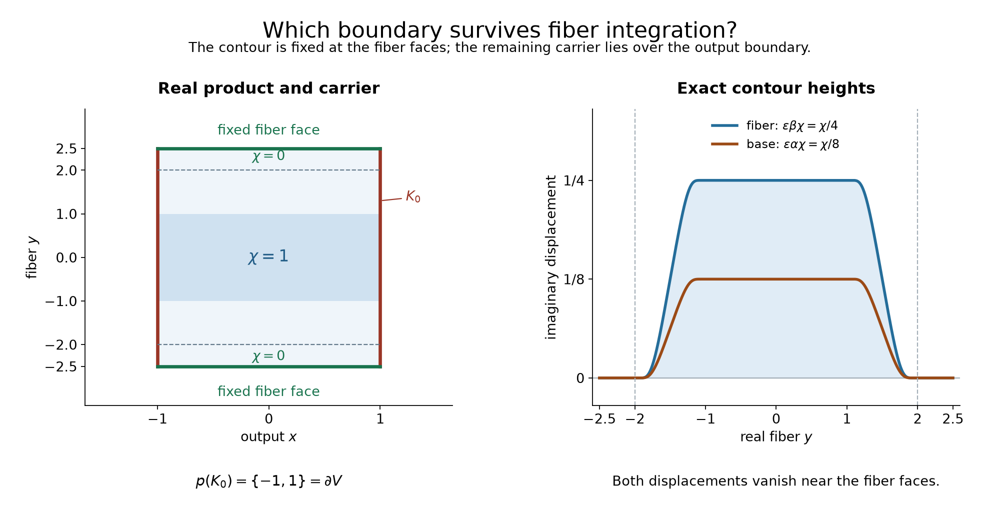

# Interchanging hyperfunction integration and analytic substitution

*Original exposition and proofs: GPT-6 Astra (OpenAI), Ultra, October 2026. Self-checked by the writing AI; no independent review. CC0.*

Contracting two kernels produces another kernel. To identify its action with two successive actions, integration must commute with an admitted singular product. We prove the stronger underlying fact: noncharacteristic analytic substitution commutes with proper fiber integration. It applies at critical points of the analytic map as well as at regular points.

The proof retains the compact analytic-functional construction of hyperfunctions. A contour is kept fixed at the fiber boundary. The remaining carrier ambiguity then lies only over the boundary of the output patch. Exponential decay permits a later deformation over the whole fiber. No finite distributional order is required.

Write \(W(u)=\operatorname{WF}_A(u)\). All scalar integrals use Lebesgue density in the fiber coordinates. We use the complete compact-carrier, boundary and operation proofs listed at the end.

## Fixing one part of the boundary

Let \(V\Subset\mathbb R^k\) be a bounded open box and \(Y\Subset\mathbb R^m\) a bounded open fiber box. Put
\[
 K=\overline V\times\overline Y,\qquad
 K_0=\partial V\times\overline Y.
 \tag{C1}
\]
Let \(H\) be holomorphic on a uniform wedge over a neighborhood of \(K\), with open convex approach cone \(\Gamma\), and also across a collar of \(\overline V\times\partial Y\). Choose \(v=(\alpha,\beta)\in\Gamma\). Let \(0\le\chi\le1\) be a smooth function of the real fiber variable, equal to one away from that collar and zero near \(\partial Y\). For small \(\epsilon>0\) define
\[
 Z_\epsilon(x,y)=(x,y)+i\epsilon\chi(y)(\alpha,\beta),\qquad
 A_\epsilon(\Phi)=\int_{V\times Y}
 H(Z_\epsilon)\Phi(Z_\epsilon)\det DZ_\epsilon\,dx\,dy .
 \tag{C2}
\]
The determinant is complex and oriented. It is not an absolute Jacobian.

**Lemma 1 (a representative with only output-boundary ambiguity).** There is \(b\in A'(K)\) such that, for every compact complex neighborhood \(N_0\) of \(K_0\),
\[
 b-A_\epsilon\in A'(N_0)
                  \quad\text{for all sufficiently small }\epsilon.
 \tag{C3}
\]
Its hyperfunction on \(V\times Y\) is \(b_\Gamma H\). Its choice is unique modulo \(A'(K_0)\).

**Proof.** Wherever \(\chi>0\), the displacement in (C2) is in \(\Gamma\); where it can approach zero, the specified collar continuation is available. Thus the graph is in the domain of \(H\). Its compact image is a complex carrier for \(A_\epsilon\), and these images lie in every neighborhood of \(K\) for small \(\epsilon\).

Interpolate between two positive values of \(\epsilon\). The moving-contour identity in [Analytic substitution for hyperfunctions](analytic-substitution-for-hyperfunctions.md), Lemma 6, is the exact divergence formula
\[
 \partial_s\bigl(q(Z_s)\det DZ_s\bigr)
       =\sum_{\ell=1}^{k+m}\partial_\ell
                       \bigl(q(Z_s)B_\ell(s,\cdot)\bigr),
 \tag{C4}
\]
where \(q=H\Phi\) and \(B_\ell\) replaces the \(\ell\)-th derivative column by \(\partial_sZ_s\). Near the fiber faces, \(\chi=0\), so \(\partial_sZ_s=0\) and every inserted-column factor vanishes. There is no fiber-face term.

For the other faces, use a cutoff in \(V\) equal to one off a small output-boundary collar. Subtract its compactly supported divergences from (C4). The remaining terms are supported in that collar. For every neighborhood of the compact moving image of \(\partial V\times\overline Y\), shrink the collar and use a small additional complex radius. Cauchy estimates bound the derivatives of \(\Phi\) there by a constant times its supremum on that neighborhood. All other factors have finite bounds on the compact contour family. This is the full carrier estimate for \(A_\epsilon-A_{\epsilon'}\), with carriers shrinking to \(K_0\).

Apply [Localizing analytic sources without analytic cutoffs](localizing-analytic-sources-without-analytic-cutoffs.md), Theorem 6, to any decreasing sequence \(\epsilon_j\to0\), with the exact real sets (C1). It supplies \(b\in A'(K)\) and (C3) on that sequence. The same two-contour estimate compares every sufficiently small \(\epsilon\) to a sufficiently late \(\epsilon_j\), proving (C3) for all small \(\epsilon\). The theorem also proves precisely the stated ambiguity. This uses eventual carrier containment, without a smallness estimate on the sizes of the differences.

To identify the class in the interior, compare (C2) with the constant translated contour \((x,y)+i\epsilon v\). The homotopy from \(\chi\) to one stays in the wedge except in the collar, where the continuation applies. Its difference is carried near the full boundary of \(V\times Y\), by the same determinant identity. The constant translated integral has the boundary class \(b_\Gamma H\), by the complete boundary construction in [Holomorphic boundary values without growth bounds](holomorphic-boundary-values-without-growth-bounds.md), Theorem 4. Thus \(b\) has this class on the interior. \(\square\)

The smaller carrier \(K_0\), rather than the full boundary of the product, matters: its projection misses the interior of \(V\).

## Integrating holomorphic sides with canceling tails

We record a precise situation in which individual holomorphic sides may be integrated even though their hyperfunction boundaries need not have proper support individually.

Let \(H_1,\ldots,H_r\) be holomorphic on uniform wedges over \(X\times\mathbb R^m\), with open convex joint approach cones \(\Gamma_j\). Work locally on relatively compact base sets. Assume:

1. Every \(H_j\) continues across the real region \(|y|>R_0\), with a common complex collar in the base and bounded fiber imaginary coordinates.
2. On the fiber tails, every fixed derivative has a bound
\[
 |\partial^\nu H_j(z,y+i\eta)|\le C_\nu e^{-c|y|}
 \tag{I1}
\]
uniformly on each of the compact base and bounded imaginary parameter sets used below.
3. The real tail continuations cancel:
\[
                    \sum_jH_j(x,y)=0\qquad(|y|>R_0).
 \tag{I2}
\]
An ordinary holomorphic summand is permitted. Its boundary is its analytic trace.

Let \(P_j\) be the projection of \(\Gamma_j\) to the base imaginary coordinates. If \(0\in P_j\), interpret the integrated side below as an ordinary holomorphic germ near the real base. Otherwise \(P_j\) is an open convex cone not containing zero.

**Theorem 2 (integration of a canceling family).** The hyperfunction
\[
                w=\sum_j b_{\Gamma_j}H_j
 \tag{I3}
\]
has support proper over \(X\). Its proper integral is
\[
 p_*w=\sum_j b_{P_j}h_j,\qquad
 h_j(z)=\int_{\mathbb R^m}H_j(z,y+i\eta)\,dy,
 \tag{I4}
\]
where \((\operatorname{Im}z,\eta)\) is any sufficiently small admissible lift in \(\Gamma_j\). The value is independent of that lift.

**Proof: the integrated sides.** For a fixed admissible lift, (I1) gives absolute convergence, locally uniform with every fixed derivative. It follows by local power series, or the supplied Cauchy formula, that the integral is holomorphic in \(z\). If two fiber heights have the same base imaginary coordinate, their segment is in the convex cone. Shift fiber coordinates on finite rectangles and use (C4), or one-variable Cauchy integration. Their remote faces are bounded by a polynomial in their radius times \(e^{-cR}\), which tends to zero. Thus the two integrals agree. These local definitions glue.

Projection of an open convex set under a linear projection is open and convex: a small ball about each lift projects onto a base ball. Compact subsets of projected directions have finitely many such lift neighborhoods, with bounded lifts. This gives the uniform small heights required for a \(P_j\)-holomorphic germ. If \(0\in P_j\), fix a lift \((0,\eta)\in\Gamma_j\); openness gives a full complex base neighborhood on which the same fiber height works. The output is then an ordinary holomorphic germ.

The tail traces in (I2) make \(w\) zero outside a fixed fiber ball on each base patch. Its support is therefore proper there, and hence proper over \(X\).

**Proof: compact representatives of the sum.** Fix a box \(V\Subset X\), a large fiber box \(Y\), and a smooth \(\chi\) equal to one on a ball containing \(\{|y|\le R_0\}\), with compact support in \(Y\). Its transition region is inside the tail continuation region. Apply Lemma 1 to each \(H_j\), with any fixed \(v_j=(\alpha_j,\beta_j)\in\Gamma_j\), obtaining \(b_j\). For an ordinary holomorphic term use the same construction, or its real integral. Put \(b=\sum_jb_j\) and \(A_\epsilon=\sum_jA_{j,\epsilon}\).

Where \(\chi=0\), the graphs are real, their determinants are one, and (I2) makes the summed integrand zero. Thus the carriers of \(A_\epsilon\) shrink to \(\overline V\times\operatorname{supp}\chi\). Equation (C3) consequently puts \(b\) in
\[
 A'\bigl((\overline V\times\operatorname{supp}\chi)
                         \cup(\partial V\times\overline Y)\bigr).
 \tag{I5}
\]
Indeed every neighborhood of this compact union carries both terms in \(b=A_\epsilon+(b-A_\epsilon)\) for small enough \(\epsilon\). Taking all such neighborhoods is the defining real-carrier bound.

On \(V\times Y\), Lemma 1 identifies the sum with \(w\). The extra carrier in (I5) lies over \(\partial V\); elsewhere the fiber support is compactly inside \(Y\). Thus \(b\) agrees with \(w\) over \(V\) and every fiber point, including the prescribed zeros outside \(Y\). The actual proper integral on \(V\) is the class of \(p_*b\), by [Integrating hyperfunctions over proper fibers](integrating-hyperfunctions-over-proper-fibers.md), Theorem 2.

**Proof: a deformation over the entire fiber.** Pair \(A_\epsilon\) with an entire output test \(\phi(x)\). Extend the finite fiber integral to \(\mathbb R^m\). The added summed integral is zero by (I2). For each summand separately deform
\[
 \chi_s(y)=(1-s)\chi(y)+s,\qquad
 Z_{j,s}(x,y)=(x,y)+i\epsilon\chi_s(y)v_j,
                     \quad0\le s\le1.
 \tag{I6}
\]
Where \(\chi_s>0\), the positive multiple of \(v_j\) is admissible; the tail continuation handles its zero values. All derivatives of the graph coefficients are bounded. Apply (C4) first on a large fiber box. The fiber-face integrals tend to zero by (I1), even after their polynomial area factor. For the base faces use the same base-collar subtraction and Cauchy bounds as in Lemma 1. Their fiber integrals are finite by (I1), with a bounded finite part. Thus the difference between the two endpoints is carried by
\[
             \partial V+i[0,\epsilon]\alpha_j.
 \tag{I7}
\]
This is an exact carrier estimate for each fixed \(\epsilon\); its constant may depend on \(\epsilon\).

At \(s=1\), the determinant is one. Absolute fiber integration gives
\[
 \int_V h_j(x+i\epsilon\alpha_j)
                  \phi(x+i\epsilon\alpha_j)\,dx.
 \tag{I8}
\]
If \(\alpha_j\ne0\), this is the translated-test representative used to define \(b_{P_j}h_j\). If \(\alpha_j=0\), it is the ordinary real integral of the analytic output. The boundary theorem compares it with a compact output representative modulo a carrier shrinking to \(\partial V\).

Finally (C3), after projection, also has carrier shrinking to \(\partial V\). Projection of a complex carrier is legitimate here directly: the pairing is with \(\phi\circ p\), and a neighborhood of the projected compact set pulls back to a neighborhood of the original carrier. Combining these comparisons for every sufficiently small \(\epsilon\) puts the fixed difference \(p_*b-\sum_jc_j\) in \(A'(\partial V)\), where \(c_j\) are the output representatives. Their hyperfunctions therefore agree on \(V\). Gluing proves (I4). \(\square\)

The cancellation was used before discarding the fiber boundary. Integrating arbitrary angular pieces as individually proper hyperfunctions would not justify this argument.

*For \(V=(-1,1)\), \(Y=(-5/2,5/2)\), the red sides are \(K_0=\partial V\times\overline Y\); the green fiber faces remain fixed. The cutoff equals one for \(|y|\le1\) and zero for \(|y|\ge2\). The right panel shows the exact imaginary displacements \(\epsilon\alpha\chi(y)\) and \(\epsilon\beta\chi(y)\), with \(\epsilon=1/4\), \(\alpha=1/2\), \(\beta=1\). Lemma 1 proves the carrier statement; Theorem 2 proves the cancellation and infinite-fiber deformation. [Reproducible figure source](../figures/fixed-fiber-boundary.py).*

## Substitution through a proper integral

Let \(p:X\times Y\to X\), \(f:Z\to X\) be real analytic, \(q:Z\times Y\to Z\), and \(F=f\times\operatorname{id}_Y\).

**Theorem 3 (noncharacteristic interchange).** Suppose \(w\in\mathcal B(X\times Y)\) has support proper over \(X\), and
\[
 (f(z),y;\xi,0)\in W(w)
                       \quad\Longrightarrow\quad Df(z)^T\xi\ne0.
 \tag{B1}
\]
Then both sides of
\[
                         f^*(p_*w)=q_*(F^*w)
 \tag{B2}
\]
are defined and equal. The map \(f\) need not be proper or of constant rank.

**Proof: admissibility and localization.** The normals of \(F\) are exactly the nonzero covectors \((\xi,0)\) with \(Df^T\xi=0\), so (B1) admits \(F^*w\). The proper-integration wavefront bound admits \(f^*p_*w\). Over a compact \(C\subset Z\), the relevant original support above \(f(C)\) is compact; the pulled support is a closed subset of \(C\) times its compact fiber projection. Thus it is proper.

Work near \(z_0\) and a relatively compact neighborhood of \(f(z_0)\). The full compact-representative construction of the integration lesson, Lemma 1, gives \(a\in A'(H)\) agreeing with \(w\) over that output neighborhood and every fiber point, with zero extension outside the original fiber domain. Shrinking preserves (B1) for \(a\) there. Let \(d=\dim X+\dim Y\), and use its actual canonical field and integrated field
\[
 U(\zeta,\theta)=a_tK_d((\zeta,\theta)-t),\qquad
 V(\zeta)=\int_{\mathbb R^{\dim Y}}U(\zeta,y)\,dy .
 \tag{B3}
\]
The complete Lemma 4 and Theorem 5 of that lesson prove exponential fiber-tail bounds for every fixed derivative, the fiber contour-shift identity, and
\[
 p_*a=\int_{S^{d-1}}\operatorname{bv}
                               V(x+i\omega')\,d\sigma_d(\omega).
 \tag{B4}
\]
Here \(\omega=(\omega',\omega'')\). Interior projected heights give analytic traces; unit heights give inward boundaries. Formula (B4) is the proved closed-ball angular recovery with the projected original sphere measure. It has no additional normalization factor.

**Proof: a finite angular cover.** Put \(A=Df(z_0)\). The troublesome unit directions are
\[
                \omega''=0,\qquad A^T\omega'=0.
 \tag{B5}
\]
For each such direction, (B1) makes \(U\) continue at
\((f(z_0),y)+i\omega\) for every real \(y\). On a compact fiber ball use a finite cover of these continuation neighborhoods. On its complement the complex kernel continuation and exponential tail estimates already apply. The identity principle makes the extensions agree on smaller overlaps. Compactness of the set (B5) then gives angular neighborhoods with common continuations on a smaller base neighborhood and the entire real fiber. Their integrated fields have the corresponding common continuation, by the same tail estimates.

For the remaining horizontal directions choose \(\alpha\) so that
\[
                     \omega'\cdot A\alpha<0.
 \tag{B6}
\]
On a sufficiently small closed angular cap and a sufficiently small base neighborhood this has a strict uniform margin. The other caps can be chosen with \(|\omega''|\ge\delta>0\); on them choose a strictly inward joint source direction, for instance one with base component zero and fiber component opposite the central \(\omega''\). These three types give a finite cover of the sphere. Partition it into finitely many Borel sets \(E_j\) with closures inside the respective neighborhoods; restricting sphere measure to these sets is sufficient.

On a nonregular cap the linear inequality
\[
 \omega'\cdot Df(x)\alpha+\omega''\cdot\beta
                         \le-c|(\alpha,\beta)|
 \tag{B7}
\]
holds on a small convex joint source cone, uniformly for \(\omega\in\overline E_j\). For a horizontal cap choose the cone around \((\alpha,0)\). The holomorphic Taylor expansion of \(f\) then gives, for small source imaginary displacement,
\[
 \big|(\operatorname{Im}f(z),\operatorname{Im}\theta)+\omega\big|<1.
 \tag{B8}
\]
The linear negative margin dominates the quadratic remainder; all constants are uniform on the chosen compact real base. This is the complete adapted-wedge argument proved in the substitution lesson, Lemma 2.

Define the resulting sides by
\[
 H_j(z,\theta)=\int_{E_j}
            U(f^{\mathbb C}(z)+i\omega',\theta+i\omega'')
                                                \,d\sigma_d(\omega).
 \tag{B9}
\]
The regular caps use their actual holomorphic continuations. The others use (B8). Finite measure and compact-parameter Cauchy bounds prove holomorphy. The angular boundary identification in [Directional splitting and holomorphic compatibility](directional-splitting-and-holomorphic-compatibility.md), Lemma 1, and the representation-independent pullback theorem identify
\[
                           F^*a=\sum_j bH_j.
 \tag{B10}
\]
One may refine the caps to pointed target cones before applying that theorem; (B7) gives the required nonzero transpose margin.

**Proof: cancellation and the integrated sides.** The fields (B9) have all the exponential derivative bounds (I1). Far enough along the real fiber, the distance from the real carrier \(H\) makes every angular integrand holomorphic through the real locus, uniformly on the finite angular cover. The full spherical sum there is the analytic representative of the zero section \(a\), hence is zero. Substitution gives (I2). Theorem 2 therefore computes the actual proper integral of (B10).

Its integrated side is
\[
 h_j(z)=\int_{E_j}V(f^{\mathbb C}(z)+i\omega')
                                                \,d\sigma_d(\omega).
 \tag{B11}
\]
For a nonregular cap, choose an admitted joint displacement in (B8). The proved fiber contour shift removes the entire fiber imaginary displacement, including \(\omega''\); absolute exponential bounds justify finite angular integration. This gives (B11). For a regular cap, first use radial heights \(r\omega\), \(r<1\), then pass to \(r=1\) on the common continuation neighborhoods, with the same integrable tail bound.

On a fiber cap with \(|\omega''|\ge\delta\), one has \(|\omega'|\le\sqrt{1-\delta^2}<1\); its term in (B4) is analytic, and (B11) is its ordinary composition with \(f\). On a horizontal cap, (B6) supplies an inward cone for the target integrated side \(\int_{E_j}V(\zeta+i\omega')\,d\sigma_d\). The closed-ball angular lemma identifies its boundary with that cap's term in (B4). Its composition with \(f\) is precisely (B11), with the adapted source cone just used. The regular caps again give analytic composition. Thus the sum of the boundaries in (B11) is \(f^*p_*a\). Theorem 2 identifies the same sum with \(q_*F^*a\). Locality and gluing prove (B2). \(\square\)

For a base diffeomorphism this identity also follows directly from compact germ pairing: with \(h=f^{-1}\), both sides pair the original representative with \(\phi(h(x))|\det Dh(x)|\). Thus (B2) has the same scalar-density convention as the earlier coordinate formula.

Zero-dimensional factors have their ordinary point conventions. A zero-dimensional fiber removes the integral. With a zero-dimensional base, \(K_0\) is empty; the fixed-fiber contour integrals in Lemma 1 are equal, and the empty-carrier case of the cited completeness theorem applies. A completely zero-dimensional source is scalar pairing. These cases also cover the terminal point used below.

## A singular projection formula

**Proposition 4 (independent factors and singular multipliers).** Tensoring with an independent hyperfunction commutes with proper integration. Moreover, if \(w\) is proper over \(X\) and \(v\in\mathcal B(X)\) satisfies
\[
 (x,\xi)\in W(v),\quad(x,y;-\xi,0)\in W(w)
                         \quad\text{never occur together},
 \tag{P1}
\]
then
\[
                         v\,p_*w=p_*\bigl((p^*v)w\bigr).
 \tag{P2}
\]

**Proof.** On compact representatives, tensoring with an independent factor and then integrating pairs the tensor functional with exactly the same entire test as integrating first and then tensoring. The full iterated germ-pairing identity is Analytic tests and real carriers, Proposition 7. The whole-fiber compact representatives of the integration lesson identify these compact formulas with the actual proper operations; locality glues them.

To prove (P2), use independent base variables \(s,t\) and form \(v(s)\otimes w(t,y)\). Its support is proper over \((s,t)\). The base diagonal \(x\mapsto(x,x)\) has nonzero normal \((\xi,-\xi)\). For its product with the fiber identity, the normal is \((\xi,-\xi,0)\). The full tensor bound shows that such a normal is excluded exactly by (P1); neither support-zero component alone can produce it. Theorem 3 commutes this pullback with fiber integration. Independent-factor integration gives \(v\otimes p_*w\) before pullback. Tensor naturality and the definition of the diagonal product give the two sides of (P2). The proper-integral wavefront bound also directly admits the left product; the right product's support is a closed subset of the original proper support. \(\square\)

## Entire chains of kernels

Let \(K_j\in\mathcal B(X_{j-1}\times X_j)\), \(1\le j\le N\). Use the support-extended primed relation from [Singular inputs and zero covectors in hyperfunction kernels](singular-inputs-and-zero-covectors-in-hyperfunction-kernels.md):
\[
 \widetilde R_j=R(K_j)\cup
       \{(x_{j-1},0;x_j,0):(x_{j-1},x_j)\in\operatorname{supp}K_j\}.
 \tag{K1}
\]
For each contiguous block \(a,\ldots,b\), let \(S_{ab}\) be the set of all compatible base tuples whose \(j\)-th adjacent pair lies in \(\operatorname{supp}K_j\). Require:

- \(S_{ab}\) is proper over its exterior variables \((x_{a-1},x_b)\).
- At every tuple in \(S_{ab}\), a path in the extended relations with zero exterior covectors is trivial:
\[
 \begin{gathered}
 (x_{j-1},\lambda_{j-1};x_j,\lambda_j)\in\widetilde R_j
                                      \quad(a\le j\le b),\\
 \lambda_{a-1}=\lambda_b=0
                   \quad\Longrightarrow\quad
                         \lambda_a=\cdots=\lambda_{b-1}=0.
 \end{gathered}
 \tag{K2}
\]
For a block of length one both requirements are automatic. Every interior \(\lambda_j\) may be zero; the condition excludes only a *nontrivial* path with zero ends.

**Theorem 5 (finite contraction and associativity).** Under these assumptions every parenthesization of the kernel chain is defined, and all give the same kernel
\[
 C_{ab}=\int_{X_a\times\cdots\times X_{b-1}}
              \prod_{j=a}^b\pi_j^*K_j .
 \tag{K3}
\]
Here the product is the simultaneous tensor restriction to the compatible-variable diagonal. It has the full bound
\[
 R(C_{ab})\subset
 \bigl(\widetilde R_a\circ\cdots\circ\widetilde R_b\bigr)
                   \setminus\{(\lambda_{a-1},\lambda_b)=(0,0)\}.
 \tag{K4}
\]
The right side is locally closed off the joint exterior zero.

**Proof: the direct construction.** The full tensor bound retains a support zero for each factor. The transpose of the compatible-variable diagonal adds the two raw covector components at each common variable. In primed notation its kernel consists exactly of paths in (K2). Thus (K2) makes this pullback noncharacteristic. Outside \(S_{ab}\) the tensor is zero near the image point, so there is no extra condition there. The restricted section has support in \(S_{ab}\); its assumed properness permits (K3).

The pullback and integration bounds require equality of adjacent primed covectors, while leaving the exterior pair nonzero. They give exactly (K4). Properness bounds the interior base variables over compact exterior sets. If interior covectors in a convergent exterior sequence were unbounded, divide the entire path by their largest norm and pass to a subsequence. Closedness of each extended relation would give a nontrivial path with zero ends, contrary to (K2). Otherwise take a bounded subsequence and pass to its limit. This proves the asserted closedness, including all zero interior components.

**Proof: every intermediate contraction is admitted.** A contracted block's nonzero relation lies in its full path relation by (K4). At a support zero of that block, its support inclusion supplies a compatible raw base tuple; assign zero covectors to all its factors. Thus its *extended* relation also lifts to a raw path. A forbidden opposite pair when two adjacent blocks are contracted would lift to a nontrivial raw path with zero exterior covectors for their union. Condition (K2) excludes it.

Their joint support is proper over the exterior variables: each block support lies in the projection of its raw support, whose projection is closed by properness. A compatible pair of block support points lifts to one raw tuple for their union. Hence the joint support is a closed subset of the corresponding compact projection of \(S_{ab}\) over any compact exterior set. This proves the required properness at every cut.

**Proof: equality with one direct integral.** Split a block into two adjacent blocks. Their unintegrated restricted tensors multiply to the restricted tensor of the whole block. To check this factorization, use tensor naturality and pullback functoriality; any forbidden normal at an intermediate product would, after summing the internal components and putting its unused components equal to zero, be a forbidden path in (K2). Thus every map used in the factorization is admitted.

An unintegrated block is proper over its two exterior variables. After adjoining the other variables it remains proper over the enlarged base. Apply Proposition 4 to move its integration through multiplication by the other block. Its exclusion (P1) is again precisely a nontrivial raw path with zero ends: a covector killed in that integration has zero components in the integrated variables, and the opposite product covector supplies the remaining matching components. Condition (K2) excludes it. Apply the same argument to the other block.

The total restricted tensor has support proper over the final exterior variables. The full repeated-integration theorem in the integration lesson, Proposition 7, now identifies these successive integrations and the remaining common-variable integral with (K3). Induction on block length proves that every binary parenthesization equals that direct expression. No continuity argument through smooth approximants is used. \(\square\)

A familiar sufficient properness hypothesis is that \(K_j\) is proper over its input \(X_j\) for every \(j\ge2\). Starting from a compact final input set and proceeding backwards bounds all interior variables; the first exterior variable is already in a compact set. The theorem permits the more general joint properness stated above.

**Corollary 6 (composed action).** Regard \(u\in\mathcal B(Z)\) as a terminal kernel from \(Z\) to a point. If \(K_1,K_2,u\) satisfy the block properness and no-zero-path conditions above, then
\[
                    (K_1\circ K_2)u=K_1(K_2u).
 \tag{K5}
\]
This includes arbitrary admissible singular inputs. Compact support of \(u\) and properness of \(K_2\) over \(Z\) ensure all the required support conditions. For noncompact inputs the exact joint properness conditions suffice.

**Proof.** The terminal extended relation is the wavefront of \(u\) with its support zero, followed by the zero cotangent space of the point. The two length-two block conditions admit \(K_1\circ K_2\) and \(K_2u\). The length-three condition admits both remaining actions. Theorem 5 identifies their parenthesizations. In the compact-input sufficient case, compactness bounds \(z\), properness of \(K_2\to Z\) then bounds \(y\), and compact output sets bound \(x\). The respective closed support sets are therefore compact. \(\square\)

## Exercises with complete solutions

**Exercise 1 (basic) — the boundary that survives.** In Lemma 1, explain why replacing \(K_0\) by the full boundary of \(V\times Y\) would not suffice after projection.

**Solution.** The full boundary contains \(\overline V\times\partial Y\), whose projection contains the whole \(\overline V\). A functional carried there can give a nonzero output in the interior. For example \(a(x)\otimes\delta_{y_0}\), with \(y_0\in\partial Y\) and compact nonzero \(a\) supported inside \(V\), projects to \(a\). In contrast, \(p(K_0)=\partial V\), so a functional carried by \(K_0\) gives the zero hyperfunction on \(V\). The vanishing inserted-column factors near the fiber faces are the exact reason the smaller carrier is available.

**Exercise 2 (intermediate) — substitution at a critical point.** Let \(w(x,y)=\delta_0(y-x)\) and \(f(s)=s^2\). Compute both sides of Theorem 3, including at \(s=0\).

**Solution.** The support is the diagonal, proper over \(x\), and its exact wavefront consists of nonzero multiples of \((-1,1)\). No nonzero covector has fiber component zero. Thus (B1) holds even where \(Df=0\). The pullback is \(\delta_0(y-s^2)\), by the analytic coordinate change in the fiber, whose fiber Jacobian is one. Each fiber integral is one. Hence both sides are the analytic function \(1\).

The same example works beyond distributions. Let
\[
 a(\phi)=\sum_{k\ge0}\frac{\phi^{(k)}(0)}{(k!)^2},
                  \qquad w(x,y)=a(y-x).
 \tag{E1}
\]
The moment theorem and the finite-jet argument supplied in the preceding lessons prove that \(a\) is a nonzero point-supported hyperfunction of infinite order, with all nonzero directions. Exact submersion and coordinate covariance again give only diagonal conormals. Its fiber integral is \(a(1)=1\); after substitution it is \(a(y-s^2)\) with the same integral. The map remains admissible at its critical point.

**Exercise 3 (basic) — properness alone does not admit a restriction.** Let \(w(x,y)=\delta_0(x)\otimes\delta_0(y)\) and let \(f\) be the constant map with value zero.

**Solution.** The support is compact, but \(W(w)\) at the origin is the full punctured joint fiber. In particular it contains \((\xi,0)\) for \(\xi\ne0\), and \(Df^T\xi=0\). Condition (B1) fails. The output integral is \(\delta_0(x)\), whose pullback by the constant map is likewise not admitted by the noncharacteristic construction. Theorem 3 asserts no value for either forbidden restriction.

**Exercise 4 (intermediate) — a singular multiplier through a point fiber.** For an arbitrary hyperfunction \(v(x)\), let \(w=1_x\otimes\delta_0(y)\). Verify Proposition 4 directly.

**Solution.** Its support is proper over \(x\). Its only nonzero wavefront covectors are pure fiber covectors, so (P1) holds for every \(v\). The product is \(v\otimes\delta_0\), by tensor and diagonal compatibility. Compact germ pairing and localization give \(p_*w=1\) and \(p_*(v\otimes\delta_0)=v\). This proves (P2) here even when \(v\) has no finite distributional order.

**Exercise 5 (intermediate) — a zero middle covector and a noncompact input.** On three real lines take
\[
 K_1=\delta_0(x)\otimes\delta_0(y),\qquad
 K_2=1_y\otimes\delta_0(z),\qquad u(z)=1.
 \tag{E2}
\]
Compute both composed actions and check the support conditions.

**Solution.** One has \(K_2u=1_y\), \(K_1(K_2u)=\delta_0(x)\), and \(K_1\circ K_2=\delta_0(x)\otimes\delta_0(z)\), giving the same action on \(u\). These are the actual tensor and point-evaluation pairings. The \(K_2,u\) support is \(\{(y,0)\}\), proper over \(y\); the other joint supports have the relevant interior variables fixed at zero. Thus every block is proper although \(u\) is not compactly supported. The input \(u\) has empty wavefront. A zero-ended path first forces the \(K_2\) input covector to zero, then its output covector to zero, and then the \(K_1\) input covector to zero. Condition (K2) follows. The contracted kernel retains the full punctured outer fiber, including paths whose middle covector is zero.

**Exercise 6 (intermediate) — an arbitrary translation chain.** Set \(K_j(x_{j-1},x_j)=\delta_0(x_{j-1}-x_j-c_j)\). Determine every contraction of a finite chain.

**Solution.** Each support is a translation graph, proper over either endpoint. Its primed relation equates its two covectors. A compatible path therefore has all covectors equal; zero exterior covectors force the whole path to zero. Theorem 5 applies. Integrating a delta in the last graph variable has coefficient one, so induction gives
\[
 C_{1N}(x_0,x_N)=
        \delta_0\left(x_0-x_N-\sum_{j=1}^Nc_j\right).
 \tag{E3}
\]
No absolute scaling factor arises because each eliminated variable has coefficient \(1\) or \(-1\). The theorem proves equality for all parenthesizations, not just this order of evaluation.

**Exercise 7 (advanced) — adjacent exclusions do not settle a triple.** Take
\[
 K_1=1_x\otimes\delta_0(y),\qquad
 K_2=\delta_0(y-z),\qquad
 K_3=\delta_0(z)\otimes1_t .
 \tag{E4}
\]
Check adjacent contractions and find the full-chain obstruction.

**Solution.** The graph kernel \(K_2\) has neither a nonzero input-axis nor a nonzero output-axis covector. Thus each adjacent pair meets the two-kernel exclusion. The pair contractions are \(1_x\otimes\delta_0(z)\) and \(\delta_0(y)\otimes1_t\). But the full raw chain has paths
\[
                         (0,\eta,\eta,0),\qquad\eta\ne0,
 \tag{E5}
\]
in its extended primed relations, over \(y=z=0\). They violate (K2). Either attempted final contraction encounters opposite nonzero covectors in its common variable. All support properness conditions hold; it is the wavefront condition that fails. The canonical operations proved here do not assign a triple contraction in this case.

**Exercise 8 (basic) — empty wavefront and an infinite fiber.** Let \(K_1=K_2=1\) on products of real lines. Explain why Theorem 5 does not assert their contraction.

**Solution.** There are no nonzero wavefront covectors, so the path condition holds. The raw support is all \(\mathbb R^3\). Over a fixed outer point the middle fiber is the whole line, which is not compact. Properness fails, and the formal integral of \(1\) over that fiber diverges. An empty wavefront cannot replace the support condition.

## Programme proofs and mathematical source

- [Localizing analytic sources without analytic cutoffs](localizing-analytic-sources-without-analytic-cutoffs.md), Theorem 6, supplies full completeness modulo a smaller real carrier, including complex intermediate carriers and every original tail index. Analytic tests and real carriers, Theorem 5 and Proposition 7, supplies germ action, exact tensors and compact transport.
- [Holomorphic boundary values without growth bounds](holomorphic-boundary-values-without-growth-bounds.md), Proposition 2, Theorem 4, Proposition 5(ii) and Theorems 6–7, supplies the actual boundary construction, carrier comparisons, angular recovery, uniqueness and cone independence. [Directional splitting and holomorphic compatibility](directional-splitting-and-holomorphic-compatibility.md), Lemma 1, supplies finite angular integration and its boundary identification.
- [Analytic substitution for hyperfunctions](analytic-substitution-for-hyperfunctions.md), Lemma 2, Proposition 3, Theorem 4, Proposition 5, Lemma 6 and Theorem 7, supplies adapted cones, independence, functoriality and the exact moving-contour and coordinate formulas. Its [contour prerequisite](../prerequisites/U011-free-foundations/contour-homotopy-U095.md), (A3)–(A4), proves the determinant identity.
- [Tensor directions and admissible hyperfunction products](tensor-directions-and-admissible-hyperfunction-products.md), Theorems 1 and 4, Lemma 5 and Theorems 6–7, supplies the support-aware tensor bounds, products and their compatibility. [Integrating hyperfunctions over proper fibers](integrating-hyperfunctions-over-proper-fibers.md), Lemmas 1, 3–4, Theorems 2, 5–6 and Proposition 7, supplies compact representatives, closed-ball angular recovery, all exponential tail and contour-shift estimates, proper integration and full Fubini.
- [Singular inputs and zero covectors in hyperfunction kernels](singular-inputs-and-zero-covectors-in-hyperfunction-kernels.md), Theorems 2–3, supplies the actual singular action and contracted kernel with their complete zero-component relations. [Support normals force both hyperfunction directions](support-normals-force-both-hyperfunction-directions.md), Exercise 1, supplies the infinite-order point example. The [metric](../prerequisites/U011-free-foundations/metric-foundation-bridges.md), [integration](../prerequisites/U011-free-foundations/banach-foundation-bridges.md) and [complex contour](../prerequisites/U011-free-foundations/complex-contours-U070.md) foundations supply cutoffs, compactness, scalar integration, Cauchy estimates and holomorphic limits.
- Lars Hörmander, *The Analysis of Linear Partial Differential Operators I: Distribution Theory and Fourier Analysis*, reprint of the second edition, Springer, 2003, [doi:10.1007/978-3-642-61497-2](https://doi.org/10.1007/978-3-642-61497-2), Theorem 8.2.14 with hypotheses (8.2.13)–(8.2.14), Theorem 8.5.5 and the hyperfunction operation extension in Section 9.3. The contour-carrier argument, organization, examples and exercises here are independently expressed.
