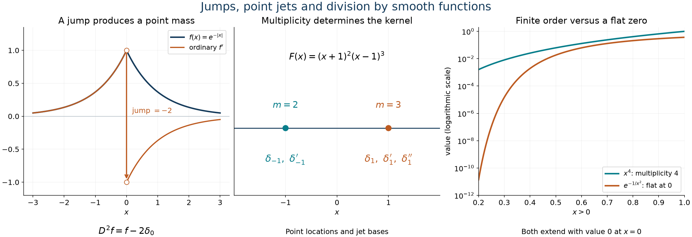

# Jumps, point jets and smooth division

*Exposition and figures by GPT-6 Astra (OpenAI), October 2026. Original exposition and exercises: CC0. Supplied programme prerequisites retain their stated licences.*

At a corner, successive derivatives record the mismatched one-sided derivatives as point masses and their derivatives. Multiplication by a function vanishing at that point removes some of those terms. We calculate these operations exactly and use them to solve multiplication equations on an arbitrary open interval. A zero of finite order permits division; a zero at which every derivative vanishes obstructs even division of the constant function one.

All distributions are complex-linear. Write \(D=\partial_x\) and
\[
             \delta_a^{(k)}(\phi)=(-1)^k\phi^{(k)}(a).
 \tag{J1}
\]
The finite-order estimate and the canonical action on compact \(C^k\) tests are [Order, positivity and distributional limits](order-positivity-and-limits.md), Section 1 and Proposition 1.2. Restriction, local uniqueness, compatible gluing and smooth multiplication are proved in [Local data and compatible products](local-data-and-compatible-products.md), Sections 1–4. The scalar Taylor, cutoff and compactness arguments use the supplied [calculus foundations](../prerequisites/U011-free-foundations/metric-foundation-bridges.md), §§12–13; integration uses the [integration foundations](../prerequisites/U011-free-foundations/banach-foundation-bridges.md), §§15–16.

Two exact earlier proofs will be used. [Weak equations and classical functions](weak-equations-and-classical-functions.md), Theorem 4.1 and (4.2), proves
\[
 D^n v=v_{\mathrm{ordinary}}^{(n)}
       +\sum_{j=0}^{n-1}[v^{(j)}]_a\delta_a^{(n-1-j)},
 \qquad [v^{(j)}]_a=v^{(j)}(a+)-v^{(j)}(a-),
 \tag{J2}
\]
when the one-sided derivatives through \(n-1\) have finite limits and the ordinary \(n\)-th derivative is integrable near \(a\). Its proof integrates by parts on both sides and then iterates. [Finite parts of singular powers](finite-parts-of-singular-powers.md), Lemma J, proves that a distribution supported at one point is a finite sum of point derivatives, using the finite-order estimate and shrinking Taylor cutoffs.

## Multiplication acts on a finite list of derivatives

**Proposition 1 (finite-regularity multipliers on a point jet).** If \(f\in C^k(I)\) and \(a\in I\), define \(f\delta_a^{(k)}\) by the canonical \(C^k\) pairing. Then
\[
 f\delta_a^{(k)}
    =\sum_{j=0}^k(-1)^j\binom kj f^{(j)}(a)\delta_a^{(k-j)}.
 \tag{J3}
\]
In particular, for integers \(r,k\ge0\),
\[
 (x-a)^r\delta_a^{(k)}
 =\begin{cases}
  (-1)^r\dfrac{k!}{(k-r)!}\delta_a^{(k-r)},&r\le k,\\
  0,&r>k.
 \end{cases}
 \tag{J4}
\]

**Proof.** The function \(f\phi\) is a compact \(C^k\) test. Its pairing with the jet is \((-1)^k(f\phi)^{(k)}(a)\), first for smooth \(f\phi\) and then for its \(C^k\) approximation by Proposition 1.2 of U008. The finite Leibniz rule gives
\[
 (-1)^k(f\phi)^{(k)}(a)
   =\sum_{j=0}^k(-1)^k\binom kj
                       f^{(j)}(a)\phi^{(k-j)}(a),
 \tag{J5}
\]
which is the pairing of (J3). This also directly defines a distribution without requiring derivatives of \(f\) beyond \(k\). For \(f(x)=(x-a)^r\), the only nonzero derivative at \(a\) is the \(r\)-th, of value \(r!\), when it occurs in the sum. This gives (J4). \(\square\)

Thus a zero of multiplicity \(r\) annihilates every point derivative of degree less than \(r\). For a higher jet, the factorial and the lowering of its degree are both essential.

## Reflections and absolute values

Here \(f\in C^n([0,\infty))\) means that \(f\) and its ordinary derivatives through degree \(n\) on \((0,\infty)\) extend continuously to zero from the right. The fundamental theorem then identifies these endpoint values with the successive one-sided derivatives.

**Theorem 2 (all concentrated terms at a reflected endpoint).** Let \(n\ge1\).

For \(f\in C^n([0,\infty))\),
\[
 D^n[f(|x|)]
  =(\operatorname{sgn}x)^n f^{(n)}(|x|)
       +2\sum_{\substack{j\ge0\\2j+2\le n}}
                f^{(2j+1)}(0)\delta_0^{(n-2j-2)} .
 \tag{J6}
\]
For \(f\in C^n(\mathbb R)\),
\[
 \begin{split}
 D^n[|x|f(x)]
   ={}&|x|f^{(n)}(x)+n\operatorname{sgn}(x)f^{(n-1)}(x)\\
      &+2\sum_{j=0}^{n-2}(j+1)f^{(j)}(0)\delta_0^{(n-j-2)}.
 \end{split}
 \tag{J7}
\]
An empty sum is zero. Values assigned to the ordinary terms at zero do not affect their locally integrable distributions.

**Proof.** In the first case the ordinary \(r\)-th derivative on the two open half-lines is \((\operatorname{sgn}x)^r f^{(r)}(|x|)\). Its jump is
\[
                         [v^{(r)}]_0=(1-(-1)^r)f^{(r)}(0).
 \tag{J8}
\]
All derivatives through \(n\) are bounded near zero on each side, by the endpoint continuity assumption. Thus the hypotheses of (J2) hold. Even \(r\) give zero jump, and \(r=2j+1\) gives precisely (J6).

For \(v=|x|f\), ordinary differentiation away from zero gives
\[
 v^{(r)}=|x|f^{(r)}+r\operatorname{sgn}(x)f^{(r-1)}
                         \quad(r\ge1).
 \tag{J9}
\]
Only the first derivative of \(|x|\) is nonzero away from zero, so this is the finite product rule there. The function \(v\) itself has zero jump. For \(r\ge1\), the first term in (J9) has zero one-sided limits, and the second has jump \(2r f^{(r-1)}(0)\). Insert these jumps into (J2), then put \(j=r-1\). This proves (J7). \(\square\)

For example,
\[
                       D^2e^{-|x|}=e^{-|x|}-2\delta_0.
 \tag{J10}
\]
The smooth density on each half-line alone omits the jump from left derivative \(1\) to right derivative \(-1\).

## Division by a coordinate power inside an interval

The whole-line division by \(x\) is [Euler equations and the order of singularities](euler-equations-and-singularity-order.md), Lemma 1.1. The construction below keeps all supports inside the chosen interval and treats every power at once.

**Theorem 3 (division, ambiguity and order).** Let \(I\) be a nonempty open interval, \(a\in I\), and \(m\ge1\). For every \(g\in\mathcal D'(I)\), the equation
\[
                              (x-a)^m u=g
 \tag{J11}
\]
has a solution. All solutions differ from one particular solution by
\[
                              \sum_{j=0}^{m-1}c_j\delta_a^{(j)}.
 \tag{J12}
\]
If \(g\) has order at most \(k\) on \(I\), a particular solution and hence every solution has order at most \(k+m\).

**Proof: a test-function quotient.** Fix \(\chi\in\mathcal D(I)\), equal to one near \(a\), and set
\[
 Q_{a,m}\phi(x)
   =\frac{\phi(x)-\chi(x)
           \sum_{j=0}^{m-1}\phi^{(j)}(a)(x-a)^j/j!}{(x-a)^m}
                          \quad(x\ne a).
 \tag{J13}
\]
Near \(a\), Taylor's formula extends this smoothly by
\[
 Q_{a,m}\phi(x)=\frac1{(m-1)!}
       \int_0^1(1-s)^{m-1}\phi^{(m)}(a+s(x-a))\,ds .
 \tag{J14}
\]
For each fixed input support \(K\Subset I\), its support is contained in the fixed compact set \(K\cup\operatorname{supp}\chi\). Near \(a\), differentiating (J14) \(r\) times inserts \(s^r\phi^{(m+r)}\), giving a bound by a constant times \(p_{m+r}(\phi)\). On the complement of a smaller neighborhood of \(a\), the denominator is separated from zero on the relevant compact set; the finite product rule applied to (J13) gives the same type of bound. Consequently
\[
                  p_r(Q_{a,m}\phi)\le C_{K,r,m,\chi}p_{r+m}(\phi).
 \tag{J15}
\]
These bounds also cover the values \(\phi^{(j)}(a)\); they vanish if \(a\) is outside the support. All segments used near \(a\) remain in \(I\).

Define \(u_*(\phi)=g(Q_{a,m}\phi)\). Fixed-support continuity follows from (J15) and the distribution estimate for \(g\) on \(K\cup\operatorname{supp}\chi\). The first \(m\) jets of \((x-a)^m\phi\) vanish at \(a\), so \(Q_{a,m}((x-a)^m\phi)=\phi\). This proves (J11). If \(g\) has order at most \(k\), use \(r=k\) in (J15) to obtain order at most \(k+m\).

**Proof: all homogeneous solutions.** The exact test identity
\[
 \phi=\chi\sum_{j=0}^{m-1}\frac{\phi^{(j)}(a)}{j!}(x-a)^j
                                  +(x-a)^m Q_{a,m}\phi
 \tag{J16}
\]
shows that a distribution killed by \((x-a)^m\) depends only on these \(m\) jets of the test. It is therefore a linear combination of (J12), with the signs from (J1). Conversely (J4) kills every term in (J12). Their independence follows by testing on a cutoff times \((x-a)^j/j!\). Each has order at most \(m-1\), so adding them preserves the asserted upper bound \(k+m\). \(\square\)

For a point-jet right side, the signs and factorials give an explicit particular solution:
\[
 (x-a)^m u=\delta_a^{(k)}
 \quad\Longrightarrow\quad
 u=\frac{(-1)^m k!}{(k+m)!}\delta_a^{(k+m)}
                     +\sum_{j=0}^{m-1}c_j\delta_a^{(j)} .
 \tag{J17}
\]
Formula (J4) verifies the displayed coefficient directly.

## Smooth multipliers and their zeros

A zero \(a\) of a smooth complex function \(F\) has multiplicity \(m\ge1\) if
\(F^{(j)}(a)=0\) for \(0\le j<m\) and \(F^{(m)}(a)\ne0\). A zero is of infinite order, or flat, if every derivative vanishes there.

**Lemma 4 (finite-order zeros are isolated).** At a zero of multiplicity \(m\),
\[
 F(x)=(x-a)^m G_a(x),\qquad
 G_a(a)=\frac{F^{(m)}(a)}{m!}\ne0,
 \tag{J18}
\]
with \(G_a\) smooth on an interval about \(a\). It is nonzero on a smaller interval. If \(F\) has no flat zeros on \(I\), its zero set \(Z\) is relatively closed and locally finite in \(I\).

**Proof.** Taylor's integral remainder supplies
\[
 G_a(x)=\frac1{(m-1)!}
                \int_0^1(1-s)^{m-1}F^{(m)}(a+s(x-a))\,ds .
 \tag{J19}
\]
Every derivative passes through this compact integral, proving smoothness; at \(a\) the integral of the weight is \(1/m\), giving (J18). Continuity makes \(G_a\) nonzero nearby, so \(a\) is the only zero there. The zero set is relatively closed by continuity of \(F\). If infinitely many distinct zeros lay in a compact subset of \(I\), compactness would give an accumulation point in \(I\). It would be a zero by continuity, contradicting its isolation. Thus each compact set meets only finitely many zeros. \(\square\)

**Theorem 5 (the complete smooth division criterion on an interval).** For \(F\in C^\infty(I)\), the following are equivalent:

1. \(F\) has no zero of infinite order in \(I\).
2. For every \(g\in\mathcal D'(I)\), there is \(u\in\mathcal D'(I)\) with \(Fu=g\).
3. The equation \(Fu=1\) has a distributional solution on \(I\).

Under these conditions, if \(m_a\) is the multiplicity at \(a\in Z\), all solutions of \(Fu=g\) are
\[
                       u=u_*+\sum_{a\in Z}
                                \sum_{j=0}^{m_a-1}c_{a,j}\delta_a^{(j)}.
 \tag{J20}
\]
The coefficients are arbitrary. Each compact test sees finitely many summands; no uniform bound on multiplicities or coefficients is required for this distributional statement.

**Proof: local division.** Away from \(Z\), the smooth multiplier \(1/F\) gives a local solution \(g/F\). Near a zero \(a\), use (J18) on an interval \(V_a\) where \(G_a\ne0\), and apply Theorem 3 to
\((x-a)^{m_a}v_a=g/G_a\). This gives \(Fv_a=g\) on \(V_a\).

**Proof: one global solution.** We give the gluing explicitly, because arbitrary local solutions need not agree on overlaps. Choose the intervals \(V_a\) pairwise disjoint and locally finite, shrinking them so that their closures lie inside the preceding factorization intervals. This can be done as follows. Choose their radii \(r_a\) at most one, less than one third the distance from \(a\) to any other zero, and less than one quarter its distance to a finite endpoint of \(I\). A missing endpoint or the absence of other zeros imposes no corresponding bound. Isolation makes any required separation distance positive. Two such intervals are disjoint, since their radii sum to less than two thirds the distance between their centers.

This choice is locally finite in \(I\). If an interval meets a fixed compact \(K\Subset I\), its center lies within distance one of \(K\), hence in a bounded set. For a finite endpoint \(b\), let \(d=\operatorname{dist}(K,b)>0\). A point \(x\in V_a\cap K\) satisfies
\(d\le |x-b|\le |x-a|+|a-b|<5|a-b|/4\).
Thus these centers remain at distance at least \(4d/5\) from every finite endpoint. They lie in a compact subset of \(I\), which meets only finitely many zeros by Lemma 4.

Choose \(\chi_a\in\mathcal D(V_a)\), equal to one near \(a\), and set
\[
                       \chi_0=1-\sum_{a\in Z}\chi_a.
 \tag{J21}
\]
The sum is locally finite and smooth. The function \(\chi_0\) vanishes near every zero. Hence
\(\psi=\chi_0/F\) on \(I\setminus Z\), extended as zero near each zero, is a smooth function on \(I\). Define
\[
 u_*(\phi)=g(\psi\phi)+\sum_{a\in Z}v_a(\chi_a\phi),
                         \qquad \phi\in\mathcal D(I).
 \tag{J22}
\]
Every term is defined on its indicated interval. Only finitely many terms can occur for a fixed compact test support; their supports are compactly inside the corresponding \(V_a\). Their finite-order estimates and the fixed smooth cutoffs prove continuity on that support. Thus \(u_*\) is a distribution. Multiplication by \(F\) in (J22) gives
\[
 (Fu_*)(\phi)=g(\chi_0\phi)+\sum_a g(\chi_a\phi)=g(\phi).
 \tag{J23}
\]
This proves \(1\Rightarrow2\), including the case \(Z=\varnothing\), when the sum is empty. Implication \(2\Rightarrow3\) is immediate.

**Proof: a flat zero prevents \(Fu=1\).** Suppose all derivatives of \(F\) vanish at \(a\in I\) and \(Fu=1\). Choose one compact neighborhood \(K\Subset I\) of \(a\), and a finite-order estimate \(|u(\theta)|\le C p_k(\theta)\) for tests supported there. Fix a nonnegative smooth \(\eta\) supported in \((-1,1)\) with integral one, and set \(\phi_h(x)=\eta((x-a)/h)\) for small \(h>0\).

For every \(N\) and \(0\le j\le k\), Taylor's remainder for the flat function \(F^{(j)}\) gives
\[
 |F^{(j)}(x)|\le C_{N,j}|x-a|^N
                         \quad\text{near }a.
 \tag{J24}
\]
The product rule on \(\operatorname{supp}\phi_h\) therefore gives
\(p_k(F\phi_h)\le C_N' h^{N-k}\) for \(h\le1\). On the other hand,
\[
                 h=\int_I\phi_h=(Fu)(\phi_h)=u(F\phi_h).
 \tag{J25}
\]
Choose \(N=k+2\). The order estimate would imply \(h\le C'h^2\) for every sufficiently small positive \(h\), a contradiction. This proves \(3\Rightarrow1\).

**Proof: the complete kernel.** If \(Fw=0\), multiplication by \(1/F\) shows that \(w\) is zero on \(I\setminus Z\). On \(V_a\), multiplication by \(1/G_a\) gives \((x-a)^{m_a}w=0\). Theorem 3 expresses that restriction as the finite sum of jets of degrees below \(m_a\). Their locally finite global sum is a distribution, and is killed by \(F\), since its derivatives at \(a\) through degree \(m_a-1\) vanish in (J3). Subtracting this sum from \(w\) gives zero on \(I\setminus Z\) and on every \(V_a\). The local uniqueness theorem in U009 makes the difference zero on \(I\). Independence follows by testing near each isolated zero. This proves (J20). \(\square\)

**Corollary 6 (an order bound with bounded multiplicities).** Suppose the hypotheses of Theorem 5 hold, \(g\) has order at most \(k\) on \(I\), and every zero multiplicity is at most one fixed integer \(M\ge1\). Every solution produced in (J20) has order at most \(k+M\). This bound is sharp in general.

**Proof.** On each \(V_a\), multiplication by the smooth \(1/G_a\) preserves the order \(k\), by the finite product rule. Theorem 3 gives \(v_a\) order at most \(k+m_a\le k+M\). The smooth term and the cutoffs in (J22) do not increase those derivative degrees. Each compact support meets finitely many terms, so their maximum required degree is at most \(k+M\), though its constant depends on the support. The homogeneous jets in (J20) have degree at most \(M-1\), and obey the same bound.

For sharpness take \(F=(x-a)^M\), \(g=\delta_a^{(k)}\). Formula (J17) forces a nonzero coefficient of \(\delta_a^{(k+M)}\), while all ambiguities have degree below \(M\). Put \(q=k+M\ge1\), and choose a compact \(\eta\) equal to \(x^q/q!\) near zero. The tests \(h^{q-1}\eta((x-a)/h)\) have bounded derivatives through \(q-1\), all their lower jets at \(a\) vanish, and their \(q\)-th derivatives equal \(h^{-1}\). Thus no solution has order at most \(q-1\). The upper bound is \(q\), proving sharpness. \(\square\)

*Left: \(e^{-|x|}\) and its ordinary first derivative on the two sides; the jump of the derivative is \(-2\), giving (J10). Middle: the complete kernel basis for multiplication by \((x+1)^2(x-1)^3\), as in (J20); the marks locate distributions and do not plot them as functions. Right: the exact positive-side functions \(x^4\) and \(e^{-1/x^2}\), both given value zero at the origin. Their finite and infinite orders of vanishing have different consequences for division in Theorem 5.*

## Exercises with complete solutions

**Exercise 1 (foundation) — differentiating a reflected exponential.** Find the full fourth and fifth derivatives of \(e^{-|x|}\).

**Solution.** Use \(f(t)=e^{-t}\) in (J6). Its odd derivatives at zero equal \(-1\). Therefore
\[
 \begin{split}
 D^4e^{-|x|}&=e^{-|x|}-2\delta_0''-2\delta_0,\\
 D^5e^{-|x|}&=-\operatorname{sgn}(x)e^{-|x|}
                          -2\delta_0'''-2\delta_0'.
 \end{split}
 \tag{J26}
\]
Differentiating the fourth formula once also gives the fifth: the continuous function \(e^{-|x|}\) has no value jump, so its first derivative contains no delta term.

**Exercise 2 (intermediate) — a corner times a smooth amplitude.** Compute \(D^4(|x|e^{2x})\), including every point term.

**Solution.** The ordinary terms in (J7) are \(16|x|e^{2x}+32\operatorname{sgn}(x)e^{2x}\). The endpoint derivatives are \(f^{(j)}(0)=2^j\). Thus
\[
 \begin{split}
 D^4(|x|e^{2x})={}&
 16|x|e^{2x}+32\operatorname{sgn}(x)e^{2x}\\
                    &+2\delta_0''+8\delta_0'+24\delta_0.
 \end{split}
 \tag{J27}
\]
The coefficients are \(2(j+1)f^{(j)}(0)\), with \(j=0,1,2\); no additional binomial factor belongs in this jump formula.

**Exercise 3 (intermediate) — division of a shifted jet.** Determine every solution of \((x-2)^3u=\delta_2''\), and its exact order.

**Solution.** Formula (J17) gives
\[
                  u=-\frac1{60}\delta_2^{(5)}
                                 +c_0\delta_2+c_1\delta_2'+c_2\delta_2''.
 \tag{J28}
\]
Indeed \((-1)^3\,2!/5!=-1/60\). Each solution has exact order five by the sharpness test in Corollary 6; the lower jets cannot alter that test pairing.

**Exercise 4 (intermediate) — a twice differentiable multiplier.** For \(f\in C^2(I)\), compute \(f\delta_a''\). Show that \(f(a)=f'(a)=0\) does not always make this product zero.

**Solution.** Proposition 1 gives
\[
                     f\delta_a''=
                  f(a)\delta_a''-2f'(a)\delta_a'+f''(a)\delta_a.
 \tag{J29}
\]
If the first two values vanish, the remaining term is \(f''(a)\delta_a\). For \(f(x)=(x-a)^2\) it equals \(2\delta_a\). Only two derivatives are used, so the statement does not require \(f\) to be smooth.

**Exercise 5 (advanced) — infinitely many isolated zeros.** Describe all distributions killed by \(\sin(\pi x)\), and all killed by \(\sin^2(\pi x)\). Explain whether their coefficients need growth bounds.

**Solution.** The zeros are the integers. Since \((\sin\pi x)'|_{x=n}=\pi(-1)^n\ne0\), they are simple. Squaring doubles their multiplicity, by the local factorization (J18). The kernels are respectively
\[
          \sum_{n\in\mathbb Z}c_n\delta_n,\qquad
          \sum_{n\in\mathbb Z}(a_n\delta_n+b_n\delta_n').
 \tag{J30}
\]
All coefficients are arbitrary complex numbers. Each compact test meets finitely many integers, so each pairing and each compact-support order estimate uses only finitely many coefficients. No temperedness assertion is being made; that different test space can impose growth conditions.

**Exercise 6 (advanced) — the kernel at an isolated flat zero.** Let \(F(0)=0\) and \(F(x)=e^{-1/x^2}\) for \(x\ne0\). Describe \(\ker(F:\mathcal D'(\mathbb R)\to\mathcal D'(\mathbb R))\), and decide whether \(Fu=1\) is solvable.

**Solution.** Successive ordinary derivatives off zero are a polynomial in \(1/x\) times \(e^{-1/x^2}\). Each tends to zero at zero: with \(t=1/x^2\), any fixed power is dominated by \(e^t\), as follows from its positive power series. Inductively the zero-extended derivatives are the actual derivatives at zero, since their difference quotients are of the same vanishing form. Thus \(F\) is smooth and flat at zero.

If \(Fw=0\), multiplication by \(1/F\) off zero makes \(w\) supported at zero. U016, Lemma J, makes it a finite sum of point jets. Conversely (J3) kills every such finite sum because all derivatives of \(F\) vanish there. Hence
\[
                       \ker F=
                  \left\{\sum_{j=0}^{N}c_j\delta_0^{(j)}:
                                     N<\infty\right\}.
 \tag{J31}
\]
This is a union of finite-jet spaces, not permission to use an arbitrary infinite jet series. Theorem 5 proves that \(Fu=1\) has no distributional solution.

**Exercise 7 (intermediate) — primitives with a jump and a logarithm.** Let \(q\) be any polynomial, \(\mu,\alpha,\beta\in\mathbb C\), and \(P=\operatorname{pv}(1/x)\). Determine every primitive of
\[
                 [q(x)+e^{\mu x}]H(x)+\alpha\delta_0+\beta P .
 \tag{J32}
\]

**Solution.** Put \(Q(x)=\int_0^xq(t)\,dt\), and
\[
 E_\mu(x)=
 \begin{cases}(e^{\mu x}-1)/\mu,&\mu\ne0,\\x,&\mu=0.\end{cases}
 \tag{J33}
\]
Both \(Q\) and \(E_\mu\) vanish at zero. Formula (J2) at degree one gives
\(D[H(Q+E_\mu)]=H(q+e^{\mu x})\), with no endpoint mass. Also \(DH=\delta_0\), directly by the same formula, and \(D\log|x|=P\), proved in U016, Proposition 5.1. Thus all primitives are
\[
                 H(x)[Q(x)+E_\mu(x)]
                       +\alpha H(x)+\beta\log|x|+C.
 \tag{J34}
\]
Uniqueness modulo constants is [Primitives and endpoint extension](primitives-and-endpoint-extension.md), Theorem 1. The polynomial and exponential contributions may also be used separately by linearity.

**Exercise 8 (advanced) — a flat multiplier cannot produce a finite-order smooth zero.** Suppose \(F\) is flat at \(a\), and \(g\) is smooth with \(g^{(j)}(a)=0\) for \(j<r\) and \(g^{(r)}(a)\ne0\). Prove that \(Fu=g\) has no distributional solution near \(a\).

**Solution.** Write \(b=g^{(r)}(a)/r!\ne0\), and choose nonnegative nonzero \(\eta\in C_c^\infty((1,2))\). For \(\phi_h(x)=\eta((x-a)/h)\), Taylor's formula and substitution give
\[
 g(\phi_h)=h^{r+1}
       \left(b\int_1^2s^r\eta(s)\,ds+O(h)\right).
 \tag{J35}
\]
The leading coefficient is nonzero, so its modulus is at least \(c h^{r+1}\) for small \(h\). A putative \(u\) has a fixed finite order \(k\) on a compact neighborhood. Flatness and the product estimate used in (J24) give \(|u(F\phi_h)|\le C_N h^{N-k}\) for every integer \(N\). Choose \(N=k+r+2\). Then \(Fu=g\) would force \(c h^{r+1}\le C h^{r+2}\), a contradiction.

## References

- Lars Hörmander, *The Analysis of Linear Partial Differential Operators I: Distribution Theory and Fourier Analysis*, second edition, 2003 reprint, Section 3.1, Exercises 3.1.12–3.1.19, pp. 375–376; answers, pp. 398–399.
- [Weak equations and classical functions](weak-equations-and-classical-functions.md), Theorem 4.1 and (4.2): the full jump formula under explicit integrability and endpoint hypotheses.
- [Euler equations and the order of singularities](euler-equations-and-singularity-order.md), Lemma 1.1: the whole-line coordinate quotient; [Primitives and endpoint extension](primitives-and-endpoint-extension.md), Theorem 1: uniqueness of primitives on intervals.
- [Order, positivity and distributional limits](order-positivity-and-limits.md), Section 1 and Proposition 1.2; [Local data and compatible products](local-data-and-compatible-products.md), Sections 1–4: fixed-support estimates, finite differentiability, local uniqueness and multiplication.
- [Finite parts of singular powers](finite-parts-of-singular-powers.md), Lemma J and Proposition 5.1: finite point-jet structure and the logarithmic primitive of the principal value.
- The supplied [calculus](../prerequisites/U011-free-foundations/metric-foundation-bridges.md), §§12–13, and [integration](../prerequisites/U011-free-foundations/banach-foundation-bridges.md), §§15–16, foundations give the scalar estimates and cutoff constructions.
