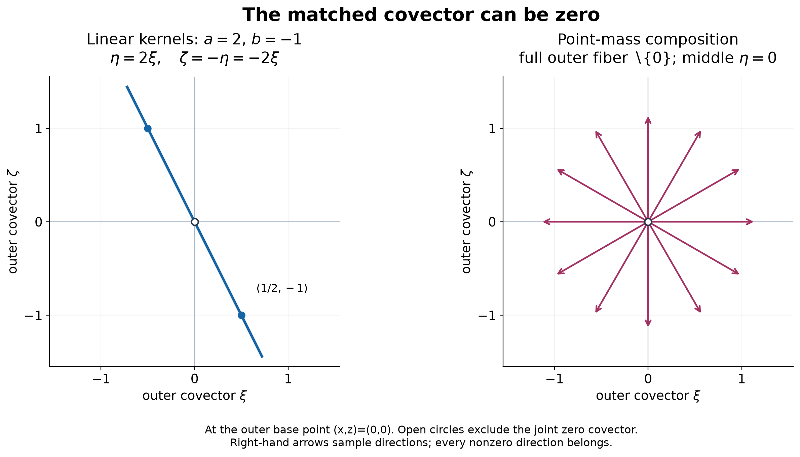
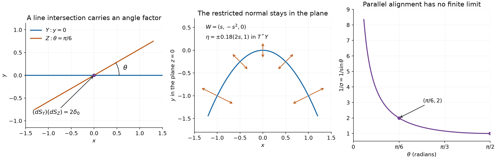

# Keeping zero covectors in kernel operations

*Written by GPT-6 Astra (OpenAI), October 2026. Public domain (CC0).*

A kernel has two covector components. Either component may vanish although the pair is singular. Those zero components determine whether a kernel can act on a distribution, and even a zero intermediate covector can carry a singularity through a composition. We develop products, integration and kernel action with these cases included, and prove the convergence statement that makes extension from smooth inputs unique. Transverse smooth densities have explicit restriction and product formulas, including the intersection angle factor and the support of each restricted weight.

Pairings are complex-linear. Our Fourier transform is \(\widehat f(\xi)=\int e^{-ix\cdot\xi}f(x)\,dx\), with inverse factor \((2\pi)^{-n}\). Open sets lie in Euclidean spaces. A closed conic subset of a nonzero cotangent space is closed *relative to that space*.

The exact earlier proofs used here are [Convolution as addition of supports](convolution-as-addition-of-supports.md), B0–B3 and Theorem 1.1, for locality, parameter pairings, tensor products, their supports and limits, and convolution; [Order, positivity and distributional limits](order-positivity-and-limits.md), Theorem 5.1, for common finite-order bounds of weakly convergent sequences; [Derivative growth and finite-order localization](derivative-growth-and-finite-order-localization.md), Lemmas 1 and 5 and Theorem 4, for fixed index shifts, bounded compact distributions and controlled cutoffs; and [Cones and derivative-growth wavefronts](cones-and-derivative-growth-wavefronts.md), Theorems 3–7, for compact conic localization, class comparisons, singular support and multiplication by a \(C^L\) function.

[Analytic pullback and cotangent directions](analytic-pullback-and-cotangent-directions.md), Theorems 2, 4 and 6, proves the all-class pullback inclusion and exact diffeomorphism and submersion formulas. Its supplied [smooth pullback reading](../prerequisites/U011-free-foundations/smooth-pullback-and-fourier-normal-condition.md), Sections 18.1–18.5, gives the complete ordinary construction and Fourier estimates. We use that construction; below we prove the additional convergence properties. Fourier inversion, Gaussian normalization and convolution identities are proved in the [Schwartz prerequisite](../prerequisites/U011-free-foundations/schwartz-fourier-foundations-U017.md), F1–F5. Compact cutoffs and integration are supplied in the [metric](../prerequisites/U011-free-foundations/metric-foundation-bridges.md), Sections 13.1–13.10, and [integration](../prerequisites/U011-free-foundations/banach-foundation-bridges.md), Sections 15–16, prerequisites.

## The zero section records support

Fix a nondecreasing sequence \(L_0=1\), \(k\le L_k\), \(L_{k+1}\le QL_k\). Write \(W_L(u)=\operatorname{WF}_L(u)\), and write \(W_\infty(u)=\operatorname{WF}(u)\) for ordinary smooth wavefront. The subscript \(\infty\) is a notation for smooth regularity, not a new growth sequence. Analytic wavefront corresponds to \(L_k=k+1\). Put

\[
 Z_u=\{(x,0):x\in\operatorname{supp}u\},\qquad
 \widetilde W_L(u)=W_L(u)\cup Z_u.
 \tag{1}
\]

A zero covector in (1) does not assert a singularity. It records a base point at which a factor may contribute when the other factor carries the nonzero frequency.

**Theorem 1 (tensor bound).** For distributions \(u\) on \(X\) and \(v\) on \(Y\),

\[
 W_L(u\otimes v)\subset
 \bigl(\widetilde W_L(u)\times\widetilde W_L(v)\bigr)
                 \setminus\{(\xi,\eta)=(0,0)\}.
 \tag{2}
\]

The same statement holds with \(L\) replaced by \(\infty\).

**Proof.** The tensor construction and exact product support are proved in B2 of the convolution lesson. Outside that support the assertion follows from vanishing. At a point of the support outside the right side, a nonzero component is regular for its factor. Suppose it is \(\xi_0\) for \(u\). Choose a product base neighborhood and a cone about \((\xi_0,\eta_0)\) on which \(|\xi|\ge c|(\xi,\eta)|\). Choose controlled cutoffs \(\alpha_M,\beta_M\), equal to one on fixed smaller base neighborhoods. Compact conic localization gives

\[
 |\widehat{\alpha_Mu}(\xi)|\le A(BL_M/|\xi|)^M,
 \qquad |\widehat{\beta_Mv}(\eta)|\le C(1+|\eta|)^d.
 \tag{3}
\]

The second bound has fixed \(d,C\): every fixed cutoff derivative is uniformly bounded, and \(v\) has a fixed finite order on the common compact support. Both localized sequences are bounded compact distributions. Their tensor transform is the product of their transforms, by the iterated pairing with the factored exponential. Put \(r=|(\xi,\eta)|\ge1\), take a fixed integer \(s\ge d\), and set \(M=N+s\). The product in (3) is bounded by \(C(DL_M)^M r^{d-M}\). The fixed-shift lemma gives \(C'(D'L_N)^N r^{-N}\). The tensor sequence is uniformly bounded in one compact finite-order seminorm by B2, and equals \(u\otimes v\) near the base point. Thus it is a valid sequence of witnesses. The case of a regular \(\eta_0\) is identical with the variables exchanged. For ordinary smooth wavefront use fixed cutoffs, arbitrary inverse powers in the regular factor, and the polynomial bound in the other factor, exactly as in Section 18.4 of the supplied smooth reading. \(\square\)

## Integration over a proper support

For \(p:X\times Y\to X\), \(p(x,y)=x\), suppose \(p\) is proper on \(S=\operatorname{supp}w\): the part of \(S\) over every compact subset of \(X\) is compact in \(X\times Y\). For a test \(\phi\), choose \(\psi\in C_c^\infty(Y)\) equal to one near the projection of \(S\cap p^{-1}(\operatorname{supp}\phi)\), and define

\[
 \langle p_*w,\phi\rangle=\langle w,\phi(x)\psi(y)\rangle.
 \tag{4}
\]

Locality proves independence of \(\psi\); near every point of the support of \(w\), the difference of two tested functions vanishes. A common \(\psi\) for tests in one compact set proves a finite-order bound. Thus (4) is a distribution. Also \(\operatorname{supp}p_*w\subset p(S)\), and \(p(S)\) is closed: a convergent sequence in the projection lifts to a compact part of \(S\) and has a convergent subsequence there.

**Theorem 2 (proper integration).** Under this support condition,

\[
 W_L(p_*w)\subset
 \{(x,\xi):\exists y,\ (x,y;\xi,0)\in W_L(w)\}.
 \tag{5}
\]

The same inclusion holds for smooth wavefront. Compactly supported \(w\) is a special case.

**Proof.** Fix \((x_0,\xi_0)\) outside the right side. Choose a compact base neighborhood of \(x_0\) inside \(X\). Properness places the relevant part of \(S\) in its product with a compact subset of \(Y\); choose a larger compact neighborhood \(B\Subset Y\). Every \((x_0,y;\xi_0,0)\), \(y\in B\), is regular: on the support this is our assumption, and outside it the distribution vanishes locally. Closedness of wavefront, compactness of \(B\), and normalization \(|\xi_0|=1\) give a smaller base neighborhood and a cone about \((\xi_0,0)\) where all these pairs remain regular. Choose controlled \(\alpha_N(x)\) supported in that base neighborhood, equal to one on a fixed smaller one. Choose controlled \(\beta_N(y)\), supported in \(B\) and equal to one near all relevant support fibers. The product sequence has the mixed-derivative bounds required by compact conic localization. Consequently

\[
 \widehat{\alpha_Np_*w}(\xi)
       =\widehat{(\alpha_N\otimes\beta_N)w}(\xi,0),\qquad
 |\widehat{\alpha_Np_*w}(\xi)|\le C(DL_N/|\xi|)^N
 \tag{6}
\]

on a fixed cone about \(\xi_0\). The equality is (4) tested on the localized exponential. A common finite order of \(w\) and uniform bounds for every fixed derivative of both cutoffs make \((\alpha_Np_*w)\) bounded on a common compact set. These are the required witnesses. For ordinary wavefront the same argument uses fixed cutoffs and ordinary compact localization, with arbitrary inverse powers. No arbitrary smooth cutoff has been asserted to preserve \(W_L\); the varying cutoffs in the all-class argument are controlled ones. \(\square\)

## Convergence with forbidden directions excluded

The extension theorem needs a specific sequential convergence, in addition to weak distributional convergence. For a closed conic \(\Gamma\subset T^*X\setminus0\), put \(\mathcal D'_\Gamma(X)=\{u:W_\infty(u)\subset\Gamma\}\). Say that \(u_j\to u\) *conically in \(\mathcal D'_\Gamma\)* when it converges weakly and

\[
 \sup_{\xi\in V}(1+|\xi|)^r
      |\widehat{\phi(u_j-u)}(\xi)|\longrightarrow0
 \tag{7}
\]

for every \(r\ge0\), \(\phi\in C_c^\infty(X)\), and closed cone \(V\) with \((\operatorname{supp}\phi\times(V\setminus0))\cap\Gamma=\varnothing\). Cone assertions concern nonzero frequencies, but suprema include the bounded-frequency part as well. We claim sequential continuity for this convergence, without making an assertion about arbitrary nets in a stronger topology.

**Lemma 3 (conic approximation and continuity).** The following facts hold.

1. Weak convergence together with uniform rapid bounds for \(\widehat{\phi u_j}\) on every allowed \(V\) is equivalent to (7).
2. Every \(u\in\mathcal D'_\Gamma\) is a conic limit of smooth compactly supported functions. If \(u\) has compact support, their supports can lie in one prescribed sufficiently small compact neighborhood of that support.
3. Tensor products are sequentially continuous into the cone obtained from \(\Gamma_1\times\Gamma_2\) by adjoining the full zero section to each factor and then deleting the joint zero. A smooth pullback \(F^*\) is sequentially continuous when \(\Gamma\cap N_F=\varnothing\), into \(F^\sharp\Gamma\). Here \(N_F\) and \(F^\sharp\) have the definitions of the preceding lesson.
4. Proper integration is sequentially continuous for sequences whose supports lie in a common closed set \(S\) proper over the output. Its output cone is

\[
 \Lambda=\{(x,\xi):\exists y,\ (x,y)\in S,
                   \ (x,y;\xi,0)\in\Gamma\}.
 \tag{8}
\]

**Proof.** A weakly convergent sequence has one common finite-order estimate after any fixed compact localization, by U008 Theorem 5.1. It follows that its pairings converge uniformly on compact families of tests: take a finite net in the controlling finite derivative seminorm, use weak convergence on the net, and bound the two approximation errors by the common order estimate. In particular, Fourier transforms of a fixed localization converge uniformly on every bounded frequency ball. Uniform bounds of order \(r+1\) make the tails in (7) at most \(C/(1+R)\); on \(|\xi|\le R\) use the uniform convergence just proved. The limit satisfies the same rapid estimates by pointwise convergence. Conversely (7) and the rapid estimates of the limit bound the tail of the sequence, and its finitely many initial terms also have rapid estimates. This proves part 1. The ordinary localization identity WF2 in Section 18.1, with a finite base/cone cover, proves that the allowed localized transforms have precisely these rapid bounds whenever the wavefront is contained in \(\Gamma\).

For part 2 choose an exhaustion of \(X\) and \(\chi_j\in C_c^\infty(X)\) equal to one on successively larger compact neighborhoods. Fix a nonnegative compact smooth profile \(\rho\) of integral one and choose \(\varepsilon_j\downarrow0\) so small that

\[
 u_j=\rho_{\varepsilon_j}*(\chi_j u)
             \quad\hbox{has compact support in }X.
 \tag{9}
\]

This is smooth by the parameter pairing B1. Test convolution tends to the original test in every fixed derivative seminorm, by uniform continuity of its derivatives; hence (9) converges weakly. Fix \(\phi,V\) as in (7). Compactness and the positive distance from \(\Gamma\) on unit directions allow a cutoff \(\psi=1\) near \(\operatorname{supp}\phi\) and a slightly larger cone \(V'\) with \((\operatorname{supp}\psi\times V')\cap\Gamma=\varnothing\) at nonzero frequencies. For large \(j\),
\(\phi u_j=\phi[\rho_{\varepsilon_j}*(\psi u)]\).
The Fourier multiplier \(\widehat\rho(\varepsilon_j\xi)\) has modulus at most one. It preserves the rapid bounds of \(\widehat{\psi u}\) on \(V'\) and its fixed polynomial bound everywhere. Multiplication by \(\phi\) gives convolution with \(\widehat\phi\). Split that convolution into \(V'\) and its complement. On the first part use the rapid bound; on the second, angular separation from \(V\) gives \(|\xi-\eta|\ge c(|\xi|+|\eta|)\), and the rapid decrease of \(\widehat\phi\) beats the polynomial bound. These are uniform estimates in \(j\), so part 1 proves conic convergence. If \(u\) is compactly supported, omit \(\chi_j\) and take all \(\varepsilon_j\) below the distance to the boundary of the chosen compact neighborhood. We do not require smooth approximants to have the exact support of \(u\), which may have empty interior.

For tensors, weak convergence is already B3. The fixed common finite-order estimates and the proof of the ordinary bound (2) give uniform rapid estimates outside
\(\Sigma=(\Gamma_1^0\times\Gamma_2^0)\setminus0\), where \(\Gamma_i^0=\Gamma_i\cup(X_i\times\{0\})\). Use finitely many product neighborhoods for any specified compact test and cone, followed by the ordinary cutoff convolution estimate. Part 1 gives conic convergence. The full zero sections are needed here because an approximating sequence need not vanish outside the support of its limit. They are closed after being adjoined, and hence so is \(\Sigma\) off the joint zero.

For pullback, localize on a sufficiently small source neighborhood as in Section 18.5. The closed cone \(\Gamma\), instead of the wavefront of one input, permits a common target cutoff \(\chi\), a common angular neighborhood of the kernel of \(DF^T\), and a positive gradient margin on its complement. For a test \(f\), the formula is

\[
 \langle F^*u_j,f\rangle=(2\pi)^{-m}\int
 \widehat{\chi u_j}(\eta)
       \left(\int f(x)e^{iF(x)\cdot\eta}\,dx\right)d\eta.
 \tag{10}
\]

Near the normal directions the input has uniform rapid bounds. On the complementary directions the inner integral has arbitrary inverse powers by the proved smooth nonstationary estimate WF4, while the input has a common polynomial bound. Choose the exponents larger than the input order plus \(m+1\). These bounds dominate (10) by one integrable function, independent of \(j\); pointwise convergence of the input transform proves weak convergence of the pullbacks.

Here are also the uniform output estimates needed for conic convergence. At an output pair outside \(F^\sharp\Gamma\), choose a closed angular neighborhood \(A\) of the target directions in \(\Gamma\) over the image point. Compactness and normal exclusion let us retain both a nonvanishing margin for \(DF^T\eta\) and separation of its direction from the output cone, on a small source neighborhood. Off \(A\) the input has uniform rapid bounds after one common localization. For \(\eta\in A\) the phase in the localized transform is \(F(x)\cdot\eta-x\cdot\xi\), and
\(|DF(x)^T\eta-\xi|\ge c(|\eta|+|\xi|)\).
WF4 with an exponent larger than the input order, output exponent and dimension gives the requested inverse power after integration. Off \(A\), split at \(|\eta|=c_0|\xi|\), with \(c_0\sup\|DF^T\|<1/2\). Below that threshold the gradient is at least \(|\xi|/2\); use WF4 and the uniform rapid input bound. Above it use the constant amplitude bound and an input inverse power larger than the output exponent plus \(m+1\). Integrating the full tail gives that output power. If \(\Gamma\) has no directions over the image point, it has none on a sufficiently small neighborhood, and the same argument uses only the latter two regions. Finite covers and ordinary localization give uniform rapid bounds for every allowed output test/cone. Part 1 applies.

The output cone \(F^\sharp\Gamma\) is closed off zero: on any compact source neighborhood, normal exclusion and compact unit target directions give \(|DF^T\eta|\ge c|\eta|\) for directions in \(\Gamma\). A converging nonzero output sequence therefore has bounded input covectors and a convergent subsequence; the upper bound for \(\|DF^T\|\) ensures that their limit is nonzero. Closedness of \(\Gamma\) finishes the argument. This also justifies using the output cone in the definition (7).

Finally, for integration choose a common \(\psi\) in (4) using \(S\). Weak convergence passes through that fixed test. Outside (8), a finite cover of the compact relevant fibers uses either absence of \(\Gamma\) in directions \((\xi,0)\), or absence of \(S\), where every sequence member vanishes. Fixed smooth localization gives uniform rapid estimates of the joint Fourier transforms there; restriction to \((\xi,0)\) gives the output estimates. The set (8) is closed off zero by properness and the same convergent-subsequence argument, with \(\eta=0\). Part 1 completes the proof. \(\square\)

## Multiplication as restriction to a diagonal

For distributions on the same \(X\), the no-opposition condition is

\[
 (x,\xi)\in W_L(u)\quad\Longrightarrow\quad
                  (x,-\xi)\notin W_L(v).
 \tag{11}
\]

**Theorem 4 (distribution product).** If (11) holds, the diagonal \(\Delta(x)=(x,x)\) is noncharacteristic for \(u\otimes v\). The distribution \(uv=\Delta^*(u\otimes v)\) has support in \(\operatorname{supp}u\cap\operatorname{supp}v\), and

\[
 W_L(uv)\subset\{(x,\xi+\eta):
     (x,\xi)\in\widetilde W_L(u),\ (x,\eta)\in\widetilde W_L(v),
                      \ \xi+\eta\ne0\}.
 \tag{12}
\]

The ordinary version holds under the ordinary no-opposition condition. In that version, for fixed closed cones \(\Gamma_1,\Gamma_2\) satisfying no opposition, multiplication is sequentially continuous for the conic convergence of Lemma 3. It is commutative, agrees with ordinary multiplication by a smooth function, and satisfies the distributional product rule. Three factors are associative under the joint condition that

\[
 \xi_1+\xi_2+\xi_3=0,\quad
 (x,\xi_i)\in\Gamma_i^0
          \quad\Longrightarrow\quad \xi_1=\xi_2=\xi_3=0.
 \tag{13}
\]

**Proof.** The nonzero normal covectors of \(\Delta\) are \((x,x;\xi,-\xi)\), \(\xi\ne0\). Formula (2) and (11) exclude all of them. Since \(W_\infty\subset W_L\), the ordinary construction is available, and the analytic pullback theorem applied to \(\Delta\) gives (12), because \(D\Delta^T(\xi,\eta)=\xi+\eta\). Locality and the product support of the tensor give the support assertion. The same argument with the supplied smooth pullback gives the ordinary version.

For convergence use tensor continuity and pullback continuity in Lemma 3. On compact base sets, no opposition gives the positive lower bound \(|\xi+\eta|\ge c(|\xi|+|\eta|)\) on \(\Gamma_1^0\times\Gamma_2^0\): otherwise normalize the sum of lengths to one, take a convergent subsequence, and obtain a forbidden nonzero opposite pair. This also proves that the resulting sum cone is closed off zero. Smooth approximations from Lemma 3 converge in these fixed cones. Their ordinary products commute, so passage to the limit proves commutativity. Keeping a smooth factor fixed and approximating the other factor proves compatibility with its usual multiplication on distributions, since that multiplication is weakly continuous.

Differentiation is conically continuous: \(\phi\partial_k w=\partial_k(\phi w)-(\partial_k\phi)w\); the Fourier transform of the first term is \(i\xi_k\widehat{\phi w}\), so one higher inverse power in (7) handles it. The derivative has wavefront in the original cone by the same calculation. Apply this and product continuity to the smooth product rule to obtain \(\partial_k(uv)=(\partial_ku)v+u(\partial_kv)\). Under (13), every partial sum cone is closed by the preceding compact normalization argument and is nonopposite to the remaining cone. Smooth simultaneous approximations therefore converge in both parenthesizations, proving \((uv)w=u(vw)\). Condition (13) implies all needed pair conditions by setting a third covector to zero; pair conditions alone need not imply (13). \(\square\)

### Chain rules and compatible compositions

The conic convergence in Lemma 3 lets us specify the hypotheses behind the familiar calculus identities. All cones in the next statement refer to the ordinary smooth wavefront. The operations agree with those used for \(W_L\) whenever the stronger \(W_L\) exclusions hold.

**Proposition 4a (calculus with noncharacteristic maps).** Let \(F:X\to Y\) and \(G:Y\to Z\) be smooth maps.

1. If \(u\in\mathcal D'_\Gamma(Z)\), \(\Gamma\cap N_G=\varnothing\), and \(G^\sharp\Gamma\cap N_F=\varnothing\), then \((G\circ F)^*u\) is defined and
\[
                    F^*(G^*u)=(G\circ F)^*u.
 \tag{C1}
\]
The identity map has identity pullback.

2. If \(u\in\mathcal D'_\Gamma(Y)\) and \(\Gamma\cap N_F=\varnothing\), then in Euclidean coordinates
\[
 \partial_{x_j}(F^*u)
       =\sum_{k=1}^{\dim Y}(\partial_{x_j}F_k)\,
                                      F^*(\partial_{y_k}u).
 \tag{C2}
\]
Pullback is linear and \(F^*(a u)=(a\circ F)F^*u\) for every smooth \(a\) on \(Y\).

3. Let \(u_i\in\mathcal D'_{\Gamma_i}(Y)\), \(i=1,2\), with no opposite nonzero covectors between \(\Gamma_1,\Gamma_2\). Suppose, at every \(x\in X\),
\[
 \begin{gathered}
 (F(x),\xi_i)\in\Gamma_i\cup(Y\times\{0\}),\\
 DF(x)^T(\xi_1+\xi_2)=0
          \quad\Longrightarrow\quad \xi_1=\xi_2=0 .
 \end{gathered}
 \tag{C3}
\]
Then all the operations in
\[
                       F^*(u_1u_2)=(F^*u_1)(F^*u_2)
 \tag{C4}
\]
are defined.

4. For the projection \(p:X\times Y\to X\), with support proper over \(X\), integration commutes with output derivatives and smooth output multipliers:
\[
 \partial_{x_j}p_*w=p_*(\partial_{x_j}w),\qquad
 a\,p_*w=p_*((a\circ p)w).
 \tag{C5}
\]
For \(w\) on \(X\times Y\times Z\) supported in a closed set proper over \(X\), integration over \(Y,Z\) agrees with either iterated order.

**Proof.** The conic image \(G^\sharp\Gamma\) is closed off zero by Lemma 3. At a covector \(\zeta\in\Gamma\) over \(G(F(x))\), normal exclusion for \(G\) makes \(\eta=DG(F(x))^T\zeta\) nonzero. Normal exclusion for \(F\) then makes \(DF(x)^T\eta\) nonzero. This is exactly the normal exclusion for \(G\circ F\). Approximate \(u\) by the smooth sequence of Lemma 3 in its fixed cone \(\Gamma\). Successive conically continuous pullbacks converge to the left side of (C1), and the pullback by \(G\circ F\) converges to its right side. The smooth identities and uniqueness of distributional limits prove (C1). The same argument applied to the identity map gives its assertion.

Differentiation is conically continuous in the same cone, as proved in Theorem 4. Multiplication by a fixed smooth function is also conically continuous, by that theorem with the other cone empty. Apply these two facts and pullback continuity to the smooth chain rule for an approximating sequence; this gives (C2), with every component and coefficient displayed. The smooth linearity and multiplier identities pass to the limit in the same way.

For part 3 put
\[
 \Sigma=\{(y,\xi_1+\xi_2):
        (y,\xi_i)\in\Gamma_i\cup(Y\times\{0\}),
                              \ \xi_1+\xi_2\ne0\}.
\]
The no-opposition condition makes \(\Sigma\) closed off zero, by the compact normalization argument in Theorem 4. Condition (C3), first with one \(\xi_i=0\), excludes \(N_F\) from each input cone. For a nonzero sum, it excludes \(N_F\) from \(\Sigma\) as well. It also excludes opposite nonzero covectors between \(F^\sharp\Gamma_1\) and \(F^\sharp\Gamma_2\): such a pair would arise from \(\xi_1,\xi_2\) with \(DF^T(\xi_1+\xi_2)=0\), contrary to (C3).

Choose smooth conic approximations to the two inputs. Their products converge conically in \(\Sigma\) by Theorem 4, so their pullbacks converge to the left side of (C4). The individual pullbacks converge in \(F^\sharp\Gamma_i\), where product continuity gives the right side. Equality holds before the limit and therefore after it. These pullback arguments are local on compact neighborhoods; the maps need not be proper or invertible.

For (C5), choose one compact cutoff \(\psi(y)\) equal to one near the support over a compact neighborhood of the output test \(\phi\). Then the derivative pairings on both sides are \(-\langle w,(\partial_{x_j}\phi)\psi\rangle\). The multiplier pairings on both sides are \(\langle w,a\phi\psi\rangle\). For three factors the proper-support hypothesis permits two such cutoffs \(\psi(y),\theta(z)\), with their product equal to one near every contributing support point over that neighborhood. Each order, and direct integration, pairs with \(\phi\) as \(\langle w,\phi\psi\theta\rangle\). Intermediate integration is allowed: a support proper over \(X\) is proper over either \(X\times Y\) or \(X\times Z\); after projecting, its remaining support is proper over \(X\), by the compact-image property. Locality makes the cutoff choices immaterial, as in Theorem 2. A zero-dimensional factor reduces to the scalar cases described below, with empty derivative sums. \(\square\)

## A kernel acting on a singular input

For \(K\in\mathcal D'(X\times Y)\), define its full primed relation by

\[
 R_L(K)=\{(x,\xi;y,\eta):(x,y;\xi,-\eta)\in W_L(K)\}.
 \tag{14}
\]

Only the *joint* zero covector is excluded from (14). Either endpoint separately may be zero. Define the output-axis and input-normal sets

\[
 \begin{aligned}
 A_L(K)&=\{(x,\xi):\exists y,\ (x,\xi;y,0)\in R_L(K)\},\\
 B_L(K)&=\{(y,\eta):\exists x,\ (x,0;y,\eta)\in R_L(K)\}.
 \end{aligned}
 \tag{15}
\]

The covectors \(\xi\) in \(A_L\) and \(\eta\) in \(B_L\) are necessarily nonzero. For smooth compact input \(f\), the usual kernel action is defined without any wavefront restriction by \(\langle Kf,\phi\rangle=\langle K,\phi(x)f(y)\rangle\). Finite-order estimates on product compacts show that this is a distribution in \(x\).

**Theorem 5 (extension of kernel action).** Let \(u\in\mathcal E'(Y)\), and suppose \(B_L(K)\cap W_L(u)=\varnothing\). With \(q(x,y)=y\), define

\[
 Ku=p_*\bigl(K\,q^*u\bigr),\qquad q^*u=1\otimes u.
 \tag{16}
\]

This is well-defined, agrees with the preceding action on smooth compact inputs, and satisfies

\[
 \begin{split}
 W_L(Ku)\subset {}&
 \{(x,\xi):\exists y\in\operatorname{supp}u,
                         \ (x,\xi;y,0)\in R_L(K)\}\\
 &\ \cup\{(x,\xi):\xi\ne0,\ \exists(y,\eta)\in W_L(u),
                              \ (x,\xi;y,\eta)\in R_L(K)\}.
 \end{split}
 \tag{17}
\]

The ordinary statement holds with \(L=\infty\). More precisely, for a fixed closed cone \(\Gamma\) disjoint from \(B_\infty(K)\), (16) is the unique sequentially continuous extension from smooth compact inputs, with convergence understood conically in \(\mathcal D'_\Gamma\) and with supports in a common compact \(M\subset Y\). The image convergence is conic in the cone obtained by (17), replacing the input wavefront by \(\Gamma\cap(M\times(\mathbb R^{\dim Y}\setminus0))\), its support by \(M\), and retaining \(W_\infty(K)\).

If the support of \(K\) is proper over \(X\), compact support of \(u\) is unnecessary. In particular for \(a\in C^L(Y)\),

\[
 W_L(Ka)\subset\{(x,\xi):\exists y\in\operatorname{supp}a,
                              \ (x,y;\xi,0)\in W_L(K)\}.
 \tag{18}
\]

**Proof.** Exact submersion covariance gives \(W_L(q^*u)=\{(x,y;0,\eta):(y,\eta)\in W_L(u)\}\). An opposite wavefront covector of \(K\) would be \((0,-\eta)\), precisely a member of \(B_L(K)\) matching a member of \(W_L(u)\). The assumed exclusion therefore permits the product. Its support lies in \(\operatorname{supp}K\cap(X\times\operatorname{supp}u)\), a closed set proper over \(X\). Theorem 2 permits integration.

Apply (12) and then require that the summed input covector vanish for (5). If the input factor contributes zero, its base point belongs to \(\operatorname{supp}u\), and the kernel contributes \((\xi,0)\); this is the first line of (17). If the input contributes \((0,\eta)\), the kernel must contribute \((\xi,-\eta)\); this is the second line. The alternative in which only the input carries a nonzero covector has output covector zero and cannot contribute to output wavefront. This proves the bound. Smooth compatibility of the product in Theorem 4 and (4) identify the original smooth kernel action.

For the ordinary convergence statement, tensoring with 1, product and proper integration are sequentially continuous by Lemma 3 and Theorem 4. The fixed compact input support gives a common proper set at the integration step. The output cone is closed locally off zero: properness bounds the input base points, and if a sequence of contributing input covectors becomes unbounded while output covectors stay bounded, normalization gives a kernel input-normal covector in \(\Gamma\), contrary to the exclusion. If the input covectors remain bounded, take a subsequence. A zero input limit gives the output-axis term; a nonzero limit gives the relation term. This argument also proves that no missing limiting directions must be added. Smooth density with support in one slightly larger compact neighborhood proves uniqueness: any extension with the stated sequential continuity has on \(u\) the limit of the same smooth kernel actions. Continuity is asserted on all common-compact families, so using that larger compact is legitimate.

When \(K\) is proper over \(X\), localize an output test in a compact neighborhood. Only a compact set of input points can contribute. Use a cutoff equal to one near it to perform the ordinary construction with a compact input; different choices agree by locality. This defines the same global product and proper integration (16). For its all-class estimate apply (12) directly to the uncut input and use the controlled localization proof of Theorem 2. In the special case \(a\in C^L\), composition with the analytic projection gives \(q^*a\in C^L\), and multiplication by it has wavefront contained in \(W_L(K)\). Its support lies over \(\operatorname{supp}a\). Integration gives (18). Thus fixed smooth localization used to identify the ordinary construction has not been used to assert an all-class localization property. \(\square\)

## Composing kernels through every intermediate covector

Let \(K_1\in\mathcal D'(X\times Y)\) and \(K_2\in\mathcal D'(Y\times Z)\). Write

\[
 \widetilde R_L(K)=R_L(K)\cup
          \{(x,0;y,0):(x,y)\in\operatorname{supp}K\}.
 \tag{19}
\]

Composition of these relations means matching both the middle base point and its covector. The middle covector is allowed to be zero.

**Theorem 6 (general kernel composition).** Suppose \(\operatorname{supp}K_2\to Z\) is proper, and

\[
 B_L(K_1)\cap A_L(K_2)=\varnothing.
 \tag{20}
\]

There is a kernel \(T=K_1\circ K_2\) whose action on smooth compact \(f\) is \(K_1(K_2f)\), with the first operator interpreted by Theorem 5. It has the bound

\[
 R_L(T)\subset
       \bigl(\widetilde R_L(K_1)\circ\widetilde R_L(K_2)\bigr)
                        \setminus\{(\xi,\zeta)=(0,0)\}.
 \tag{21}
\]

Equivalently its right side is the union of \(R_L(K_1)\circ R_L(K_2)\), after deleting the joint outer zero, and the two sets

\[
 \begin{aligned}
 &\{(x,\xi;z,0):\exists y,\ (x,\xi;y,0)\in R_L(K_1),
                                      \ (y,z)\in\operatorname{supp}K_2\},\\
 &\{(x,0;z,\zeta):\exists y,\ (x,y)\in\operatorname{supp}K_1,
                                      \ (y,0;z,\zeta)\in R_L(K_2)\}.
 \end{aligned}
 \tag{22}
\]

The middle covector in the first relation composition remains unrestricted, including zero. The ordinary version holds under (20) with \(L=\infty\). No clean intersection, phase function, or absence of endpoint axes is assumed.

**Proof.** Introduce
\(j(x,y,z)=(x,y,y,z)\) and \(p(x,y,z)=(x,z)\). Their relevant operations are

\[
 T=p_*j^*(K_1\otimes K_2),\qquad
 Dj^T(\xi,\alpha,\beta,\gamma)=(\xi,\alpha+\beta,\gamma).
 \tag{23}
\]

The nonzero normals to \(j\) have the form \((0,\eta,-\eta,0)\), \(\eta\ne0\). Formula (2) could place one of these in the tensor wavefront only if \(K_1\) has covector \((0,\eta)\) and \(K_2\) has \((-\eta,0)\) at the matching middle point. Their primed middle covector is \(-\eta\), violating (20). Thus the pullback exists. Its support lies in the closed set
\(S=\{(x,y,z):(x,y)\in\operatorname{supp}K_1,(y,z)\in\operatorname{supp}K_2\}\).
For compact \((x,z)\) sets, the \((y,z)\) coordinates lie in a compact set by the assumed properness of \(K_2\), and the \(x\) coordinates lie in a compact set. The resulting part of \(S\) is closed in this compact product. Hence integration in (23) is permitted.

By the analytic pullback and integration bounds, a contributing covector has \(\alpha+\beta=0\). Put \(\eta=-\alpha=\beta\), and \(\zeta=-\gamma\). The two factors then give \((x,\xi;y,\eta)\) and \((y,\eta;z,\zeta)\) in their extended primed relations. This is (21). If both factors carry nonzero joint covectors it is the full relation composition, even when \(\eta=0\). If exactly one factor has its joint covector zero, its base point must lie in its support, yielding one of (22). If both have joint zero, the outer covector is zero and is removed. This proves every term and sign.

We verify the operator identity, including its distributional limits. Fix compact tests \(\phi(x)\), \(f(z)\). Properness permits compact \(z\) and \(y\) cutoffs equal to one near all contributions from \(\operatorname{supp}f\); multiplying \(K_2\) by them gives a compact kernel \(H\). The local output and composed pairings on these tests agree with those using \(H\), by locality. Its ordinary wavefront is contained in \(W_\infty(K_2)\). By Lemma 3 take smooth \(H_j\to H\) conically with common compact support. The associated output distributions \(H_j f\) converge conically to \(Hf=K_2f\), by smooth multiplication and proper integration. A fixed cone containing their possible limiting wavefront is the projection of the \((\eta,0)\) directions in \(W_\infty(H)\) over the compact \(z\) support. This cone is closed, and is contained in \(A_\infty(K_2)\); it is disjoint from \(B_\infty(K_1)\). Thus Theorem 5 gives \(K_1(H_jf)\to K_1(K_2f)\) weakly.

Tensor continuity, pullback continuity for \(j\), and integration with a common compact middle support also give \(p_*j^*(K_1\otimes H_j)\to p_*j^*(K_1\otimes H)\). For smooth \(H_j\), the two pairings are equal: both are
\(\langle K_1,\phi(x)\int H_j(y,z)f(z)\,dz\rangle\).
One may pass the compact parameter integral through the distribution by B1–B3 of the convolution lesson. To verify the restriction formula in this equality, locally approximate \(K_1\) smoothly in a fixed wavefront cone; tensoring with smooth \(H_j\) is always noncharacteristic for the middle diagonal, and Lemma 3 passes the elementary smooth identity to the limit. Therefore the two limits coincide. Products of external tests determine a distribution on \(X\times Z\) by B2, so (23) is precisely the kernel of the composed action. Finally (20) for \(L\) implies its ordinary counterpart. The ordinary argument just given and the all-class estimates use the same construction, completing both statements. \(\square\)

*Left: for the linear kernels of Exercise 6 with \(a=2,b=-1\), the matching covector is \(\eta=2\xi\), and the outer covectors satisfy \(\zeta=-2\xi\). Right: the composition in Exercise 5 has every nonzero outer covector at the origin; the middle covector is always zero. The rays shown are samples of that full punctured plane, not a restriction to finitely many directions. [Full-size vector figure](../figures/kernel-zero-covectors.svg) · [Reproducible figure source](../figures/kernel-zero-covectors.py).*

## Convolution as a kernel consequence

**Corollary 7 (convolution directions).** If \(a\in\mathcal D'(\mathbb R^n)\) and \(u\in\mathcal E'(\mathbb R^n)\), then

\[
 W_L(a*u)\subset\{(s+t,\xi):(s,\xi)\in W_L(a),
                                      \ (t,\xi)\in W_L(u)\}.
 \tag{24}
\]

The ordinary version and the conic continuity of the corresponding kernel action hold as well. Smooth compact inputs give smooth outputs, continuously for the usual fixed-support smooth convergence.

**Proof.** Set \(K(x,y)=a(x-y)\), the pullback by the analytic submersion \(d(x,y)=x-y\). Exact submersion covariance gives
\(W_L(K)=\{(x,y;\xi,-\xi):(x-y,\xi)\in W_L(a)\}\).
Both endpoint-axis sets (15) are empty. Thus every compact \(u\) satisfies the normal exclusion, and the relation term in (17) is exactly (24). For smooth compact \(u\), measure substitution \(s=x-y,t=y\) in the distributional pairing identifies the action with \(\langle a\otimes u,\phi(s+t)\rangle\). For general compact \(u\), conic smooth approximation, Theorem 5, and B3 and Theorem 1.1 of the convolution lesson pass this identity to the limit. This identifies the construction with the earlier convolution, including its normalization. The ordinary convergence assertion follows from Theorem 5 with empty input normal set. When the input cone is empty, its approximating transforms have uniform rapid decrease in all directions. The resulting output has empty ordinary wavefront; moreover (7) in all directions implies local convergence of every derivative by Fourier inversion, using an integrable inverse power larger than the derivative order plus dimension. This proves the stated smooth continuity. \(\square\)

If a factor space has dimension zero, its open set is empty or a point. Distributions on a point are scalars, their nonzero cotangent spaces are empty, tensoring is scalar multiplication and integration is the identity or multiplication by the scalar. The definitions and proofs above reduce to these statements. The formulas also hold for empty supports and the zero distribution.

## The angle factor at a transverse intersection

The following results concern ordinary smooth wavefront. A smooth density on a submanifold is regarded as a scalar distribution using the ambient Euclidean volume. On a submanifold itself we use its induced volume. This convention fixes the numerical factor in restriction.

The finite Gram construction and its determinant identities are proved in the [algebra foundation](../prerequisites/U011-free-foundations/stable-prerequisite-bridges.md), Section 10.5. The complete real symmetric diagonalization proof is in [Point sources and complex Gaussian kernels](point-sources-and-complex-gaussian-kernels.md), Section 2.

Let \(Y,Z\) be relatively closed smooth embedded submanifolds without boundary in an open \(X\subset\mathbb R^n\), of codimensions \(p,q\). Assume they are transverse:
\(T_xY+T_xZ=\mathbb R^n\) for every \(x\in W=Y\cap Z\).
Then \(W\) is a relatively closed embedded submanifold of dimension \(n-p-q\). Indeed, local defining functions for \(Y,Z\) have independent differentials together: a dependence would give a nonzero covector in both normal spaces. Apply the coordinate-completion lemma in [Regular level sets and transverse convolution](regular-level-sets-and-transverse-convolution.md), Lemma 0.2, to their joint map. It gives a local diffeomorphism
\[
 x=h(r,s,t),\qquad Y=\{r=0\},\quad Z=\{s=0\},\quad
 W=\{r=s=0\},
\]
where \(r\in\mathbb R^p\), \(s\in\mathbb R^q\), and \(t\in\mathbb R^{n-p-q}\).

**Lemma 8 (the intersection determinant).** At \(x\in W\), choose matrices \(N_Y,N_Z\) whose columns are orthonormal bases of the Euclidean normal spaces to \(Y,Z\). Put \(C=N_Y^TN_Z\). The positive quantity
\[
 \sigma(Y,Z;x)
 =\sqrt{\det
       \begin{pmatrix}I_p&C\\ C^T&I_q\end{pmatrix}}
 =\sqrt{\det(I_q-C^TC)}
 =\sqrt{\det(I_p-CC^T)}
 \tag{R1}
\]
is independent of those bases, symmetric in \(Y,Z\), smooth on \(W\), and at most one. In the simultaneous coordinates above, write \(J_X=|\det Dh|\), and let \(J_Y,J_Z,J_W\) be the Gram volume factors of \(h(0,s,t)\), \(h(r,0,t)\), and \(h(0,0,t)\), respectively. At \(r=s=0\),
\[
                  \sigma=\frac{J_XJ_W}{J_YJ_Z}.
 \tag{R2}
\]
Every empty determinant and every zero-dimensional volume factor equals one.

**Proof.** Transversality says that the normal columns of \((N_Y,N_Z)\) are independent. Their Gram matrix in (R1) is therefore positive definite. Block elimination, first with \(I_p\) and then with \(I_q\), proves the two determinant equalities. Orthogonal changes in the separate frames conjugate that matrix by an orthogonal block matrix, leaving its determinant unchanged. Local smooth frames are obtained by Gram–Schmidt from the smooth independent defining differentials. Thus \(\sigma\) is smooth and positive. The positive matrix \(I_q-C^TC\) has eigenvalues in \((0,1]\): its quadratic form is \(|v|^2-|Cv|^2\), bounded above by \(|v|^2\). Real symmetric diagonalization gives \(0<\sigma\le1\).

Here are the full coordinate factors in (R2). Set \(G=Dh^TDh\), and denote a principal submatrix by its coordinate block. Then \(J_X^2=\det G\), \(J_Y^2=\det G_{s,t}\), \(J_Z^2=\det G_{r,t}\), and \(J_W^2=\det G_t\). For any coordinate block \(A\) of a positive definite matrix,
\[
          \det (G^{-1})_A=\frac{\det G_{A^c}}{\det G}.
 \tag{R3}
\]
To prove this identity, permute coordinates so that \(G=\begin{pmatrix}B&E\\E^T&D\end{pmatrix}\), with \(B\) indexed by \(A\). Multiplying by the triangular elimination matrices gives
\(\det G=\det D\,\det(B-ED^{-1}E^T)\).
Solving the same block equations gives
\((G^{-1})_A=(B-ED^{-1}E^T)^{-1}\).
This proves (R3); the empty-block cases follow directly.

The rows of \(Dh^{-1}\) indexed by \(r\) span the normal covectors to \(Y\), and the rows indexed by \(s\) span those to \(Z\). Their joint Gram matrix is \((G^{-1})_{r,s}\). Orthonormalizing each group multiplies its Gram determinant by the reciprocal of the separate determinants. Consequently
\[
 \sigma^2
 =\frac{\det(G^{-1})_{r,s}}
        {\det(G^{-1})_r\,\det(G^{-1})_s}
 =\frac{J_W^2/J_X^2}{(J_Y^2/J_X^2)(J_Z^2/J_X^2)}.
\]
Taking positive square roots proves (R2). The same argument covers \(p=0\), \(q=0\), and \(p+q=n\). \(\square\)

## Restricting and multiplying smooth densities

For a smooth complex function \(a\) on \(Y\), write \(a\,dS_Y\) for the ambient distribution \(\varphi\mapsto\int_Ya\varphi\,dS_Y\). Its exact wavefront is the normal bundle over \(\operatorname{supp}_Y a\), with zero removed, by [Cones and derivative-growth wavefronts](cones-and-derivative-growth-wavefronts.md), Theorem 9 and Corollary 10.

**Theorem 9 (transverse density formulas).** Let \(a\in C^\infty(Y;\mathbb C)\), \(b\in C^\infty(Z;\mathbb C)\). The restriction of \(b\,dS_Z\) to \(Y\), and the product of the two ambient distributions, are defined by the wavefront constructions. With \(j_Y:Y\hookrightarrow X\),
\[
 \begin{aligned}
 j_Y^*(b\,dS_Z)&=\frac{b|_W}{\sigma(Y,Z;\cdot)}\,dS_W
                                      &&\text{as a distribution on }Y,\\
 (a\,dS_Y)(b\,dS_Z)&=\frac{(a|_W)(b|_W)}{\sigma(Y,Z;\cdot)}\,dS_W
                                      &&\text{as a distribution on }X.
 \end{aligned}
 \tag{R4}
\]
The right sides use the same induced measure on \(W\). Their supports and ordinary wavefronts are exactly
\[
 \begin{aligned}
 \operatorname{supp}j_Y^*(b\,dS_Z)&=\operatorname{supp}_W(b|_W),\\
 \operatorname{WF}_Y(j_Y^*(b\,dS_Z))
   &=\{(x,\eta):x\in\operatorname{supp}_W(b|_W),\
                 0\ne\eta\in T_x^*Y,\ \eta|_{T_xW}=0\},\\
 \operatorname{supp}[(a\,dS_Y)(b\,dS_Z)]
   &=\operatorname{supp}_W((a|_W)(b|_W)),\\
 \operatorname{WF}_X((a\,dS_Y)(b\,dS_Z))
   &=\{(x,\xi):x\in\operatorname{supp}_W((a|_W)(b|_W)),\
                    \xi\ne0,\ \xi|_{T_xW}=0\}.
 \end{aligned}
 \tag{R5}
\]
In particular every nonzero normal sign occurs over those supports. The restriction of a weight can have smaller support than its ambient support intersected with \(W\).

**Proof: existence and the meaning on \(Y\).** The singular covectors of \(b\,dS_Z\) lie in the normal bundle of \(Z\). Normal covectors of the inclusion \(j_Y\) annihilate \(T_xY\). The two normal spaces intersect only at zero by transversality, so the smooth pullback theorem applies. Likewise opposite nonzero normal covectors for the two densities would belong to both normal spaces. Theorem 4 therefore defines their product.

Concretely, in a chart \(k:U\subset\mathbb R^{n-p}\to Y\), form \((j_Y\circ k)^*(b\,dS_Z)\), a scalar distribution on \(U\). Pair it with the test function times the chart volume \(J_Y\). On overlapping charts, Proposition 4a and the diffeomorphism test formula, including its inverse determinant, give the same pairing. Thus these chart definitions glue to a distribution on \(Y\) relative to its induced volume. This also explains the volume convention before Lemma 8.

**Proof: the local calculation.** In the simultaneous chart, the scalar pullbacks of the two densities are
\[
 \begin{aligned}
 h^*(a\,dS_Y)&=\alpha(s,t)\delta_0(r),
 &\alpha(s,t)&=\frac{a(h(0,s,t))J_Y(s,t)}{J_X(0,s,t)},\\
 h^*(b\,dS_Z)&=\beta(r,t)\delta_0(s),
 &\beta(r,t)&=\frac{b(h(r,0,t))J_Z(r,t)}{J_X(r,0,t)}.
 \end{aligned}
 \tag{R6}
\]
These follow directly from the scalar pullback pairing
\(\langle h^*u,\psi\rangle
=\langle u,(\psi/|\det Dh|)\circ h^{-1}\rangle\)
and the Gram measure formula. All factors are smooth and positive except for the freely chosen complex weights.

Restriction to \(r=0\) of the second expression is \(\beta(0,t)\delta_0(s)\). One can check this with compact smooth normal mollifiers: \(\beta(r,t)\rho_\varepsilon(s)\) converges conically to the second expression by Lemma 3's Fourier estimate, fixed smooth multiplication and the projection formula. Its restriction converges to \(\beta(0,t)\delta_0(s)\) by the same estimate, or directly by the normalized integral of \(\rho_\varepsilon\). Pullback continuity identifies that limit with the defined restriction. All of these assertions are local; insert compact cutoffs equal to one on the test support before mollifying. Pairing on \(Y\) multiplies the result by \(J_Y(0,t)\). Relative to \(dS_W=J_W(t)\,dt\), the density is therefore
\[
                b\,\frac{J_ZJ_Y}{J_XJ_W}=\frac b\sigma .
\]

Similarly the product of the two expressions in (R6) is
\(\alpha(0,t)\beta(0,t)\delta_0(r)\delta_0(s)\).
For completeness, separate normal mollifiers in \(r,s\) converge conically to each factor; their product pairs by two successive normalized averages and converges to evaluation at \(r=s=0\). The product continuity in Theorem 4 gives precisely that product, including for zero-dimensional blocks. Diffeomorphism pullback commutes with the product by Proposition 4a: its invertible transpose cannot kill a nonzero sum, and the original factors have no opposite covectors.

Returning from the scalar pullback to the ambient pairing multiplies by \(J_X(0,0,t)\). Dividing the resulting \(dt\) density by \(J_W\) gives
\[
 ab\,\frac{J_YJ_Z}{J_X^2}\frac{J_X}{J_W}
                          =\frac{ab}{\sigma}.
\]
This proves both identities in (R4) locally and hence globally. Relative closedness supplies locally finite measures on compact test supports; no compactness of the entire submanifolds is assumed.

Finally apply the full smooth-density wavefront formula to \(W\) in \(X\). For \(W\) in \(Y\), apply that formula in a chart of \(Y\); its metric volume differs from coordinate volume by a strictly positive smooth factor. Such a factor and its reciprocal preserve support and wavefront, and the diffeomorphism equality transports normal covectors. Since \(\sigma\) is strictly positive, the weights have exactly the supports stated in (R5), even at zeros or flat zeros that remain in those supports. This proves all the equalities. If \(W\) is empty, locality makes both distributions zero. \(\square\)

On a smooth manifold, fix a positive smooth ambient density \(\mu_X\), and a positive smooth density \(\mu_Y\) on \(Y\) when taking restriction. A submanifold density \(\nu_Z\) defines the scalar distribution \(\nu_Z/\mu_X\): on a compactly supported test density \(f\mu_X\), its value is \(\int_Z f\,\nu_Z\). In a coordinate chart write \(\mu_X=m\,dx\), \(\mu_Y=n\,dS_Y\), \(\nu_Y=a\,dS_Y\), and \(\nu_Z=b\,dS_Z\), where \(m,n>0\). The corresponding scalar coefficients in (R4) are \(a/m\) and \(b/m\). Therefore the resulting distribution densities are
\[
 \mu_Y j_Y^*(\nu_Z/\mu_X)
       =\frac{n\,b}{m\,\sigma}\,dS_W,\qquad
 \mu_X(\nu_Y/\mu_X)(\nu_Z/\mu_X)
       =\frac{ab}{m\,\sigma}\,dS_W.
\]
All coefficients on the right are evaluated on \(W\). These formulas follow from (R4) by multiplying the restricted scalar distribution by \(n\), and the ambient scalar product by \(m\), respectively. On overlaps, the proved pullback composition law, product covariance and scalar coordinate formula identify these distributions; their density expressions hence transform by the absolute Jacobian on \(W\) and glue. This proves the smooth-density assertion on a manifold with the specified background densities. Changing those backgrounds changes the numerical factors as displayed. The angle factor \(\sigma\) refers to the Euclidean measures of the chosen chart; it is not a metric-independent normalization.

*Left: two lines at angle \(\pi/6\) have \(\sigma=1/2\), so their unit arclength densities multiply to \(2\delta_0\), as in Exercise 11. Middle: the projection to the plane \(z=0\) of Exercise 12's intersection \((s,-s^2,0)\); the displayed covectors are \(\pm0.18(2s,1)\) within that plane. Ambient conormals also have an arbitrary \(dz\) component. Right: the exact coefficient \(1/\sin\theta\) for \(0<\theta\le\pi/2\); the plotted interval starts at \(0.12\) radians. Its divergence as the lines become parallel is proved in Exercise 11. [Reproducible figure source](../figures/transverse-density-factors.py).*

## Exercises with complete solutions

**Exercise 1 — a zero endpoint is indispensable.** Compute the wavefront of \(\delta_0(x)\otimes1_y\) on \(\mathbb R^2\) for every \(L\), and explain why the product of the two nonzero wavefront sets is insufficient in (2).

**Solution.** The one-dimensional point mass has every nonzero covector over zero, as proved in U074 after Theorem 7. Exact projection covariance in U083 therefore gives
\(W_L(\delta_0\otimes1)=\{(0,y;\xi,0):y\in\mathbb R,\xi\ne0\}\).
The second factor has empty wavefront, so the product of the two nonzero wavefront sets is empty. Its support-times-zero term supplies every direction in this example. The ordinary answer is the same. \(\square\)

**Exercise 2 — crossing two point-mass walls.** On \(\mathbb R^2\), form the product of \(u(x,y)=\delta_0(x)\) and \(v(x,y)=\delta_0(y)\). Identify both the distribution and its wavefront.

**Solution.** Their wavefront covectors are respectively \((\xi,0)\) on \(x=0\), and \((0,\eta)\) on \(y=0\). No nonzero opposite pair exists, so the product is defined. Take compact mollifiers \(\rho_\varepsilon(x)\), \(\sigma_\varepsilon(y)\) in the normal variables. They converge conically by the proof of Lemma 3 and the exact projection formula. Their smooth product pairs with a test as its double average around \((0,0)\), tending to the test's value there. Product continuity gives \(uv=\delta_{(0,0)}\). Every cutoff equal to one near the origin leaves its Fourier transform equal to one. Thus every nonzero covector there is in the ordinary wavefront, hence in every \(W_L\); away from the origin it vanishes. Formula (12) includes the axial directions through its zero terms and all other directions through addition of the two nonzero normal components. \(\square\)

**Exercise 3 — a divergent regularization of a square.** Explain the failure of (11) for \(\delta_0^2\) on the line. For the normalized Gaussian \(g_\varepsilon(t)=(4\pi\varepsilon)^{-1/2}e^{-t^2/(4\varepsilon)}\), determine the leading size of \(\langle g_\varepsilon^2,\phi\rangle\) when \(\phi(0)>0\).

**Solution.** Both signs are in the wavefront of \(\delta_0\), giving an opposite pair. Substituting \(t=\sqrt\varepsilon\,r\) gives

\[
 \langle g_\varepsilon^2,\phi\rangle
 =\frac{\varepsilon^{-1/2}}{4\pi}
       \int e^{-r^2/2}\phi(\sqrt\varepsilon r)\,dr
 \sim\frac{\phi(0)}{2\sqrt{2\pi}}\varepsilon^{-1/2}.
 \tag{25}
\]

Dominated convergence applies after extracting the prefactor, since \(\phi\) is bounded and the Gaussian integrable. Thus these squares have no distributional limit. This disproves existence of this particular unrenormalized approximation; failure of a sufficient wavefront condition is not a general theorem forbidding every separately specified product. \(\square\)

**Exercise 4 — the output-axis term survives a smooth input.** Let \(K(x,y)=\delta_0(x)\otimes1_y\), and choose \(f\in C_c^\infty(\mathbb R)\) with \(\int f=1\). Determine \(Kf\) and the term in (17) that accounts for it.

**Solution.** Direct pairing gives \(\langle Kf,\phi\rangle=\phi(0)\int f=\phi(0)\), so \(Kf=\delta_0\). The input has empty ordinary wavefront; hence the relation acting on its nonzero wavefront contributes nothing in the ordinary version. The first line of (17) gives every \((0,\xi)\), \(\xi\ne0\), from the kernel covectors \((\xi,0)\). This also demonstrates why smoothness of the input alone does not imply smoothness of the output for an arbitrary distribution kernel. \(\square\)

**Exercise 5 — a composition carried by zero.** Let \(K_1(x,y)=\delta_0(x)\otimes1_y\), and \(K_2(y,z)=g(y)\otimes\delta_0(z)\), where \(g\ge0\) is smooth, compactly supported and \(\int g=1\). Prove that restricting the matched middle covector to be nonzero gives a false composition bound, even if both outer-axis terms in (22) are kept.

**Solution.** The support of \(K_2\) is compact, hence proper over \(Z\). The input-normal set of \(K_1\) is empty by Exercise 1, so (20) holds. Direct action gives \(K_2f=g f(0)\) and \(K_1(K_2f)=\delta_0 f(0)\), hence \(T(x,z)=\delta_0(x)\delta_0(z)\). Its wavefront is every nonzero pair over \((0,0)\), by Exercise 2. The full relation of \(K_1\) has only middle covector zero. At any point where \(g(y)>0\), the ordinary wavefront of \(K_2\) includes \((y,0;z=0,\zeta)\) for every \(\zeta\ne0\) in primed notation: locally multiplication by the smooth nonvanishing \(g\) and its inverse preserves the wavefront of \(1\otimes\delta_0\). These directions also belong to every \(W_L\). Thus \((\xi,0)\) and \((0,\zeta)\) match at middle covector zero, yielding outer pairs with both components nonzero. If zero were forbidden in the matching, the main composition term would be empty. The two terms (22) supply only outer axes and miss all such pairs. The proposed narrower bound is therefore false. \(\square\)

**Exercise 6 — determinant weight and primed signs.** For nonzero real \(a,b\), let \(K_a(x,y)=\delta_0(x-ay)\). Compute its action, its primed covectors and \(K_a\circ K_b\). Specialize to \(a=2,b=-1\).

**Solution.** Integrating first in \(y\) after the affine substitution \(r=x-ay\) gives \(K_a f(x)=|a|^{-1}f(x/a)\). This formula for distributions is the pullback by \(x\mapsto x/a\), multiplied by \(|a|^{-1}\); it also follows by smooth conic approximation. Exact submersion covariance gives covectors \((\xi,-a\xi)\) on \(x=ay\), so the primed relation has \(\eta=a\xi\). Its two endpoint-axis sets are empty. Both linear kernels are proper over either base variable. The composed action is \(|ab|^{-1}f(x/(ab))\), and uniqueness of a distribution from product tests gives \(K_a\circ K_b=K_{ab}\); there is no additional scalar multiplying this kernel. Matching gives \(\eta=a\xi\), \(\zeta=b\eta=ab\xi\). For \(a=2,b=-1\), the action is \(f(-x/2)/2\), and \(\zeta=-2\xi\), with middle covector \(2\xi\). This checks the sign reversal in the priming convention and the absolute value in the density weight separately. \(\square\)

**Exercise 7 — the condition at infinity.** On three copies of the line, take \(K_1=K_2=1\). All their wavefronts are empty. Explain why Theorem 6 nevertheless cannot be applied.

**Solution.** The support of \(K_2\) is \(\mathbb R^2\), whose inverse image of a nonempty compact set in \(Z\) contains every \(y\); its projection is not proper. For \(f\) with \(\int f=1\), \(K_2f\) is the constant function one. The first kernel would then require integrating one over the whole middle line. With nonnegative cutoffs equal to one on \([-R,R]\), this integral is at least \(2R\) and diverges. Wavefront exclusion controls local distribution products; the support condition additionally controls this integral at infinity. \(\square\)

**Exercise 8 — pairwise tests do not check a triple.** In a two-dimensional cotangent fiber take the three positive rays generated by \(e_1\), \(e_2\) and \(-e_1-e_2\). Test the pairwise and joint conditions used in Theorem 4.

**Solution.** No two rays contain nonzero opposite vectors: the first two have different coordinate axes, and the third has two strictly negative coordinates. Hence all pairwise no-opposition tests pass. But \(e_1+e_2+(-e_1-e_2)=0\) is a sum with all three terms nonzero. Condition (13) fails. The partial sum cone of the first two contains \(e_1+e_2\), opposite to the third ray, so the second multiplication cannot be justified by that theorem's hypotheses. This is a counterexample to an implication between cone conditions, not an assertion that every particular triple of distributions with these cone bounds has an undefined product. \(\square\)

**Exercise 9 — the chain rule keeps the density factor.** For \(F(x)=ax+b\) on the line, \(a\ne0\), calculate \(F^*\delta_0\) and \(F^*\delta'_0\), and check (C2).

**Solution.** The pullback under this diffeomorphism pairs with a test \(\phi\) by pairing the input with \(|a|^{-1}\phi((y-b)/a)\). Thus
\[
 F^*\delta_0=|a|^{-1}\delta_{-b/a},\qquad
 F^*\delta'_0=(a|a|)^{-1}\delta'_{-b/a}.
\]
For the second equality the input derivative acts as minus the derivative of that test, giving \(-\phi'(-b/a)/(a|a|)\). Consequently
\(\partial_x(F^*\delta_0)=aF^*\delta'_0\), including negative \(a\). The absolute value is the density factor; the signed factor \(a\) comes from differentiation. \(\square\)

**Exercise 10 — two admissible pullbacks do not check their product.** On \(\mathbb R^2\), let \(u_1(x,y)=\delta_0(x)\), \(u_2(x,y)=\delta_0(y)\), and \(F(t)=(t,t)\). Test the hypotheses of (C4).

**Solution.** The two source distributions have disjoint normal axes, so \(u_1u_2=\delta_{(0,0)}\) by Exercise 2. Each separate pullback is admissible: \(DF^T(\xi,0)=\xi\) and \(DF^T(0,\eta)=\eta\) are nonzero on their respective nonzero wavefronts. Both pullbacks equal \(\delta_0(t)\). Their product fails the no-opposition condition. Likewise the sum \((1,0)+(0,-1)\) is nonzero but \(DF^T(1,-1)=0\), so (C3) fails. The wavefront of \(\delta_{(0,0)}\) contains this normal covector, preventing use of the stated pullback construction on the left. The divergent square in Exercise 3 explains why separately admissible inputs cannot justify the smooth product identity here. \(\square\)

**Exercise 11 (foundation: an angle changes the point mass).** In \(\mathbb R^2\), take \(Y=\{y=0\}\) and \(Z=\{(-\sin\theta)x+(\cos\theta)y=0\}\), with \(0<\theta\le\pi/2\). Compute the restriction of unit arclength density on \(Z\) to \(Y\), and the product of the two unit arclength densities. What happens as \(\theta\downarrow0\)?

**Solution.** The unit normals \((0,1)\) and \((-\sin\theta,\cos\theta)\) have pairing \(\cos\theta\), so \(\sigma=\sin\theta\). The intersection has counting measure at the origin. Formula (R4) gives
\[
 j_Y^*(dS_Z)=\frac{\delta_0}{\sin\theta}
 \quad\text{on the line},\qquad
 (dS_Y)(dS_Z)=\frac{\delta_{(0,0)}}{\sin\theta}
 \quad\text{on the plane}.
 \tag{R7}
\]
The ambient product also follows by substituting the invertible linear coordinates \((y,-x\sin\theta+y\cos\theta)\), whose determinant has absolute value \(\sin\theta\). At \(\theta=\pi/6\) the coefficient is two. Pairing with any test that equals one at the origin gives \(1/\sin\theta\), which diverges as \(\theta\downarrow0\). Thus these products have no distributional limit at parallel alignment. At \(\theta=0\) the normal exclusion itself fails; the divergence concerns this exact family and does not assert that every separately specified renormalization is impossible. \(\square\)

**Exercise 12 (intermediate: a curved intersection and both kinds of normals).** In \(\mathbb R^3\), let \(Y=\{z=0\}\), \(Z=\{z=x^2+y\}\), and give both surfaces unit induced density. Find the exact product, the restricted density on \(Y\), and their wavefronts.

**Solution.** The normals \((0,0,1)\) and \((-2x,-1,1)\) are independent everywhere. Parametrize \(W\) by \((s,-s^2,0)\), whose arclength factor is \(\sqrt{1+4s^2}\). The normalized second normal gives
\[
 \sigma(s)=\sqrt{\frac{1+4s^2}{2+4s^2}},\qquad
 \langle(dS_Y)(dS_Z),\varphi\rangle
   =\int_{\mathbb R}\sqrt{2+4s^2}\,\varphi(s,-s^2,0)\,ds.
 \tag{R8}
\]
The restriction on \(Y\) has the same density \(1/\sigma(s)\) relative to the curve's arclength. Its covectors inside \(Y\) are exactly
\(\lambda(2s,1)\), \(\lambda\ne0\), over \((s,-s^2)\). For the ambient product they are
\[
 \{(s,-s^2,0;\lambda(2s,1,0)+\mu(0,0,1)):
                    s\in\mathbb R,\ (\lambda,\mu)\ne(0,0)\}.
 \tag{R9}
\]
Indeed the tangent \((1,-2s,0)\) annihilates precisely those covectors, and the density in (R8) is strictly positive. Formula (R5) proves equality, including both signs and the purely vertical ambient covectors. The figure's middle arrows use \(\lambda=\pm0.18\) and display only the covectors within \(Y\). \(\square\)

**Exercise 13 (advanced: a restricted weight can lose its entire support).** Keep the surfaces of Exercise 12 and the unit density on \(Y\). Compare the densities \(y\,dS_Z\) and \(z\,dS_Z\). Determine their restrictions and products with \(dS_Y\), and explain the difference at the origin.

**Solution.** On \(W\), the first weight is \(-s^2\). The product pairing in (R8) acquires the factor \(-s^2\), and the restricted density is \(-s^2/\sigma(s)\) relative to arclength. Although this coefficient is zero at \(s=0\), every curve neighborhood contains nonzero coefficient. Its support is the whole curve. Hence its ambient and restricted wavefronts are exactly those in Exercise 12, including over the origin.

The second weight is identically zero on \(W\). Both its restriction and its product with \(dS_Y\) are therefore zero by (R4), with empty supports and wavefronts. Nevertheless \(z|_Z=x^2+y\) has nonzero values arbitrarily close to every point of \(W\), so \(z\,dS_Z\) has the full normal fiber of \(Z\) over each such point. Those fibers are noncharacteristic for restriction to \(Y\). Thus the general pullback bound can be strict even when the original distribution has every conormal direction along the intersection. The exact support in (R5) is the support of the restricted coefficient, not the intersection of the original support with \(Y\). \(\square\)

## Sources

Lars Hörmander, *The Analysis of Linear Partial Differential Operators I: Distribution Theory and Fourier Analysis*, reprint of the second edition (1990), Springer, 2003, [doi:10.1007/978-3-642-61497-2](https://doi.org/10.1007/978-3-642-61497-2), Sections 8.2 and 8.5, especially Definition 8.2.2, Examples 8.2.8 and 8.2.11, Theorems 8.2.9–8.2.14 and 8.5.4–8.5.5. These provide the convergence and wavefront-operation targets. The organization, proofs, examples, exercises and illustration here are independently expressed. The earlier programme proofs used in those arguments are linked at the beginning of the lesson.
