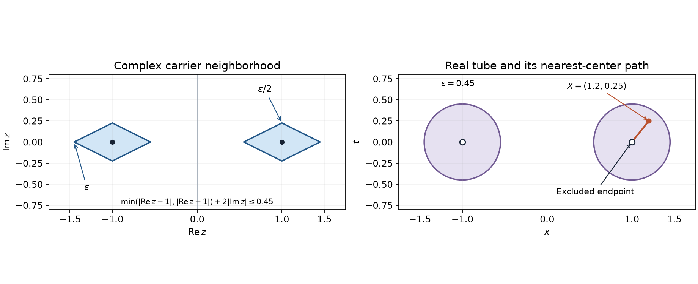

# Localizing analytic sources without analytic cutoffs

*Original exposition and proofs: GPT-6 Astra (OpenAI), October 2026. CC0.*

An analytic function cannot be a nontrivial compact cutoff. Nevertheless, an analytic functional carried by a union of real compact sets can be divided into pieces carried by those sets. The construction takes place one dimension higher: multiply its harmonic field by a smooth cutoff, then solve an equation to remove the resulting Laplacian. A second use of harmonic approximation lets us assemble data whose differences eventually concentrate near a smaller carrier, even when their sizes grow without bound.

Write \(A'(K)\) for the entire-test functionals with a bound on every complex neighborhood of the compact carrier \(K\), as in [Analytic tests and real carriers](analytic-tests-and-real-carriers.md), Definition (A1). All pairings are complex linear. We work with \(n\ge1\), \(d=n+1\), \(X=(x,t)\in\mathbb R^d\), and the positive Laplacian \(\Delta=\sum\partial_j^2\).

The needed approximation and solvability results already have full programme proofs in [Fundamental solutions, continuation and approximation](fundamental-solutions-continuation-and-approximation.md): B0–B2 for compact partitions and smooth completeness, Theorems 1.2–1.3 for regularity and limits, Theorem 4.1 for Runge approximation on arbitrary open sets, and Theorem 5.1 for exact distributional solvability on arbitrary open sets. These apply to the Laplace fundamental solution from [Point sources and complex Gaussian kernels](point-sources-and-complex-gaussian-kernels.md), Theorem 1.1. Its power or logarithmic formula is real analytic away from zero: around a positive squared radius, the convergent binomial or logarithmic series gives the local analytic expression. Smooth right sides therefore have smooth solutions by the same Theorem 1.2.

We also use the entire odd harmonic lift, recovery formula, full harmonic converse and smallest-real-carrier theorem in [Recovering analytic data from harmonic fields](recovering-analytic-data-from-harmonic-fields.md), Theorems 2, 4–6. The exact local holomorphic approximation is Theorem 4 of [Analytic tests and real carriers](analytic-tests-and-real-carriers.md). Compact cutoffs and scalar calculus are proved in [metric foundations](../prerequisites/U011-free-foundations/metric-foundation-bridges.md), Sections 12–13; Cauchy bounds are in [complex contours](../prerequisites/U011-free-foundations/complex-contours-U070.md), CX7–CX11 and CMI6–CMI8. The [finite partition construction](local-data-and-compatible-products.md), immediately before Theorem 1.1, will also be used.

## Correcting a smooth cutoff

For a real compact set \(K\), write \(\widehat K=K\times\{0\}\). A harmonic field below is allowed to have arbitrary growth at infinity.

**Lemma 1 (separating two carriers off their intersection).** If \(A,B\subset\mathbb R^d\) are compact and invariant under \(t\mapsto-t\), there is a smooth, even function \(\phi\) on
\[
 \Omega=\mathbb R^d\setminus(A\cap B)
 \tag{S1}
\]
with values in \([0,1]\), vanishing outside a bounded set, equal to one near \(A\setminus B\) and zero near \(B\setminus A\). The neighborhoods and smoothness are relative to \(\Omega\).

**Proof.** The relatively closed sets \(A\cap\Omega\) and \(B\cap\Omega\) are disjoint. Thus the two open sets
\[
 O_0=\Omega\setminus A,\qquad O_1=\Omega\setminus B
 \tag{S2}
\]
cover \(\Omega\). Take the locally finite compact smooth partition \(\{\psi_j\}\) constructed in B0 of the approximation lesson. On each compact \(\operatorname{supp}\psi_j\), the finite subordinate partition construction gives nonnegative \(\theta_{j\ell}\), each compactly supported in one \(O_i\), whose sum is one near that support. The products \(\psi_j\theta_{j\ell}\) form a locally finite partition on \(\Omega\). Group the products according to \(i=0,1\), obtaining \(a_0+a_1=1\). Local finiteness shows that \(a_0\) vanishes on a neighborhood of each point of \(A\cap\Omega\), and \(a_1\) vanishes near \(B\cap\Omega\): locally only finitely many supports occur, each avoiding the relevant closed set. Consequently \(a_1=1\) near \(A\cap\Omega\).

Multiply \(a_1\) by a compact radial cutoff equal to one near \(A\cup B\), and average the result with its reflection in \(t\). Both prescribed sets are reflection invariant, so the resulting \(\phi\) retains the required constant values near them and all the other properties. No extension of \(\phi\) through \(A\cap B\) is asserted. \(\square\)

**Theorem 2 (finite splitting and its exact ambiguity).** For real compact sets \(K_1,\ldots,K_r\) and \(u\in A'(K_1\cup\cdots\cup K_r)\), there exist
\[
 u_j\in A'(K_j),\qquad u=u_1+\cdots+u_r.
 \tag{S3}
\]
For two carriers the sequence of vector spaces
\[
 0\longrightarrow A'(K_1\cap K_2)
 \xrightarrow{\,w\mapsto(w,-w)\,}
 A'(K_1)\oplus A'(K_2)
 \xrightarrow{\,(u_1,u_2)\mapsto u_1+u_2\,}
 A'(K_1\cup K_2)\longrightarrow0
 \tag{S4}
\]
is exact. In particular, the two pieces are unique when the carriers are disjoint. This assertion does not specify a continuous linear choice of pieces.

**Proof.** Empty carriers contribute zero. For two nonempty carriers let \(U\) be the canonical odd harmonic field of \(u\), defined outside \(A\cup B\), where \(A=\widehat K_1\), \(B=\widehat K_2\). Choose \(\phi\) from Lemma 1. Away from \(A\cup B\), set
\[
 q=\Delta(\phi U)
   =(\Delta\phi)U+2\nabla\phi\cdot\nabla U.
 \tag{S5}
\]
Near \(A\setminus B\) the cutoff is one, and near \(B\setminus A\) it is zero. Thus \(q\) is zero in the portions of these neighborhoods where \(U\) is defined; extension by zero makes \(q\) a smooth function on all of \(\Omega\) in (S1). These definitions agree on overlaps, so they are a single smooth function. It is odd in \(t\).

The earlier global solvability theorem gives \(v\in\mathcal D'(\Omega)\) with \(\Delta v=q\). The exact local regularity theorem makes \(v\) smooth, since \(q\) is smooth. Replacing it by
\[
 v^o(x,t)=\tfrac12\big(v(x,t)-v(x,-t)\big)
 \tag{S6}
\]
preserves the equation and makes it odd. Use this odd solution as \(v\).

Define
\[
 U_1=\phi U-v\quad\hbox{outside }A,\qquad
 U_2=(1-\phi)U+v\quad\hbox{outside }B.
 \tag{S7}
\]
The first product is extended by zero near \(B\setminus A\); the second is extended by zero near \(A\setminus B\). The cutoff is identically zero on the respective neighborhoods, so these are smooth extensions. Equation (S5), including its zero extensions, proves \(\Delta U_1=\Delta U_2=0\) on their full stated domains. Both fields are odd and \(U_1+U_2=U\) on the common domain.

The full harmonic converse supplies \(u_i\in A'(K_i)\). To check their sum without a condition at infinity, take one compact cutoff \(\chi=1\) near \(A\cup B\). The recovery formula with the entire harmonic lift \(\Phi_f\) gives, for every entire \(f\),
\[
 (u_1+u_2)(f)
 =-\int (U_1+U_2)\Delta(\chi\Phi_f)
 =u(f).
 \tag{S8}
\]
Only the compact transition region is integrated. This proves the two-set existence assertion. Repeatedly split the union of the first \(r-1\) carriers from the last one, and use induction to obtain (S3).

If two pairs have the same sum, their difference is \((w,-w)\) with \(w\) carried by both \(K_1\) and \(K_2\). The smallest-real-carrier theorem puts its support in their intersection, so \(w\in A'(K_1\cap K_2)\). Conversely any such \(w\) gives a difference of pairs. The first map is injective and the last is onto by (S3), proving exactness. When the intersection is empty, its analytic-functional space is zero. \(\square\)

The smooth cutoff was applied to a harmonic function on a punctured space. It was not multiplied into an arbitrary analytic test. The correction \(v\) restores precisely the equation that multiplication disturbed.

## Complex neighborhoods and real tubes

We now need functionals which do not yet have a real carrier. For nonempty real compact \(K\), let
\[
 \begin{split}
 \rho_K(z)&=\operatorname{dist}(\operatorname{Re}z,K)
                  +2|\operatorname{Im}z|,&
 K_\varepsilon&=\{z:\rho_K(z)\le\varepsilon\},\\
 T_\varepsilon(K)&=\{X:\operatorname{dist}(X,\widehat K)\le\varepsilon\},
 &Y_\varepsilon(K)&=\mathbb R^d\setminus T_\varepsilon(K),
 \end{split}
 \tag{N1}
\]
where \(\varepsilon>0\). These are different neighborhoods in different spaces.

**Lemma 3 (germs at a thickened real set).** A functional in \(A'(K_\varepsilon)\) extends uniquely to holomorphic germs near \(K_\varepsilon\), with a supremum bound on every such neighborhood. Holomorphic parameter dependence can be passed through the pairing.

**Proof.** Every open neighborhood \(V\) of \(K_\varepsilon\) contains \(K_{\varepsilon+\delta}\) for some \(\delta>0\). Otherwise choose \(z_j\notin V\) with \(\rho_K(z_j)\le\varepsilon+1/j\). These points are bounded; a convergent subsequence has limit in \(K_\varepsilon\) and in the closed complement of \(V\), a contradiction. This also proves the cofinality needed below.

For a function \(f\) holomorphic on \(V\), the earlier Gaussian approximation theorem gives entire \(f_m\) converging uniformly to \(f\) on \(K_{\varepsilon+\delta}\). A functional bound on a smaller open neighborhood of \(K_\varepsilon\) inside this larger compact set makes \(u(f_m)\) Cauchy. Define the extended value by its limit. For two choices use a still smaller positive enlargement contained in both; the difference of the approximants converges uniformly there, so the limits agree. The same argument proves agreement for equivalent germs, linearity, and a bound by \(C_V\sup_V|f|\).

Any continuous germ extension has the same value on this approximation, proving uniqueness. For holomorphic parameters, choose a fixed positive enlargement and a parameter polydisk on whose product the kernel is holomorphic. Its Taylor series and derivative series converge uniformly on smaller products by Cauchy estimates. The one fixed functional bound permits termwise pairing. This proves the parameter assertion. \(\square\)

Let \(E_d\) be the positive-Laplacian fundamental solution and \(P=\partial_tE_d\). The preceding harmonic lesson proves
\[
 P(x,t)=\frac{t}{\sigma_n(|x|^2+t^2)^{(n+1)/2}},
 \qquad \Delta P=\partial_t\delta_0,
 \tag{N2}
\]
where \(\sigma_n\) is the area of the unit sphere in \(\mathbb R^{n+1}\). Its entire lift satisfies
\[
 \Delta\Phi_f=0,\quad \Phi_f(z,0)=0,\quad
 \partial_s\Phi_f(z,0)=f(z),\qquad
 |\Phi_f(z,s)|\le C_n|s|\sup_{|w-z|<2|s|}|f(w)|.
 \tag{N3}
\]
At \(s=0\) the last assertion is its continuous zero value.

**Proposition 4 (a quantitative dictionary).**

1. If \(u\in A'(K_\varepsilon)\), then
   \[
    U_u(X)=u_z\big(P(X-(z,0))\big)
    \quad (X\in Y_\varepsilon(K))
    \tag{N4}
   \]
   is a well-defined odd harmonic function. For every compact smooth \(\chi=1\) near \(T_\varepsilon(K)\) and every entire \(f\),
   \[
    u(f)=-\int U_u(X)\Delta(\chi\Phi_f)(X)\,dX.
    \tag{N5}
   \]
   Enlarging the radius or the real set does not change the field on the resulting smaller exterior domain. The same compatibility holds with the canonical field when the functional is already carried by \(K\).
2. Conversely, for every odd harmonic \(F\) on \(Y_\varepsilon(K)\), the right side of
   \[
    R(F)(f)=-\int F(X)\Delta(\chi\Phi_f)(X)\,dX
    \tag{N6}
   \]
   is independent of the compact cutoff \(\chi=1\) near \(T_\varepsilon(K)\), and defines an element of \(A'(K_{24\varepsilon})\).

The explicit factor \(24\) is only a convenient bound; its uniformity as \(\varepsilon\downarrow0\) is what will be used.

**Proof of the forward statement.** Write \(z=a+ib\), let \(c\in K\) be nearest to \(a\), and suppose \(X=(x,t)\notin T_\varepsilon(K)\). The real distance estimate gives
\[
 \begin{aligned}
 \sqrt{|x-a|^2+t^2}
 &\ge \operatorname{dist}(X,\widehat K)-|a-c|\\
 &>\varepsilon-\operatorname{dist}(a,K)
 \ge 2|b|\qquad(z\in K_\varepsilon).
 \end{aligned}
 \tag{N7}
\]
Hence
\[
 \operatorname{Re}\big((x-z)\cdot(x-z)+t^2\big)
 =|x-a|^2+t^2-|b|^2>0.
 \tag{N8}
\]
The power in (N2) has a single holomorphic branch on the right half-plane, chosen positive on the positive real axis. Compactness gives a complex neighborhood of \(K_\varepsilon\) and a real neighborhood of \(X\) on which this branch is defined. Lemma 3 now justifies the pairing and all parameter derivatives. The kernel identities give harmonicity and oddness.

To prove recovery, let \(S=\operatorname{supp}\Delta(\chi\Phi_f)\), which is contained in the compact transition region of \(\chi\). Choose \(\delta>0\) small enough that \(\chi=1\) near \(T_{\varepsilon+\delta}(K)\). For real \(a\) with \(\operatorname{dist}(a,K)\le\varepsilon+\delta\), the distributional identity in (N2) gives
\[
 I(a):=\int P(X-(a,0))\Delta(\chi\Phi_f)(X)\,dX=-f(a).
 \tag{N9}
\]
Both sides extend holomorphically to a neighborhood of \(K_{\varepsilon+\delta}\). For the integral, apply (N8) uniformly over \(S\), then differentiate under the compact integral. Each vertical segment from \(a+ib\) to \(a\) remains in this neighborhood after it is chosen by the positive-real-part condition: decreasing \(|b|\) preserves that condition. Equality near the real trace follows from the real Taylor coefficients, and the holomorphic identity principle propagates it along these segments. Thus (N9) is an identity of germs near \(K_\varepsilon\).

Apply \(u\) to it. Uniform Riemann sums on the compact integration region converge uniformly on a smaller complex neighborhood of the carrier, so the functional bound exchanges \(u\) with the integral. This proves (N5). For nested real sets and increasing radii, the kernel on the smaller exterior domain is holomorphic near the larger thickened carrier. Approximate it by entire functions on a slight enlargement of that carrier. The same approximants converge on neighborhoods of both carriers, so both pairings have the same limit. For a real carrier use its germ extension and the same approximation. No germ extension theorem for arbitrary complex compact sets has been assumed.

**Proof of the reverse statement.** The difference of two admissible cutoffs vanishes near \(T_\varepsilon(K)\). Integration by parts against the harmonic \(F\) therefore makes their difference in (N6) zero. To obtain a carrier estimate, choose an even cutoff supported in the open tube of radius \(2\varepsilon\), equal to one near the closed tube of radius \(\varepsilon\).

For real \(X=(x,t)\) in that support and complex \((z,s)\) within distance \(\varepsilon\) of \(X\),
\[
 \operatorname{dist}(\operatorname{Re}z,K)<3\varepsilon,\quad
 |\operatorname{Im}z|<\varepsilon,\quad |s|<3\varepsilon.
 \tag{N10}
\]
If \(|w-z|<2|s|\), these bounds imply
\[
 \operatorname{dist}(\operatorname{Re}w,K)<9\varepsilon,\quad
 |\operatorname{Im}w|<7\varepsilon,\quad
 \rho_K(w)<23\varepsilon.
 \tag{N11}
\]
The lift estimate (N3) bounds \(\Phi_f\) there by \(3C_n\varepsilon\sup_{K_{24\varepsilon}}|f|\). Cauchy circles of radius \(\varepsilon/(2\sqrt d)\) give a bound for each first derivative on the real support of \(\chi\) by a constant times the same supremum. Use the exact product identity
\[
 \Delta(\chi\Phi_f)=\Phi_f\Delta\chi+
                         2\nabla\chi\cdot\nabla\Phi_f.
 \tag{N12}
\]
The cutoff derivatives have compact support in \(Y_\varepsilon(K)\), where \(F\) is bounded. Thus
\[
 |R(F)(f)|\le C_{F,\chi,\varepsilon}
                    \sup_{K_{24\varepsilon}}|f|.
 \tag{N13}
\]
This estimate implies the defining bound for every neighborhood of \(K_{24\varepsilon}\). Linearity is immediate, so \(R(F)\in A'(K_{24\varepsilon})\). \(\square\)

*The same real compact set \(K_0=\{-1,1\}\) is used in two different spaces, with \(\varepsilon=0.45\). The left panel shows exactly \(\operatorname{dist}(\operatorname{Re}z,K_0)+2|\operatorname{Im}z|\le\varepsilon\). The right shows the closed Euclidean tube around \(K_0\times\{0\}\). Its marked segment joins \(X=(1.2,0.25)\) to the excluded center \((1,0)\). Every point before the endpoint remains in the relative complement used in Lemma 5. The diagram illustrates the geometry; (N7)–(N13) prove the comparison in every dimension.*

## Why these tubes permit harmonic approximation

**Lemma 5 (the complement condition with all components retained).** Let \(K_0\subset\mathbb R^n\) be nonempty and compact, and put
\[
 \Omega_0=\mathbb R^d\setminus\widehat K_0.
 \tag{R1}
\]
Every harmonic function on \(Y_\varepsilon(K_0)\) is a \(C^\infty\) limit there of functions harmonic on \(\Omega_0\). An odd function can be approximated by odd ones.

**Proof.** The exact condition in the earlier Runge theorem prohibits a nonempty compact relatively open-and-closed piece of
\[
 \Omega_0\setminus Y_\varepsilon(K_0)
            =T_\varepsilon(K_0)\setminus\widehat K_0.
 \tag{R2}
\]
Suppose such a piece \(Q\) exists and take \(X\in Q\). Choose a nearest \(Y\in\widehat K_0\). The segment
\[
 X_s=(1-s)X+sY,\qquad 0\le s<1,
 \tag{R3}
\]
has distance at most \((1-s)|X-Y|\le\varepsilon\) from \(\widehat K_0\). It does not meet \(\widehat K_0\) before \(Y\): any earlier meeting would be closer to \(X\) than its chosen nearest point. Thus the whole half-open segment lies in (R2). Its connectedness and relative clopenness keep it in \(Q\). Compactness of \(Q\) would then put its endpoint \(Y\) in \(Q\subset\Omega_0\), a contradiction. This argument does not require finitely many components or regularity of the boundary of \(K_0\).

Apply the full Runge theorem with \(X=\Omega_0\), \(Y=Y_\varepsilon(K_0)\) and \(P=\Delta\). To preserve oddness, replace every approximant \(h\) by \((h(x,t)-h(x,-t))/2\). Reflection preserves both domains. For a symmetric compact set and a fixed derivative order, the error after this replacement is no greater than the previous maximum error on that set; signs from differentiating the reflection have modulus one. General compact sets may first be enlarged by their reflections. \(\square\)

## Stabilization away from a shrinking carrier

The next assertion concerns eventual carrier containment. It puts no smallness condition on the norms of the differences.

**Theorem 6 (completeness modulo a smaller real carrier).** Let \(K_0\subset K\subset\mathbb R^n\) be compact. Let \(u_m\) be analytic functionals on entire functions, each having some compact complex carrier. Suppose:

1. For every compact neighborhood \(V\) of \(K\) in \(\mathbb C^n\), \(u_m\in A'(V)\) for all sufficiently large \(m\).
2. For every compact neighborhood \(V_0\) of \(K_0\), \(u_m-u_l\in A'(V_0)\) for all sufficiently large \(m,l\).

Then there is \(u\in A'(K)\) such that, for every such \(V_0\),
\[
 u-u_m\in A'(V_0)\quad\hbox{for all sufficiently large }m.
 \tag{C1}
\]
The possible \(u\)'s are exactly one coset of \(A'(K_0)\).

**Proof: uniqueness and empty sets.** If \(u,v\) both satisfy (C1), choose any open neighborhood \(W\) of \(K_0\) and a compact neighborhood \(V_0\subset W\). Subtraction gives \(u-v\in A'(V_0)\), hence a bound by \(\sup_W|f|\). Doing this for every \(W\) proves \(u-v\in A'(K_0)\). Adding any element of this latter space preserves the conclusion.

We regard the empty set as a compact neighborhood of itself. If \(K_0=\varnothing\), condition 2 makes the sequence eventually constant. Condition 1 then puts that constant functional in \(A'(K)\), by the same compact-neighborhood argument. This proves the conclusion, including \(K=\varnothing\), where the eventual constant is zero. Henceforth assume \(K_0\ne\varnothing\).

**Proof: choose radii and a subsequence.** Set \(\varepsilon_j=2^{-j}\). The sets \(K_{\varepsilon_j}\) and \((K_0)_{\varepsilon_j}\) are compact neighborhoods of their real sets. Choose strictly increasing indices \(m_j\) so that
\[
 \begin{split}
 a_j:=u_{m_j}&\in A'(K_{\varepsilon_j}),\\
 u_m-u_l&\in A'((K_0)_{\varepsilon_j})
                       \quad(m,l\ge m_j).
 \end{split}
 \tag{C2}
\]
The two eventual hypotheses permit this choice at each stage. Define \(U_j=U_{a_j}\) on \(Y_{\varepsilon_j}(K)\) by Proposition 4. The functional \(a_{j+1}-a_j\) has a field \(D_j\) harmonic on \(Y_{\varepsilon_j}(K_0)\), and
\[
 D_j=U_{j+1}-U_j
                   \quad\hbox{on }Y_{\varepsilon_j}(K).
 \tag{C3}
\]
Indeed their pairings with the same kernel agree after entire approximation on the larger carrier \(K_{\varepsilon_j}\); the smaller carrier is contained in it. All these fields are odd.

Consider the symmetric compact sets
\[
 M_j=\{X:|X|\le j,\quad
          \operatorname{dist}(X,\widehat K_0)\ge2\varepsilon_j\}.
 \tag{C4}
\]
They increase, lie in \(Y_{\varepsilon_j}(K_0)\), and their interiors exhaust \(\Omega_0\). On an empty \(M_j\) every displayed seminorm is zero. By Lemma 5 choose odd harmonic \(h_j\) on \(\Omega_0\) such that
\[
 \|D_j-h_j\|_{C^j(M_j)}<2^{-j},
 \qquad
 \|g\|_{C^j(M)}=\max_{|\alpha|\le j}\sup_M|\partial^\alpha g|.
 \tag{C5}
\]
For an empty \(M_j\), take \(h_j=0\).

**Proof: form an actual harmonic limit.** On their respective domains define
\[
 W_j=U_j-\sum_{i<j}h_i.
 \tag{C6}
\]
For every compact \(L\subset\mathbb R^d\setminus\widehat K\), all sufficiently late \(W_j\) are defined near \(L\). For any fixed derivative order, all sufficiently late \(M_j\) contain \(L\) and (C5) controls that derivative there. Since \(W_{j+1}-W_j=D_j-h_j\) wherever \(U_j\) is defined, these differences have summable bounds on every such compact. Smooth completeness from B1 of the approximation lesson gives a limit \(U\), smooth and harmonic on
\[
 \Omega_K=\mathbb R^d\setminus\widehat K.
 \tag{C7}
\]
The derivative limit proves harmonicity, and reflection proves oddness. The harmonic converse therefore gives \(u\in A'(K)\).

For a fixed \(j\), the series
\[
 F_j=-\sum_{i<j}h_i+\sum_{i\ge j}(D_i-h_i)
 \tag{C8}
\]
defines an odd harmonic function on \(Y_{\varepsilon_j}(K_0)\). Each summand with \(i\ge j\) is defined there because the radii decrease. On any compact subset, finitely many early terms are smooth and the late terms converge with every derivative by (C5). On \(Y_{\varepsilon_j}(K)\), telescoping (C6) gives
\[
 F_j=U-U_j.
 \tag{C9}
\]
Choose one compact cutoff equal to one near \(T_{\varepsilon_j}(K)\). It is also admissible for \(F_j\) and for the recovery of \(u\). Its transition region lies where (C9) holds. The recovery identities and their cutoff independence give
\[
 u-a_j=R(F_j)\in A'((K_0)_{24\varepsilon_j}).
 \tag{C10}
\]
The bound is a carrier statement; the constants may depend on \(j\).

**Proof: recover every original index.** Given a compact neighborhood \(V_0\) of \(K_0\), choose \(j\) large enough that \((K_0)_{24\varepsilon_j}\subset V_0\). This is possible by compactness and shrinking neighborhoods. For every \(m\ge m_j\), (C2) gives \(a_j-u_m\in A'((K_0)_{\varepsilon_j})\). Add it to (C10); monotonicity of carriers yields (C1). Thus no original tail is lost by the subsequence construction. Together with the first part this proves the full theorem. \(\square\)

This result is different from completeness in the fixed-carrier seminorms of the preceding analytic-functional lesson. Arbitrarily large terms on \(K_0\) are permitted here. What stabilizes is the functional away from every shrinking neighborhood of that set.

## Exercises with full solutions

**Exercise 1 (basic) — compare the two complex distances.** For real compact \(K\), prove
\[
 \operatorname{dist}(z,K)\le\rho_K(z)
              \le\sqrt5\,\operatorname{dist}(z,K).
 \tag{E1}
\]
Show that both constants are sharp, and give the resulting inclusions between complex Euclidean tubes and \(K_\varepsilon\).

**Solution.** Set \(a=\operatorname{dist}(\operatorname{Re}z,K)\), \(b=|\operatorname{Im}z|\). The complex Euclidean distance is \(\sqrt{a^2+b^2}\): minimizing over the real set changes only the real part. The first inequality follows by squaring \(a+2b\); the second is the two-term Cauchy–Schwarz inequality \((a+2b)^2\le5(a^2+b^2)\). Equality for the first occurs when \(b=0\), \(a>0\); equality for the second occurs when \(b=2a>0\). Both are realized for \(K=\{0\}\) in one dimension. Therefore the closed Euclidean tube of radius \(\varepsilon/\sqrt5\) is contained in \(K_\varepsilon\), and \(K_\varepsilon\) is contained in the closed Euclidean tube of radius \(\varepsilon\).

**Exercise 2 (basic) — stabilization with unbounded measurements.** In one dimension let \(K=\{0,1\}\), \(K_0=\{0\}\), and
\[
 u_m(f)=m!f(0)+f(1).
 \tag{E2}
\]
Find all conclusions \(u\) of Theorem 6 and determine whether \(u_m\) converges on entire tests.

**Solution.** Every \(u_m\) is carried by \(K\), and every difference is carried by \(K_0\), so both hypotheses hold without discarding any indices. The functional \(\delta_1\), meaning evaluation at \(1\), satisfies \(u-u_m=-m!\delta_0\in A'(K_0)\). The uniqueness assertion gives exactly \(\delta_1+A'(\{0\})\). But \(u_m(1)=m!+1\) diverges, so there is no pointwise convergence on all entire tests, hence no convergence in any topology implying those evaluations. The theorem imposes no such convergence.

**Exercise 3 (intermediate) — the approximating carriers need not be real.** Let \(u_m(f)=f(i/m)\), \(K=K_0=\{0\}\). Verify the two hypotheses, and show that no fixed \(u_m\) has any real compact carrier.

**Solution.** The point \(i/m\) lies in \(K_\varepsilon\) when \(2/m\le\varepsilon\). Both evaluations in a difference eventually lie in any prescribed neighborhood of zero, proving the hypotheses. The functional \(u=0\) is a valid conclusion, and every element of \(A'(\{0\})\) is another.

For a fixed \(m\), suppose \(u_m\in A'(L)\) for real compact \(L\). Choose a complex Euclidean neighborhood of \(L\) of radius \(0<r<1/m\). On that neighborhood the entire function \(f_\lambda(z)=e^{-i\lambda z}\), \(\lambda>0\), has modulus at most \(e^{\lambda r}\), whereas
\[
 u_m(f_\lambda)=e^{\lambda/m}.
 \tag{E3}
\]
No fixed constant can bound their ratio as \(\lambda\to\infty\). This contradicts the carrier estimate. Thus the proof of Theorem 6 must allow genuinely complex intermediate carriers.

**Exercise 4 (advanced) — disjoint pieces by holomorphic germs.** Let \(K_1,K_2\) be disjoint real compact sets and \(u\in A'(K_1\cup K_2)\). Give a direct splitting using local holomorphic tests, and explain why an entire analytic partition with the same constant values cannot replace those germs on a connected complex domain.

**Solution.** Choose disjoint complex neighborhoods of the two compact sets. Define a holomorphic germ \(g\) near their union which is one near \(K_1\) and zero near \(K_2\). Set \(u_1(f)=u(gf)\), \(u_2(f)=u((1-g)f)\). To prove \(u_1\in A'(K_1)\), take any neighborhood \(V_1\) of \(K_1\), choose a smaller neighborhood there, and a disjoint neighborhood of \(K_2\). On their union, \(gf\) equals \(f\) on the first part and zero on the second. The germ bound for \(u\) gives \(|u_1(f)|\le C_{V_1}\sup_{V_1}|f|\). The other carrier is identical. Their sum is \(u\); Theorem 2 proves uniqueness. A holomorphic function on a connected domain which is one on a nonempty open subset is one everywhere by the identity principle, so it cannot also be zero near the other nonempty carrier.

**Exercise 5 (intermediate) — an infinite-order ambiguity at an overlap.** Let \(K_1=[-2,0]\), \(K_2=[0,2]\), and
\[
 u(f)=\int_{-2}^2 f(x)\,dx+
                  \sum_{k\ge0}\frac{f^{(k)}(0)}{(k!)^2}.
 \tag{E4}
\]
Give one splitting and describe all others. Can its ambiguity be limited to finite-order distributions at zero?

**Solution.** The series \(v_0\) in (E4) is the point-carried analytic functional proved in the preceding analytic-functional lesson, formula (D5); that proof also shows it is not a distribution. Take \(u_1(f)=\int_{-2}^0f+v_0(f)\), \(u_2(f)=\int_0^2f\). The interval integrals are carried by their respective intervals by their supremum bounds, and \(v_0\) is carried by zero. Every splitting is \((u_1+w,u_2-w)\), \(w\in A'(\{0\})\), by (S4). Taking \(w=v_0\) shows why finite jets do not exhaust the ambiguity.

**Exercise 6 (intermediate) — measure the error made by a cutoff.** In one base dimension take the field of \(\delta_0\),
\[
 U(x,t)=\frac{t}{2\pi(x^2+t^2)}.
 \tag{E5}
\]
Near \(x=1\), choose a smooth cutoff depending only on \(x\) with \(\phi'(1)=-1\), \(\phi''(1)=0\). Compute \(\Delta(\phi U)(1,t)\), \(t\ne0\). Interpret this when splitting the disjoint carriers \(\{0\}\) and \(\{2\}\).

**Solution.** The product identity gives \(q=\phi''U+2\phi'\partial_xU\). Since \(\partial_xU=-xt/[\pi(x^2+t^2)^2]\),
\[
 q(1,t)=\frac{2t}{\pi(1+t^2)^2}\ne0.
 \tag{E6}
\]
Such a cutoff can be chosen equal to one near \(0\), zero near \(2\), and affine with slope \(-1\) near \(1\), with smooth transitions between these regions. Multiplication alone therefore fails to give a harmonic piece. After the correction in (S7), recovery must give the unique disjoint-carrier splitting \((\delta_0,0)\), since this pair already has the required sum and carriers.

**Exercise 7 (advanced) — a quantitative tail without a false norm claim.** In Theorem 6, for \(0\le r\le j\), bound the \(C^r(M_j)\) norm of \(\sum_{i\ge j}(D_i-h_i)\). State exactly what is and is not controlled by this bound.

**Solution.** Nesting gives \(M_j\subset M_i\) and \(r\le i\) for \(i\ge j\). Thus (C5), the triangle inequality and the geometric series give
\[
 \left\|\sum_{i\ge j}(D_i-h_i)\right\|_{C^r(M_j)}
       \le\sum_{i\ge j}2^{-i}=2^{1-j}.
 \tag{E7}
\]
Smooth convergence justifies differentiation of the sum. The estimate controls the tail after the chosen harmonic corrections. It does not bound the finite sum \(\sum_{i<j}h_i\), the original functionals \(u_m\), or their fixed-carrier seminorms. Exercise 2 excludes such an inference.

**Exercise 8 (basic) — no smaller carrier at all.** Suppose \(K_0=\varnothing\) in Theorem 6. Prove the exact eventual-stationarity conclusion, including the case \(K=\varnothing\), without a harmonic construction.

**Solution.** Taking the compact neighborhood \(V_0=\varnothing\) in condition 2 gives \(u_m-u_l\in A'(\varnothing)=\{0\}\) for \(m,l\) beyond one index. Let their common value be \(a\). For any open neighborhood \(W\) of \(K\), choose a compact neighborhood \(V\subset W\). Condition 1 gives \(a\in A'(V)\), hence a bound on \(W\). Thus \(a\in A'(K)\), and (C1) holds exactly with zero differences. Uniqueness follows because the ambiguity space is zero. If \(K=\varnothing\) as well, condition 1 with \(V=\varnothing\) gives \(a=0\).

## Proof locations and mathematical sources

- [Analytic tests and real carriers](analytic-tests-and-real-carriers.md), (A1), Theorems 4–6 and formula (D5): carrier bounds, full weighted-neighborhood approximation, germ action, distribution comparison and the infinite point functional.
- [Recovering analytic data from harmonic fields](recovering-analytic-data-from-harmonic-fields.md), Theorems 2, 4–6 and (P2): entire harmonic lifts with the radius bound, canonical fields and recovery, converse without a growth condition, and the smallest real carrier.
- [Fundamental solutions, continuation and approximation](fundamental-solutions-continuation-and-approximation.md), B0–B2, Theorems 1.2–1.3, 4.1 and 5.1: complete partitions, smooth convergence, regularity, harmonic approximation under its exact complement condition, and exact global solvability. [Point sources and complex Gaussian kernels](point-sources-and-complex-gaussian-kernels.md), Theorem 1.1: the positive-Laplacian fundamental solution.
- [Local data and compatible products](local-data-and-compatible-products.md), the finite partition preceding Theorem 1.1; [metric foundations](../prerequisites/U011-free-foundations/metric-foundation-bridges.md), Sections 12–13; [complex contours](../prerequisites/U011-free-foundations/complex-contours-U070.md), CX7–CX11 and CMI6–CMI8: the finite partitions, cutoffs, elementary calculus, compactness, Cauchy estimates and identity principle used above.
- Lars Hörmander, *The Analysis of Linear Partial Differential Operators I*, second edition, 2003 reprint, [DOI 10.1007/978-3-642-61497-2](https://doi.org/10.1007/978-3-642-61497-2), Section 9.1, Theorems 9.1.7–9.1.8 and the neighborhood comparison preceding them. This is the mathematical source for completeness modulo carriers and finite splitting. The exposition, proofs at the stated interfaces, examples, exercises and figure here are independently written. The required approximation and solvability proofs are included earlier in the programme at the exact locations above.
