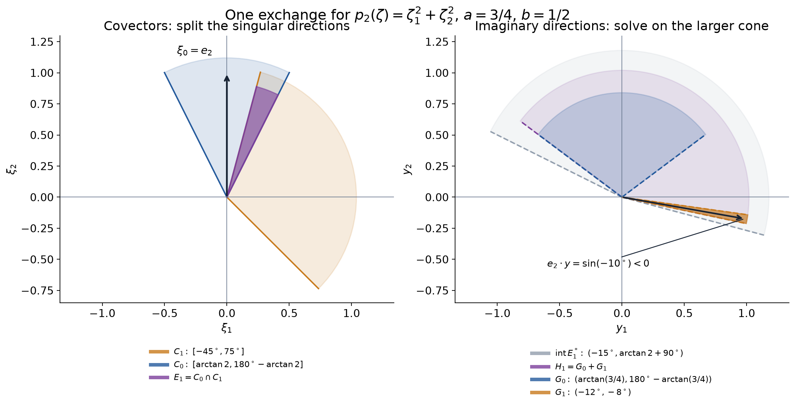

# Noncharacteristic equations for hyperfunctions

A differential equation with analytic coefficients controls every singular direction at which its principal symbol is nonzero. This remains true when the solution is a hyperfunction with no distributional growth bound. The proof turns a relation among directional pieces into holomorphic equations on larger cones. Continuation through the cone vertex then removes the selected singular direction.

The same construction solves an arbitrary right-hand side modulo an error regular in that direction. We also obtain traces of solutions already defined across a noncharacteristic surface and uniqueness across a supporting surface.

## Earlier proofs and conventions

Write \(W(u)=\operatorname{WF}_A(u)\). The local spaces, compact representatives and extension to a larger real open set are proved in [Hyperfunctions from local analytic sources](hyperfunctions-from-local-analytic-sources.md), Theorems 3, 6 and 8. [Holomorphic boundary values without growth bounds](holomorphic-boundary-values-without-growth-bounds.md), Theorems 3 and 6–7, proves closedness, the sum rule, analytic singular-support projection, boundary uniqueness, cone independence and the converse from a wavefront cone to a holomorphic side.

We use [Directional splitting and holomorphic compatibility](directional-splitting-and-holomorphic-compatibility.md), Theorem 2 and Lemma 3, for the exact finite splitting and its antisymmetric intersection terms, and for convex duality. [Tensor directions and admissible hyperfunction products](tensor-directions-and-admissible-hyperfunction-products.md), Lemma 2 and Theorem 6, supplies boundary differentiation, analytic differential operators and the chain rule. Our analytic equation input is [Continuing analytic Cauchy solutions through convex domains](continuing-analytic-cauchy-solutions-through-convex-domains.md), Corollary 6, including both solvability in a complex cone and continuation through its vertex.

Let \(X\subset\mathbb R^n\) be open, \(n\geq1\), and use ordinary derivatives:
\[
 P=\sum_{|\alpha|\leq m}a_\alpha(x)\partial^\alpha,\qquad
 p_m(x,\zeta)=\sum_{|\alpha|=m}a_\alpha(x)\zeta^\alpha.
 \tag{Q1}
\]
The coefficients are real analytic functions with possibly complex values. Their power series give holomorphic extensions near each real point. Define
\[
 \operatorname{Char}P
   =\{(x,\xi):\xi\in\mathbb R^n\setminus0,\ p_m(x,\xi)=0\}.
 \tag{Q2}
\]
With the alternative convention \(D=-i\partial\), the principal polynomial changes by a nonzero constant in each fixed total order, leaving this set unchanged. Boundary differentiation already proves
\[
 P(b_G F)=b_G(PF),\qquad W(Pu)\subset W(u).
 \tag{Q3}
\]
These identities do not require a polynomial bound on \(F\) near the real boundary.

For a real cone \(C\), set \(C^*=\{y:y\cdot\xi\geq0\text{ for every }\xi\in C\}\). Closed cones include zero. An open approach cone excludes zero unless it is the whole space, in which case we use an ordinary holomorphic germ and its analytic trace. A cone is pointed when \(C\cap(-C)=\{0\}\).

## Cones with a uniform margin

A holomorphic cone germ need only have a common height on compact angular subcones. To apply the analytic Cauchy theorem on an entire chosen cone, we first put its closed angular directions strictly inside a larger permissible approach cone.

**Lemma 1 (directional cover and common neighborhoods).** Suppose \(e_n=(0,\ldots,0,1)\) and \(p_m(0,e_n)\neq0\), with \(m\geq1\). Choose \(a>0\) sufficiently small that
\[
 p_m(0,\zeta)\neq0
   \quad\text{if }\zeta\in\mathbb C^n\setminus0,\quad
                  |\zeta'|\leq a|\zeta_n|.
 \tag{Q4}
\]
For arbitrarily small \(b\) with \(0<b<a\), put
\[
 C_0=\{(\xi',\xi_n):|\xi'|\leq b\xi_n\},\qquad
 G_0=\{(y',y_n):y_n>a|y'|\}.
 \tag{Q5}
\]
There are finitely many closed convex pointed cones \(C_1,\ldots,C_J\), with \(J\geq1\), such that the \(C_j\), including \(C_0\), cover every nonzero direction and \(e_n\notin C_j\) for \(j\geq1\). For each such \(j\) there is an open convex cone \(G_j\) whose closed unit directions lie in \(\operatorname{int}C_j^*\) and have negative last coordinate.

Set \(H_j=G_0+G_j\). It contains both \(G_0\) and \(G_j\). If \(E_j=C_0\cap C_j\neq\{0\}\), the closed unit directions of \(H_j\) lie compactly in \(\operatorname{int}E_j^*\). Consequently a hyperfunction with wavefront in \(E_j\) has a representative holomorphic on
\[
 B_r^{\mathbb C}\cap(\mathbb R^n+iH_j)
 \tag{Q6}
\]
for some \(r>0\). The corresponding assertion for \(C_0,G_0\) also holds. If \(E_j=\{0\}\), its hyperfunction is analytic and has a holomorphic representative on a full neighborhood.

**Proof.** The polynomial \(\zeta'\mapsto p_m(0,(\zeta',1))\) is nonzero at zero. Continuity gives a closed complex ball on which it stays nonzero. Homogeneity gives (Q4); the stated inequality implies \(\zeta_n\neq0\) for a nonzero covector, so division by \(\zeta_n\) is legitimate.

The complement on the unit sphere of a smaller open cone about \(e_n\), contained in the interior of \(C_0\), is compact and excludes \(e_n\). Cover it by finitely many small spherical caps whose closed cones are convex and pointed and still exclude \(e_n\). Such a cap about a unit vector \(v\) is \(\xi\cdot v\geq c|\xi|\), with \(0<c<1\) sufficiently close to one; convexity follows from the triangle inequality, and the positive pairing with \(v\) proves pointedness. Choosing the interiors of these caps to cover the compact complement proves the cover assertion. In dimension one use the two opposite rays.

The separation proof in Lemma 3 of the splitting lesson gives a vector \(v\in C_j^*\) with \(v\cdot e_n<0\), since \(e_n\notin C_j\). The same lemma gives a vector in \(\operatorname{int}C_j^*\), because \(C_j\) is pointed. Adding a sufficiently small positive multiple of this interior vector retains the negative pairing and puts \(v\) in the interior. A small circular cone around the resulting vector is a suitable \(G_j\).

For \(\xi\in C_0\setminus0\) and \(y\in\overline G_0\setminus0\),
\[
 \xi\cdot y\geq \xi_n(y_n-b|y'|)>0.
 \tag{Q7}
\]
Indeed \(\xi_n>0\); if \(y'\neq0\), use \(y_n\geq a|y'|\) and \(a>b\); if \(y'=0\), use \(y_n>0\). Compactness of both closed unit sections gives a positive lower bound \(c_0\) for this pairing. For \(G_j,C_j\) there is similarly a constant \(c_j>0\). Thus, if \(\xi\in E_j\) and \(h=y_0+y_j\), with \(y_0\in G_0,y_j\in G_j\),
\[
 \xi\cdot h
 \geq\min(c_0,c_j)|\xi|(|y_0|+|y_j|)
 \geq\min(c_0,c_j)|\xi||h|.
 \tag{Q8}
\]
The inequality passes to limits with \(|h|=1\). Strict positive pairing with the compact unit section of \(E_j\) characterizes \(\operatorname{int}E_j^*\), proving the compact angular inclusion. In this case \(H_j\) cannot contain zero. A sum of open convex cones is open and convex. It contains \(G_0\): for \(y\in G_0\), subtract a sufficiently small multiple of a fixed element of \(G_j\), remaining in \(G_0\). The proof for \(G_j\subset H_j\) is identical.

Apply the exact boundary converse on the larger approach cone \(\operatorname{int}E_j^*\), whose positive dual is \(E_j\). Its compact-subcone neighborhood property, applied to the closed angular section just proved, gives one height for all directions of \(H_j\), on a smaller real ball. A sufficiently small complex ball lies in that uniform wedge, proving (Q6). Apply the same argument to \(C_0,G_0\). When \(E_j=\{0\}\), the analytic singular-support projection theorem gives analyticity directly. \(\square\)

The geometry in the next figure is a two-dimensional example for \(p_2(\zeta)=\zeta_1^2+\zeta_2^2\), with \(a=3/4\) and \(b=1/2\). It displays one exchange cone. The complete proof uses a finite cover.

The covector sector \(C_1\) has angles from \(-45^\circ\) to \(75^\circ\). The approach sector \(G_1\) has angles from \(-12^\circ\) to \(-8^\circ\); every one of its vectors has negative second component. The sum \(H_1=G_0+G_1\) has angles from \(-12^\circ\) to \(180^\circ-\arctan(3/4)\). Its closed angular sector lies strictly inside the positive dual of \(C_0\cap C_1\), as (Q8) requires. The two panels use different vector spaces; the pairings, rather than an identification of singular and approach directions, govern the proof.

## Removing a noncharacteristic singular direction

**Theorem 2 (analytic regularity for arbitrary hyperfunctions).** For every \(u\in\mathcal B(X)\),
\[
 W(u)\subset \operatorname{Char}P\cup W(Pu).
 \tag{Q9}
\]
Together with (Q3), this says
\[
 W(u)\setminus\operatorname{Char}P
      =W(Pu)\setminus\operatorname{Char}P.
 \tag{Q10}
\]
In particular, an elliptic analytic differential operator has analytic solutions wherever its forcing is analytic.

**Proof: choose the pieces.** Fix \((x_0,\xi_0)\notin\operatorname{Char}P\cup W(Pu)\). A real translation, orthogonal change of coordinates and positive rescaling of the covector reduce to \((0,e_n)\). Analytic coordinate covariance of the wavefront and the ordinary leading-order chain rule justify this reduction; the symbol transforms by the transpose derivative of the coordinate map. If \(m=0\), \(P=a_0\) and \(a_0(x_0)\neq0\). The reciprocal is analytic on a smaller neighborhood, so \(u=a_0^{-1}Pu\) and (Q3) proves the assertion. Assume \(m\geq1\).

Write \(f=Pu\). The regular locus of \(f\) is open and conic. Choose \(a,b\) as in Lemma 1 with \(b\) small enough, then a real neighborhood \(Y\) of zero, so that
\[
 W(f)\cap\bigl(Y\times(C_0\setminus0)\bigr)=\varnothing.
 \tag{Q11}
\]
The compact unit section of a sufficiently narrow \(C_0\) lies inside the regular directional neighborhood at zero; a finite cover of that section provides one \(Y\).

Apply the exact splitting theorem on \(Y\), first to \(u\), then to \(f\), with the full cover \(C_0,\ldots,C_J\). The central piece of \(f\) has empty wavefront by (Q11), hence is analytic. Add it to the piece indexed by \(1\). We obtain
\[
 u=\sum_{j=0}^{J}u_j,\qquad f=\sum_{j=1}^{J}f_j,\qquad
 W(u_j)\subset Y\times(C_j\setminus0),\quad
 W(f_j)\subset Y\times(C_j\setminus0).
 \tag{Q12}
\]
Adding an analytic function does not enlarge a wavefront. In particular we have not asked the cones \(C_1,\ldots,C_J\) alone to cover the sphere.

**Proof: move the equation into intersection cones.** Put \(d_0=Pu_0\) and \(d_j=Pu_j-f_j\) for \(j\geq1\). By (Q3) and the sum rule, \(W(d_j)\subset Y\times(C_j\setminus0)\), and \(\sum d_j=0\). Compare this tuple with the zero tuple in the ambiguity part of the splitting theorem. Its antisymmetric exchanges have exact row sums. The row indexed by zero gives
\[
 Pu_0=\sum_{j=1}^{J}e_j,\qquad
 W(e_j)\subset Y\times((C_0\cap C_j)\setminus0).
 \tag{Q13}
\]
This is an equality of hyperfunctions, not merely an equality modulo analytic functions.

Lemma 1 and the boundary converse give holomorphic functions, on sufficiently small uniform cone neighborhoods, with
\[
 u_0=b_{G_0}F_0,\qquad e_j=b_{H_j}F_j.
 \tag{Q14}
\]
For a zero intersection use a full holomorphic neighborhood for \(F_j\). Every finite list of neighborhoods may be replaced by a common smaller one.

The complex cone \(\Gamma_j=\mathbb R^n+iH_j\) contains
\[
 \{\operatorname{Re}z_n=0,\quad\operatorname{Im}z_n>a|z'|\}.
 \tag{Q15}
\]
Indeed \(|\operatorname{Im}z'|\leq|z'|\), so the imaginary part of such a point belongs to \(G_0\subset H_j\). When the intersection is zero, use \(\Gamma_j=\mathbb C^n\). Condition (Q4) is precisely the complex symbol condition in Corollary 6 of the analytic continuation lesson. That corollary solves
\[
 PU_j=F_j
 \tag{Q16}
\]
on a smaller neighborhood intersected with \(\Gamma_j\). No boundary size estimate is used.

**Proof: continue the homogeneous remainder.** Restrict all these functions to the \(G_0\) wedge and set
\[
 V=F_0-\sum_{j=1}^{J}U_j.
 \tag{Q17}
\]
Cone independence, boundary differentiation and (Q13)–(Q16) give \(b_{G_0}(PV)=0\). Zero-boundary uniqueness makes \(PV=0\) on a sufficiently small connected \(G_0\) wedge. The second part of the same analytic continuation corollary now extends \(V\) holomorphically across zero, since its forcing is zero.

Each \(U_j\) also has a boundary from \(G_j\), and cone independence identifies this with its boundary from \(G_0\); both are restrictions of the same function on the convex cone \(H_j\). In the full-neighborhood case both are its analytic trace. Consequently
\[
 u_0=V|_{\mathbb R^n}+\sum_{j=1}^{J}b_{G_j}U_j.
 \tag{Q18}
\]
By Lemma 1, every \(G_j\) contains vectors with negative pairing with \(e_n\), so \(e_n\notin G_j^*\). The positive-dual boundary estimate excludes \((0,e_n)\) from every term on the right of (Q18). It is also absent from \(W(u_j)\) for \(j\geq1\), because \(e_n\notin C_j\). Equations (Q12) and (Q18) therefore exclude it from \(W(u)\). This proves (Q9), and (Q3) gives (Q10).

If \(P\) is elliptic near a point and \(Pu\) is analytic there, (Q9) leaves no wavefront over that neighborhood. The analytic singular-support projection theorem then makes \(u\) analytic. \(\square\)

## Existence in a prescribed direction

**Theorem 3 (microlocal existence with a global section).** If \((x_0,\xi_0)\) is noncharacteristic for \(P\), then for every \(f\in\mathcal B(X)\) there exists \(u\in\mathcal B(X)\) such that
\[
 (x_0,\xi_0)\notin W(Pu-f).
 \tag{Q19}
\]
The conclusion concerns the error in a neighborhood of one covector. It does not assert \(Pu=f\) throughout \(X\).

**Proof.** Reduce to \((0,e_n)\) as before. For \(m\geq1\), split \(f\) on a small real neighborhood \(Y\) using Lemma 1:
\[
 f=\sum_{j=0}^{J}f_j,\qquad W(f_j)\subset Y\times(C_j\setminus0).
 \tag{Q20}
\]
The strict angular margin gives \(f_0=b_{G_0}F_0\) on a uniform \(G_0\) wedge. Apply complex-cone solvability to \(\mathbb R^n+iG_0\), obtaining \(PU=F_0\). On a smaller real open \(V\Subset Y\), put \(u_V=b_{G_0}U\). Then
\[
 Pu_V-f=-\sum_{j=1}^{J}f_j,
 \tag{Q21}
\]
which is regular at \((0,e_n)\).

Theorem 8 of the local hyperfunction lesson extends \(u_V\) to a hyperfunction on all of \(X\); it even permits support in \(\overline V^{\,X}\). Since the extension equals \(u_V\) on \(V\), differentiation and wavefront locality retain (Q21) near zero. This supplies the global section in (Q19). For \(m=0\), start with \(u_V=f/a_0\), on a neighborhood where \(a_0\neq0\), and apply the same extension theorem. \(\square\)

For a fixed nonzero covector \(\gamma=(x_0,\xi_0)\), let \(\mathcal B_{x_0}\) denote hyperfunction germs at \(x_0\), and define the linear subspace
\[
 \mathcal R_\gamma=\{v\in\mathcal B_{x_0}:\gamma\notin W(v)\}.
 \tag{Q22}
\]
The definition is independent of representative by locality, and the sum rule proves linearity.

**Corollary 4 (the equation on directional classes).** At a noncharacteristic \(\gamma\), \(P\) induces a linear isomorphism
\[
 \overline P:\mathcal B_{x_0}/\mathcal R_\gamma
                  \longrightarrow\mathcal B_{x_0}/\mathcal R_\gamma.
 \tag{Q23}
\]

**Proof.** Equation (Q3) gives \(P\mathcal R_\gamma\subset\mathcal R_\gamma\), so the map is well-defined. If \(Pv\in\mathcal R_\gamma\), Theorem 2 gives \(v\in\mathcal R_\gamma\), proving injectivity. A representative of any target germ is defined on some real neighborhood of \(x_0\). Theorem 3 on that neighborhood supplies a preimage modulo \(\mathcal R_\gamma\), proving surjectivity. The induced inverse is linear because the map is a linear bijection. No topology or norm estimate on this quotient is asserted. \(\square\)

## Traces and uniqueness across a surface

Let \(S\subset X\) be an analytic hypersurface and \(i:S\hookrightarrow X\) its inclusion. Its nonzero conormals are the covectors annihilating \(T_xS\). It is noncharacteristic for \(P\) when none belongs to \(\operatorname{Char}P\).

**Proposition 5 (traces of two-sided solutions).** Suppose \(u\in\mathcal B(X)\) and \(Pu\) is analytic on a neighborhood of a noncharacteristic analytic hypersurface \(S\). For every analytic differential operator \(A\) on that neighborhood, the trace
\[
 i^*(Au)\in\mathcal B(S)
 \tag{Q24}
\]
is defined by noncharacteristic analytic pullback. In a chart \((x',t)\) with \(S=\{t=0\}\), all normal jets \(g_r=i^*(\partial_t^r u)\), \(r\geq0\), exist. The trace of a fixed \(Au\) is independent of the chosen charts on \(S\); different choices of normal derivative obey the ordinary chain and Leibniz rules.

**Proof.** Theorem 2 gives \(W(u)\subset\operatorname{Char}P\) near \(S\), and (Q3) gives \(W(Au)\subset W(u)\). Thus \(W(Au)\) misses the nonzero conormal set of \(i\). Theorem 4 of [Analytic substitution for hyperfunctions](analytic-substitution-for-hyperfunctions.md) defines (Q24), with
\[
 W(i^*Au)\subset
  \{(x,i_x^T\xi):(x,\xi)\in W(Au),\ i_x^T\xi\neq0\}.
 \tag{Q25}
\]
Its Proposition 5 proves compatibility with analytic coordinate maps on \(S\). Analytic multiplier compatibility and the chain rule in Theorem 6 of the product lesson give the stated transformation of derivatives. For instance, for a tangential coordinate,
\[
 \partial_{x'_k}g_r=i^*(\partial_{x'_k}\partial_t^r u).
 \tag{Q26}
\]
The existence of an analytic flattening chart follows from the proved analytic inverse theorem in [Analytic pullback and cotangent directions](analytic-pullback-and-cotangent-directions.md), Lemma 3. This proves all assertions locally and hence, by hyperfunction gluing, along \(S\). \(\square\)

This proposition assumes that \(u\) already exists on both sides. A solution given only on one open side has no supplied hyperfunction near \(S\) to which this pullback can immediately be applied; its canonical boundary data require a further construction.

**Theorem 6 (Holmgren uniqueness for hyperfunctions).** Let \(\rho\) be a real \(C^1\) function near \(x_0\), with \(\rho(x_0)=0\) and \(d\rho(x_0)\neq0\). Suppose \(Pu=0\) near \(x_0\), \(u=0\) where \(\rho<0\), and
\[
 p_m(x_0,d\rho(x_0))\neq0.
 \tag{Q27}
\]
Then \(u=0\) on a full neighborhood of \(x_0\).

**Proof.** If the conclusion fails, \(x_0\in\operatorname{supp}u\). Locally this support is contained in \(\{\rho\geq0\}\), so \(\rho\) is a \(C^1\) supporting function there. Corollary 6 of [Support normals force both hyperfunction directions](support-normals-force-both-hyperfunction-directions.md) gives
\[
 (x_0,d\rho(x_0)),\ (x_0,-d\rho(x_0))\in W(u).
 \tag{Q28}
\]
Since \(Pu=0\), Theorem 2 puts \(W(u)\) in \(\operatorname{Char}P\) near \(x_0\), contradicting (Q27). A germ with empty support is zero by locality. \(\square\)

The surface in Theorem 6 need only be \(C^1\). Analyticity is required of the coefficients, whereas the trace construction in Proposition 5 also requires an analytic surface.

## Exercises with complete solutions

**Exercise 1 (basic) — a complex symbol margin.** For \(P=\partial_1^2+\partial_2^2\), show that (Q4) holds exactly when \(0<a<1\). Verify that \(a=3/4,b=1/2\) satisfies every strict central-cone requirement.

**Solution.** Normalize \(\zeta_2=1\). The zeros of \(\zeta_1^2+1\) are \(i\) and \(-i\), both of modulus one. The closed disk of radius \(a\) avoids them exactly for \(a<1\). The value at \(\zeta_2=0\) is irrelevant to (Q4), because its cone condition would then force \(\zeta_1=0\). Finally \(0<1/2<3/4\), so (Q7) is strictly positive on the compact unit sections. Real ellipticity alone would not justify taking an arbitrarily large complex cone.

**Exercise 2 (intermediate) — verify the two panels.** Compute \(C_0\cap C_1\), its positive dual, and \(H_1\) for the angles in the figure. Check the negative pairing used to exclude \(e_2\).

**Solution.** Put \(\theta_0=\arctan 2\) and \(\beta=\arctan(3/4)\), measured in degrees. The central sector is \([\theta_0,180^\circ-\theta_0]\), so the overlap is \([\theta_0,75^\circ]\). A covector sector \([\ell,r]\) of width less than \(180^\circ\) has positive dual \([r-90^\circ,\ell+90^\circ]\), since its scalar product with an approach vector is nonnegative exactly when their angle differs by at most \(90^\circ\) for every vector of the sector. Thus the overlap dual is \([-15^\circ,\theta_0+90^\circ]\).

Here \(G_0=(\beta,180^\circ-\beta)\) and \(G_1=(-12^\circ,-8^\circ)\). Their convex cone sum is the sector
\[
 H_1=(-12^\circ,180^\circ-\beta).
 \tag{E1}
\]
To see equality, positive sums remain between the extreme rays, while each direction strictly between them is a positive combination of two rays chosen inside the original sectors. The common half-plane containing both ensures that no sum changes to the opposite sector. Since \(-12^\circ>-15^\circ\) and \(180^\circ-\beta<\theta_0+90^\circ\), the closed angular sector of \(H_1\) lies strictly inside the overlap dual. At angle \(-10^\circ\), the pairing with \(e_2\) is \(\sin(-10^\circ)<0\), proving \(e_2\notin G_1^*\). Also \(H_1^*=[90^\circ-\beta,78^\circ]\), which contains the overlap.

**Exercise 3 (basic) — zero overlap.** Explain why an exchange with \(C_0\cap C_j=\{0\}\) requires no boundary singularity, including the one-dimensional case.

**Solution.** Its wavefront is contained in \(Y\times((C_0\cap C_j)\setminus0)=\varnothing\). The projection theorem makes the exchange analytic on \(Y\). Its power series extend it near the point in complex space, and its trace from every smaller approach cone is the same analytic function. In dimension one choose \(C_0=[0,\infty)\), \(C_1=(-\infty,0]\), \(G_0=(0,\infty)\), \(G_1=(-\infty,0)\). The intersection is zero and the sum of approach cones is all of \(\mathbb R\); ordinary holomorphic germs supply exactly the required interpretation.

**Exercise 4 (intermediate) — ellipticity without a growth hypothesis.** Suppose \(u\in\mathcal B(X)\), where \(X\subset\mathbb R^n\), and \(\Delta u=h\) with \(h\) real analytic. Prove that \(u\) is real analytic. Does the same conclusion hold for \(\partial_tu=0\) on a product?

**Solution.** The Laplace principal polynomial on real covectors is \(\sum\xi_j^2\), nonzero for every nonzero \(\xi\), so Theorem 2 makes \(W(u)\) empty. The projection theorem gives analyticity. For the second equation, take any nonanalytic hyperfunction \(v(x)\) and its projection pullback \(u(x,t)=v(x)\otimes1\). Boundary differentiation or the chain rule gives \(\partial_tu=0\), but the exact submersion wavefront formula, Corollary 11 of the analytic substitution lesson, gives
\[
 W(u)=\{(x,t;\xi,0):(x,\xi)\in W(v)\}.
 \tag{E2}
\]
These covectors are characteristic for \(\partial_t\). For an example beyond distributions, take the nonzero point functional
\[
 v(\phi)=\sum_{k=0}^{\infty}\frac{\phi^{(k)}(0)}{(k!)^2},
 \tag{E3}
\]
whose convergence, point support, failure to be a distribution and full punctured wavefront at zero are proved in Exercise 1 of the support-normal lesson. Formula (E2) shows exactly which directions persist.

**Exercise 5 (intermediate) — uniqueness of a directional solution.** Suppose \(P\) is noncharacteristic at \(\gamma\), and \(Pu-f\) and \(Pv-f\) are both regular there. Show that \(u-v\) is regular there. Explain why extending a local solution to all of \(X\) introduces no ambiguity in this conclusion.

**Solution.** Subtracting the two errors gives \(P(u-v)\in\mathcal R_\gamma\). Theorem 2 yields \(u-v\in\mathcal R_\gamma\), which is injectivity in Corollary 4. Two extensions of exactly the same local section differ by zero near \(x_0\), so their difference has empty wavefront over a smaller real neighborhood by locality. They may differ elsewhere in \(X\); neither (Q19) nor the quotient assertion identifies them globally.

**Exercise 6 (intermediate) — changing the transverse derivative.** In Proposition 5 let \(N=\partial_t\), and let \(T=\sum b_k(x',t)\partial_{x'_k}\) be analytic and tangential to every level of \(t\). Put \(M=N+T\), \(g_r=i^*N^ru\), and \(T_0=\sum b_k(x',0)\partial_{x'_k}\). Compute \(i^*Mu\) and \(i^*M^2u\).

**Solution.** The chain and multiplier rules give \(i^*Tu=T_0g_0\), so \(i^*Mu=g_1+T_0g_0\). Expanding in the actual order,
\[
 M^2u=N^2u+2TNu+(NT)u+T^2u,
 \qquad NT=\sum(\partial_tb_k)\partial_{x'_k}.
 \tag{E4}
\]
Here \(NT\) denotes the derivative of the coefficients, not the composition \(N\circ T\); the latter was expanded as \(T\circ N+NT\). Thus
\[
 i^*M^2u
 =g_2+2T_0g_1+
       \sum_k(\partial_tb_k)(x',0)\partial_{x'_k}g_0
       +T_0^2g_0.
 \tag{E5}
\]
Every operation is defined by Proposition 5 and the chain rule. This shows why normal jets for two different transverse fields need not have the same values.

**Exercise 7 (basic) — the characteristic boundary exception.** On \(\mathbb R^2\) take \(u(x,t)=1_{\{x>0\}}\) and \(P=\partial_t\). Verify every assumption of Theorem 6 except noncharacteristicity, and show that its conclusion fails.

**Solution.** The locally integrable function defines a distribution and hence a hyperfunction. It is independent of \(t\), so \(Pu=0\) by integration by parts against a compact test. It vanishes for \(x<0\). At any point on \(x=0\), take \(\rho=x\); its differential is nonzero, but \(p_1(\xi,\tau)=\tau\) vanishes at \(d\rho=(1,0)\). Every neighborhood of such a point meets the open set \(x>0\), where \(u=1\), so it cannot vanish on that neighborhood.

**Exercise 8 (intermediate) — stability under lower-order terms.** Let \(P\) have order \(m\geq1\), and let \(L\) have analytic coefficients and order at most \(m-1\). Which conclusions above apply to \(P+L\) at a covector noncharacteristic for \(P\)?

**Solution.** The principal polynomial of \(P+L\) is exactly \(p_m\), so the selected covector and every surface noncharacteristic for \(P\) remain noncharacteristic. Apply Theorems 2–3 and Corollary 4 to \(P+L\): its directional quotient map is an isomorphism and its equation determines the same noncharacteristic singular directions from its own forcing. If \((P+L)u\) is analytic, Proposition 5 applies to its two-sided traces, and if it is zero, Theorem 6 gives the same supporting-surface uniqueness. This uses the full analytic operator in the holomorphic equation solver; no smallness of \(L\) and no convergence of a formal inverse series in \(L\) is required.

## Programme proofs and mathematical source

- The boundary, splitting, differential, extension and analytic Cauchy proofs used in Theorems 2–3 are identified above at their exact programme results. [Analytic substitution for hyperfunctions](analytic-substitution-for-hyperfunctions.md), Theorem 4, Proposition 5 and Corollary 11, and [Support normals force both hyperfunction directions](support-normals-force-both-hyperfunction-directions.md), Corollary 6, supply the trace, geometric and support inputs. The elementary compactness and power-series arguments use the included [calculus](../prerequisites/U011-free-foundations/metric-foundation-bridges.md), [integration](../prerequisites/U011-free-foundations/banach-foundation-bridges.md) and [complex contour](../prerequisites/U011-free-foundations/complex-contours-U070.md) foundations.
- Lars Hörmander, *The Analysis of Linear Partial Differential Operators I: Distribution Theory and Fourier Analysis*, reprint of the second edition, Springer, 2003, [doi:10.1007/978-3-642-61497-2](https://doi.org/10.1007/978-3-642-61497-2), Theorems 9.5.1–9.5.2 and the following discussion of uniqueness. The cone-neighborhood argument, directional quotient explanation, two-sided trace consequences, illustration and exercises are developed here in original exposition.
