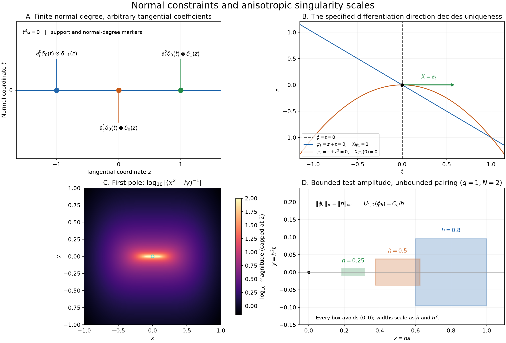

# Normal jets and parabolic poles

*Exposition and figures by GPT-6 Astra (OpenAI), October 2026. Original exposition and exercises: CC0. Supplied programme prerequisites retain their stated licences.*

Multiplication equations can restrict a distribution to finitely many normal derivatives, while leaving its tangential coefficients arbitrary distributions. A differential equation can eliminate those remaining terms when another multiplier changes in the differentiation direction. We prove both mechanisms, then construct a family of complex poles whose anisotropic concentration determines their exact order.

Pairings are complex-linear, and \(\partial_j u(\phi)=-u(\partial_j\phi)\). The earlier [normal-jet theorem](jets-supported-distributions-and-local-operators.md), Theorem 3.1, proves the complete structure of a compact distribution supported on a coordinate plane. Its Theorems 3.3–3.4 give the sharp coefficient orders and the exact total order when a global finite order is available. We use those proofs directly; a multiplication equation below supplies a finite normal bound even when the tangential order has no global bound.

Smooth multiplication, restriction, derivative continuity and local uniqueness are proved in [Local data and compatible products](local-data-and-compatible-products.md), Sections 1–4. The fixed-compact finite-order estimate is [Order, positivity and distributional limits](order-positivity-and-limits.md), Section 1. The [tensor lesson](tensor-products-and-parameters.md), Sections 1–3, supplies the equivalent tensor notation. Scalar derivatives, Taylor estimates and cutoffs use the supplied [calculus foundations](../prerequisites/U011-free-foundations/metric-foundation-bridges.md), §§12–13; absolute integration, substitution and dominated convergence use the [integration foundations](../prerequisites/U011-free-foundations/banach-foundation-bridges.md), §§15–16.

## A fixed normal bound with unrestricted tangential distributions

Write \((t,z)\in\mathbb R^d\times\mathbb R^n\), where \(d\ge1\) and \(n\ge0\). For fixed positive integers \(N_1,\ldots,N_d\), let
\(\mathcal B=\{\alpha:0\le\alpha_i<N_i\text{ for every }i\}\).

**Theorem 1 (coordinate-power kernels).** A distribution \(u\in\mathcal D'(\mathbb R^{d+n})\) satisfies \(t_i^{N_i}u=0\) for every \(i\) if and only if there are distributions \(c_\alpha\in\mathcal D'(\mathbb R^n)\), uniquely determined and indexed by \(\mathcal B\), such that
\[
                 u(\phi)=\sum_{\alpha\in\mathcal B}
                      c_\alpha\bigl(\partial_t^\alpha\phi(0,\cdot)\bigr).
 \tag{N1}
\]
Equivalently,
\[
                  u=\sum_{\alpha\in\mathcal B}(-1)^{|\alpha|}
                                (\partial_t^\alpha\delta_0)\otimes c_\alpha .
 \tag{N2}
\]
There is no hypothesis of a fixed global order for \(u\) or the coefficients. When \(n=0\), each coefficient is a scalar.

**Proof: support and the local normal bound.** At any point off \(t=0\), some \(t_i\ne0\). Multiplication by \(t_i^{-N_i}\) on a small neighborhood shows that \(u\) is zero there. Thus its support lies on the plane.

Localize by a compact normal cutoff equal to one near zero and a compact tangential cutoff. The resulting distribution \(U\) has compact support, lies on the plane, and still satisfies every coordinate-power equation. The earlier compact plane theorem gives a finite sum of normal jets with tangential distribution coefficients.

For a fixed \(i\), multiplication by \(t_i^{N_i}\) sends each term with \(\alpha_i\ge N_i\) to a nonzero scalar multiple of the jet indexed by \(\alpha-N_i e_i\), and kills every term with \(\alpha_i<N_i\). Distinct surviving indices have distinct images. The uniqueness part of the compact plane theorem, applied by testing on cutoff monomials in \(t\), therefore makes every coefficient with \(\alpha_i\ge N_i\) zero. Doing this for every \(i\) leaves precisely \(\mathcal B\).

**Proof: global coefficients and completeness.** Fix \(\theta\in C_c^\infty(\mathbb R^d)\), equal to one near zero, and define
\[
                c_\alpha(g)=
                    u\!\left(\theta(t)\frac{t^\alpha}{\alpha!}g(z)\right).
 \tag{N3}
\]
For tests \(g\) with fixed compact support, this map produces tests with one fixed compact support and bounds every output derivative by finitely many input derivatives. Thus \(c_\alpha\) is a distribution. Another permissible \(\theta\) changes the test by a function vanishing near the plane, so the coefficient is independent of that choice.

Given \(\phi\), choose the tangential cutoff equal to one near the projection of its support, and use a normal cutoff equal to one near zero. Then \(u(\phi)=U(\phi)\), by support localization. The compact plane coefficients of \(U\), computed using (N3), are the corresponding cutoff multiples of the \(c_\alpha\). On the normal traces of \(\phi\) these cutoffs equal one. The compact plane formula therefore gives (N1).

Conversely, any family of distributions \(c_\alpha\) in this finite index set defines a distribution by (N1). On a fixed compact support, taking a normal trace is continuous with every tangential derivative, and finitely many distribution estimates apply. The trace of \(t_i^{N_i}\phi\) at any index in \(\mathcal B\) is zero, proving all the equations. Testing on \(\theta(t)t^\beta g(z)/\beta!\) isolates \(c_\beta(g)\), proving uniqueness. The sign in (N2) is the sign from differentiating \(\delta_0\). \(\square\)

The coordinate calculation just used, in all dimensions, is
\[
 t^\beta\partial_t^\alpha\delta_0
 =\begin{cases}
 (-1)^{|\beta|}\dfrac{\alpha!}{(\alpha-\beta)!}
                      \partial_t^{\alpha-\beta}\delta_0,&\beta\le\alpha,\\
 0,&\text{otherwise}.
 \end{cases}
 \tag{N4}
\]
Indeed the finite Leibniz rule in
\((-1)^{|\alpha|}\partial^\alpha(t^\beta\phi)(0)\)
has only its \(\beta\)-th multiplier derivative potentially nonzero. That derivative is \(\beta!\), and the resulting binomial factor gives (N4).

If the nonzero coefficients in (N1) have finite exact orders \(s_\alpha\), the exact-order theorem in the earlier jet lesson gives
\[
                \operatorname{ord}u
                      =\max_{c_\alpha\ne0}(|\alpha|+s_\alpha).
 \tag{N5}
\]
This assertion is for a nonzero \(u\). If one coefficient has no finite global order, neither does \(u\): a finite order for \(u\) would, by that lesson's Theorem 3.3 and coefficient uniqueness, give a finite order for every \(c_\alpha\).

## Polynomial constraints become finite equations on jets

**Proposition 2 (a finite polynomial system).** Let \(P_1,\ldots,P_r\) be complex polynomials on \(\mathbb R^d\). Suppose that for some positive integers \(N_i\) there are polynomial identities
\[
                         x_i^{N_i}=\sum_{\ell=1}^r A_{i\ell}(x)P_\ell(x)
                                    \qquad(1\le i\le d).
 \tag{N6}
\]
All solutions of \(P_\ell u=0\) in \(\mathcal D'(\mathbb R^d)\) have the unique form
\[
                u=Q(\partial)\delta_0,\qquad
                Q(\xi)=\sum_{\alpha\in\mathcal B}q_\alpha\xi^\alpha,
 \tag{N7}
\]
where the finite coefficients satisfy
\[
                              P_\ell(-\partial_\xi)Q=0
                                         \qquad(1\le\ell\le r).
 \tag{N8}
\]
Thus solving the displayed finite linear equations gives the entire distributional kernel.

**Proof.** Multiplying \(P_\ell u=0\) by the polynomial coefficients in (N6) gives \(x_i^{N_i}u=0\). Theorem 1 with no tangential variables gives (N7), with the coefficient signs absorbed into \(q_\alpha\). Formula (N4) shows, monomial by monomial, that
\[
             P_\ell(x)\,Q(\partial)\delta_0
                    =\bigl[P_\ell(-\partial_\xi)Q\bigr](\partial)\delta_0 .
 \tag{N9}
\]
The point derivatives are independent, as follows by tests equal near zero to individual normalized monomials. Their combination on the right is zero exactly when its coefficient polynomial is zero. This proves necessity and sufficiency of (N8), as well as uniqueness. No assertion that arbitrary polynomial systems have identities (N6) is being made. \(\square\)

**Corollary 3 (two quadratic constraints).** All solutions of
\((x^2-y^2)u=0\) and \(xyu=0\) on \(\mathbb R^2\) are
\[
                u=a\delta_0+b\partial_x\delta_0+c\partial_y\delta_0
                                    +d(\partial_x^2+\partial_y^2)\delta_0,
 \tag{N10}
\]
with arbitrary complex \(a,b,c,d\).

**Proof.** The exact polynomial identities are
\[
 \begin{aligned}
 x^3&=x(x^2-y^2)+y(xy),\\
 y^3&=x(xy)-y(x^2-y^2).
 \end{aligned}
 \tag{N11}
\]
Consequently Proposition 2 permits only \(\xi^j\eta^k\) with \(j,k\le2\) in \(Q\). The equation \(\partial_\xi\partial_\eta Q=0\) kills every mixed coefficient: each term with \(j,k\ge1\) has its own nonzero image \(jk\,\xi^{j-1}\eta^{k-1}\). What remains is
\(a+b\xi+c\eta+d_1\xi^2+d_2\eta^2\).
The other equation is
\((\partial_\xi^2-\partial_\eta^2)Q=2(d_1-d_2)=0\).
Thus \(d_1=d_2\), giving (N10). Conversely these coefficient polynomials satisfy both equations (N8), so every displayed distribution is a solution. \(\square\)

## A multiplier changing in the differentiation direction

Let \(X\) be a real smooth vector field on an open set \(\Omega\subset\mathbb R^d\), acting on scalar distributions by
\[
                         Xu=\sum_{j=1}^d b_j(x)\partial_j u,
                          \qquad b_j\in C^\infty(\Omega;\mathbb R).
 \tag{N12}
\]
The previously proved distributional product rule gives
\(X(fu)=(Xf)u+fXu\), including for these variable coefficients.

**Theorem 4 (a sharp directional uniqueness criterion).** Let \(\phi,\psi\) be real smooth functions on \(\Omega\), and assume
\[
                          X\phi\ne0\quad\text{wherever }\phi=0.
 \tag{N13}
\]
The implication
\[
                 \phi u=0,\quad \psi Xu=0
                        \quad\Longrightarrow\quad u=0
                        \qquad(u\in\mathcal D'(\Omega))
 \tag{N14}
\]
holds if and only if
\[
                   \phi(p)=\psi(p)=0
                            \quad\Longrightarrow\quad X\psi(p)\ne0 .
 \tag{N15}
\]
At any point where (N15) fails, the nonzero point mass \(\delta_p\) is already a counterexample to (N14).

**Proof: extracting two more annihilating multipliers.** Differentiate the zero distribution \(\phi u\), then multiply by \(\psi\). The two hypotheses on \(u\) give
\[
                   \psi(X\phi)u=-\phi\psi Xu=0.
 \tag{N16}
\]
Set \(R=\phi^2+(X\phi)^2\). Assumption (N13) makes \(R\) strictly positive everywhere: if \(\phi\ne0\) its first term is positive, and if \(\phi=0\) its second term is positive. Its reciprocal is smooth. Since \(\phi\psi u=0\), identity (N16) implies
\[
          \psi u=\frac{\phi}{R}(\phi\psi u)
                     +\frac{X\phi}{R}\bigl(\psi(X\phi)u\bigr)=0.
 \tag{N17}
\]
The product rule applied to this zero distribution now gives
\((X\psi)u=-\psi Xu=0\).

Under (N15), the smooth function
\(S=\phi^2+\psi^2+(X\psi)^2\) is strictly positive. Hence
\[
             u=\frac{\phi}{S}(\phi u)+\frac{\psi}{S}(\psi u)
                                +\frac{X\psi}{S}\bigl((X\psi)u\bigr)=0 .
 \tag{N18}
\]
All these are smooth multiplications on \(\Omega\); no uniform bound at infinity is required.

**Proof: necessity.** Suppose \(\phi(p)=\psi(p)=X\psi(p)=0\). Then
\(\phi\delta_p=\psi\delta_p=(X\psi)\delta_p=0\), by evaluation. The product rule gives
\[
                   \psi X\delta_p
                          =X(\psi\delta_p)-(X\psi)\delta_p=0.
 \tag{N19}
\]
Thus \(\delta_p\) satisfies both equations and is nonzero. A compact test equal to one near \(p\) detects it. This proves necessity and the complete criterion. \(\square\)

For example, in coordinates \((t,z)\), take \(\phi=t\) and \(X=\partial_t\). If \(\psi=z+t\), then \(X\psi=1\), and uniqueness holds. If \(\psi=z+t^2\), both \(\psi\) and \(X\psi\) vanish at the origin, and \(\delta_{(0,0)}\) survives. In both examples the curves \(\phi=0\) and \(\psi=0\) have independent gradients at their intersection. The relevant condition is the derivative in the specified direction \(X\).

## Boundary poles with an anisotropic concentration scale

**Theorem 5 (parabolic poles, exact order and singular support).** For positive integers \(q,N\), the limit
\[
                  U_{q,N}=\lim_{\varepsilon\downarrow0}
                               (x^{2q}+\varepsilon+iy)^{-N}
                     \quad\text{in }\mathcal D'(\mathbb R^2)
 \tag{N20}
\]
exists. It has exact order \(N-1\), singular support \(\{(0,0)\}\), and satisfies
\[
                   \left(\partial_x+2qi x^{2q-1}\partial_y\right)U_{q,N}=0.
 \tag{N21}
\]
Moreover,
\[
           U_{q,1}=\frac1{x^{2q}+iy}\quad\text{as a locally integrable function},
           \qquad
           U_{q,N}=\frac{i^{N-1}}{(N-1)!}\partial_y^{N-1}U_{q,1}.
 \tag{N22}
\]
The value assigned to the first function at the origin is irrelevant.

**Proof: the first pole is locally integrable.** Its absolute value is
\((x^{4q}+y^2)^{-1/2}\). Work in the square \(|x|,|y|<r\), with \(0<r<1\). In the positive quadrant and for \(x>0\), split the \(y\)-integral at \(x^{2q}<r\). On the lower part the integrand is at most \(x^{-2q}\), while on the upper part it is at most \(1/y\). Therefore
\[
             \int_0^r\frac{dy}{\sqrt{x^{4q}+y^2}}
                     \le 1+\log\frac r{x^{2q}} .
 \tag{N23}
\]
The right side is integrable over \(0<x<r\), because \(\int_0^r|\log x|\,dx<\infty\), as follows from the primitive \(x\log x-x\) and its limit at zero. Reflection gives the other quadrants. Away from the origin the function is smooth, proving local integrability everywhere.

Since \(x^{2q}\ge0\) and \(\varepsilon>0\),
\[
        |x^{2q}+\varepsilon+iy|^{-1}
                          \le |x^{2q}+iy|^{-1}.
 \tag{N24}
\]
Pointwise convergence off the origin and dominated convergence on every compact set give \(L^1_{\mathrm{loc}}\) convergence of the first poles. In particular they converge as distributions.

**Proof: higher poles and their equation.** Ordinary differentiation gives
\[
 \partial_y^{N-1}(x^{2q}+\varepsilon+iy)^{-1}
       =(-i)^{N-1}(N-1)!(x^{2q}+\varepsilon+iy)^{-N}.
 \tag{N25}
\]
Derivatives are continuous on distributions, directly by their test definition. Passing to the limit gives (N20) and (N22). A locally integrable function has order at most zero on every compact test-support set. Taking \(N-1\) derivatives therefore gives order at most \(N-1\).

For each positive \(\varepsilon\), the differential operator in (N21) applied to its smooth pole gives
\[
       -2qN x^{2q-1}(x^{2q}+\varepsilon+iy)^{-N-1}
       +2qi x^{2q-1}(-iN)(x^{2q}+\varepsilon+iy)^{-N-1}=0 .
 \tag{N26}
\]
Smooth multiplication and differentiation are continuous on distributions, so the limit satisfies (N21).

**Proof: the lower order bound.** Suppose \(N\ge2\). Choose a nonnegative, nonzero \(\eta\in C_c^\infty(\mathbb R^2)\) supported in a sufficiently small neighborhood of \((1,0)\) that
\[
                    C_\eta=\int_{\mathbb R^2}
                              (s^{2q}+it)^{-N}\eta(s,t)\,ds\,dt\ne0 .
 \tag{N27}
\]
This choice is possible by continuity: the real part of the displayed smooth factor equals one at \((1,0)\), and remains positive on a small neighborhood. The support avoids the origin. For \(0<h\le1\), put
\[
                \phi_h(x,y)=h^{2q(N-2)}
                                  \eta(x/h,y/h^{2q}).
 \tag{N28}
\]
All supports lie in one compact set and, for each positive \(h\), avoid the origin. Every derivative \(\partial_x^a\partial_y^b\) with \(a+b\le N-2\) has sup norm bounded by a fixed constant times
\(h^{2q(N-2)-a-2qb}\), whose exponent is nonnegative. Thus the test seminorm through order \(N-2\) is bounded independently of \(h\).

On these supports \(U_{q,N}\) is the ordinary smooth function
\((x^{2q}+iy)^{-N}\), by (N22) or local convergence. Substituting \(x=hs,y=h^{2q}t\) gives
\[
                    U_{q,N}(\phi_h)=C_\eta h^{1-2q}.
 \tag{N29}
\]
Its modulus is unbounded as \(h\downarrow0\). This contradicts an order-at-most-\(N-2\) estimate on that fixed compact set. The upper bound is therefore exact. For \(N=1\), the distribution is nonzero and has order at most zero, so its exact order is zero.

**Proof: singular support.** Off the origin the limit agrees with the smooth nonvanishing-denominator function, so its singular support is contained in the origin. If it had a smooth representative near the origin, that representative would equal
\((x^{2q}+iy)^{-N}\) at every nonzero point of that neighborhood. Equality follows from equality as distributions and the usual small-bump test for continuous functions. Along \(y=0\), \(x\ne0\), these values are \(x^{-2qN}\), unbounded as \(x\to0\). A smooth function is bounded on a smaller compact neighborhood, a contradiction. The singular support is exactly the origin. \(\square\)

The case \(q=1\) gives the quadratic parabolic family. Increasing \(q\) makes its concentration narrower in the \(y\)-direction. The exact distributional order is still \(N-1\), because the test scaling in (N28) accounts for both the concentration and the derivative cost.

*Top left: locations and normal derivative degrees for \(\delta_0(t)\otimes\delta_{-1}(z)+\partial_t\delta_0(t)\otimes\delta_0(z)+\partial_t^2\delta_0(t)\otimes\delta_1(z)\); the marks do not plot a distribution as a function. Top right: the two choices of the second multiplier in the example after Theorem 4, with \(X=\partial_t\). Bottom left: \(\log_{10}|(x^2+iy)^{-1}|\), with color values capped at \(2\); the only singular point is the origin. Bottom right: support boxes under \((x,y)=(hs,h^2t)\) for a test supported in \(3/4\le s\le5/4,\ |t|\le3/20\). Here \(q=1,N=2\), the amplitude in (N28) is one, the test sup norm stays bounded, and the tested pole grows as \(h^{-1}\).*

## Exercises with complete solutions

**Exercise 1 (foundation) — a normal cubic constraint.** Describe all distributions on \(\mathbb R^2_{t,z}\) satisfying \(t^3u=0\), without assuming a finite global order. Give their pairing on a test.

**Solution.** Theorem 1 gives arbitrary \(c_0,c_1,c_2\in\mathcal D'(\mathbb R)\), with
\[
 u(\phi)=c_0(\phi(0,\cdot))
          +c_1(\partial_t\phi(0,\cdot))
          +c_2(\partial_t^2\phi(0,\cdot)).
 \tag{N30}
\]
Thus \(u=\delta_0\otimes c_0-\delta_0'\otimes c_1+\delta_0''\otimes c_2\). The coefficients may have unbounded order along the unbounded \(z\)-axis; the normal degree is nonetheless at most two.

**Exercise 2 (advanced) — a bounded normal degree does not bound total order.** Construct a nonzero \(u\in\mathcal D'(\mathbb R^2)\) with \(tu=0\) but no finite global distributional order.

**Solution.** On the tangential line let
\[
                          c=\sum_{n=1}^\infty\delta_n^{(n)} .
 \tag{N31}
\]
This is a distribution, since only finitely many integers meet a compact test support. It has no finite global order. For any proposed bound \(k\), choose \(n>k\) and a small interval about \(n\) containing no other integer. On that interval it is \(\delta_n^{(n)}\), of exact order \(n\): tests \(h^{n-1}\rho((z-n)/h)\), with \(\rho=z^n/n!\) near zero and compact support, have bounded derivatives through \(n-1\) and \(n\)-th jet \(h^{-1}\). Hence they disprove order \(n-1\), and therefore order \(k\).

Set \(u=\delta_0\otimes c\). It is killed by \(t\). If it had finite order \(k\), testing on \(\theta(t)g(z)\), where \(\theta(0)=1\) is fixed and compactly supported, would give a global order-at-most-\(k\) estimate for \(c\), with constants depending on the compact support of \(g\). This contradicts the preceding argument.

**Exercise 3 (intermediate) — weighted quadratic constraints.** For a real \(\lambda\ne0\), determine all distributions killed by both \(x^2-\lambda y^2\) and \(xy\).

**Solution.** The identities
\[
 x^3=x(x^2-\lambda y^2)+\lambda y(xy),\qquad
 \lambda y^3=x(xy)-y(x^2-\lambda y^2)
 \tag{N32}
\]
give cubic coordinate bounds. The mixed constraint again removes every mixed coefficient. The remaining quadratic condition is \(d_1-\lambda d_2=0\). Hence the complete family is
\[
         a\delta_0+b\partial_x\delta_0+c\partial_y\delta_0
                              +d(\lambda\partial_x^2+\partial_y^2)\delta_0 .
 \tag{N33}
\]
The nonzero assumption on \(\lambda\) is used to obtain the \(y^3\) bound; it cannot be dropped from this proof.

**Exercise 4 (intermediate) — a directional test on intersecting curves.** With \(\phi=t\), \(X=\partial_t\), compare the systems with second multipliers
\(\psi_1=z+t\), \(\psi_2=z+t^2\), and \(\psi_3=z^2+t\). Which systems force \(u=0\)?

**Solution.** In each case \(X\phi=1\). For \(\psi_1\) and \(\psi_3\), \(X\psi=1\) everywhere, so Theorem 4 gives uniqueness. For \(\psi_2\), the common zero with \(\phi\) is the origin and \(X\psi_2=2t=0\) there. The nonzero \(\delta_{(0,0)}\) satisfies both equations by (N19), so uniqueness fails. The tangential square in \(\psi_3\) does not matter when its derivative in the specified direction remains nonzero.

**Exercise 5 (advanced) — variable coefficients in the direction field.** On \(\mathbb R^2_{t,z}\), take \(X=\partial_t+t\partial_z\), \(\phi=t\), and \(\psi=z+t^2/2\). Does \(\phi u=0,\ \psi Xu=0\) imply \(u=0\)?

**Solution.** We have \(X\phi=1\), but
\(X\psi=t+t=2t\), which vanishes at the common zero \((0,0)\). Theorem 4 gives the counterexample \(\delta_{(0,0)}\). Directly, \(\psi\delta_0=0\) and \((X\psi)\delta_0=0\), so the product rule gives \(\psi X\delta_0=0\). This calculation retains the variable coefficient of \(X\); it does not treat \(X\delta_0\) as merely a constant directional derivative without its multiplier contributions.

**Exercise 6 (intermediate) — a fourth-degree parabolic denominator.** Determine the limit, exact order, singular support and annihilating first-order equation for
\((x^4+\varepsilon+iy)^{-3}\) as \(\varepsilon\downarrow0\).

**Solution.** Theorem 5 at \(q=2,N=3\) gives
\[
              U_{2,3}=-\frac12\partial_y^2\frac1{x^4+iy},
              \qquad
              (\partial_x+4ix^3\partial_y)U_{2,3}=0 .
 \tag{N34}
\]
Its exact order is two and its singular support is the origin. The lower-order test has amplitude \(h^4\), scales \(x\) by \(h\) and \(y\) by \(h^4\), and pairs with magnitude proportional to \(h^{-3}\). Its first derivative seminorm remains bounded, disproving order one.

**Exercise 7 (advanced) — point terms cannot lower the order.** For \(N\ge2\), could one subtract a finite sum of point derivatives from \(U_{q,N}\) and obtain a distribution of order at most \(N-2\)?

**Solution.** No. Every test \(\phi_h\) in (N28) vanishes near the origin, because its unscaled support is a small neighborhood of \((1,0)\). Every point derivative therefore pairs to zero with it. Subtracting any finite point-jet sum leaves exactly the unbounded pairing (N29), while the test seminorm through degree \(N-2\) is bounded. The same contradiction proves that no such subtraction lowers the order to \(N-2\).

**Exercise 8 (advanced) — a simultaneous polynomial system with a different jet basis.** Determine all \(u\in\mathcal D'(\mathbb R^2)\) satisfying \(x^2u=0\), \(y^2u=0\), and \((x+y)u=0\).

**Solution.** The first two constraints give
\(Q=a+b\xi+c\eta+d\xi\eta\) in Proposition 2. The last constraint is
\[
               -(\partial_\xi+\partial_\eta)Q
                                  =-(b+c)-d(\xi+\eta)=0 .
 \tag{N35}
\]
Thus \(c=-b\), \(d=0\), and all solutions are
\(a\delta_0+b(\partial_x-\partial_y)\delta_0\). Conversely substitution in (N4) verifies each of the three multiplier equations. The derivative along \(x-y\) survives because the two first-derivative point terms in the \(x+y\) product cancel.

## References

- Lars Hörmander, *The Analysis of Linear Partial Differential Operators I: Distribution Theory and Fourier Analysis*, second edition, 2003 reprint, Section 3.1, Exercises 3.1.21–3.1.24, p. 376; answers, p. 399.
- [Jets, supported distributions and local operators](jets-supported-distributions-and-local-operators.md), Theorems 3.1, 3.3 and 3.4: compact plane structure, finite global order and exact coefficient orders.
- [Local data and compatible products](local-data-and-compatible-products.md), Sections 1–4; [Order, positivity and distributional limits](order-positivity-and-limits.md), Section 1: local uniqueness, smooth products, continuous derivatives and finite-order estimates.
- [Tensor products and parameter-dependent distributions](tensor-products-and-parameters.md), Sections 1–3: test traces and tensor notation.
- The supplied [calculus](../prerequisites/U011-free-foundations/metric-foundation-bridges.md), §§12–13, and [integration](../prerequisites/U011-free-foundations/banach-foundation-bridges.md), §§15–16, foundations supply the compact estimates and convergence arguments.
