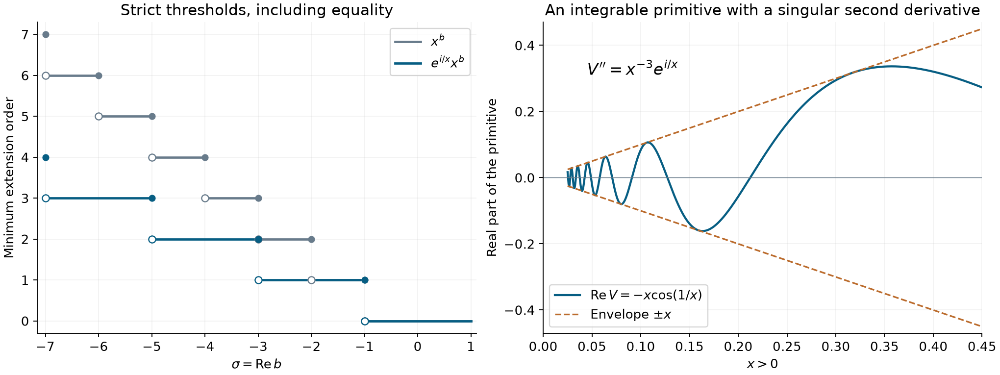

# Oscillation and extension order

*Exposition and figures by GPT-6 Astra (OpenAI), October 2026. Original exposition and exercises: CC0. Supplied programme prerequisites retain their stated licences.*

An unbounded function on an open half-line need not extend across its endpoint as a distribution. Oscillation can change the answer, and can reduce the smallest order of an extension. We determine the exact threshold for a power with an inverse-power phase, including its strict endpoint. We also construct a real phase for an arbitrary continuously differentiable amplitude, without imposing any bound on its growth at zero.

Write \(\mathbb R_+=(0,\infty)\), and use complex-linear distribution pairings. An extension of \(f\) means a distribution on \(\mathbb R\) whose restriction to \(\mathbb R_+\) is the regular distribution of \(f\). It need not be a locally integrable function at zero. For a compact test support \(K\), put
\[
 p_k(\phi)=\max_{0\le j\le k}\|\phi^{(j)}\|_\infty.
 \tag{O1}
\]
Order at most \(k\) means \(|u(\phi)|\le C_Kp_k(\phi)\), with the same nonnegative integer \(k\) for every \(K\). The constant may depend on \(K\). We use this convention whenever discussing an extension of prescribed order.

[Order, positivity and distributional limits](order-positivity-and-limits.md), Definition (1.2) and Proposition 1.2, proves this topology and extension to compact \(C^k\) tests. [Finite parts of singular powers](finite-parts-of-singular-powers.md), Proposition 1.1 and Theorem 2.1, supplies the nonintegrable power extensions, including the logarithmic formulas at negative integers. The annular argument in [Euler equations and the order of singularities](euler-equations-and-singularity-order.md), Lemma 4.1, explains the strict order endpoint for homogeneous restrictions; we give its phase-adapted form below. The supplied [scalar calculus](../prerequisites/U011-free-foundations/metric-foundation-bridges.md), §§12–13, and [integration foundations](../prerequisites/U011-free-foundations/banach-foundation-bridges.md), §§15–16, prove the calculus, cutoffs, absolute integration and limiting operations used here.

## The cost of an endpoint singularity

For \(b\in\mathbb C\), set \(x^b=\exp(b\log x)\) for \(x>0\), using the real logarithm. Write \(\sigma=\operatorname{Re}b\) and \(\beta=\operatorname{Im}b\).

**Proposition 1 (the power threshold).** The function \(x^b\) has a distributional extension of order at most \(k\) if and only if
\[
                         \sigma+k+1>0.
 \tag{O2}
\]
An extension with this order can be chosen supported in \([0,\infty)\).

**Proof.** Choose a nonnegative nonzero \(\psi\in C_c^\infty((1,2))\). For \(0<\varepsilon<1\), the tests
\[
 \phi_\varepsilon(x)=
 \begin{cases}
 \varepsilon^k x^{-i\beta}\psi(x/\varepsilon),&x>0,\\
 0,&x\le0
 \end{cases}
 \tag{O3}
\]
are smooth, supported in \([\varepsilon,2\varepsilon]\), and have a common \(p_k\) bound. Indeed every derivative of \(x^{-i\beta}\) of degree \(r\) has absolute value at most a constant times \(x^{-r}\), while a cutoff derivative of degree \(j-r\) costs \(\varepsilon^{-(j-r)}\). For \(j\le k\) their product is bounded by \(C_j\varepsilon^{k-j}\).

Any extension must therefore satisfy
\[
 u(\phi_\varepsilon)
    =c_\sigma\varepsilon^{\sigma+k+1},
 \qquad c_\sigma=\int_1^2 t^\sigma\psi(t)\,dt>0.
 \tag{O4}
\]
A negative exponent contradicts its finite-order bound on \([-1,1]\) for small \(\varepsilon\). If the exponent is zero, choose \(\varepsilon_j=4^{-j}\). The finite sums of these tests have pairwise disjoint supports and one common \(p_k\) bound: at each point at most one summand or derivative is nonzero. Their pairings are \(Nc_\sigma\). This also contradicts the bound. Every finite sum vanishes on a neighborhood of zero, so only the prescribed positive restriction has been used.

For sufficiency, if \(b\) is not a negative integer, the earlier finite-part formula gives
\[
 u(\phi)=\frac{(-1)^k}{(b+1)\cdots(b+k)}
                  \int_0^\infty x^{b+k}\phi^{(k)}(x)\,dx.
 \tag{O5}
\]
The empty product is one. Its denominator is nonzero, its integral is absolutely convergent at zero by (O2), and its estimate uses only \(p_k\). Its restriction is \(x^b\), by \(k\) integrations by parts on tests supported inside \(\mathbb R_+\). If \(b=-m\), \(m\ge1\), condition (O2) is \(k\ge m\). The finite part \(F_m\) in Theorem 2.1 of the linked lesson has order at most \(m\), positive restriction \(x^{-m}\), and support in \([0,\infty)\). It therefore gives the required extension as well. \(\square\)

**Proposition 2 (growth which has no distributional extension).** The function \(e^{1/x}\) on \(\mathbb R_+\) has no distributional extension to any neighborhood of zero.

**Proof.** Such an extension would have some finite order \(k\) on a fixed compact interval about zero. Take the same nonnegative \(\psi\), and test with \(\varepsilon^k\psi(x/\varepsilon)\). The \(p_k\) norms stay bounded, whereas
\[
 \int_0^\infty e^{1/x}\varepsilon^k\psi(x/\varepsilon)\,dx
       \ge \varepsilon^{k+1}e^{1/(2\varepsilon)}
                        \int_1^2\psi(t)\,dt
       \longrightarrow\infty.
 \tag{O6}
\]
For the last limit, the positive exponential series bounds \(e^s\) below by \(s^{k+2}/(k+2)!\). This proves the contradiction for every possible finite \(k\). \(\square\)

## A finite primitive construction

Fix \(a>0\). The leading derivative of \(e^{ix^{-a}}\) costs \(x^{-a-1}\), while differentiating a power costs only \(x^{-1}\). A finite triangular calculation makes this distinction sufficient for an exact primitive; no infinite asymptotic series is needed.

**Lemma 3 (a primitive up to an integrable remainder).** Let \(k\ge1\), \(b\in\mathbb C\), and \(N\ge1\) be integers with \(\sigma+Na>-1\). There are constants \(c_0,\ldots,c_{N-1}\), with \(c_0=(-ia)^{-k}\), such that
\[
 \begin{split}
 V(x)&=e^{ix^{-a}}\sum_{j=0}^{N-1}
                   c_jx^{b+k(a+1)+ja},\\
 R(x)&=e^{ix^{-a}}x^b-V^{(k)}(x)
       =e^{ix^{-a}}\sum_{j=N}^{N+k-1}d_jx^{b+ja}
 \end{split}
 \qquad(x>0).
 \tag{O7}
\]
In particular \(R\) is integrable on \((0,T)\) for every finite \(T\).

**Proof.** For \(\gamma\in\mathbb C\), repeated differentiation gives
\[
 \frac{d^k}{dx^k}\bigl(e^{ix^{-a}}x^\gamma\bigr)
   =e^{ix^{-a}}\sum_{r=0}^k
        A_{k,r}(\gamma)x^{\gamma-k(a+1)+ra}.
 \tag{O8}
\]
To prove and specify this identity, put \(A_{0,0}=1\) and regard coefficients with an index outside \(0\le r\le k\) as zero. The ordinary product rule yields
\[
 A_{k+1,r}(\gamma)=
       -ia A_{k,r}(\gamma)
       +\bigl(\gamma-k(a+1)+(r-1)a\bigr)A_{k,r-1}(\gamma).
 \tag{O9}
\]
The first term differentiates the exponential; the second differentiates the power at the preceding index. This proves (O8) by induction and \(A_{k,0}=(-ia)^k\).

Let \(\gamma_j=b+k(a+1)+ja\). In \(V^{(k)}\), the coefficient at \(e^{ix^{-a}}x^{b+\ell a}\) is
\[
 \sum_{\substack{0\le j<N\\
                 0\le\ell-j\le k}}
             c_j A_{k,\ell-j}(\gamma_j).
 \tag{O10}
\]
Choose \(c_0=(-ia)^{-k}\), so the coefficient at \(\ell=0\) is one. For \(1\le\ell<N\), set
\[
 c_\ell=-(-ia)^{-k}
         \sum_{j=\max(0,\ell-k)}^{\ell-1}
                  c_j A_{k,\ell-j}(\gamma_j).
 \tag{O11}
\]
This cancels exactly the coefficient at \(\ell\). The remaining indices range from \(N\) to \(N+k-1\), giving (O7). Each remaining term has absolute value bounded near zero by a constant times \(x^{\sigma+Na}\), since \(a>0\). This exponent is greater than \(-1\). Away from zero all terms are smooth, proving the last assertion. \(\square\)

## The sharp gain from inverse-power oscillation

**Theorem 4 (all extension orders).** For \(a>0\), \(b\in\mathbb C\), and \(k\ge0\), the function
\[
                         f_{a,b}(x)=e^{ix^{-a}}x^b
 \tag{O12}
\]
has a distributional extension of order at most \(k\) exactly when
\[
                       \sigma+k(a+1)+1>0.
 \tag{O13}
\]
The smallest possible order is the least nonnegative integer satisfying (O13). An extension attaining it can be supported in \([0,\infty)\).

**Proof: necessity, including equality.** Use the same fixed nonnegative \(\psi\), but take
\[
 \phi_\varepsilon(x)=
 \begin{cases}
 \varepsilon^{k(a+1)}e^{-ix^{-a}}x^{-i\beta}
                         \psi(x/\varepsilon),&x>0,\\
 0,&x\le0.
 \end{cases}
 \tag{O14}
\]
For each \(j\ge0\), differentiation and induction bound
\[
 \left|\frac{d^j}{dx^j}
          \bigl(e^{-ix^{-a}}x^{-i\beta}\bigr)\right|
                 \le C_j x^{-j(a+1)}
                 \qquad(0<x\le1).
 \tag{O15}
\]
For detail, after \(j\) derivatives each term is a constant times
\(e^{-ix^{-a}}x^{-i\beta-j-\ell a}\), \(0\le\ell\le j\). Differentiating the power keeps \(\ell\), and differentiating the exponential increases it by one. This proves the term description and its bound because \(a>0\). On the support of \(\phi_\varepsilon\), a further cutoff derivative has size \(C\varepsilon^{-r}\). Since \(r\le r(a+1)\) and \(\varepsilon\le1\), the product rule gives
\[
       \|\phi_\varepsilon^{(j)}\|_\infty
            \le C_j\varepsilon^{(k-j)(a+1)}
             \qquad(0\le j\le k,\ \varepsilon<1/2).
 \tag{O16}
\]
Thus these tests have one common \(p_k\) bound on \([-1,1]\). The phases cancel exactly:
\[
 u(\phi_\varepsilon)=
          c_\sigma\varepsilon^{\sigma+k(a+1)+1}.
 \tag{O17}
\]
A negative exponent is impossible. At exponent zero, sum the tests at \(\varepsilon_j=4^{-j}\); their disjoint supports retain a common \(p_k\) bound, while the pairing is \(Nc_\sigma\). This excludes equality, for \(k=0\) as well as every positive \(k\). No choice of values on the negative half-line or at zero affects these tests.

**Proof: sufficiency by an actual primitive.** For \(k=0\), (O13) is precisely the integrability of \(x^\sigma\) at zero. The extension by zero is then a regular distribution of order zero.

For \(k\ge1\), choose \(N\ge1\) with \(\sigma+Na>-1\) and form \(V,R\) in Lemma 3. Define
\[
 H(x)=\frac1{(k-1)!}\int_0^x(x-t)^{k-1}R(t)\,dt,\qquad
 W(x)=V(x)+H(x)\quad(x>0).
 \tag{O18}
\]
Absolute integrability of \(R\) makes this well defined. Iterating the integral \(\int_0^x\), or differentiating these absolutely convergent integrals successively, proves \(H^{(k)}=R\) on the open half-line. In the iterative proof the triangular integration region has finite absolute integral; Fubini gives the kernel \((x-t)^{k-1}/(k-1)!\). Since \(R\) is smooth away from zero, the final derivative is the ordinary fundamental theorem there.

For \(0<x\le1\),
\[
 |V(x)|\le Cx^{\sigma+k(a+1)},\qquad
 |H(x)|\le\frac{x^{k-1}}{(k-1)!}\int_0^x|R(t)|\,dt.
 \tag{O19}
\]
The first bound is integrable by (O13), and the second is bounded and integrable. Consequently the extension \(W_+\), equal to \(W\) for \(x>0\) and zero for \(x\le0\), is locally integrable on \(\mathbb R\). Put
\[
              u=\partial_x^k W_+,\qquad
              u(\phi)=(-1)^k\int_0^\infty W(x)\phi^{(k)}(x)\,dx.
 \tag{O20}
\]
Its finite-order bound on each compact support is immediate from absolute integrability. On positive-side tests, ordinary integration by parts gives \(u=W^{(k)}=V^{(k)}+R=f_{a,b}\). Differentiation preserves the support \([0,\infty)\), directly from the test formula. This proves sufficiency and, together with necessity, the asserted minimum. \(\square\)

For example \(e^{i/x}x^{-5}\) has minimum extension order three, whereas \(x^{-5}\) has minimum order five. The order two oscillatory endpoint fails because \(-5+2(1+1)+1=0\). For every fixed \(a>0\) and \(b\), some finite \(k\) satisfies (O13); the unphased exponential in Proposition 2 has a different growth scale.

*Left: for \(a=1\), the least possible extension order is constant between the thresholds \(\sigma=-1,-3,-5,\ldots\); each equality belongs to the larger order. The unphased powers have thresholds \(-1,-2,-3,\ldots\) (Proposition 1 and Theorem 4). Right: for \(a=1,b=-3,k=2\), the finite primitive \(V=-x e^{i/x}\) satisfies \(V''=x^{-3}e^{i/x}\) exactly. The plotted real part is \( -x\cos(1/x)\); its absolute value is bounded by the two straight lines \(\pm x\), although its second derivative has amplitude \(x^{-3}\). These are exact identities, not numerical evidence for a proof.*

## A phase for an arbitrary amplitude

The next construction allows growth much faster than any power. The key is to control both the amplitude divided by the phase derivative and the derivative of that quotient.

**Lemma 5 (a positive reciprocal phase derivative).** For every complex \(f\in C^1(\mathbb R_+)\), there is a positive real \(h\in C^1(\mathbb R_+)\) such that
\[
 \begin{gathered}
 f(x)h(x)\longrightarrow0\quad(x\downarrow0),\\
 \int_0^1\bigl(|f h|+|f'h|+|f h'|\bigr)\,dx<\infty.
 \end{gathered}
 \tag{O21}
\]

**Proof.** Set \(A=1+|f(1)|\), and for \(0<x\le1\) put
\[
 \begin{gathered}
 B(x)=A+\int_x^1(1+|f'(t)|)\,dt,\\
                 h_0(x)=\frac{x^2}{B(x)^2}.
 \end{gathered}
 \tag{O22}
\]
These are finite at every positive \(x\), \(B\) is \(C^1\), and
\[
 \begin{gathered}
 B\ge1,\qquad |f(x)|\le B(x),\\
 B'=-(1+|f'|),\\
 \left(\frac1B\right)'=\frac{1+|f'|}{B^2}.
 \end{gathered}
 \tag{O23}
\]
The bound on \(f\) follows by the fundamental theorem from \(1\) to \(x\). Since \(1/B\) is nonnegative and increasing, its derivative has integral at most \(1/A\) on \((0,1)\): integrate first from \(\varepsilon\) to \(1\) and let \(\varepsilon\) decrease to zero. No finite limit of \(B\) is required.

Direct differentiation gives
\[
 h_0'=\frac{2x}{B^2}
             +\frac{2x^2(1+|f'|)}{B^3}.
 \tag{O24}
\]
Consequently, on \((0,1)\),
\[
 \begin{split}
 |fh_0|&\le x^2,\\
 |f'h_0|&\le (1/B)',\\
 |fh_0'|&\le 2x+2(1/B)'.
 \end{split}
 \tag{O25}
\]
These inequalities give all the integrals and the zero limit. To define \(h\) on the entire half-line, choose a smooth \(0\le\chi\le1\), equal to one for \(x\le1/2\) and zero for \(x\ge3/4\), and put \(h=\chi h_0+(1-\chi)\) for \(0<x<1\), \(h=1\) for \(x\ge1\). It is positive and \(C^1\), agrees with \(h_0\) near zero, and the additional terms in (O21) are integrable on the compact intervening interval. This proves the lemma. \(\square\)

**Theorem 6 (regularization by a real phase).** For every \(f\in C^1(\mathbb R_+;\mathbb C)\) there is a real \(g\in C^2(\mathbb R_+)\) and an extension \(u\) of \(fe^{ig}\), supported in \([0,\infty)\), of order at most one. It is given by the actual improper integral
\[
 \begin{split}
 u(\phi)
 &=\lim_{\varepsilon\downarrow0}
                   \int_\varepsilon^\infty f(x)e^{ig(x)}\phi(x)\,dx\\
 &=i\int_0^\infty e^{ig(x)}(f(x)h(x)\phi(x))'\,dx,
 \qquad g(x)=\int_1^x\frac{dt}{h(t)}.
 \end{split}
 \tag{O26}
\]
The second integral is absolutely convergent. For every continuous \(f\) and real continuous \(g\), an order-zero extension of \(fe^{ig}\) exists if and only if \(|f|\) is integrable near zero. Thus for the construction above, when \(f\) is not integrable near zero the smallest possible extension order is exactly one.

**Proof.** The positivity and \(C^1\) regularity of \(h\) give the stated real \(C^2\) function \(g\), with \(g'=1/h\). The derivative in the second line of (O26) is
\((f'h+fh')\phi+fh\phi'\). Lemma 5 controls its absolute integral near zero, and on the remaining compact test support all terms are continuous. Its integral is bounded by \(C_Kp_1(\phi)\); hence it defines a distribution of order at most one.

Since \((e^{ig})'=i e^{ig}/h\), integration by parts on \([\varepsilon,\infty)\) gives
\[
 \int_\varepsilon^\infty fe^{ig}\phi
    =i f(\varepsilon)h(\varepsilon)e^{ig(\varepsilon)}
                               \phi(\varepsilon)
         +i\int_\varepsilon^\infty e^{ig}(fh\phi)'.
 \tag{O27}
\]
The boundary term tends to zero by (O21), and the integral tends absolutely to the expression in (O26). This proves the claimed improper interpretation and the restriction. Negative-side tests have zero pairing, proving the support assertion.

It remains to justify the order-zero assertion without making any assumption about cancellation. Write \(F=fe^{ig}\), so \(|F|=|f|\). If this modulus is integrable near zero, extension by zero is locally integrable and has order zero.

Conversely, suppose an order-zero extension exists, and fix \(r>0\) and its order-zero bound \(C\) on tests supported in \([-2r,2r]\). For a smooth \(0\le\eta\le1\) supported inside \((0,r)\), and \(\delta>0\), the function
\[
 q_\delta(x)=
       \eta(x)\frac{\overline{F(x)}}{\sqrt{|F(x)|^2+\delta^2}}
 \tag{O28}
\]
is continuous, supported away from zero, and has supremum at most one. Approximate it uniformly by compact smooth tests with a common support inside \((0,2r)\), using the mollifier argument of U008, Proposition 1.2. That proposition extends the distribution continuously to these tests. On this compact region \(F\) is integrable, so its regular pairings also converge uniformly under the approximation. Thus the extension's pairing with \(q_\delta\) equals the ordinary integral, and
\[
       \int_0^r \eta(x)
           \frac{|F(x)|^2}{\sqrt{|F(x)|^2+\delta^2}}\,dx\le C.
 \tag{O29}
\]
Let \(\delta\downarrow0\). Dominated convergence on the fixed compact support gives \(\int\eta|F|\le C\). For any \(0<\varepsilon<r/2\), choose \(\eta=1\) on \([\varepsilon,r/2]\). Nonnegativity then gives \(\int_\varepsilon^{r/2}|F|\le C\), uniformly in \(\varepsilon\). Monotone convergence proves integrability near zero. This also shows why changing only a real phase can never turn a nonintegrable amplitude into an order-zero extension. \(\square\)

For \(f(x)=e^{1/x}\), Proposition 2 excludes an extension before choosing a phase. Lemma 5 and Theorem 6 produce one after choosing a phase, with exact minimum order one. The claim concerns a distributional extension; the amplitude itself still grows at the same rate.

## Exercises with complete solutions

**Exercise 1 (foundation) — an integer threshold is strict.** Determine the minimum extension orders of \(x^{-4+2i}\), \(e^{ix^{-2}}x^{-4+2i}\), and \(e^{ix^{-2}}x^{-4-\epsilon+2i}\) for \(0<\epsilon<1\).

**Solution.** For the first function (O2) reads \(k>3\), so the minimum is four. For the second, (O13) reads \(3k-3>0\); the minimum is two, since \(k=1\) gives equality. For the third it reads \(3k-3-\epsilon>0\), whose least integer solution is again two. The imaginary part of the power changes the phase of the tests but not any of these thresholds.

**Exercise 2 (intermediate) — finite cancellation at the endpoint.** In the second example of Exercise 1, give explicit order-one test functions whose pairings contradict an order-one extension.

**Solution.** Fix the nonnegative \(\psi\) above and take
\[
 \phi_j(x)=4^{-3j}e^{-ix^{-2}}x^{-2i}\psi(4^j x)
                       \quad(x>0),
 \qquad \phi_j(x)=0\quad(x\le0).
 \tag{O30}
\]
Here \(\varepsilon_j=4^{-j}\), \(k(a+1)=3\), and (O16) bounds every \(p_1(\phi_j)\) by one common constant. Their supports are disjoint. Pairing any finite sum with the positive restriction gives \(N\int_1^2t^{-4}\psi(t)\,dt\), although the sum's \(p_1\) norm is uniformly bounded. Each finite sum is an admissible smooth test vanishing near zero. These are the contradictory tests, with no limit test at zero asserted.

**Exercise 3 (intermediate) — an exact primitive with no remainder.** Show that \(V(x)=-x e^{i/x}\) has second derivative \(e^{i/x}x^{-3}\). Deduce an extension and prove that its order cannot be one.

**Solution.** Direct differentiation gives
\[
             V'=e^{i/x}(i/x-1),\qquad
             V''=e^{i/x}x^{-3}.
 \tag{O31}
\]
In the second derivative the terms \(-i/x^2\) and \(i/x^2\) cancel. Since \(|V(x)|=x\), its extension by zero is locally integrable. The distribution \(\partial_x^2 V_+\) has order at most two and the required restriction. For \(a=1,\sigma=-3,k=1\), the expression in (O13) is zero. Necessity in Theorem 4 therefore excludes order one.

**Exercise 4 (advanced) — a vanishing correction.** In Lemma 3 take \(a=1,b=-2,k=1,N=2\). Find \(c_0,c_1,V,R\), and an order-one extension.

**Solution.** Here \(\gamma_0=0,\gamma_1=1\), \(A_{1,0}=-i\), and \(A_{1,1}(\gamma)=\gamma\). Hence \(c_0=i\), \(c_1=-(-i)^{-1}c_0\gamma_0=0\). Thus \(V=i e^{i/x}\) and \(V'=x^{-2}e^{i/x}\), so \(R=0\) (a permitted integrable residual). The derivative of \(V_+\) gives the extension. Its minimum order is one because \(-2+2k+1>0\) first holds at \(k=1\). The recursive correction can vanish; the construction never requires every coefficient to be nonzero.

**Exercise 5 (advanced) — a nonzero remainder.** Use \(a=1,b=-5/2,k=1,N=2\) in Lemma 3. Compute the finite primitive and residual, including signs, and show that the construction gives minimum order one.

**Solution.** Now \(\gamma_0=-1/2,\gamma_1=1/2\). The recursion gives \(c_0=i\) and \(c_1=-1/2\). Therefore
\[
 \begin{split}
 V&=e^{i/x}\bigl(ix^{-1/2}-\tfrac12x^{1/2}\bigr),\\
 V'&=e^{i/x}\bigl(x^{-5/2}-\tfrac14x^{-1/2}\bigr),\\
 R&=\tfrac14 e^{i/x}x^{-1/2}.
 \end{split}
 \tag{O32}
\]
The two \(x^{-3/2}\) terms cancel. The residual is integrable. Set \(H(x)=\int_0^xR(t)\,dt\); then \(W=V+H\) is locally integrable at zero and \(W'=f_{1,-5/2}\). Thus \(\partial_xW_+\) is an order-one extension. Order zero fails, since the modulus \(x^{-5/2}\) is not integrable; equivalently (O13) fails at \(k=0\).

**Exercise 6 (intermediate) — the weight for a positive exponential.** For \(f(x)=e^{1/x}\), compute \(B\) in (O22) on \(0<x\le1\). State the resulting phase derivative near zero and the minimum extension order after adding that phase.

**Solution.** One has \(|f'|=e^{1/x}/x^2\), and
\(\int_x^1 e^{1/t}t^{-2}\,dt=e^{1/x}-e\).
Since \(A=1+e\),
\[
 B(x)=e^{1/x}+2-x,\qquad
             g'(x)=\frac{(e^{1/x}+2-x)^2}{x^2}
                      \quad(0<x\le1/2).
 \tag{O33}
\]
The cutoff in Lemma 5 determines a positive \(C^1\) reciprocal derivative farther from zero. Theorem 6 gives an extension of order at most one. Its order cannot be zero because \(\int_0^{1/2}e^{1/x}\,dx=\infty\); this also follows from the lower bound \(e^{1/x}\ge x^{-2}/2\). The minimum is therefore one.

**Exercise 7 (foundation) — phases and absolute integrability.** Let \(f(x)=x^{-1/2}\) and let \(g\) be any real continuous function on \(\mathbb R_+\), however rapidly it oscillates near zero. Does \(fe^{ig}\) have an order-zero extension? What changes for \(f(x)=x^{-1}\)?

**Solution.** In the first case the absolute integral at zero is finite, since \(\int_0^r x^{-1/2}dx=2\sqrt r\). Extension by zero has order zero for every such \(g\). In the second case no phase permits an order-zero extension, by Theorem 6 and the divergence of \(\int_0^r dx/x\). Some phases still permit order-one extensions; for instance \(g(x)=1/x\) satisfies Theorem 4. No assertion of an extension for every continuous phase in the second case is needed.

**Exercise 8 (advanced) — global order versus behavior at infinity.** Replace \(f_{a,b}\) by \(e^{x^2}f_{a,b}\). Prove that the minimum order of an extension to \(\mathbb R\) is unchanged, and explain why this says nothing about temperedness.

**Solution.** Multiplication by a smooth function preserves an order-at-most-\(k\) estimate on every fixed compact support, by the Leibniz rule and boundedness of its derivatives there. Multiply the extension in Theorem 4 by \(e^{x^2}\) for the upper bound. Conversely, an extension of the modified function, multiplied by \(e^{-x^2}\), extends \(f_{a,b}\) with the same order bound, proving the lower bound. The constants may depend on the compact set; no polynomial control of these constants at infinity is supplied. Temperedness imposes a separate bound on Schwartz tests and does not follow from this definition of global finite order.

## References

- Lars Hörmander, *The Analysis of Linear Partial Differential Operators I: Distribution Theory and Fourier Analysis*, second edition, 2003 reprint, Chapter II, Exercises 2.1–2.4, p. 372; answers, p. 395.
- [Order, positivity and distributional limits](order-positivity-and-limits.md), Definition (1.2) and Proposition 1.2: order on compact supports and the continuous-test approximation used in (O28)–(O29).
- [Finite parts of singular powers](finite-parts-of-singular-powers.md), Proposition 1.1 and Theorem 2.1: (O5) and the negative-integer finite parts.
- [Euler equations and the order of singularities](euler-equations-and-singularity-order.md), Lemma 4.1 and Theorem 4.2: homogeneous order thresholds and phase-aligned annular tests.
- [Scalar calculus](../prerequisites/U011-free-foundations/metric-foundation-bridges.md), §§12–13, and [integration foundations](../prerequisites/U011-free-foundations/banach-foundation-bridges.md), §§15–16: the full calculus, cutoff, integration and convergence arguments.
