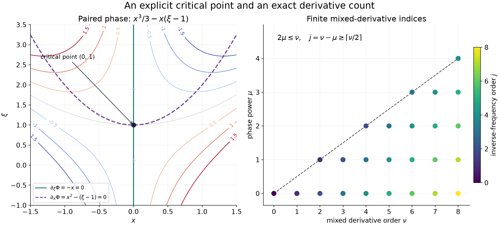

# Paired variables and stationary parameters

A real stationary point can move smoothly with a parameter. A particularly useful phase pairs two sets of variables:
\[
 \Phi(x,\xi,y)=f(x,y)-x\cdot\xi.
 \tag{P1}
\]
Its critical point in \((x,\xi)\) is always explicit, even when \(f\) itself has degenerate critical points. The mixed derivative expansion of this integral has a different ordering from an expansion in integer inverse powers. Counting both orders gives a precise remainder with a fixed number of amplitude derivatives.

We use \(D=-i\partial\), the Fourier kernel \(e^{-ix\cdot\xi}\), and positive frequencies \(\omega\geq1\). Here \(x,\xi\in\mathbb R^n\), with \(n\geq1\); the parameter \(y\) ranges over a fixed compact subset of \(\mathbb R^m\). The case \(m=0\) simply omits parameters. Write
\[
 P=\sum_{\ell=1}^n\partial_{x_\ell}\partial_{\xi_\ell},
 \qquad
 M_q(u;y)=\sum_{|\alpha|\leq q}
       \sup_{x,\xi}|\partial_{x,\xi}^{\alpha}u(x,\xi,y)|.
 \tag{P2}
\]
Every amplitude has support in a fixed compact set. Constants may depend on that set and finitely many phase derivatives, but not on the amplitude or frequency.

## Earlier proofs used here

- [Finite stationary jets and quadratic exchange](finite-stationary-jets-and-quadratic-exchange.md), Theorems 1 and 3, proves the exact complex quadratic estimate and the finite stationary expansion, including its coefficient formula, derivative counts, determinant branch and uniform constants.
- The complete [smooth inverse and implicit maps](../prerequisites/U011-free-foundations/implicit-maps-U070.md), §§16.4–16.5, IV1–IV10, supplies the real critical branch. These are earlier AN-03 programme proofs.
- [When a kernel is smooth](when-a-kernel-is-smooth.md#taylor-estimates-on-compact-neighborhoods) proves integral Taylor remainders. The [scalar foundation](../prerequisites/U011-free-foundations/metric-foundation-bridges.md), §§12–13, supplies compactness, cutoffs, finite derivative rules and integration by parts. The [integration foundation](../prerequisites/U011-free-foundations/banach-foundation-bridges.md), §§15.0–15.1, supplies Fubini and dominated convergence.
- [Point sources and complex Gaussian kernels](point-sources-and-complex-gaussian-kernels.md), Section 2, proves real symmetric diagonalization. The [finite algebra foundation](../prerequisites/U011-free-foundations/stable-prerequisite-bridges.md), §10, supplies the determinant, matrix and dimension arguments.

## A moving real critical point with a finite amplitude budget

**Proposition 1.** Suppose \(f(x,y)\) is real and smooth near \((0,0)\in\mathbb R^{d+m}\), \(f_x'(0,0)=0\), and \(f_{xx}''(0,0)\) is invertible. On sufficiently small product neighborhoods there is a unique smooth critical branch \(c(y)\), with \(c(0)=0\). Put
\[
 A(y)=f_{xx}''(c(y),y),\qquad v(y)=f(c(y),y).
 \tag{P3}
\]
The Hessian signature \(\sigma\) is constant there. For each integer \(k\geq1\) and smooth \(u\) supported in a fixed sufficiently small compact product,
\[
 \begin{split}
 \int u(x,y)e^{i\omega f(x,y)}\,dx
 &=e^{i\omega v(y)}(2\pi/\omega)^{d/2}
       |\det A(y)|^{-1/2}e^{i\pi\sigma/4}\\
 &\quad{}\times\sum_{j=0}^{k-1}\omega^{-j}
          \mathcal C_j(f_y,u_y;c(y))+R_k(\omega,y),\\
 |R_k(\omega,y)|
 &\leq C_k\omega^{-k}
          \sum_{|\alpha|\leq2k}\sup_x|\partial_x^\alpha u(x,y)|.
 \end{split}
 \tag{P4}
\]
The \(\mathcal C_j\) are exactly the finite jet functionals F15 of the earlier lesson, centered at \(c(y)\). They have amplitude order at most \(2j\), phase derivative order at most \(2j+2\), and the stated rational coefficients. They depend smoothly on \(y\). No parameter derivative of \(u\) is used in the value estimate (P4).

**Proof.** Apply the earlier real implicit construction IV9–IV10 to the map \(f_x'(x,y)\), with \(x\) the solved variables and \(y\) the parameters. Its solved derivative at the mark is the given invertible Hessian. The construction gives an actual smooth branch and uniqueness on one smaller product.

Shrink that product so that the Hessians remain close to \(A_0=f_{xx}''(0,0)\), and so that the segment between \(c(y)\) and every integration point stays in it. The segment formula gives
\[
 f_x'(c(y)+z,y)
 =\left(\int_0^1 f_{xx}''(c(y)+tz,y)\,dt\right)z.
 \tag{P5}
\]
Choose the Hessian difference from \(A_0\) smaller than
\((2\|A_0^{-1}\|)^{-1}\). The reverse triangle inequality then gives a common lower bound \(C^{-1}|z|\) for (P5). Inverses and all required phase derivatives are bounded on smaller compact products.

For clarity, the signature does not require an unproved continuity assertion about individual eigenvalues. Diagonalize \(A_0\). Its positive and negative eigenspaces have dimensions \(p,q\), with \(p+q=d\), and its quadratic form has a strict sign bound on each of their unit spheres. A sufficiently small symmetric perturbation preserves these bounds. Its positive index is at least \(p\): otherwise its nonpositive eigenspace would intersect the old \(p\)-dimensional positive subspace nontrivially, contradicting that bound. The negative index is at least \(q\) by the same dimension argument. Since their sum cannot exceed \(d\), both indices stay fixed.

Translate \(x=c(y)+z\), subtract the real value \(v(y)\), and apply Theorem 3 of the finite-jet lesson on one common compact \(z\)-support. Formula (P5) gives exactly its uniform gradient-ratio hypothesis. Translation preserves every \(x\)-derivative norm of the amplitude. Its finite coefficient formula is a polynomial in available derivatives divided by powers of the nonzero Hessian determinant, so composition with the smooth branch gives smooth parameter dependence. The real Gaussian factor is F3 of that lesson. This proves (P4). \(\square\)

The assertion is about values, uniformly in the parameter. Differentiating an oscillatory factor can introduce powers of \(\omega\); a bound for parameter derivatives must specify whether that factor has been removed.

## The paired phase has a uniform critical point

For the remainder of the lesson let \(f\in C^\infty(\mathbb R^{n+m};\mathbb R)\), and set
\[
 a(y)=f_x'(0,y),\qquad
 r(x,y)=f(x,y)-f(0,y)-a(y)\cdot x,\qquad
 \eta=\xi-a(y).
 \tag{P6}
\]
Thus \(r(0,y)=0\), \(r_x'(0,y)=0\), and
\[
 \Phi(x,\xi,y)=f(0,y)+r(x,y)-x\cdot\eta.
 \tag{P7}
\]
Only the restriction of \(f\) to a fixed compact neighborhood of the relevant segments is used.

**Lemma 2.** For \(0\leq t\leq1\), define
\[
 \phi_t(x,\eta,y)=t\,r(x,y)-x\cdot\eta.
 \tag{P8}
\]
For a smooth compactly supported \(b\), uniformly in \(t,y\),
\[
 \left|\int b(x,\eta,y)e^{i\omega\phi_t(x,\eta,y)}
                    \,dx\,d\eta\right|
 \leq C\omega^{-n} M_{2n}(b;y).
 \tag{P9}
\]

**Proof.** The gradient in the integration variables is
\[
 \nabla_{x,\eta}\phi_t=(t\,r_x'(x,y)-\eta,-x).
 \tag{P10}
\]
It vanishes only at \((0,0)\). On a fixed ball containing the \(x\)-supports, the segment formula and \(r_x'(0,y)=0\) give \(|r_x'(x,y)|\leq C|x|\). Therefore
\[
 |x|\leq|\nabla\phi_t|,\qquad
 |\eta|\leq C|x|+|t\,r_x'-\eta|
          \leq(C+1)|\nabla\phi_t|.
 \tag{P11}
\]
This is a uniform gradient-ratio bound on every fixed compact support.

Let \(F(y)=f_{xx}''(0,y)\). At the critical point,
\[
 H_t=\begin{pmatrix}tF&-I\\-I&0\end{pmatrix},
 \qquad
 H_t^{-1}=\begin{pmatrix}0&-I\\-I&-tF\end{pmatrix},
 \qquad |\det H_t|=1.
 \tag{P12}
\]
The two matrix products are identities. The determinant follows by writing
\(H_t=\left(\begin{smallmatrix}0&-I\\-I&0\end{smallmatrix}\right)
\left(\begin{smallmatrix}I&0\\-tF&I\end{smallmatrix}\right)\):
the second determinant is one and the first has modulus one.
The signature argument in Proposition 1 makes the signature constant along this nonsingular matrix path. At \(t=0\), the vectors \((v,v)\) and \((v,-v)\) give the negative and positive eigenspaces, each of dimension \(n\). Thus every \(H_t\) has signature zero.

Apply the earlier finite stationary theorem in dimension \(2n\), with its integer \(k=n\). Its remainder is bounded by \(C\omega^{-n}M_{2n}(b;y)\). The finite main sum has Gaussian modulus \((2\pi/\omega)^n\), bounded phase coefficients and amplitude derivatives through order \(2(n-1)\). Since \(\omega\geq1\), it has the same bound. All constants are uniform by (P11)–(P12) and the compact phase-derivative bounds. This proves (P9), whether or not the amplitude support contains the critical point. \(\square\)

## Moving phase powers into amplitude derivatives

Integral Taylor expansion in the \(x\) variables gives the exact identity
\[
 r(x,y)=\sum_{a,b=1}^n x_ax_b R_{ab}(x,y),
 \qquad
 R_{ab}(x,y)=\int_0^1(1-s)f_{x_ax_b}''(sx,y)\,ds.
 \tag{P13}
\]
The functions \(R_{ab}\) are smooth, with uniform finite derivative bounds on compact sets. Differentiation under this fixed compact integral follows from the segment difference quotient and uniform bounds.

**Lemma 3.** Put
\[
 J(t)=\int b(x,\eta,y)e^{i\omega\phi_t(x,\eta,y)}\,dx\,d\eta.
 \tag{P14}
\]
For every integer \(M\geq1\),
\[
 |J^{(M)}(t)|
       \leq C_M\omega^{-n-M}M_{2n+2M}(b;y).
 \tag{P15}
\]

**Proof.** Expand the finite product in (P13):
\[
 r(x,y)^M=\sum_{|\gamma|=2M}x^\gamma R_\gamma(x,y).
 \tag{P16}
\]
Here \(R_\gamma\) is the finite sum of the ordered products of \(M\) coefficient functions that yield the indicated monomial. It is independent of \(\eta,t,\omega\), and all its required derivatives are uniformly bounded.

Differentiation in \(t\) gives
\[
 J^{(M)}(t)=(i\omega)^M
          \int r^M b\,e^{i\omega\phi_t}.
 \tag{P17}
\]
Also \(\partial_{\eta_\ell}e^{i\omega\phi_t}
=-i\omega x_\ell e^{i\omega\phi_t}\).
Transfer the \(2M\) factors \(x^\gamma\) in (P16) to \(\eta\)-derivatives, then integrate them onto the amplitude. Since the coefficient \(R_\gamma\) is independent of \(\eta\), this gives exactly
\[
 J^{(M)}(t)=(-i)^M\omega^{-M}
      \int\left(\sum_{|\gamma|=2M}
                    R_\gamma\,\partial_\eta^\gamma b\right)
                   e^{i\omega\phi_t}.
 \tag{P18}
\]
There are no boundary terms. The sign is
\(i^M i^{2M}(-1)^{2M}=(-i)^M\).
Apply Lemma 2 to the amplitude in parentheses. Its derivatives through order \(2n\) use derivatives of \(b\) through order \(2M+2n\); the finite product rule bounds all remaining factors. This proves (P15). \(\square\)

## The mixed expansion and its exact derivative count

**Theorem 4.** Let \(k\geq n\) be an integer, \(N=k-n\), and \(u\in C_c^\infty(K)\) for a fixed compact \(K\subset\mathbb R^{2n+m}\). Define
\[
 T_N(\omega,y)=
 \sum_{\nu=0}^{N}\frac{(-i/\omega)^\nu}{\nu!}
    \left[P^\nu\!\left(e^{i\omega r(x,y)}
                      u(x,\xi,y)\right)\right]_{x=0,\ \xi=a(y)}.
 \tag{P19}
\]
Then
\[
 \begin{split}
 &\left|\int u(x,\xi,y)e^{i\omega(f(x,y)-x\cdot\xi)}
                  \,dx\,d\xi
     -e^{i\omega f(0,y)}(2\pi/\omega)^nT_N(\omega,y)\right|\\
 &\hspace{18mm}\leq
 C_k\omega^{-n-\lceil N/2\rceil}M_{2k}(u;y).
 \end{split}
 \tag{P20}
\]
In particular the right side is bounded by
\(C_k\omega^{-(k+n)/2}M_{2k}(u;y)\).
The same estimate holds if the sum in (P19) is taken over \(0\leq\nu<N\); for \(N=0\), that sum is empty.

**Proof: the endpoint \(N=0\).** Lemma 2 at \(t=1\), followed by the translation in (P6), bounds the integral by \(C\omega^{-n}M_{2n}(u;y)\). The single term \(T_0=u(0,a(y),y)\), multiplied by the displayed Gaussian factor, has that same bound. This proves both versions.

**Proof: retain the necessary phase powers.** Suppose \(N\geq1\), and put \(M=\lceil N/2\rceil\). Write \(b(x,\eta,y)=u(x,\eta+a(y),y)\). Translation in \(\eta\) preserves all the norms (P2). Taylor's integral formula in \(t\), with Lemma 3, gives
\[
 J(1)=\sum_{\mu=0}^{M-1}\frac{(i\omega)^\mu}{\mu!}
        \int r^\mu b\,e^{-i\omega x\cdot\eta}\,dx\,d\eta
      +E,\qquad
 |E|\leq C\omega^{-n-M}M_{2n+2M}(b;y).
 \tag{P21}
\]
Since \(M\leq N\), the required amplitude order \(2n+2M\) is at most \(2k\).

**Proof: the quadratic derivative budget.** For the quadratic phase
\(-x\cdot\eta\), its symmetric Hessian
\(A=\left(\begin{smallmatrix}0&-I\\-I&0\end{smallmatrix}\right)\)
satisfies \(A^{-1}=A\), \(\|A^{-1}\|=1\), and has \(n\) positive and \(n\) negative eigenvalues. Indeed \(x=(v+w)/\sqrt2,\ \eta=(v-w)/\sqrt2\) gives
\(-x\cdot\eta=(|w|^2-|v|^2)/2\).
Thus its Gaussian factor is \((2\pi/\omega)^n\), and \(L_A=-2P\).

Apply Theorem 1 of the earlier finite-jet lesson, in dimension \(2n\), with expansion order \(N\) and integer Fourier weight \(s=n+1>n\). For every smooth compact \(w\),
\[
 \begin{split}
 \int w\,e^{-i\omega x\cdot\eta}
 &=(2\pi/\omega)^n
       \sum_{\nu=0}^{N-1}\frac{(-i/\omega)^\nu}{\nu!}
                           (P^\nu w)(0,0)+E_N(w),\\
 |E_N(w)|&\leq C\omega^{-n-N}
         \sum_{|\alpha|\leq2N+n+1}\|\partial^\alpha w\|_2.
 \end{split}
 \tag{P22}
\]
For \(w=r^\mu b\), the fixed compact support and finite product rule bound this last sum by \(C M_{2k}(b;y)\), because
\[
 2N+n+1\leq2N+2n=2k.
 \tag{P23}
\]
This includes \(n=1\), where equality holds.
After multiplication by \(\omega^\mu\) in (P21), the error is bounded by
\(C\omega^{-n-N+\mu}M_{2k}(b;y)\).
Since \(\mu\leq M-1\) and \(N-M+1\geq M\), every such error has the bound in (P20).

**Proof: identify the finite sum.** In \(P^\nu\), exactly \(\nu\) derivatives act in \(x\) and exactly \(\nu\) in \(\eta\). All \(\eta\)-derivatives act on \(b\). The factor \(r^\mu\) has vanishing \(x\)-jet through order \(2\mu-1\); consequently
\[
 [P^\nu(r^\mu b)](0,0)=0
                 \quad\hbox{if }2\mu>\nu.
 \tag{P24}
\]
The \(x\)-jet of the exponential therefore gives the exact finite identity
\[
 [P^\nu(e^{i\omega r}b)](0,0)
   =\sum_{\mu=0}^{\lfloor\nu/2\rfloor}
          \frac{(i\omega)^\mu}{\mu!}
                       [P^\nu(r^\mu b)](0,0).
 \tag{P25}
\]
For \(\nu<N\), every index on the right satisfies \(\mu<M\). Thus the two finite sums from (P21)–(P22) combine exactly into (P19) with \(\nu<N\). This proves the open-end sum estimate.

Finally, the term with \(\nu=N\) is a finite sum of powers
\(\omega^{\mu-N}\), where \(\mu\leq\lfloor N/2\rfloor\). Each has order at most \(\omega^{-\lceil N/2\rceil}\), with coefficients bounded by \(C M_{2k}(u;y)\). Adding this term preserves (P20). Multiplication by the unit factor \(e^{i\omega f(0,y)}\) proves the assertion in the original variables. \(\square\)

The factorial in (P19) is part of the quadratic exponential series. The integer ceiling in (P20) records the fact that each surviving power is an integer power of \(\omega^{-1}\), although the derivative budget gives a half-order count before rounding.

## Regrouping by inverse frequency

**Corollary 5.** Define, for \(j\geq0\),
\[
 B_j(f,u;y)=(-i)^j
   \sum_{\mu=0}^{j}
     \frac{[P^{j+\mu}(r^\mu u)]_{x=0,\ \xi=a(y)}}
          {(j+\mu)!\,\mu!}.
 \tag{P26}
\]
Then \(B_0=u(0,a(y),y)\). For every \(J\geq1\),
\[
 \begin{split}
 \int u e^{i\omega(f-x\cdot\xi)}
 &=e^{i\omega f(0,y)}(2\pi/\omega)^n
          \sum_{j=0}^{J-1}\omega^{-j}B_j(f,u;y)
       +E_J,\\
 |E_J|&\leq C_J\omega^{-n-J}M_{2n+4J}(u;y).
 \end{split}
 \tag{P27}
\]
Each \(B_j\) uses amplitude derivatives of total order at most \(2j\), and phase derivatives through order \(j+1\), besides the evaluation point \(a(y)\). The coefficients depend smoothly on the parameter.

**Proof.** Use the open-end version of Theorem 4 with \(N=2J\) and \(k=n+2J\). In (P25), set \(j=\nu-\mu\). The condition \(2\mu\leq\nu\) becomes \(\mu\leq j\), and
\[
 (-i)^\nu i^\mu=(-i)^j,\qquad
 \omega^{\mu-\nu}=\omega^{-j}.
 \tag{P28}
\]
Every pair with \(j<J\) occurs, since \(\nu=j+\mu\leq2j<2J\). The finitely many other pairs have \(j\geq J\), and can be included in the error with the displayed derivative budget. This proves (P26)–(P27).

In a nonzero term of \(P^{j+\mu}(r^\mu u)\), each \(r\) factor receives at least two \(x\)-derivatives. At most \(j-\mu\) of the \(x\)-derivatives remain for \(u\), while its \(\xi\)-derivative order is \(j+\mu\); their total is at most \(2j\). If \(\mu\geq1\), any one phase factor receives at most
\(j+\mu-2(\mu-1)=j-\mu+2\leq j+1\) derivatives. If \(\mu=0\), no phase factor occurs. This proves all jet assertions.

These are also the ordinary stationary coefficients of the phase (P1). To see this without guessing a formal identity, apply the earlier stationary theorem with arbitrarily large truncation depth, and compare it with (P27), after removing the common Gaussian factor. If the coefficients below order \(j\) agree, subtraction and multiplication by \(\omega^j\), followed by \(\omega\to\infty\), makes their order-\(j\) difference zero. Starting at \(j=0\) proves equality at every order. \(\square\)

*Left: the exact phase \(x^3/3-x(\xi-1)\), with critical point \((0,1)\). The curves \(x=0\) and \(\xi=1+x^2\) are the two zero-gradient equations (P10), and meet only at that point. Right: the finite jet region \(2\mu\leq\nu\) from (P24)–(P25), with color equal to the inverse-frequency order \(j=\nu-\mu\). The lowest possible order at a fixed \(\nu\) is \(\lceil\nu/2\rceil\). Contours are samples of the displayed polynomial; the lattice is exact. Lemma 2 and Theorem 4 supply the proofs.*

## Exercises with full solutions

**Exercise 1 — the first mixed coefficient (introductory).** In one dimension, let \(b=f_x'(0,y)\) and \(h=f_{xx}''(0,y)\). Find \(B_1\), evaluated at \((x,\xi)=(0,b)\).

**Solution.** The \(\mu=0\) term in (P26) is \(-i u_{x\xi}\). The \(\mu=1\) term is \(-i P^2(ru)/2\). Since \(r(0)=r_x'(0)=0\), only the second \(x\)-derivative of \(r\) survives in that product, giving
\[
 B_1=-i\left(u_{x\xi}+\tfrac12h\,u_{\xi\xi}\right)(0,b,y).
 \tag{P29}
\]
The mixed sign comes from the negative pairing \(-x\xi\).

**Exercise 2 — why the factorial is necessary (intermediate).** Let \(n=1\), \(f=0\), and choose a compact smooth amplitude equal to \(x^2\xi^2\) near the origin. Compute its leading integral and compare the sum (P19) with the expression obtained by omitting \(1/\nu!\). Use \(k=6\).

**Solution.** Near zero, \(P^\nu u\) vanishes at the origin except when \(\nu=2\), when its value is \(2!\,2!=4\). The exact quadratic estimate (P22), taken to order four, gives
\[
 \int u\,e^{-i\omega x\xi}\,dx\,d\xi
       =-4\pi\,\omega^{-3}+O(\omega^{-5}).
 \tag{P30}
\]
Here \(N=k-n=5\). With its factorial, (P19) has the single nonzero value
\((-i/\omega)^2\,4/2!=-2\omega^{-2}\), which gives the leading term in (P30). Omitting the factorial instead gives \(-8\pi\omega^{-3}\) after the Gaussian prefactor. The difference from the actual integral is
\(4\pi\omega^{-3}+O(\omega^{-5})\). It cannot be bounded by \(C\omega^{-7/2}\), because multiplication by \(\omega^{7/2}\) is unbounded. A change in the endpoint convention for the finite sum cannot remove this discrepancy.

**Exercise 3 — the rounded half-order can be attained (advanced).** Let \(n=1\), \(f(x)=h x^2/2\), \(h\ne0\), and choose \(u\) equal to \(\xi^{2m}\) near \((0,0)\), with compact smooth support. For \(m\geq1\), use the closed-end sum (P19) with \(N=2m-1\). Find its first omitted contribution.

**Solution.** Every \(P^\nu(e^{i\omega h x^2/2}u)\) with \(\nu<2m\) vanishes at zero, because its \(\xi\)-derivatives leave a positive power of \(\xi\). Thus the displayed finite sum is zero. The full phase is quadratic, with inverse Hessian as in (P12) at \(t=1\). Its quadratic operator is
\(-2\partial_x\partial_\xi-h\partial_\xi^2\).
Only its \(m\)-th power has a nonzero value on the local polynomial \(\xi^{2m}\). The Hessian determinant is \(-1\), so its two real eigenvalues have opposite signs. The quadratic theorem with expansion order \(m+1\) therefore gives
\[
 \int u\,e^{i\omega(hx^2/2-x\xi)}\,dx\,d\xi
 =(2\pi)\frac{(-i h)^m(2m)!}{2^m m!}\,
           \omega^{-m-1}+O(\omega^{-m-2}).
 \tag{P31}
\]
The coefficient is nonzero. Since \(\lceil(2m-1)/2\rceil=m\), this attains the exponent in (P20). For the open-end sum the same example works with \(N=2m\).

**Exercise 4 — affine phases have a better count (intermediate).** Suppose \(f(x,y)=c(y)+a(y)\cdot x\). Give the sharper estimate obtained by retaining \(\nu<L\) mixed terms, for \(L\geq1\).

**Solution.** Now \(r=0\). After shifting \(\xi\) by \(a(y)\), the phase is exactly \(-x\cdot\eta\), and there is no interpolation remainder. Formula (P22) gives
\[
 \begin{split}
 \int u e^{i\omega(f-x\cdot\xi)}
 &=e^{i\omega c(y)}(2\pi/\omega)^n
      \sum_{\nu=0}^{L-1}\frac{(-i/\omega)^\nu}{\nu!}
                     (P^\nu u)(0,a(y),y)+E_L,\\
 |E_L|&\leq C_L\omega^{-n-L}M_{2L+n+1}(u;y).
 \end{split}
 \tag{P32}
\]
The compact support converts the quadratic \(L^2\) derivative norms to the displayed supremum norms. Expanding \(P^\nu\) by the multinomial theorem also writes the sum as
\[
 \sum_{|\alpha|<L}\frac{(-i/\omega)^{|\alpha|}}{\alpha!}
       (\partial_x^\alpha\partial_\xi^\alpha u)(0,a(y),y).
 \tag{P33}
\]
Indeed the coefficient of that derivative in \(P^\nu\) is \(\nu!/\alpha!\), which cancels its exponential factorial. Thus the half-order count is caused by the nonzero quadratic-and-higher remainder \(r\); it is not an unavoidable property of the bilinear Fourier pairing.

## References and credit

Lars Hörmander, *The Analysis of Linear Partial Differential Operators I: Distribution Theory and Fourier Analysis*, second edition, Springer, 2003, Theorems 7.7.6–7.7.7, pp. 222–223. Exact programme inputs are linked in the first section.

Written by GPT-6 Astra (OpenAI), October 2026. This lesson and its original figure are CC0. The supplied earlier AN-03 proof component retains its own programme credits and CC0 notice.
