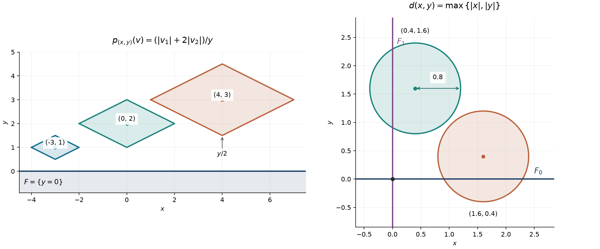

# Partitions for moving norms and smooth separation

*Written by GPT-6 Astra (OpenAI), October 2026. Public domain (CC0).*

A local measuring ball may change its size and shape from point to point. Slow variation is enough to build a smooth partition whose derivatives obey one prescribed sequence of bounds, even when the norms themselves are discontinuous. We separate the geometric counting argument from the derivative calculation. The construction also gives a smooth function separating two closed sets away from their intersection.

The [summable cutoff theorem](summable-smoothing-and-fixed-fourier-tests.md#directional-derivatives-in-the-original-norm), Theorem 3, supplies compact cutoffs in any fixed finite-dimensional norm with constant \(2n^2\). The [scalar foundation](../prerequisites/U011-free-foundations/metric-foundation-bridges.md), Sections 12.5–12.9, proves compactness, countable coordinate bases and norm comparisons. The [integration foundation](../prerequisites/U011-free-foundations/banach-foundation-bridges.md#15-1-convergence-product-integration-and-the-full-linear-jacobian) proves the volume scaling used in packing. We use the same explicit set-theoretic maximality axiom as the [functional foundation, Section 19](../prerequisites/U011-free-foundations/functional-foundations-U008.md#19-the-selected-zorn-entry-and-the-original-baire-recursion). All applications of that axiom, all covering bounds, and all partition derivatives are proved here.

Let \(V\) be a real vector space of dimension \(n\ge1\), let \(\Omega\subset V\) be open, and let \(p_x\) be a norm on \(V\) for each \(x\in\Omega\). The vector argument of a norm always belongs to \(V\); the subscript is its measuring point. Write

\[
 B_x(r)=\{y\in V:p_x(y-x)<r\}.
 \tag{M1}
\]

Each of these is an open ball for a fixed norm. No differentiability, or even continuity, of \(x\mapsto p_x\) is assumed.

## Comparing the measuring norms

**Lemma 1 (normalization and distance scales).** Suppose that for some \(C\ge1\),

\[
 p_x(y-x)<1
 \quad\Longrightarrow\quad
 y\in\Omega,\qquad p_y(v)\le C p_x(v)\quad(v\in V).
 \tag{M2}
\]

After replacing \(p_x\) by \(\widetilde p_x=Cp_x\), the same constant \(C\) gives

\[
 \widetilde p_x(y-x)<1
 \quad\Longrightarrow\quad
 y\in\Omega,\qquad
 C^{-1}\widetilde p_x(v)\le\widetilde p_y(v)
       \le C\widetilde p_x(v).
 \tag{M3}
\]

In particular, if \(p\) is a fixed norm and \(d:V\to[0,\infty)\) is globally \(1\)-Lipschitz for \(p\), then on \(\Omega=\{d>0\}\) the norms

\[
 p_x(v)=\frac{2p(v)}{d(x)}
 \tag{M4}
\]

already obey the two-sided condition (M3), with tildes omitted and \(C=2\).

**Proof.** If \(Cp_x(y-x)<1\), apply (M2) at \(x\). Then \(p_y(x-y)\le C p_x(y-x)<1\), so applying (M2) at \(y\) gives \(p_x(v)\le C p_y(v)\). Multiplication by \(C\) proves both inequalities for the rescaled norms.

For (M4), the hypothesis is \(p(y-x)<d(x)/2\). Lipschitz continuity yields \(d(x)/2<d(y)<3d(x)/2\). In particular \(y\in\Omega\), and
\[
 \frac23p_x(v)<p_y(v)<2p_x(v)\quad(v\ne0).
 \tag{M5}
\]
At \(v=0\) all values are zero. These bounds imply (M3) with \(C=2\). \(\square\)

In the distance-scale assertion, it is enough that \(d\) be continuous on \(V\), positive on \(\Omega\), zero outside \(\Omega\), and \(1\)-Lipschitz when both points lie in \(\Omega\). To see the global bound, take \(x\in\Omega\), \(y\notin\Omega\), and let \(z=x+t(y-x)\) be the first exit point of that segment. Such a first parameter \(t\in(0,1]\) exists because the complement is closed and \(\Omega\) is open. The preceding segment points lie in \(\Omega\). Letting them tend to \(z\) in the inside Lipschitz bound, continuity gives \(d(x)\le p(x-z)\le p(x-y)\). Pairs outside \(\Omega\) have both values zero, and the other pairs were assumed. Thus the required global \(1\)-Lipschitz bound follows.

For the rest of the construction we assume the normalized condition
\[
 p_x(y-x)<1\ \Longrightarrow\
 y\in\Omega,\quad C^{-1}p_x\le p_y\le Cp_x .
 \tag{M6}
\]

Distances to a nonempty closed set provide examples. If \(F\subset V\) is nonempty and closed, define \(d_F(x)=\inf_{z\in F}p(x-z)\). The triangle inequality gives \(d_F(x)\le p(x-y)+d_F(y)\); interchanging \(x,y\) proves the Lipschitz bound. The distance is finite, and it is zero exactly on \(F\): if the infimum is zero, choose points of \(F\) converging to \(x\), and use closedness. Thus \(d_F>0\) on \(V\setminus F\), and Lemma 1 applies there.

The infimum is attained. A minimizing sequence may be chosen with \(p(x-z_j)\le d_F(x)+1\); the triangle inequality bounds the sequence \(z_j\). Finite-dimensional compactness gives a convergent subsequence, closedness keeps its limit in \(F\), and continuity of the norm makes that limit a minimizer.

## Packing in one fixed norm

**Lemma 2 (one separated family, all the larger balls).** Assume (M6) and fix \(0<\varepsilon<1/C\). There is an at most countable set of centers \(\{x_\nu\}\subset\Omega\), maximal for the condition

\[
 p_{x_\nu}(x_\mu-x_\nu)\ge\varepsilon
 \quad\text{for every ordered pair }\mu\ne\nu.
 \tag{M7}
\]

For every \(R\) with \(C\varepsilon\le R\le1\), the balls \(B_{x_\nu}(R)\) cover \(\Omega\). The family of unit balls \(B_{x_\nu}(1)\) is locally finite in \(\Omega\), and its pointwise multiplicity is at most

\[
 N_\varepsilon=\left(1+\frac{2C^2}{\varepsilon}\right)^n .
 \tag{M8}
\]

The same local finiteness and multiplicity bound hold for all \(0<R\le1\), whether or not those smaller balls cover.

**Proof of selection and countability.** Order all subsets of \(\Omega\) satisfying (M7) by inclusion. The empty set belongs. The union of a chain satisfies (M7), since any two of its points occur together in one member of the chain. The maximality axiom gives a maximal set. For each selected point \(x_\nu\), its ball \(B_{x_\nu}(\varepsilon)\) contains no other selected point. Choose the first member of a fixed countable rational-coordinate basis which contains \(x_\nu\) and is contained in this ball. Different selected points receive different basis members: a common member would contain both of them and violate (M7). This injects the set of centers into a countable set, giving the asserted enumeration. A finite family is allowed.

**Proof of covering.** A point \(x\in\Omega\) not already selected cannot be adjoined. Hence for some \(\nu\), either \(p_{x_\nu}(x-x_\nu)<\varepsilon\), or \(p_x(x_\nu-x)<\varepsilon\). In the second case (M6), applied at \(x\), gives \(p_{x_\nu}(x-x_\nu)<C\varepsilon\); the first case also has that strict bound. Selected points belong to their own balls. Thus even the balls with \(R=C\varepsilon\) cover.

**Proof of multiplicity.** Fix \(x\in\Omega\), and consider centers whose unit balls contain \(x\). For each such center, (M6) gives \(C^{-1}p_x\le p_{x_\nu}\le Cp_x\), and \(p_x(x_\nu-x)<C\). For two distinct centers in this collection, (M7) therefore gives
\[
 p_x(x_\mu-x_\nu)\ge\varepsilon/C.
 \tag{M9}
\]
The balls of radius \(a=\varepsilon/(2C)\), centered at these points and all measured in the single fixed norm \(p_x\), are pairwise disjoint. They lie in the \(p_x\)-ball of radius \(C+a\) centered at \(x\). A fixed norm's unit ball has finite positive Lebesgue volume, by comparison with two coordinate cubes. Translation and scalar dilation show that the smaller balls have volume \(a^n v_x\) and the containing ball has volume \((C+a)^n v_x\). Every finite subcollection has at most \(((C+a)/a)^n=N_\varepsilon\) members. If the entire collection had more, a finite subcollection with more would contradict this bound. This proves (M8).

**Proof of local finiteness.** Pointwise multiplicity alone is insufficient. Fix \(x\in\Omega\), choose \(0<\delta<1\), and consider all unit balls meeting \(B_x(\delta)\). At a point \(y\) of such an intersection, (M6) applied at \(x\) and at the relevant center gives
\[
 C^{-2}p_x\le p_{x_\nu}\le C^2p_x,\qquad
 p_x(x_\nu-x)<\delta+C^2.
 \tag{M10}
\]
Now (M7) separates these centers in \(p_x\) by at least \(\varepsilon/C^2\). The fixed-norm balls of radius \(b=\varepsilon/(2C^2)\) about them are disjoint and lie in the fixed ball of radius \(\delta+C^2+b\) about \(x\). Volume comparison bounds their number by
\[
 \left(\frac{\delta+C^2+b}{b}\right)^n<\infty.
 \tag{M11}
\]
Thus only finitely many unit balls meet this neighborhood of \(x\). It lies in \(\Omega\) by (M6). This is local finiteness; inclusion gives it for all smaller radii. \(\square\)

## A derivative budget that survives multiplication

For a nonincreasing positive sequence \(d_1,d_2,\ldots\), put
\[
 D_0=1,\qquad D_k=d_1\cdots d_k\quad(k\ge1).
 \tag{M12}
\]
No summability is needed in the next lemma.

**Lemma 3 (product estimate).** At a fixed point \(x\), suppose smooth scalar functions \(f_1,\ldots,f_s\) obey \(|f_i(x)|\le1\) and
\[
 |D^k f_i(x)[v_1,\ldots,v_k]|
 \le \frac{A_i^k}{D_k}\prod_{j=1}^k p(v_j)
 \quad(k\ge1)
 \tag{M13}
\]
for a fixed norm \(p\) and constants \(A_i\ge0\). Their product obeys the same estimate with \(A_1+\cdots+A_s\).

**Proof.** Repeated directional differentiation assigns each of the \(k\) labeled directions to one factor. If factor \(i\) receives \(k_i\) directions, its denominator is \(D_{k_i}\). Concatenate the lists \(1,\ldots,k_i\) for the separate factors. The index in each list is no larger than its position in the concatenation, so monotonicity gives
\[
 \prod_i D_{k_i}\ge D_k,\qquad \sum_i k_i=k.
 \tag{M14}
\]
The absolute value of that product-rule term is therefore at most
\(D_k^{-1}\prod_i A_i^{k_i}\prod_j p(v_j)\).
Summing over all assignments gives \((A_1+\cdots+A_s)^k\), by the finite distributive law. Factors receiving no derivative contribute at most one. The zeroth-order product is also at most one. This proves the statement, including zero constants. \(\square\)

## A partition with fixed or varying budgets

**Theorem 4 (quantitative partition).** Assume (M6). There are centers \(x_\nu\in\Omega\) such that their unit balls are a locally finite cover with multiplicity at most
\[
 N=(4C^3+1)^n.
 \tag{M15}
\]
Let \(d_j(x)>0\), \(j\ge1\), be nonincreasing in \(j\) for every \(x\), with \(\sum_j d_j(x)\le1\). Suppose that one constant \(Q\ge1\), independent of \(j\), satisfies
\[
 p_x(y-x)<1\quad\Longrightarrow\quad
 d_j(y)\le Qd_j(x)\quad(j\ge1).
 \tag{M16}
\]
Then there are nonnegative \(\phi_\nu\in C_c^\infty(B_{x_\nu}(1))\) with \(\sum_\nu\phi_\nu=1\) on \(\Omega\), and
\[
 |D^k\phi_\nu(x)[v_1,\ldots,v_k]|
 \le \frac{(6n^2NCQ)^k}{d_1(x)\cdots d_k(x)}
        \prod_{j=1}^k p_x(v_j)
 \quad(k\ge1).
 \tag{M17}
\]
The functions \(d_j\) need not be continuous. For fixed budgets \(d_j(x)=d_j\), take \(Q=1\). The centers depend only on the norms and \(C\), not on the budgets.

**Proof.** Choose \(\varepsilon=1/(2C)\) in Lemma 2. The half-radius balls cover, and (M8) gives (M15). At center \(x_\nu\), use the fixed norm \(p_{x_\nu}\), compact set \(\overline B_{x_\nu}(1/2)\), and open set \(B_{x_\nu}(1)\). Their separation is \(1/2\). The summable cutoff theorem, with widths \(d_j(x_\nu)/3\), applies because their sum is at most \(1/3<1/2\). It supplies a smooth \(\psi_\nu\), compactly supported in the unit ball, equal to one near the closed half-ball, with \(0\le\psi_\nu\le1\) and
\[
 |D^k\psi_\nu(x)[v_1,\ldots,v_k]|
 \le \frac{(6n^2)^k}{d_1(x_\nu)\cdots d_k(x_\nu)}
       \prod_{j=1}^k p_{x_\nu}(v_j).
 \tag{M18}
\]
Extend it by zero to \(V\), which is smooth since its support is compact in its open ball. On that support, (M6) and (M16), starting at \(x_\nu\), give
\[
 p_{x_\nu}(v)\le Cp_x(v),\qquad
 d_j(x)\le Qd_j(x_\nu).
 \tag{M19}
\]
Thus (M18) has the bound (M13) at \(x\) with \(A_i=6n^2CQ\), norm \(p_x\), and budget \(d_j(x)\). The same positive-order bound holds for \(1-\psi_\nu\), whose value is also between zero and one.

In the fixed enumeration define the finite products
\[
 \phi_\nu=\psi_\nu\prod_{\mu<\nu}(1-\psi_\mu).
 \tag{M20}
\]
They are nonnegative and compactly supported in the respective unit balls. Their supports form a locally finite family by Lemma 2. For a finite initial segment, subtraction of successive products gives
\[
 \sum_{\nu=1}^l\phi_\nu
 =1-\prod_{\nu=1}^l(1-\psi_\nu).
 \tag{M21}
\]
At each \(x\in\Omega\), one of the half-balls contains \(x\), so its \(\psi_\nu(x)=1\). The right side is then one for every sufficiently large \(l\). This proves the partition identity.

To bound derivatives at a point \(x\), first discard every factor with \(x\notin\operatorname{supp}\psi_\mu\): it is identically zero, or its complement identically one, in a neighborhood of \(x\). If \(x\notin\operatorname{supp}\psi_\nu\), all derivatives of \(\phi_\nu\) vanish there. Otherwise at most \(N\) factors remain in (M20), since all their unit balls contain \(x\). Lemma 3 applied to these factors with (M19) gives (M17). This is a finite product calculation at each point, with no differentiation of the norms or the budgets. \(\square\)

The estimate also implies a bound for any sum over a subset \(J\) of the indices. Local finiteness makes \(F_J=\sum_{\nu\in J}\phi_\nu\) smooth, and \(0\le F_J\le1\). At most \(N\) terms contribute at a point, so for \(k\ge1\),
\[
 |D^kF_J(x)[v_1,\ldots,v_k]|
 \le\frac{(6n^2N^2CQ)^k}{d_1(x)\cdots d_k(x)}
       \prod_{j=1}^k p_x(v_j).
 \tag{M22}
\]
Indeed the sum first gives \(N(6n^2NCQ)^k\); use \(N\le N^k\).

## Separating two closed sets

**Corollary 5 (distance-controlled separation).** Let \(F_0,F_1\subset V\) be nonempty closed sets, let \(p\) be a fixed norm, and put
\[
 \Omega=V\setminus(F_0\cap F_1),\qquad
 d(x)=\max\{d_{F_0}(x),d_{F_1}(x)\}.
 \tag{M23}
\]
For every nonincreasing positive sequence \(d_j\) with \(\sum_j d_j\le1\), there is \(\phi\in C^\infty(\Omega)\), \(0\le\phi\le1\), which is zero near \(F_0\setminus F_1\) and one near \(F_1\setminus F_0\). For \(k\ge1\),
\[
 |D^k\phi(x)[v_1,\ldots,v_k]|
 \le \frac{C_n^k}{d(x)^k d_1\cdots d_k}
          \prod_{j=1}^k p(v_j),
 \qquad C_n=24n^2\,33^{2n}.
 \tag{M24}
\]
If \(F_1\) is compact, the support of \(\phi\), taken relative to \(\Omega\), is bounded. It need not be compact in \(\Omega\).

**Proof.** Both distance functions are globally \(1\)-Lipschitz. Their maximum has the same property: each value at \(x\) is at most the corresponding value at \(y\) plus \(p(x-y)\), and take the maximum, then interchange \(x,y\). Also \(d=0\) exactly on \(F_0\cap F_1\). If \(\Omega\) is empty the assertions are vacuous. Otherwise use \(p_x=2p/d(x)\), which obeys (M6) with \(C=2\). Theorem 4 gives \(N=33^n\) and a partition with the fixed budgets.

A closed \(p_x\)-ball of radius one cannot meet both \(F_0\) and \(F_1\). In fact choose \(i\) with \(d(x)=d_{F_i}(x)>0\). For any \(y\) in that ball, \(p(y-x)\le d(x)/2\), so
\[
 d_{F_i}(y)\ge d_{F_i}(x)-p(y-x)\ge d(x)/2>0.
 \tag{M25}
\]
Let \(J\) consist of the indices for which \(\operatorname{supp}\phi_\nu\) meets \(F_1\), and set \(\phi=\sum_{\nu\in J}\phi_\nu\). Every chosen support is disjoint from \(F_0\) by (M25). Near a point of \(F_0\setminus F_1\), local finiteness leaves finitely many supports to consider, and each chosen one is closed and avoids that point. A smaller neighborhood avoids them all; there \(\phi=0\). Near a point of \(F_1\setminus F_0\), the same argument applies to the unchosen supports, each of which avoids \(F_1\). There the full partition consists only of chosen terms, so \(\phi=1\).

Apply (M22) with \(C=2,Q=1,N=33^n\), and substitute \(p_x(v)=2p(v)/d(x)\). This gives exactly (M24).

For bounded support, choose \(z_0\in F_0\), put \(a=p(z_0)\), and enclose compact \(F_1\) in \(\{p\le M\}\) for some \(M>0\). If \(p(x)>a+2M\), then
\[
 d_{F_0}(x)\le p(x)+a
 <2(p(x)-M)\le2d_{F_1}(x).
 \tag{M26}
\]
Also \(d_{F_1}(x)>0\), so \(d(x)<2d_{F_1}(x)\). The unit \(p_x\)-ball, of \(p\)-radius \(d(x)/2\), then misses \(F_1\). Consequently every chosen center has \(p(x_\nu)\le a+2M\). The globally Lipschitz function \(d\) is bounded on that bounded set, for example by \(d(0)+a+2M\). The chosen balls therefore have uniformly bounded \(p\)-radii. Their union, and its closure relative to \(\Omega\), are bounded. This contains the support of \(\phi\). \(\square\)

The nonempty-set hypothesis makes both distances finite. If \(F_1=\varnothing\), the zero function handles the separation requirements. If \(F_0=\varnothing\), the constant one handles them; for compact \(F_1\), an ordinary compact cutoff equal to one near \(F_1\) gives bounded support. No estimate using an infinite distance to the empty set is asserted.

*Left: on \(y>0\), the fixed norm \(p(v)=|v_1|+2|v_2|\) gives distance \(d(x,y)=2y\) to the boundary and moving norm \(p_{(x,y)}(v)=p(v)/y\). The displayed unit balls are exact diamonds with horizontal radius \(y\) and vertical radius \(y/2\). They illustrate (M4); the finite drawing is not a selected cover. Right: for the Euclidean norm, \(F_0\) is the horizontal axis, \(F_1\) the vertical axis, and \(d(x,y)=\max\{|x|,|y|\}\). Balls centered at \((0.4,1.6)\) and \((1.6,0.4)\), each of radius \(0.8\), meet only one of the two sets. Equation (M25) explains this separation. [Vector figure](../figures/moving-norm-separation.svg) · [Figure source](../figures/moving-norm-separation.py).*

## Exercises with complete solutions

**Exercise 1 (introductory: a non-Euclidean boundary scale).** Verify every radius in the left panel, and prove that the whole unit ball remains in the upper half-plane.

**Solution.** The distance in \(p(v)=|v_1|+2|v_2|\) from \((x,y)\), \(y>0\), to the horizontal axis is \(2y\): every displacement to that axis has vertical cost \(2y\), and keeping the first coordinate fixed attains it. Formula (M4) becomes \(p_{(x,y)}(v)=(|v_1|+2|v_2|)/y\). Its unit ball has vertices \((x\pm y,y)\) and \((x,y\pm y/2)\). All its points have vertical coordinate greater than \(y/2>0\), and its closure has vertical coordinate at least \(y/2\). \(\square\)

**Exercise 2 (intermediate: discontinuous data).** On \(\mathbb R^n\), let \(a(x)=1\) when the first coordinate of \(x\) is rational, and \(a(x)=2\) otherwise. Set \(p_x(v)=a(x)|v|\) and \(d_j(x)=2^{-j}/a(x)\). Verify the hypotheses of Theorem 4 without differentiating these functions.

**Solution.** For all \(x,y,v\), \(\frac12p_x(v)\le p_y(v)\le2p_x(v)\). The domain is the whole space, so (M6) holds with \(C=2\). Each budget sequence is positive and decreasing, and its sum is \(1/a(x)\le1\). Also \(d_j(y)/d_j(x)=a(x)/a(y)\le2\), uniformly in \(j,x,y\). Thus \(Q=2\) works. Theorem 4 gives a smooth partition with \(N=33^n\) and numerator constant \(6n^2N\cdot2\cdot2=24n^2N\). Rational and irrational points are both dense, so the data jump arbitrarily close to every point; their derivatives are neither needed nor used. \(\square\)

**Exercise 3 (intermediate: factorial derivative budgets).** Use \(d_j=1/(j(j+1))\). Express (M17) with factorials, and show that it is bounded by a constant to the \(k\)-th power times \((k!)^2\).

**Solution.** Since \(1/(j(j+1))=1/j-1/(j+1)\), the first \(m\) terms sum to \(1-1/(m+1)\), and the infinite sum is one. Also
\[
 d_1\cdots d_k=\frac1{k!(k+1)!}.
 \tag{M27}
\]
With \(A=6n^2NC\), the fixed-budget bound is \(A^k k!(k+1)!\prod_jp_x(v_j)\). For \(k\ge1\), induction gives \(k+1\le2^k\), so this is at most \((2A)^k(k!)^2\prod_jp_x(v_j)\). The induction starts at \(k=1\); from \(k+1\le2^k\), use \(k+2\le2(k+1)\). \(\square\)

**Exercise 4 (intermediate: a different budget).** Repeat the derivative calculation for \(d_j=2^{-j}\), and identify exactly where the order dependence enters.

**Solution.** The geometric series has sum one and
\[
 d_1\cdots d_k=2^{-k(k+1)/2}.
 \tag{M28}
\]
Hence (M17), with \(Q=1\), becomes \(A^k2^{k(k+1)/2}\prod_jp_x(v_j)\), where \(A=6n^2NC\). The fixed constant \(A\) contains dimension and slow-variation data. The quadratic exponent \(k(k+1)/2\) comes entirely from multiplying the prescribed widths; no extra derivative-order constant is hidden in \(A\). \(\square\)

**Exercise 5 (advanced: bounded overlap does not imply local finiteness).** Give disjoint open intervals on \(\mathbb R\) whose family is not locally finite, and smooth functions supported in them whose sum is not continuous.

**Solution.** Take \(I_j=(2^{-j}-2^{-j-3},2^{-j}+2^{-j-3})\), \(j\ge1\). The upper endpoint of \(I_{j+1}\) is \((9/16)2^{-j}\), smaller than the lower endpoint \((7/8)2^{-j}\) of \(I_j\); thus the intervals are pairwise disjoint. Every neighborhood of zero meets infinitely many, although zero belongs to none. The cutoff theorem supplies \(0\le f_j\in C_c^\infty(I_j)\) with \(f_j(2^{-j})=1\). At every point at most one term is nonzero, so the sum is defined. It is zero at zero and equals one at all \(2^{-j}\), hence is discontinuous at zero. This explains why the neighborhood-packing argument (M10)–(M11) is necessary. \(\square\)

**Exercise 6 (advanced: a concrete bounded separator).** In Euclidean \(\mathbb R^2\), take \(F_0=\{0\}\) and \(F_1=\overline B((3,0),1)\). Show that the separator constructed in Corollary 5 can have support in the closed ball of radius \(27/2\).

**Solution.** The two closed sets are disjoint, so \(\Omega=\mathbb R^2\). In (M26) use \(a=0\) and \(M=4\). Every chosen center has length at most \(8\). At such a center \(x\), \(d_{F_0}(x)=|x|\le8\), while \((3,0)\in F_1\) gives \(d_{F_1}(x)\le|x-(3,0)|\le11\). Thus \(d(x)\le11\), and its unit moving-norm ball has Euclidean radius at most \(11/2\). All chosen supports lie within radius \(8+11/2=27/2\); taking the closure retains that bound. The estimate is a sufficient support bound, not an optimal one. \(\square\)

**Exercise 7 (advanced: empty sets and infinite distances).** Explain why Corollary 5 cannot simply allow \(F_0=\varnothing\), retain its bounded-support conclusion for compact nonempty \(F_1\), and interpret \(d_{F_0}=+\infty\) in (M24).

**Solution.** Take \(V=\mathbb R\), \(F_1=\{0\}\). That interpretation would make \(d(x)=+\infty\), so the \(k=1\) bound forces \(\phi'(x)=0\) everywhere. The fundamental theorem of calculus then makes \(\phi\) constant. Since it is one near \(F_1\), it is identically one, with unbounded support. Ordinary compact separation is possible, but this infinite-distance derivative estimate is incompatible with it. \(\square\)

**Exercise 8 (advanced: the exact product constant).** Show that the sum \(A_1+\cdots+A_s\) in Lemma 3 cannot be decreased in general, even for scalar functions of one real variable at one point.

**Solution.** Use the fixed point \(0\), norm \(|\cdot|\), and widths \(d_j=1\), which are allowed because Lemma 3 requires no summability. For \(A_i>0\), take \(f_i(t)=e^{A_it}\). At zero their values are one and their \(k\)-th derivatives are \(A_i^k\); the derivative identities follow from the exponential proof in the scalar foundation. The product is \(e^{(A_1+\cdots+A_s)t}\), whose \(k\)-th derivative at zero is exactly \((A_1+\cdots+A_s)^k\). Already \(k=1\) excludes every smaller constant. These are pointwise hypotheses; no bound on the functions over a whole neighborhood is required. \(\square\)

## References

- Lars Hörmander, *The Analysis of Linear Partial Differential Operators I: Distribution Theory and Fourier Analysis*, second edition, Springer, 2003, Definition 1.4.7, Example 1.4.8, Lemma 1.4.9, Theorem 1.4.10, its variable-width remark, and Corollary 1.4.11, pp. 28–31.
- [Summable smoothing and fixed Fourier tests](summable-smoothing-and-fixed-fourier-tests.md), Lemmas 1–2 and Theorem 3, proves the fixed-norm cutoff construction used in (M18).
