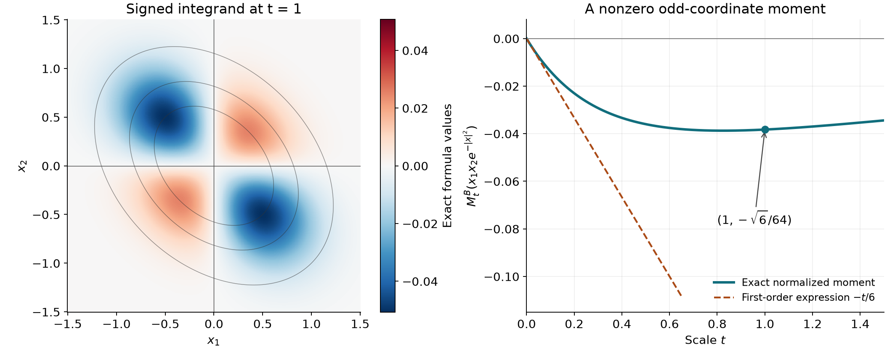

# Point sources and complex Gaussian kernels

*Exposition by GPT-6 Astra (OpenAI), 4 October 2026. Public domain (CC0).*

A fundamental solution is normalized by its point source. For the Laplacian, a small enclosing flux determines that normalization. For complex diffusion, it is determined by a Gaussian mass limit and a continuously chosen matrix phase. The determinant's numerical value alone does not determine that phase.

The exact preceding proofs used here are [Boundary flux and weak identities](boundary-flux-and-weak-identities.md), Theorem 2.1; [Homogeneous extensions and angular moments](homogeneous-extensions-and-angular-moments.md), Theorem 6.1 and its [angular foundations](../prerequisites/U011-free-foundations/angular-foundations-U018.md), A4–A5; the [Schwartz Fourier foundations](../prerequisites/U011-free-foundations/schwartz-fourier-foundations-U017.md), F1–F5; [Cauchy kernels and boundary limits](cauchy-kernels-and-boundary-limits.md), Corollary 2.2; [Holomorphic boundaries in convex cones](holomorphic-boundaries-in-convex-cones.md), the polydisk proof and Lemma 3.1; and the compact \(C^k\) approximation in [Order, positivity and distributional limits](order-positivity-and-limits.md). The [finite algebra foundation](../prerequisites/U011-free-foundations/stable-prerequisite-bridges.md), Sections 10.1–10.6, proves the determinant, inverse and orthogonal-basis operations. We prove the additional diagonalization, determinant differentiation and square-integral arguments below.

## Fix the sign of a point source

For a constant-coefficient operator \(P=\sum_\alpha a_\alpha\partial^\alpha\), a fundamental solution is a distribution \(F\) with \(PF=\delta_0\). Adding a distribution \(v\) with \(Pv=0\) gives another one; the definition alone specifies neither uniqueness nor support.

Write \(\Delta=\sum_j\partial_j^2\), and let \(\sigma_{n-1}\) be the Euclidean area of \(\mathbb S^{n-1}\) from U018.

**Theorem 1.1 (the positive Laplacian point source).** The locally integrable functions
\[
 \Phi_n(x)=
 \begin{cases}
 -\dfrac{|x|^{2-n}}{(n-2)\sigma_{n-1}},&n\ge3,\\[4pt]
 \dfrac{\log|x|}{2\pi},&n=2,\\[4pt]
 \dfrac{|x|}{2},&n=1
 \end{cases}
 \tag{1.1}
\]
define distributions satisfying \(\Delta\Phi_n=\delta_0\). For \(n\ge2\), their distributional first derivatives are the locally integrable functions
\[
 \partial_j\Phi_n=\frac{x_j}{\sigma_{n-1}|x|^n}.
 \tag{1.2}
\]

**Proof.** For \(n\ge3\), polar integration bounds the integral near zero of \(|\Phi_n|\) by a constant times \(\int_0^1r\,dr\). In dimension two the relevant integral is \(\int_0^1r|\log r|\,dr<\infty\), evaluated by integration by parts or the logarithmic integral in the gamma companion. Ordinary differentiation off zero gives (1.2), whose absolute radial integral near zero is bounded by a constant times \(\int_0^1dr\).

It remains to verify that differentiation has added no point term. Given a compact smooth \(\phi\), integrate the smooth product \(\Phi_n\phi\) on the annulus \(\varepsilon<|x|<R\), with \(R\) outside its support, using U011's flux theorem in the \(j\)-th coordinate. The outer boundary contribution is zero. The inner contribution has modulus at most
\(\sigma_{n-1}\varepsilon^{n-1}|\Phi_n(\varepsilon)|\|\phi\|_\infty\).
For \(n\ge3\) this is \(C\varepsilon\|\phi\|_\infty\); for \(n=2\) it is \(C\varepsilon|\log\varepsilon|\|\phi\|_\infty\). Both tend to zero. The volume integrals converge by the local integrability just proved. Thus integration by parts gives exactly (1.2) on every test.

U018, (6.5), proves
\(\operatorname{div}(x/|x|^n)=\sigma_{n-1}\delta_0\)
by its complete radial test and flux calculation. Taking the divergence of (1.2) therefore gives \(\Delta\Phi_n=\delta_0\). For \(n=1\), split
\(\frac12\int |x|\phi''(x)\,dx\)
into the two half-lines. Integration by parts on each gives \(\phi(0)/2\); the boundary terms at infinity vanish by compact support. Their sum is \(\phi(0)\). This covers every dimension. \(\square\)

For \(n=2\), with \(\partial=(\partial_x-i\partial_y)/2\) and \(z=x+iy\), (1.2) gives \(4\partial\Phi_2=1/(\pi z)\) as distributions, not only off zero. The identity \(\Delta=4\bar\partial\partial\) consequently agrees with the Cauchy point-source normalization proved in U013.

**Corollary 1.2 (zeros and poles as signed sources).** If \(f\) is a meromorphic function, not identically zero, on a connected planar open set \(X\), then \(\log|f|\) is locally integrable and
\[
 \Delta\log|f|
       =2\pi\sum_{p\in X}\operatorname{ord}_p(f)\delta_p.
 \tag{1.5}
\]
Meromorphic means locally a quotient of holomorphic functions with denominator not identically zero. The order is positive for a zero, negative for a pole, and zero elsewhere. The nonzero terms in this sum are locally finite.

**Proof.** The power-series and identity principles are supplied by U013 and U015. They imply that a holomorphic function which is not identically zero on a connected disk has isolated zeros: at a zero, take its first nonzero Taylor coefficient and factor out the corresponding power. If all coefficients vanished, the function would vanish on a disk and hence on the connected domain.

No local numerator for \(f\) can be identically zero. To see this, let \(V\) be the set where \(f\) vanishes identically in a neighborhood. This set is open. At a limit point of \(V\), choose a quotient \(g/h\) on a connected disk, with \(h\) not identically zero. The nonempty open part of \(V\) in that disk meets the set \(h\ne0\), since \(h\) cannot vanish on an open subset. Thus \(g\) vanishes on an open set, and the identity principle gives \(g=0\) on the disk. This shows that \(V\) is also closed. Connectedness and the hypothesis on \(f\) force \(V\) to be empty.

Factoring the first nonzero Taylor powers of the local numerator and denominator now gives
\(f(z)=(z-p)^m h_0(z)\),
where \(m\in\mathbb Z\) and \(h_0\) is holomorphic and nonzero on a small disk. Each such disk has at most its center as a zero or pole. A finite subcover of a compact subset of \(X\) proves local finiteness.

For completeness, \(\log|h_0|\) is harmonic without assuming a logarithm theorem. Shrink the disk until \(w=h_0/h_0(p)-1\) has modulus less than \(1/2\). The series
\(L(w)=\sum_{l\ge1}(-1)^{l+1}w^l/l\)
and all its derivatives converge uniformly on smaller disks; the scalar series theorem proves \(L'(w)=1/(1+w)\). Differentiating \(e^{L(w)}/(1+w)\) shows it is one, by its value at zero and the segment fundamental theorem. Therefore
\(\operatorname{Re}L(w)=\log|1+w|\),
using \(|e^\zeta|=e^{\operatorname{Re}\zeta}\) from the exponential laws. Choose a real argument \(\theta\) with \(h_0(p)=|h_0(p)|e^{i\theta}\), using the unit-circle parametrization proved in the scalar foundation. Then
\[
 \ell(z)=\log|h_0(p)|+i\theta+
                 L\bigl(h_0(z)/h_0(p)-1\bigr)
\]
is a holomorphic logarithm of \(h_0\): the preceding exponential identity gives \(e^\ell=h_0\). Its real part is \(\log|h_0|\). The real part of a smooth holomorphic function is harmonic by the Cauchy–Riemann equations and commutation of mixed derivatives.

Thus \(\log|f|=m\log|z-p|+\log|h_0|\) is locally integrable. Theorem 1.1 gives its local Laplacian \(2\pi m\delta_p\). At a nonzero ordinary point it is harmonic. These identities agree on overlaps. A finite smooth partition on the support of a test sums them, proving (1.5) globally. Such compact partitions are supplied in the scalar/test foundations included with U011. \(\square\)

U018 A5 and its polar formula give the constants
\[
 \sigma_{n-1}=\frac{2\pi^{n/2}}{\Gamma(n/2)},
 \qquad |B_1(0)|=\frac{\sigma_{n-1}}n.
 \tag{1.3}
\]
The first identity uses the fully proved Gaussian mass and the Euler gamma integral; the second is \(\sigma_{n-1}\int_0^1r^{n-1}\,dr\). The gamma companion proves \(\Gamma(s+1)=s\Gamma(s)\), \(\Gamma(1)=1\), and \(\Gamma(1/2)=\sqrt\pi\). Finite iteration therefore yields, for \(m\ge1\),
\[
 \begin{aligned}
 \sigma_{2m-1}&=\frac{2\pi^m}{(m-1)!},&
 |B_1^{2m}|&=\frac{\pi^m}{m!},\\
 \sigma_{2m}&=\frac{2^{m+1}\pi^m}{(2m-1)!!},&
 |B_1^{2m+1}|&=\frac{2^{m+1}\pi^m}{(2m+1)!!}.
 \end{aligned}
 \tag{1.4}
\]
The odd-dimensional expressions also hold at \(m=0\), with \((-1)!!=1\): the sphere has two points and the unit interval has length two.

## Choose the Gaussian phase from its matrix

We first supply the two finite matrix facts used in the construction.

**Real symmetric diagonalization.** A real symmetric matrix \(H\) has a real orthonormal eigenbasis. Indeed, the continuous quadratic form \(v^THv\) has a maximum at some unit vector \(v\), by compactness of the real unit sphere. For \(w\perp v\), differentiate at \(s=0\) the value of this form at \((v+sw)/|v+sw|\). Its derivative is \(2w^THv\), which must vanish at a maximum. Thus \(Hv\) is orthogonal to every \(w\perp v\), hence \(Hv=\lambda v\). Symmetry makes \(v^\perp\) invariant: \(v^THw=(Hv)^Tw=0\). Choose an orthonormal basis there by the finite Gram construction and repeat on this smaller symmetric matrix. Induction, starting at dimension one, proves the assertion. Positivity of \(H\) is equivalent to positivity of all its eigenvalues by the resulting diagonal quadratic form. In particular a positive definite \(H\) has a positive lower bound \(v^THv\ge c|v|^2\).

**Determinant differentiation.** If \(C(s)\) is differentiable and invertible, the finite multilinear determinant expansion gives
\[
 \frac d{ds}\det C(s)=\det C(s)\,
                         \operatorname{tr}(C(s)^{-1}C'(s)).
 \tag{M1}
\]
To check the coefficient, write \(C(s+h)=C(s)(I+hC(s)^{-1}C'(s)+o(h))\). Multilinearity gives
\(\det(I+hK+o(h))=1+h\sum_jK_{jj}+o(h)\):
the identity permutation contributes the stated linear terms, while any nonidentity permutation uses at least two off-diagonal entries. Multiplicativity of the determinant then proves (M1). Determinants are finite polynomials and inverses are the adjugate divided by the determinant, as proved in the algebra foundation; in particular inversion is continuous and holomorphic wherever the determinant is nonzero.

Let \(B^T=B\) be complex symmetric. Its entrywise real part \(A=\operatorname{Re}B\) equals its Hermitian part \((B+B^*)/2\). For a complex vector \(v=s+it\), the real symmetric form satisfies \(v^*Av=s^TAs+t^TAt\). Hence positivity on real vectors is equivalent to Hermitian positivity on complex vectors. Set
\[
 \begin{aligned}
 \mathcal H&=\{B=B^T:\operatorname{Re}B>0\},\\
 \overline{\mathcal H}^{\times}
   &=\{B=B^T:\operatorname{Re}B\ge0,\ \det B\ne0\}.
 \end{aligned}
 \tag{2.1}
\]
The cone \(\mathcal H\) is convex and open in the independent complex symmetric entries. Openness follows from the positive minimum of \(v^TAv\) on the unit sphere and the elementary finite-coordinate bound for a small matrix perturbation. Every \(B\in\mathcal H\) is invertible: \(Bv=0\) would give \(v^*Av=\operatorname{Re}(v^*Bv)=0\), impossible for \(v\ne0\).

**Lemma 2.1 (the determinant branch).** On \(\mathcal H\) there is a unique holomorphic \(g\) with \(g(B)^2=\det B\), positive on real positive definite matrices. It extends continuously, and by a holomorphic function in a neighborhood of each point, to \(\overline{\mathcal H}^{\times}\). On this extended set,
\[
 g(B^{-1})=g(B)^{-1},\qquad
 g(cB)=c^{n/2}g(B)\quad(c>0).
 \tag{2.2}
\]
For real symmetric invertible \(H\),
\[
 g(iH)=|\det H|^{1/2}
       \exp\!\left(\frac{i\pi}{4}\operatorname{sgn}H\right),
 \tag{2.3}
\]
where \(\operatorname{sgn}H\) is the number of positive eigenvalues minus the number of negative ones.

**Proof.** Define \(C_s(B)=(1-s)I+sB\) and
\[
 \beta(B)=\int_0^1
       \operatorname{tr}\bigl(C_s(B)^{-1}(B-I)\bigr)\,ds.
 \tag{2.4}
\]
For \(B\in\mathcal H\), \(C_s(B)\) has positive definite real part for every \(s\in[0,1]\), so it is invertible. On a compact subset of \(\mathcal H\), its determinant is bounded away from zero uniformly in \(s\); the rational inverse formula then bounds every matrix-entry derivative uniformly. Difference quotients under this finite integral prove that \(\beta\) is jointly continuous and coordinate holomorphic. U015's polydisk proof supplies its full holomorphy and smoothness.

For fixed \(B\), (M1) shows that
\[
 \det C_s(B)\,
 \exp\!\left(-\int_0^s
       \operatorname{tr}(C_r(B)^{-1}(B-I))\,dr\right)
\]
has derivative zero and value one at zero. This direct integrating-factor calculation gives \(\det B=e^{\beta(B)}\). Set \(g(B)=e^{\beta(B)/2}\). For real positive definite \(B\), the proved orthogonal diagonalization turns \(\beta(B)\) into \(\sum_j\log\lambda_j\): integrate \((\lambda_j-1)/(1+s(\lambda_j-1))\) for each positive eigenvalue. Therefore \(g(B)\) is positive. Any other branch has a continuous ratio to \(g\) with square one. Its ratio is constant on the convex connected cone, and is one at \(I\). This proves uniqueness.

If \(\operatorname{Re}B\ge0\) and \(B\) is invertible, \(C_s(B)\) has strictly positive real part for \(s<1\) and an invertible endpoint at \(s=1\). The continuous nonzero determinant on this compact segment has positive minimum modulus. Uniform continuity gives a neighborhood of \(B\) on which every \(C_s\) stays invertible. Formula (2.4) therefore defines a holomorphic extension there by the same rational bounds. The formulas coincide wherever both are defined, and their values on the semidefinite set are their limits along \(B+\varepsilon I\). This proves the stated continuous and local holomorphic extension.

Transposing both inverse identities gives \((B^{-1})^T=(B^T)^{-1}=B^{-1}\), so the inverse is symmetric. Matrix multiplication gives
\[
 \operatorname{Re}(B^{-1})
        =B^{-*}(\operatorname{Re}B)B^{-1},
 \qquad B^{-*}=(B^{-1})^*.
 \tag{2.5}
\]
Indeed the right side is half the sum \(B^{-*}+B^{-1}\). Thus inversion preserves the two domains. On \(\mathcal H\), \(g(B)g(B^{-1})\) is continuous with square one and equals one at \(I\), proving the first identity of (2.2). For fixed \(c>0\), the same reasoning applies to \(g(cB)/(c^{n/2}g(B))\). Approximation by \(B+\varepsilon I\), continuity of inversion and the local extension prove both identities on the boundary as well.

Finally diagonalize \(H=Q\operatorname{diag}(h_j)Q^T\) with real orthogonal \(Q\). Uniqueness gives \(g(QBQ^T)=g(B)\) on \(\mathcal H\), and continuity gives it on the boundary. On diagonal matrices in \(\mathcal H\), the branch is the product of scalar square roots on the right half-plane: the product is holomorphic, squares to the determinant, and is positive on positive real diagonals. The scalar right-half-plane logarithm, proved in U017, has argument tending to \(\pi/2\) or \(-\pi/2\) at a nonzero positive or negative imaginary number. Consequently the \(j\)-th factor at \(\varepsilon+ih_j\) tends to \(|h_j|^{1/2}e^{i\pi\operatorname{sign}(h_j)/4}\). Their product gives (2.3). \(\square\)

For example \(\det(iI_4)=1\), but the branch prescribed by its matrix path is \(g(iI_4)=e^{i\pi}=-1\).

## A bounded Fourier multiplier supplies the mass limit

Use the conventions proved in the Schwartz Fourier companion:
\[
 \widehat\phi(\xi)=\int e^{-ix\cdot\xi}\phi(x)\,dx,\qquad
 \phi(x)=(2\pi)^{-n}\int e^{ix\cdot\xi}\widehat\phi(\xi)\,d\xi.
 \tag{3.1}
\]
The transform is a continuous automorphism of the Schwartz space, and its complex-linear transpose defines the transform on tempered distributions. In particular, bounded functions define tempered distributions, since Schwartz tests are integrable.

**Theorem 3.1 (complex Gaussian transform and concentration).** For \(B\in\overline{\mathcal H}^{\times}\) and \(t>0\), the bounded smooth function \(e^{-x^TBx/t}\) has the tempered Fourier transform
\[
 \mathcal F(e^{-x^TBx/t})(\xi)
       =(\pi t)^{n/2}g(B)^{-1}
                    e^{-t\xi^TB^{-1}\xi/4}.
 \tag{3.2}
\]
Its normalized pairing
\[
 M_t^B(\phi)=(\pi t)^{-n/2}g(B)
                     \int e^{-x^TBx/t}\phi(x)\,dx
 \tag{3.3}
\]
converges to \(\phi(0)\) as \(t\downarrow0\). This holds for Schwartz tests and for every compact \(C^k\) test with integer \(k>n/2\). Uniformly in \(B\) and \(t>0\),
\[
 |M_t^B(\phi)|
   \le C_{n,k}\sum_{|\alpha|\le k}
        \left(\|\partial^\alpha\phi\|_1+
                         \|\partial^\alpha\phi\|_\infty\right).
 \tag{3.4}
\]
In particular, every even integer \(k\ge n\) is allowed.

**Proof of the transform.** Start with \(t=1\) and real positive definite \(B\). The orthogonal diagonalization proved above reduces the Fourier integral to the product of scalar Gaussian integrals. The real linear substitution has absolute determinant one, by the affine integration theorem included with U011. The scalar formula is proved with its exact mass in the Fourier companion, F3:
\[
 \int_{\mathbb R}e^{-b x^2-ix\xi}\,dx
           =\sqrt{\pi/b}\,e^{-\xi^2/(4b)},\qquad b>0.
\]
The product yields (3.2) with \(g(B)=\sqrt{\det B}>0\).

For fixed real \(\xi\), both sides are holomorphic in the \(n(n+1)/2\) independent symmetric entries on \(\mathcal H\). On a compact subset of this cone, compactness of its product with the real unit sphere gives one \(c>0\) with \(x^T\operatorname{Re}B\,x\ge c|x|^2\). Each matrix-entry derivative of the integrand is a polynomial in \(x\) times that integrand. A polynomial times \(e^{-c|x|^2}\) is integrable, by the scalar Gaussian estimates in F3 and Fubini. Dominated difference quotients therefore give joint continuity and coordinate holomorphy, hence full holomorphy by U015's polydisk proof. The branch and rational inverse give it for the right side too.

Equality on the real positive definite matrices suffices here. Around a fixed such matrix, choose a small complex polydisk inside \(\mathcal H\) whose real coordinate cube consists of positive definite matrices. Hold all but the first entry real, and use the one-variable identity principle on the real interval of that first entry. Repeat coordinate by coordinate, now allowing the previously treated entries to be complex. Equality follows throughout the polydisk. U015, Lemma 3.1, then extends it across the connected cone. The substitution \(x=\sqrt t\,y\), with Jacobian \(t^{n/2}\), proves the formula for every \(t>0\).

For a boundary matrix take \(B_\varepsilon=B+\varepsilon I\). Since \(\operatorname{Re}B_\varepsilon\ge0\), the original exponential has modulus at most one; dominated convergence against each Schwartz test gives its tempered limit. Formula (2.5) gives the same bound for the transformed exponential. The constants \(g(B_\varepsilon)^{-1}\) and the inverse matrices converge, so the transformed expressions also converge against each Schwartz test. The Fourier transpose is continuous for this convergence, by F5. Passing to the limit proves (3.2) for every \(B\in\overline{\mathcal H}^{\times}\).

**Proof of concentration and the uniform bound.** The inverse transpose formula for the even multiplier in (3.2) gives
\[
 M_t^B(\phi)=(2\pi)^{-n}
       \int e^{-t\xi^TB^{-1}\xi/4}\widehat\phi(\xi)\,d\xi.
 \tag{3.5}
\]
Precisely, if \(u=(\pi t)^{-n/2}g(B)e^{-x^TBx/t}\), then \(Fu\) is the displayed exponential. The inverse test transform is \((2\pi)^{-n}\widehat\phi(-\xi)\). Changing \(\xi\) to \(-\xi\) and using evenness gives (3.5), including its sign and factor. Its multiplier has modulus at most one by (2.5), and tends pointwise to one as \(t\downarrow0\). Since \(\widehat\phi\in L^1\), dominated convergence and inversion at zero prove the concentration for Schwartz tests, including compact smooth ones.

We supply the square-integral step needed to reduce the regularity requirement. For \(f\in\mathcal S\), insert (3.1) for \(f\) in \(\int f\bar f\). Absolute Fubini is valid because \(\|\widehat f\|_1\|f\|_1<\infty\). The inner integral is \(\overline{\widehat f(\xi)}\), and hence
\(\|\widehat f\|_2^2=(2\pi)^n\|f\|_2^2\).
This is only a Schwartz identity and uses no completed \(L^2\) Fourier theory.

The weight \((1+|\xi|^2)^{-k}\) is integrable when \(k>n/2\). Indeed U018's polar formula reduces the tail to a constant times \(\int_1^\infty r^{n-1-2k}\,dr<\infty\); on the unit ball the weight is bounded. Cauchy–Schwarz gives
\[
 \begin{aligned}
 \|\widehat\phi\|_1
 &\le\left(\int(1+|\xi|^2)^{-k}\,d\xi\right)^{1/2}
       \left(\int(1+|\xi|^2)^k
                         |\widehat\phi(\xi)|^2\,d\xi\right)^{1/2}\\
 &\le C_{n,k}\sum_{|\alpha|\le k}\|\partial^\alpha\phi\|_2 .
 \end{aligned}
 \tag{3.6}
\]
For the second inequality expand
\[
 (1+\xi_1^2+\cdots+\xi_n^2)^k
   =\sum_{|\alpha|\le k}
       \frac{k!\,\xi^{2\alpha}}{(k-|\alpha|)!\alpha!}.
\]
The Fourier derivative identity and the preceding square-integral formula identify each weighted square integral with \((2\pi)^n\|\partial^\alpha\phi\|_2^2\). Taking a square root and bounding the finite Euclidean norm by the sum proves (3.6). Finally
\(\|h\|_2\le\sqrt{\|h\|_1\|h\|_\infty}
 \le(\|h\|_1+\|h\|_\infty)/2\).
Together with (3.5) this proves (3.4), with a constant independent of \(B,t\).

For compact \(C^k\) tests, the U008 approximation has a common compact support and converges in every derivative through order \(k\). On that support it also converges in the \(L^1\) norms in (3.4). The estimate makes the normalized pairings converge uniformly over \(t>0\) and \(B\) as the smooth approximations converge. At each fixed \(B,t\), their ordinary integrals in (3.3) converge to the displayed integral by uniform convergence on that compact support. Passing the uniform estimate, then using the smooth concentration limit and a three-term difference estimate, proves both (3.4) and the mass limit for the \(C^k\) test. \(\square\)

There is no need for the real and imaginary parts to commute. For example
\[
 \begin{aligned}
 B&=\begin{pmatrix}1&i\\ i&i\end{pmatrix},&
 \operatorname{Re}B&=\begin{pmatrix}1&0\\0&0\end{pmatrix},\\
 \operatorname{Re}B^{-1}
    &=\frac12\begin{pmatrix}1&-1\\-1&1\end{pmatrix}.
 \end{aligned}
 \tag{3.7}
\]
Its determinant is \(1+i\), and the displayed real parts are semidefinite. Formula (3.5) still has a multiplier of modulus at most one, even though the original Gaussian lacks decay in one real direction. Purely imaginary invertible matrices are included for the same reason.

## Cross terms and Gaussian moments

For any symmetric matrix \(A\), write
\(\Delta_A=\sum_{r,s}A_{rs}\partial_r\partial_s\).
Every sum below is finite when it acts on a polynomial.

**Proposition 3.2 (polynomial Gaussian tests).** Let \(B\in\overline{\mathcal H}^{\times}\), \(t>0\), and \(P\) be a polynomial of degree at most \(d\). Put \(C_t=B+tI\). Then
\[
 \begin{aligned}
 &\int_{\mathbb R^n} e^{-x^TBx/t}P(x)e^{-|x|^2}\,dx\\
 &\quad=\frac{(\pi t)^{n/2}}{g(C_t)}
       \sum_{m=0}^{\lfloor d/2\rfloor}
           \frac{(t/4)^m}{m!}
           (\Delta_{C_t^{-1}}^mP)(0).
 \end{aligned}
 \tag{J1}
\]
In particular, for a homogeneous polynomial of degree \(2m\) the unnormalized integral is \(O(t^{n/2+m})\) as \(t\downarrow0\). Every homogeneous polynomial of odd total degree has integral zero. A monomial with an odd exponent in one coordinate may have a nonzero integral.

**Proof.** The real part of \(C_t\) is positive definite. Thus the integral and all its moments converge absolutely. The transform identity (3.2), with \(C_t\) held fixed while differentiating the frequency, gives
\[
 \int e^{-x^TC_tx/t}P(x)\,dx
 =\frac{(\pi t)^{n/2}}{g(C_t)}
   \left.
    P(i\partial_\xi)
       e^{-t\xi^TC_t^{-1}\xi/4}
   \right|_{\xi=0}.
 \tag{J2}
\]
Each differentiated integrand is a polynomial times a strictly decreasing Gaussian, so dominated difference quotients justify every derivative. The sign follows from
\(\partial_\xi^\alpha e^{-ix\cdot\xi}=(-ix)^\alpha e^{-ix\cdot\xi}\).

Expand the exponential at \(\xi=0\). A derivative of degree at most \(d\) can use only powers \(m\le\lfloor d/2\rfloor\) of its quadratic polynomial. For homogeneous polynomials \(Q,P\) of the same degree,
\[
 (P(\partial_\xi)Q)(0)=(Q(\partial_x)P)(0).
 \tag{J3}
\]
Indeed, on monomials both sides are zero unless the multiindices agree, in which case both equal that multiindex factorial times the two coefficients. Bilinearity proves the identity. For degree \(2m\), the factor \(i^{2m}=(-1)^m\) cancels the sign in \((-t/4)^m\). Applying (J3) to \(Q(\xi)=(\xi^TC_t^{-1}\xi)^m\) proves (J1), first on homogeneous parts and then on their finite sum.

The matrices \(C_t^{-1}\) remain bounded for small \(t\), since \(B\) is invertible; \(g(C_t)\) tends to the nonzero value \(g(B)\), by Lemma 2.1. For homogeneous degree \(2m\), only the \(m\)-th term in (J1) survives. This proves its stated bound. For odd total degree every term vanishes. Equivalently, the change \(x\mapsto-x\) reverses an odd polynomial while preserving the quadratic form.

To see the last assertion, take
\[
 B=\begin{pmatrix}2&1\\1&2\end{pmatrix},\qquad
 P(x)=x_1x_2,\qquad
 D_t=(t+1)(t+3).
 \tag{J4}
\]
Here \(g(B)=\sqrt3\), \(g(C_t)=\sqrt{D_t}\), and
\[
 C_t^{-1}=\frac1{D_t}
       \begin{pmatrix}t+2&-1\\-1&t+2\end{pmatrix}.
\]
The two mixed derivatives in \(\Delta_{C_t^{-1}}P\) give \(-2/D_t\). Hence
\[
 \begin{aligned}
 \int e^{-x^TBx/t}x_1x_2e^{-|x|^2}\,dx
    &=-\frac{\pi t^2}{2D_t^{3/2}},\\
 M_t^B(x_1x_2e^{-|x|^2})
    &=-\frac{\sqrt3\,t}{2D_t^{3/2}}\ne0.
 \end{aligned}
 \tag{J5}
\]
Both coordinate exponents are odd, while the total degree is even. \(\square\)

For a diagonal \(B\), reflection in any single coordinate preserves the whole weight. An odd exponent in that coordinate then does force zero. With cross terms, the symmetry that always remains is simultaneous reflection in every coordinate.

*Figure. Left: the exact signed integrand \((\sqrt3/\pi)x_1x_2e^{-3x_1^2-2x_1x_2-3x_2^2}\), sampled on the displayed square, for the normalized pairing in (J5) at \(t=1\). The integral in (J5) is over the entire plane. Right: its exact value as a function of \(t\), with the first-order expression \(-t/6\) and the exact point \((1,-\sqrt6/64)\). The curves and color values are evaluations of these formulas; no numerical integral is used to establish the identity. Proposition 3.2 and Solution 7 give the proof. The [editable figure script](../figures/mixed-gaussian-moments.py) reproduces the image.*

## Integrate the kernels in time

Let \(A=A^T\), \(\operatorname{Re}A\ge0\), and \(\det A\ne0\). For \(t>0\) define
\[
 \begin{aligned}
 G_A(x,t)&=c_A t^{-n/2}e^{-q_A(x)/t},\\
 c_A&=(4\pi)^{-n/2}g(A)^{-1},&
 q_A(x)&=\tfrac14x^TA^{-1}x.
 \end{aligned}
 \tag{4.1}
\]
It is zero for negative time. The time-zero distribution is defined by the iterated pairing in the next theorem.

**Theorem 4.1 (heat and complex diffusion point sources).** For every compact smooth space-time test,
\[
 \begin{aligned}
 E_A(\phi)&=\int_0^\infty I_\phi(t)\,dt,\\
 I_\phi(t)&=\int_{\mathbb R^n}G_A(x,t)\phi(x,t)\,dx
 \end{aligned}
 \tag{4.2}
\]
converges and defines a distribution supported in \(\{t\ge0\}\), of order at most every integer \(k>n/2\). It satisfies
\[
 L_AE_A=\delta_{(0,0)},\qquad
 L_A=\partial_t-\sum_{j,l}A_{jl}\partial_j\partial_l.
 \tag{4.3}
\]
For real positive definite \(A\), it is locally integrable and smooth off the space-time origin. In particular
\[
 E_I(x,t)=
 \begin{cases}
 (4\pi t)^{-n/2}e^{-|x|^2/(4t)},&t>0,\\
 0,&t\le0
 \end{cases}
 \tag{4.4}
\]
is a fundamental solution of \(\partial_t-\Delta\).

**Proof.** Put \(B=A^{-1}/4\). Formula (2.5) shows that \(\operatorname{Re}B\ge0\), and (2.2) gives \(g(B)=2^{-n}g(A)^{-1}\). Thus \(I_\phi(t)=M_t^B(\phi(\cdot,t))\). For tests on one compact space-time support, (3.4) bounds this uniformly by a fixed \(C^k\) norm times a constant depending on that support; all spatial \(L^1\) norms are bounded by its finite enclosing box volume times sup norms. The function \(I_\phi\) is continuous for \(t>0\), by differentiation under the compact spatial integral on intervals bounded away from zero. Compact time support and the uniform bound make (4.2) absolutely integrable as a scalar function of time. They prove the finite-order distribution estimate. Tests supported in negative time pair to zero.

Formula (3.2) gives
\[
 \widehat{G_A}(\xi,t)=e^{-t\xi^TA\xi}.
 \tag{4.5}
\]
For the classical differential identity when \(t>0\), put \(C=A^{-1}\). Then
\(\partial_jG_A=-(Cx)_jG_A/(2t)\) and
\[
 \partial_j\partial_lG_A
   =\left(\frac{(Cx)_j(Cx)_l}{4t^2}
                         -\frac{C_{jl}}{2t}\right)G_A.
\]
Contracting with \(A_{jl}\) uses symmetry, \(CA=AC=I\), and \(\operatorname{tr}(AC)=n\). It gives
\((q_A/t^2-n/(2t))G_A=\partial_tG_A\).
This verifies the equation directly with every coefficient.

For \(\varepsilon>0\), spatial integration by parts is valid because the test is compact and the kernel is smooth. It combines with the last identity and time integration to give
\[
 \begin{aligned}
 -\int_\varepsilon^\infty
    G_A(\cdot,t)\left(\partial_t\phi+
              \sum_{j,l}A_{jl}\partial_j\partial_l\phi\right)dt
   =G_A(\cdot,\varepsilon)\bigl(\phi(\cdot,\varepsilon)\bigr).
 \end{aligned}
 \tag{4.6}
\]
Here each \(G_A(\cdot,t)\) denotes spatial pairing. Equivalently the integrand on the left is minus the derivative of \(I_\phi(t)\), and the upper time endpoint vanishes by the test support. The left side converges to \(L_AE_A(\phi)\), by the established existence for differentiated tests. The difference between the right side tested at \(\phi(\cdot,\varepsilon)\) and at \(\phi(\cdot,0)\) tends to zero by (3.4) and convergence in the fixed compact \(C^k\) norm. The concentration theorem gives the remaining limit \(\phi(0,0)\), proving (4.3).

When \(A\) is real positive definite, diagonalization and the scalar Gaussian integrals show \(G_A\ge0\) and \(\int G_A(x,t)\,dx=1\). Tonelli bounds its absolute integral on a compact spatial set and \(0<t<T\) by \(T\), proving local integrability through time zero.

On a compact spatial set away from zero, positivity of \(A^{-1}\) gives \(q_A(x)\ge c>0\). Inductively every space-time derivative of (4.1) is a finite polynomial in \(x,t^{-1}\) times the same kernel, and is bounded there by \(C t^{-M}e^{-c/t}\). This tends to zero faster than any power of \(t\), since the exponential series bounds \(e^{c/(2t)}\) below by every chosen power of \(1/t\). Consequently each derivative tends uniformly to zero as \(t\downarrow0\). Extending by zero for \(t\le0\) is smooth: induct on derivative order, using the fundamental theorem in a coordinate segment to identify each derivative across \(t=0\); for the time derivative the difference quotient is bounded by the next positive-time derivative, which tends to zero. Positive-time smoothness was already explicit. Thus the extension is smooth at every point except possibly \((0,0)\). \(\square\)

For general complex matrices the theorem asserts the distribution and its source; smooth continuation across time zero away from the origin was proved only for real positive definite matrices.

With the Schrödinger convention \(i\partial_t+\Delta=i(\partial_t-i\Delta)\), the supported fundamental solution is
\[
 -iE_{iI},\qquad
 G_{iI}(x,t)=(4\pi t)^{-n/2}e^{-in\pi/4}
                                      e^{i|x|^2/(4t)}.
 \tag{4.7}
\]
Multiplying the unit-source identity for \(\partial_t-i\Delta\) by \(i(-i)=1\) proves the normalization. The matrix branch supplies the separate phase \(e^{-in\pi/4}\).

## Vanishing jets improve the unnormalized integral

Put \(N(f)=\|f\|_1+\|f\|_\infty\).

**Lemma 5.1 (a zero-jet Gaussian estimate).** Fix \(B\in\overline{\mathcal H}^{\times}\). Let \(j\ge0\) and \(\phi\in C_c^{2j}(\mathbb R^n)\), with \(\partial^\alpha\phi(0)=0\) for all \(|\alpha|<2j\). Then, for \(0<t<1\),
\[
 \left|\int e^{-x^TBx/t}\phi(x)\,dx\right|
   \le C_{B,j,n}t^j\sum_{|\alpha|\le2j}N(\partial^\alpha\phi).
 \tag{5.1}
\]
The jet condition is empty at \(j=0\). The constant is independent of the diameter of the test support.

**Proof.** When \(j=0\), the modulus of the exponential is at most one, so the \(L^1\) norm proves the assertion. Suppose \(j\ge1\). Choose once and for all a smooth cutoff \(\chi\) equal to one on the half unit ball and supported in the unit ball. Define
\[
 \psi_l(x)=\chi(x)\int_0^1\partial_l\phi(sx)\,ds
              +(1-\chi(x))\frac{x_l}{|x|^2}\phi(x).
 \tag{5.2}
\]
The last term is zero near zero and is continued there as zero. The segment fundamental theorem and \(\phi(0)=0\) give
\(\sum_lx_l\int_0^1\partial_l\phi(sx)\,ds=\phi(x)\).
Also \(\sum_lx_l^2/|x|^2=1\) off zero. Thus \(\phi=\sum_lx_l\psi_l\), including at zero.

These functions are compact \(C^{2j-1}\). Differentiation under the finite integral is justified by uniform continuity of the derivatives on its compact parameter sets, and gives \(s^{|\alpha|}\partial^{\alpha+e_l}\phi(sx)\). Near zero this shows \(\partial^\alpha\psi_l(0)=0\) whenever \(|\alpha|<2j-1\). On the fixed unit ball, every derivative through order \(2j-1\) is bounded by finitely many sup norms of \(\phi\) through order \(2j\). The corresponding \(L^1\) bounds multiply these sup bounds by the fixed ball volume.

For the second term, all derivatives of \((1-\chi)x_l/|x|^2\) are bounded globally: on the fixed transition annulus they are continuous; outside it, repeated quotient differentiation gives smooth homogeneous functions of degrees \(-1-|\alpha|\), bounded by their sphere maxima times the indicated decreasing radial powers. The product rule therefore bounds its \(L^1\) and sup norms by the respective norms of the derivatives of \(\phi\). Consequently
\[
 \sum_l\sum_{|\alpha|\le2j-1}N(\partial^\alpha\psi_l)
      \le C_{j,n}\sum_{|\alpha|\le2j}N(\partial^\alpha\phi),
 \tag{5.3}
\]
with no support-radius constant.

Set \(C=B^{-1}/2\). Symmetry and differentiation of the exponential imply
\[
 x_l e^{-x^TBx/t}
    =-t\sum_iC_{li}\partial_i(e^{-x^TBx/t}).
\]
Insert \(\phi=\sum_lx_l\psi_l\) and integrate by parts on the compact \(\psi_l\):
\[
 \int e^{-x^TBx/t}\phi
     =t\sum_{l,i}C_{li}
          \int e^{-x^TBx/t}\partial_i\psi_l.
 \tag{5.4}
\]
Only one classical integration by parts is used, and \(C^{2j-1}\) regularity is at least \(C^1\). It follows coordinatewise from the fundamental theorem and Fubini, since the functions are compact and their first derivatives continuous. Each \(\partial_i\psi_l\) is \(C^{2j-2}\) with all jets of degree below \(2j-2\) zero. Inductively apply (5.1) with \(j-1\) to it. Estimate (5.3) bounds the resulting finite sum, and the additional factor \(t\) gives \(t^j\). This proves the full claim by induction. \(\square\)

This estimate concerns the unnormalized integral. Dividing by \(t^{n/2}\) changes the power to \(t^{j-n/2}\); the mass-concentration assertion of Theorem 3.1 is proved separately.

## Gaussian Taylor subtraction at the exact derivative count

The polynomial calculation and the zero-jet estimate also give a direct finite-derivative proof of the concentration bound.

**Corollary 5.2 (Taylor subtraction and concentration).** Fix \(B\in\overline{\mathcal H}^{\times}\). For every even integer \(k\ge n\), there is a constant \(C_{B,k,n}\) such that
\[
 t^{-n/2}
 \left|\int e^{-x^TBx/t}\phi(x)\,dx\right|
 \le C_{B,k,n}\sum_{|\alpha|\le k}N(\partial^\alpha\phi),
 \quad 0<t<1,\quad \phi\in C_c^k(\mathbb R^n).
 \tag{J6}
\]
For every such test, \(M_t^B(\phi)\to\phi(0)\). The argument uses the transform identity (3.2) for polynomial Gaussian tests and the zero-jet estimate (5.1).

**Proof.** We first extend (5.1) to the specific noncompact remainders needed here. Suppose a \(C^{2j}\) function \(\psi\) has zero jets below \(2j\), and every derivative through order \(2j\) is integrable and tends to zero at infinity. Choose a smooth compact cutoff \(\chi_R(x)=\chi(x/R)\), equal to one near zero, with \(R\to\infty\). The product rule gives
\[
 N\bigl(\partial^\alpha(\chi_R\psi-\psi)\bigr)\longrightarrow0
 \quad (|\alpha|\le2j).
 \tag{J7}
\]
For the term without a derivative on the cutoff, the \(L^1\) tail and the supremum of the derivative outside a growing ball tend to zero. A term with \(q\ge1\) cutoff derivatives has coefficient bounded by \(CR^{-q}\), supported outside that ball, and is bounded by the corresponding \(L^1\) or supremum norm of a lower derivative of \(\psi\). These estimates prove (J7). The cutoffs do not alter any jet at zero for large \(R\). Apply Lemma 5.1 to \(\chi_R\psi\); its support-independent constant permits passage to the limit. The integrals converge by the \(L^1\) difference and \(|e^{-x^TBx/t}|\le1\). Thus (5.1) holds for \(\psi\).

Let \(T\) be the Taylor polynomial through degree \(k-1\) at zero of \(\phi(x)e^{|x|^2}\), and write
\[
 \phi=T e^{-|x|^2}+\psi .
 \tag{J8}
\]
The product rule shows that \(\partial^\alpha\psi(0)=0\) for every \(|\alpha|<k\). Each coefficient of \(T\) is a fixed finite linear combination of derivatives of \(\phi\) at zero, hence is bounded by \(C_{k,n}\sum_{|\alpha|<k}\|\partial^\alpha\phi\|_\infty\). Derivatives of every fixed monomial times \(e^{-|x|^2}\) are integrable, bounded, and tend to zero at infinity, by the Gaussian estimates in the Fourier foundation. Consequently
\[
 \sum_{|\alpha|\le k}N(\partial^\alpha\psi)
 \le C_{k,n}\sum_{|\alpha|\le k}N(\partial^\alpha\phi).
 \tag{J9}
\]
The extended Lemma 5.1, with \(j=k/2\), bounds the normalized remainder by the right side times \(t^{(k-n)/2}\le1\).

Apply (J1) separately to the homogeneous parts of \(T\). Odd total degrees vanish. A term of degree \(2m\) is bounded after division by \(t^{n/2}\) by a constant times \(t^m\) times its coefficient norm. The inverse \(C_t^{-1}\) and \(g(C_t)^{-1}\) are uniformly bounded for \(0\le t\le1\): the entire path has invertible matrices, with compact parameter interval, and Lemma 2.1 supplies the continuous nonzero branch. There are finitely many polynomial terms. Together with (J9) this proves (J6).

For a compact smooth \(\phi\), make (J8) instead with any even \(K>n\). The normalized remainder is \(O(t^{(K-n)/2})\), tending to zero. In the polynomial part, every positive even degree tends to zero after normalization, while the constant term contributes
\(\phi(0)g(B)/g(B+tI)\to\phi(0)\).
This proves concentration for smooth tests.

Finally approximate a compact \(C^k\) test by compact smooth tests on one common support, converging in \(C^k\), using the proved approximation in U008. On that support their \(L^1\) derivative differences also tend to zero. Multiplication of (J6) by the fixed factor \(\pi^{-n/2}|g(B)|\) gives a uniform bound on the difference of their normalized pairings for all \(0<t<1\). The values at zero converge as well. In the three-term difference between \(M_t^B(\phi)\) and \(\phi(0)\), first make these two approximation errors small, and then use the smooth concentration limit. This proves the assertion at exactly the stated finite regularity. \(\square\)

## Exercises

**Exercise 1 (basic: anisotropic diffusion).** In dimension two take \(A=\operatorname{diag}(2,1/2)\). Write \(G_A\), compute its spatial mass and its two second moments, and identify its point-source operator.

**Exercise 2 (intermediate: two oscillatory directions).** Take \(A=\operatorname{diag}(i,-i)\). Compute \(g(A)\), the kernel and its spatial Fourier transform. For a nonnegative compact smooth test equal to one near the space-time origin, prove that the joint integral of the absolute value diverges while the iterated pairing exists. Give an order bound from this lesson.

**Exercise 3 (intermediate: a determinant hides a sign).** For \(A=iI_4\), compare the prescribed branch with the principal scalar square root of \(\det A\). What point source results from using that scalar root instead? Give the correctly normalized fundamental solution for \(i\partial_t+\Delta\).

**Exercise 4 (advanced: a mixed Gaussian test).** Let \(B=\operatorname{diag}(1,i)\) and \(\phi(x)=e^{-|x|^2}\) in dimension two. Evaluate \(M_t^B(\phi)\), identify its branch and expand through the linear term in \(t\). Check the concentration value.

**Exercise 5 (intermediate: signed planar point sources).** Set \(p=(1,0)\), \(q=(-1,0)\), and \(F=2\Phi_2(\cdot-p)-3\Phi_2(\cdot-q)\). Find its Laplacian and the outward flux of its gradient through the circle of radius two. Compute \(\Delta\log|f|\) for \(f(z)=(z-1)^2/(z+1)^3\). Explain why the outer flux is well defined despite the interior singularities.

**Exercise 6 (advanced: time zero away from the source).** In one spatial dimension compare \(A=3\) with \(A=i\) near a fixed nonzero spatial point. Prove that the first kernel extends smoothly by zero across \(t=0\), whereas the second has no continuous extension there. Reconcile this with the distributional source identity.

**Exercise 7 (intermediate: cross terms retain an odd-coordinate moment).** For the real matrix \(B\) in (J4), evaluate \(M_t^B(x_1x_2e^{-|x|^2})\), prove that its quotient by \(t\) tends to \(-1/6\), and evaluate it at \(t=1\). Determine \(M_t^B(x_1^2x_2e^{-|x|^2})\). Explain the difference using an actual symmetry of the weight.

**Exercise 8 (advanced: the fourth mixed moment).** For the same \(B\), evaluate \(M_t^B(x_1^2x_2^2e^{-|x|^2})\). Determine the limit after division by \(t^2\). Account for all mixed derivatives; treating the two coordinates as independent does not give the same coefficient.

**Exercise 9 (advanced: a purely oscillatory cross term).** Put \(B=\left(\begin{smallmatrix}0&i\\i&0\end{smallmatrix}\right)\). Determine \(g(B)\) and compute \(M_t^B(x_1x_2e^{-|x|^2})\). Explain why its ordinary spatial integral exists for every \(t>0\), and find its first nonzero term as \(t\downarrow0\).

## Complete solutions

**Solution 1.** Both the determinant and the positive branch are one. Thus
\[
 G_A(x,t)=\frac1{4\pi t}
       \exp\!\left(-\frac{x_1^2}{8t}-\frac{x_2^2}{2t}\right),
 \qquad t>0.
 \tag{6.1}
\]
The product of the two scalar Gaussian mass integrals is one. For the normalized one-dimensional density \(g_a(x)=(4\pi at)^{-1/2}e^{-x^2/(4at)}\), differentiation gives \(g_a'=-xg_a/(2at)\). Integrating \((xg_a)'=g_a-x^2g_a/(2at)\) over the line has zero endpoints by Gaussian decay; hence \(\int x^2g_a=2at\). The moments here are \(4t\) and \(t\). The unit-source operator is \(\partial_t-2\partial_1^2-\tfrac12\partial_2^2\).

**Solution 2.** The signature is zero, so \(g(A)=1\). The formulas are
\[
 G_A(x,t)=\frac1{4\pi t}e^{i(x_1^2-x_2^2)/(4t)},
 \qquad
 \widehat G_A(\xi,t)=e^{-it(\xi_1^2-\xi_2^2)}.
 \tag{6.2}
\]
On a small spatial ball and \(0<t<\eta\) where the test is one, the absolute value is \((4\pi t)^{-1}\). Its integral is a positive volume times \(\int_0^\eta dt/t=\infty\). In contrast the spatial oscillatory pairing is uniformly bounded by (3.4), so its scalar time integral exists by Theorem 4.1. It gives the unit source for \(\partial_t-i\partial_1^2+i\partial_2^2\). Taking \(k=2>n/2=1\) gives order at most two.

**Solution 3.** Although \(\det(iI_4)=1\), (2.3) gives \(g(iI_4)=e^{i\pi}=-1\). Hence
\[
 G_{iI_4}(x,t)=-(4\pi t)^{-2}e^{i|x|^2/(4t)}.
 \tag{6.3}
\]
Using the scalar root \(+1\) reverses the kernel, yielding \(-\delta_{(0,0)}\) under \(\partial_t-i\Delta\). For \(i\partial_t+\Delta\), the correct distribution is \(-iE_{iI_4}\), whose positive-time expression is \(i(4\pi t)^{-2}e^{i|x|^2/(4t)}\).

**Solution 4.** The test contributes real decay, so Theorem 3.1 at frequency zero for the strictly positive-real-part matrix \(B+tI\) gives the ordinary Gaussian integral. Consequently
\[
 M_t^B(\phi)=\frac{g(B)}{g(B+tI)}
              =\bigl((1+t)(1-it)\bigr)^{-1/2}.
 \tag{6.4}
\]
The last root is the branch continued from one at \(t=0\): \(g(B)=e^{i\pi/4}\), and the ratio of squared branches is \(\det B/\det(B+tI)\). Continuity fixes the sign of the ratio. Since \((1+t)(1-it)=1+(1-i)t-it^2\), differentiate the identity \(h(t)^2((1+t)(1-it))=1\) at zero to get \(h'(0)=-(1-i)/2\). Its local holomorphy, supplied by Lemma 2.1, gives
\[
 M_t^B(\phi)=1-\tfrac12(1-i)t+O(t^2).
\]
The limit is \(1=\phi(0)\).

**Solution 5.** Translating the distributional identity of Theorem 1.1 gives \(\Delta F=2\delta_p-3\delta_q\). Near the radius-two circle both gradients are smooth. The translated angular-flux result of U018, Corollary 6.2, gives flux one for each unit radial gradient through this circle, since its region contains the corresponding source. This can also be checked by removing small disks about \(p,q\), applying the smooth flux theorem to the remaining region, and using the inner circle fluxes. Thus the outward flux is \(2-3=-1\). No surface integral passes through either singularity.

Here \(\log|f|=2\log|z-1|-3\log|z+1|=2\pi F\). Therefore
\(\Delta\log|f|=4\pi\delta_p-6\pi\delta_q\),
and its outer gradient flux is \(-2\pi\), agreeing with the signed orders in Corollary 1.2.

**Solution 6.** For \(A=3\), the kernel is
\((12\pi t)^{-1/2}e^{-x^2/(12t)}\).
On a compact interval about \(x_0\ne0\), choose \(|x|\ge\eta>0\). Every space-time derivative is bounded by \(Ct^{-M}e^{-\eta^2/(12t)}\), which tends to zero faster than any power. The derivative-extension argument in Theorem 4.1 proves smooth continuation by zero across \(t=0\).

For \(A=i\), the kernel is
\((4\pi t)^{-1/2}e^{-i\pi/4}e^{ix^2/(4t)}\).
At each fixed nonzero \(x\), its modulus is \((4\pi t)^{-1/2}\), tending to infinity. It has no continuous extension. The iterated distributional pairing still exists and satisfies its source equation; the smooth-extension assertion was limited to real positive definite matrices.

**Solution 7.** Equation (J5) gives
\[
 M_t^B(x_1x_2e^{-|x|^2})
       =-\frac{\sqrt3\,t}{2((t+1)(t+3))^{3/2}}.
 \tag{J10}
\]
Dividing by \(t\) and taking \(t\downarrow0\) gives
\(-\sqrt3/(2\,3^{3/2})=-1/6\).
At \(t=1\) it is \(-\sqrt3/(2\,8^{3/2})=-\sqrt6/64\).
The monomial \(x_1^2x_2\) has odd total degree, so simultaneous reflection \(x\mapsto-x\) changes its sign and preserves both quadratic factors; its integral is zero. Reflecting only \(x_1\) changes the cross term \(2x_1x_2\) in \(x^TBx\), so that reflection cannot be used to cancel the moment \(x_1x_2\).

**Solution 8.** Write \(C=C_t^{-1}\). Applying its quadratic differential operator twice to \(P=x_1^2x_2^2\) gives
\[
 \begin{aligned}
 \Delta_CP&=2C_{11}x_2^2+8C_{12}x_1x_2+2C_{22}x_1^2,\\
 (\Delta_C^2P)(0)&=8C_{11}C_{22}+16C_{12}^2.
 \end{aligned}
 \tag{J11}
\]
Only \(m=2\) contributes in (J1). Multiplying by the normalization in \(M_t^B\) therefore gives
\[
 \begin{aligned}
 M_t^B(Pe^{-|x|^2})
 &=\frac{g(B)}{g(C_t)}
        \frac{t^2}{4}(C_{11}C_{22}+2C_{12}^2)\\
 &=\frac{\sqrt3\,t^2((t+2)^2+2)}{4D_t^{5/2}}.
 \end{aligned}
 \tag{J12}
\]
Its quotient by \(t^2\) tends to
\(\sqrt3\cdot6/(4\,3^{5/2})=1/6\).
The term \(2C_{12}^2\) is supplied by the mixed derivative terms in (J11); it is nonzero here.

**Solution 9.** The matrix is \(iH\) for the real symmetric matrix
\(H=\left(\begin{smallmatrix}0&1\\1&0\end{smallmatrix}\right)\), whose eigenvectors \((1,1)\) and \((1,-1)\) have eigenvalues \(1\) and \(-1\). Its signature is zero and \(|\det H|=1\); Lemma 2.1 gives \(g(B)=1\). Also
\[
 C_t=\begin{pmatrix}t&i\\i&t\end{pmatrix},\quad
 C_t^{-1}=\frac1{1+t^2}
              \begin{pmatrix}t&-i\\-i&t\end{pmatrix},\quad
 g(C_t)=\sqrt{1+t^2}.
 \tag{J13}
\]
For the last branch, diagonalization gives scalar factors with eigenvalues \(t+i\) and \(t-i\); their right-half-plane square roots are conjugate and their product is positive. Formula (J1), with \((\Delta_{C_t^{-1}}x_1x_2)(0)=-2i/(1+t^2)\), yields
\[
 M_t^B(x_1x_2e^{-|x|^2})
      =-\frac{it}{2(1+t^2)^{3/2}}
      =-\frac i2t+O(t^3).
 \tag{J14}
\]
The error follows from the mean value bound for \((1+s)^{-3/2}\) on \(0\le s\le1\), with \(s=t^2\). Since \(\operatorname{Re}B=0\), the modulus of the unnormalized integrand is \(|x_1x_2|e^{-|x|^2}\), an integrable function. Thus every integral used here is an ordinary absolutely convergent spatial integral.

## Programme proof locations and sources

- [Boundary flux and weak identities](boundary-flux-and-weak-identities.md), Theorem 2.1; [Homogeneous extensions and angular moments](homogeneous-extensions-and-angular-moments.md), Theorem 6.1 and Corollary 6.2; [angular foundations](../prerequisites/U011-free-foundations/angular-foundations-U018.md), A4–A5: all boundary, polar, source and sphere-normalization inputs.
- [Schwartz Fourier foundations](../prerequisites/U011-free-foundations/schwartz-fourier-foundations-U017.md), F1–F5; [Complex powers at a boundary](complex-powers-at-a-boundary.md), Lemma H0: full Fourier seminorms, Gaussian mass, both inverses, direct transposes and the right-half-plane logarithm.
- [Cauchy kernels and boundary limits](cauchy-kernels-and-boundary-limits.md), Corollary 2.2; [Holomorphic boundaries in convex cones](holomorphic-boundaries-in-convex-cones.md), polydisk Cauchy proof and Lemma 3.1: scalar power series and every identity principle used here.
- [Order, positivity and distributional limits](order-positivity-and-limits.md), finite-\(C^k\) extension; [finite algebra foundation](../prerequisites/U011-free-foundations/stable-prerequisite-bridges.md), Sections 10.1–10.6: the test approximation and algebra from which the additional proofs above proceed.
- [Semyon Dyatlov, *Lecture notes for 18.155: distributions, elliptic regularity, and applications to PDEs*](https://math.mit.edu/~dyatlov/18.155/155-notes.pdf), Proposition 9.6 and Section 11.1: freely accessible radial Laplacian and Gaussian/Fourier proofs. The Laplacian proof above includes every dimension and the first-derivative boundary error.
- [Michael E. Taylor, *Fourier Analysis, Distributions, and Constant-Coefficient Linear PDE*, author-hosted text](https://mtaylor.web.unc.edu/wp-content/uploads/sites/16915/2018/04/fourier.pdf), Section 3, formulas (3.13)–(3.21), and Section 5, formulas (5.10)–(5.11): free Gaussian normalization, square-integral and heat-kernel calculations. Our Fourier normalization is (3.1), and the complete matrix branch, semidefinite boundary limit, finite-regularity estimates and distributional time-source proof are supplied here.

- Lars Hörmander, *The Analysis of Linear Partial Differential Operators I: Distribution Theory and Fourier Analysis*, reprint of the second edition, Springer, 2003, [doi:10.1007/978-3-642-61497-2](https://doi.org/10.1007/978-3-642-61497-2), §§3.3–3.4, pp.80–86: point sources, complex Gaussian concentration and integral normalizations. The polynomial identities (J1)–(J14) and their proofs use the matrix Gaussian transform and the explicit test estimates supplied in this lesson.

This original exposition is CC0. Separately credited earlier foundation selections retain their stated CC0 1.0 licences.
