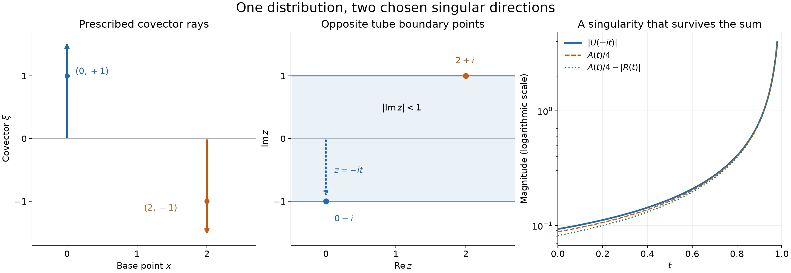
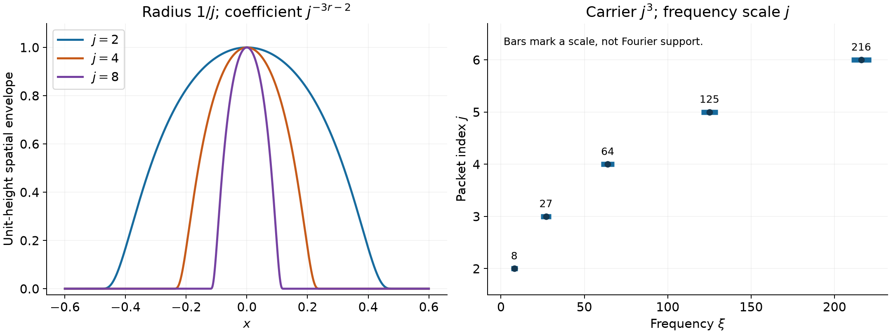

# Prescribing every singular direction

*Written by GPT-6 Astra (OpenAI), October 2026. Public domain (CC0).*

Closedness and positive conicity are the only restrictions on the wavefront set of a complex distribution. We prove this in a form that realizes the same set simultaneously for smooth, analytic and every admissible derivative-growth regularity. The construction places singularities at a dense collection of base-direction pairs. A geometric gap gives holomorphic continuation everywhere else, while a strict coefficient bound prevents the chosen singularities from cancelling. A separate compact-packet construction realizes any smooth wavefront set with any prescribed finite differentiability, and gives real-valued realizations for symmetric direction sets.

The prerequisites are [Continuing the spherical kernel](continuing-the-spherical-kernel.md), Theorem 4 for the continuation domain, Theorem 6 for conic exponential decay, and Theorem 7 for positivity and boundary growth; [Holomorphic decompositions of tempered distributions](holomorphic-decompositions-of-tempered-distributions.md), Theorem 4 for its polynomial-growth converse; and [Boundary regularity and conic decomposition](boundary-regularity-and-conic-decomposition.md), Theorem 3 and Exercise 5 for the exact boundary characterization and restriction to open sets. [Cones and derivative-growth wavefronts](cones-and-derivative-growth-wavefronts.md), Theorems 3 and 5–7, supplies controlled localization, projection, comparison and finite sums. Polydisk Cauchy estimates and power series are proved in Section 3 of [Holomorphic boundaries in convex cones](holomorphic-boundaries-in-convex-cones.md). The [Fourier foundation](../prerequisites/U011-free-foundations/schwartz-fourier-foundations-U017.md), F1–F5, fixes the transform and conjugation conventions, and the [metric foundation](../prerequisites/U011-free-foundations/metric-foundation-bridges.md) supplies Euclidean compactness and the elementary topology used below.

## A positive kernel with a prescribed boundary pole

For \(n\ge1\), use \(\widehat f(\xi)=\int e^{-ix\cdot\xi}f(x)\,dx\) and inverse factor \((2\pi)^{-n}\). Let \(\sigma\) be the ordinary unit-sphere measure, including two unit point masses in dimension one. The earlier spherical kernel is

\[
 I(\xi)=\int_{S^{n-1}}e^{-\omega\cdot\xi}\,d\sigma(\omega),
 \qquad
 K(z)=(2\pi)^{-n}\int_{\mathbb R^n}
                  \frac{e^{iz\cdot\xi}}{I(\xi)}\,d\xi,
 \quad |\operatorname{Im}z|<1.
 \tag{1}
\]

The continuation theorem extends \(K\) holomorphically to

\[
 Q=\{z\in\mathbb C^n:z\cdot z\notin(-\infty,-1]\},
 \qquad z\cdot z=\sum_{\ell=1}^n z_\ell^2.
 \tag{2}
\]

The square in (2) is bilinear, not Hermitian. In particular \(\operatorname{Re}(z\cdot z)>-1\) is sufficient to lie in \(Q\). On closed complex cones whose nonzero squares avoid the nonpositive real ray, \(K\) decreases exponentially at infinity, with every fixed derivative. These facts, including their constants on compact sets of directions, are proved in the kernel lesson.

**Lemma 1 (radial majorant).** For a unit vector \(\theta\), the number \(H(r)=K(ir\theta)\), \(0\le r<1\), is positive, independent of \(\theta\), and nondecreasing. Moreover,

\[
 \begin{gathered}
 |K(a+ib)|\le H(|b|)\le C(1-|b|)^{-n}\quad(a,b\in\mathbb R^n,\ |b|<1),\\
 H(r)=\frac{(n-1)!}{(2\pi)^n}(1-r)^{-n}\bigl(1+O(1-r)\bigr)
                         \quad(r\uparrow1).
 \end{gathered}
 \tag{3}
\]

**Proof.** The sphere's rotation invariance, already proved with its graph measure, gives \(I(R\xi)=I(\xi)\) for orthogonal \(R\). Orthogonal substitution in (1) then gives the asserted radial independence. Positivity follows from the positive real integrand at \(ir\theta\). Since \(I(-\xi)=I(\xi)\), replacing \(\xi\) by \(-\xi\) and averaging gives

\[
 H(r)=(2\pi)^{-n}\int
                   \frac{\cosh(r\theta\cdot\xi)}{I(\xi)}\,d\xi.
 \tag{4}
\]

For every real \(t\), \(\cosh(rt)\) is nondecreasing in \(r\ge0\), because its derivative is \(t\sinh(rt)\ge0\). All integrals in question converge absolutely for \(r<1\), so comparison of their nonnegative integrands proves monotonicity. Taking the absolute value inside (1) gives \(|K(a+ib)|\le K(ib)=H(|b|)\). The asymptotic in (3), with its exact coefficient in every dimension including one, is Theorem 7 of the kernel lesson. It gives the upper estimate near one. Continuity bounds \(H\) on a remaining compact interval, so increasing \(C\) gives that estimate on all of \([0,1)\). \(\square\)

## Dense data and coefficients that cannot cancel

A cone is invariant under multiplication of its covector by every positive number. Let \(S\) be a closed conic subset of \(\mathbb R^n\times(\mathbb R^n\setminus\{0\})\), and write

\[
 S_1=S\cap(\mathbb R^n\times S^{n-1}).
 \tag{5}
\]

It is closed in the unit-direction space. Suppose initially that it is nonempty. Choose distinct pairs \((x_j,\theta_j)\), indexed either by \(1\le j\le J<\infty\) or by all positive integers, whose set is dense in \(S_1\). Here is the elementary selection argument. Rational numbers are countable by listing their integer numerators and positive denominators in finite boxes of increasing size; finite tuples are countable by the same finite-box enumeration. Thus ambient rational-center, positive rational-radius balls are countable. They form a base: inside any open ball about a point, choose a rational center sufficiently close to that point, then a positive rational radius larger than that distance but small enough that the new ball remains inside the original ball. Density of the rationals is proved in Section 12 of the metric foundation. Intersecting these balls with the unit-direction space gives its countable base. Select a point from every such ball meeting \(S_1\), using the countable choice in the foundational assumptions, and remove repetitions. Every relative neighborhood contains one of these basis sets and therefore a selected point. If only finitely many distinct points result, keep that finite list. No infinite list without repetitions is required for a finite set.

Choose \(c_j=4^{-j}\). In either the finite or infinite case,

\[
 \sum_j c_j\le\frac13,\qquad
 \sum_{j>k}c_j\le\frac{c_k}{3}.
 \tag{6}
\]

Define on the unit tube \(T=\{z:|\operatorname{Im}z|<1\}\)

\[
 U(z)=\sum_j c_j K\left(\frac{z-x_j-i\theta_j}{2}\right).
 \tag{7}
\]

**Lemma 2 (existence of the represented distribution).** The series (7) converges uniformly on compact subsets of \(T\), is holomorphic there, and satisfies

\[
 |U(x+iy)|\le C_1(1-|y|)^{-n}.
 \tag{8}
\]

There is a unique tempered distribution \(u\) whose spherical tube representation is \(U\).

**Proof.** The imaginary part of the \(j\)-th kernel argument has norm
\(|y-\theta_j|/2\le(1+|y|)/2<1\). Lemma 1 gives

\[
 \left|K\left(\frac{x+iy-x_j-i\theta_j}{2}\right)\right|
       \le C2^n(1-|y|)^{-n},
 \tag{9}
\]

independently of both \(j\) and \(x\). The summable coefficients prove uniform convergence on compact subsets and (8).

To justify holomorphy, take a closed polydisk and a slightly larger one inside \(T\). The partial sums are holomorphic. Apply the proved polydisk Cauchy formula on the larger polydisk and pass to the uniform limit in its compact boundary integral. The denominators stay away from zero on the smaller polydisk. Differentiating that integral therefore gives every complex derivative of the limit, uniformly on still smaller polydisks. Thus the limit is holomorphic, without any assertion about convergence merely on real slices. The polynomial-growth converse in Theorem 4 of the representation lesson applies to (8), with real-space growth exponent zero and boundary exponent \(n\). It supplies precisely the unique tempered distribution claimed, by averaging the distributional boundaries of \(U\). \(\square\)

**Lemma 3 (a retained singularity).** For each selected pair,

\[
 |U(x_k-it\theta_k)|\longrightarrow\infty
                     \qquad(t\uparrow1).
 \tag{10}
\]

**Proof.** Put \(A(t)=H((1+t)/2)\) for \(0<t<1\). The \(k\)-th term in (7) is exactly the positive real number \(c_kA(t)\). Every later term has absolute value at most \(c_jA(t)\): its imaginary argument is \(-(t\theta_k+\theta_j)/2\), whose norm is at most \((1+t)/2\), so Lemma 1 applies. Thus the whole later tail has magnitude at most \(c_kA(t)/3\).

For each \(j<k\) examine its limiting argument
\(w_{jk}=(x_k-x_j-i(\theta_k+\theta_j))/2\). The unit-length identities give

\[
 \operatorname{Re}(w_{jk}\cdot w_{jk})+1
       =\frac{|x_k-x_j|^2+|\theta_k-\theta_j|^2}{4}>0.
 \tag{11}
\]

Strictness uses distinctness of the pairs, even if their base points coincide. Thus \(w_{jk}\in Q\), and the holomorphic continuation (2) bounds its kernel along the approaching path for \(t\) sufficiently close to one. There are only finitely many earlier indices. Their weighted sum has a bound \(C_k\) on a common terminal interval. The triangle inequality now gives

\[
 |U(x_k-it\theta_k)|\ge\frac{2c_k}{3}A(t)-C_k.
 \tag{12}
\]

The asymptotic (3) shows \(A(t)\to\infty\), proving (10). In particular there is no bounded one-sided neighborhood of \(x_k-i\theta_k\), hence no smooth boundary regularity there. \(\square\)

## Uniform continuation at every other direction

The preceding lower bound alone would allow extra singularities. The next step excludes all of them, including those that an uncontrolled infinite sum might create.

**Lemma 4 (the geometric gap).** If \((x,\theta)\notin S_1\), with \(|\theta|=1\), then (7) extends holomorphically to a full complex neighborhood of \(p=x-i\theta\).

**Proof.** Since \(S_1\) is closed, its complement is open. Some \(\varepsilon>0\) satisfies

\[
 |x-x_j|^2+|\theta-\theta_j|^2\ge\varepsilon^2
                         \quad\hbox{for every }j.
 \tag{13}
\]

At \(p\) the kernel arguments \(w_j(p)=(p-x_j-i\theta_j)/2\) obey

\[
 \begin{aligned}
 \operatorname{Re}(w_j(p)\cdot w_j(p))+1
       &=\frac{|x-x_j|^2+|\theta-\theta_j|^2}{4}\\
       &\ge\frac{\varepsilon^2}{4}.
 \end{aligned}
 \tag{14}
\]

We need one complex neighborhood and one bound for every term, not a different neighborhood for each \(j\). First restrict \(z\) to \(|z-p|\le1\). Then \(|\operatorname{Im}w_j(z)|\le3/2\), whereas \(|\operatorname{Re}w_j(z)|\ge(|x_j|-|x|-1)/2\). Choose \(R\) so large that \(|x_j|>R\) implies

\[
 |w_j(z)|\ge1,\qquad
 |\operatorname{Im}w_j(z)|\le\tfrac14|\operatorname{Re}w_j(z)|
                       \quad(|z-p|\le1).
 \tag{15}
\]

The directions with \(|\operatorname{Im}w|\le|\operatorname{Re}w|/4\) form a compact set on the complex unit sphere, and
\(\operatorname{Re}(w\cdot w)\ge(15/16)|\operatorname{Re}w|^2>0\) there. The conic decay theorem for \(K\) therefore gives \(|K(w_j(z))|\le C_2e^{-c|w_j(z)|}\le C_2\) for these indices, uniformly on this full ball.

For \(|x_j|\le R\), consider all parameter pairs \((a,b)\) with \(|a|\le R\), \(|b|=1\), and \(|x-a|^2+|\theta-b|^2\ge\varepsilon^2\). This is a compact set containing every remaining selected pair. Formula (14) and uniform continuity of the polynomial
\(\operatorname{Re}(((z-a-ib)/2)\cdot((z-a-ib)/2))+1\)
give \(0<\rho<1\) for which this expression is at least \(\varepsilon^2/8\) whenever \(|z-p|\le\rho\) and the parameters belong to that compact set. Their arguments form a compact subset of \(Q\). Continuity of \(K\) gives one bound \(C_3\) for all these arguments.

Every summand in (7) is consequently holomorphic on \(|z-p|<\rho\), with magnitude at most \(c_j\max(C_2,C_3)\). The series converges uniformly on this ball and is holomorphic by the polydisk argument in Lemma 2. On its intersection with \(T\), the continued kernel equals the original kernel, so the sum equals the original \(U\). This proves the full-neighborhood extension. \(\square\)

## Realizing an arbitrary closed conic set

Recall that an admissible scale is a nondecreasing positive sequence with \(L_0=1\), \(k\le L_k\), and \(L_{k+1}\le QL_k\) for some fixed \(Q\). The analytic case is \(L_k=k+1\); the ordinary smooth wavefront has no prescribed growth rate on its derivative constants.

**Theorem 5 (simultaneous realization).** Let \(X\subset\mathbb R^n\) be any open set, and let \(S\) be relatively closed and conic in \(X\times(\mathbb R^n\setminus\{0\})\). There is a complex distribution \(u\in\mathcal D'(X)\) such that

\[
 \operatorname{WF}(u)=\operatorname{WF}_L(u)
                     =\operatorname{WF}_A(u)=S
           \quad\hbox{for every admissible }L.
 \tag{16}
\]

When \(X=\mathbb R^n\), \(u\) can be chosen tempered. More generally the construction on any \(X\) can be obtained by restricting a tempered distribution on \(\mathbb R^n\).

**Proof on the whole space.** If \(S\) is empty, take \(u=0\); zero Fourier witnesses prove every stated wavefront empty. Otherwise use (7) and the tempered distribution of Lemma 2. Lemma 3 and the exact smooth boundary characterization in Theorem 3 of the preceding lesson put every selected \((x_k,\theta_k)\) in \(\operatorname{WF}(u)\). That wavefront is closed and conic. Density of the selected pairs in \(S_1\), followed by positive scaling, gives \(S\subset\operatorname{WF}(u)\).

Lemma 4 and the analytic extension part of the same characterization exclude every unit pair outside \(S_1\) from \(\operatorname{WF}_A(u)\). Conicity gives \(\operatorname{WF}_A(u)\subset S\). The already proved comparison

\[
 \operatorname{WF}(u)\subset\operatorname{WF}_L(u)
                         \subset\operatorname{WF}_A(u)
 \tag{17}
\]

places every intermediate set between these equal endpoints. The same one \(u\) works for every admissible \(L\), without choosing a new sequence or constants for each class. \(\square\)

**Proof on an arbitrary open set.** Take the closure \(\overline S\) in \(\mathbb R^n\times(\mathbb R^n\setminus\{0\})\). Relative closedness means

\[
 \overline S\cap\bigl(X\times(\mathbb R^n\setminus\{0\})\bigr)=S.
 \tag{18}
\]

It remains conic: positive scaling is a homeomorphism carrying \(S\) onto itself, hence carrying its closure onto itself. The whole-space result gives a tempered \(v\) with all its wavefront sets equal to \(\overline S\). Set \(u=v|_X\).

For clarity, restriction preserves the precise local wavefront set in each class. Near any \(x_0\in X\), choose a compact cutoff supported inside \(X\) and equal to one on a smaller neighborhood. The controlled localization theorem in the conic lesson moves each \(L\)-witness into that compact neighborhood, retaining boundedness and its conic estimate on a smaller cone. The resulting compact distributions extend by zero to the whole space with the same finite-order bound. Conversely a global witness can be localized in that neighborhood and read as a witness on \(X\). For ordinary smooth wavefront the corresponding operation is the fixed-cutoff Fourier convolution estimate proved in the preceding lesson, Lemma 2 and Exercise 5. Thus restriction gives intersection with the cotangent bundle over \(X\), for every wavefront in (16). Equation (18) proves the assertion. The argument includes disconnected or empty open sets and does not identify \(X\) with \(\mathbb R^n\). \(\square\)

## Two isolated singular directions

In dimension one the kernel has the exact continuation
\(K(w)=1/(4\cosh(\pi w/2))\), proved by the contour calculation in Exercise 4 of the kernel lesson. Choose the two pairs \((0,+1)\), \((2,-1)\). Formula (7) becomes

\[
 U(z)=\frac14 K\left(\frac{z-i}{2}\right)
       +\frac1{16}K\left(\frac{z-2+i}{2}\right).
 \tag{19}
\]

The resulting tempered distribution has, in every class in (16), exactly the positive ray over zero and the negative ray over two. No singularity occurs over other real points. This does not assert that the distribution is supported at those two points; wavefront describes failure of local regularity, not physical support.

Along \(z=-it\), \(0\le t<1\), its first unweighted term and its remaining term are

\[
 A(t)=\frac{1}{4\cos(\pi(1+t)/4)},\qquad
 R(t)=\frac1{16}K\left(-1+\frac{i(1-t)}2\right).
 \tag{20}
\]

Consequently

\[
 U(-it)=\frac{A(t)}4+R(t),\qquad
 |U(-it)|\ge\frac{A(t)}4-|R(t)|.
 \tag{21}
\]

Here \(R\) stays bounded up to \(t=1\), whereas \(A(t)\) diverges. This is a concrete version of the general cancellation argument.

*Left: the two prescribed rays in the real cotangent plane, with unit points \((0,1)\) and \((2,-1)\) marked. Middle: their opposite imaginary boundary points \(0-i\) and \(2+i\) in the unit tube; the dotted path is \(z=-it\). Right: numerical samples for \(0\le t\le0.98\) of the exact functions \(|U(-it)|\), \(A(t)/4\), and the lower bound \(A(t)/4-|R(t)|\) from (20)–(21). The vertical scale is logarithmic. The finite plot illustrates the formulas; the proof of divergence is Lemma 3. [Editable figure source](../figures/prescribed-wavefront-poles.py).*

## Prescribed smooth directions with finite differentiability

The smooth wavefront set records failure of infinite differentiability. A function can have many continuous derivatives and still carry any prescribed closed conic set of smooth singular directions. The following construction gives this additional control by separating the frequencies of compact packets. The simultaneous realization in Theorem 5 remains a separate assertion about all derivative-growth classes.

We use the Fourier convention in (1), the finite-derivative convergence and compact smooth bump arguments in the supplied [metric foundation](../prerequisites/U011-free-foundations/metric-foundation-bridges.md), Sections 13.7 and 13.10, and the Fourier estimates in the [Schwartz foundation](../prerequisites/U011-free-foundations/schwartz-fourier-foundations-U017.md), F1–F5. The fixed-cutoff convolution proof in [Boundary regularity and conic decomposition](boundary-regularity-and-conic-decomposition.md), Lemma 2 and (16), supplies locality and angular shrinking. These are ordinary smooth-wavefront estimates; no bound for an analytic or derivative-growth wavefront is inferred from them.

Fix a nonnegative real \(\varphi\in C_c^\infty(\mathbb R^n)\), supported in the unit ball, with \(\int\varphi=1\). Such a function is obtained by dividing a nonzero nonnegative bump by its positive integral. Thus \(\widehat\varphi(0)=1\).

**Lemma 6 (uniform compact packets).** Let \(r\ge0\) be an integer, put \(a=3r+2\), and choose any sequence \(x_j\in\mathbb R^n\), \(\theta_j\in S^{n-1}\). Then
\[
 u(x)=\sum_{j=1}^{\infty}j^{-a}\varphi(j(x-x_j))
                                      e^{ij^3x\cdot\theta_j}
 \tag{P1}
\]
belongs to \(C_b^r(\mathbb R^n)\cap L^1(\mathbb R^n)\). Here \(C_b^r\) means that the function and all derivatives through order \(r\) are continuous and bounded.

For any fixed \(\chi\in C_c^\infty\), put
\[
 \varphi_j(z)=\chi(x_j+z/j)\varphi(z).
 \tag{P2}
\]
This is a bounded family of compact smooth tests: for every integer \(N\ge0\),
\[
 |\widehat{\varphi_j}(\eta)|\le C_{\chi,N}(1+|\eta|)^{-N}
                \quad\hbox{for every }j,\eta.
 \tag{P3}
\]
Moreover,
\[
 \widehat{\chi u}(\xi)=
 \sum_{j=1}^{\infty} j^{-a-n}
 e^{-i(\xi-j^3\theta_j)\cdot x_j}
 \widehat{\varphi_j}\bigl((\xi-j^3\theta_j)/j\bigr).
 \tag{P4}
\]

**Proof.** At derivative order \(|\alpha|\le r\), Leibniz's rule bounds the \(j\)-th differentiated term by
\[
 C_\alpha j^{-a+3|\alpha|}\le C_\alpha j^{-2}.
 \tag{P5}
\]
Indeed a derivative on the bump contributes \(j\), and one on the exponential contributes at most \(j^3\); the finitely many bump derivatives are bounded independently of the center. Thus all these derivative series converge uniformly on the whole space. Successive use of the fundamental theorem on coordinate segments identifies their sums as the derivatives of the sum. This proves \(C_b^r\), including \(r=0\). The \(L^1\) norm of the \(j\)-th term is \(j^{-a-n}\|\varphi\|_1\). Its summable series proves the \(L^1\) assertion, and identifies the pointwise sum with that \(L^1\) limit by domination.

Each derivative of (P2) is a finite sum of \(j^{-|\beta|}(\partial^\beta\chi)(x_j+z/j)\) times a fixed derivative of \(\varphi\). All supports lie in the same unit ball, and all derivative bounds are uniform even when the centers escape to infinity. Integration by parts with \((1-\Delta_z)^q\), where \(2q\ge N\), proves (P3). Finally substitute \(x=x_j+z/j\) in each localized Fourier integral. This gives its exact factor in (P4); summable \(L^1\) norms justify exchanging the sum and the integral. \(\square\)

**Theorem 7 (finite differentiability with an exact smooth wavefront).** For every open \(X\subset\mathbb R^n\), every relatively closed conic
\(S\subset X\times(\mathbb R^n\setminus\{0\})\), and every integer \(r\ge0\), there is a complex function \(u\in C^r(X)\) with
\[
                         \operatorname{WF}(u)=S.
 \tag{P6}
\]
It can be chosen as the restriction of a function in \(C_b^r(\mathbb R^n)\cap L^1(\mathbb R^n)\).

**Selection of packets.** First suppose \(X=\mathbb R^n\). If \(S\) is empty take zero. Otherwise use the countable dense selection in (5). Form an infinite sequence \((x_j,\theta_j)\in S_1\) by repeating every selected pair infinitely often: use periodic repetitions for a finite list, and successive initial segments of lengths \(1,2,3,\ldots\) for an infinite list. Every point of \(S_1\) is then approached along a subsequence with indices tending to infinity. More explicitly, choose a selected pair within \(1/k\) of the desired point and choose its occurrence after the preceding index. Apply (P1).

**Excluding all other directions.** Let \((x_0,\xi_0)\notin S\). Relative closedness gives an open base neighborhood \(U\) and an open cone \(V\) about \(\xi_0\) with \((U\times V)\cap S=\varnothing\). Choose a compact smooth \(\chi=1\) near \(x_0\), with support at positive distance from the complement of \(U\). Terms with \(x_j\notin U\) vanish on this support for all sufficiently large \(j\), because their spatial radii are at most \(1/j\). The remaining finitely many such terms are smooth.

For terms with \(x_j\in U\), we have \(\theta_j\notin V\). On a smaller cone \(V'\) whose angular closure lies in \(V\), compact angular separation gives
\[
 |\xi-j^3\theta_j|\ge c(|\xi|+j^3),\qquad \xi\in V'.
 \tag{P7}
\]
The positive constant follows by normalizing the sum of the two lengths to one: a zero difference would put one unit direction in both separated angular sets. For \(|\xi|\ge1\),
\[
 \frac{|\xi|+j^3}{j}\ge|\xi|^{2/3}.
 \tag{P8}
\]
If \(j\le|\xi|^{1/3}\), the first summand proves this; otherwise the second does. Equations (P3)–(P4) therefore bound the sum of these terms by
\(C_N|\xi|^{-2N/3}\sum_jj^{-a-n}\). The exponent \(N\) is arbitrary, and the omitted finite smooth sum also decreases rapidly after localization. Hence \((x_0,\xi_0)\) is regular, proving \(\operatorname{WF}(u)\subset S\).

**Retaining every prescribed direction.** Fix \((x_0,\theta_0)\in S_1\), an arbitrary compact smooth \(\chi=1\) near \(x_0\), and an arbitrary open cone about \(\theta_0\). Along a subsequence, \(x_k\to x_0\), \(\theta_k\to\theta_0\), and \(k\to\infty\). For sufficiently large such \(k\), the whole \(k\)-th bump lies where \(\chi=1\), so \(\varphi_k=\varphi\); also \(k^3\theta_k\) lies in that cone. At this frequency the \(k\)-th summand of (P4) is exactly \(k^{-a-n}\).

All other summands are smaller together, regardless of their complex phases. For \(j\ne k\),
\[
 \frac{|k^3\theta_k-j^3\theta_j|}{j}
 \ge \frac{|k^3-j^3|}{j}
 =|k-j|\left(\frac{k^2}{j}+k+j\right)
 \ge k|k-j|.
 \tag{P9}
\]
Consequently (P3) gives
\[
 \left|\widehat{\chi u}(k^3\theta_k)-k^{-a-n}\right|
 \le C_N\sum_{j\ne k}j^{-a-n}(1+k|k-j|)^{-N}
 \le C'_N k^{-N}.
 \tag{P10}
\]
The last inequality uses \(|k-j|\ge1\) and the convergent sum of \(j^{-a-n}\). Choose one integer \(N>a+n\). For all sufficiently large indices in the subsequence,
\[
              |\widehat{\chi u}(k^3\theta_k)|
                         \ge\tfrac12 k^{-a-n}.
 \tag{P11}
\]
This contradicts rapid decay in the chosen cone: a decay exponent \(M>(a+n)/3\) would give an upper bound \(C_M k^{-3M}\). Since both the cutoff and the cone were arbitrary, \((x_0,\theta_0)\in\operatorname{WF}(u)\). Positive conicity gives every covector in \(S\), proving equality.

For general \(X\), take the closure of \(S\) in the full punctured cotangent space, apply the whole-space construction, and restrict the function to \(X\). Formula (18) and the proved locality of smooth wavefront give exactly (P6). Restriction preserves \(C^r\). This also covers empty and disconnected open sets. \(\square\)

**Corollary 8 (real-valued realization).** In Theorem 7 a real-valued function exists if and only if \(S\) is invariant under \((x,\xi)\mapsto(x,-\xi)\).

**Proof.** Necessity follows from the conjugation identity (22), proved in Exercise 3. For sufficiency on the whole space, retain the same normalized real bump, sequence and exponent, and set
\[
 v(x)=\sum_{j=1}^{\infty}j^{-a}\varphi(j(x-x_j))
                                      \cos(j^3x\cdot\theta_j).
 \tag{P12}
\]
The derivative and integrability bounds of Lemma 6 apply to both exponential halves, so \(v\) is real and belongs to \(C_b^r\cap L^1\). The upper-bound proof gives
\(\operatorname{WF}(v)\subset S\cup(-S)=S\).

For the lower bound at \(k^3\theta_k\), the positive \(k\)-th exponential contributes exactly \(\tfrac12k^{-a-n}\). For both signs of every \(j\ne k\), the radial separation (P9) applies unchanged. Their combined error is at most \(C_Nk^{-N}\). The negative \(k\)-th exponential has argument \(2k^2\theta_k\) in \(\widehat\varphi\), so its magnitude is at most \(C_Nk^{-a-n-2N}\). Choose \(N>a+n\). Their sum is less than \(\tfrac14k^{-a-n}\) for sufficiently large \(k\), leaving the same failure of rapid decay. Thus \(S\subset\operatorname{WF}(v)\). For a relatively closed symmetric \(S\) over \(X\), its full closure is symmetric; restriction finishes the proof. \(\square\)

*Left: exact unit-height envelopes \(\rho(jx)\), where \(\rho(s)=\exp(1-1/(1-s^2))\) for \(|s|<1\) and zero otherwise, for \(j=2,4,8\). The proof uses their integral-normalized version with coefficient \(j^{-3r-2}\). Right: carrier frequencies \(j^3\) for \(j=2,\ldots,6\), with bars \([j^3-j,j^3+j]\) marking the frequency scale \(j\) in (P4). These bars are scale markers, not Fourier support bounds. The exact separation and noncancellation estimates are (P9)–(P11). [Reproducible figure source](../figures/finite-regularity-wavefront-packets.py).*

## Exercises with complete solutions

**Exercise 1 — empty, finite and dense sets (foundation).** Explain why the construction must allow a finite list of distinct pairs. For a finite nonempty \(S_1\), check the proof of Theorem 5 without adding repeated pairs. What distribution realizes the empty set?

**Solution.** A dense subset of a finite set must be that entire finite set: each of its points has a small ball avoiding the others. There is no infinite sequence of distinct points in it. Enumerate those points once and use the finite sum (7). The coefficient bounds (6) remain valid, because a finite tail is no larger than the infinite geometric tail. Earlier terms in Lemma 3 are still finite, and Lemma 4 applies unchanged (or directly by a finite intersection of continuation neighborhoods). Thus every selected singularity remains and there are no others. For the empty set, the zero distribution has identically zero localized transforms and realizes it in every class. \(\square\)

**Exercise 2 — how much coefficient separation is needed? (intermediate).** Replace \(4^{-j}\) by nonzero complex coefficients \(a_j\). Prove the same realization if \(\sum_j|a_j|<\infty\) and, for one \(0\le\tau<1\), \(\sum_{j>k}|a_j|\le\tau|a_k|\) for every \(k\). Apply this to \(a_j=q^{-j}e^{i\gamma_j}\) with arbitrary real phases and \(q>2\). What does the argument say at \(q=2\)?

**Solution.** In Lemmas 2 and 4, replace coefficient sums by sums of absolute values. Uniform convergence and holomorphic continuation are unchanged. At the \(k\)-th pair the own term has magnitude \(|a_k|A(t)\), even when its phase is nonzero; the later tail has magnitude at most \(\tau|a_k|A(t)\). The lower bound is therefore \((1-\tau)|a_k|A(t)-C_k\), which diverges. Theorem 5 follows as before. For the infinite geometric sequence the tail-to-term ratio is exactly \(1/(q-1)<1\); finite tails are smaller. At \(q=2\) this estimate has ratio one in the infinite case and supplies no positive divergent lower bound. It does not prove that cancellation must occur, only that this particular sufficient estimate no longer establishes absence of cancellation. \(\square\)

**Exercise 3 — why complex distributions are allowed (advanced).** Define \(\overline u(\phi)=\overline{u(\overline\phi)}\). Prove

\[
 \mathcal W(\overline u)=\{(x,-\xi):(x,\xi)\in\mathcal W(u)\}
 \tag{22}
\]

for \(\mathcal W=\operatorname{WF}\) or any \(\operatorname{WF}_L\). Deduce that a real distribution must have reflection-symmetric wavefront. If \(S\) is symmetric and \(u\) is supplied by Theorem 5, show that the union of the wavefronts of \(\operatorname{Re}u\) and \(\operatorname{Im}u\) is exactly \(S\), simultaneously in every class.

**Solution.** For a compact distribution, the definition of its Fourier transform gives
\(\widehat{\overline v}(\xi)=\overline{\widehat v(-\xi)}\), with a real cutoff equal to one near its support in the pairing. Conjugation preserves support and the finite-order bound. Conjugating an \(L\)-witness sequence therefore gives a witness for \(\overline u\) on the reflected cone with exactly the same constants. Conjugating a second time gives the reverse implication and proves (22). For smooth wavefront, conjugate the compact cutoff witness as well; its conjugate is still one near the base point, and the same transform identity proves (22). If \(u=\overline u\), the reflection symmetry follows. Thus a single positive ray over a point cannot be the wavefront of a real distribution.

When \(S\) is symmetric, (22) gives \(\mathcal W(\overline u)=S\). The finite-sum rule applied to
\(\operatorname{Re}u=(u+\overline u)/2\) and \(\operatorname{Im}u=(u-\overline u)/(2i)\) puts each of their wavefronts in \(S\). Applying the same rule to \(u=\operatorname{Re}u+i\operatorname{Im}u\) gives the opposite inclusion into their union. Both components are real distributions by the definition of conjugation. This proves the union statement; it does not assert that either component alone has every prescribed singularity. \(\square\)

**Exercise 4 — accumulation at the boundary of an open set (advanced).** On \(X=(0,1)\), prescribe only positive covectors over the points \(1/j\), \(j\ge2\). Prove that this is a valid relatively closed conic set and compute its closure in the full punctured cotangent space. Explain the role of restriction in Theorem 5.

**Solution.** The only accumulation point of these base points outside the set itself is zero. One proof is that any sequence of distinct indices tends to infinity along a subsequence, forcing the reciprocal subsequence to tend to zero; bounded indices supply only finitely many values. Zero is outside \(X\), so the set of base points is closed relative to \(X\). The positive direction is a closed component of \(\mathbb R\setminus\{0\}\). Their product is therefore relatively closed and conic. Its full closure adds precisely the positive ray over zero, because convergence in the punctured cotangent space has a nonzero limiting covector and cannot change its positive sign. The global construction realizes this enlarged set. Restricting to \((0,1)\) removes its fiber over zero and gives exactly the prescribed local set. No unwanted negative direction or base point is introduced. \(\square\)

**Exercise 5 — independently choosing the two one-dimensional signs (intermediate).** Let \(F_+,F_-\) be any two relatively closed subsets of an open \(X\subset\mathbb R\). Construct a distribution whose singular directions are positive exactly over \(F_+\) and negative exactly over \(F_-\), simultaneously for every class in (16). Identify its smooth and analytic singular supports.

**Solution.** The set
\(S=(F_+\times(0,\infty))\cup(F_-\times(-\infty,0))\)
is relatively closed in the punctured cotangent space: each sign component is open and closed there, and each base set is relatively closed in \(X\). It is conic. Apply Theorem 5. Its projection to the base is \(F_+\cup F_-\). The analytic projection theorem proved in the conic lesson identifies this with analytic singular support. Outside the union the distribution is analytic, hence smooth. At any point of the union at least one smooth wavefront direction is present by (16), whereas a smooth function has no such direction by the compact-cutoff integration-by-parts estimate. Thus its smooth singular support is also precisely \(F_+\cup F_-\). In particular the two regularity singular supports coincide for this construction even when the individual positive and negative direction sets differ. \(\square\)

**Exercise 6 — a uniform approximation with derivatives (foundation).** Let \(u_J\) be the first \(J\) terms of (P1). Show that
\(\max_{|\alpha|\le r}\|\partial^\alpha(u-u_J)\|_\infty\le C_r/J\).
Does this imply that the limit is smooth?

**Solution.** Sum (P5) over \(j>J\), and use
\(\sum_{j>J}j^{-2}\le\int_J^\infty t^{-2}\,dt=1/J\).
There are finitely many multi-indices through order \(r\), so their constants have a finite maximum. The same calculation proves the estimate for (P12). It concerns only the prescribed finite derivative orders. If \(S\ne\varnothing\), Theorem 7 gives a nonempty smooth wavefront, so the limit is not smooth everywhere. A sequence of smooth functions converging with finitely many derivatives need not have a smooth limit. \(\square\)

**Exercise 7 — a point with just one direction (intermediate).** On \(\mathbb R^2\), prescribe the positive multiples of \(e_1\) over the origin and no other singular covectors. Produce a bounded integrable \(C^4\) realization. Explain exactly what changes when cosines replace the complex exponentials.

**Solution.** Take \(r=4\), \(a=14\), \(x_j=0\) and \(\theta_j=e_1\) in (P1). Theorem 7 applies to the closed conic set
\(S=\{(0,se_1):s>0\}\), and Lemma 6 gives boundedness, integrability and four continuous bounded derivatives. This function is smooth off zero but is not smooth on any neighborhood of zero, since its smooth wavefront there is nonempty. It cannot be real-valued, because (22) would force the negative direction as well.

For the cosine series, the upper bound is \(S\cup(-S)\). The noncancellation proof of Corollary 8 applies at the positive frequencies. The function is real, so (22) supplies the negative frequencies. Its exact smooth wavefront is therefore \(\{(0,se_1):s\ne0\}\); there are no directions with a nonzero second component. \(\square\)

**Exercise 8 — confining the physical support (advanced).** Suppose the projection \(K\) of \(S\) to \(X\) is compact. Given any open \(O\subset X\) containing \(K\), show that a realization in Theorem 7 can be chosen in \(C_c^r(O)\). Give the real-valued version and explain the case \(S=\varnothing\).

**Solution.** Choose a compact smooth \(b\) supported in \(O\) and equal to one on a neighborhood of \(K\). Explicitly, cover \(K\) by finitely many inner balls whose larger closed balls lie in \(O\). The supplied bump construction gives real \(b_\ell=1\) on these inner balls, supported in the larger balls. Then \(b=1-\prod_\ell(1-b_\ell)\) has the required properties. If \(u\) is supplied by Theorem 7, set \(w=bu\), extending by zero outside \(O\) when necessary. It belongs to \(C_c^r(O)\): the support of \(b\) stays inside \(O\), so no boundary derivative is introduced by the extension. Smooth multiplication gives \(\operatorname{WF}(w)\subset\operatorname{WF}(u)=S\). At every base point of \(S\), \(w=u\) on a neighborhood because \(b=1\) there. Locality gives the reverse inclusion. Thus \(\operatorname{WF}(w)=S\). If \(S\) is symmetric, take the real realization of Corollary 8 and a real \(b\). Conversely a real realization still requires symmetry by (22). For empty \(S\), zero has empty support and works even when \(O\) is empty. \(\square\)

## References

- The earlier programme proofs linked above supply kernel continuation, exact boundary growth, the tempered representation converse, wavefront characterization, localization and class comparison. All the selection, summation, geometric exclusion and noncancellation arguments needed for realization are proved here.
- Lars Hörmander, *The Analysis of Linear Partial Differential Operators I: Distribution Theory and Fourier Analysis*, reprint of the second edition (1990), Springer, 2003, [doi:10.1007/978-3-642-61497-2](https://doi.org/10.1007/978-3-642-61497-2), Section 8.4, Theorem 8.4.14. This is the simultaneous realization target. The exposition, coefficient variant, uniform continuation argument, examples, figure and exercises here are independently organized and expressed.

- Lars Hörmander, *The Analysis of Linear Partial Differential Operators I: Distribution Theory and Fourier Analysis*, second-edition reprint, Springer, 2003, [doi:10.1007/978-3-642-61497-2](https://doi.org/10.1007/978-3-642-61497-2), Theorem 8.1.4 and its continuous-function construction. Lemma 6 and Theorem 7 give the finite-differentiability packet estimates; Corollary 8 gives the real-valued construction.
