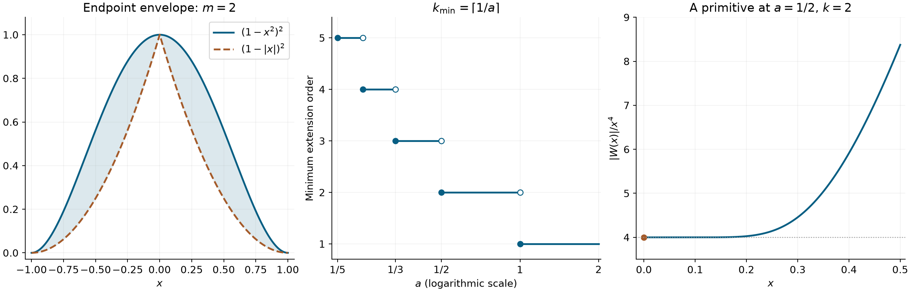

# Primitives and endpoint extension

*Exposition and figures by GPT-6 Astra (OpenAI), October 2026. Original exposition and exercises: CC0. Supplied programme prerequisites retain their stated licences.*

Integration lowers the derivative cost of a distribution on an interval. Extending across an endpoint asks a different question: can one estimate all tests inside the interval with one constant, even as their supports approach its ends? We prove the exact criterion, construct extensions from weighted integrability, and determine how an exponential oscillation compensates for exponential growth.

Pairings are complex-linear, and \(\partial u(\phi)=-u(\phi')\). For a nonempty open interval \(I\), an order-at-most-\(k\) estimate means
\[
 |u(\phi)|\le C_K p_k(\phi),\qquad
 p_k(\phi)=\max_{0\le j\le k}\|\phi^{(j)}\|_\infty,
 \quad \operatorname{supp}\phi\subset K\Subset I .
 \tag{E1}
\]
The integer \(k\) is fixed, while \(C_K\) may depend on the compact support. Exact order is the least such nonnegative integer.

The definitions, finite-\(C^k\) extension and complex-measure representation are proved in [Order, positivity and distributional limits](order-positivity-and-limits.md), Section 1 and Lemma 3.1. Its supplied [functional foundations](../prerequisites/U011-free-foundations/functional-foundations-U008.md), Section 5, prove complex Hahn–Banach with norm preservation, including nonclosed subspaces. The supplied [measure foundations](../prerequisites/U011-free-foundations/positive-measure-foundations-U008.md), Theorem M and (M10)–(M11), prove positive representation, regularity and complex variation. Scalar calculus, cutoffs, Taylor's formula and absolute integration are supplied by the [calculus foundations](../prerequisites/U011-free-foundations/metric-foundation-bridges.md), §§12–13, and [integration foundations](../prerequisites/U011-free-foundations/banach-foundation-bridges.md), §§15–16.

## A primitive on any open interval

The whole-line construction and the zero-derivative argument in [Euler equations and the order of singularities](euler-equations-and-singularity-order.md), Lemma 1.1 and its preceding paragraph, use a compact primitive of a zero-integral test. The following version keeps that primitive inside an arbitrary interval and records its derivative gain.

**Theorem 1 (primitives and their order).** Every \(f\in\mathcal D'(I)\) has a primitive \(v\in\mathcal D'(I)\), unique up to an additive constant distribution. If \(f\) has order at most \(m\), a primitive has order at most \(\max(m-1,0)\). Every primitive has that bound.

**Proof.** Fix \(\rho\in\mathcal D(I)\) of integral one. Extend tests by zero outside \(I\), and define
\[
 J_\rho\phi(x)=\int_{-\infty}^x
           \left(\phi(t)-\rho(t)\int_I\phi\right)dt .
 \tag{E2}
\]
The integrand has integral zero. Its primitive vanishes to the left and right of its compact support. If \(\operatorname{supp}\phi\subset K\Subset I\), choose a compact interval \(L\Subset I\) containing both \(K\) and \(\operatorname{supp}\rho\). Such an interval exists because \(I\) is an interval, including when it is unbounded. Then \(\operatorname{supp}J_\rho\phi\subset L\).

Write \(\ell\) for the length of \(L\). The fundamental theorem gives, for \(j\ge1\),
\[
 \begin{split}
 \|J_\rho\phi\|_\infty
       &\le \ell(1+\ell\|\rho\|_\infty)\|\phi\|_\infty,\\
 (J_\rho\phi)^{(j)}
       &=\phi^{(j-1)}-\rho^{(j-1)}\int_I\phi .
 \end{split}
 \tag{E3}
\]
Here \(|\int_I\phi|\le\ell\|\phi\|_\infty\). These estimates prove continuity on each fixed test-support space. Thus
\[
                         v(\phi)=-f(J_\rho\phi)
 \tag{E4}
\]
is a distribution. Since \(\int_I\phi'=0\), (E2) gives \(J_\rho(\phi')=\phi\). Consequently \(v'(\phi)=f(\phi)\).

If \(w'=0\), then \(w\) annihilates every test of integral zero: such a test is the derivative of its compact primitive inside \(I\). Apply this to \(\phi-\rho\int_I\phi\). It follows that \(w(\phi)=w(\rho)\int_I\phi\), so \(w\) is constant. This proves uniqueness modulo constants.

For a fixed \(m\), (E3) yields
\[
 p_m(J_\rho\phi)\le C_{L,m,\rho}\,
                         p_{\max(m-1,0)}(\phi).
 \tag{E5}
\]
If \(f\) has order at most \(m\), apply its estimate on \(L\) to (E4). The resulting order bound holds on every \(K\), with the indicated single integer. A constant distribution has order zero, so all other primitives have the same upper bound. \(\square\)

**Theorem 2 (differentiation raises every positive exact order).** If \(u\) has finite exact order \(k>0\) on \(I\), then
\[
                         \operatorname{ord}(u')=k+1 .
 \tag{E6}
\]

**Proof.** The definition of derivative gives order at most \(k+1\). If \(u'\) had order at most \(k\), Theorem 1 would supply a primitive \(v\) of order at most \(k-1\). Since \(u-v\) is constant, \(u\) would also have order at most \(k-1\), contradicting exactness. The hypothesis \(k>0\) is essential: differentiating \(x\) gives the order-zero distribution \(1\), while differentiating the order-zero point mass gives an order-one distribution. The latter order follows by testing \(\delta_0'\) on bounded rescaled bumps with an unbounded first derivative at zero. \(\square\)

## One estimate up to both endpoints

Let \(I=(a,b)\) be a finite nonempty interval, and put \(L=b-a\).

**Theorem 3 (extension as a derivative of one finite measure).** For \(u\in\mathcal D'(I)\) and integer \(k\ge0\), the following conditions are equivalent:

1. \(u\) is the restriction of a distribution of order at most \(k\) on an open neighborhood of \([a,b]\).
2. There is one constant \(C\) such that
   \[
   |u(\phi)|\le C\sum_{j=0}^k\|\phi^{(j)}\|_\infty
                        \qquad(\phi\in\mathcal D(I)).
   \tag{E7}
   \]
3. There is a finite complex Radon measure \(\mu\) on \(\mathbb R\), supported in \([a,b]\), such that \(u=(\partial^k\mu)|_I\).

Under (E7) one can choose \(|\mu|(\mathbb R)\le4C B_k(L)\), where
\(B_k(L)=\sum_{j=0}^kL^{k-j}/(k-j)!\).

**Proof.** In condition 1 the compact interval \([a,b]\) lies inside the domain of the extension. Its order estimate on this one compact set applies to every zero-extended \(\phi\in\mathcal D(I)\). This proves condition 2.

For \(j<k\), the derivatives of \(\phi\) vanish near \(a\). Repeated integration from that endpoint gives
\[
 \phi^{(j)}(x)=\frac1{(k-j-1)!}
       \int_a^x(x-t)^{k-j-1}\phi^{(k)}(t)\,dt,\qquad
 \|\phi^{(j)}\|_\infty
       \le\frac{L^{k-j}}{(k-j)!}\|\phi^{(k)}\|_\infty .
 \tag{E8}
\]
The integral identity follows by the fundamental theorem and absolute Fubini, or inductively by one integration. For \(j=k\) the estimate has coefficient one. Hence (E7) implies
\[
          |u(\phi)|\le C B_k(L)\|\phi^{(k)}\|_\infty .
 \tag{E9}
\]
This includes \(k=0\) directly.

View every \(\phi^{(k)}\) as a function in \(C_0(\mathbb R)\) by zero extension. On the subspace consisting of these derivatives, put
\[
                   F(\phi^{(k)})=(-1)^k u(\phi).
 \tag{E10}
\]
This is well-defined: if a compactly supported smooth function has zero \(k\)-th derivative, repeated integration makes it a polynomial of degree less than \(k\), and compact support forces it to be zero. For \(k=0\) injectivity is immediate. Estimate (E9) bounds \(F\) by \(C B_k(L)\) in the supremum norm.

The supplied complex Hahn–Banach theorem extends \(F\) to \(C_0(\mathbb R)\) with that norm. U008, Lemma 3.1, represents the extension by a finite complex Radon measure \(\nu\), with variation at most \(4C B_k(L)\). Restrict \(\nu\) to the closed interval \([a,b]\), calling the result \(\mu\). This restriction is still a finite complex Radon measure: restrict each positive part, use its compact inner approximations, and use complements and finiteness for outer approximation. Its variation does not increase. Tests supported in \(I\) and their derivatives vanish outside \([a,b]\), so
\((-1)^k\int\phi^{(k)}\,d\mu=u(\phi)\).
This is condition 3, with the stated mass bound.

Finally, \(\partial^k\mu\) is a distribution on all of \(\mathbb R\), supported in \([a,b]\), and its pairing is bounded by \(|\mu|(\mathbb R)\|\phi^{(k)}\|_\infty\). Thus condition 3 implies condition 1. \(\square\)

Condition (E7) is stronger than having order at most \(k\) on the open interval. In (E1), the constants can grow without bound as the support approaches an endpoint. Theorem 3 requires one constant for all those supports.

## Weighted integrability and an explicit extension

**Theorem 4 (two endpoint subtractions).** Let \(m\ge1\) be an integer and \(f:(-1,1)\to\mathbb C\) measurable, with
\[
                  A_m=\int_{-1}^1(1-x^2)^m|f(x)|\,dx<\infty .
 \tag{E11}
\]
Then \(f\) has a distributional extension \(F\) to \(\mathbb R\), supported in \([-1,1]\), of order at most \(m\).

**Proof by a uniform estimate.** On every compact subinterval the weight is bounded below by a positive constant, so \(f\) is locally integrable. For \(\phi\in\mathcal D((-1,1))\), its jets at both endpoints vanish. Taylor's integral formula at either endpoint gives
\(|\phi(x)|\le p_m(\phi)\min(1+x,1-x)^m/m!\).
Since \(\min(1+x,1-x)\le1-x^2\) for \(-1<x<1\), we obtain
\(|\int f\phi|\le A_m p_m(\phi)/m!\).
Theorem 3 now provides the asserted supported extension.

**An explicit formula.** Choose fixed smooth cutoffs \(\chi_-\), \(\chi_+\), equal to one near \(-1\), \(1\), respectively, and zero near the other endpoint. They may be chosen with disjoint supports. For a test on \(\mathbb R\), put
\[
 R_\phi(x)=\phi(x)-
    \sum_{e\in\{-1,1\}}\chi_e(x)
       \sum_{j=0}^{m-1}\frac{\phi^{(j)}(e)}{j!}(x-e)^j .
 \tag{E12}
\]
Then an extension is
\[
                        F(\phi)=\int_{-1}^1 f(x)R_\phi(x)\,dx .
 \tag{E13}
\]
Near each endpoint, \(R_\phi\) is its Taylor remainder of degree \(m-1\). Taylor's integral estimate and \(1-x^2=(1-x)(1+x)\) therefore give the corresponding weighted bound. On the remaining closed middle interval the weight has a positive lower bound, and all the finitely many cutoff and polynomial factors are bounded. Together these facts give a constant depending only on \(m\) and the chosen cutoffs such that
\[
              |R_\phi(x)|\le C_m(1-x^2)^m p_m(\phi),
                           \qquad -1<x<1 .
 \tag{E14}
\]
Thus (E13) is absolutely convergent and has order at most \(m\). If \(\phi\) vanishes near \([-1,1]\), its interior values and all its endpoint jets vanish, so \(F(\phi)=0\). This proves the support assertion. For a test compactly inside \((-1,1)\), every subtracted jet is zero and (E13) is exactly \(\int f\phi\). \(\square\)

## Finite cancellation for an exponential phase

For \(a>0\), set \(t(x)=e^{a/x}\) on \(x>0\). If \(P\) is a polynomial and \(\beta\) is real, direct differentiation gives
\[
 \partial_x\!\left(e^{it(x)}e^{\beta/x}P(x)\right)
 =e^{it(x)}
   \left[
    e^{\beta/x}\bigl(P'(x)-\beta x^{-2}P(x)\bigr)
       +e^{(\beta+a)/x}\bigl(-ia x^{-2}P(x)\bigr)
   \right].
 \tag{E15}
\]

**Lemma 5 (an exact finite cancellation).** For every \(a>0\) and integer \(k\ge1\), there are polynomials \(P_0,\ldots,P_{k-1}\), each divisible by \(x^{2k}\), and polynomials \(Q_k,\ldots,Q_{2k-1}\), such that, on \(x>0\),
\[
 \begin{split}
 W(x)&=e^{i e^{a/x}}\sum_{j=0}^{k-1}
                    e^{(1-(k+j)a)/x}P_j(x),\\
 r(x)&=e^{i e^{a/x}}\sum_{\ell=k}^{2k-1}
                    e^{(1-\ell a)/x}Q_\ell(x),\\
 W^{(k)}(x)&=e^{1/x}e^{i e^{a/x}}+r(x).
 \end{split}
 \tag{E16}
\]
The first polynomial is \(P_0=(-ia)^{-k}x^{2k}\).

**Proof.** Apply (E15) \(k\) times to a term whose polynomial is divisible by \(x^{2k}\). After \(q\le k\) differentiations, each coefficient is still a polynomial divisible by \(x^{2k-2q}\): differentiation reduces its minimum degree by at most one, and multiplication by \(x^{-2}\) reduces it by two. Thus no negative polynomial power occurs in the final coefficients.

Each use of the second term in (E15) increases the exponential numerator \(\beta\) by \(a\); a use of the first term leaves it unchanged. Starting with \(\beta=1-(k+j)a\), the possible final exponential numerators are \(1-\ell a\), \(j\le\ell\le j+k\). The unique choice of the second term at every differentiation gives the coefficient at the smallest index:
\[
 \partial_x^k\!\left(e^{i e^{a/x}}
                   e^{(1-(k+j)a)/x}P_j(x)\right)
  =e^{i e^{a/x}}\sum_{\ell=j}^{j+k}
                     e^{(1-\ell a)/x}R_{j,\ell}(x),
 \quad R_{j,j}=(-ia)^k x^{-2k}P_j .
 \tag{E17}
\]
These are polynomial identities obtained by a finite recursion. In particular the displayed diagonal coefficient is nonzero as an operator on \(P_j\).

Choose \(P_0\) so that \(R_{0,0}=1\). Suppose \(P_0,\ldots,P_{j-1}\) have been chosen, and let \(S_j\) be their combined polynomial coefficient at index \(j\). Set
\[
                   P_j=-(-ia)^{-k}x^{2k}S_j,
                         \qquad 1\le j\le k-1 .
 \tag{E18}
\]
This polynomial has the required divisibility and cancels that coefficient. It introduces no index less than \(j\), so every earlier cancellation remains valid. After these finitely many choices, only index zero, with coefficient one, and indices \(k,\ldots,2k-1\) remain. They give (E16). \(\square\)

**Theorem 6 (the sharp extension order of the prescribed phase).** Let \(a\in\mathbb R\), and let \(k\ge0\) be an integer. The smooth function
\[
                  f_a(x)=e^{1/x}e^{i e^{a/x}},\qquad x>0,
\]
has an extension to \(\mathbb R\) of order at most \(k\) if and only if
\[
                                  ak\ge1 .
 \tag{E19}
\]
Thus an extension exists for some finite order exactly when \(a>0\); its least possible order is \(\lceil1/a\rceil\). The equality case in (E19) is included.

**Proof: sufficiency.** Condition (E19) forces \(a>0\) and \(k\ge1\). In (E16), every exponent \(1-(k+j)a\) and \(1-\ell a\) is nonpositive. The polynomials \(P_j\) vanish to order at least \(2k\), so \(W=O(x^{2k})\) near zero. The function \(r\) is bounded there. Both functions are locally integrable on the closed positive half-line.

Extend them by zero to \(x\le0\), writing \(W_+\) and \(r_+\). Then
\[
                              U=\partial_x^k W_+-r_+
 \tag{E20}
\]
is a distribution of order at most \(k\), supported in \([0,\infty)\). On every compact set its bound follows from the local \(L^1\) norms of \(W_+\) and \(r_+\). On \(x>0\), ordinary differentiation and (E16) give \(U=f_a\). This proof remains valid when \(ak=1\); no strict decay of the leading exponential is required.

**Proof: necessity.** Put \(A=\max(a,0)\). Choose a fixed nonnegative nonzero \(\eta\in C_c^\infty((1,2))\). For small \(h>0\), use the tests
\[
 \phi_h(x)=x^{2k}e^{-kA/x}
       \eta\!\left(\frac{x-h}{h^2}\right)e^{-i e^{a/x}}
                         \quad(x>0),
 \qquad \phi_h=0\quad(x\le0).
 \tag{E21}
\]
They are smooth, supported in \((h+h^2,h+2h^2)\), and all lie in one fixed compact neighborhood of zero.

For \(0<x<1\), differentiating the last exponential \(j\) times gives it multiplied by a finite sum of terms \(c x^{-q}e^{\ell a/x}\), with \(q\le2j\), \(0\le\ell\le j\). This follows inductively: differentiating a power costs one inverse power, differentiating \(e^{\ell a/x}\) costs two, and differentiating the phase costs two and increases \(\ell\) by one. Hence its derivative has modulus at most \(C_jx^{-2j}e^{jA/x}\). Similarly, derivatives of \(x^{2k}e^{-kA/x}\) through degree \(j\le k\) are bounded by \(C_jx^{2k-2j}e^{-kA/x}\).

On the support of the cutoff, \(x\) is comparable to \(h\), so each cutoff derivative of degree \(j\) costs at most \(C_jx^{-2j}\). The product rule now gives
\[
 |\phi_h^{(j)}(x)|
     \le C_jx^{2k-2j}e^{-(k-j)A/x}\le C_j,
                         \qquad 0\le j\le k .
 \tag{E22}
\]
All constants are independent of small \(h\). Outside the support the derivatives are zero.

Any order-at-most-\(k\) extension would therefore give uniformly bounded pairings with \(\phi_h\). Because the tests are supported in \(x>0\), these pairings must equal ordinary integrals. The phases cancel exactly. If \(c=1-kA>0\), positivity and \(x\le h+2h^2\) give
\[
 \int_0^\infty f_a(x)\phi_h(x)\,dx
 \ge h^{2k+2}e^{c/(h+2h^2)}
                         \int_1^2\eta(s)\,ds
                      \longrightarrow+\infty .
 \tag{E23}
\]
The exponential dominates this fixed power of \(h\), as follows directly from its positive power series with an integer term of degree greater than \(2k+2\). This is a contradiction. If \(a\le0\), then \(A=0\) and \(c=1\) for every \(k\), so no distributional extension exists even locally at zero: every distribution has some finite order on a fixed compact neighborhood. If \(a>0\), necessity says \(ak\ge1\). This includes the exclusion of order zero.

For the first endpoint case \(a=1\), a particularly short construction is
\[
 g(x)=
 \begin{cases}e^{i e^{1/x}},&x>0,\\0,&x\le0,\end{cases}
 \qquad U=i x^2\partial_xg .
 \tag{E24}
\]
The function \(g\) is bounded. On the positive half-line its derivative is
\(-i x^{-2}e^{1/x}e^{i e^{1/x}}\), so the displayed distribution has the required restriction and order at most one. Necessity proves that this order is minimal. \(\square\)

*Left: the endpoint Taylor envelope \(d(x)^2\), where \(d(x)=1-|x|\), lies below the weight \((1-x^2)^2\) used in Theorem 4. Middle: the minimum extension order in Theorem 6 for \(a>0\). A filled endpoint belongs to its horizontal segment; an open endpoint belongs to the segment below. Right: the exact normalized modulus \(|W(x)|/x^4\) from Exercise 7, with its continuous value \(4\) at zero. The bounded curve shows why this primitive is locally integrable at the equality \(2a=1\).*

## Exercises with complete solutions

**Exercise 1 (foundation) — changing the normalization of a primitive.** For unit-integral tests \(\rho,\sigma\in\mathcal D(I)\), let \(v_\rho=-f\circ J_\rho\) and \(v_\sigma=-f\circ J_\sigma\). Compute their difference and the value \(v_\rho(\rho)\).

**Solution.** The function \(Q(x)=\int_{-\infty}^x(\rho-\sigma)(t)\,dt\) is a compact smooth test inside \(I\). Formula (E2) gives \(J_\rho\phi-J_\sigma\phi=-Q\int_I\phi\). Thus
\[
                  v_\rho-v_\sigma=f(Q)\,1,\qquad v_\rho(\rho)=0 .
 \tag{E25}
\]
The second assertion follows from \(J_\rho\rho=0\). The sign of the constant follows from the minus sign in (E4).

**Exercise 2 (intermediate) — repeated primitives.** Let \(u\) have order at most \(k\) on \(I\), and let \(r\ge1\). Describe all solutions of \(v^{(r)}=u\), and give their order bound.

**Solution.** Apply Theorem 1 repeatedly to construct one solution \(v_0\), with order at most \(\max(k-r,0)\). If \(w^{(r)}=0\), then \(w^{(r-1)}\) is constant. Subtract that constant times \(x^{r-1}/(r-1)!\), and repeat with one fewer derivative. This proves
\[
              v=v_0+P,\qquad \deg P\le r-1,\qquad
              \operatorname{ord}v\le\max(k-r,0).
 \tag{E26}
\]
Polynomials have order zero on compact subsets, so all solutions retain the bound. If \(u\) has exact order \(k\ge r\), then \(v\) has exact order \(k-r\): a smaller nonnegative order would give an order less than \(k\) for its \(r\)-th derivative. When \(k=r\), order zero is already the least possible nonnegative bound.

**Exercise 3 (intermediate) — a local order bound does not control an endpoint.** On a finite interval \((a,b)\), prove that \(f(x)=e^{1/(b-x)}\) has order zero but has no distributional extension through \(b\).

**Solution.** It is smooth and integrable on every compact subinterval, giving local order zero. Suppose an extension had order at most \(k\) on a compact neighborhood of \(b\). Fix nonnegative nonzero \(\eta\in C_c^\infty((1,2))\), and take
\[
                         \psi_h(x)=h^k\eta((b-x)/h).
 \tag{E27}
\]
All derivatives through \(k\) are uniformly bounded and the supports approach \(b\) from inside. Their pairings are at least \(h^{k+1}e^{1/(2h)}\int\eta\), which tends to infinity. Every distribution has some such finite local order, so no extension exists. In particular the single constant required by (E7) is absent for every \(k\).

**Exercise 4 (advanced) — sharpness of the weighted order.** For \(m\ge1\), show that \(f_m(x)=(1-x)^{-m-1/2}\) on \((-1,1)\) satisfies (E11), but admits no extension of order at most \(m-1\) near \(1\).

**Solution.** Near \(1\), the weighted absolute value is
\((1+x)^m(1-x)^{-1/2}\), which is integrable by the elementary power integral; near \(-1\) it is bounded. Thus Theorem 4 gives order at most \(m\). For nonnegative nonzero \(\eta\in C_c^\infty((1,2))\), take \(\psi_h(x)=h^{m-1}\eta((1-x)/h)\). Its derivatives through \(m-1\) are uniformly bounded, whereas substitution \(t=(1-x)/h\) gives
\[
 \int f_m(x)\psi_h(x)\,dx
                  =h^{-1/2}\int_1^2t^{-m-1/2}\eta(t)\,dt\to+\infty .
 \tag{E28}
\]
This excludes lower order. The order \(m\) supplied by the theorem is optimal for this amplitude.

**Exercise 5 (intermediate) — the effect of changing endpoint cutoffs.** Let \(F_\chi,F_\psi\) be the explicit extensions (E13) obtained from two allowed pairs of cutoffs. Express their difference in terms of point derivatives.

**Solution.** Subtract their formulas. Each cutoff difference vanishes near both endpoints, so all coefficient integrals below are absolutely convergent even without the weight. With \(\delta_e^{(j)}(\phi)=(-1)^j\phi^{(j)}(e)\),
\[
 F_\chi-F_\psi
  =\sum_{e\in\{-1,1\}}\sum_{j=0}^{m-1}
       \frac{(-1)^j}{j!}
       \left(\int_{-1}^1
          f(x)(\psi_e(x)-\chi_e(x))(x-e)^j\,dx\right)\delta_e^{(j)} .
 \tag{E29}
\]
These point terms change neither the restriction to the open interval nor the asserted upper order. The formula describes the difference between these particular constructions.

**Exercise 6 (intermediate) — a first-order formula on the full allowed range.** For \(a\ge1\), define \(g_a=0\) on \(x\le0\) and \(g_a(x)=e^{(1-a)/x}e^{i e^{a/x}}\) on \(x>0\). Give an order-one extension of \(f_a\) using only \(g_a\), its derivative and smooth multipliers.

**Solution.** The function \(g_a\) is bounded near zero and locally integrable everywhere. On the positive half-line,
\(x^2g_a'=(a-1)g_a-ia f_a\).
Therefore
\[
                      U_a=\frac{i}{a}
                                  \bigl(x^2\partial_xg_a+(1-a)g_a\bigr)
 \tag{E30}
\]
has the required restriction and order at most one. Multiplication by \(x^2\) preserves that local order bound by the product rule on tests. Theorem 6 excludes order zero. At \(a=1\), (E30) is exactly (E24).

**Exercise 7 (advanced) — an explicit equality case of order two.** Put \(a=1/2\), \(t=e^{1/(2x)}\), and, for \(x>0\), define
\[
 W(x)=e^{it}\left[-4x^4+
                         4i x^4(12x-1)e^{-1/(2x)}\right].
 \tag{E31}
\]
Verify that it gives an order-two extension of \(f_{1/2}\), and compute its normalized modulus.

**Solution.** Apply (E15) twice. The second derivative of the first summand in (E31) is
\(e^{it}[e^{1/x}+i(12x-1)e^{1/(2x)}-48x^2]\).
For the second summand, its highest exponential coefficient is
\(-i(12x-1)e^{1/(2x)}\), which cancels the middle term. The remaining coefficients give
\[
 W''=f_{1/2}+r,\qquad
 r=e^{it}\left[144x^2-1+
                  i(960x^3+144x^2-1)e^{-1/(2x)}\right].
 \tag{E32}
\]
Both \(W\) and \(r\) are locally integrable at zero: \(W=O(x^4)\) and \(r\) is bounded. Hence \(\partial_x^2W_+-r_+\) is an order-at-most-two extension. Since \(a\cdot1<1\), no order-one extension exists.

The two terms inside the brackets in (E31) are respectively real and purely imaginary. Since \(|e^{it}|=1\),
\(|W(x)|/x^4=4\sqrt{1+(12x-1)^2e^{-1/x}}\), tending to \(4\) as \(x\downarrow0\). This is the exact curve in the figure.

**Exercise 8 (foundation) — which side of each threshold is included?** Describe the positive parameters \(a\) for which the least extension order of \(f_a\) is exactly \(k\), for every \(k\ge1\).

**Solution.** The least integer is \(\lceil1/a\rceil\). Thus
\[
 \begin{cases}
 a\in[1,\infty),&k=1,\\
 a\in[1/k,\,1/(k-1)),&k\ge2.
 \end{cases}
 \tag{E33}
\]
The left endpoint is included because equality \(ak=1\) is allowed. The right endpoint already permits order \(k-1\). For \(a\le0\) there is no distributional extension of any order, and order zero is never possible.

## References

- Lars Hörmander, *The Analysis of Linear Partial Differential Operators I: Distribution Theory and Fourier Analysis*, second edition, 2003 reprint, Section 3.1, Exercises 3.1.1–3.1.6, pp. 374–375; answers, p. 398.
- [Euler equations and the order of singularities](euler-equations-and-singularity-order.md), Lemma 1.1 and its preceding zero-derivative proof: compact primitives of zero-integral tests.
- [Order, positivity and distributional limits](order-positivity-and-limits.md), Section 1 and Lemma 3.1; [functional foundations](../prerequisites/U011-free-foundations/functional-foundations-U008.md), Section 5; [measure foundations](../prerequisites/U011-free-foundations/positive-measure-foundations-U008.md), Theorem M and (M10)–(M11): test estimates, complex extension and finite-measure representation.
- [Calculus foundations](../prerequisites/U011-free-foundations/metric-foundation-bridges.md), §§12–13, and [integration foundations](../prerequisites/U011-free-foundations/banach-foundation-bridges.md), §§15–16: cutoffs, repeated integration, Taylor estimates and the convergence arguments used above.
