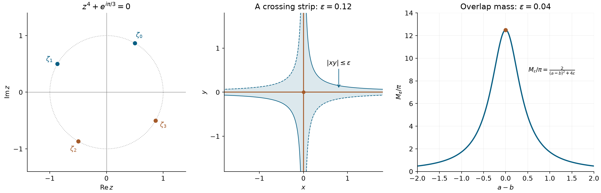

# Products, crossings and singular limits

*Exposition and figures by GPT-6 Astra (OpenAI), October 2026. Original exposition and exercises: CC0. Supplied programme prerequisites retain their stated licences.*

A limit of products can retain information that the separate limits lose. At a crossing of coordinate axes, a regularized reciprocal is controlled by parity, while a regularized point mass requires a logarithmic subtraction. At a quartic zero, two Taylor coefficients carry the divergent terms. For two moving positive kernels, their separation relative to their width determines whether their product vanishes, converges or grows without bound.

All pairings are complex-linear, and all distributional limits are tested against arbitrary compactly supported smooth functions. We use \(\delta_0^{(j)}(\phi)=(-1)^j\phi^{(j)}(0)\). The [test topology](order-positivity-and-limits.md), Definition 1.2 and Proposition 1.2, supplies the finite-derivative criterion for a distribution. The [scalar calculus](../prerequisites/U011-free-foundations/metric-foundation-bridges.md), §§12–13, supplies cutoffs, Taylor's integral formula and the fundamental theorem of calculus. The [integration foundations](../prerequisites/U011-free-foundations/banach-foundation-bridges.md), §§15–16, supply absolute Fubini, dominated convergence and scalar substitution.

For the quartic calculation we use the proved simple-pole integral and finite-part identity in [Real zeros and merging poles](real-zeros-and-merging-poles.md), Theorem 2.1, (2.6) and (2.8). The branch and all coefficients for the half-plane parameter are computed below. [Cauchy kernels and distributional boundary limits](cauchy-kernels-and-boundary-limits.md), Theorem 4.1, gives the one-dimensional principal-value convention.

## Parity at a product of coordinate hyperplanes

For an integer \(n\ge1\) and \(x\in\mathbb R^n\), let \(r_jx\) reverse its \(j\)-th coordinate, and define
\[
 p(x)=x_1\cdots x_n,\qquad
 O_j\phi(x)=\frac{\phi(x)-\phi(r_jx)}2,\qquad
 E_j=I-O_j,\qquad \phi_{\mathrm o}=O_1\cdots O_n\phi .
 \tag{P1}
\]
The operators for distinct coordinates commute. The function \(\phi_{\mathrm o}\) is odd in every coordinate.

**Lemma 1 (division of the fully odd part).** There is a unique smooth function \(h_\phi\) with \(\phi_{\mathrm o}=p h_\phi\). It has compact support. If \(\phi\) is supported in \([-R,R]^n\), so is \(h_\phi\), and
\[
 \begin{split}
 h_\phi(x)&=\int_{[0,1]^n}
  (\partial_1\cdots\partial_n\phi_{\mathrm o})
                     (t_1x_1,\ldots,t_nx_n)\,dt,\\
 \|h_\phi\|_\infty&\le
                         \|\partial_1\cdots\partial_n\phi\|_\infty .
 \end{split}
 \tag{P2}
\]

**Proof.** The fundamental theorem gives \(g(x_j)=x_j\int_0^1g'(t x_j)\,dt\) whenever \(g(0)=0\). Apply it successively in the \(n\) coordinates of \(\phi_{\mathrm o}\). Oddness gives the required zero in each coordinate, and differentiation in another coordinate preserves it. Differentiation under this compact parameter integral proves smoothness of \(h_\phi\). The mixed derivative of \(\phi_{\mathrm o}\) is an average, with signs, of the corresponding derivatives of \(\phi\), so its supremum is no larger.

Off the coordinate hyperplanes the quotient is \(\phi_{\mathrm o}/p\), and is zero outside the reflected support box. By continuity it is zero there on the hyperplanes as well. This proves compact support. That same dense complement proves uniqueness of a continuous quotient. \(\square\)

Define the product principal value by the concrete formula
\[
 \mathcal P_n(\phi)=\int_{\mathbb R^n}h_\phi(x)\,dx .
 \tag{P3}
\]
Lemma 1 bounds this functional by \((2R)^n\|\partial_1\cdots\partial_n\phi\|_\infty\) on each fixed support box. Thus it is a distribution of order at most \(n\).

**Theorem 2 (a symmetric reciprocal at the crossing).** For \(\varepsilon>0\),
\[
 \frac1{p+i\varepsilon}+\frac1{p-i\varepsilon}
       =\frac{2p}{p^2+\varepsilon^2}
       \longrightarrow 2\mathcal P_n
                     \quad\text{in }\mathcal D'(\mathbb R^n).
 \tag{P4}
\]
The same limit holds through nonzero real values of \(\varepsilon\), since the kernel depends only on \(\varepsilon^2\). Moreover \(\mathcal P_n\) is the iterated, or independently truncated, principal value in all coordinates.

**Proof.** The kernel is odd in each coordinate. The identity
\(\phi-\phi_{\mathrm o}=\sum_{j=1}^n O_1\cdots O_{j-1}E_j\phi\)
expresses the difference as a sum whose \(j\)-th term is even in \(x_j\). Each pairs to zero with the kernel by reflection in that coordinate. The integrals are absolute for each fixed positive \(\varepsilon\), so these reflections are legitimate. Hence
\[
 \int\frac{2p}{p^2+\varepsilon^2}\phi
    =2\int\frac{p^2}{p^2+\varepsilon^2}h_\phi
                   \longrightarrow2\int h_\phi .
 \tag{P5}
\]
The fraction is bounded by one and tends to one off the coordinate hyperplanes, whose Lebesgue measure is zero. The majorant \(2|h_\phi|\) is integrable.

For positive truncation parameters \(\eta_1,\ldots,\eta_n\), reflections likewise give
\[
 \int_{\substack{|x_j|>\eta_j\\1\le j\le n}}
                  \frac{\phi(x)}{x_1\cdots x_n}\,dx
 =\int_{\substack{|x_j|>\eta_j\\1\le j\le n}}h_\phi(x)\,dx .
 \tag{P6}
\]
The right side tends to (P3) when all parameters tend to zero, independently of their rates; dominated convergence also permits successive limits. For \(n=1\) this is precisely the usual symmetric principal value. On a product test \(\prod_j\phi_j(x_j)\), Fubini factors (P3) into the product of its one-dimensional principal values. Formula (P3) specifies the distribution on every test, not only on product tests. \(\square\)

## The two divergent moments of a quartic reciprocal

Let \(H=\{w\in\mathbb C:\operatorname{Re}w>0\}\). Write
\(w=|w|e^{i\theta}\), \(-\pi/2<\theta<\pi/2\), and set
\(s=w^{1/4}=|w|^{1/4}e^{i\theta/4}\). This fixes every fractional power below.

**Theorem 3 (a limit throughout the right half-plane).** As \(w\to0\) within \(H\),
\[
 \frac1{x^4+w}
 -\frac{\pi}{\sqrt2}\,w^{-3/4}\delta_0
 -\frac{\pi}{2\sqrt2}\,w^{-1/4}\delta_0''
                 \longrightarrow Q=\operatorname{pf}(x^{-4}).
 \tag{P7}
\]
There is no first-derivative term. Explicitly, with
\(\Phi(x)=(\phi(x)+\phi(-x))/2\),
\[
 Q(\phi)=\int_{\mathbb R}
   \frac{\Phi(x)-\phi(0)-x^2\phi''(0)/2}{x^4}\,dx
       =-\frac16\bigl(\partial_x^3\operatorname{pv}(1/x)\bigr)(\phi).
 \tag{P8}
\]
The error in (P7), paired with \(\phi\), is bounded by
\(C|w|^{1/4}\max_{0\le j\le4}\|\phi^{(j)}\|_\infty\), with \(C\) independent of the approach angle.

**Proof: the exact moments.** The four roots of \(x^4+w\) are
\[
 \zeta_l=s e^{i(\pi/4+l\pi/2)},\qquad 0\le l\le3 .
 \tag{P9}
\]
Their fourth powers are \(-w\), and they are distinct. The first two have positive imaginary part, and the last two have negative imaginary part for every allowed \(\theta\). For \(j=0,1\), polynomial division at these four roots gives
\[
 \frac{x^{2j}}{x^4+w}
   =\frac14\sum_{l=0}^3\frac{\zeta_l^{\,2j-3}}{x-\zeta_l},
 \qquad
 \int_{\mathbb R}\frac{x^{2j}}{x^4+w}\,dx
   =\frac{i\pi}{4}\sum_{l=0}^3
               \operatorname{sgn}(\operatorname{Im}\zeta_l)\,
               \zeta_l^{\,2j-3}.
 \tag{P10}
\]
For the algebraic identity, multiply by \(x^4+w\): both sides are polynomials of degree at most three with equal values at all four roots. Their difference is zero by repeated linear factor division. For the integral, first integrate each term on \([-A,A]\). Formula (2.6) of U038, proved by real logarithmic and arctangent primitives, gives the limit \(i\pi\operatorname{sgn}(\operatorname{Im}\zeta_l)\). The combined original integrand is absolutely integrable at infinity, so its symmetric integral is its ordinary integral.

Put \(m=2j-3\), which is \(-3\) or \(-1\). The lower roots are the negatives of the upper roots, and \(m\) is odd. Their signed sum is therefore twice the upper sum. In both cases
\(e^{im\pi/4}+e^{3im\pi/4}=-i\sqrt2\).
Consequently
\[
 \int\frac{dx}{x^4+w}=\frac{\pi}{\sqrt2}s^{-3},
 \qquad
 \int\frac{x^2\,dx}{x^4+w}=\frac{\pi}{\sqrt2}s^{-1}.
 \tag{P11}
\]
This computes the coefficients on the entire half-plane without a passage through a pole on the real axis.

**Proof: the remainder.** The denominator is even, so only \(\Phi\) contributes. Put
\(R(x)=\Phi(x)-\phi(0)-x^2\phi''(0)/2\).
Its derivatives through order three vanish at zero. Taylor's formula gives \(R(x)=O(x^4)\) there, with a bound by the fourth derivative of \(\phi\). At infinity \(R\) is a polynomial of degree at most two with a minus sign, so \(R/x^4\) is integrable. The exact moments show that the left side of (P7), paired with \(\phi\), is
\[
 \int\frac{R(x)}{x^4+w}\,dx,\qquad
 \int\frac{R(x)}{x^4+w}\,dx-Q(\phi)
       =-\int\frac{w}{x^4+w}\frac{R(x)}{x^4}\,dx .
 \tag{P12}
\]
These are ordinary convergent integrals even though \(R\) itself is not compactly supported.

For \(w\in H\),
\[
 |x^4+w|^2=x^8+2x^4\operatorname{Re}w+|w|^2
                         \ge x^8+|w|^2.
 \tag{P13}
\]
This gives domination by \(|R/x^4|\), and hence the limit. For the quantitative estimate, the quotient \(R/x^4\), continuously defined at zero, has supremum at most \(C\max_{j\le4}\|\phi^{(j)}\|_\infty\). Use Taylor on \(|x|\le1\) and the three separate numerator terms on \(|x|\ge1\). With \(\rho=|w|^{1/4}\), (P13) then gives
\[
 \left|\int\frac{R}{x^4+w}-Q(\phi)\right|
 \le C\max_{j\le4}\|\phi^{(j)}\|_\infty
       \int_{\mathbb R}\min\!\left(1,\frac{\rho^4}{x^4}\right)dx
 =\frac{8C}{3}\rho\max_{j\le4}\|\phi^{(j)}\|_\infty .
 \tag{P14}
\]
The integral formula and derivative identification (P8) are exactly U038, Theorem 2.1, (2.8), at \(k=2\); that proof integrates the Taylor remainder three times with all endpoint terms controlled. It also proves that \(Q\) has exact order four. The odd Taylor coefficient is absent because the original density is even. \(\square\)

## Logarithmic concentration on two intersecting axes

Let \(\chi\in C_c^\infty(\mathbb R;\mathbb C)\) satisfy \(\int\chi=1\). Neither positivity nor evenness is assumed. Set
\[
 \chi_\varepsilon(t)=\varepsilon^{-1}\chi(t/\varepsilon),
 \qquad m_\chi=\int_{\mathbb R}\chi(t)\log|t|\,dt .
 \tag{P15}
\]
The logarithmic moment is finite, since \(\chi\) is bounded near zero and compactly supported.

For a test \(\phi\) on \(\mathbb R^2\), choose \(a,b>0\) with its support inside \((-a,a)\times(-b,b)\), and define
\[
 \begin{split}
 V(\phi)
 &=\int_{-a}^a\frac{\phi(x,0)-\phi(0,0)}{|x|}\,dx\\
 &\quad+\int_{-b}^b\frac{\phi(0,y)-\phi(0,0)}{|y|}\,dy
                         +2\log(ab)\phi(0,0).
 \end{split}
 \tag{P16}
\]
The one-variable differences are \(O(|x|)\) and \(O(|y|)\), so these integrals converge. Enlarging \(a\) changes its integral by \(-2\log(a_{\rm new}/a)\phi(0,0)\), exactly canceled by the last term; enlarging \(b\) behaves the same way. Comparing through a common larger rectangle proves independence of both choices. On each fixed support rectangle, (P16) is bounded by a constant times the first-derivative test norm. It defines a distribution supported on the union of the axes.

**Theorem 4 (the crossing and its logarithmic term).** As \(\varepsilon\downarrow0\),
\[
 \chi_\varepsilon(xy)+2\log\varepsilon\,\delta_{(0,0)}
                      \longrightarrow V-2m_\chi\delta_{(0,0)}
                       \quad\text{in }\mathcal D'(\mathbb R^2).
 \tag{P17}
\]
The coefficient \(2\) is necessary: replacing it by any other constant prevents convergence.

**Proof.** Work on the rectangle \(Q_{a,b}=[-a,a]\times[-b,b]\). Decompose the test there as its mixed remainder, its two axis differences and its value at the origin. The mixed remainder is
\[
 \begin{split}
 B(x,y)&=\phi(x,y)-\phi(x,0)-\phi(0,y)+\phi(0,0)\\
 &=xy\int_0^1\int_0^1
                   \partial_x\partial_y\phi(tx,sy)\,dt\,ds .
 \end{split}
 \tag{P18}
\]
Choose \(L>0\) with \(\operatorname{supp}\chi\subset[-L,L]\). On the support of the kernel, \(|xy|\le L\varepsilon\); moreover
\(\varepsilon^{-1}|\chi(xy/\varepsilon)B(x,y)|
\le \|\partial_x\partial_y\phi\|_\infty
       \sup_t|t\chi(t)|\).
For \(0<c<ab\), direct integration of the positive quadrant gives
\[
 |Q_{a,b}\cap\{|xy|\le c\}|
      =4\int_0^a\min(b,c/x)\,dx
      =4c\bigl(1+\log(ab/c)\bigr).
 \tag{P19}
\]
With \(c=L\varepsilon\), this tends to zero. Thus the mixed remainder contributes zero in the limit, including its possible complex signs.

Integrating first in \(y\), the contribution of the first axis difference is exactly
\[
 \int_{-a}^a
  \frac{\phi(x,0)-\phi(0,0)}{|x|}
   \left(\int_{|t|<b|x|/\varepsilon}\chi(t)\,dt\right)dx .
 \tag{P20}
\]
For nonzero \(x\), the parenthesis tends to one. Its absolute value is at most \(\|\chi\|_1\), and the remaining quotient is integrable. Dominated convergence gives the first integral of (P16). Integrating in the opposite order gives the second.

For the constant term, use the same substitution and then absolute Fubini:
\[
 \begin{split}
 \int_{Q_{a,b}}\chi_\varepsilon(xy)\,dx\,dy
 &=2\int_{|t|<ab/\varepsilon}
                 \chi(t)\log\frac{ab}{\varepsilon|t|}\,dt\\
 &=2\log(ab/\varepsilon)-2m_\chi
                   \qquad(0<\varepsilon<ab/L).
 \end{split}
 \tag{P21}
\]
For the first equality, a fixed \(t\) allows
\(\varepsilon|t|/b<|x|<a\), whose integral with weight \(1/|x|\) is the displayed logarithm times two. The value \(t=0\) is irrelevant to the integral. Absolute Fubini follows either from the original bounded integrand on the finite rectangle, or from the integrability of \(|\chi(t)\log|t||\). Adding the four contributions proves (P17).

If the logarithmic coefficient were \(C\ne2\), a test equal to one near the origin would leave the additional term \((C-2)\log\varepsilon\), which has no finite limit. This proves necessity.

There is also an intrinsic derivative form of \(V\):
\[
 V(\phi)=-\int_0^\infty
 \bigl(\phi_x(t,0)-\phi_x(-t,0)
       +\phi_y(0,t)-\phi_y(0,-t)\bigr)\log t\,dt .
 \tag{P22}
\]
To prove it, integrate each axis integral in (P16) by parts on \([\eta,a]\) or \([\eta,b]\), after combining its positive and negative halves. The inner difference vanishes at least linearly, so its product with \(\log\eta\) tends to zero. At the outer endpoint the test is zero and the boundary term cancels the corresponding \(2\log a\) or \(2\log b\) point term. The displayed derivatives vanish outside the support, so the upper limit may be infinity. \(\square\)

## How the overlap of two narrow kernels changes the limit

Write \(C_{\varepsilon,A}(x)=\varepsilon/((x-A)^2+\varepsilon^2)\), for real \(A\) and positive \(\varepsilon\).

**Lemma 5 (the exact overlap mass).** For all real \(A,B\),
\[
 \int_{\mathbb R}C_{\varepsilon,A}(x)C_{\varepsilon,B}(x)\,dx
                       =\frac{2\pi\varepsilon}{(A-B)^2+4\varepsilon^2}.
 \tag{P23}
\]

**Proof.** Put \(u=x-(A+B)/2\), \(h=(A-B)/2\), and
\(D_\pm=(u\pm h)^2+\varepsilon^2\).
If \(h\ne0\), direct multiplication gives
\[
 \frac1{D_-D_+}
     =\frac{\alpha u+\beta}{D_-}
        +\frac{-\alpha u+\beta}{D_+},\qquad
 \beta=\frac1{2(h^2+\varepsilon^2)},\quad
 \alpha=-\frac{\beta}{2h}.
 \tag{P24}
\]
Indeed the coefficient of \(u^2\) is \(4\alpha h+2\beta=0\), and the constant numerator is \(2\beta(h^2+\varepsilon^2)=1\). In the first fraction write
\(\alpha u+\beta=\alpha(u-h)+\beta/2\);
in the second write
\(-\alpha u+\beta=-\alpha(u+h)+\beta/2\).
On symmetric finite intervals the integrals of the centered linear numerators are logarithmic endpoint ratios tending to zero. Each constant-numerator integral tends to \(\pi/\varepsilon\), by the arctangent primitive. Thus the integral of (P24) is \(\beta\pi/\varepsilon\). Multiplication by \(\varepsilon^2\) gives (P23).

If \(h=0\), substitute \(u=\varepsilon t\). The integral is
\(\varepsilon^{-1}\int(1+t^2)^{-2}dt=\pi/(2\varepsilon)\),
using the primitive
\(\tfrac12(\arctan t+t/(1+t^2))\). This agrees with (P23). \(\square\)

**Theorem 6 (moving centers and their products).** For fixed real \(a,b\), let \(u_{a,\varepsilon}=C_{\varepsilon,a\sqrt\varepsilon}\). Then
\[
 \begin{gathered}
 u_{a,\varepsilon}\longrightarrow\pi\delta_0,\\
 u_{a,\varepsilon}u_{b,\varepsilon}
           \longrightarrow\frac{2\pi}{(a-b)^2}\delta_0
                                  \quad(a\ne b),\\
 \varepsilon u_{a,\varepsilon}^{\,2}
           \longrightarrow\frac{\pi}{2}\delta_0 .
 \end{gathered}
 \tag{P25}
\]
The unnormalized square has no distributional limit.

More generally, suppose \(A_\varepsilon,B_\varepsilon\to c\), with no prescribed separation rate. Let \(M_\varepsilon\) denote (P23). Then
\[
 M_\varepsilon^{-1}
       C_{\varepsilon,A_\varepsilon}C_{\varepsilon,B_\varepsilon}
                           \longrightarrow\delta_c .
 \tag{P26}
\]

**Proof.** The density in (P26) is nonnegative and has total mass one. Fix \(d>0\). Eventually both centers are within \(d/2\) of \(c\). For \(|x-c|\ge d\), each distance from a center is at least \(|x-c|/2\), so
\[
 \begin{split}
 \int_{|x-c|\ge d} C_{\varepsilon,A_\varepsilon}
                            C_{\varepsilon,B_\varepsilon}\,dx
 &\le16\varepsilon^2
                      \int_{|x-c|\ge d}|x-c|^{-4}\,dx\\
 &\le C_d\varepsilon^2,\\
 M_\varepsilon^{-1}\int_{|x-c|\ge d}
              C_{\varepsilon,A_\varepsilon}C_{\varepsilon,B_\varepsilon}
 &\le \frac{C_d}{2\pi}\,
               \varepsilon\bigl((A_\varepsilon-B_\varepsilon)^2
                                         +4\varepsilon^2\bigr)\to0 .
 \end{split}
 \tag{P27}
\]
For a smooth compact test, subtract \(\phi(c)\) from its normalized pairing. The contribution on \(|x-c|<d\) is bounded by the modulus of continuity there, since the total mass is one. The complementary contribution is at most \(2\|\phi\|_\infty\) times (P27). First let \(\varepsilon\downarrow0\), then \(d\downarrow0\). This proves (P26).

For the centers in the statement, (P23) is
\(M_\varepsilon=2\pi/((a-b)^2+4\varepsilon)\).
When \(a\ne b\) it tends to the finite coefficient in (P25); when \(a=b\) it equals \(\pi/(2\varepsilon)\). Formula (P26) gives both product assertions. A nonnegative test equal to one near zero has normalized pairing tending to one, so its pairing with the unnormalized square tends to \(+\infty\).

Finally, substitution \(x=a\sqrt\varepsilon+\varepsilon t\) gives
\[
 \langle u_{a,\varepsilon},\phi\rangle
       =\int_{\mathbb R}
          \frac{\phi(a\sqrt\varepsilon+\varepsilon t)}{1+t^2}\,dt
                         \longrightarrow\pi\phi(0).
 \tag{P28}
\]
The integrable majorant is \(\|\phi\|_\infty/(1+t^2)\). This proves the separate-kernel limit for every \(a\). \(\square\)

*Left: the four roots (P9) for \(w=e^{i\pi/3}\); the two upper roots stay above the real line throughout the specified half-plane branch. Middle: the strip \(|xy|\le\varepsilon\), with \(\varepsilon=0.12\), on a bounded square. If \(\operatorname{supp}\chi\subset[-1,1]\), this strip contains the support of \(\chi_\varepsilon(xy)\). Its limiting axes and their intersection explain the terms of Theorem 4. Right: the exact total product mass from (P23), divided by \(\pi\), for \(A=a\sqrt\varepsilon\), \(B=b\sqrt\varepsilon\) and \(\varepsilon=0.04\), as a function of \(a-b\). The vertical value at zero is \(1/(2\varepsilon)\).*

## Exercises with complete solutions

**Exercise 1 (foundation) — multiplying away the coordinate singularity.** Prove \(p\mathcal P_n=1\) as distributions. Explain why the limit in (P4) therefore satisfies \(p(2\mathcal P_n)=2\).

**Solution.** Reversing coordinate \(j\) changes the sign of \(p\), so \(O_j(p\phi)=pE_j\phi\). Applying all coordinates gives \((p\phi)_{\mathrm o}=p E_1\cdots E_n\phi\). The quotient in Lemma 1 is thus \(E_1\cdots E_n\phi\). Each reflection preserves the integral, and therefore
\[
 (p\mathcal P_n)(\phi)
       =\int E_1\cdots E_n\phi=\int\phi .
 \tag{P29}
\]
This proves both assertions, with the usual regular distribution on the right.

**Exercise 2 (intermediate) — independent regularization rates.** Show that, as every \(\eta_j\downarrow0\) independently,
\[
       \prod_{j=1}^n\frac{x_j}{x_j^2+\eta_j^2}
                           \longrightarrow\mathcal P_n .
 \tag{P30}
\]

**Solution.** The density is odd in every coordinate, so its pairing with \(\phi\) equals its pairing with \(\phi_{\mathrm o}=p h_\phi\). That pairing is
\(\int h_\phi\prod_j x_j^2/(x_j^2+\eta_j^2)\).
The product is bounded by one and tends to one off the coordinate hyperplanes. Dominated convergence proves (P30) for every joint path, and also for successive limits. This compares two distinct regularizations of the same product principal value.

**Exercise 3 (advanced) — uniqueness of the homogeneous quartic subtractions.** Suppose \(b_j:H\to\mathbb C\), \(0\le j\le2\), satisfy
\[
 b_j(tw)=t^{(j-3)/4}b_j(w)\quad(t>0),
 \tag{P31}
\]
and \((x^4+w)^{-1}-\sum_{j=0}^2 b_j(w)\delta_0^{(j)}\) has a distributional limit as \(w\to0\) in \(H\). Prove that the three \(b_j\) are exactly the coefficients in (P7), with \(b_1=0\).

**Solution.** Subtract (P7) from the assumed convergent family. The resulting sum of point derivatives has a limit. For each \(j\), take a compact smooth test equal to \(x^j/j!\) near zero. Its derivatives of degrees zero through two vanish at zero except for its \(j\)-th derivative, which is one. It isolates \((-1)^j\) times the difference of the two \(j\)-th coefficients. That difference must remain bounded as \(w\to0\). On the ray \(w=tw_0\), it is its value at \(w_0\) times \(t^{(j-3)/4}\). All three exponents are negative, so boundedness forces that value to vanish. The point \(w_0\) was arbitrary. The explicit coefficients in (P7) do satisfy (P31), including the zero first-derivative coefficient.

**Exercise 4 (intermediate) — the quartic finite part under multiplication and scaling.** Prove that \(x^4Q=1\), that \(Q\) is even, and that for \(t>0\),
\[
                         Q(\phi(t\,\cdot))=t^3Q(\phi).
 \tag{P32}
\]

**Solution.** The even part of \(x^4\phi\) is \(x^4\Phi\), and its two subtracted jets in (P8) vanish. Thus \(Q(x^4\phi)=\int\Phi=\int\phi\). Evenness is built into (P8). For scaling, the even part becomes \(\Phi(tx)\), its value at zero remains \(\phi(0)\), and its second derivative becomes \(t^2\phi''(0)\). Substitute \(y=tx\) in (P8); the denominator and Jacobian give \(t^4/t=t^3\), proving (P32).

**Exercise 5 (intermediate) — changing the shape scale at a crossing.** For \(\lambda>0\), replace \(\chi\) by \(\chi^\lambda(t)=\lambda^{-1}\chi(t/\lambda)\). Determine the change in the limiting distribution in Theorem 4.

**Solution.** Its integral is still one, and scalar substitution gives
\[
 m_{\chi^\lambda}=m_\chi+\log\lambda,\qquad
 U_{\chi^\lambda}=U_\chi-2\log\lambda\,\delta_{(0,0)},
 \quad U_\chi=V-2m_\chi\delta_{(0,0)} .
 \tag{P33}
\]
Only the point coefficient changes; the two axis finite parts remain the same. The calculation allows complex and nonsymmetric \(\chi\).

**Exercise 6 (advanced) — exact order at the axis crossing.** Prove that \(V+c\delta_{(0,0)}\) has exact distributional order one for every complex \(c\).

**Solution.** Formula (P16) gives order at most one on every fixed support rectangle. Choose even compact smooth \(0\le\eta,\theta\le1\), both equal to one near zero, with \(\eta=1\) on \([-1,1]\) and \(\theta=0\) outside \([-2,2]\). For \(0<r<1/4\), put
\(\phi_r(x,y)=\eta(x)\eta(y)(1-\theta(x/r)\theta(y/r))\).
These tests have a common compact support, supremum at most one, and value zero at the origin. On either axis the trace is \(\eta(t)(1-\theta(t/r))\). Each positive half-axis integral from \(2r\) to \(1\) equals \(\log(1/(2r))\). The transition interval contributes a bounded amount by \(t=rs\), and the outer cutoff contributes a constant. Hence
\[
          (V+c\delta_{(0,0)})(\phi_r)=4\log(1/r)+O(1).
 \tag{P34}
\]
This is unbounded while the zeroth-order seminorm stays bounded, so order zero is impossible.

**Exercise 7 (advanced) — the separation threshold.** Fix \(a\ne b\) and \(\gamma>0\). Classify the limit of
\(C_{\varepsilon,a\varepsilon^\gamma}C_{\varepsilon,b\varepsilon^\gamma}\).

**Solution.** Both centers tend to zero, so (P26) applies. Its exact mass is
\[
 M_\varepsilon=
 \frac{2\pi\varepsilon}
            {(a-b)^2\varepsilon^{2\gamma}+4\varepsilon^2}.
 \tag{P35}
\]
If \(0<\gamma<1/2\), this tends to zero and the absolute pairing is bounded by \(M_\varepsilon\|\phi\|_\infty\), so the distributional limit is zero. If \(\gamma=1/2\), it tends to \(2\pi/(a-b)^2\), giving that multiple of \(\delta_0\). If \(1/2<\gamma<1\), the first denominator term dominates and the mass grows like a positive constant times \(\varepsilon^{1-2\gamma}\). At \(\gamma=1\) it equals \(2\pi/(((a-b)^2+4)\varepsilon)\). For \(\gamma>1\) it grows like \(\pi/(2\varepsilon)\). In all three latter cases, (P26) makes a nonnegative test equal to one near zero have pairing tending to \(+\infty\); there is no distributional limit.

**Exercise 8 (foundation) — the separate limits do not determine the product.** Give two pairs of smooth positive functions, each factor converging to \(\pi\delta_0\), whose products have different finite limits. Give a third pair with the same factor limits whose product does not converge.

**Solution.** Use the factors of Theorem 6. For \((a,b)=(0,1)\) and \((a,b)=(0,2)\), respectively, the product limits are
\[
                         2\pi\delta_0
                   \quad\text{and}\quad \frac{\pi}{2}\delta_0.
 \tag{P36}
\]
For \((a,b)=(0,0)\) the product is the nonconvergent square. Every individual factor has the same limit \(\pi\delta_0\) by (P28). These examples explain why the products were analyzed before taking their factor limits.

## References

- Lars Hörmander, *The Analysis of Linear Partial Differential Operators I: Distribution Theory and Fourier Analysis*, second edition, 2003 reprint, Chapter II, Exercises 2.11–2.14, pp. 373–374; answers, pp. 396–397.
- [Real zeros and merging poles](real-zeros-and-merging-poles.md), Theorem 2.1, (2.6) and (2.8): the simple complex-pole integral and the quartic finite part, including its derivative representation and exact order.
- [Cauchy kernels and distributional boundary limits](cauchy-kernels-and-boundary-limits.md), Theorem 4.1: the one-dimensional principal-value convention.
- [Order, positivity and distributional limits](order-positivity-and-limits.md), Definition 1.2 and Proposition 1.2; [scalar calculus](../prerequisites/U011-free-foundations/metric-foundation-bridges.md), §§12–13; [integration foundations](../prerequisites/U011-free-foundations/banach-foundation-bridges.md), §§15–16: test estimates, Taylor division, cutoffs, absolute Fubini and convergence.
