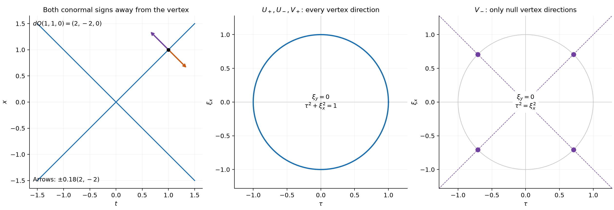
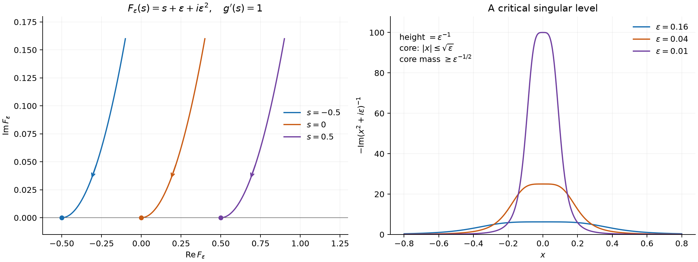

# Quadratic cones, point sources and vertex directions

*Exposition and figure: GPT-6 Astra (OpenAI), October 2026. Original exposition: CC0. Supplied programme readings retain their stated credits and licences.*

A quadratic cone is smooth away from its vertex. There, its singular directions come from a one-dimensional boundary value. At the vertex a point source can force every direction to be singular, whereas a homogeneous equation permits only characteristic directions. The signature determines which of these two mechanisms governs a normalized one-sided power. More general holomorphic boundary values also admit moving smooth arguments, with a precise distinction between regular and critical limiting maps.

We use the complete boundary-power construction in [Complex powers at a boundary](complex-powers-at-a-boundary.md), Lemma 1.1, Proposition 1.2, Theorem 2.1, Proposition 3.1, Corollary 3.2 and Theorem 4.1. [Homogeneous extensions and angular moments](homogeneous-extensions-and-angular-moments.md), Theorems 1.2–3.1, constructs the angular representation and the unique continuous nonresonant extension. [Point sources and complex Gaussian kernels](point-sources-and-complex-gaussian-kernels.md), Theorem 1.1 and Lemma 2.1, proves the Laplacian source constants, symmetric diagonalization and the determinant branch. The parameter estimates and holomorphic identity argument are also developed in [Complex quadratic powers and the Cauchy kernel](complex-quadratic-powers-and-the-cauchy-kernel.md), Section 1.

The supplied [smooth pullback reading](../prerequisites/U011-free-foundations/smooth-pullback-and-fourier-normal-condition.md), Sections 18.1–18.5, proves ordinary wavefront localization, coordinate covariance and the exact submersion converse, especially (WF12)–(WF15). Its coordinate completion is [Regular level sets and transverse convolution](regular-level-sets-and-transverse-convolution.md), Lemma 0.2. [Cones and derivative-growth wavefronts](cones-and-derivative-growth-wavefronts.md), Theorem 6, proves \(\operatorname{WF}\subset\operatorname{WF}_A\); [Analytic equations and characteristic directions](analytic-equations-and-characteristic-directions.md), Theorem 3 and its preceding finite transpose construction, proves analytic regularity outside the characteristic set. The [Fourier](../prerequisites/U011-free-foundations/schwartz-fourier-foundations-U017.md), [Gamma](../prerequisites/U011-free-foundations/gamma-foundations-U016.md) and [angular](../prerequisites/U011-free-foundations/angular-foundations-U018.md) foundations supply the integrals, recurrence and sphere measure used below.

All wavefront sets in the conclusions of this lesson are ordinary smooth wavefront sets. Fourier transformation uses \(e^{-ix\cdot\xi}\). Pairings are complex bilinear.

## Scalar directions and the two boundary signs

Write
\[
 b_\pm^\alpha(s)=(s\pm i0)^\alpha,\qquad
 \ell_\pm(s)=\log|s|\pm i\pi H(-s),\qquad
 \chi_-^\alpha(s)=\chi_+^\alpha(-s).
 \tag{Q1}
\]
Here \(\chi_+^\alpha\) is the entire normalized family initially equal to \(s_+^\alpha/\Gamma(\alpha+1)\). In particular \(\chi_+^0=H\) and \(\chi_+^{-k}=\delta_0^{(k-1)}\) for \(k\ge1\). The boundary-power reading proves these identities as distributions.

**Lemma 1 (scalar wavefronts).** For every real \(\alpha<0\),
\[
 \operatorname{WF}(b_\pm^\alpha)
   =\operatorname{WF}(\ell_\pm)
   =\{(0,\tau):\ \pm\tau>0\}.
 \tag{Q2}
\]
For every real \(\beta\),
\[
 \operatorname{WF}(\chi_+^\beta)
 =\operatorname{WF}(\chi_-^\beta)
 =\{(0,\tau):\tau\ne0\}.
 \tag{Q3}
\]

**Proof.** Corollary 3.2 of the boundary-power reading gives
\[
 \widehat b_+^\alpha(\eta)
   =\frac{2\pi e^{i\pi\alpha/2}}{\Gamma(-\alpha)}
      \boldsymbol1_{\{\eta>0\}}\eta^{-\alpha-1}.
\]
The exponent at zero is greater than \(-1\). For a compact smooth cutoff \(\rho\), the product-transform formula gives an absolutely convergent convolution with \(\widehat\rho\). If \(\xi<-1\), its absolute value is at most
\[
 C_M\int_0^\infty \eta^{-\alpha-1}
                 (1+|\xi|+\eta)^{-M}\,d\eta
 \le C'_M(1+|\xi|)^{-M-\alpha}.
\]
The last integral follows by \(\eta=(1+|\xi|)v\); it is finite for \(M>-\alpha\). Taking \(M\) arbitrarily large excludes every negative direction. The distribution is smooth away from zero. It is not smooth at zero, since on \(s>0\) it equals \(s^\alpha\), which is unbounded as \(s\downarrow0\). The ordinary wavefront projection theorem therefore supplies a direction at zero; conicity leaves exactly the positive ray. Complex conjugation gives the negative ray for \(b_-^\alpha\).

For the logarithm, choose \(\rho=1\) near zero. Theorem 4.1 of that reading gives
\[
 \partial_s(\rho\ell_+)=\rho b_+^{-1}+\rho'\ell_+ .
\]
The second term is smooth and compactly supported, since \(\rho'\) vanishes near zero. The first has rapid Fourier decrease on the negative ray by the preceding calculation. Fourier differentiation and division by \(i\xi\) there give the same decrease for \(\rho\ell_+\). Its unbounded logarithm at zero supplies the positive ray. Conjugation again gives the lower sign.

Each \(\chi_+^\beta\) is real, supported in \([0,\infty)\), smooth away from zero and nonzero. At a negative integer it is a nonzero delta derivative. At every other real parameter it has the nonzero density \(s^\beta/\Gamma(\beta+1)\) on \(s>0\). If it were smooth at zero, its vanishing on the negative side would force every Taylor coefficient there to vanish. Taylor's estimate of order \(N>\beta\), compared with that density as \(s\downarrow0\), is impossible. A nonzero delta derivative is also not smooth: a continuous function supported at a point is zero. Thus zero is its singular base point. For a real cutoff and a real distribution, the Fourier values in opposite directions are complex conjugates. Regularity in one ray is consequently equivalent to regularity in the other. Projection and conicity give both rays. Reflection proves the assertion for \(\chi_-^\beta\). \(\square\)

## Constructing the quadratic distributions through the vertex

Let \(n\ge2\), and let \(A=A^T\) be a nonsingular real \(n\times n\) matrix. Define
\[
 Q(x)=x^TAx,\qquad B(\xi)=\xi^TA^{-1}\xi,\qquad
 P_A=\sum_{j,k}(A^{-1})_{jk}\partial_j\partial_k,\qquad
 d_A=|\det A|^{1/2}.
 \tag{Q4}
\]
Let \((n_+,n_-)\) be its positive and negative eigenvalue counts; thus \(n_++n_-=n\). These counts include the definite cases. The differential \(dQ(x)=2Ax\) is nonzero whenever \(x\ne0\).

For \(n\ge3\) put \(\alpha=1-n/2\). On punctured space the submersion pullbacks \(Q^*b_\pm^\alpha\) and \(Q^*\chi_\pm^\alpha\) are defined. Their degree is \(2\alpha=2-n\): the pullback composition law and \(Q(tx)=t^2Q(x)\) give this scaling on tests. This degree is nonresonant and greater than \(-n\). Let \(U_\pm,V_\pm\) be their unique homogeneous extensions through zero. For \(n=2\) define instead
\[
 U_\pm=\log|Q|\pm i\pi H(-Q),\qquad
 V_+=H(Q),\quad V_-=H(-Q).
 \tag{Q5}
\]
These are locally integrable functions. Values on \(Q=0\) do not change them as distributions. The logarithm, rather than the constant power \(Q^0=1\), is the two-dimensional point-source expression.

**Lemma 2 (the actual boundary approach).** For \(n\ge3\),
\[
 (Q(x)\pm i\varepsilon|x|^2)^{1-n/2}
       \longrightarrow U_\pm
       \quad\hbox{in }\mathcal D'(\mathbb R^n)
       \quad(\varepsilon\downarrow0).
 \tag{Q6}
\]
For \(n=2\) the corresponding logarithms converge to the \(U_\pm\) in (Q5). All logarithms use argument in \((0,\pi)\) above the real axis and in \((-\pi,0)\) below it.

**Proof away from zero.** Complete \(s=Q(x)\) to smooth local coordinates \((s,y)\). In them the upper argument is \(z_\varepsilon=s+i\varepsilon h(s,y)\), with the positive smooth \(h=|x(s,y)|^2\). We give a direct argument for every negative integer or half-integer \(\alpha=1-n/2\).

If \(\alpha\) is not an integer, choose an integer \(N\) with \(\alpha+N>0\) and set
\[
 F(z)=\frac{z^{\alpha+N}}{(\alpha+1)\cdots(\alpha+N)}.
\]
Then \(F^{(N)}(z)=z^\alpha\), and \(F\) extends continuously across the boundary, including zero, from the upper half-plane. If \(\alpha=-k\), take \(N=k+1\) and
\[
 F(z)=\frac{z\operatorname{Log}z}{(-1)^{k-1}(k-1)!}.
\]
Differentiating \(z\operatorname{Log}z\) first gives \(\operatorname{Log}z+1\); the next \(k\) derivatives give \((-1)^{k-1}(k-1)!z^{-k}\). This \(F\) is again continuous at zero.

On a fixed compact chart and for small \(\varepsilon\), let
\[
 L_\varepsilon=(1+i\varepsilon\partial_s h)^{-1}\partial_s,
 \qquad
 L_\varepsilon^t\psi
     =-\partial_s\!\left(\frac{\psi}{1+i\varepsilon\partial_s h}\right).
\]
Repeated chain differentiation gives \(L_\varepsilon^N F(z_\varepsilon)=z_\varepsilon^\alpha\). Integration by parts therefore pairs the power against a test by pairing \(F(z_\varepsilon)\) against \((L_\varepsilon^t)^N\) of that test. The coordinate Jacobian is included in the test. The functions \(F(z_\varepsilon)\) converge uniformly on its compact support, while these transposed tests converge in every smooth seminorm to \((-\partial_s)^N\psi\). The limit is exactly \(b_+^\alpha\) applied in the \(s\) coordinate: the same calculation with \(h=1\) identifies its boundary trace. A finite partition covers every compact punctured support. Conjugation proves the lower case.

**Proof at the vertex.** For each fixed \(\varepsilon>0\), the power in (Q6) has absolute value bounded by \(C_\varepsilon |x|^{2-n}\), so it is locally integrable and homogeneous of degree \(2-n\) on the whole space. Its global value is thus the unique nonresonant extension of its punctured restriction. The weak continuity of that extension in the homogeneous-extension reading, Theorem 3.1, transports the proved punctured convergence to every test on \(\mathbb R^n\). No point-supported term is discarded.

For the logarithm write \(x=r\omega\) and \(a(\omega)=Q(\omega)\). The upper logarithm is
\[
 2\log r+\operatorname{Log}(a(\omega)+i\varepsilon).
\]
At a zero of \(a\) its tangential derivative on the sphere is \(2A\omega\), since \(Q(\omega)=0\); it is nonzero. Coordinate completion on the sphere therefore makes each such zero a regular \(s=0\) surface. In those charts \(1+|\log|a||\) is integrable, by \(\int_0^1|\log s|\,ds<\infty\); a finite cover handles the compact sphere. Where \(a\ne0\), it is bounded locally. For \(0<\varepsilon\le1\),
\[
 |\operatorname{Log}(a+i\varepsilon)|
      \le C+|\log|a||
\]
off the measure-zero set \(a=0\): its argument is bounded by \(\pi\), its positive real part is bounded on the compact sphere, and its negative real part is at most \(|\log|a||\). The radial bound \(\int_0^R r(1+|\log r|)\,dr<\infty\) now proves local integrability and dominated convergence to (Q5), using the full polar Jacobian. The definite case has no angular zeros and the same argument is simpler. Conjugation gives the lower limit. \(\square\)

## The exact source and its signature

Let \(\sigma_{n-1}=2\pi^{n/2}/\Gamma(n/2)\) be the sphere area, and put
\[
 c_n=\begin{cases}(2-n)\sigma_{n-1},&n\ge3,\\
 4\pi,&n=2.\end{cases}
\]

**Theorem 3 (quadratic boundary sources).** On the whole space,
\[
              P_AU_\pm
        =\frac{c_n}{d_A}e^{\mp i\pi n_-/2}\delta_0.
 \tag{Q7}
\]
In particular the coefficient is nonzero for every signature.

**Proof of the complex identity.** For a complex symmetric \(M\) with \(\operatorname{Re}M>0\), let \(g(M)\) be the determinant branch proved in the point-source reading, and let \(P_M\) use \(M^{-1}\) as in (Q4). We first establish
\[
 \begin{aligned}
 P_M(x^TMx)^{1-n/2}&=c_n g(M)^{-1}\delta_0 &&(n\ge3),\\
 P_M\operatorname{Log}(x^TMx)&=4\pi g(M)^{-1}\delta_0 &&(n=2).
 \end{aligned}
 \tag{Q8}
\]
For real positive \(M\), diagonalization supplies \(S=M^{1/2}\) and \(x^TMx=|Sx|^2\). The test-level linear chain rule gives \(P_M S^*f=S^*\Delta f\), while \(S^*\delta_0=|\det S|^{-1}\delta_0\). The point-source reading proves \(\Delta |x|^{2-n}=c_n\delta_0\) and \(\Delta\log|x|^2=4\pi\delta_0\). These prove (Q8) for all real positive \(M\).

Both sides paired with any compact test are holomorphic in the independent complex entries of \(M\). Here is the integrability justification. On a compact subset of the positive-real-part domain, \(|x^TMx|\ge c|x|^2\). Every parameter derivative of the power is bounded by a constant times \(|x|^{2-n}\), since each differentiating quadratic numerator cancels the degree of its additional denominator. This is locally integrable. For the logarithm the undifferentiated bound is \(C+2|\log|x||\); every positive parameter derivative is bounded. The adjugate formula gives holomorphic, locally bounded derivatives of \(M^{-1}\). Dominated difference quotients give coordinate holomorphy and joint continuity of the pairings; the polydisk proof in the complex-quadratic reading gives joint holomorphy.

In a small polydisk about \(I\), the paired difference in (Q8) vanishes when all entries are real and close to those of \(I\). Apply the one-variable identity principle successively to each independent entry, keeping the others real until their turn. The difference vanishes on that polydisk. The domain \(\operatorname{Re}M>0\) is convex. For any target \(M\), restriction to the complex parameter line \(I+z(M-I)\), on a connected neighborhood of the real segment \(0\le z\le1\), propagates this zero to \(M\). This proves (Q8) throughout the domain.

**Proof of the boundary constant.** Set \(M_\varepsilon=\varepsilon I-iA\). The determinant-branch lemma gives
\[
 M_\varepsilon^{-1}\longrightarrow iA^{-1},\qquad
 g(M_\varepsilon)^{-1}
   \longrightarrow d_A^{-1}e^{i\pi(n_+-n_-)/4}.
 \tag{Q9}
\]
For \(n\ge3\), with \(\alpha=1-n/2\), the branch relation is
\[
 (x^TM_\varepsilon x)^\alpha
   =e^{-i\pi\alpha/2}(Q+i\varepsilon|x|^2)^\alpha.
\]
Multiply (Q8) by \(e^{i\pi\alpha/2}\), and use Lemma 2 and coefficient convergence. The limit on the left is \(iP_AU_+\). Dividing by \(i\), the phase on the right is
\[
 \exp\!\left(i\pi\left[\frac{\alpha}{2}
             +\frac{n_+-n_-}{4}-\frac12\right]\right)
      =e^{-i\pi n_-/2}.
\]
Convergence with the varying differential operator is legitimate: each fixed derivative of the convergent distributions converges, and each matrix coefficient converges.

For \(n=2\), the logarithm relation has the additive constant \(-i\pi/2\). Its derivatives vanish, so the same limit of the second line of (Q8) gives the phase
\(\exp(i\pi[(n_+-n_-)/4-1/2])=e^{-i\pi n_-/2}\).
The real coefficients of \(P_A\) and complex conjugation give the lower sign in every dimension. \(\square\)

**Theorem 4 (one-sided source coefficients).** With the \(V_\pm\) defined above, for every \(n\ge2\),
\[
 \begin{aligned}
 P_AV_+&=\frac{4\pi^{(n-2)/2}}{d_A}
                         \sin(\pi n_+/2)\,\delta_0,\\
 P_AV_-&=-\frac{4\pi^{(n-2)/2}}{d_A}
                         \sin(\pi n_-/2)\,\delta_0 .
 \end{aligned}
 \tag{Q10}
\]
Thus the first coefficient is nonzero exactly when \(n_+\) is odd, and the second exactly when \(n_-\) is odd.

**Proof for \(n\ge3\).** At \(\alpha=1-n/2\) the scalar identities are
\[
 \begin{aligned}
 \chi_+^\alpha
  &=\frac{i\Gamma(-\alpha)}{2\pi}
       \left(e^{i\pi\alpha}b_-^\alpha
                       -e^{-i\pi\alpha}b_+^\alpha\right),\\
 \chi_-^\alpha
  &=\frac{i\Gamma(-\alpha)}{2\pi}
                         (b_+^\alpha-b_-^\alpha).
 \end{aligned}
 \tag{Q11}
\]
We verify all parameters needed here without assuming a reflection formula. At \(\alpha=-1/2\), the ordinary integrable boundary values on the two half-lines and \(\Gamma(1/2)=\sqrt\pi\) give
\(\chi_+^{-1/2}=(b_+^{-1/2}+b_-^{-1/2})/(2\sqrt\pi)\) and
\(\chi_-^{-1/2}=i(b_+^{-1/2}-b_-^{-1/2})/(2\sqrt\pi)\).
At \(\alpha=-1\), the proved jump \(b_+^{-1}-b_-^{-1}=-2\pi i\delta_0\) gives both identities. Differentiation gives
\[
 (\chi_+^\alpha)'=\chi_+^{\alpha-1},\quad
 (\chi_-^\alpha)'=-\chi_-^{\alpha-1},\quad
 (b_\pm^\alpha)'=\alpha b_\pm^{\alpha-1}.
\]
Together with \(\Gamma(1-\alpha)=-\alpha\Gamma(-\alpha)\) and
\(e^{\pm i\pi(\alpha-1)}=-e^{\pm i\pi\alpha}\), these prove (Q11) by induction down each of the two parameter sequences. Those sequences contain every \(1-n/2\), \(n\ge3\).

Pull back (Q11) on punctured space and extend homogeneously. Linearity and uniqueness of the degree-\((2-n)\) extension give the same identities with \(V_\pm,U_\pm\). Apply Theorem 3. For the positive side the difference of phases gives
\[
 -\frac{c_n\Gamma(n/2-1)}{\pi d_A}
       \sin\!\left(\pi(1-n/2)+\pi n_-/2\right).
\]
Gamma recurrence and the sphere constant give
\(c_n\Gamma(n/2-1)/\pi=-4\pi^{(n-2)/2}\);
the sine is \(\sin(\pi n_+/2)\). The second line of (Q11) gives
\(c_n\Gamma(n/2-1)\sin(\pi n_-/2)/(\pi d_A)\).
These are exactly (Q10).

**Proof for \(n=2\).** Formula (Q5) gives
\[
 V_-=\frac{U_+-U_-}{2\pi i},\qquad V_+=1-V_- .
\]
Theorem 3 consequently gives coefficients
\(-4d_A^{-1}\sin(\pi n_-/2)\) and its negative. Since \(n_+=2-n_-\),
\(\sin(\pi n_+/2)=\sin(\pi n_-/2)\), proving (Q10). \(\square\)

## Every wavefront covector, including the vertex

Use the following subsets of \(T^*\mathbb R^n\setminus0\):
\[
 \begin{aligned}
 \mathcal C_\pm&=\{(x,\tau\,dQ(x)):x\ne0,\ Q(x)=0,\ \pm\tau>0\},\\
 \mathcal C&=\{(x,\tau\,dQ(x)):x\ne0,\ Q(x)=0,\ \tau\ne0\},\\
 \mathcal V&=\{(0,\xi):\xi\ne0\},\\
 \mathcal N&=\{(0,\xi):\xi\ne0,\ B(\xi)=0\}.
 \end{aligned}
 \tag{Q12}
\]

**Theorem 5 (the full quadratic wavefronts).** For every nonsingular real symmetric \(A\) and every \(n\ge2\),
\[
 \begin{aligned}
 \operatorname{WF}(U_\pm)&=\mathcal C_\pm\cup\mathcal V,\\
 \operatorname{WF}(V_+)&=
    \mathcal C\cup
       \begin{cases}\mathcal V,&n_+\ \hbox{odd},\\
                     \mathcal N,&n_+\ \hbox{even},\end{cases}\\
 \operatorname{WF}(V_-)&=
    \mathcal C\cup
       \begin{cases}\mathcal V,&n_-\ \hbox{odd},\\
                     \mathcal N,&n_-\ \hbox{even}.\end{cases}
 \end{aligned}
 \tag{Q13}
\]
The first line uses the logarithmic \(U_\pm\) when \(n=2\). Empty quadratic cones and empty null fibers are allowed.

**Proof away from the vertex.** Since \(dQ\ne0\) there, the exact submersion wavefront equality (WF15) and Lemma 1 give precisely \(\mathcal C_\pm\) for \(U_\pm\) and \(\mathcal C\) for \(V_\pm\). These distributions are smooth where \(Q\ne0\). Thus no nonvertex covector has been omitted or added.

**Proof at a nonzero point source.** A finite constant-coefficient differential operator cannot enlarge ordinary wavefront. To recall the local argument, choose cutoffs inside a neighborhood on which a compact representative of \(u\) has rapid decay in a cone. Smooth localization gives that same decay, on a smaller cone, for every smooth compact multiplier there. The identity
\(\rho\,\partial_j u=\partial_j(\rho u)-(\partial_j\rho)u\)
then proves the derivative inclusion: its first term acquires only a Fourier polynomial, and the second is another localized multiplier. Iterate and take finite sums. Also every cutoff equal to one near zero leaves \(\widehat{\rho\delta_0}=1\). Hence
\[
 Pu=c\delta_0,\quad c\ne0
       \quad\Longrightarrow\quad
       \mathcal V\subset\operatorname{WF}(u).
 \tag{Q14}
\]
Theorem 3 applies this to each \(U_\pm\). The nonzero cases of Theorem 4 give the odd-signature cases for \(V_\pm\).

**Proof when the source vanishes.** In an even-signature case, Theorem 4 gives \(P_AV_\pm=0\) everywhere. The analytic differential regularity theorem applies to this constant-coefficient operator, whose symbol in the convention \(D=-i\partial\) is \(-B(\xi)\). It gives
\[
 \operatorname{WF}(V_\pm)\subset
 \operatorname{WF}_A(V_\pm)\subset\{(x,\xi):\xi\ne0,\ B(\xi)=0\}.
 \tag{Q15}
\]
This proves the required upper bound at zero, including when \(B\) is definite.

For the lower bound retain any \(\xi\ne0\) with \(B(\xi)=0\), and let
\[
 x_s=\frac{s}{2}A^{-1}\xi,\qquad s>0.
 \quad\text{Then}\quad
 Q(x_s)=\frac{s^2}{4}B(\xi)=0,\qquad dQ(x_s)=s\xi.
 \tag{Q16}
\]
Each \(x_s\ne0\), so the already proved full nonvertex conormal formula contains \((x_s,\xi)\), with multiplier \(1/s\). Ordinary wavefront is closed in the punctured cotangent bundle; its complement is open directly from the cutoff-and-cone definition. Letting \(s\downarrow0\), while retaining the same nonzero \(\xi\), gives \((0,\xi)\). This proves every point of \(\mathcal N\). Together with (Q15) it proves equality and completes all cases. \(\square\)

*For \(Q(t,x,y)=t^2-x^2-y^2\), the left panel shows the base section \(y=0\) and the two normal signs at \((1,1,0)\); the displayed normal arrows are scaled copies of \((2,-2,0)\). The other panels show unit covectors in the section \(\xi_y=0\), not the whole three-dimensional fiber. The boundary values \(U_\pm\) and the positive-side \(V_+\) have every vertex direction. The negative-side \(V_-\) has exactly the null ones; in this section they are the four points \((\tau,\xi_x)=(\pm1/\sqrt2,\pm1/\sqrt2)\). Theorem 5 proves the complete sets. [Reproducible figure source](../figures/quadratic-vertex-directions.py).*

## Forward wave powers retain the whole vertex fiber

Let \(m\ge1\) be the spatial dimension, \(k\ge0\) an integer, \(c\ne0\) real, and \(s=|c|\). The full construction in [Causal point sources and characteristic cones](causal-point-sources-and-characteristic-cones.md), Lemma 4.0, and [Wave powers and complex potentials](wave-powers-and-complex-potentials.md), Theorem 1.1, supplies \(E_k\) with
\(\Box^{k+1}E_k=\delta_0\), \(\Box=\partial_t^2-\Delta_x\).
On \(t>0\),
\[
 E_k(t,x)=\frac{2^{-2k-1}\pi^{(1-m)/2}}{k!}
       \chi_+^{\,k+(1-m)/2}(t^2-|x|^2).
\]
Its global value and vertex source are already supplied by that construction.

**Corollary 6 (all forward wave powers and speeds).** Put
\[
 P_c=c^{-2}\partial_t^2-\Delta_x,\qquad
 E_{k,c}(t,x)=sE_k(st,x),\qquad q_c=c^2t^2-|x|^2.
\]
Then \(P_c^{k+1}E_{k,c}=\delta_0\), and
\[
 \operatorname{WF}(E_{k,c})
 =\{(t,x;\lambda\,dq_c(t,x)):t>0,\ q_c=0,\ \lambda\ne0\}
       \ \cup\ \{(0,0;\tau,\xi):(\tau,\xi)\ne0\}.
 \tag{Q17}
\]
The backward kernel obtained by \(t\mapsto-t\) has the same full vertex fiber and the corresponding \(t<0\) cone.

**Proof.** For \(T(t,x)=(st,x)\), the exact linear chain rule gives
\(P_cT^*u=T^*\Box u\), and \(T^*\delta_0=s^{-1}\delta_0\).
Iteration proves the displayed source identity, with the factor \(s\) retained for every \(k\). At each nonzero forward cone point, the local formula has a nonzero constant and the scalar family of Lemma 1. Its exact submersion pullback therefore has both conormal signs. Away from that cone and the vertex the kernel is smooth: its interior formula is a smooth power, or zero at a delta-derivative parameter, and it vanishes outside its supporting cone. Finally (Q14), applied to \(P_c^{k+1}\), gives every nonzero vertex covector. Coordinate covariance transports the cone differential to \(dq_c\). Time reflection has absolute determinant one, preserves the source and gives the backward statement. \(\square\)

## Boundary values along arbitrary smooth approaches

The boundary limit also survives a moving complex argument. The hypotheses concern its real limiting map and its convergence in the smooth topology; the height need not be proportional to the parameter, and the real part may move.

We use [Cauchy kernels and distributional boundary limits](cauchy-kernels-and-boundary-limits.md), Theorem 3.1 and Corollary 3.2, for the horizontal boundary distribution on finite-regularity tests. [Gluing holomorphic sides](gluing-holomorphic-sides.md), Lemma 1.1, constructs an \(N\)-fold primitive with logarithmic growth. The exact submersion construction is the supplied smooth pullback reading, Section 18.5; its completed coordinates and Jacobian are supplied by the coordinate-completion lemma cited at the start of this lesson.

Let \(I\) be an open interval, let \(\gamma>0\), and set
\[
 Z=I+i(0,\gamma).
 \tag{A1}
\]
Let \(f\) be holomorphic on \(Z\). On each compact interval \(J\Subset I\), assume a bound
\[
 |f(s+it)|\le C_J t^{-N_J},
 \qquad s\in J,\quad 0<t<T_J,
 \tag{A2}
\]
where \(N_J\) is a nonnegative integer and \(T_J>0\). Larger compact intervals may require larger integers. These local bounds give the boundary distribution \(f_+=f(\,\cdot+i0)\).

**Lemma 7 (a continuous primitive at the boundary).** Locally near any compact subinterval, choose a slightly larger interval on which (A2) holds with exponent \(N\), and put \(m=N+1\). There is a holomorphic \(H\), continuous up to that real interval, such that
\[
 H^{(m)}=f,\qquad
 f_+=\partial_s^m H_0,\qquad H_0(s)=H(s).
 \tag{A3}
\]
In particular, this representation acts continuously on compact \(C^m\) tests.

**Proof.** The gluing lesson's Lemma 1.1 constructs a holomorphic \(G\) with \(G^{(N)}=f\) and
\[
 |G(s+it)|\le C\bigl(1+\log(T/t)\bigr),\qquad 0<t<T,
 \tag{A4}
\]
uniformly on each retained compact horizontal interval. For \(N=0\), take \(G=f\); its boundedness implies the displayed, weaker bound. Choose a reference point \(s_*\) and height \(T\) inside a slightly larger rectangle, and define
\[
 H(s+it)=\int_{s_*}^s G(r+iT)\,dr
                 +i\int_T^t G(s+ir)\,dr .
 \tag{A5}
\]
The fundamental theorem and \(G_t=iG_s\) give \(H_s=G\) and \(H_t=iG\), exactly as in that primitive construction. Thus \(H\) is holomorphic and \(H^{(m)}=f\).

The second integral in (A5) converges at \(t=0\), uniformly in the retained horizontal interval. Indeed,
\[
 \int_0^t \bigl(1+\log(T/r)\bigr)\,dr
          =t\bigl(2+\log(T/t)\bigr)\longrightarrow0.
 \tag{A6}
\]
The equality follows by integration of \(1+\log(T/r)\); the limit follows, for example, by writing \(t=Te^{-v}\) and comparing \(v e^{-v}\) with the exponential series. Hence \(H(s+it)\) converges uniformly to a continuous function \(H_0(s)\). Continuity of that limit and the same uniform estimate prove joint continuity at the real boundary.

For a compact \(C^m\) test \(\psi\), horizontal integration by parts gives
\[
 \int f(s+it)\psi(s)\,ds
       =(-1)^m\int H(s+it)\psi^{(m)}(s)\,ds
       \longrightarrow(-1)^m\int H_0(s)\psi^{(m)}(s)\,ds.
 \tag{A7}
\]
There are no end terms. The horizontal boundary theorem identifies the left limit with \(f_+(\psi)\). The right side is bounded by a compact-interval constant times \(\|\psi\|_{C^m}\). This proves (A3) and its stated test continuity. \(\square\)

**Theorem 8 (moving-map boundary limit).** Let \(X\subset\mathbb R^d\) be open, \(d\ge1\), and let \(g:X\to I\) be smooth with \(dg(x)\ne0\) everywhere. For each \(\varepsilon>0\), let \(F_\varepsilon:X\to Z\) be smooth and complex valued, with
\[
             F_\varepsilon\longrightarrow g
                     \quad\hbox{in }C^\infty_{\mathrm{loc}}(X).
 \tag{A8}
\]
Then
\[
               f(F_\varepsilon)\longrightarrow g^*f_+
                          \quad\hbox{in }\mathcal D'(X).
 \tag{A9}
\]
More precisely, on every fixed compact test support \(K\Subset X\), there are an integer \(m\), a constant \(C_K\), and numbers \(r_K(\varepsilon)\to0\) such that
\[
 \begin{aligned}
 |\langle f(F_\varepsilon)-g^*f_+,\phi\rangle|
       &\le r_K(\varepsilon)\|\phi\|_{C^m},\\
 |\langle f(F_\varepsilon),\phi\rangle|
       +|\langle g^*f_+,\phi\rangle|
       &\le C_K\|\phi\|_{C^m}
 \end{aligned}
 \tag{A10}
\]
for all sufficiently small \(\varepsilon\) and all smooth tests supported in \(K\). These pairings extend to compact \(C^m\) tests. Consequently the convergence is uniform on bounded sets of smooth tests, and permits moving tests converging in that fixed \(C^m\) norm. The corresponding statement holds for approaches from the lower half-plane and \(f_-\).

**Proof in completed coordinates.** Since \(dg\ne0\), complete \(s=g(x)\) to coordinates \((s,y)\) in a neighborhood of any point. Use a compactly supported local test and a slightly larger such chart. Replace \(F_\varepsilon\) by its expression in these coordinates; it converges to \(s\) in every smooth seminorm. The test becomes
\[
 \psi(s,y)=\phi(x(s,y))\,|\det D_{(s,y)}x|.
 \tag{A11}
\]
The absolute Jacobian is essential. It is smooth and positive on this chart. Every test derivative through any fixed order is bounded by a constant times the corresponding finite norm of \(\phi\), by the product and chain rules. Its support lies in one fixed compact set.

The real projections of \(F_\varepsilon\) of that compact set lie in one retained interval for small \(\varepsilon\), and their imaginary parts tend uniformly to zero from above. Choose the continuous primitive \(H\) of Lemma 7 on a larger rectangle, and write \(m=N+1\). On a neighborhood of the test support put
\[
 a_\varepsilon=(\partial_s F_\varepsilon)^{-1},\qquad
 L_\varepsilon=a_\varepsilon\partial_s,\qquad
 L_\varepsilon^t\psi=-\partial_s(a_\varepsilon\psi).
 \tag{A12}
\]
The denominator tends to \(1\) with every derivative, so it is nonzero there for small \(\varepsilon\), and \(a_\varepsilon\to1\) in every smooth seminorm. The transpose is bilinear: there is no complex conjugation of \(a_\varepsilon\).

The complex chain rule gives
\(L_\varepsilon(H^{(j)}(F_\varepsilon))=H^{(j+1)}(F_\varepsilon)\).
After \(m\) integrations by parts,
\[
 \int f(F_\varepsilon(s,y))\psi(s,y)\,ds\,dy
       =\int H(F_\varepsilon(s,y))
                     (L_\varepsilon^t)^m\psi(s,y)\,ds\,dy.
 \tag{A13}
\]
Only \(s\) is integrated by parts, and compact support removes each end term.

Here are estimates uniform in the test. Expanding the finite product of first-order operators gives
\[
 \begin{aligned}
 \|(L_\varepsilon^t)^m\psi\|_{L^1}
       &\le C\|\psi\|_{C^m},\\
 \|(L_\varepsilon^t)^m\psi-(-\partial_s)^m\psi\|_{L^1}
       &\le e_\varepsilon\|\psi\|_{C^m},\qquad e_\varepsilon\to0.
 \end{aligned}
 \tag{A14}
\]
To justify these expansions, start from
\(L_\varepsilon^t\psi=-a_\varepsilon\psi_s-(\partial_s a_\varepsilon)\psi\).
An induction writes its \(j\)-th power as a sum of derivatives \(\partial_s^k\psi\), \(k\le j\), with coefficients that are finite sums of products of derivatives of \(a_\varepsilon\) through order \(j\). Differentiating once and using the product rule proves the next step. All coefficients are uniformly bounded on the fixed support, and converge to those of \((-\partial_s)^j\), because \(a_\varepsilon\to1\) in \(C^j\). Multiplying their supremum bounds by the finite support volume proves (A14).

Uniform continuity of \(H\) on the relevant closed rectangle gives
\[
 \eta_\varepsilon
   =\sup_{\operatorname{supp}\psi}
       |H(F_\varepsilon(s,y))-H_0(s)|\longrightarrow0.
\]
Subtract \(\int H_0(s)(-\partial_s)^m\psi\,ds\,dy\) from (A13). Equations (A14) bound the difference by
\[
       \bigl(C\eta_\varepsilon+C'e_\varepsilon\bigr)
                      \|\psi\|_{C^m}.
 \tag{A15}
\]
The limit integral, by (A7) and integration in \(y\), is
\[
 \left\langle f_+,\,s\longmapsto\int\psi(s,y)\,dy\right\rangle .
 \tag{A16}
\]
This is precisely the previously constructed submersion pullback in completed coordinates, including its absolute density factor. No value of \(f\) on the real axis has been substituted into a singular expression.

**Localization and the test topology.** Cover \(K\) by finitely many such charts and use a fixed smooth partition. If their growth exponents differ, take the largest of their finite test orders. Each partition multiplier and coordinate change is continuous in that finite norm. Summing (A15) gives the first estimate in (A10); boundedness of \(H(F_\varepsilon)\), (A14), and the corresponding limit integral give the second. The submersion pullbacks agree on overlaps by their proved coordinate construction, so the limit is \(g^*f_+\) on all of \(X\).

The same formulas extend continuously to \(C^m\) tests with fixed support, by the supplied finite-norm smoothing approximation; equivalently one may integrate by parts directly for those tests. If \(\phi_\varepsilon\to\phi\) in \(C^m\) with common support, the common bound controls the pairing with \(\phi_\varepsilon-\phi\), and the fixed-test difference tends to zero by (A10). A bounded smooth test set has a common compact support and bounded \(C^m\) norm, so (A10) proves strong distributional convergence. For the lower side apply the upper theorem to \(h(z)=f(-z)\), the maps \(-F_\varepsilon\), and the submersion \(-g\). Reflection and the already proved pullback composition law identify the limit with \(g^*f_-\). \(\square\)

No estimate of the form \(\operatorname{Im}F_\varepsilon\ge c\varepsilon^q\) occurs in this proof. In particular, a jointly smooth map \(F(x,\varepsilon)\) with \(F(x,0)=g(x)\), nonzero \(dg\), and positive-height values satisfies (A8) on each compact set and therefore (A9). This includes arbitrary smooth real drift and heights flat at \(\varepsilon=0\).

**Corollary 9 (critical points over regular boundary values).** Retain the hypotheses on \(f\) and \(F_\varepsilon\), but allow \(dg=0\) at some points. Suppose that at every such point \(x_0\), \(f\) extends holomorphically to a complex neighborhood of \(g(x_0)\), agreeing with its original values above the interval. Then \(f(F_\varepsilon)\) still has a distributional limit. Near regular points it is the submersion pullback of Theorem 8; near each critical point it is the smooth function given by the holomorphic extension composed with \(g\).

**Proof.** Around a critical point, shrink the source neighborhood so that the image of its closure under \(g\) lies in a compact subset of the extension domain. For small \(\varepsilon\), its image under \(F_\varepsilon\) remains in that domain. Uniform continuity of each derivative of the extension on a slightly larger compact set, together with the finite chain rule and (A8), gives convergence in every smooth seminorm to the extension composed with \(g\). Around regular points Theorem 8 applies. On an overlap the local distributional limits coincide, since they are limits of the same functions against every test there. A finite partition on each compact support therefore defines the global limit, with the local finite-test estimates already proved. This argument asserts no pullback at a critical point lying over a singular boundary value. \(\square\)

*Left: the paths \(F_\varepsilon(s)=s+\varepsilon+i\varepsilon^2\), for \(s=-1/2,0,1/2\) and \(0\le\varepsilon\le0.4\), end at a real map with derivative one. Theorem 8 preserves the boundary distribution despite the real drift and changing height. Right: the exact profiles \(-\operatorname{Im}(x^2+i\varepsilon)^{-1}=\varepsilon/(x^4+\varepsilon^2)\), at \(\varepsilon=0.16,0.04,0.01\), have height \(\varepsilon^{-1}\) and a core width proportional to \(\sqrt\varepsilon\). Exercise 8 proves divergent mass near the critical point; the plotted samples are illustrations of that proof. [Reproducible figure source](../figures/moving-boundary-and-critical-concentration.py).*

## Exercises with complete solutions

**Exercise 1 (foundation: the three-dimensional saddle).** Take \(Q=t^2-x^2-y^2\). Compute all four point-source coefficients and compare the vertex wavefronts of \(V_+\) and \(V_-\).

**Solution.** Here \(n=3\), \(d_A=1\), \((n_+,n_-)=(1,2)\), and \(P_A=\partial_t^2-\partial_x^2-\partial_y^2\). Since \(c_3=-4\pi\) and \(e^{\mp i\pi}=-1\),
\[
 P_AU_+=P_AU_-=4\pi\delta_0,\qquad
 P_AV_+=4\sqrt\pi\,\delta_0,\qquad P_AV_-=0.
\]
The normalized powers are the locally integrable functions
\(V_\pm=\boldsymbol1_{\{\pm Q>0\}}|Q|^{-1/2}/\sqrt\pi\).
Both have every nonzero conormal over each nonvertex cone point. At the vertex \(V_+\) has every nonzero covector, whereas \(V_-\) has exactly
\(\tau^2=\xi_x^2+\xi_y^2\), with the joint zero removed. Its nonzero interior values on \(Q<0\) do not introduce any wavefront there, since they are smooth. These are the sets displayed in the figure's sections. \(\square\)

**Exercise 2 (intermediate: a cone delta with no point source).** Let \(Q=x_1^2+x_2^2-x_3^2-x_4^2\). Identify \(V_+\) and \(V_-\), compute their source, and give their vertex wavefront.

**Solution.** Now \(\alpha=-1\), and both scalar families equal \(\delta_0\). Thus \(V_+=V_-\) is the unique degree-\((-2)\) extension of the punctured pullback \(\delta_0(Q)\). The notation specifies that extension; it is not an unsupported pullback at the critical point. The signature is \((2,2)\), so both sines in (Q10) vanish. Consequently \(P_AV_\pm=0\), with \(P_A=\partial_1^2+\partial_2^2-\partial_3^2-\partial_4^2\). The vertex fiber is precisely the nonzero set
\(\xi_1^2+\xi_2^2=\xi_3^2+\xi_4^2\).
The full wavefront also includes every nonzero multiple of \(dQ\) over every nonvertex cone point. In contrast, each \(U_\pm\) has source \(4\pi^2\delta_0\) and a full vertex fiber: \(c_4=-4\pi^2\), and its determinant phase is again \(-1\). Subtracting the two boundary-source equations agrees with the zero source of the delta term in their boundary jump. \(\square\)

**Exercise 3 (intermediate: verify the logarithmic source directly).** In two dimensions take \(Q=t^2-x^2\). Check the constants in Theorems 3–4 using characteristic coordinates.

**Solution.** Set \(u=t-x\), \(v=t+x\). Then \(Q=uv\), \(P_A=4\partial_u\partial_v\), and the coordinate determinant has absolute value two. Almost everywhere,
\[
 H(uv)=H(u)H(v)+H(-u)H(-v).
\]
Each mixed derivative on the right is \(\delta_0(u)\delta_0(v)\). Returning to \((t,x)\) gives
\(\delta_0(u)\delta_0(v)=\tfrac12\delta_{(0,0)}(t,x)\).
Therefore \(P_AH(Q)=4\delta_0\), and \(P_AH(-Q)=-4\delta_0\). Also
\(\log|uv|=\log|u|+\log|v|\) as locally integrable functions. Its mixed derivative is zero, since each summand is independent of one variable. Formula (Q5) hence gives
\[
 P_AU_+=-4\pi i\delta_0,\qquad P_AU_-=4\pi i\delta_0.
\]
These agree with \(n_-=1\) in (Q7). All four distributions have a full vertex wavefront. Away from the vertex, the logarithms have their respective single normal signs, while the Heaviside distributions have both signs. \(\square\)

**Exercise 4 (advanced: the definite cases are part of the theorem).** For \(Q=|x|^2\), determine \(V_\pm\) and their wavefronts in every \(n\ge2\).

**Solution.** The negative-side pullback is zero off the origin. Its unique homogeneous extension is zero for \(n\ge3\); for \(n=2\), \(H(-|x|^2)=0\) almost everywhere. Thus \(V_-=0\) in every case. For odd \(n\ge3\), the positive-side value is
\[
 V_+=\frac{|x|^{2-n}}{\Gamma(2-n/2)} .
\]
Its denominator is finite and nonzero, as follows from the half-integer Gamma recurrence. The coefficient in (Q10) is nonzero, and its wavefront is the full vertex fiber. For even \(n\ge4\), \(\alpha\) is a negative integer, so the scalar \(\chi_+^\alpha\) is supported at zero. Its pullback on punctured space is zero because \(Q>0\) there; uniqueness again gives \(V_+=0\). Finally \(n=2\) gives \(V_+=1\). All even-dimensional cases therefore have empty wavefront. This is exactly (Q13): the nonvertex cone and the nonzero null fiber are empty for a definite form. The logarithmic \(U_\pm\) in dimension two still have a point source and a full vertex fiber. \(\square\)

**Exercise 5 (advanced: retain an anisotropic determinant).** Let \(Q=4t^2-x^2-9y^2\). Compute the source coefficients, the dual null cone and the nonvertex normals.

**Solution.** The coordinate map \((t,x,y)\mapsto(2t,x,3y)\) has absolute determinant six. Thus \(d_A=6\), \((n_+,n_-)=(1,2)\), and
\[
 P_A=\tfrac14\partial_t^2-\partial_x^2-\tfrac19\partial_y^2,\qquad
 B(\tau,\xi,\eta)=\tfrac14\tau^2-\xi^2-\tfrac19\eta^2.
\]
Theorems 3–4 give
\[
 P_AU_\pm=\tfrac{2\pi}{3}\delta_0,\qquad
 P_AV_+=\tfrac{2\sqrt\pi}{3}\delta_0,\qquad P_AV_-=0.
\]
These are also the constants of Exercise 1 multiplied by \(1/6\), the pullback factor of a point mass. Nonvertex normals are multiples of
\(dQ=(8t,-2x,-18y)\) at \(Q=0\). The \(U_\pm\) retain respectively positive and negative multiples there and all vertex directions. The \(V_\pm\) retain both signs there; at zero \(V_+\) has every direction and \(V_-\) has precisely \(B=0\), with zero excluded. For every such nonzero covector, the exact path \(x_s=(s/2)A^{-1}(\tau,\xi,\eta)\) from (Q16) verifies the limiting lower inclusion without replacing \(A\) by an unrecorded normalized form. \(\square\)

**Exercise 6 (foundation: a height flatter than every power).** For \(\varepsilon>0\), set
\[
 F_\varepsilon(x)=x+\varepsilon\sin x
       +i e^{-1/\varepsilon^2}(2+\cos x).
 \tag{A17}
\]
Determine the distributional limit of \(1/F_\varepsilon(x)\). Determine also the limit when the sign of the imaginary part is reversed, and for the upper approach with limiting real map \(-x\).

**Solution.** The imaginary part in (A17) is positive. On each compact set every \(x\)-derivative of \(F_\varepsilon-x\) tends to zero; thus (A8) holds with \(g=x\). Theorem 8 and the previously proved pole limits give
\[
 \frac1{F_\varepsilon}\longrightarrow
       \operatorname{pv}\frac1x-i\pi\delta_0 .
 \tag{A18}
\]
For a fixed strip height \(\gamma\), the maps lie in that strip when \(3e^{-1/\varepsilon^2}<\gamma\). Reversing the imaginary sign gives
\(\operatorname{pv}(1/x)+i\pi\delta_0\).

The height has no positive lower bound by \(c\varepsilon^q\), for any fixed \(c>0\) and \(q\). Indeed, with \(v=1/\varepsilon\), the quantity \(v^q e^{-v^2}\) tends to zero: choose an integer \(k>q/2\) in \(e^{v^2}\ge v^{2k}/k!\). Defining the exponential factor to be zero at \(\varepsilon=0\) gives a smooth function there. Repeated differentiation for \(\varepsilon\ne0\) has the form a polynomial in \(\varepsilon^{-1}\) times \(e^{-1/\varepsilon^2}\); the same bound makes each derivative tend to zero, and the fundamental theorem successively identifies the extensions as derivatives at zero. Hence this is also a jointly smooth approach, with all height derivatives zero at the boundary.

For the upper approach
\(-x+\varepsilon\sin x+i e^{-1/\varepsilon^2}(2+\cos x)\),
the limiting map is reflection. The scalar identity
\(1/(-x+i\eta)=-1/(x-i\eta)\), \(\eta>0\), gives
\[
 (-\mathrm{id})^*(x+i0)^{-1}
       =-\operatorname{pv}\frac1x-i\pi\delta_0 .
 \tag{A19}
\]
The delta coefficient retains its sign because scalar distributional pullback uses the absolute Jacobian. The same result follows by reflection in Theorem 8. \(\square\)

**Exercise 7 (intermediate: two simple level zeros and one harmless critical point).** Let
\[
 F_\varepsilon(x)=x^2-1+\varepsilon\sin x
                         +i\varepsilon^3(2+\cos x),
 \qquad \varepsilon>0.
 \tag{A20}
\]
Find the distributional limit of \(1/F_\varepsilon\) on the whole real line, including \(x=0\) and the two roots of the limiting real map.

**Solution.** The maps approach \(g(x)=x^2-1\) in the smooth topology. Their positive heights are at most \(3\varepsilon^3\). The sole critical point of \(g\) is zero, whose image is \(-1\); the function \(f(z)=1/z\) is holomorphic near that image. Corollary 9 therefore applies at zero, giving the ordinary smooth limit \(1/(x^2-1)\) there. At each of the roots \(r=1,-1\), \(g'(r)=2r\ne0\), so Theorem 8 and the pole formula apply. They give
\[
 \begin{aligned}
 \frac1{F_\varepsilon}
 &\longrightarrow
 \frac12\left(\operatorname{pv}\frac1{x-1}
                     -\operatorname{pv}\frac1{x+1}\right)
       -\frac{i\pi}{2}(\delta_1+\delta_{-1}).
 \end{aligned}
 \tag{A21}
\]

Here are the real principal-value and density factors explicitly. The pulled-back delta has coefficient \(1/|g'(r)|=1/2\) at each root, by the one-dimensional change-of-variables test formula. The pulled-back principal value is the limit of
\(\int_{|g(x)|>\delta}\phi(x)/g(x)\,dx\).
To identify it, use
\[
 \frac1{x^2-1}=\frac12\left(\frac1{x-1}-\frac1{x+1}\right)
                       \qquad (x\ne\pm1).
\]
Near \(r\), write \(x=r+h\), so \(g(x)=h(2r+h)\). The endpoints removed by \(|g|\le\delta\) satisfy
\(h_\pm=\pm\delta/2+O(\delta^2)\).
This follows directly by solving the two quadratic equations, or by Taylor's formula for their local inverse, whose derivative has magnitude \(1/2\). Replacing these endpoints by the symmetric endpoints \(\pm\delta/2\) changes the singular integral by \(O(\delta)\): the endpoint differences have length \(O(\delta^2)\), and the integrand has size \(O(\delta^{-1})\) on those small intervals. The remaining local term is bounded. Thus the level-deletion limit is exactly the displayed combination of ordinary principal values. Away from the two roots it is the ordinary function. These local descriptions agree on overlaps and establish (A21) globally, without treating the critical point over \(-1\) as a singular level. \(\square\)

**Exercise 8 (advanced: concentration at a critical singular level).** Show that the smooth upper approach \(F_\varepsilon(x)=x^2+i\varepsilon\) does not give a distributional limit for \(f(z)=1/z\). Explain why this does not assert failure for every holomorphic \(f\) at every critical map.

**Solution.** Choose a nonnegative compact smooth test \(\phi\), equal to one on \([-a,a]\), \(a>0\). Direct algebra gives
\[
 -\operatorname{Im}\frac1{x^2+i\varepsilon}
              =\frac{\varepsilon}{x^4+\varepsilon^2}.
 \tag{A22}
\]
For \(0<\varepsilon<a^2\) and \(|x|\le\sqrt\varepsilon\), the denominator is at most \(2\varepsilon^2\). Hence
\[
 -\operatorname{Im}\left\langle
                 \frac1{x^2+i\varepsilon},\phi\right\rangle
       \ge \int_{-\sqrt\varepsilon}^{\sqrt\varepsilon}
                   \frac{dx}{2\varepsilon}
       =\varepsilon^{-1/2}\longrightarrow+\infty .
 \tag{A23}
\]
A distributional limit would have a finite limit on this one fixed test, so it cannot exist. Both the nonzero-derivative hypothesis of Theorem 8 and the holomorphic-extension condition at the critical image in Corollary 9 fail at zero. The figure shows the exact concentration profiles in (A22); the inequality above proves the divergence for every sufficiently small parameter, independently of those samples.

For contrast within this same calculation, \(f(z)=z\) has no singular boundary value: \(f(F_\varepsilon)=x^2+i\varepsilon\to x^2\) smoothly, although the limiting map remains critical at zero. Thus the submersion condition is sufficient for all the admitted boundary functions, and cannot simply be dropped for that entire class; it is not necessary for each individual regular function. \(\square\)

## Sources

Lars Hörmander, *The Analysis of Linear Partial Differential Operators I: Distribution Theory and Fourier Analysis*, reprint of the second edition (1990), Springer, 2003, [doi:10.1007/978-3-642-61497-2](https://doi.org/10.1007/978-3-642-61497-2), Theorem 6.2.1, Lemma 6.2.2, the two-dimensional remark following that lemma, and Example 8.2.6. The point-source and wavefront results are developed here with the exact earlier programme proofs listed above. The exposition, examples, exercises and figure are independently expressed.
