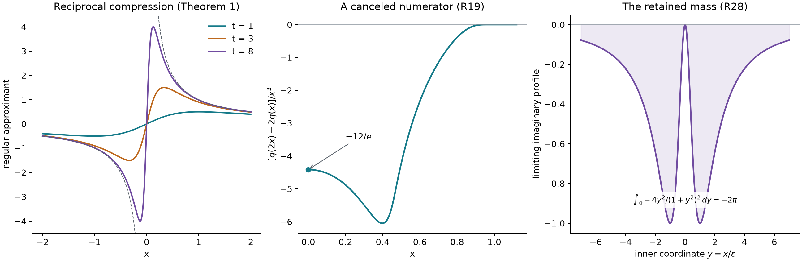

# Reciprocal scaling and cancellation at a pole

*Exposition and figures by GPT-6 Astra (OpenAI), October 2026. Original exposition and exercises: CC0. Supplied programme prerequisites retain their stated licences.*

A reciprocal tail can converge to a principal value when it is compressed toward the origin. An integrable perturbation leaves a point mass instead. We separate these two effects, express every derivative of a principal value by a convergent finite-difference integral, and calculate the point terms that survive cancellation of boundary poles.

All pairings are complex-linear. Write \(D=\partial_x\), \(\delta_0^{(j)}(\phi)=(-1)^j\phi^{(j)}(0)\), and
\[
 P=\operatorname{pv}(1/x),\qquad
 S_m=\frac{(-1)^{m-1}}{(m-1)!}D^{m-1}P,\quad m\ge1.
 \tag{R1}
\]
The definition and complete boundary-limit proofs are [Cauchy kernels and boundary limits](cauchy-kernels-and-boundary-limits.md), Section 4, Theorem 4.1 and Corollary 4.2:
\[
 \begin{split}
 P(\phi)&=\int_0^\infty\frac{\phi(x)-\phi(-x)}x\,dx,\\
 (x+i\sigma0)^{-m}
   &=S_m-\sigma i\pi\frac{(-1)^{m-1}}{(m-1)!}\delta_0^{(m-1)},
       \qquad \sigma\in\{-1,1\}.
 \end{split}
 \tag{R2}
\]
Here the boundary notation means the limit of \(x+i\sigma\varepsilon\) with \(\varepsilon\downarrow0\). The cited proof gives a uniform bound on tests supported in \([-R,R]\):
\[
 \left|\int_{\mathbb R}\frac{\phi(x)}{(x+i\sigma\varepsilon)^m}\,dx\right|
 \le\frac{2R\|\phi^{(m)}\|_\infty+
                  \pi\|\phi^{(m-1)}\|_\infty}{(m-1)!}.
 \tag{R3}
\]
In particular \(P\) has order at most one. Its order is exactly one: its nonzero punctured restriction \(1/x\) is homogeneous of degree \(-1\), and [Euler equations and the order of singularities](euler-equations-and-singularity-order.md), Lemma 4.1, proves by disjoint annular tests that an order \(k\) extension must satisfy \(k-1+1>0\).

The same normalization gives
\[
 D\log|x|=P,\qquad
 D\bigl(\log|x|+\sigma i\pi H(-x)\bigr)=P-\sigma i\pi\delta_0.
 \tag{R4}
\]
The first identity is proved by the endpoint integration in [Finite parts of singular powers](finite-parts-of-singular-powers.md), Proposition 5.1; the full logarithmic traces and their derivatives are [Complex powers at a boundary](complex-powers-at-a-boundary.md), Theorem 4.1. Thus the real logarithm and its two boundary branches have distinct derivatives at the origin.

The test topology is [Order, positivity and distributional limits](order-positivity-and-limits.md), Section 1. The supplied [scalar foundations](../prerequisites/U011-free-foundations/metric-foundation-bridges.md), §§12–13, and [integration foundations](../prerequisites/U011-free-foundations/banach-foundation-bridges.md), §§15–16, prove cutoffs, Taylor estimates, Rolle's theorem, absolute integration, substitution and dominated convergence used below. The supplied [finite algebra](../prerequisites/U011-free-foundations/stable-prerequisite-bridges.md), §§10.3–10.4, proves rank-nullity and elimination, including the kernel and inverse criteria for square matrices.

## A reciprocal tail under compression

For a locally integrable function \(f\) and \(t>0\), let \(T_t(x)=t f(tx)\). The assertion that \(f\) is odd is an almost-everywhere assertion, and changing its null-set values has no effect.

**Theorem 1 (odd reciprocal tails).** Suppose \(f\in L^1_{\mathrm{loc}}(\mathbb R)\) is odd and
\[
                         y f(y)\longrightarrow c\in\mathbb C
                               \quad\text{as }y\to+\infty.
 \tag{R5}
\]
An essential limit is sufficient. Then, as \(t\to+\infty\),
\[
 T_t\longrightarrow cP,\qquad
 D^rT_t=t^{r+1}f^{(r)}(t\,\cdot)\longrightarrow cD^rP
                  \quad(r\ge0)
 \tag{R6}
\]
in distributions. No ordinary differentiability of \(f\) is required. On each fixed compact test support the first convergence is uniform over tests with bounded \(C^1\) norm; the \(r\)-th derivative convergence is uniform over bounded \(C^{r+1}\) norms.

**Proof.** For \(\operatorname{supp}\phi\subset[-R,R]\), set \(q(x)=\phi(x)-\phi(-x)\). Oddness and scalar substitution give
\[
 T_t(\phi)=\int_0^\infty t f(tx)q(x)\,dx,\qquad
 |q(x)|\le2x\|\phi'\|_\infty.
 \tag{R7}
\]
Fix \(\eta>0\), and choose \(M>0\) so that \(|y f(y)-c|\le\eta\) for almost every \(y\ge M\). Split the difference from \(cP(\phi)\) at \(M/t\). On the lower part use \(y=tx\), local integrability and (R7); on the upper part use
\(|t f(tx)-c/x|\le\eta/x\). The result is
\[
 |T_t(\phi)-cP(\phi)|
 \le \frac{2\|\phi'\|_\infty}{t}
       \left(\int_0^M y|f(y)|\,dy+|c|M\right)
       +2R\eta\|\phi'\|_\infty .
 \tag{R8}
\]
The compact integral is finite. First let \(t\to\infty\), then \(\eta\downarrow0\). This proves the asserted uniform convergence.

For a distribution \(u\), define \(u(t\,\cdot)(\phi)=t^{-1}u(\phi(\,\cdot/t))\). The chain rule in this test identity gives \(D^rT_t=t^{r+1}f^{(r)}(t\,\cdot)\), with \(f^{(r)}\) the distributional derivative. Indeed both pairings equal \((-1)^r f(\phi^{(r)}(\,\cdot/t))\). Apply (R8) to \(\phi^{(r)}\) to obtain the rest of (R6) and the stated bounds. \(\square\)

Only a tail limit was used; neither continuity nor an \(O(y^{-2})\) remainder is needed. This differs from the Fourier-transform expansion with an integrable remainder in [Reciprocal tails and zero-frequency jumps](reciprocal-tails-and-zero-frequency-jumps.md), Theorem 2.1.

**Corollary 2 (an integrable perturbation retains its mass).** Under the assumptions of Theorem 1, let \(h\in L^1(\mathbb R)\) and \(b=\int_{\mathbb R}h\). Then
\[
 t(f+h)(t\,\cdot)\longrightarrow cP+b\delta_0,\qquad
 D^r[t(f+h)(t\,\cdot)]\longrightarrow cD^rP+b\delta_0^{(r)} .
 \tag{R9}
\]

**Proof.** Substitution gives
\(\int t h(tx)\phi(x)\,dx=\int h(y)\phi(y/t)\,dy\).
The integrand tends to \(h(y)\phi(0)\), with majorant \(|h(y)|\|\phi\|_\infty\). Dominated convergence proves the first assertion together with Theorem 1; applying it to each fixed derivative of the test proves the second. A uniform version follows by splitting the \(y\)-integral at \(M\), using \(|\phi(y/t)-\phi(0)|\le |y|\|\phi'\|_\infty/t\) on the compact part and \(2\|\phi\|_\infty\) on the tail. \(\square\)

## Convergent integrals from dilated test values

Fix \(n\ge1\), distinct positive numbers \(\lambda_1,\ldots,\lambda_N\), and real coefficients \(a_1,\ldots,a_N\). Define
\[
 \begin{split}
 q_n(y)&=\phi(y)-(-1)^n\phi(-y),\\
 N_\phi(x)&=\sum_{\ell=1}^N a_\ell q_n(\lambda_\ell x),\\
 M_j&=\sum_{\ell=1}^N a_\ell\lambda_\ell^j,\qquad
 J_n=\{j:0\le j<n,\ j\equiv n+1\pmod2\}.
 \end{split}
 \tag{R10}
\]
The letter \(N_\phi\) denotes the numerator, while \(N\) is the number of nodes.

**Theorem 3 (moment cancellation and every principal-value derivative).** The ordinary improper integral
\[
                       I(\phi)=\int_0^\infty
                                    \frac{N_\phi(x)}{x^{n+1}}\,dx
 \tag{R11}
\]
converges for every compact smooth \(\phi\) if and only if
\[
                             M_j=0\qquad(j\in J_n).
 \tag{R12}
\]
Under this condition it is absolutely convergent and
\[
                 I=\frac{(-1)^nM_n}{n!}D^nP.
 \tag{R13}
\]
Consequently \(I=D^nP\) exactly when, in addition,
\[
                              M_n=(-1)^n n!.
 \tag{R14}
\]

**Proof: convergence and necessity.** Taylor expansion at zero shows that only powers of parity \(n+1\) occur in \(q_n\). Its coefficient at degree \(j\) of that parity is \(2\phi^{(j)}(0)/j!\). Conditions (R12) therefore imply
\[
 N_\phi^{(r)}(x)=O(x^{n+1-r}),\qquad 0\le r\le n+1,
                         \quad x\downarrow0.
 \tag{R15}
\]
To see the differentiated bounds, the vanished coefficients say precisely that the derivatives of \(N_\phi\) through degree \(n\) vanish at zero. Taylor's remainder applied to each derivative gives (R15). The numerator is compactly supported on the positive half-line apart from its zero endpoint. Its quotient in (R11) is bounded near zero and vanishes for large \(x\), proving absolute convergence.

Conversely, for each \(j\in J_n\), take \(\phi(y)=y^j\chi(y)\), where \(\chi\) is an even smooth compact cutoff equal to one near zero. Then \(N_\phi(x)=2M_jx^j\) near zero. If \(M_j\ne0\), the integral there is a nonzero constant times \(\int x^{j-n-1}dx\), which has no finite lower-end limit. Thus convergence for every test forces every condition in (R12).

**Proof: identification.** Integrate (R11) by parts \(n\) times, initially on a compact interval \([\varepsilon,A]\) containing the numerator support at its upper end. Each lower-end boundary term is \(O(\varepsilon)\) by (R15); upper-end terms vanish. Hence
\[
 I(\phi)=\frac1{n!}\int_0^\infty\frac{N_\phi^{(n)}(x)}x\,dx.
 \tag{R16}
\]
The chain rule gives
\[
 N_\phi^{(n)}(x)
  =\sum_{\ell=1}^N a_\ell\lambda_\ell^n
       [\phi^{(n)}(\lambda_\ell x)-\phi^{(n)}(-\lambda_\ell x)].
 \tag{R17}
\]
Each individual quotient by \(x\) is integrable, by the first line of (R2). Substitution \(y=\lambda_\ell x\) identifies its integral with \(P(\phi^{(n)})\). This proves (R13), with the sign \((-1)^n\) from the distributional derivative. Finally \(D^nP\) is nonzero: off zero it equals \((-1)^n n!x^{-n-1}\). Therefore its scalar multiple equals itself exactly under (R14). \(\square\)

**Proposition 4 (the number of positive nodes).** Put \(p=|J_n|=\lceil n/2\rceil\). For every choice of \(p+1\) distinct positive nodes, there is a unique real coefficient vector satisfying (R12)–(R14). Fewer than \(p+1\) positive nodes cannot suffice. For nodes \(1,2\), the first two orders are
\[
 \begin{array}{c|c|c}
 n&(a_1,a_2)&q_n(y)\\ \hline
 1&(1,-1)&\phi(y)+\phi(-y)\\
 2&(-2,1)&\phi(y)-\phi(-y).
 \end{array}
 \tag{R18}
\]

**Proof.** We use the following elementary root count. A nonzero real linear combination of \(s\) distinct nonnegative integer powers of \(x\) has at most \(s-1\) distinct positive zeros. For \(s=1\) it has none. For \(s>1\), divide by its smallest power, without changing positive zeros. Differentiating removes the nonzero constant term and leaves a combination of \(s-1\) distinct powers. If the original had \(s\) distinct positive zeros, Rolle's theorem would give at least \(s-1\) distinct positive zeros of that derivative, contradicting induction. The same argument excludes any larger number by selecting \(s\) zeros.

For \(s\) distinct exponents \(e_1,\ldots,e_s\) and \(s\) distinct positive nodes, the matrix \((\lambda_\ell^{e_j})_{j,\ell}\) is invertible. Otherwise a nonzero vector in its left kernel would give a nonzero combination of those powers vanishing at all \(s\) nodes, contrary to the root count. The equivalence between singularity and a nonzero kernel, for a square matrix, follows from finite elimination; the usual elimination also solves the system when no pivot vanishes.

Apply this with the \(p+1\) exponents in \(J_n\cup\{n\}\), and right side zero except for the nonzero value in (R14). This gives existence and uniqueness, over the reals. If there were only \(s\le p\) nodes, choose any \(s\) exponents from \(J_n\). Their invertible matrix and the vanishing moments force all coefficients to be zero, contradicting (R14). For \(n=1\), the two equations are \(a_1+a_2=0\), \(a_1+2a_2=-1\); for \(n=2\) they are \(a_1+2a_2=0\), \(a_1+4a_2=2\). Their solutions are (R18). \(\square\)

In particular, every compact smooth test satisfies the ordinary convergent identity
\[
 D^2P(\phi)=\int_0^\infty
    \frac{\phi(2x)-\phi(-2x)-2\phi(x)+2\phi(-x)}{x^3}\,dx.
 \tag{R19}
\]
The cancellation is inside one numerator. Splitting it into the four divergent integrals would not define the same expression.

## Smooth coefficients and the terms supported at the pole

We first record two identities on tests. The relation \(xP=1\) follows immediately from (R2). The product rule then yields
\[
 xS_m=S_{m-1}\quad(m\ge2),\qquad xS_1=1,\qquad x^mS_m=1.
 \tag{R20}
\]
Indeed \(xD^qP=D^q(xP)-qD^{q-1}P=-qD^{q-1}P\) for \(q\ge1\), which gives the recurrence after inserting the factors in (R1). For a smooth \(d\), Leibniz's formula applied to \((d\phi)^{(q)}(0)\) gives
\[
 d\,\delta_0^{(q)}
   =\sum_{j=0}^q(-1)^j\binom qj d^{(j)}(0)\delta_0^{(q-j)}.
 \tag{R21}
\]
Each sign can be checked by pairing the term on the right with \(\phi\): its total sign is \((-1)^q\), as required.

**Theorem 5 (complete coefficient formula for opposite boundary poles).** Let \(A,B\in C^\infty(\mathbb R)\), \(m\ge1\), and \(\sigma\in\{-1,1\}\). Write
\[
 \begin{gathered}
 h=A+B,\qquad d=A-B,\qquad q=m-1,\\
 h_m(x)=\frac{h(x)-\sum_{j=0}^{m-1}h^{(j)}(0)x^j/j!}{x^m}
                          \quad(x\ne0).
 \end{gathered}
 \tag{R22}
\]
The last function has its smooth extension at zero. Then, as \(\varepsilon\downarrow0\),
\[
 \begin{split}
 \frac{A(x)}{(x+i\sigma\varepsilon)^m}
 +\frac{B(x)}{(x-i\sigma\varepsilon)^m}
 \ \longrightarrow\ L_\sigma
  &=h_m+\sum_{j=0}^{m-1}\frac{h^{(j)}(0)}{j!}S_{m-j}\\
 &\quad-\frac{\sigma i\pi(-1)^q}{q!}
       \sum_{j=0}^q(-1)^j\binom qj d^{(j)}(0)\delta_0^{(q-j)} .
 \end{split}
 \tag{R23}
\]
The two limits \(L_+\) and \(L_-\) agree if and only if \(d^{(j)}(0)=0\) for \(0\le j<m\). Either one is represented by a locally integrable function near zero if and only if both \(A\) and \(B\) vanish to order at least \(m\) at zero.

**Proof: the formula.** Multiplication by a fixed smooth function is continuous on distributions: it is transposed multiplication on tests, with every derivative bounded on a fixed compact support by Leibniz's formula. Apply (R2) separately to \(A\phi\) and \(B\phi\). Their sum is
\[
                   L_\sigma=hS_m-
                      \frac{\sigma i\pi(-1)^q}{q!}d\,\delta_0^{(q)}.
 \tag{R24}
\]
Taylor's integral remainder gives the global smooth extension
\[
 h_m(x)=\frac1{(m-1)!}\int_0^1(1-s)^{m-1}h^{(m)}(sx)\,ds .
 \tag{R25}
\]
Differentiation under this compact integral is justified by uniform bounds on every compact \(x\)-interval. Substitute the Taylor decomposition of \(h\) into \(hS_m\), use (R20), and use (R21) for the point term. This proves (R23). No bound on \(A,B\) at infinity is required, because the tests are compact.

**Proof: equal limits and regularity.** The point jets are linearly independent: a cutoff times \(x^r/r!\), equal to that monomial near zero, tests only the \(r\)-th jet. The difference between the two formulas (R23) is zero exactly when every displayed derivative of \(d\) is zero.

Off the origin \(L_\sigma\) equals \(h(x)/x^m\). If the first nonzero derivative of \(h\) among degrees \(0,\ldots,m-1\) has degree \(j\), Taylor's formula gives \(|h(x)/x^m|\ge c|x|^{j-m}\) on a sufficiently small punctured interval. This is not integrable. A locally integrable representative of \(L_\sigma\) would have to equal this function almost everywhere there, which is impossible. The fact that equal locally integrable distributions have equal functions almost everywhere follows from the supplied local \(L^1\) mollification theorem.

If all those derivatives of \(h\) vanish, the finite-part terms in (R23) disappear and \(h_m=h/x^m\) is smooth. A nonzero finite sum of point jets cannot be a locally integrable distribution. To verify this, let \(r\) be its largest nonzero jet degree and choose a compact \(\eta\) equal to \(x^r/r!\) near zero. Its pairing with \(t^r\eta(x/t)\) has a fixed nonzero value; all lower jet pairings are zero. A locally integrable function paired with these tests tends to zero, since its absolute integral on their shrinking supports tends to zero and \(t^r\|\eta\|_\infty\) is bounded. This is a contradiction.

Thus regularity also requires every derivative of \(d\) through degree \(m-1\) to vanish. Together with the same conditions on \(h=A+B\), these are exactly the stated vanishing conditions on \(A\) and \(B\). Their sufficiency follows from (R23). \(\square\)

**Corollary 6 (a double pole with a surviving mass).** For real \(\varepsilon\ne0\), define
\[
 E_\varepsilon(x)=\frac{e^x}{(x+i\varepsilon)^2}
       +\frac{e^{-x}}{(x-i\varepsilon)^2}
       -\frac{2(x^2-\varepsilon^2)}{(x^2+\varepsilon^2)^2}.
 \tag{R26}
\]
Its two one-sided distributional limits are
\[
 \lim_{\varepsilon\to0,\ \operatorname{sgn}\varepsilon=\sigma}
 E_\varepsilon
       =\frac{2(\cosh x-1)}{x^2}-2\sigma i\pi\delta_0,
                       \qquad \sigma=\pm1.
 \tag{R27}
\]
The quotient extends smoothly with value one at zero. In particular there is no two-sided distributional limit.

**Proof.** The last rational term in (R26) is
\((x+i\varepsilon)^{-2}+(x-i\varepsilon)^{-2}\).
Thus Theorem 5 applies with \(A=e^x-1\), \(B=e^{-x}-1\), \(m=2\). Here \(h=2(\cosh x-1)\), \(h(0)=h'(0)=0\), and \(d(0)=0\), \(d'(0)=2\). Formula (R23) gives (R27), including its sign. Taylor's formula gives \(h(x)/x^2\to h''(0)/2=1\). The difference of the limits is \(-4i\pi\delta_0\ne0\).

The concentrated imaginary part is also visible on its inner scale. For \(\varepsilon>0\),
\[
 \operatorname{Im}E_\varepsilon(x)
    =-\frac{4\varepsilon x\sinh x}{(x^2+\varepsilon^2)^2},\qquad
 \varepsilon\operatorname{Im}E_\varepsilon(\varepsilon y)
    \longrightarrow-\frac{4y^2}{(1+y^2)^2}.
 \tag{R28}
\]
This is pointwise convergence in \(y\), obtained from \(\sinh(\varepsilon y)/\varepsilon\to y\). The integral of the limiting profile is \(-2\pi\): use
\[
 \frac{y^2}{(1+y^2)^2}
    =\frac1{2(1+y^2)}
       -\frac12D_y\left(\frac{y}{1+y^2}\right)
 \tag{R29}
\]
and the arctangent endpoint values. This calculation illustrates the mass in (R27); the distributional limit, including the real part, was proved by (R23). \(\square\)

*Left: the regular functions \(t^2x/(1+t^2x^2)\) in Theorem 1; the dashed reciprocal is shown only away from zero. Middle: the canceled numerator in (R19), divided by \(x^3\), for the compact smooth test \(\phi(x)=x\exp[-1/(1-x^2)]\) on \(|x|<1\), zero otherwise. Its continuous value at zero is \(-12/e\). Right: the exact limiting inner profile in (R28), whose integral is \(-2\pi\). This profile describes the coefficient of a point mass, not an ordinary function representing that mass.*

## Exercises with complete solutions

**Exercise 1 (foundation) — a rational approximation and its derivative.** Find the distributional limits, as \(t\to+\infty\), of
\[
 \frac{t^2x}{1+t^2x^2},\qquad
 \frac{t^2(1-t^2x^2)}{(1+t^2x^2)^2}.
 \tag{R30}
\]

**Solution.** Use \(f(y)=y/(1+y^2)\), which is odd, locally integrable, and has \(y f(y)\to1\). The first limit is \(P\) by Theorem 1. The second function is its ordinary derivative for each fixed \(t\), so the derivative assertion gives \(DP=-S_2\). Pointwise convergence away from zero alone would not identify the complete distribution across zero.

**Exercise 2 (intermediate) — breaking oddness by an integrable term.** For \(\beta\in\mathbb C\), find the compressed limit of \(f_\beta(x)=(x+\beta)/(1+x^2)\), and the limits of all its compressed derivatives.

**Solution.** Split it into the odd function from Exercise 1 and \(h(x)=\beta/(1+x^2)\). The latter is integrable, with integral \(\pi\beta\) by the arctangent primitive. Corollary 2 gives \(P+\pi\beta\delta_0\), and at derivative degree \(r\) it gives \(D^rP+\pi\beta\delta_0^{(r)}\). All these functions have the same leading reciprocal tail, while the integrable term retains its mass.

**Exercise 3 (intermediate) — a quantitative tail estimate.** Under Theorem 1, assume \(|y f(y)-c|\le Cy^{-\alpha}\) for \(y\ge1\), with \(\alpha>0\). Prove a fixed-support estimate of size \(O(t^{-\alpha/(\alpha+1)})\|\phi'\|_\infty\).

**Solution.** The tail assumption bounds \(y|f(y)|\) by \(|c|+C\) for \(y\ge1\). Therefore the compact integral in (R8) is at most \(C_0+(|c|+C)M\) for \(M\ge1\), where \(C_0=\int_0^1y|f(y)|dy\). Use \(\eta=CM^{-\alpha}\) in that same proof and choose \(M=t^{1/(\alpha+1)}\) for \(t\ge1\). Both \(M/t\) and \(M^{-\alpha}\) equal \(t^{-\alpha/(\alpha+1)}\); the \(C_0/t\) term is smaller. This proves the bound with a constant depending on the fixed support and the displayed data. It is a guaranteed estimate, without a claim of optimal rate.

**Exercise 4 (advanced) — three nodes for a third derivative.** Using nodes \(1,2,3\), express \(D^3P\) by an absolutely convergent integral of even test differences.

**Solution.** The constraints are \(M_0=M_2=0\), \(M_3=-6\). Solving them gives
\[
                    (a_1,a_2,a_3)=\frac1{11}(-15,24,-9).
 \tag{R31}
\]
Indeed their sum is zero; their square-weighted sum is \((-15+96-81)/11=0\); their cube-weighted sum is \((-15+192-243)/11=-6\). With \(q_3(y)=\phi(y)+\phi(-y)\), Theorem 3 gives
\(D^3P(\phi)=\int_0^\infty[-15q_3(x)+24q_3(2x)-9q_3(3x)]\,dx/(11x^4)\).
The two canceled moments make the numerator \(O(x^4)\), and Proposition 4 proves that two positive nodes cannot suffice.

**Exercise 5 (intermediate) — arbitrary spacing for the second derivative.** For \(r>1\), find the coefficients using nodes \(1,r\) that represent \(D^2P\).

**Solution.** The equations are \(a_1+ra_2=0\) and \(a_1+r^2a_2=2\). They give
\[
                     a_1=-\frac2{r-1},\qquad
                     a_2=\frac2{r(r-1)} .
 \tag{R32}
\]
Use these coefficients with the odd \(q_2\) and denominator \(x^3\). Taylor cancellation and identification both follow from Theorem 3. At \(r=2\) this is (R19). The coefficients grow as the nodes merge, consistently with loss of invertibility at coincident nodes.

**Exercise 6 (advanced) — the exact order remains visible.** Show that every nonzero representation of \(D^nP\) in Theorem 3 has exact distributional order \(n+1\), despite its absolutely convergent integral formula.

**Solution.** Differentiating the order-one estimate for \(P\) gives an upper bound \(n+1\). Off zero \(D^nP=(-1)^nn!x^{-n-1}\), which is nonzero and homogeneous of degree \(-n-1\). U019, Lemma 4.1, applied in dimension one forces \(k-n-1+1>0\) for any order \(k\), so \(k\ge n+1\). The absolute convergence concerns the canceled numerator of each test; it does not give an estimate using only its undifferentiated supremum norm.

**Exercise 7 (advanced) — a cubic pole with three point terms.** Find both one-sided limits of
\[
             \frac{e^x}{(x+i\varepsilon)^3}
              -\frac{1+x+x^2/2}{(x-i\varepsilon)^3}.
 \tag{R33}
\]

**Solution.** Here \(h=e^x-1-x-x^2/2\) vanishes to order three, and \(d=e^x+1+x+x^2/2\) has \(d(0)=d'(0)=d''(0)=2\). For \(\operatorname{sgn}\varepsilon=\sigma\), Theorem 5 gives
\[
       \frac{e^x-1-x-x^2/2}{x^3}
             -\sigma i\pi(\delta_0''-2\delta_0'+\delta_0).
 \tag{R34}
\]
The smooth quotient has value \(1/6\) at zero. All finite-part terms cancel, but none of the three displayed point coefficients can be discarded.

**Exercise 8 (intermediate) — exact order of the jump.** Determine the limit and its exact order for
\((x+i\varepsilon)^{-m}-(x-i\varepsilon)^{-m}\) as \(\varepsilon\downarrow0\), for every \(m\ge1\).

**Solution.** Set \(A=1\), \(B=-1\). Then \(h=0\), \(d=2\), so
\[
        -\frac{2i\pi(-1)^{m-1}}{(m-1)!}\delta_0^{(m-1)}
 \tag{R35}
\]
is the limit. For \(m=1\) it is a nonzero measure of order zero. For \(q=m-1>0\), the upper order bound is \(q\) by the jet definition. Take a compact smooth \(\eta\) equal to \(x^q/q!\) near zero. The tests \(t^{q-1}\eta(x/t)\) have bounded derivatives through \(q-1\), while their \(q\)-th derivatives at zero equal \(t^{-1}\). The pairing with (R35) is therefore unbounded, proving exact order \(m-1\). The two individual boundary poles have higher order, but their difference retains only the point jet.

## References

- Lars Hörmander, *The Analysis of Linear Partial Differential Operators I: Distribution Theory and Fourier Analysis*, second edition, 2003 reprint, Section 3.1, Exercises 3.1.7–3.1.11, p. 375; answers, p. 398.
- [Cauchy kernels and boundary limits](cauchy-kernels-and-boundary-limits.md), Section 4, Theorem 4.1 and Corollary 4.2: principal values, both boundary signs and finite-test bounds.
- [Finite parts of singular powers](finite-parts-of-singular-powers.md), Proposition 5.1, and [Complex powers at a boundary](complex-powers-at-a-boundary.md), Theorem 4.1: the real logarithm and its two boundary traces.
- [Euler equations and the order of singularities](euler-equations-and-singularity-order.md), Lemma 4.1: strict lower order bounds from disjoint annuli.
- [Order, positivity and distributional limits](order-positivity-and-limits.md), Section 1, and the supplied [scalar](../prerequisites/U011-free-foundations/metric-foundation-bridges.md), §§12–13, and [integration](../prerequisites/U011-free-foundations/banach-foundation-bridges.md), §§15–16, foundations: test estimates, Taylor remainders, Rolle's theorem, substitution, mollification and convergence.
