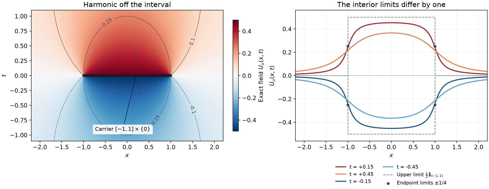

# Recovering analytic data from harmonic fields

*Original exposition and proofs: GPT-6 Astra (OpenAI), October 2026. CC0.*

An analytic functional on a real compact set can be observed from outside that set through a harmonic field in one extra dimension. The field changes sign on reflection across the original space. Its normal jump has the correct normalization for distributions, and a cutoff integral recovers every analytic test pairing. Conversely, every such odd harmonic field determines an analytic functional; the only ambiguity is an everywhere harmonic field. Requiring decay at infinity removes that ambiguity.

We write \(X=(x,t)\in\mathbb R^{n+1}\), \(n\ge1\), and use \(\Delta=\sum\partial_j^2\), bilinear pairings and ordinary derivatives. An analytic functional carried by a real compact \(K\subset\mathbb R^n\) has, for every complex neighborhood \(\Omega\) of \(K\), a bound \(|u(f)|\le C_\Omega\sup_\Omega|f|\). [Analytic tests and real carriers](analytic-tests-and-real-carriers.md), Theorems 1–6, proves polynomial determination, extension to holomorphic germs, parameter differentiation and the faithful inclusion of compact distributions. Those results are used below with their full neighborhood quantifiers.

The normalized Laplace fundamental solution and its first derivatives come from [Point sources and complex Gaussian kernels](point-sources-and-complex-gaussian-kernels.md), Theorem 1.1. [Tensor products and parameter-dependent distributions](tensor-products-and-parameters.md) and [Convolution as addition of supports](convolution-as-addition-of-supports.md) supply differentiation of compact pairings and convolution with one compact smooth factor. The [angular reading](../prerequisites/U011-free-foundations/angular-foundations-U018.md), A4–A5, proves polar integration and sphere area; the [Fourier reading](../prerequisites/U011-free-foundations/schwartz-fourier-foundations-U017.md), F3, proves the Gaussian integral. Gamma integrals and recurrence are in the [gamma reading](../prerequisites/U011-free-foundations/gamma-foundations-U016.md), G0–G2. The [Cauchy reading](../prerequisites/U011-free-foundations/complex-contours-U070.md), CMI6–CMI8, supplies the complex estimates and series used here. Cutoffs, calculus, dominated integration and Fubini are supplied by the [metric](../prerequisites/U011-free-foundations/metric-foundation-bridges.md) and [integration](../prerequisites/U011-free-foundations/banach-foundation-bridges.md) readings.

We also use an already proved regularity consequence. A harmonic distribution is real analytic: apply [analytic differential regularity](analytic-equations-and-characteristic-directions.md), Theorem 3, to the elliptic operator \(\Delta\), then [wavefront projection](cones-and-derivative-growth-wavefronts.md), Theorem 5, and [the analytic derivative criterion](derivative-growth-and-finite-order-localization.md), Proposition 3. Its convergent real Taylor series gives a local holomorphic extension satisfying the same equation. A harmonic function that is zero on an open part of a connected domain is therefore zero throughout: the set of points where all derivatives vanish is closed, is open by its Taylor series, and contains the initial open set. This argument applies to complex-valued functions as well.

## Normal data have an entire harmonic lift

For a positive number \(a\), put \((a)_0=1\) and \((a)_k=a(a+1)\cdots(a+k-1)\). Let \(d\mu\) be normalized Euclidean sphere measure on \(S^{n-1}\); in dimension one it gives mass \(1/2\) to each of \(-1,1\).

**Lemma 1 (directional derivatives recover Laplacian powers).** For every \(k\ge0\),
\[
 \int_{S^{n-1}}(\omega\cdot\partial)^{2k}f\,d\mu(\omega)
 =\frac{(2k)!}{4^k k!(n/2)_k}\,\Delta^k f .
 \tag{H1}
\]
This is an identity of differential operators, valid for every sufficiently differentiable \(f\).

**Proof.** For a real vector \(a\), rotation invariance gives
\(\int(a\cdot\omega)^{2k}d\mu=c_k|a|^{2k}\).
The invariance follows directly from the polar formula and orthogonal substitution in the Gaussian-weighted Euclidean integral. To find \(c_k\), integrate \(x_1^{2k}e^{-|x|^2}\) in two ways. One-variable integration by parts gives
\[
 \int_{\mathbb R}x^{2k}e^{-x^2}\,dx
 =\sqrt\pi\,\frac{(2k)!}{4^k k!}.
 \tag{H2}
\]
The boundary term vanishes because a polynomial times this Gaussian tends to zero; induction starts with the Gaussian mass. Product integration gives the corresponding \(n\)-dimensional value. Polar integration gives instead the sphere moment times \(\Gamma(k+n/2)/2\). Dividing by the sphere area \(2\pi^{n/2}/\Gamma(n/2)\) yields the coefficient in (H1). For \(n=1\) this agrees with the two-point average.

Both sides of the resulting identity in \(a\) are polynomials. Equality on all real tuples means equality of their coefficients, by induction using the one-variable fact that a nonzero polynomial has finitely many roots. Substitute the commuting operators \(\partial_1,\ldots,\partial_n\) for the variables. The finite multinomial formula proves (H1). \(\square\)

**Theorem 2 (entire odd harmonic extension).** For every entire \(f\) on \(\mathbb C^n\), there is a unique entire \(\Phi_f\) on \(\mathbb C^{n+1}\) satisfying
\[
 (\Delta_z+\partial_s^2)\Phi_f=0,\qquad
 \Phi_f(z,0)=0,\qquad \partial_s\Phi_f(z,0)=f(z).
 \tag{H3}
\]
It is odd in \(s\) and is given by
\[
 \Phi_f(z,s)=\sum_{k=0}^\infty
       \frac{s^{2k+1}(-\Delta_z)^k f(z)}{(2k+1)!}.
 \tag{H4}
\]
For every \(R>1\) there is a constant \(C_{n,R}\) such that, for \(s\ne0\),
\[
 |\Phi_f(z,s)|
 \le C_{n,R}|s|\sup_{|w-z|<R|s|}|f(w)|.
 \tag{H5}
\]
At \(s=0\) its value is zero.

**Proof.** Apply the one-variable Cauchy estimate to \(\lambda\mapsto f(z+\lambda\omega)\) and then (H1). For every radius \(\rho>0\),
\[
 |\Delta^k f(z)|\le
 4^k k!(n/2)_k\,\rho^{-2k}
                \sup_{|w-z|<\rho}|f(w)|.
 \tag{H6}
\]
One may first use circles of radius less than \(\rho\), and then let their radii increase to \(\rho\).

Set \(b_k=4^k k!(n/2)_k/(2k+1)!\). Then \(b_0=1\) and
\[
 \frac{b_{k+1}}{b_k}=\frac{k+n/2}{k+3/2}.
 \tag{H7}
\]
Choose an integer \(M\ge\max(0,(n-3)/2)\). The ratio is at most
\(1+M/(k+1)\le((k+2)/(k+1))^M\), using the binomial formula. Hence \(b_k\le(k+1)^M\). In particular
\[
 C_{n,R}=\sum_{k\ge0}b_k R^{-2k}<\infty
 \quad(R>1).
 \tag{H8}
\]
Take \(\rho=R|s|\) in (H6) to prove (H5).

To verify entire convergence, fix a compact set of \((z,s)\) and choose a fixed \(\rho\) larger than the maximum of \(|s|\). The right side of (H6) uses \(f\) on one fixed compact neighborhood of the \(z\)-projection. The polynomial bound for \(b_k\) gives locally uniform convergence in (H4). The Cauchy estimates on slightly larger polydisks give locally uniform convergence of every derivative series. The two differentiated series in (H3) cancel term by term, and the initial data and oddness follow directly.

For uniqueness, expand an entire solution in powers of \(s\). Its coefficients \(a_j(z)\) obey
\((j+2)(j+1)a_{j+2}=-\Delta_z a_j\).
The initial values \(a_0=0,a_1=f\) force exactly (H4). Equality near \(s=0\), followed by the one-variable identity theorem for each fixed \(z\), gives equality everywhere. \(\square\)

The radius factor in (H5) is independent of dimension. Bounding each coordinate derivative separately without retaining the spherical average would lose this feature.

## The half-jump normalization

Put \(d=n+1\), and write \(\sigma_n=|S^n|=2\pi^{(n+1)/2}/\Gamma((n+1)/2)\). The earlier point-source theorem gives the locally integrable fundamental solution
\[
 E(X)=
 \begin{cases}
 -|X|^{2-d}/((d-2)\sigma_{d-1}),&d\ge3,\\
 (2\pi)^{-1}\log|X|,&d=2,
 \end{cases}
 \qquad \Delta E=\delta_0 .
 \tag{P1}
\]
Its normal derivative is the locally integrable function
\[
 P(x,t)=\partial_tE(x,t)
       =\frac{t}{\sigma_n(|x|^2+t^2)^{(n+1)/2}},
 \qquad \Delta P=\partial_t\delta_0 .
 \tag{P2}
\]
It is harmonic away from zero and odd in \(t\).

**Proposition 3 (mass and distributional jump).** For \(t\ne0\), \(P_t(x)=P(x,t)\) is integrable and
\[
 \int_{\mathbb R^n}P_t(x)\,dx=\tfrac12\operatorname{sgn}t.
 \tag{P3}
\]
For every compact distribution \(T\) on \(\mathbb R^n\),
\[
 P_t*T\longrightarrow \tfrac12T\quad(t\downarrow0),
 \qquad
 P_t*T\longrightarrow-\tfrac12T\quad(t\uparrow0)
 \tag{P4}
\]
in distributions.

**Proof.** With \(\beta=(n+1)/2\), the gamma integral and positive Fubini give
\[
 \begin{split}
 \int_{\mathbb R^n}(|x|^2+t^2)^{-\beta}\,dx
 &=\frac{\pi^{n/2}}{\Gamma(\beta)}
        \int_0^\infty r^{-1/2}e^{-rt^2}\,dr\\
 &=\frac{\pi^{(n+1)/2}}{\Gamma(\beta)|t|}.
 \end{split}
 \tag{P5}
\]
Indeed \(q^{-\beta}=\Gamma(\beta)^{-1}\int_0^\infty r^{\beta-1}e^{-rq}dr\), by positive substitution, and the spatial Gaussian integral is \((\pi/r)^{n/2}\). This proves integrability and (P3).

For \(t>0\), \(P_t(x)=t^{-n}P_1(x/t)\), with a nonnegative integrable kernel of mass \(1/2\). For every compact smooth test \(\phi\), split the convolution integral into a small displacement and its complement. Uniform continuity of each derivative of \(\phi\) controls the first part; the rescaled tail of \(P_1\) tends to zero in the second. Thus \(P_t*\phi\to\phi/2\), with all derivatives uniformly on the real domain. Pairing with the finite-order compact distribution \(T\) proves (P4), since \(P_t\) is even in \(x\). Oddness in \(t\) supplies the negative limit. \(\square\)

## Recovering every analytic test

For \(u\in A'(K)\), \(K\subset\mathbb R^n\) compact, define
\[
 U_u(X)=u_y\big(P(X-(y,0))\big),
 \qquad X\notin K\times\{0\}.
 \tag{R1}
\]
This uses the local holomorphic test extension, not an entire-test assumption on the kernel.

**Theorem 4 (canonical harmonic field and recovery).** The function \(U_u\) is harmonic on \(\mathbb R^{n+1}\setminus(K\times\{0\})\), is odd in \(t\), and tends to zero at infinity. In fact it is \(O(|X|^{-n})\). For every globally harmonic function \(\Phi\) on \(\mathbb R^{n+1}\) and every \(\chi\in C_c^\infty(\mathbb R^{n+1})\) equal to one near \(K\times\{0\}\),
\[
 u\big(\partial_t\Phi(\,\cdot\,,0)\big)
 =-\int_{\mathbb R^{n+1}}U_u(X)\Delta(\chi\Phi)(X)\,dX.
 \tag{R2}
\]
The integrand is supported away from \(K\times\{0\}\). In particular, \(u\mapsto U_u\) is injective.

**Proof.** For fixed \(X\) outside \(K\times\{0\}\), the squared denominator in (P2) is positive for real \(y\in K\). On a sufficiently small complex neighborhood of this compact set it stays close to these positive values. The binomial power series therefore defines a holomorphic branch agreeing with the real kernel. This remains true uniformly for \(X\) in a small neighborhood of any fixed allowed point. The holomorphic parameter theorem from the preceding lesson permits differentiation through \(u\). Harmonicity and oddness follow from the corresponding identities for \(P\).

Choose one fixed bounded complex neighborhood of \(K\). For \(y\) in that neighborhood and \(|X|\) large,
\[
 (x-y)\cdot(x-y)+t^2=|X|^2+O(|X|),
 \tag{R3}
\]
uniformly in \(y\). The branch just specified then bounds the kernel by \(C|X|^{-n}\). The functional bound on that fixed neighborhood proves the decay assertion.

Since \(\Phi\) is harmonic, \(\Delta(\chi\Phi)\) vanishes where \(\chi\) is constant. For real \(Y\) in a neighborhood on which \(\chi=1\), the whole distributional identity (P2) gives
\[
 \begin{split}
 \int P(X-Y)\Delta(\chi\Phi)(X)\,dX
 &=\langle\partial_t\delta_Y,\chi\Phi\rangle\\
 &=-\partial_t\Phi(Y).
 \end{split}
 \tag{R4}
\]
The integral is an ordinary compact integral avoiding the singular point. Its kernel is holomorphic in \(Y\) on a complex neighborhood of \(K\times\{0\}\), uniformly over the integration support. The function \(\Phi\) is real analytic by the earlier elliptic regularity proof. Thus (R4) is also an equality of holomorphic germs, by their Taylor coefficients on the real set.

Set \(Y=(y,0)\) and apply \(u\). The exchange with the integral is justified by uniform Riemann sums on a fixed compact integration box and a fixed smaller complex neighborhood of \(K\): the integrands and their parameter dependence are continuous there, and the functional has one supremum bound on that neighborhood. This proves (R2). Choosing \(\Phi=\Phi_f\) from Theorem 2 recovers \(u(f)\) for every entire \(f\), proving injectivity. \(\square\)

For a compact distribution \(T\), (R1) is \(P_t*T\) off the original space, and Proposition 3 gives its jump \(T\). Formula (R2) remains meaningful for analytic functionals that are not distributions.

## Every odd harmonic field has such a source

**Theorem 5 (converse and normalization at infinity).** Let \(U\) be harmonic on \(\mathbb R^{n+1}\setminus(K\times\{0\})\), with \(K\subset\mathbb R^n\) compact, and suppose \(U(x,-t)=-U(x,t)\). There are unique \(u\in A'(K)\) and a globally harmonic odd function \(H\) such that
\[
 U=U_u+H
 \quad\text{outside }K\times\{0\}.
 \tag{C1}
\]
They satisfy the recovery identity (R2) with \(U\) in place of \(U_u\). Moreover \(H=0\) if and only if \(U\to0\) at infinity.

**Proof: constructing the functional.** Choose an even compact cutoff \(\chi(x,t)=\chi(x,-t)\), equal to one near \(K\times\{0\}\). Symmetrizing an ordinary cutoff supplies one. For entire \(f\), define
\[
 u(f)=-\int U(X)\Delta(\chi\Phi_f)(X)\,dX .
 \tag{C2}
\]
The derivatives of \(\chi\) have compact support disjoint from \(K\times\{0\}\), so this integral exists. It is independent of the cutoff: the difference \((\chi_1-\chi_2)\Phi_f\) has compact support away from \(K\times\{0\}\), and integration by parts against the harmonic \(U\) gives zero.

We prove the bound for every complex neighborhood \(\Omega\) of \(K\). Choose \(\rho>0\) so that \(\{z:\operatorname{dist}(z,K)<\rho\}\subset\Omega\), and take \(0<\delta<\rho/7\). Choose \(\chi\) supported where the real distance from \(X\) to \(K\times\{0\}\) is less than \(\delta\). For such a real \(X=(x,t)\) and complex \((z,s)\) at distance less than \(\delta\) from it, some \(y\in K\) satisfies
\[
 |z-y|<2\delta,\qquad |s|<2\delta .
 \tag{C3}
\]
Consequently the ball \(|w-z|<2|s|\) lies in \(\Omega\). Theorem 2 with \(R=2\) bounds \(|\Phi_f(z,s)|\) by \(2C_{n,2}\delta\sup_\Omega|f|\). Cauchy estimates on coordinate circles of radius \(\delta/(2\sqrt{n+1})\) bound all first derivatives on the real support of \(\chi\) by a constant times \(\sup_\Omega|f|\). Since
\[
 \Delta(\chi\Phi_f)=\Phi_f\Delta\chi+
                      2\nabla\chi\cdot\nabla\Phi_f,
 \tag{C4}
\]
and \(U\) is bounded on the compact support of these cutoff derivatives, (C2) gives \(|u(f)|\le C_\Omega\sup_\Omega|f|\). Thus \(u\in A'(K)\).

**Proof: removing the apparent singularity in the difference.** Extend
\[
 W=(1-\chi)U
 \tag{C5}
\]
by zero near \(K\times\{0\}\). It is a globally smooth odd function. Its Laplacian
\[
 q=\Delta W=-2\nabla\chi\cdot\nabla U-U\Delta\chi
 \tag{C6}
\]
is smooth, compactly supported and odd. Let
\[
 V=E*q,\qquad H=W-V.
 \tag{C7}
\]
Convolution with the compact smooth \(q\) is globally smooth: move output derivatives onto \(q\) under the locally integrable fundamental-solution pairing, on the fixed compact difference sets for bounded output sets. The earlier convolution theorem and (P1) give \(\Delta V=q\), so \(H\) is globally harmonic. Since \(E\) is even under reflection in \(t\), \(V\) and \(H\) are odd.

We next identify \(V(X)=U_u(X)\) for all sufficiently large real \(X\). Fix such an \(X\) and write \(E_X(Y)=E(X-Y)\). For \(X\) sufficiently far from the origin, \(E_X\) has a holomorphic extension to a complex polydisk containing the support of \(\chi\) and a neighborhood of \(K\times\{0\}\). This follows from the power or logarithmic series in (P1): the bilinear squared distance differs from the positive number \(|X|^2\) by less than half that number on any fixed polydisk once \(|X|\) is large.

Let \(Q_N(Y)\) be its Taylor polynomial through total degree \(N\). These polynomials and all fixed derivatives converge uniformly on a smaller polydisk containing the required compact sets, by the Cauchy estimates. Each \(Q_N\) is harmonic: in the series for \(\Delta E_X=0\), each homogeneous degree comes from the Laplacian of exactly one homogeneous Taylor term. Put
\[
 Q_N^o(y,s)=\tfrac12\big(Q_N(y,s)-Q_N(y,-s)\big),
 \qquad f_N(y)=-\partial_sQ_N^o(y,0).
 \tag{C8}
\]
The polynomial \(-Q_N^o\) is the unique lift of \(f_N\), by Theorem 2. Also \(f_N\to P(X-(y,0))\) uniformly on a complex neighborhood of \(K\), because \(\partial_sE(X-(y,s))=-P(X-(y,s))\). The germ bound for \(u\) therefore gives
\[
 \begin{split}
 U_u(X)
 &=\lim_N u(f_N)\\
 &=\lim_N\int U\,\Delta(\chi Q_N^o)\,dY
 =\int U\,\Delta(\chi E_X)\,dY .
 \end{split}
 \tag{C9}
\]
The last equality uses uniform convergence of derivatives on the cutoff-transition support. The even part of \(E_X\) contributes zero there, since \(U\) is odd and \(\chi\) is even.

On the other hand, (C6) and integration by parts on the support of \(\nabla\chi\) give
\[
 \begin{split}
 V(X)
 &=\int E_X(-2\nabla\chi\cdot\nabla U-U\Delta\chi)\,dY\\
 &=\int U(2\nabla E_X\cdot\nabla\chi+E_X\Delta\chi)\,dY\\
 &=\int U\,\Delta(\chi E_X)\,dY.
 \end{split}
 \tag{C10}
\]
There is no singular integration here: \(X\) is outside the fixed compact support, and every cutoff derivative avoids \(K\times\{0\}\). Equations (C9)–(C10) identify \(V=U_u\) outside a sufficiently large ball. There \(\chi=0\), so \(U-H=V=U_u\).

The domain \(\mathbb R^{n+1}\setminus(K\times\{0\})\) is connected. Each of its upper and lower half-spaces is path connected; they can be joined by a vertical segment over a point outside the compact \(K\). A point on the remaining part of the plane can first move a short distance vertically. Therefore unique continuation for harmonic functions extends \(U-H=U_u\) from the exterior of the ball to the whole domain. This proves (C1).

**Proof: recovery, uniqueness and decay.** If \(\Phi\) is any globally harmonic function, then \(\int H\Delta(\chi\Phi)=0\), since \(H\) is globally harmonic and \(\chi\Phi\) is compact smooth. Theorem 4 and (C1) give (R2) for \(U\). In particular \(\Phi=\Phi_f\) determines \(u(f)\) uniquely for every entire \(f\); then (C1) determines \(H\).

The canonical field \(U_u\) tends to zero. Thus \(H=0\) implies \(U\to0\). Conversely, if \(U\to0\), then \(H\to0\). A globally harmonic complex function tending to zero is zero. To check this directly, on a ball add \(\eta|X|^2\), \(\eta>0\), to the real part of a constant complex multiple of \(H\). Its strictly positive Laplacian prevents an interior maximum, since the Hessian at a local maximum is negative semidefinite. Let \(\eta\downarrow0\). Choose the multiplier so that its real part at a fixed point equals \(|H|\) there. This bounds that value by the maximum of \(|H|\) on the sphere. Letting the sphere radius tend to infinity proves the assertion. \(\square\)

For \(K=\varnothing\), the field is already globally harmonic and the conclusion is \(u=0,H=U\). The compact cutoff in the proof can then be zero.

## The smallest real carrier

**Theorem 6 (support detected by harmonic continuation).** Every analytic functional with some real compact carrier has a unique smallest real compact carrier, denoted \(\operatorname{supp}_A u\). A real compact set \(L\) is a carrier exactly when the canonical field extends to a harmonic function on
\(\mathbb R^{n+1}\setminus(L\times\{0\})\).

**Proof.** If \(L\) is a carrier, Theorem 4 constructs the extension. Canonical fields computed from two carriers agree off the plane. To justify this without assuming uniqueness of a germ extension on unrelated sets, use their compact union: the kernel at \(t\ne0\) is holomorphic near that union, and entire approximation there makes its pairing through either carrier the same limit. Unique continuation gives agreement wherever both fields are defined.

Conversely, suppose the canonical field extends across all points outside \(L\times\{0\}\). The extension remains odd, since its reflection agrees off the plane. It tends to zero at infinity. Theorem 5 gives \(v\in A'(L)\) whose canonical field is exactly this extension, with no entire harmonic term. Regard \(u-v\) as carried by the union of an original carrier and \(L\). Its canonical field is zero outside that union, so injectivity in Theorem 4 gives \(u=v\). Thus \(L\) is a carrier.

Now let \(K_*\) be the intersection of all real compact carriers of \(u\). It is a compact subset of any one of them. The compatible fields for these carriers glue on the union of their domains, which is exactly the complement of \(K_*\times\{0\}\). Harmonicity is local, so the glued field is harmonic there and still tends to zero at infinity. The criterion just proved gives \(u\in A'(K_*)\). This also covers the empty intersection: the glued field is globally harmonic and tends to zero, hence is zero, and injectivity gives \(u=0\). Minimality and uniqueness follow from the definition of the intersection. \(\square\)

This is a statement about real carriers. The disjoint complex-carrier example in the preceding lesson remains valid.

*In one base dimension, the analytic functional \(u(f)=\int_{-1}^1f(y)\,dy\) has the canonical field in Exercise 4. The left panel shows that exact field away from its carrier \([-1,1]\times\{0\}\). The right panel gives exact horizontal slices at \(t=\pm0.15,\pm0.45\). At every interior point of the interval the limits are \(+1/2\) and \(-1/2\); at its endpoints they are \(+1/4\) and \(-1/4\). The difference of the two distributional limits is the interval density.*

## Exercises with full solutions

**Exercise 1 — quadratic normal data.** For \(f(z)=z_1^2\), find its lift and check all initial conditions.

**Solution.** Since \(\Delta f=2\) and \(\Delta^2 f=0\), (H4) gives \(\Phi_f(z,s)=s z_1^2-s^3/3\). The \(z\)-Laplacian is \(2s\), and the \(s\)-second derivative is \(-2s\). Its value at \(s=0\) is zero, and its first normal derivative there is \(z_1^2\).

**Exercise 2 — the radius cannot be smaller than one.** For \(\xi\in\mathbb R^n\setminus\{0\}\), compute the lift of \(e^{i\xi\cdot z}\). Show that a bound of the form (H5) with a fixed \(0<R<1\) cannot hold for all entire data.

**Solution.** Since \(-\Delta f=|\xi|^2f\), the series gives
\[
 \Phi_f(z,s)=e^{i\xi\cdot z}\frac{\sinh(s|\xi|)}{|\xi|}.
 \tag{E1}
\]
At \(z=0,s=1\), the supremum of \(|f|\) on \(|w|<R\) is \(e^{R|\xi|}\). But \(\sinh(|\xi|)/|\xi|\) divided by \(e^{R|\xi|}\) tends to infinity as \(|\xi|\to\infty\). Thus no fixed constant can give that smaller-radius estimate. This does not decide the endpoint \(R=1\).

**Exercise 3 — two Cauchy poles give the normalization.** In one base dimension express \(P(x,t)\) using the two linear factors \(x-it,x+it\).

**Solution.** Direct subtraction gives
\[
 P(x,t)=\frac1{4\pi i}
       \left(\frac1{x-it}-\frac1{x+it}\right)
       =\frac{t}{2\pi(x^2+t^2)}.
 \tag{E2}
\]
The elementary antiderivative \( (2\pi)^{-1}\arctan(x/t)\), with its limits for either sign of \(t\), gives total mass \(\operatorname{sgn}(t)/2\). The two signs in (E2) are therefore fixed by the positive Laplacian convention.

**Exercise 4 — an interval as its own smallest carrier.** Let \(u(f)=\int_{-1}^1f(y)\,dy\). Find \(U_u\), its pointwise limits from both sides of the plane, and its smallest real carrier.

**Solution.** For \(t\ne0\), direct integration gives
\[
 U_u(x,t)=\frac1{2\pi}
 \left(\arctan\frac{1-x}{t}+\arctan\frac{1+x}{t}\right).
 \tag{E3}
\]
For \(t\downarrow0\), the limit is \(1/2\) when \(|x|<1\), \(1/4\) when \(x=\pm1\), and zero when \(|x|>1\). Oddness gives the negative limits below. The density distribution has support exactly \([-1,1]\): every neighborhood of an interior point contains a nonnegative nonzero test of positive integral, and the endpoints belong to the closure of these support points. The exact real-carrier statement for distributions in the preceding lesson gives \(\operatorname{supp}_A u=[-1,1]\), in agreement with Theorem 6.

**Exercise 5 — the entire harmonic ambiguity.** Replace an odd harmonic field \(U\) by \(U+t\). What changes in its recovered analytic functional and in its decay?

**Solution.** The added function \(t\) is globally harmonic and odd. For every compact \(\chi\Phi\), integration by parts gives \(\int t\Delta(\chi\Phi)=\int(\Delta t)\chi\Phi=0\). Thus the recovered functional is unchanged. The entire harmonic term increases by \(t\), and a decaying canonical field plus \(t\) does not decay along the vertical axis. The normalization at infinity distinguishes these representatives.

**Exercise 6 — a point dipole.** For \(u=\partial_{x_j}\delta_0\), compute \(U_u\). In one base dimension give its explicit formula.

**Solution.** The functional derivative introduces a minus sign, while differentiating \(P(X-(y,0))\) in \(y_j\) introduces another. Hence \(U_u=\partial_{x_j}P\). At \(n=1\),
\[
 U_u(x,t)=-\frac{xt}{\pi(x^2+t^2)^2}.
 \tag{E4}
\]
It is odd in \(t\), homogeneous of degree \(-2\), harmonic off zero, and has distributional limits \(\pm\delta_0'/2\) by Proposition 3. Its smallest real carrier is the origin by the distribution inclusion theorem.

**Exercise 7 — an infinite point source without finite distributional order.** For \(u(f)=\sum_{k\ge0}f^{(k)}(0)/(k!)^2\) in one variable, express its harmonic field as a locally convergent series and determine its smallest real carrier.

**Solution.** The preceding lesson proves \(u\in A'(\{0\})\) and that \(u\) is not a distribution. Its field is
\[
 U_u(x,t)=\sum_{k\ge0}
       \frac{(-1)^k}{(k!)^2}\partial_x^kP(x,t).
 \tag{E5}
\]
On every compact subset of the punctured plane, the kernel as a function of \(y\) is holomorphic on a uniform disk \(|y|<\rho\) and uniformly bounded there. Cauchy estimates give a summable bound \(C\rho^{-k}/k!\). The same argument on a slightly larger compact neighborhood permits all fixed \(X\)-derivatives term by term. Thus the series defines the harmonic field locally uniformly with every derivative. Its smallest carrier is a subset of \(\{0\}\). It cannot be empty, since \(u(1)=1\) and Theorem 4 is injective. Therefore it is exactly \(\{0\}\).

**Exercise 8 — why the oddness assumption matters.** Take the even field \(E\) in (P1), harmonic off the origin. Show that the recovery expression using odd lifts and an even cutoff gives zero, although \(E\) cannot extend harmonically through the origin.

**Solution.** The lift \(\Phi_f\) is odd, so \(\Delta(\chi\Phi_f)\) is odd when \(\chi\) is even. Multiplication by the even \(E\) gives an odd compact integrand supported away from zero, whose integral is zero. Thus these normal-data tests detect nothing. Nevertheless the locally integrable \(E\) satisfies \(\Delta E=\delta_0\). If it agreed off zero with a smooth harmonic extension, the two locally integrable functions would agree almost everywhere, hence define the same distribution, contradicting this point source. Even singular fields therefore cannot be included in Theorem 5 with the same normal-data construction.

## Mathematical source

Lars Hörmander, *The Analysis of Linear Partial Differential Operators I*, second edition, 2003 reprint, Section 9.1, Propositions 9.1.3 and 9.1.5, Lemma 9.1.4 and Theorem 9.1.6. The harmonic lift uses spherical directional estimates; its converse uses a compact smooth source and harmonic Taylor polynomials.
