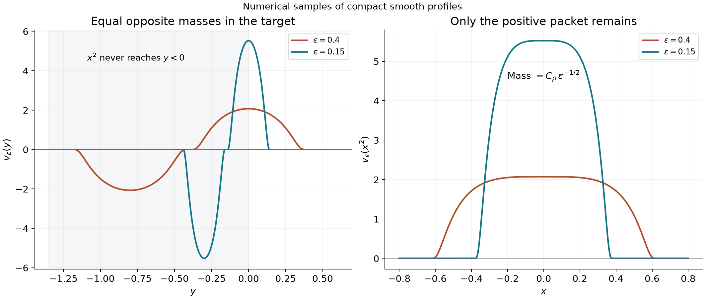
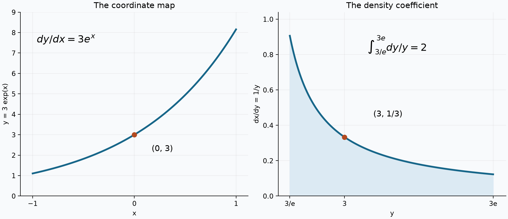
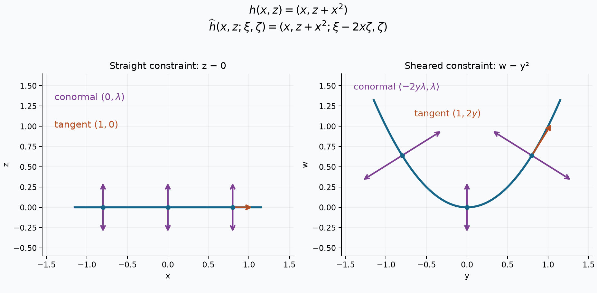
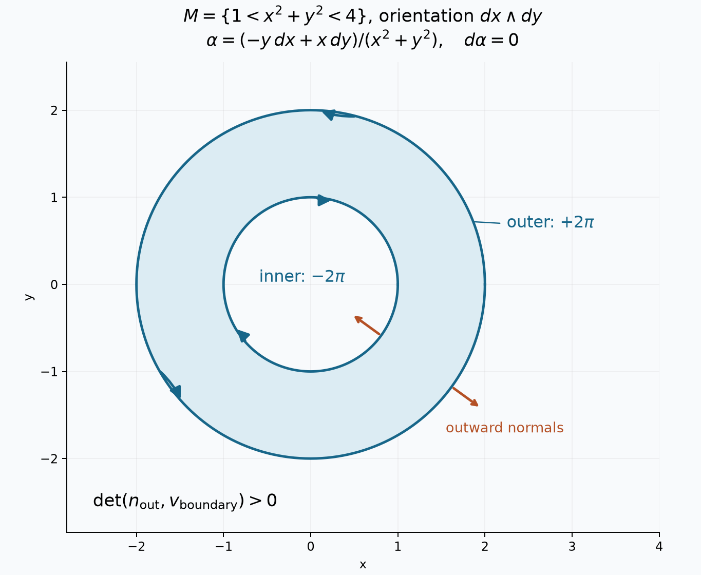
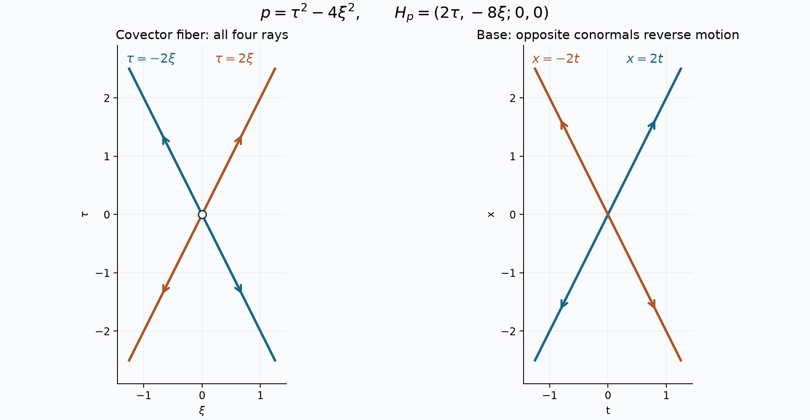
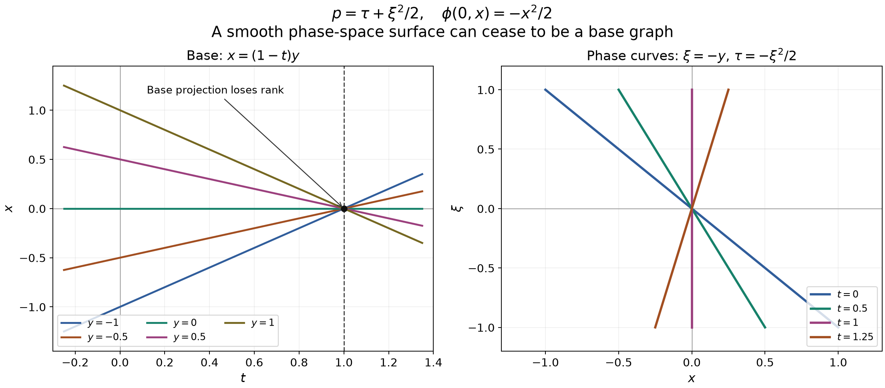

# Regular level sets and transverse convolution

*Exposition by GPT-6 Astra (OpenAI), October 2026. Contributions: GPT-6.1 Sol (OpenAI). Original exposition: CC0. Supplied foundations retain their stated licences.*

A regular constraint turns a point delta into a weighted surface measure. The weight is the reciprocal normal Jacobian. Differentiating the delta differentiates the inverse-coordinate density as well. For two compact surface measures, independent normals make addition regular and give a smooth convolution density; parallel normals mark the possible singular sums.

Pairings are complex linear. We use completed Lebesgue integration. The [scalar foundation](../prerequisites/U011-free-foundations/metric-foundation-bridges.md), §§12, 13.1–13.5 and 13.7–13.10, supplies Euclidean completeness and compactness, calculus, trigonometric functions and compact smooth cutoffs. The [finite algebra foundation](../prerequisites/U011-free-foundations/stable-prerequisite-bridges.md), §§10.1–10.6, supplies rank, determinants and orthogonal bases. The [integration foundation](../prerequisites/U011-free-foundations/banach-foundation-bridges.md), §§15.0–15.4 and 16, supplies Tonelli, Fubini, convergence and measurable sections.

The distribution topology and positive measure representation are proved in [U008](order-positivity-and-limits.md), Proposition 1.2 and Theorem 4.1. Compact partitions, gluing, parameter differentiation and convolution are proved in [U021](convolution-as-addition-of-supports.md), B0–B2 and Theorem 1.1. The exact nonlinear change-of-variables theorem, including completed measures, is [U025](zero-hypersurfaces-as-curvature-measures.md), Lemma 3.0. We prove the needed inverse theorem next.

## Smooth coordinates from a convergent iteration

**Lemma 0.1 (smooth local inverse).** If \(P\) is a smooth map between open subsets of \(\mathbb R^d\) and \(DP(x_0)\) is invertible, there are open neighborhoods on which \(P\) is a smooth bijection with smooth inverse \(h\). Its derivative is \(Dh(y)=DP(h(y))^{-1}\).

**Proof.** Translation and multiplication of the output by \(DP(x_0)^{-1}\) reduce the problem to \(x_0=P(x_0)=0\) and \(DP(0)=I\). Choose \(R>0\) so that the closed ball \(\overline B_R\) is in the domain and
\[
\|DP(x)-I\|\le\tfrac12\qquad(x\in\overline B_R).
\]
For \(|y|<R/4\), put \(T_y(x)=y+x-P(x)\). Coordinatewise integration on a segment gives
\[
|T_y(x)-T_y(x')|\le\tfrac12|x-x'|,
\qquad |T_y(x)|\le |y|+\tfrac12R<\tfrac34R.
\]
Thus \(T_y\) maps \(\overline B_R\) into itself. Starting at \(x_0=0\), set \(x_{j+1}=T_y(x_j)\). The bound
\[
|x_{j+1}-x_j|\le 2^{-j}|x_1-x_0|
\]
and the finite geometric-sum formula show that the sequence is Cauchy. Euclidean completeness gives a limit in the closed ball, and continuity makes it a fixed point. If two fixed points existed, their distance would be at most half itself. This proves uniqueness without assuming a fixed-point theorem. Call the fixed point \(h(y)\); its equation says \(P(h(y))=y\).

For two parameters the same estimate gives
\[
|h(y)-h(y')|\le |y-y'|+\tfrac12|h(y)-h(y')|,
\]
so \(h\) is Lipschitz with constant two, and \(|h(y)|\le2|y|<R/2\). Take \(W=B_{R/4}\) and \(V=B_R\cap P^{-1}(W)\). This is open, contains zero, and uniqueness proves that \(P\) maps it bijectively onto \(W\), with inverse \(h\).

At each \(x\in B_R\), the inequality \(|DP(x)v|\ge |v|/2\) proves injectivity of the square derivative; finite-dimensional rank makes it invertible, with inverse norm at most two. Fix \(y,y+k\in W\), put \(x=h(y)\) and \(s=h(y+k)-h(y)\). Differentiability gives
\[
k=DP(x)s+r(s),\qquad |r(s)|/|s|\longrightarrow0.
\]
As \(|s|\le2|k|\), it follows that
\[
h(y+k)-h(y)-DP(x)^{-1}k
=-DP(x)^{-1}r(s)=o(|k|).
\]
This proves the derivative formula. Matrix inversion is smooth where the determinant is nonzero: the adjugate formula follows by expanding a determinant along a row; off-diagonal entries in the product vanish as determinants with repeated rows, and diagonal entries are the determinant itself. Its entries are therefore polynomial cofactors divided by the nonzero determinant. The derivative formula first shows \(h\in C^1\). Inductively, if \(h\in C^j\), the formula and the chain rule make \(Dh\in C^j\), so \(h\in C^{j+1}\). Hence \(h\) is smooth. Undoing the two affine coordinate changes proves the claim. Dimension zero is the single-point identity. \(\square\)

**Lemma 0.2 (constraint coordinates, with parameters).** If a smooth map \(F:X\subset\mathbb R^n\to\mathbb R^r\) has rank \(r\) at \(x_0\), select \(r\) coordinate columns forming a nonsingular minor and let \(w\) be the remaining coordinates. The map \(x\mapsto(F(x),w)\) has a smooth local inverse \(x=h(t,w)\), with \(F(h(t,w))=t\). If \(F=F_z\) depends smoothly on extra parameters, the inverse can be chosen smoothly in \(z\) near any such point.

**Proof.** After a column permutation, the derivative of the displayed map has block form
\[
\begin{pmatrix}F_v&F_w\\0&I\end{pmatrix},
\]
whose determinant is the chosen nonzero minor. Apply Lemma 0.1. For parameters, apply it instead to \((z,x)\mapsto(z,F_z(x),w)\); the extra diagonal block is the identity. Its inverse retains its first coordinates \(z\), proving the claimed form. Taking \(t=0\) gives the implicit graph. The free coordinates recover \(w\), so its parametrization is injective with injective derivative. \(\square\)

## The normal Jacobian determines the level measure

**Theorem 1.1 (regular constraints and their delta measure).** Let \(X\subset\mathbb R^n\) be open, \(1\le r\le n\), and let \(F:X\to\mathbb R^r\) be smooth with rank \(r\) on \(Z=F^{-1}(0)\). Set \(J_F=\sqrt{\det(DFDF^T)}\) at regular points. Then
\[
\langle\delta_0(F),\psi\rangle
=\int_Z\frac{\psi(x)}{J_F(x)}\,dS_{n-r}(x)
\tag{1.1}
\]
defines a positive locally finite measure and an order-zero distribution. Surface measure uses the Gram density of a parametrization; in dimension zero it is counting measure. Empty determinants equal one. For any compact smooth complex \(\rho\) on \(\mathbb R^r\) with \(\int\rho=1\),
\[
\epsilon^{-r}\rho(F/\epsilon)\longrightarrow\delta_0(F)
\quad\text{in }\mathcal D'(X),\qquad \epsilon\downarrow0.
\tag{1.2}
\]
No positivity, symmetry or reality of \(\rho\) is required.

**Proof: the exact density.** In the coordinates of Lemma 0.2, write
\[
Dh=[A\ B],\qquad A=h_t,\quad B=h_w,\quad L=DF(h).
\]
The chain rule gives \(LA=I_r\), \(LB=0\). Choose orthonormal bases \(Q\) of \(\ker L\) and \(N\) of its orthogonal complement, by the supplied finite Gram procedure. The columns of \(B\) span the kernel, so \(B=QC\) for an invertible square \(C\). As \(LQ=0\),
\[
LL^T=(LN)(LN)^T,\qquad J_F(h)=|\det(LN)|.
\]
Moreover
\[
[N\ Q]^T[A\ B]
=\begin{pmatrix}N^TA&0\\Q^TA&C\end{pmatrix},
\qquad (LN)(N^TA)=I_r.
\]
The orthogonal factor \([N\ Q]^T\) has determinant of absolute value one. Taking determinants, and using \(B^TB=C^TC\), proves
\[
|\det Dh|
=\frac{|\det C|}{|\det(LN)|}
=\frac{\sqrt{\det(B^TB)}}{J_F(h)}.
\tag{1.3}
\]
When \(r=n\), the empty blocks contribute one, and the identity still holds.

Here are the measure details. On a zero-level chart \(\gamma(w)=h(0,w)\), define surface measure by \(\sqrt{\det(D\gamma^TD\gamma)}\,dw\). If \(\widetilde\gamma=\gamma\circ\kappa\) is another chart, its Gram matrix is
\[
D\kappa^T(D\gamma^TD\gamma)D\kappa.
\]
Thus its square-root determinant gains exactly \(|\det D\kappa|\). The transitions are smooth: each is the projection to the free original coordinates composed with the other parametrization, and the reverse transition has the same form. U025 Lemma 3.0 proves equality of the chart measures on every Borel overlap, and also of the measures divided by \(J_F\).

The zero set is relatively closed. The countable Euclidean base gives a countable chart subcover: for each basic neighborhood whose intersection with \(Z\) lies in some chart, choose one such chart. Split their union into disjoint Borel pieces by removing earlier members and add their compatible measures. Compatibility makes this independent of the splitting and gives (1.1). For a fixed compact set in \(X\), finitely many smaller chart neighborhoods cover its intersection with \(Z\). Their densities and inverse Jacobians are bounded on compact subcharts. In particular \(J_F\) has a positive lower bound there. The resulting mass on that compact is finite, and
\[
|\delta_0(F)(\psi)|\le C_K\|\psi\|_\infty
\quad(\operatorname{supp}\psi\subset K).
\]
This proves the asserted distribution order. The locally finite Borel measure is Radon by the measure regularity fact proved immediately after U025 Lemma 3.0.

**Proof: convergence and compact bounds.** First let \(\psi\) have compact support inside a regular coordinate chart. Define
\[
G_\psi(t)=\int\psi(h(t,w))|\det Dh(t,w)|\,dw .
\tag{1.4}
\]
The integrand, extended by zero outside the compact image of that support, is smooth on the full coordinate space. All its \(w\)-supports lie in one compact set. The coordinate FTC and uniform continuity of every derivative permit differentiation under the integral, so \(G_\psi\) is smooth. Exact nonlinear substitution and then \(t=\epsilon s\) give
\[
\int_X\epsilon^{-r}\rho(F(x)/\epsilon)\psi(x)\,dx
=\int_{\mathbb R^r}\rho(s)G_\psi(\epsilon s)\,ds
\longrightarrow G_\psi(0).
\]
Uniform continuity on the compact profile support and \(\int\rho=1\) justify the limit. Equation (1.3) identifies it with (1.1).

For a general compact test support \(K\), U021 B0 gives finitely many smooth chart cutoffs whose sum equals one near \(K\cap Z\). The remaining test piece has compact support disjoint from \(Z\); continuity gives a positive minimum of \(|F|\) there. For small \(\epsilon\) it contributes zero, since \(\rho\) is compactly supported. Sum the chart limits. This proves (1.2) and independence of the profile.

The same proof works for continuous compact tests: the integrated function is then continuous, and uniform continuity still proves the limit. Finally, for a fixed smooth compact weight \(a\), the approximate measures
\[
a(x)\epsilon^{-r}\rho(F(x)/\epsilon)\,dx
\]
have support in \(\operatorname{supp}a\) and uniformly bounded total variation as \(\epsilon\downarrow0\). In each chart their absolute integral is bounded by \(\|\rho\|_1\) times a uniform compact bound for the integrated absolute density; the separated remainder eventually vanishes. These facts apply to complex weights and profiles. \(\square\)

**Corollary 1.2 (two real constraints).** If \(f,g\) have independent differentials at their common zeros in \(\mathbb R^n\), \(n\ge2\), then
\[
\begin{gathered}
\delta_0(f,g)(\psi)=\int_{\{f=g=0\}}\frac{\psi}{\Delta}\,dS_{n-2},\\
\Delta^2=|p|^2|q|^2-(p\cdot q)^2,\quad
p=\nabla f,\quad q=\nabla g,\quad\Delta>0.
\end{gathered}
\tag{1.5}
\]

**Proof.** The matrix \(D(f,g)D(f,g)^T\) has entries \(|p|^2,p\cdot q,|q|^2\); its determinant is the displayed expression. Orthogonal projection of \(q\) onto \(p^\perp\) shows it is positive precisely when the vectors are independent. Apply Theorem 1.1. For \(n=2\), the numerator is counting measure and the denominator is \(|\det D(f,g)|\). For \(n=1\), independence forces the common zero set to be empty; on each compact support \(|(f,g)|\) has positive minimum, so every compact approximate joint delta is eventually zero. Product profiles \(\rho(t)\sigma(s)\) of arbitrary unit integrals are included. \(\square\)

**Example 1.3.** For \(f(x,y)=2(y-\sin x)\), coordinates \(t=f,w=x\) have inverse \((x,\sin x+t/2)\) of absolute determinant \(1/2\). Hence
\[
\delta_0(f)(\psi)=\tfrac12\int\psi(x,\sin x)\,dx.
\]
The graph speed is \(\sqrt{1+\cos^2x}\), and the normal length is twice that; (1.1) gives the same weight.

## A normal derivative also differentiates the density

**Proposition 2.1 (one normal derivative).** For smooth scalar \(f\) with \(df\ne0\) on \(f^{-1}(0)\), define locally, using (1.4),
\[
\langle\delta'_0(f),\psi\rangle=-G_\psi'(0).
\tag{2.1}
\]
The partitioned local expressions give a well-defined distribution of order at most one.

**Proof.** Take a scalar compact smooth unit-integral \(\rho\), and put \(\rho_\epsilon(t)=\epsilon^{-1}\rho(t/\epsilon)\). In a regular chart, substitution and compact integration by parts give
\[
\int\rho_\epsilon'(f(x))\psi(x)\,dx
=\int\rho_\epsilon'(t)G_\psi(t)\,dt
=-\int\rho(s)G_\psi'(\epsilon s)\,ds
\longrightarrow-G_\psi'(0).
\]
For a general test, use the chart partition from Theorem 1.1; its separated remainder contributes zero for sufficiently small \(\epsilon\). Each local sum is consequently the limit of the same globally defined smooth approximants, so all choices give the same pairing. Differentiating (1.4) once differentiates \(\psi\) at most once and differentiates the smooth inverse density. On each fixed compact support the finite chart bounds therefore give \(C_K(\|\psi\|_\infty+\|\nabla\psi\|_\infty)\). This proves continuity and the order bound. \(\square\)

**Proposition 2.2 (crossing axes away from their crossing).** On \(X=\mathbb R^2\setminus\{0\}\), the distribution \(\delta'_0(xy)\) has exact support the two punctured axes and exact order one. On \(x\ne0\),
\[
\delta'_0(xy)=\frac1{x|x|}\delta'_0(y).
\tag{2.2}
\]
Its full pairing is
\[
\begin{aligned}
\langle\delta'_0(xy),\psi\rangle
={}&-\int_{x\ne0}\frac{\psi_y(x,0)}{x|x|}\,dx\\
&-\int_{y\ne0}\frac{\psi_x(0,y)}{y|y|}\,dy.
\end{aligned}
\tag{2.3}
\]

**Proof.** On the first chart, \(t=xy,w=x\) has inverse \((x,t/x)\) and absolute Jacobian \(1/|x|\). Formula (2.1) gives the additional factor \(1/x\) from differentiating the test, proving (2.2). On \(y\ne0\), interchange coordinates. The two formulas both vanish where \(xy\ne0\), so they agree on their overlap. Compact tests in the punctured plane vanish on a neighborhood of the origin; both integrals in (2.3) are ordinary finite integrals. They restrict to the two local formulas, hence gluing in U021 B0 proves the full expression.

Each axis point is in the support: a small product test with prescribed nonzero normal derivative has nonzero pairing there. Elsewhere the formula vanishes. To rule out order zero near a point of the horizontal axis, choose a nonzero nonnegative compact bump \(b\) on an interval avoiding zero and a compact smooth \(\eta\) with \(\eta'(0)\ne0\). For small \(\epsilon\), set
\[
\psi_\epsilon(x,y)=\epsilon b(x)\eta(y/\epsilon).
\]
Their suprema tend to zero on one fixed compact support, but the pairing is the nonzero constant
\(-\eta'(0)\int b(x)/(x|x|)\,dx\); the coefficient has constant sign on the interval. This contradicts an order-zero bound. The vertical-axis proof interchanges variables. Proposition 2.1 proves the upper bound. In particular the negative sign of \(1/(x|x|)\) for \(x<0\) cannot be replaced by \(1/x^2\). \(\square\)

**Example 2.3.** For \(f(x,y)=e^x(y-\sin x)\), the inverse normal coordinate is \(y=\sin x+e^{-x}t\), with density \(e^{-x}\). Thus
\[
\begin{aligned}
\delta_0(f)(\psi)&=\int e^{-x}\psi(x,\sin x)\,dx,\\
\delta'_0(f)(\psi)&=-\int e^{-2x}\psi_y(x,\sin x)\,dx.
\end{aligned}
\]
The second inverse-scale factor comes from differentiating the test.

## Roots and simultaneous constraints

**Proposition 3.1 (periodic point masses).** If \(-1<a<1\) and \(\theta=\arccos a\in(0,\pi)\), then
\[
\delta_a(\cos x)
=\frac1{\sqrt{1-a^2}}\sum_{j\in\mathbb Z}
\bigl(\delta_{\theta+2\pi j}+\delta_{-\theta+2\pi j}\bigr).
\tag{3.1}
\]

**Proof.** The scalar foundation proves the unit-circle parametrization and its period. Cosine decreases strictly from one to minus one on \((0,\pi)\), since its derivative is \(-\sin x<0\); the intermediate value theorem gives the unique \(\theta\). Reflection and the full period give exactly the two root families. At each root the derivative has absolute value \(\sqrt{1-a^2}\). Theorem 1.1 in dimension one gives (3.1). The root set is locally finite, so each compact test meets finitely many masses. Each mass is positive; bumps detect each root, proving exact support and order zero. At \(a=\pm1\) the derivative vanishes and the regular-constraint statement does not apply. \(\square\)

**Proposition 3.2 (two isolated intersections).** For any complex compact smooth \(\phi\) with integral one, and \(\phi_\epsilon(t)=\epsilon^{-1}\phi(t/\epsilon)\),
\[
\phi_\epsilon(x^2-y^2)\phi_\epsilon(y-1)
\longrightarrow\tfrac12\delta_{(1,1)}+\tfrac12\delta_{(-1,1)}
\quad\text{in }\mathcal D'(\mathbb R^2).
\tag{3.2}
\]

**Proof.** The constraint vector \(F=(x^2-y^2,y-1)\) has exactly those two zeros. Its derivative has rows \((2x,-2y)\), \((0,1)\), so its absolute determinant there is two. Apply Theorem 1.1 to the joint profile \(\phi(t)\phi(s)\), whose integral is one by Fubini.

The two branches also check every weight directly. Nonzero approximants force \(y=1+O(\epsilon)\) and \(x^2-y^2=O(\epsilon)\), hence \(x\) lies near \(1\) or \(-1\). In coordinates \(t=x^2-y^2,s=y-1\), their inverses are
\[
y=1+s,\qquad x=\pm\sqrt{(1+s)^2+t},\qquad
|\det Dh|=\frac1{2|x|}.
\]
After \(t=\epsilon u,s=\epsilon v\), the test times density tends uniformly on the fixed profile support to \(\psi(\pm1,1)/2\). Integrating the product profile gives each half mass. No cancellation, symmetry or positivity of \(\phi\) was assumed. \(\square\)

## Independent normals give a smooth convolution density

Let \(f,g\) be smooth real functions on \(\mathbb R^n\), \(n\ge1\), with nonzero gradients on \(M=f^{-1}(0)\), \(N=g^{-1}(0)\). For complex \(a,b\in C_c^\infty(\mathbb R^n)\), define
\[
\mu=a\,\delta_0(f),\qquad \nu=b\,\delta_0(g).
\]
Their total variations are finite by Theorem 1.1. U021 Theorem 1.1 gives the compact convolution, whose explicit measure pairing is
\[
u(\psi)=\int_M\int_N
\frac{a(x)b(y)\psi(x+y)}
{|\nabla f(x)||\nabla g(y)|}\,dS(y)dS(x).
\tag{4.1}
\]
Absolute Fubini is justified by the product of the finite variation bounds and \(\|\psi\|_\infty\).

Put \(K_f=M\cap\operatorname{supp}a\), \(K_g=N\cap\operatorname{supp}b\), and define
\[
B=\{x+y:(x,y)\in K_f\times K_g,\
\nabla f(x),\nabla g(y)\text{ are dependent}\}.
\tag{4.2}
\]
The zero Gram determinant defines a closed subset of this compact product, and addition is continuous. Thus \(B\) is compact.

**Theorem 4.1 (transverse compact convolution).** On \(O=\mathbb R^n\setminus B\), the convolution is smooth. If \(n\ge2\), its value is
\[
\begin{gathered}
U(z)=\int_{\Sigma_z}\frac{a(x)b(z-x)}{\Delta_z(x)}\,dS_{n-2}(x),
\qquad \Sigma_z=\{x:f(x)=g(z-x)=0\},\\
\Delta_z(x)^2=|p|^2|q|^2-(p\cdot q)^2,\qquad
p=\nabla f(x),\quad q=\nabla g(z-x).
\end{gathered}
\tag{4.3}
\]
The integral is taken on a regular neighborhood of the compact weighted intersection, where \(\Delta_z>0\), with weight zero elsewhere. There is no assertion about other, unweighted critical parts of \(\Sigma_z\). For \(n=1\), the function on \(O\) is zero. In every dimension,
\[
\operatorname{sing\,supp}u\subset B.
\tag{4.4}
\]

**Proof: parameter charts.** First suppose \(n\ge2\). Fix \(z_0\in O\) and a small closed ball \(L\) about it contained in \(O\). The set
\[
T=\{(z,x):z\in L,\ x\in\operatorname{supp}a,\
z-x\in\operatorname{supp}b,\ f(x)=g(z-x)=0\}
\]
is compact. At every point of \(T\), the \(x\)-derivative of \(F_z(x)=(f(x),g(z-x))\) has independent rows \(p^T,-q^T\). Choose a nonzero two-column minor there. Lemma 0.2 gives smooth inverse coordinates \(x=h(z,t,s,w)\), with \(n-2\) free coordinates \(w\). On sufficiently small neighborhoods the same minor stays nonzero.

Cover \(T\) by finitely many such charts. U021 B0 supplies compact smooth functions \(\chi_j(z,x)\) supported in the charts, whose sum is one on a neighborhood of \(T\). One obtains them by finitely many smaller bumps, division by their positive sum, and multiplication by a cutoff equal to one near \(T\). On the compact weighted set over \(L\) outside that neighborhood, \(|F_z(x)|\) has a positive lower bound. Consequently this remainder gives zero to all sufficiently narrow compact approximate joint deltas, uniformly for \(z\in L\). If \(T\) is empty, the same compact minimum proves this directly and the eventual density is zero.

In each chart put
\[
\begin{gathered}
H_j(z,t,s)=\int
\chi_j(z,h)a(h)b(z-h)J_h(z,t,s,w)\,dw,\\
J_h=\left|\det\frac{\partial h}{\partial(t,s,w)}\right|.
\end{gathered}
\tag{4.5}
\]
The compact chart support of \(\chi_j\) lets the integrand extend smoothly by zero in all coordinate variables. The determinant has locally constant sign because it never vanishes, so its absolute value is smooth. The \(w\)-support is in a common compact projection. Repeated coordinate FTC under this finite integral, with uniform bounds for each derivative, proves that \(H_j\) is smooth. The candidate density \(U(z)=\sum_jH_j(z,0,0)\) is therefore smooth near \(z_0\).

**Proof: identification with convolution.** Choose arbitrary compact smooth unit-integral scalar profiles \(\rho,\sigma\). Theorem 1.1 gives
\[
\mu_\epsilon=a\,\rho_\epsilon(f)\,dx\longrightarrow\mu,
\qquad
\nu_\epsilon=b\,\sigma_\epsilon(g)\,dy\longrightarrow\nu
\]
on continuous compact tests, with fixed compact supports and uniformly bounded variations.

We justify convergence of their product pairing on \(\psi(x+y)\). On the two fixed compact supports, choose finite nonnegative smooth partitions with each member supported in a ball of radius \(\delta\), and choose a center in the corresponding support piece. Replace \(\psi(x+y)\) by the sum of the center values times the products of partition functions. The partitions sum to one there, so the uniform error is bounded by the modulus of continuity of \(\psi\) at \(4\delta\). This approximant is a finite sum of products of compact continuous functions. Its pairings converge by the two individual measure limits. The error for every \(\epsilon\), and for the limit measures, is bounded by that modulus times their uniform product variation bound. Let \(\delta\downarrow0\). Thus \(\mu_\epsilon*\nu_\epsilon\to u\) on tests.

For each \(\epsilon>0\), the linear substitution \(y=z-x\) has absolute determinant one. Ordinary Fubini gives the density
\[
U_\epsilon(z)=\int a(x)b(z-x)
\rho_\epsilon(f(x))\sigma_\epsilon(g(z-x))\,dx.
\]
For \(z\) near \(z_0\), the compact remainder already vanishes for small \(\epsilon\). U025 Lemma 3.0 in each inverse chart gives exactly
\[
U_\epsilon(z)=\sum_j\iint\rho(v)\sigma(q)
H_j(z,\epsilon v,\epsilon q)\,dv\,dq.
\tag{4.6}
\]
Every \(z\)-derivative satisfies this same identity with the corresponding derivative of \(H_j\). Uniform continuity on the compact parameter and profile supports shows that it converges uniformly to \(\sum_j\partial_z^\alpha H_j(z,0,0)\). Thus \(U_\epsilon\to U\) in all local smooth seminorms. Its distributional limit is already \(u\), so \(u=U\) near \(z_0\).

Apply (1.3) at fixed \(z\) to \(F_z\). Its normal Gram determinant is \(\Delta_z^2\); the minus sign in the second row cancels in that determinant. The numerator is the Gram density of the free \(w\)-coordinates on the intersection. Summing \(\chi_j\) therefore turns \(\sum H_j(z,0,0)\) into (4.3). All relevant charts are regular around the weighted intersection; unrelated critical points contribute nothing. For \(n=2\) the free-coordinate integrals are counting sums, with the same denominator.

For \(n=1\), both nonzero normals are dependent at every weighted pair, so \(B=K_f+K_g\). Formula (4.1) vanishes on its complement. This proves the stated zero function and completes (4.4).

Finally, the tangent criterion agrees with the calculation. The differential of addition on \(M\times N\) takes \((v,w)\in p^\perp\times q^\perp\) to \(v+w\). The orthogonal complement of its image is
\((p^\perp+q^\perp)^\perp=\operatorname{span}(p)\cap\operatorname{span}(q)\),
as follows by testing orthogonality separately against each summand. It is zero exactly when the normals are independent. The result supplies a possible singular set, not equality: complex weights can cancel. \(\square\)

**Example 4.2.** Put compact weights \(\alpha(s)\,ds\) on the horizontal line \((s,0)\) and \(\beta(t)\,dt\) on the vertical line \((0,t)\). Their addition map is the identity \((s,t)\mapsto(s,t)\). Testing gives the entire smooth density \(\alpha(z_1)\beta(z_2)\). In (4.3) the single intersection point is \(x=(z_1,0)\) and \(\Delta_z=1\).

## Pullback with a fixed derivative cost

The integrated test \(G_\psi\) in (1.4) applies to every distribution in the constraint variable, not only to a point mass. This also makes the differentiability needed of the constraint precise. Write \(\mathcal D'_k(Y)\) for distributions whose order on each compact set is at most the same nonnegative integer \(k\). By [Order, positivity and distributional limits, Proposition 1.2](order-positivity-and-limits.md), they act uniquely on \(C_c^k(Y)\).

**Proposition 5.1 (finite-order pullback).** Let \(F:X\subset\mathbb R^n\to Y\subset\mathbb R^m\) have rank \(m\) everywhere, where \(m\le n\). If \(F\) is smooth, pullback is a unique continuous linear map
\[
 F^*:\mathcal D'(Y)\longrightarrow\mathcal D'(X)
 \tag{P1}
\]
agreeing with \(v\mapsto v\circ F\) for continuous functions. It is continuous for both weak and strong distribution topologies and preserves each order bound \(k\). More generally, if \(F\in C^{k+1}\), the same construction gives an order-preserving map \(\mathcal D'_k(Y)\to\mathcal D'_k(X)\). For this last assertion the weak topology tests against \(C_c^k\), and the strong topology is uniform convergence on bounded families of \(C_c^k\) tests. These are the finite-differentiability dual topologies; no assertion about testing a nonsmooth coordinate map only against smooth functions is substituted for them.

**Proof.** Lemma 0.1 works for a \(C^{k+1}\) map: its contraction argument uses one derivative, and the inverse derivative formula bootstraps exactly through \(k+1\). Thus Lemma 0.2 supplies inverse coordinates \(x=h(t,w)\), of the same regularity, with \(F(h(t,w))=t\). For a test compactly supported inside the chart, extend
\[
 B_\psi(t,w)=\psi(h(t,w))|\det Dh(t,w)|
 \quad\hbox{by zero},\qquad
 G_\psi(t)=\int B_\psi(t,w)\,dw .
 \tag{P2}
\]
Its support is compactly inside the coordinate domain before the extension. The absolute determinant is \(C^k\), since its nonzero sign is constant on each connected chart. The argument for (1.4), through only \(k\) derivatives if necessary, proves \(G_\psi\in C_c^k(Y)\). For each compact test support \(K\) in this chart, its coordinate image and its projection to the \(t\)-space lie in fixed compact sets. The chain and product rules and the finite volume of the \(w\)-projection give
\[
 p_{J,k}(G_\psi)\le C_{K,k}p_{K,k}(\psi),
 \qquad\operatorname{supp}G_\psi\subset J\Subset Y .
 \tag{P3}
\]
The constant includes derivatives of \(h\) through \(k+1\); these are exactly the extra derivatives needed for the determinant. Define the local pairing by \(F^*u(\psi)=u(G_\psi)\). The order-\(k\) estimate of \(u\) and (P3) give the same order for the output.

We check chart independence with the topology actually used. On any compact target neighborhood, insert a cutoff into \(u\) that is one near that neighborhood and convolve with a compact smooth approximate identity. The finite-order estimate and uniform continuity of the derivatives through \(k\) show convergence on every \(C_c^k\) test: the averaged test and the test itself converge in the \(C^k\) norm on a common compact. The argument is precisely the mollification calculation in Proposition 1.2 just cited, applied inside the pairing. For a smooth approximant the ordinary change-of-variables theorem gives (P2) in every chart. Passing to the limit proves equality on overlaps. The compact partition argument in U021 B0 then glues the pairings, and a finite partition on any compact test support preserves (P3).

Equivalently this gives a single continuous test map \(F_*:C_c^k(X)\to C_c^k(Y)\), obtained by summing the chart integrals. Independence holds because its integrals against every smooth \(v\) equal \(\int v(F(x))\psi(x)\,dx\); a nonzero continuous difference is detected by a compact smooth test, using a small ball and its constant complex phase. In the smooth case \(F_*\) maps \(\mathcal D(X)\) continuously into \(\mathcal D(Y)\). Formula (P3), at every order, shows that it carries bounded test families to bounded test families, with a common compact support. Hence
\[
 \sup_{\psi\in B}|F^*u(\psi)|
                  =\sup_{\psi\in B}|u(F_*\psi)|
 \tag{P4}
\]
proves strong continuity, and each fixed test proves weak continuity. For the finite-\(k\) test space, bounded families have a common compact support and a uniformly bounded \(C^k\) norm. The escaping-point seminorm proof of (T1) in the order lesson proves the common support verbatim; the global derivative seminorm through order \(k\) proves the remaining bound, and fixed-support continuity proves its converse. Hence (P3)–(P4) give the same continuity for the stated finite-\(k\) dual topologies.

For clarity, continuous functions determine the extension uniquely. Compactly localize any distribution and mollify it. A cutoff exhaustion and smoothing scales tending sufficiently rapidly to zero give a sequence of compact smooth functions converging on all tests: on the \(j\)-th compact, arrange error at most \(1/j\) for the finite-order seminorm controlling the localized distribution, by the segment integral estimate for averaged tests. More explicitly on each fixed compact the error is \(O(\epsilon)\) times one additional test derivative, with its localization constant; choose the scale to make the first \(j\) such constants times \(\epsilon\) at most \(1/j\). These estimates also give uniform convergence on bounded smooth test families. Thus smooth functions are dense in both weak and strong distribution topologies. The chart formulas extend continuous functions by ordinary substitution, so a continuous extension is unique. For finite \(k\), the local mollifications converge weakly on \(C_c^k\), which proves the corresponding uniqueness. \(\square\)

For smooth submersions \(F\), the usual identities hold:
\[
 \begin{aligned}
 \partial_j F^*u&=\sum_{\ell=1}^m(\partial_jF_\ell)F^*(\partial_\ell u),\\
 F^*(a u)&=(a\circ F)F^*u,\\
 (H\circ F)^*u&=F^*H^*u
 \end{aligned}
 \tag{P5}
\]
in the last line when \(H\) also is a smooth submersion. To prove them, localize and mollify \(u\) as in the proof, use the ordinary identities on the smooth approximants and pass to the limit. Differentiation and multiplication are continuous on distributions by their transposed test formulas; (P4) supplies pullback continuity. In the last identity both derivatives are surjective, so their product is surjective as required.

For a diffeomorphism and \(F(x_0)=y_0\), (P2) gives
\[
 F^*\delta_{y_0}=|\det DF(x_0)|^{-1}\delta_{x_0}.
 \tag{P6}
\]
For \(M_t(x)=tx\), \(t>0\), the complete formula is
\[
 (M_t^*u)(\psi)=t^{-n}u(\psi(\,\cdot\,/t)).
 \tag{P7}
\]
Thus the equation \(M_t^*u=t^a u\) is exactly distributional homogeneity of degree \(a\), with its density factor present. If a target has dimension zero, its distributions are scalar constants and their pullbacks are constant functions; all displayed empty-coordinate formulas have that meaning.

## Why unrestricted composition forces openness

Continuity for every distribution is a stronger requirement than the existence of a particular composition.

**Theorem 5.2 (openness is necessary).** Let \(F:X\subset\mathbb R^n\to Y\subset\mathbb R^m\) be smooth. Suppose every sequence \(v_j\in C_c^\infty(Y)\) converging to zero in \(\mathcal D'(Y)\) satisfies \(v_j\circ F\to0\) in \(\mathcal D'(X)\). Then \(F\) is open. Separately, \(v\circ F\) is compactly supported for every \(v\in C_c^\infty(Y)\) if and only if \(F\) is proper, meaning that inverse images of compact sets are compact.

**Proof.** Suppose \(n,m\ge1\) and \(F\) is not open. There are an open \(V\subset X\), a point \(x_0\in V\), and \(y_0=F(x_0)\) that is not interior to \(F(V)\). Translate both origins to these points. Choose a compact ball \(K\Subset V\) about zero and points \(y_j\notin F(V)\), \(y_j\to0\). Put \(\epsilon_j=|y_j|>0\). The compact set \(F(K)\) misses each \(y_j\), so their individual distances to it are positive.

Choose \(a\ge0\), compact smooth, equal to one on the unit target ball. For small \(\epsilon>0\) set
\[
 b_\epsilon(y)=\epsilon^{-n}a(y/\epsilon).
 \tag{P8}
\]
Here the exponent is the source dimension. On a ball about zero the segment mean-value estimate gives \(|F(x)|\le L|x|\) with \(L\ge1\). Fix a nonnegative test \(\psi\), supported in the interior of \(K\) and equal to one near zero. For sufficiently small \(\epsilon\),
\[
 \int b_\epsilon(F(x))\psi(x)\,dx
 \ge \epsilon^{-n}\operatorname{vol}B(0,\epsilon/L)
 =\operatorname{vol}B(0,1)L^{-n}>0 .
 \tag{P9}
\]
We cancel the target pairings by corrections supported near the missing points, so these corrections have zero composition on \(K\).

Choose an integer \(q\ge\max(n-m,0)\), and put
\[
 c_{j,\alpha}=\frac{\epsilon_j^{m-n}}{\alpha!}
       \int a(z)(\epsilon_jz-y_j)^\alpha\,dz,\qquad
 Q_j=\sum_{|\alpha|\le q}(-1)^{|\alpha|}c_{j,\alpha}
                                      \partial^\alpha\delta_{y_j}.
 \tag{P10}
\]
Taylor's formula for a smooth \(\phi\), along the segment from \(y_j\) to \(\epsilon_jz\), gives
\[
 |(b_{\epsilon_j}-Q_j)(\phi)|
 \le C\epsilon_j^{m-n+q+1}
          \max_{|\beta|\le q+1}\sup_J|\partial^\beta\phi|.
 \tag{P11}
\]
One fixed compact ball \(J\Subset Y\) contains all these segments for large \(j\). To check the exponent, the Jacobian contributes \(\epsilon_j^m\), (P8) contributes \(\epsilon_j^{-n}\), and every Taylor remainder has \(q+1\) factors of \(\epsilon_jz-y_j=O(\epsilon_j)\). The signs in (P10) make \(Q_j(\phi)=\sum c_{j,\alpha}\partial^\alpha\phi(y_j)\). The exponent in (P11) is positive.

Let \(\rho\) be a compact smooth unit-integral bump supported in the unit ball. Replace \(Q_j\) by the smooth function
\[
 R_j=\sum_{|\alpha|\le q}(-1)^{|\alpha|}c_{j,\alpha}
                \partial^\alpha\rho_{h_j}(\,\cdot-y_j).
 \tag{P12}
\]
Integration by parts and the segment fundamental theorem imply
\[
 |(R_j-Q_j)(\phi)|
 \le C h_j\left(\sum_{|\alpha|\le q}|c_{j,\alpha}|\right)
            \max_{|\beta|\le q+1}\sup_J|\partial^\beta\phi|.
 \tag{P13}
\]
Choose \(h_j>0\) smaller than half the distance from \(y_j\) to \(F(K)\), small enough that all supports remain in \(J\), and so that the coefficient before the seminorm is at most \(1/j\). There is no lower bound preventing this choice. Thus \(R_j\) vanishes on \(F(K)\), while (P11)–(P13) show
\(v_j=b_{\epsilon_j}-R_j\to0\) on all smooth tests, even uniformly on bounded smooth families on \(J\). Every \(v_j\) is compact smooth in \(Y\). But on \(K\) its composition is \(b_{\epsilon_j}\circ F\), so (P9) contradicts the assumed convergence. This proves openness.

If \(n=0<m\), a nonempty source is one point. Bumps \(a((y-F(0))/\epsilon)\) tend to zero distributionally in the target while their values at the image remain one, giving the same contradiction. A zero-dimensional target or empty source makes openness immediate.

For properness, if \(F\) is proper then the support of \(v\circ F\) is a closed subset of the compact set \(F^{-1}(\operatorname{supp}v)\). Conversely, for compact \(A\Subset Y\), choose \(v=1\) near \(A\) with compact support. Then \(F^{-1}(A)\) is a relatively closed subset of the compact support of \(v\circ F\), hence compact. Such a cutoff exists for every compact subset of the open \(Y\), including those with empty interior. \(\square\)

**Corollary 5.3 (full rank is dense for an open smooth map).** If \(F\) is open, the set where \(DF\) has rank \(m\) is open and dense in \(X\).

**Proof.** Nonvanishing of an \(m\)-row minor is an open condition. If the full-rank set were not dense, some nonempty open \(W\) would have rank everywhere below \(m\). Let \(r<m\) be the largest rank attained there. If \(r>0\), select a nonzero \(r\)-minor at a point and shrink to a neighborhood on which it remains nonzero. The rank is then exactly \(r\). After reordering coordinates, use
\((F_1,\ldots,F_r,x_J)\) as coordinates, by Lemma 0.1. In a small product box \((t,w)\), the map becomes
\[
                 (t,w)\longmapsto (t,H(t,w)).
 \tag{P14}
\]
Its derivative has rank \(r\). Since its first \(r\) rows are \((I,0)\), every \(w\)-derivative of \(H\) is zero. Integration along coordinate segments in the box gives \(H(t,w)=H(t,w_0)\). Its image lies in a graph with at least one remaining target coordinate, which has empty interior: fixing \(t\) and changing that coordinate by an arbitrarily small nonzero amount leaves the graph. This contradicts openness. If \(r=0\), the segment argument makes \(F\) constant on a small ball, again impossible for a positive-dimensional target. Zero-dimensional cases have the same immediate interpretations as above. \(\square\)

Conversely, a map of rank \(m\) everywhere is open: constraint coordinates write it locally as a projection after a diffeomorphism, and each open coordinate box projects to an open box. Taking their unions proves the assertion for any open source set. Openness alone does not give the continuity in Theorem 5.2. Exercise 12 gives an open, proper map with a critical point where that continuity fails.

*Figure. The target profiles in Exercise 11 have equal opposite masses, centered at \(0\) and \(-2\epsilon\), and tend to zero as distributions. Composition with \(x\mapsto x^2\) misses the negative packet entirely. The second panel shows the nonnegative compositions. Their mass grows as \(\epsilon^{-1/2}\), with the positive constant calculated in Solution 11. The curves are numerical samples of the exact compact-bump formulas; the proof is the change of scale in that solution. [Editable figure source](../figures/openness-and-composition.py).*

## Higher layers and iterated commutators

Suppose \(p\) is real and smooth, with \(dp\ne0\) at its zero set. On its regular neighborhood Proposition 5.1 defines \(p^*\delta_0^{(j)}\), and it is zero away from that zero set. These definitions glue because its support is on the level set; (P2) shows that its order is at most \(j\). It agrees with the earlier formulas for \(j=0,1\). Pullback of the Heaviside function, followed by (P5), gives
\(\partial_\ell H(p)=(\partial_\ell p)\delta_0(p)\).
Since \(H(p)\) is the indicator of \(p>0\) except on a set of measure zero in the regular charts, Theorem 1.1 gives the full surface density
\[
 \partial_\ell H(p)
             =\frac{\partial_\ell p}{|\nabla p|}\,dS_{\{p=0\}} .
 \tag{P15}
\]
Where \(p\ne0\), the function is locally constant and its derivative vanishes, so the identity holds on the whole domain.

**Proposition 5.4 (all differential layers).** Let \(L\) be a differential operator with smooth coefficients and locally bounded finite order, let \(u\) be smooth, and define
\[
 L_0=L,\qquad L_{j+1}=L_j p-pL_j .
\]
Then
\[
 L\bigl(u\,p^*\delta_0\bigr)
       =\sum_{j\ge0}\frac{L_j u}{j!}\,p^*\delta_0^{(j)} .
 \tag{P16}
\]
The sum is locally finite.

**Proof.** In a regular chart take \(t=p(x)\) and the complementary coordinates \(w\). Formula (P5) and repeated product differentiation express \(L\) there as a finite sum
\(\sum_{\ell,\beta}a_{\ell,\beta}(t,w)\partial_t^\ell\partial_w^\beta\).
The order does not increase. Composition with the chart commutes with multiplication by \(p\) and with operator action, so it also transports every stated commutator.

For one summand, \([\partial_t^\ell\partial_w^\beta,t]=\ell\partial_t^{\ell-1}\partial_w^\beta\). Induction gives its \(j\)-th commutator as
\[
 a_{\ell,\beta}\frac{\ell!}{(\ell-j)!}
              \partial_t^{\ell-j}\partial_w^\beta
 \quad(0\le j\le\ell),
 \tag{P17}
\]
and zero otherwise. The coefficient remains on the left throughout. The distributional product rule, proved by testing and ordinary integration by parts, gives
\[
 \partial_t^\ell\partial_w^\beta(u\,\delta_0(t))
 =\sum_{j=0}^{\ell}\binom{\ell}{j}
          (\partial_t^{\ell-j}\partial_w^\beta u)\,\delta_0^{(j)}(t).
 \tag{P18}
\]
The normal delta is independent of \(w\), so no tangential derivative of it occurs. Equations (P17) and (P18) agree term by term after division by \(j!\). Add the finite operator terms and return to the original coordinates. Off \(p=0\) both sides vanish. Each commutator lowers the local order by at least one, proving local finiteness and the global identity by restriction. \(\square\)

For \(L=\Delta\), the first two commutators are
\[
 L_1=2\nabla p\cdot\nabla+\Delta p,\qquad
 L_2=2|\nabla p|^2,\qquad L_3=0 .
 \tag{P19}
\]
This follows by expanding \(\Delta(pv)-p\Delta v\) and then commuting once more with \(p\). Consequently
\[
 \Delta(u\,\delta_0(p))
 =(\Delta u)\delta_0(p)
 +(2\nabla p\cdot\nabla u+u\Delta p)\delta'_0(p)
 +u|\nabla p|^2\delta''_0(p).
 \tag{P20}
\]
The middle term contains the curvature contribution \(\Delta p\); discarding it would already fail for a parabolic level set.

## Distributions and densities in charts

A chart change acts differently on a scalar quantity and on a quantity that is to be integrated. This difference persists for singular distributions. The absolute Jacobian in (P2) determines both laws, including orientation reversal.

Let \(X\) be a Hausdorff, second-countable smooth manifold of dimension \(n\), without boundary. A chart is a homeomorphism \(\kappa_i:U_i\to V_i\subset\mathbb R^n\), where \(U_i,V_i\) are open. An atlas covers \(X\) and has smooth transition maps with smooth inverses. On an overlap use the direction
\[
 F_{ij}=\kappa_i\circ\kappa_j^{-1},\qquad
 J_{ij}(y)=|\det DF_{ij}(y)|,\qquad y\in\kappa_j(U_i\cap U_j).
 \tag{M1}
\]
Thus \(F_{ij}\) takes \(j\)-coordinates to \(i\)-coordinates. A determinant in this section is an absolute determinant unless its sign is explicitly discussed.

**Lemma 6.1 (atlases, local classes and partitions).** An atlas determines a unique maximal smooth atlas. Membership in \(C^k(X)\), \(0\le k\le\infty\), or \(L^p_{\mathrm{loc}}(X)\), \(0<p\le\infty\), can be checked in any defining atlas. A function supported compactly inside one chart extends by zero with the same regularity. Every open cover of \(X\) admits a locally finite smooth nonnegative partition of unity with each support compact in an assigned cover member and a chart. A compact subset of an open set has a smooth compact cutoff in that open set, equal to one near the compact subset.

**Proof of the atlas assertions.** Adjoin every chart compatible with all charts of the given atlas. Two adjoined charts are compatible: near an overlap point choose an original chart containing that point and write their transition as the composition of their two transitions through that chart. Smoothness is local, so this proves compatibility on the whole overlap, for the inverse as well. The enlarged family covers \(X\), contains the original atlas and is maximal. Any compatible extension is contained in this family by its definition; hence the maximal atlas is unique.

The finite chain rule preserves \(C^k\) under a smooth diffeomorphism. For \(0<p<\infty\), a compact coordinate change has bounded absolute Jacobian, and its inverse has bounded absolute Jacobian on the relevant compact image. The change-of-variables theorem used in Theorem 1.1 therefore bounds either integral of the \(p\)-th power by a finite constant times the other. Smooth diffeomorphisms preserve coordinate null sets by that same formula, so essential boundedness is also invariant. These local assertions extend over a compact set by a finite cover. Thus an atlas suffices for the definitions, including completed measurable functions modulo null sets. For extension by zero, the compact support is closed in \(X\) and lies inside the chart. Every point outside it has a neighborhood on which the extension is zero. Inside the chart the assertions are precisely the coordinate assertions just proved. This proves the claimed regularity without a boundary jump.

**Proof of the partition assertion.** We use the compact-shell construction of the programme's *From local energy to global divergence equations*, MG1–MG5, with smooth charts as in *Detecting regularity without choosing coordinates*, BG1–BG2. Here is the construction with the needed topology explicit. Each point has a smaller coordinate ball whose closed ball remains in its chart. The inverse image of that closed ball is compact by Euclidean compactness and continuity, and is closed because \(X\) is Hausdorff. Given any open cover, the countable topological base selects a countable subcover: for each basic open set contained in some cover member, select one such member. Each point belongs to a basic open set contained in its original cover member.

In particular select relatively compact coordinate balls \(V_1,V_2,\ldots\) covering \(X\). Starting with \(K_0=K_{-1}=\varnothing\), construct compact sets \(K_j\) by taking finite unions of closed coordinate balls. At each step include closures of the first \(j\) balls and enough additional balls whose interiors cover \(K_{j-1}\). Then
\[
 K_j\subset\operatorname{int}K_{j+1},\qquad
 X=\bigcup_j\operatorname{int}K_j .
 \tag{M2}
\]
A finite original cover causes no problem: include its whole list at subsequent steps. Every compact set lies inside one of the increasing interiors, by a finite subcover.

The compact shell \(A_j=K_j\setminus\operatorname{int}K_{j-1}\) lies in
\(W_j=\operatorname{int}K_{j+1}\setminus K_{j-2}\).
Around each point of \(A_j\), choose concentric chart balls of radii \(r,2r,3r\), the largest closed ball contained in \(W_j\) and an assigned member of the proposed open cover. Finitely many inner balls cover \(A_j\). Use the proved Euclidean smooth cutoff to obtain a function \(\beta_{j,\ell}\), equal to one on the inner ball, between zero and one, and supported in the middle closed ball. Pull it back and extend by zero. It is smooth by the preceding compact-support assertion.

These supports are locally finite. The neighborhood \(\operatorname{int}K_N\) meets none of the balls from shells \(j\ge N+2\), since \(W_j\) excludes \(K_{j-2}\supset K_N\); each remaining shell supplied finitely many balls. The shells cover \(X\), since a point has a first index with membership in \(K_j\). Thus
\[
 S=\sum_{j,\ell}\beta_{j,\ell}\ge1,\qquad
 \theta_{j,\ell}=\frac{\beta_{j,\ell}}S,\qquad
 \sum_{j,\ell}\theta_{j,\ell}=1 .
 \tag{M3}
\]
Each sum is locally finite. The ordinary reciprocal and product rules prove smoothness at every order, with the same compact supports.

For a compact \(K\subset O\) apply this to \(\{O,X\setminus K\}\). Sum the finitely many partition members assigned to \(O\) whose supports meet \(K\), and call the sum \(\chi\). Their supports form a compact subset of \(O\). Every unselected support misses \(K\), and their locally finite closed union is closed: locally it is a finite closed union. Its complement is a neighborhood of \(K\) on which the selected sum is one. This proves the cutoff assertion. If \(X\) is empty all assertions are vacuous. If \(n=0\), second countability and the singleton charts make \(X\) countable discrete; singleton cutoffs and their locally finite partition give the assertions directly. \(\square\)

**Theorem 6.2 (scalar distributions from one atlas).** Suppose an atlas is given distributions \(u_i\in\mathcal D'(V_i)\) satisfying
\[
                 u_j=F_{ij}^*u_i
                 \quad\hbox{on every overlap}.
 \tag{M4}
\]
There is a unique compatible family on the maximal atlas extending them. These families define scalar distributions on \(X\). The construction agrees with ordinary distributions when \(X\) is a Euclidean open set, and with scalar functions under coordinate composition. An order bound \(k\) is invariant under charts.

**Proof.** In any new chart \(\lambda:U\to V\), use
\((\kappa_i\circ\lambda^{-1})^*u_i\) on \(\lambda(U\cap U_i)\). On a triple overlap (M4) and the pullback composition identity (P5) make these distributions equal. The Euclidean gluing argument U021 B0 supplies one distribution on \(V\): its pairing is the finite sum of partitioned local pairings; a common refinement proves independence. In a second new chart the same composition law identifies both families on each original-chart overlap. Those overlaps cover the intersection, so locality gives their compatibility everywhere. An original chart recovers its prescribed value by its identity transition. Locality also proves uniqueness.

The identity chart on a Euclidean open set makes the construction exactly its previous distribution space. For functions, (P2) and ordinary substitution give the pullback \(f\circ F_{ij}\). Thus the coordinate rule is scalar composition. Locally integrable functions give distributions by integration against coordinate test densities; the same change-of-variables formula gives (M4). If the local order is at most \(k\), Proposition 5.1 preserves that order under each diffeomorphism, and a fixed finite partition on each compact support preserves the same \(k\). The inverse chart change proves equivalence of order bounds. \(\square\)

## Which tests a scalar distribution acts on

A smooth density \(\rho\) is a family of smooth coefficients satisfying
\[
           \rho_j=J_{ij}(\rho_i\circ F_{ij}).
 \tag{M5}
\]
The symbol \(\rho_i|dx_i|\) records this law, not an orientation. The determinant chain rule proves the cocycle; \(J_{ij}>0\) is smooth because the nonzero determinant has locally constant sign. Compact smooth densities form \(\mathcal D(X;\Omega)\); compact smooth functions form \(\mathcal D(X)\). At fixed compact support, use the smooth derivative seminorms in finitely many compact chart neighborhoods. The product and chain rules make any two such choices equivalent. Both test spaces have the locally convex inductive-limit topology over compact supports, so a linear functional is continuous exactly when it obeys a finite derivative estimate on every fixed compact support. The seminorm argument in U008 (T1) proves this assertion equally for these chart seminorms: the inductive limit is the finest locally convex topology making the fixed-support inclusions continuous.

**Theorem 6.3 (the two dualities and a positive density).** There are natural identifications
\[
 \begin{split}
 \{\text{scalar distributions on }X\}&=\mathcal D(X;\Omega)',\\
 \{\text{distribution densities on }X\}&=\mathcal D(X)'.
 \end{split}
 \tag{M6}
\]
Here the primes mean continuous complex-linear duals. A distribution density has local coefficients \(v_i\in\mathcal D'(V_i)\) with law
\[
                         v_j=J_{ij}F_{ij}^*v_i .
 \tag{M7}
\]
Scalar distributions can be multiplied by smooth densities. There exists a strictly positive smooth density \(\mu\); for each such choice multiplication by \(\mu\) is an order-preserving linear isomorphism from scalar distributions to distribution densities, continuous with continuous inverse for both weak and strong dual topologies.

**Proof of the scalar duality.** If a test density is supported inside a chart, pair \(u_i\) with its coefficient \(\rho_i\). This is independent of the chart. Indeed the diffeomorphism case of (P2) says explicitly
\[
 (F_{ij}^*u_i)(\psi)
       =u_i\!\left((\psi/J_{ij})\circ F_{ij}^{-1}\right).
 \tag{M8}
\]
Substitute \(\psi=\rho_j=J_{ij}(\rho_i\circ F_{ij})\); the transformed test is exactly \(\rho_i\).

For an arbitrary compact test density choose a partition from Lemma 6.1 subordinate to charts and set
\[
                 u(\rho)=\sum_i u_i((\theta_i\rho)_i).
 \tag{M9}
\]
Only finitely many supports meet the test support. The index \(i\) may include several partition members in the same chart. To compare two choices, multiply their partition functions pairwise. Every resulting term is supported in a common chart overlap, where (M8) gives equality. Summing proves independence. For a fixed compact support, one fixed finite partition and the local distribution estimates bound (M9) by finitely many chart seminorms, so it is continuous.

Conversely a continuous functional on \(\mathcal D(X;\Omega)\) defines \(u_i(\psi)\) by applying it to the density with chart coefficient \(\psi\), extended by zero. This test map is continuous on each fixed compact support by (M5), so \(u_i\) is a distribution. Equality of the two descriptions of a density in an overlap, with (M8), gives (M4). The two constructions are inverse first on a chart and then on all tests by (M9).

**Proof of the density duality.** Given coefficients satisfying (M7), define
\[
                 v(\phi)=\sum_i v_i((\theta_i\phi)\circ\kappa_i^{-1}).
 \tag{M10}
\]
For a test supported on an overlap write \(\phi_i=\phi_j\circ F_{ij}^{-1}\). Then (M8) gives
\[
 (J_{ij}F_{ij}^*v_i)(\phi_j)
       =(F_{ij}^*v_i)(J_{ij}\phi_j)=v_i(\phi_i).
 \tag{M11}
\]
The refinement and continuity proofs for (M9) therefore apply to (M10). Conversely a continuous functional on compact smooth functions gives \(v_i(\psi)=v(\psi\circ\kappa_i)\), with zero extension outside the chart. This is continuous on compact chart tests. The equality of these local pairings and (M11), applied also to the inverse transition, gives exactly (M7). Again the constructions are inverse.

**Proof of multiplication and positivity.** If \(u\) is scalar and \(\rho\) is a smooth density, the coefficient \(v_i=\rho_i u_i\) satisfies (M7), because
\[
 \rho_j u_j
      =J_{ij}(\rho_i\circ F_{ij})F_{ij}^*u_i
      =J_{ij}F_{ij}^*(\rho_i u_i)
 \tag{M12}
\]
by (P5). The product functional is \(v(\phi)=u(\phi\rho)\), as follows on a chart and then by a partition.

For existence take the nonnegative smooth chart partition of Lemma 6.1. In its assigned chart let \(\mu_i=|dx_i|\), which has coefficient one there, and extend \(\theta_i\mu_i\) by zero. Its compact support is inside that chart. The locally finite sum
\[
                         \mu=\sum_i\theta_i\mu_i
 \tag{M13}
\]
is a smooth density. In any chart its coefficients are sums of nonnegative functions times positive transition determinants. At each point at least one partition coefficient is positive, so \(\mu\) is strictly positive. Write its chart coefficient as \(m_i>0\). Formula (M5) shows that \(u_i=v_i/m_i\) obeys (M4) whenever \(v_i\) obeys (M7); hence division is the inverse to multiplication by \(\mu\).

On every compact chart support, \(m_i\), \(m_i^{-1}\) and their derivatives through any prescribed finite order are bounded. The finite product rule thus preserves distribution order and makes the corresponding test multiplication maps continuous with continuous inverses. Their transposes are continuous for weak dual topologies. They are continuous for strong dual topologies as well: a continuous linear test map sends bounded test sets to bounded sets, and the strong seminorm is the supremum of the pairings over such a set. This proves the stated topological isomorphism.

A Riemannian density is a particular such choice. If positive symmetric chart matrices \(G_i\) satisfy \(G_j=DF_{ij}^{\,T}(G_i\circ F_{ij})DF_{ij}\), finite linear algebra gives
\[
       \sqrt{\det G_j}
            =J_{ij}\sqrt{\det G_i\circ F_{ij}} .
 \tag{M14}
\]
Their positive square roots are smooth and satisfy (M5), even on an orientation-reversing overlap. Changing a positive background from \(\mu\) to \(a\mu\), \(a>0\), changes the scalar representative of the same distribution density from \(u\) to \(a^{-1}u\). Thus the identification uses its specified density; (M6) itself requires no background choice. \(\square\)

*Left: \(y=3e^x\) maps \([-1,1]\) to \([3/e,3e]\). Right: the same coordinate measure has coefficient \(dx/dy=1/y\) in the \(y\)-chart. Its integral over that interval is \(2\). At \(x=0\), the scalar distribution coefficient \(\delta_0\) becomes \(3\delta_3\), whereas the distribution density giving point evaluation has coefficient \(\delta_3\). Exercise 14 proves both formulas and their derivative versions. [Reproducible figure source](../figures/scalars-and-density-coordinates.py).*

## Tangent vectors, covectors and bundle gluing

A tangent vector differentiates a scalar test at a point. A covector evaluates that tangent vector. Their coordinate laws are forced by these two operations. We first construct the bundles that hold them, retaining the distinction between scalar distributions and distribution densities from Theorem 6.3.

Let \(\mathbb K=\mathbb R\) or \(\mathbb C\). A smooth rank-\(r\) vector bundle over \(X\) is a smooth manifold \(E\), a smooth projection \(\pi:E\to X\), vector spaces \(E_x=\pi^{-1}(x)\), and local smooth trivializations \(E|_U\to U\times\mathbb K^r\) that are linear isomorphisms on each fiber. For complex fibers, the total smooth manifold uses real and imaginary coordinates.

**Lemma 7.1 (constructing a bundle from transitions).** Let \(\{U_i\}\) cover \(X\), and suppose smooth matrices
\[
 G_{ji}:U_i\cap U_j\longrightarrow\operatorname{GL}(r,\mathbb K),
 \qquad G_{ii}=I,\qquad G_{kj}G_{ji}=G_{ki}
 \tag{B1}
\]
are given. There is a smooth vector bundle with these transitions, uniquely up to the isomorphism respecting the given trivializations. Its \(C^k\) sections are exactly the compatible families \(s_j=G_{ji}s_i\). The same identity defines distribution sections and is independent of the atlas and local frames. The dual bundle has transition \(G_{ij}^{\,T}\).

**Proof of existence and topology.** We use the explicit gluing argument BG3–BG8 of the programme's *Detecting regularity without choosing coordinates*. Form the disjoint union of the \(U_i\times\mathbb K^r\), and identify
\[
 (i,x,v_i)\sim(j,x,v_j)
       \quad\Longleftrightarrow\quad v_j=G_{ji}(x)v_i .
 \tag{B2}
\]
Equation (B1) proves reflexivity, symmetry and transitivity. Give the quotient \(E\) the quotient topology, write \(q\) for the quotient map, and put \(\pi[(i,x,v_i)]=x\). The projection is continuous because its composition with \(q\) is continuous on each disjoint-union component. The set \(\pi^{-1}(U_i)\) is open. On it define
\[
 \Phi_i[(j,x,v_j)]=(x,G_{ij}(x)v_j),\qquad
 \Phi_i^{-1}(x,v_i)=q(i,x,v_i).
 \tag{B3}
\]
The cocycle makes the first formula well defined; the two maps are inverse. Restricting a quotient map to an open saturated inverse image remains a quotient map: the inverse image of a relatively open subset is open in that open inverse image and hence in the original disjoint union. On each component of this inverse image, \(\Phi_iq\) is the continuous map \((x,v_j)\mapsto(x,G_{ij}(x)v_j)\). Thus \(\Phi_i\) is continuous by the quotient criterion. Its inverse is the continuous inclusion followed by \(q\). Consequently (B3) is a homeomorphism, not merely a bijection.

Different base points have disjoint inverse images of base neighborhoods. Two distinct points over the same base point lie in one open product chart (B3), where they have disjoint neighborhoods. This proves Hausdorffness. By the countable-base argument in Lemma 6.1, choose a countable subcover of the \(U_i\). Each corresponding open product chart is second countable, and the union of its countable bases is a countable base for \(E\).

Combine (B3) with smooth base coordinates. Its overlap map is the base coordinate change together with multiplication by \(G_{ji}(x)\). The inverse uses the inverse base change and \(G_{ij}\). Product and chain rules prove both maps smooth. This gives the required atlas, smooth projection and smooth fiber operations. The total real dimension is \(\dim X+r\) over \(\mathbb R\), and \(\dim X+2r\) over \(\mathbb C\). Rank zero gives \(E=X\) with singleton fibers; an empty base gives the empty bundle.

**Proof of sections and independence.** A section has coordinates \(s_i\) in (B3), and equality of its two representatives is precisely \(s_j=G_{ji}s_i\). Conversely compatible coordinates define one quotient point over each base point and a \(C^k\) section in every local chart. A bundle originally given by trivializations maps to this quotient by those coordinates; the inverse maps are its original trivializations. Thus the constructed bundle recovers it, and any isomorphism respecting those coordinates must be this one.

For distribution sections, let each \(s_i\) be an \(r\)-tuple of scalar distributions on \(U_i\), as defined in Theorem 6.2, and impose \(s_j=G_{ji}s_i\) on overlaps. Smooth matrix multiplication is defined entry by entry. Its associativity, the cocycle and componentwise distribution gluing prove existence and uniqueness from compatible local families. If the frame in \(U_i\) is changed by a smooth invertible matrix \(A_i\), set
\[
 s_i'=A_i s_i,\qquad G_{ji}'=A_jG_{ji}A_i^{-1}.
 \tag{B4}
\]
These maps and their inverses preserve the compatibility relation. In numerical base coordinates the same formula also includes the scalar pullback of Theorem 6.2; its multiplication and composition identities prove independence under base-chart changes. On each compact set, the product and chain rules preserve any given finite distribution order. Smooth sections are recovered because scalar pullback agrees with function composition.

If \(v_j=G_{ji}v_i\), equality of scalar evaluations \(\ell_j^Tv_j=\ell_i^Tv_i\) requires
\[
                         \ell_j=G_{ij}^{\,T}\ell_i .
 \tag{B5}
\]
These matrices satisfy the cocycle, so the first part constructs the smooth bundle of linear duals. The argument uses transpose, without complex conjugation, for complex-linear functionals. Replacing real matrices and vectors by complex ones gives the complexification of a real bundle. In particular the positive determinant factors (M5), regarded as functions of the base point, construct the density line bundle; its smooth and distribution sections are exactly the two density classes of Theorem 6.3. \(\square\)

**Theorem 7.2 (tangent vectors as first jets).** At \(x\in X\), let \(T_xX\) be the real distribution densities of order at most one supported in \(\{x\}\) and annihilating the constant function \(1\). Then \(T_xX\) is an \(n\)-dimensional real vector space. In coordinates \(z=\kappa(x)\), its elements have the unique form
\[
                  t(\phi)=\sum_{a=1}^n v^a
                    \partial_{z_a}(\phi\circ\kappa^{-1})(\kappa(x)).
 \tag{B6}
\]
They satisfy the derivation rule \(t(\phi\psi)=\phi(x)t(\psi)+\psi(x)t(\phi)\). The union \(TX\) is a smooth rank-\(n\) vector bundle. A smooth map \(F:X\to Y\) has a smooth tangent map
\[
 dF_x:T_xX\longrightarrow T_{F(x)}Y,\qquad
                  (dF_x t)(\psi)=t(\psi\circ F).
 \tag{B7}
\]
It obeys the chain rule, without an injectivity or submersion assumption.

**Proof.** A distribution density with point support acts on any smooth function near that point: multiply by a compact cutoff equal to one there. Two such choices differ by a function vanishing on a neighborhood of the support, so locality makes their pairings equal. Thus the condition \(t(1)=0\) is well defined. Under a chart, Theorem 6.3 sends it to an ordinary coordinate distribution of the same order and point support. The point specialization of [Jets, supported distributions and local operators, Theorem 3.1](jets-supported-distributions-and-local-operators.md#the-exact-structure-on-a-plane) gives
\[
                    t(\phi)=c\,\phi(x)+\sum_a v^a\partial_a\phi(x).
 \tag{B8}
\]
Here \(v^a\) is the negative of the coefficient of \(\partial_a\delta_x\), since that distribution pairs as \(-\partial_a\phi(x)\). The value on \(1\) removes \(c\). Conversely each vector \(v\) in (B6) defines such a density. Its continuity is bounded by the first test derivatives, and its support is in \(\{x\}\). Cutoff coordinate functions isolate every \(v^a\), proving uniqueness and dimension. The usual first product rule gives the derivation identity. The zero vector is included; “order at most one” is essential to this vector-space definition.

For completeness, the first-jet implication used in (B8) can be seen directly. Subtract from a test its degree-one Taylor polynomial at the point, times a cutoff equal to one there. The remainder \(r\) has \(r(x)=0\) and \(dr(x)=0\). On a ball of radius \(O(\varepsilon)\), Taylor's formula gives \(r=o(\varepsilon)\), \(dr=o(1)\). Multiplication by a cutoff \(\chi((z-x)/\varepsilon)\) has \(C^1\) norm \(o(1)\), since the cutoff derivative costs only \(\varepsilon^{-1}\). Point support makes its pairing equal to \(t(r)\), and the order-one bound makes that pairing tend to zero. This proves exactly the required first-jet factorization.

If \(z_j=h_{ji}(z_i)\), the chain rule in (B6) gives
\[
                      v_j=Dh_{ji}(z_i)v_i .
 \tag{B9}
\]
These invertible matrices satisfy (B1), so Lemma 7.1 gives a smooth bundle; its fibers are the already defined \(T_xX\). A smooth section has smooth components \(v^a(x)\), and acts on functions by the first-order operator \(\sum_a v^a\partial_a\), with zero constant term. Conversely such locally compatible operators give a vector field by (B9).

In (B7) only the germ of \(\psi\circ F\) at \(x\) is needed, so its support need not be compact. In charts the formula is
\[
                     (x,v)\longmapsto(F(x),DF(x)v).
 \tag{B10}
\]
It is smooth, its output is a first-order point derivation at \(F(x)\), and ordinary differentiation proves \(d(G\circ F)=dG\circ dF\) and \(d\,\mathrm{id}=\mathrm{id}\). A curve \(\gamma:I\to X\) has velocity \(d\gamma_s(1)\), which evaluates \(\phi\) as \(\frac d{ds}\phi(\gamma(s))\). For a \(C^k\) map, \(k\ge1\), (B10) defines the \(C^{k-1}\) tangent map as well. In dimension zero all fibers and all tangent maps are zero. \(\square\)

## The canonical one-form and conormal bundle

The cotangent bundle is \(T^*X=(TX)^*\). Its fiber pairs linearly with \(T_xX\). Covectors and functions in this section are real; complex one-forms use the complexified cotangent bundle. If \(z_j=h_{ji}(z_i)\), write the two covector coefficient columns as \(\xi_i,\xi_j\). Equations (B5) and (B9) give
\[
                  \xi_j=Dh_{ji}(z_i)^{-T}\xi_i,\qquad
                  \xi_j^Tv_j=\xi_i^Tv_i .
 \tag{B11}
\]
The notation \(\sum_a\xi_a\,dz_a\) means the functional taking \(v\) to \(\sum_a\xi_av^a\). A \(C^k\) function \(f\), \(k\ge1\), gives the \(C^{k-1}\) covector field \(df_x(t)=t(f)\).

**Theorem 7.3 (evaluation determines the cotangent geometry).** Let \(\pi:T^*X\to X\) be the projection. The formula
\[
             \alpha_{(x,\xi)}(V)=\xi(d\pi_{(x,\xi)}V)
 \tag{B12}
\]
defines a smooth one-form on \(T^*X\). It has the coordinate expression \(\alpha=\sum_a\xi_a\,dz_a\). Every \(C^1\) section \(s:X\to T^*X\) satisfies \(s^*\alpha=s\), where on the right \(s\) is regarded as a one-form. These identities characterize \(\alpha\); it suffices to require them for sections \(s=df\) with smooth \(f\).

For a \(C^k\) map \(F:X\to Y\), \(k\ge1\), and a \(C^{k-1}\) one-form \(\beta\) on \(Y\), the pullback is
\[
               (F^*\beta)_x(t)=\beta_{F(x)}(dF_x t).
 \tag{B13}
\]
It is \(C^{k-1}\) and obeys \(F^*(df)=d(f\circ F)\) for \(f\in C^k(Y)\). A smooth diffeomorphism \(F\) has a cotangent lift
\[
       \widehat F(x,\xi)=\bigl(F(x),(dF_x^{-1})^*\xi\bigr);
                \qquad \widehat F^*\alpha_Y=\alpha_X .
 \tag{B14}
\]
If \(Y\subset X\) is an embedded smooth submanifold of codimension \(c\), its conormal bundle
\[
 N^*Y=\{(y,\xi):y\in Y,\ \xi|_{T_yY}=0\}
 \tag{B15}
\]
is a smooth rank-\(c\) bundle over \(Y\), of total dimension \(n\), and the restriction of \(\alpha\) to it is zero. It is naturally the dual of the normal quotient bundle \(TX|_Y/TY\).

**Proof of the canonical form.** Formula (B12) uses only the already constructed tangent map and the dual evaluation, so it is coordinate independent. In the local product coordinates \((z,\xi)\), \(d\pi(v,w)=v\); hence the displayed coordinate expression follows and is smooth. If \(\pi\circ s=\mathrm{id}\), differentiating gives \(d\pi\circ ds=\mathrm{id}\), and therefore
\[
                    (s^*\alpha)_x(t)=s(x)(t).
 \tag{B16}
\]
In particular \((df)^*\alpha=df\) for \(f\in C^2\). If \(f\) is only \(C^1\), its differential is a continuous section; it still specifies the continuous one-form \(df\). Formula (B16) then has a natural continuous-section interpretation, namely evaluation of that section on \(t\). This interpretation agrees with ordinary pullback whenever the section is \(C^1\); no derivative of a merely continuous section is asserted.

To prove the characterization, write any smooth one-form \(\gamma\) on \(T^*X\) in a chart as
\(\gamma=\sum A_a(z,\xi)\,dz_a+\sum B_a(z,\xi)\,d\xi_a\).
At a prescribed point \(z_0\), every covector \(\xi\) and every real symmetric matrix \(H\) occur as \(df(z_0)\) and \(D^2f(z_0)\): take the corresponding quadratic polynomial and a cutoff equal to one near \(z_0\). The identity \((df)^*\gamma=df\) at that point gives
\[
                         A+HB=\xi
                  \quad\hbox{for every symmetric }H .
 \tag{B17}
\]
Taking \(H=0\), then \(H=I\), gives \(A=\xi\), \(B=0\). Thus \(\gamma=\alpha\).

**Proof of pullback and lift.** In coordinates (B13) is \(DF(x)^T\beta(F(x))\); the finite product and chain rules prove its regularity, and the scalar chain rule proves its assertion about \(df\). For a diffeomorphism, (B14) is the inverse-transpose law of the programme's *Phase space and generating families*, equation (1.5). Here is its full pairing check. Since \(\pi_Y\widehat F=F\pi_X\), for any tangent vector \(V\) at \((x,\xi)\),
\[
 \begin{aligned}
 (\widehat F^*\alpha_Y)(V)
 &=((dF_x^{-1})^*\xi)\bigl(dF_x(d\pi_XV)\bigr)\\
 &=\xi(d\pi_XV)=\alpha_X(V).
 \end{aligned}
 \tag{B18}
\]
The inverse cotangent lift is the lift of \(F^{-1}\), by the same chain rule. Absolute volume determinants play no role in this covector law; the full signed linear map is retained.

**Proof for a submanifold.** Choose adapted coordinates \((z_1,\ldots,z_n)\) in which \(Y=\{z_1=\cdots=z_c=0\}\). Its tangent vectors are exactly those with first \(c\) components zero. This follows directly by differentiating the coordinate inclusion and its inverse chart on \(Y\). Thus (B15) is described by
\[
           z_1=\cdots=z_c=0,\qquad
           \xi_{c+1}=\cdots=\xi_n=0 .
 \tag{B19}
\]
The free variables \((z_{c+1},\ldots,z_n,\xi_1,\ldots,\xi_c)\) give smooth product charts of total dimension \(n\). Transition maps preserve the annihilator by (B11), and are fiber-linear isomorphisms, proving the bundle assertion. On its tangent space the differentials \(dz_1,\ldots,dz_c\) vanish, and the coefficients \(\xi_{c+1},\ldots,\xi_n\) vanish. Therefore every term of \(\alpha=\sum\xi_a dz_a\) restricts to zero.

For the quotient bundle, an adapted tangent frame identifies \(TX|_Y/TY\) with the first \(c\) tangent components. Changes of adapted frame preserve \(TY\), hence induce invertible linear maps on this quotient; their cocycle follows from that of \(TX\). Lemma 7.1 constructs its smooth bundle. A functional on a vector space factors uniquely through the quotient by a subspace exactly when it annihilates that subspace: define its quotient value on a representative, with independence given by the annihilation. This elementary identification and (B19) give the smooth isomorphism \(N^*Y\cong(TX|_Y/TY)^*\). The full annihilator includes the zero covector and both signs of every nonzero covector. Puncturing it removes only zero, not one of those signs. If \(c=0\), it is the zero section over \(Y\), and all conclusions still hold. \(\square\)

*The map \(h(x,z)=(y,w)=(x,z+x^2)\) sends \(z=0\) to \(w=y^2\). Its tangent map sends \((1,0)\) to \((1,2y)\), while its cotangent lift sends \((0,\lambda)\) to \((-2y\lambda,\lambda)\). The arrows show both signs with \(|\lambda|=0.3\); they are covector coefficients in the displayed Cartesian coordinates. Their pairing with the indicated tangent is zero. Exercises 17–18 compute the full maps and the canonical-form restriction. [Reproducible figure source](../figures/tangent-cotangent-shear.py).*

## Exterior differentiation and radial primitives

The cotangent bundle supplies the linear arguments of differential forms. Alternation records oriented area and higher-dimensional volume, while exterior differentiation expresses the fundamental theorem of calculus in all degrees. Throughout this section the manifolds and maps are smooth. Forms may have real or complex coefficients; orientations use real tangent spaces.

**Lemma 8.1 (alternation, exterior differentiation and pullback).** On an \(n\)-dimensional manifold, the alternating \(k\)-linear forms on each tangent space form a smooth bundle \(\Lambda^kT^*X\). Its smooth sections admit an associative wedge product and an exterior derivative satisfying, for a \(k\)-form \(\eta\) and an \(l\)-form \(\zeta\),
\[
 \eta\wedge\zeta=(-1)^{kl}\zeta\wedge\eta,\qquad
 d(\eta\wedge\zeta)=d\eta\wedge\zeta+(-1)^k\eta\wedge d\zeta,
 \qquad d^2=0.
 \tag{F1}
\]
For every smooth map \(F:X\to Z\), pullback preserves wedges and satisfies
\[
 d(F^*\eta)=F^*(d\eta),\qquad
 (F\circ G)^*=G^*F^*.
 \tag{F2}
\]
No invertibility, submersion or properness assumption is needed for these operations on smooth forms.

**Proof of the algebra.** Let \(e_1,\ldots,e_n\) be a basis of a real vector space \(V\), with dual basis \(e^1,\ldots,e^n\). For covectors \(\ell_1,\ldots,\ell_k\), define their wedge on \(v_1,\ldots,v_k\) by
\[
 (\ell_1\wedge\cdots\wedge\ell_k)(v_1,\ldots,v_k)
       =\det\bigl(\ell_a(v_b)\bigr)_{a,b=1}^k .
 \tag{F3}
\]
Expanding each argument in the basis shows that every alternating form has a unique expression
\[
       \eta=\sum_{i_1<\cdots<i_k}
          \eta(e_{i_1},\ldots,e_{i_k})\,
          e^{i_1}\wedge\cdots\wedge e^{i_k}.
 \tag{F4}
\]
Indeed repeated indices vanish, and the terms obtained by permuting one increasing list combine into the determinant (F3). Evaluation on the increasing basis lists proves uniqueness. The empty list gives scalars in degree zero. There are no increasing lists when \(k>n\), so that space is zero.

Multiply basis wedges by concatenating their lists, setting a repeated index to zero, and otherwise sorting with its permutation sign; extend bilinearly. An intrinsic expression for the result is
\[
 (\eta\wedge\zeta)(v_1,\ldots,v_{k+l})
 =\sum_{\sigma\in\operatorname{Sh}(k,l)}
    \operatorname{sgn}(\sigma)\,
    \eta(v_{\sigma(1)},\ldots,v_{\sigma(k)})
    \zeta(v_{\sigma(k+1)},\ldots,v_{\sigma(k+l)}).
 \tag{F5}
\]
Here a shuffle preserves the order within each of its two displayed lists. Expanding (F5) on the basis in (F4) gives the same concatenation rule, so it proves basis independence. Concatenating three lists proves associativity, including the zero cases with repeated indices. Exchanging lists of lengths \(k,l\) uses \(kl\) transpositions and gives the first identity in (F1).

Apply this construction to \(T_xX\). A change of cotangent basis acts on (F3) by the corresponding matrix minors. These are smooth functions of the base point; composition of evaluations gives the cocycle, and the inverse basis change gives the inverse matrix. Lemma 7.1 therefore constructs the bundle. In a coordinate chart every section has the unique expression
\[
 \eta=\sum_{I}a_I(x)\,dx^I,\qquad
 d\eta=\sum_I\sum_j\partial_j a_I(x)\,dx^j\wedge dx^I,
 \quad I=(i_1<\cdots<i_k).
 \tag{F6}
\]
The coefficient product rule, moving \(dx^j\) past the first \(k\) factors in the second term, proves the signed product rule in (F1). In \(d^2\eta\), the terms with two distinct differentiating indices cancel because their mixed partials agree and their two covectors change sign. Equal indices give zero. This proves \(d^2=0\) in coordinates.

**Proof of naturality.** Define pullback by evaluation:
\[
 (F^*\eta)_x(v_1,\ldots,v_k)
   =\eta_{F(x)}(D F_xv_1,\ldots,D F_xv_k).
 \tag{F7}
\]
The chain rule proves composition. Substituting the same vectors in (F5) proves preservation of wedge products. In coordinates \(y\) on the target, (F7) becomes
\[
 F^*(a(y)\,dy^{i_1}\wedge\cdots\wedge dy^{i_k})
   =(a\circ F)\,dF^{i_1}\wedge\cdots\wedge dF^{i_k}.
 \tag{F8}
\]
Its exterior derivative is \(d(a\circ F)\wedge dF^{i_1}\wedge\cdots\wedge dF^{i_k}\), because the remaining terms contain \(d^2F^j=0\). The scalar chain rule identifies this expression with \(F^*(da\wedge dy^{i_1}\wedge\cdots\wedge dy^{i_k})\). Summing proves (F2). Applied to coordinate changes, this equality says exactly that the local derivatives (F6) agree on overlaps. Thus \(d\) is globally defined. Equivalently it is characterized locally by
\[
 d(f_0\,df_1\wedge\cdots\wedge df_k)
       =df_0\wedge df_1\wedge\cdots\wedge df_k:
 \tag{F9}
\]
such expressions include every coordinate term in (F6). Complex coefficients obey the same proof by complex linearity. \(\square\)

**Theorem 8.2 (radial homotopy and the local Poincaré lemma).** Let \(U\subset\mathbb R^n\) be open and star-shaped about \(0\). For \(k\geq1\), put
\[
 (K\eta)_x(v_1,\ldots,v_{k-1})
   =\int_0^1 t^{k-1}\eta_{tx}(x,v_1,\ldots,v_{k-1})\,dt,
 \qquad Kf=0\quad(k=0).
 \tag{F10}
\]
Then \(K\eta\) is smooth and
\[
                  dK\eta+Kd\eta=\eta-h_0^*\eta,
        \qquad h_0(x)=0.
 \tag{F11}
\]
For every positive-degree closed form, \(\eta=dK\eta\). In degree zero, \(Kdf=f-f(0)\). Consequently a smooth closed form of positive degree on a manifold is exact near each point. The conclusion is local; a closed form need not have a global primitive.

**Proof.** Formula (F10) is polynomial in the vector arguments and alternating in the \(k-1\) remaining ones. For a compact set of \(x\)'s, its radial segments form the compact image of \([0,1]\) times that set, contained in \(U\). The coefficient integrands and all their \(x\)-derivatives are smooth there. The compact parameter-integral proof in U021, B0–B2, permits differentiation under the integral. The factor \(t^{k-1}\) has a nonnegative integer exponent, so the endpoint \(t=0\) has no singularity.

Consider \(H(t,x)=tx\). For each compact local set of \(x\)'s, this formula is defined into \(U\) on an open neighborhood of \([0,1]\) times that set. Decompose the pulled-back form uniquely as
\[
 H^*\eta=dt\wedge A(t,x)+B(t,x),\qquad
 B(t,\cdot)=h_t^*\eta,\quad h_t(x)=tx,
 \tag{F12}
\]
where \(A,B\) have only \(dx\) factors. Evaluation on \(\partial_t,v_1,\ldots,v_{k-1}\) gives
\[
 A(t,x)(v_1,\ldots,v_{k-1})
       =t^{k-1}\eta_{tx}(x,v_1,\ldots,v_{k-1}).
 \tag{F13}
\]
Write \(d_x\) for exterior differentiation in \(x\). The signed product rule gives
\[
 d(H^*\eta)=dt\wedge(\partial_tB-d_xA)+d_xB.
 \tag{F14}
\]
By (F2), this equals \(H^*(d\eta)\). Its \(dt\) coefficient is therefore the integrand defining \(K(d\eta)\). Integrating that coefficient from \(0\) to \(1\), and applying the fundamental theorem of calculus to \(B\), gives
\[
 Kd\eta=B(1,\cdot)-B(0,\cdot)-d_x\int_0^1A(t,\cdot)\,dt.
 \tag{F15}
\]
This is (F11). For a zero-form there is no \(A\) term, and the same calculation gives \(Kdf=f-f(0)\). For a positive-degree form, pullback by the constant map is zero because its derivative is zero. A coordinate ball centered at any specified point is star-shaped after translation; naturality then transports this primitive to the manifold. In degree zero, a closed function is constant on each such ball. No assertion of a global positive-degree primitive follows from these local constructions; Solution 21 gives an explicit obstruction. \(\square\)

## Oriented integration and the boundary formula

An orientation of an \(n\)-dimensional real manifold is a continuous choice of a positive ray in the real line \(\Lambda^nT_x^*X\). For \(n\geq1\), a coordinate chart is positive when \(dx^1\wedge\cdots\wedge dx^n\) belongs to that ray. Thus two positive charts have positive transition determinant. Conversely an atlas with positive transition determinants specifies such rays. A zero-dimensional manifold consists locally of points; its orientation assigns a sign to each point, and integration is the correspondingly signed sum.

There is an equivalent description by a nowhere-zero smooth real top form. A given form chooses its positive ray continuously. Conversely take local smooth positive generators of the chosen rays and a subordinate partition from Lemma 6.1. Extend their products with the partition functions by zero and sum. The sum is smooth by local finiteness, and is positive and nonzero at each point because at least one coefficient is positive and all generators lie in the same ray. This also covers dimension zero. Reversing the orientation negates every integral of a top form.

In a positive chart write \(\omega=a(x)\,dx^1\wedge\cdots\wedge dx^n\). Under \(y=F(x)\), its coefficient changes by
\[
         a_y(y)=a_x(F^{-1}(y))\det D F^{-1}(y).
 \tag{F16}
\]
The determinant is positive, so this is exactly the density transition of (M5). Hence an oriented top form determines a density, and
\[
       \int_X\omega=\sum_i\int
            (\theta_i\omega)_{\text{positive chart }i}
 \tag{F17}
\]
is defined for compactly supported forms. To verify independence, insert a second partition into each term. On each overlap, the substitution formula of U025, Lemma 3.0, and (F16) give the same integral in either chart. Only finitely many terms meet the support, and summing either partition gives one. This proves equality of the two definitions. In dimension zero use the assigned point signs instead of a coordinate determinant. The absolute density \(|\omega|\), whose coefficient is \(|a|\), is independent of orientation; its integral also defines absolute integrability for forms without compact support. For complex forms this uses the complex modulus.

If \(i:Y\hookrightarrow X\) is an oriented embedded \(k\)-dimensional submanifold, integrate a \(k\)-form on \(Y\) by this same construction on \(Y\). For an ambient form, first pull it back by \(i\). Compactness of a subset of \(X\) does not, by itself, imply compactness of its inverse image in \(Y\).

**Theorem 8.3 (submanifold distributions and Stokes' formula).** Let \(\omega\) be a smooth top form on an oriented embedded submanifold \(i:Y\hookrightarrow X\). Suppose
\[
            \int_{i^{-1}(K)}|\omega|<\infty
               \quad\text{for every compact }K\subset X.
 \tag{F18}
\]
Then
\[
 T_\omega(\phi)=\int_Y(\phi\circ i)\omega,\qquad \phi\in C_c^\infty(X),
 \tag{F19}
\]
is a distribution density of order zero on \(X\), with
\[
 \operatorname{supp}T_\omega
       \subset\overline{i(\operatorname{supp}_Y\omega)}^{\,X}.
 \tag{F20}
\]
Condition (F18) holds whenever the embedding is proper; in particular it holds for a closed embedded submanifold and any smooth top form.

Let now \(Y\) be oriented of dimension \(k\geq1\), and let \(M\subset Y\) be open with compact closure and smooth boundary. If \(\beta\) is a smooth \((k-1)\)-form on a neighborhood of \(\overline M\), then
\[
                       \int_M d\beta=\int_{\partial M}\beta.
 \tag{F21}
\]
The boundary orientation is outward first: an outward transverse vector followed by a positive boundary basis is a positive basis in \(Y\). On a manifold without boundary, the integral of \(d\gamma\) is zero whenever \(\gamma\) is a compactly supported \((k-1)\)-form.

**Proof of the distribution assertion.** For tests supported in \(K\), (F18) gives
\[
 |T_\omega(\phi)|
      \leq\|\phi\|_\infty\int_{i^{-1}(K)}|\omega|.
 \tag{F22}
\]
Absolute integrability makes the integral unambiguous, and this bound is the order-zero continuity estimate for scalar tests in Theorem 6.3. Thus the object is a distribution density, without choosing an ambient background density. A test supported outside the closed set in (F20) pulls back to a function vanishing on the support of \(\omega\), so its pairing is zero. If \(i\) is proper, \(i^{-1}(K)\) is compact. Finitely many relatively compact charts cover it; smooth coefficients are bounded on their compact closures, which proves finite absolute integral. If \(Y\) is a closed embedded submanifold, \(K\cap Y\) is compact and has the same topology as its inverse image under the embedding, proving properness.

For clarity, (F20) uses ambient closure. For \(X=\mathbb R\), \(Y=(0,1)\) and \(\omega=dy\), (F19) is the distribution of the characteristic function of \((0,1)\), and its support is \([0,1]\). For \(\omega=dy/y\), a nonnegative ambient test equal to one near zero has infinite integral, so (F19) does not define an ambient distribution. Solution 22 proves both assertions and their integration-by-parts consequence.

**Proof of the boundary formula and its signs.** Smoothness of the boundary means that near each boundary point there are smooth coordinates in which \(M\) is a half-space. First assume \(k\geq2\). Choose positive coordinates \(y^1,\ldots,y^k\) with \(M=\{y^1<0\}\): any needed orientation reversal can be made in a tangential coordinate while retaining the inequality. The outward vector \(\partial_{y^1}\) then makes \(y^2,\ldots,y^k\) positive boundary coordinates. This choice is intrinsic: another outward transverse vector equals a positive multiple of the first plus a tangent vector; the tangent summand does not change the determinant, and the positive multiple does not change its sign. Coordinate transitions preserving the ambient orientation therefore preserve this boundary orientation.

For a form compactly supported in such a chart, write
\[
 \beta=\sum_{j=1}^k(-1)^{j-1}b_j(y)\,
       dy^1\wedge\cdots\wedge\widehat{dy^j}
                    \wedge\cdots\wedge dy^k .
 \tag{F23}
\]
The wedge signs in (F6) give
\[
          d\beta=\left(\sum_{j=1}^k\partial_jb_j\right)
                         dy^1\wedge\cdots\wedge dy^k.
 \tag{F24}
\]
Extend the compactly supported coefficients by zero outside the chart. Fubini and the one-dimensional fundamental theorem of calculus give
\[
 \int_{y^1<0}\partial_1b_1(y)\,dy
      =\int_{\mathbb R^{k-1}}b_1(0,y')\,dy',
 \qquad
 \int_{y^1<0}\partial_jb_j(y)\,dy=0\quad(j>1).
 \tag{F25}
\]
The restriction of \(\beta\) to the boundary is precisely
\(b_1(0,y')\,dy^2\wedge\cdots\wedge dy^k\); all other terms contain \(dy^1\), which vanishes on its tangent space. Thus (F25) proves (F21) for this chart with exactly the outward-first sign. The finite-integration argument is the same one used in U011, Theorem 2.1; no limiting characteristic-function argument is required. In an interior chart, every derivative integrates to zero.

For \(k=1\), retain a positive coordinate \(s\). At a right endpoint with \(M=\{s<b\}\), the outward direction is positive and the boundary point has sign \(+1\); the local fundamental theorem gives \(+\beta(b)\). At a left endpoint with \(M=\{s>a\}\), the outward direction is negative, the boundary point has sign \(-1\), and the integral gives \(-\beta(a)\). Thus the formula includes both endpoint signs without requiring an impossible tangential coordinate reversal in dimension one.

Cover the compact set \(\overline M\) by finitely many boundary or interior charts and choose smooth functions \(\theta_i\) compactly supported in those charts with sum one on a neighborhood of \(\overline M\), by Lemma 6.1. Such a finite family can be obtained from a locally finite partition on \(Y\) by adding the open complement of \(\overline M\) to the cover and retaining the chart supports meeting \(\overline M\); the unretained supports miss a neighborhood of that compact set. Apply the local identity to each \(\theta_i\beta\) and add. On that neighborhood,
\[
 \sum_i d(\theta_i\beta)
    =\left(\sum_i d\theta_i\right)\wedge\beta
                  +\left(\sum_i\theta_i\right)d\beta=d\beta,
 \tag{F26}
\]
and on the boundary the restrictions sum to \(\beta\). This proves (F21). Compact closure also ensures that all integrals are finite. For compactly supported \(\gamma\) on a manifold without boundary, the identical partition argument uses only interior charts and proves \(\int_Yd\gamma=0\).

In particular \(\int_Yd((\phi\circ i)\beta)=0\) is justified when \((\phi\circ i)\beta\) is compactly supported on a boundaryless \(Y\), as it is for a proper embedding and an ambient compactly supported test. Without that condition, a boundary contribution at an omitted limit point can remain. \(\square\)

*For \(M=\{1<x^2+y^2<4\}\) with orientation \(dx\wedge dy\), the outer circle is counterclockwise and the inner circle clockwise. The displayed radial arrows are outward normals to the annulus, so the inner normals point into the hole. The form \(\alpha=(-y\,dx+x\,dy)/(x^2+y^2)\) has boundary integrals \(2\pi\) and \(-2\pi\); their sum is \(\int_Md\alpha=0\). Theorem 8.3 fixes the signs, and Solution 21 computes both integrals. The figure is an exact planar illustration; its arrows show directions, not tangent or normal magnitudes.*

## Principal symbols between vector bundles

Let \(E,F\to X\) be smooth complex vector bundles of finite ranks, not necessarily equal. A differential operator \(P:C^\infty(X;E)\to C^\infty(X;F)\) of order at most \(m\), where \(m\geq0\) is an integer, has in local coordinates and frames the form
\[
              Pu=\sum_{|\alpha|\leq m}A_\alpha(x)\partial_x^\alpha u.
 \tag{H1}
\]
The matrices \(A_\alpha\) have \(\operatorname{rank}F\) rows and \(\operatorname{rank}E\) columns. Formula (H1) depends only on the germ of \(u\), so sections and functions defined near a point suffice in the calculations below.

**Theorem 9.1 (the intrinsic leading polynomial).** The condition (H1) is independent of coordinates and frames. Its degree-\(m\) principal symbol in the \(\partial\) convention is the smooth, fiberwise homogeneous polynomial
\[
 p_m(x,\xi)=\sum_{|\alpha|=m}A_\alpha(x)\xi^\alpha
       \in\operatorname{Hom}(E_x,F_x).
 \tag{H2}
\]
For a real smooth function \(\phi\) with \(d\phi(x)=\xi\), and a smooth section \(u\) with \(u(x)=v\), it is characterized by
\[
 p_m(x,\xi)v
       =\lim_{t\to+\infty}
           t^{-m}e^{-t\phi(x)}P(e^{t\phi}u)(x).
 \tag{H3}
\]
The limit depends only on \(\xi,v\). If \(Q:F\to G\) has order at most \(l\), then
\[
                     p_{l+m}(QP)=p_l(Q)\,p_m(P)
 \tag{H4}
\]
in the displayed order. The degree-\(m\) symbol vanishes identically precisely when \(P\) has order at most \(m-1\); for \(m=0\), this means \(P=0\).

**Proof.** Under a new coordinate system \(y=\kappa(x)\), the chain rule writes each \(\partial_{x_j}\) as
\(\sum_a(\partial_{x_j}\kappa_a)\partial_{y_a}\). Repeated product rules show that a product of at most \(m\) such operators remains a differential operator of order at most \(m\), with smooth coefficients. If section components change by \(u'=G_Eu\) and output components by \(w'=G_Fw\), the new operator is \(G_FPG_E^{-1}\). Derivatives of \(G_E^{-1}\) give smooth coefficients and cannot increase the number of derivatives on \(u'\). The inverse coordinate and frame changes give the converse. Thus the definition is intrinsic, including non-square matrices.

For every multi-index \(\alpha\), the exact expression
\(e^{-t\phi}\partial^\alpha(e^{t\phi}u)\) is a polynomial in \(t\) of degree at most \(|\alpha|\), with leading term
\[
             t^{|\alpha|}(d\phi)^\alpha u.
 \tag{H5}
\]
For \(\alpha=0\) this is \(u\). Applying another derivative to \(e^{t\phi}\) times the preceding polynomial gives
\(\partial_jB(t)+t(\partial_j\phi)B(t)\). The second summand gives the claimed next leading term, while the first has one lower possible degree. This proves (H5) by induction, even when a displayed leading coefficient is zero. Substitution in (H1) proves (H3). It also gives convergence with every coordinate derivative uniformly on compact sets: after division by \(t^m\), the error is a finite sum of \(t^{-j}\) times smooth coefficients, \(j\geq1\).

Every covector and fiber vector is represented by such a local \(\phi,u\): use a linear coordinate function and constant section components. If global representatives are desired, multiply them by a smooth cutoff equal to one near the point, as supplied by Lemma 6.1. The right side of (H3) uses only intrinsic scalar multiplication and the operator \(P\); its computed value depends only on \(d\phi(x),u(x)\). Hence it defines the intrinsic fiber map (H2). Explicitly the simultaneous coordinate/frame transformation is
\[
 p'_m\bigl(\kappa(x),\eta\bigr)
   =G_F(x)\,p_m\bigl(x,D\kappa(x)^T\eta\bigr)\,G_E(x)^{-1}.
 \tag{H6}
\]
The transpose is the covector rule, and the two frame matrices cannot be interchanged.

For composition, the product rule in \(Q(Pu)\) gives terms where derivatives of \(Q\) fall on coefficients of \(P\), and terms where all of them fall on the differentiated \(u\). Only the latter can have total order \(l+m\), and only the degree-\(l\) and degree-\(m\) parts can attain that order. Their coefficients multiply in the order \(Q\) then \(P\), proving (H4). A polynomial \(\sum_{|\alpha|=m}A_\alpha\xi^\alpha\) vanishes for all real \(\xi\) only when every coefficient vanishes: its \(\alpha\)-th derivative at \(\xi=0\) is \(\alpha!A_\alpha\). This proves the order-drop assertion. For order zero, (H1) is multiplication by \(A_0\), so the same statement says exactly \(P=0\). \(\square\)

The Fourier convention \(D_j=-i\partial_{x_j}\) gives a different constant in the symbol of the same operator:
\[
 \sigma_m^D(P)=i^m p_m(P),\qquad
 \lim_{t\to+\infty}t^{-m}e^{-it\phi}P(e^{it\phi}u)
                  =i^m p_m(x,d\phi)u.
 \tag{H7}
\]
Indeed \(\partial_j=iD_j\), or apply the induction for (H5) with \(it\). Both conventions have the same zero set for a scalar operator, but their constants must be retained when evaluating the symbol.

For a scalar operator considered at order \(m\), its characteristic set is
\[
       \operatorname{Char}(P)
         =\{(x,\xi)\in T^*X\mid\xi\ne0,\ p_m(x,\xi)=0\}.
 \tag{H8}
\]
If \(Y=\{\phi=c\}\) is a regular level hypersurface, so \(d\phi\ne0\) on it, Theorem 7.3 gives
\[
      N^*Y\setminus0=\{(x,\lambda\,d\phi(x)):
                                    x\in Y,\ \lambda\ne0\}.
 \tag{H9}
\]
Homogeneity \(p_m(x,\lambda\xi)=\lambda^mp_m(x,\xi)\) holds for every nonzero real \(\lambda\). Therefore the hypersurface is characteristic at \(x\) exactly when its entire punctured conormal fiber lies in (H8). Both signs of \(\lambda\) occur. This statement requires a regular level; a function with zero differential does not define a conormal line by (H9). A general real smooth Hamiltonian below need not be homogeneous and has no automatic conicity property.

## Symplectic graphs and local potentials

Write \(\alpha\) for the canonical one-form of Theorem 7.3 and put
\[
              \omega=d\alpha=\sum_{j=1}^n d\xi_j\wedge dx_j.
 \tag{H10}
\]
For tangent vectors \(v=(a,b)\), \(w=(c,d)\), with base components first,
\[
                      \omega(v,w)=b\cdot c-a\cdot d.
 \tag{H11}
\]
If this vanishes for every \(w\), taking \(d=0\) gives \(b=0\) and taking \(c=0\) gives \(a=0\). Thus \(\omega\) is nondegenerate, and \(d\omega=d^2\alpha=0\) by Lemma 8.1. A closed nondegenerate two-form is called symplectic.

For a subspace \(W\) of a \(2n\)-dimensional symplectic vector space \(V\), define \(W^\omega=\{v:\omega(v,w)=0\text{ for all }w\in W\}\). Nondegeneracy identifies \(V\) with \(V^*\). Every functional on \(W\) extends to \(V\) by extending a basis of \(W\) to one of \(V\) and prescribing zero on the additional basis vectors. The map \(V\to W^*\) given by this pairing is therefore surjective, with kernel \(W^\omega\). Rank and nullity give
\[
          \dim W^\omega=2n-\dim W,\qquad
                       (W^\omega)^\omega=W.
 \tag{H12}
\]
For the second equality, alternation gives the inclusion of \(W\), and the dimension formula makes it equality. In particular a subspace on which \(\omega\) vanishes has dimension at most \(n\), and such a subspace of dimension \(n\) equals its symplectic annihilator. A smooth submanifold is Lagrangian when each of its tangent spaces equals its symplectic annihilator.

**Theorem 9.2 (Lagrangian graphs and the exact global condition).** The graph of a smooth real one-form \(\beta\) on \(X\) is Lagrangian in \(T^*X\) if and only if \(d\beta=0\). In that case \(\beta=df\) for a real smooth \(f\) near each point. On each connected component, a global real smooth \(f\) with \(df=\beta\) exists if and only if
\[
                    \int_\gamma\beta=0
 \tag{H13}
\]
for every closed piecewise smooth curve \(\gamma\) in that component.

Consequently, if \(p\) is any real smooth function on an open subset of \(T^*X\), a Lagrangian submanifold \(S\subset\{p=0\}\) whose projection is a diffeomorphism onto an open base set gives local solutions of
\[
                         p(x,df(x))=0.
 \tag{H14}
\]
A single global potential for that graph is equivalent to (H13). A local diffeomorphism of its projection gives the same conclusion on each of its local graph branches.

**Proof.** The section \(s_\beta:x\mapsto(x,\beta_x)\) parametrizes the graph, with inverse the restricted projection. It is an embedding of dimension \(n\), because its first component is \(x\). Theorem 7.3 and Lemma 8.1 give
\[
                     s_\beta^*\alpha=\beta,\qquad
                     s_\beta^*\omega=d\beta.
 \tag{H15}
\]
Thus its tangent spaces are isotropic exactly when \(d\beta=0\), and (H12) turns isotropy in dimension \(n\) into the Lagrangian condition. Theorem 8.2 supplies the local primitives.

If \(\beta=df\), the chain rule on each smooth segment and the fundamental theorem of calculus show that its integral along a curve is the difference of endpoint values. This proves necessity of (H13). Conversely fix a point \(x_0\) in a connected component. Any point in the component can be reached by a finite piecewise smooth curve: the set of points reachable from \(x_0\) is open, because coordinate balls can be joined by straight coordinate segments; its complement is also open by the same argument. Connectedness makes the reachable set the whole component.

Define \(f(x)\) to be the integral of \(\beta\) along any such curve from \(x_0\) to \(x\). Concatenating one path with the reverse of another and using (H13) proves independence. In a coordinate ball with a local primitive \(g\), join a fixed point of the ball to \(x\) by coordinate segments. The endpoint formula gives \(f(x)=g(x)+C\) there, for one constant \(C\). Hence \(f\) is smooth and \(df=\beta\). Finally a submanifold whose projection is a diffeomorphism is the graph of its inverse section; \(p=0\) on that graph becomes (H14) for each local potential. The same reasoning applies on every branch where the projection is a local diffeomorphism. \(\square\)

A smooth map \(F\) between open subsets of cotangent bundles of the same dimension is symplectic when \(F^*\omega_2=\omega_1\). Its differential is injective: if \(DF(v)=0\), then \(\omega_1(v,w)=\omega_2(DF(v),DF(w))=0\) for every \(w\), so \(v=0\). Equal finite dimensions imply invertibility, and Lemma 0.2 makes \(F\) a local diffeomorphism. This need not make it globally injective. Its local inverses and compositions are symplectic by the pullback composition law. In particular the cotangent lift (B14), which preserves \(\alpha\), preserves \(\omega\).

The top form
\[
 \frac{\omega^n}{n!}
    =d\xi_1\wedge dx_1\wedge\cdots\wedge d\xi_n\wedge dx_n
 \tag{H16}
\]
never vanishes and gives a canonical orientation and volume form. To see the equality, expand the \(n\)-fold wedge of (H10). A repeated pair vanishes; all \(n!\) permutations of the distinct two-form factors have positive sign because exchanging two blocks of degree two uses four transpositions. Pullback preserves wedges, so every symplectic map preserves (H16). This proves the orientation and volume assertion without assuming a globally invertible map.

## Hamiltonian motion on its actual domain

**Theorem 9.3 (Hamilton fields, local flows and tangency).** Let \(p\) be real and smooth on an open set \(\Omega\subset T^*X\). There is a unique smooth real vector field \(H_p\) satisfying
\[
          \omega(v,H_p)=dp(v),\qquad
          H_p=\sum_j\bigl(p_{\xi_j}\partial_{x_j}
                         -p_{x_j}\partial_{\xi_j}\bigr).
 \tag{H17}
\]
It has a smooth local flow \(\Phi_s\), with smooth dependence on all initial coordinates, a local group law and local inverse \(\Phi_{-s}\). On their domains,
\[
                  p\circ\Phi_s=p,\qquad
                  \Phi_s^*\omega=\omega.
 \tag{H18}
\]
If \(S\subset\Omega\) is Lagrangian and \(p\) is constant on \(S\), then \(H_p\) is tangent to \(S\) and its local flow preserves \(S\) near each of its points. This is a local assertion; an omitted boundary point of a nonclosed \(S\) can end the restricted trajectory.

For real smooth \(p,q\), define
\[
 \{p,q\}=H_pq
       =\sum_j(p_{\xi_j}q_{x_j}-p_{x_j}q_{\xi_j}).
 \tag{H19}
\]
Then
\[
 [H_p,H_q]=H_{\{p,q\}},\qquad
 \{p,\{q,r\}\}+\{q,\{r,p\}\}+\{r,\{p,q\}\}=0.
 \tag{H20}
\]

**Proof of existence and the domain assertions.** Nondegeneracy gives a unique solution of the first equation in (H17) at each point. Formula (H11) gives the displayed coordinate formula, whose smooth coefficients show smoothness. Uniqueness in the intrinsic equation makes these coordinate expressions agree on overlaps.

The complete [smooth parameter-flow proof](../prerequisites/U011-free-foundations/smooth-parameter-flows-U072.md), §§17.1–17.5, applies in a cotangent coordinate chart with state space \(\mathbb R^{2n}\), no external parameter, initial time zero, and autonomous field
\[
                 F(z)=\bigl(p_\xi(z),-p_x(z)\bigr).
 \tag{H21}
\]
Its domain is the given open coordinate subset of \(\Omega\), and \(F\) is \(C^\infty\). Choose a compact rectangle inside it. If \(M\) bounds \(|F|\) and \(L\) bounds \(\|DF\|\), the choice \(hM\leq\rho/4\), \(hL<1\) in that proof supplies one two-sided time interval for nearby initial data, including zero values of either bound. NF3–NF5 give existence and uniqueness, NF12 is the actual first variational equation, and NF13–NF15 prove all higher initial-data and mixed time derivatives. The path-space and operator-completeness proofs and the finite calculus inputs are included in that reading.

A coordinate change sends a solution to a solution for the transformed vector field by the chain rule. Uniqueness makes these local solutions agree, producing the manifold local flow. For sufficiently small \(s,t\) on a common local domain, the curves \(\Phi_t(\Phi_s(z))\) and \(\Phi_{s+t}(z)\), considered as functions of \(t\), solve the same autonomous equation with the same value at \(t=0\). Uniqueness gives the group law and then the inverse \(\Phi_{-s}\). The identities continue wherever these local maps can be successively composed along the solution. Each compact time segment in a trajectory has a finite cover by such flow neighborhoods, so this continuation uses finitely many compositions and preserves smoothness. No assertion of existence for all real time is made.

**Proof of conservation and symplectic preservation.** Along a trajectory,
\[
       \frac{d}{ds}p(\Phi_s(z))
          =dp(H_p)=\omega(H_p,H_p)=0,
 \tag{H22}
\]
so the first identity in (H18) follows from the fundamental theorem. A trajectory in \(\{p=0\}\) is called a bicharacteristic; stationary trajectories are included.

For the second identity work first in a common cotangent chart. In the order \(z=(x,\xi)\), the matrices of \(\omega\) and the Hamilton field are
\[
 \Omega_0=\begin{pmatrix}0&-I\\ I&0\end{pmatrix},\qquad
 J=-\Omega_0=\begin{pmatrix}0&I\\-I&0\end{pmatrix},
 \qquad H_p=J\nabla p.
 \tag{H23}
\]
Let \(U_s=D_z\Phi_s(z)\). The actual variational equation from NF12 gives
\[
 U_s'=A_sU_s,\qquad U_0=I,\qquad
 A_s=J\,\operatorname{Hess}p(\Phi_s(z)).
 \tag{H24}
\]
The Hessian is symmetric by equality of mixed partials. Since \(J^T=-J\) and \(J^2=-I\), direct multiplication gives
\(A_s^T\Omega_0=-\operatorname{Hess}p(\Phi_s(z))\) and
\(\Omega_0A_s=\operatorname{Hess}p(\Phi_s(z))\). Therefore
\[
 \frac{d}{ds}(U_s^T\Omega_0U_s)
       =U_s^T(A_s^T\Omega_0+\Omega_0A_s)U_s=0.
 \tag{H25}
\]
Its initial value is \(\Omega_0\), which is exactly the second identity in (H18). Coordinate independence and the pullback composition law extend it along any successive local flow neighborhoods. In particular the flow preserves the volume form (H16).

For tangency, if \(v\in T_zS\), constancy of \(p|_S\) gives \(\omega(v,H_p)=dp(v)=0\). Thus \(H_p\in(T_zS)^\omega=T_zS\). In submanifold coordinates its restriction is a smooth vector field on \(S\). The same local existence proof applied there gives a solution in \(S\); its inclusion into \(\Omega\) solves the ambient equation. Uniqueness identifies it with the ambient flow for that local interval. This proves the stated local invariance without claiming extension past an omitted endpoint of \(S\).

**Proof of the bracket identities.** The coordinate expression (H19) is antisymmetric. Let \(P_2=\operatorname{Hess}p\), \(Q_2=\operatorname{Hess}q\). Because \(J\) is constant in cotangent coordinates and \(J^T=-J\),
\[
 \begin{aligned}
 \nabla\{p,q\}&=Q_2J\nabla p-P_2J\nabla q,\\
 [H_p,H_q]&=D H_q\,H_p-D H_p\,H_q\\
           &=JQ_2J\nabla p-JP_2J\nabla q
             =J\nabla\{p,q\}.
 \end{aligned}
 \tag{H26}
\]
The middle expression is the vector-field commutator: applying two vector fields successively to a smooth function cancels the symmetric second derivatives and leaves these two first-derivative terms. Formula (H17) now proves the first identity in (H20). Apply that identity to \(r\), expand the commutator, and use antisymmetry in (H19); this gives the displayed cyclic identity. Since every object is intrinsic, the coordinate calculation proves it on all overlaps. \(\square\)

*For \(P=\partial_t^2-4\partial_x^2\), the \(\partial\)-symbol is \(p=\tau^2-4\xi^2\). The fiber panel shows all four nonzero rays, with the origin excluded. The base panel shows the two characteristic lines \(x=\pm2t\); the opposed arrows on each line correspond to opposite conormals, not to a single oriented trajectory. Solution 25 gives the exact flow and both sign choices. Coordinates, slopes and ray locations are exact; arrow lengths indicate direction only.*

## Embedded flowouts along an entire initial manifold

Local characteristic curves must fit together as a submanifold before they can represent a solution. The following shrinking argument allows a different time interval at each initial point.

**Lemma 10.1 (shrinking an immersed extension).** Let \(Z\) be an embedded submanifold of a Hausdorff second-countable smooth manifold \(M\). Suppose \(F\) is smooth on an open neighborhood of \(Z\times\{0\}\) in \(Z\times\mathbb R^k\), with \(F(z,0)=z\), and \(DF\) is injective there. There is a positive continuous function \(\epsilon:Z\to(0,1)\) such that
\[
       F:\{(z,a):|a|<\epsilon(z)\}\longrightarrow M
       \quad\hbox{is a smooth embedding}.
 \tag{J1}
\]
It is enough to assume injectivity of \(DF\) at \((z,0)\) for every \(z\): nonvanishing minors give the required open neighborhood.

**Proof.** First replace \(M\) by an open neighborhood \(O\) in which \(Z\) is closed. Such an \(O\) exists even if \(Z\) is not closed in \(M\). In an adapted chart around each point of \(Z\), its intersection with that chart is a closed coordinate plane. Therefore \(\overline Z\) has no additional points in that chart. The union of these charts satisfies \(\overline Z\cap O=Z\). Restrict the domain of \(F\) so its image is in \(O\).

The exhaustion (M2) and cutoffs of Lemma 6.1, applied to \(O\), give compact \(K_j\subset\operatorname{int}K_{j+1}\) exhausting \(O\), and \(0\le\chi_j\le1\), equal to one near \(K_j\), supported in \(\operatorname{int}K_{j+1}\). The sum
\[
                   h=1+\sum_{j\ge1}(1-\chi_j)
 \tag{J2}
\]
is locally finite and smooth. If \(x\notin K_{m+1}\), its first \(m\) summands equal one. Hence every sublevel of \(h\) lies in a compact \(K_j\); being closed in \(O\), it is compact. In particular \(L_j=Z\cap\{h\le j\}\) is compact.

Restrict the domain further by \(|a|<1\) and
\[
                      |h(F(z,a))-h(z)|<1.
 \tag{J3}
\]
For each integer \(j\ge1\), choose \(0<\delta_j<1\), decreasing with \(j\), so \(F\) is defined and immersive on \(L_j\times\{|a|\le\delta_j\}\), satisfies (J3) there, and is injective on this compact tube. Here is the last assertion in detail. A full-rank minor of \(DF\), followed by the inverse theorem, writes \(F\) locally as a graph over \(\dim Z+k\) target coordinates; thus it is locally an embedding. If no uniform injective tube existed over \(L_j\), there would be distinct pairs \((z_\nu,a_\nu),(w_\nu,b_\nu)\), with both parameter norms tending to zero, and equal images. Compactness supplies limits \(z,w\in L_j\). Continuity gives \(z=w\), because \(F(z,0)=z\). Both pairs then lie in one local embedding neighborhood of \((z,0)\), a contradiction. The domain, rank and (J3) requirements also admit a uniform radius by compactness. Shrinking preserves every requirement and makes the radii decreasing.

Choose a positive continuous \(r:[1,\infty)\to(0,1)\) with
\[
                    r(s)\le\tfrac12\delta_{\lfloor s\rfloor+4}.
 \tag{J4}
\]
For example interpolate linearly between the values \(r(j)=\delta_{j+5}/2\). Set \(\epsilon(z)=r(h(z))\) and let \(B=\{(z,a):|a|\le\epsilon(z)\}\). This closed tube is contained in the domain just chosen. If two points of \(B\) have equal image, (J3) gives \(|h(z)-h(w)|<2\). Put \(j=\lfloor\max(h(z),h(w))\rfloor+1\). Both base points belong to \(L_j\); for either base value \(s\), \(\lfloor s\rfloor+4\ge j\). Thus both parameter norms are at most \(\delta_j/2\), and compact-tube injectivity gives equality of the pairs.

The restriction \(F|_B\) is proper into \(O\). Indeed, for compact \(A\subset O\), (J3) bounds \(h(z)\) by \(1+\max_Ah\) on its inverse image, and \(|a|\le1\). That inverse image is closed in a product of the compact sublevel in \(Z\) and the closed unit parameter ball, hence compact. To see inverse continuity directly, let images in \(F(B)\) converge to \(F(z,a)\). A convergent sequence together with its limit is compact. Properness gives a convergent subsequence of the preimages, and every such limit equals \((z,a)\) by injectivity. The same argument applied to any subsequence proves convergence of all the preimages. Compact subsets of manifolds have this subsequence property by a finite chart cover and Euclidean compactness; coordinate neighborhoods are first countable, so the sequential criterion proves continuity. Thus \(F|_B\) is a homeomorphism onto its image. Restricting to the open tube in (J1) preserves this property, and the local graph description proves it is a smooth embedding. \(\square\)

**Theorem 10.2 (isotropic initial data and a Hamiltonian flowout).** Let \(p\) be real and smooth on \(\Omega\subset T^*X\), where \(\dim X=n\ge1\). Let \(Z\subset\Omega\) be an embedded \((n-1)\)-dimensional submanifold such that
\[
              p|_Z=0,\qquad \omega|_{TZ}=0,\qquad
              H_p(z)\notin T_zZ\quad(z\in Z).
 \tag{J5}
\]
There is an embedded Lagrangian submanifold \(S\subset\{p=0\}\) containing all of \(Z\), parametrized by \(\Phi_t(z)\) for \(|t|<\epsilon(z)\), with \(\epsilon>0\) continuous. The Hamilton field is tangent to \(S\). No uniform time, complete orbit, or global potential is asserted.

**Proof.** Theorem 9.3 supplies \(F(z,t)=\Phi_t(z)\) on an open neighborhood of \(Z\times\{0\}\). Its differential at zero is
\[
                       DF_{(z,0)}(v,b)=v+bH_p(z).
 \tag{J6}
\]
Condition (J5) makes it injective. Lemma 10.1 supplies an embedded open tube. Conservation gives \(p=0\) throughout its image. Its tangent vectors are generated by \(D\Phi_t(v)\), \(v\in T_zZ\), and \(H_p(\Phi_tz)\). Symplectic preservation makes the pairing of two first-kind vectors zero. Differentiating \(p(\Phi_tz)=p(z)=0\) in \(v\) gives
\[
        \omega(D\Phi_t v,H_p(\Phi_tz))
                       =dp(D\Phi_t v)=0.
 \tag{J7}
\]
The last pairing, of the Hamilton field with itself, vanishes by antisymmetry. The image is therefore isotropic of dimension \(n\), hence Lagrangian by (H12). Varying \(t\) in its open interval proves tangency. The tube includes both positive and negative times at every initial point. \(\square\)

## Noncharacteristic Cauchy data and the base projection

**Theorem 10.3 (a smooth Hamilton–Jacobi germ).** In coordinates \(x=(x',x_n)\in\mathbb R^n\), let \(p\) be real and smooth near \((0,\eta)\), and let \(\psi\) be real and smooth near \(0\in\mathbb R^{n-1}\). Suppose
\[
 p(0,\eta)=0,\qquad p_{\xi_n}(0,\eta)\ne0,\qquad
                         d\psi(0)=\eta'.
 \tag{J8}
\]
There is a unique germ at \(0\) of a real smooth function \(\phi\) satisfying
\[
 p(x,d\phi(x))=0,\qquad \phi(x',0)=\psi(x'),\qquad
                              d\phi(0)=\eta.
 \tag{J9}
\]
The covector \(\eta\) may be zero. Uniqueness of germs means that any two such solutions agree on a neighborhood of \(0\).

**Proof of existence.** Apply the parameter implicit theorem, Lemma 0.2, to
\[
              p(x',0,d\psi(x'),\zeta)=0 .
 \tag{J10}
\]
It gives a unique smooth root \(\zeta=g(x')\) near \(\eta_n\), with \(g(0)=\eta_n\). The initial submanifold
\[
          z(y)=(y,0,d\psi(y),g(y))
 \tag{J11}
\]
is embedded, because its first \(n-1\) coordinates are \(y\). Pullback of \(\alpha\) is \(d\psi\); hence pullback of \(\omega\) is \(d^2\psi=0\). Its \(x_n\) tangent component is zero, whereas that of \(H_p\) is \(p_{\xi_n}\ne0\) after shrinking. Theorem 10.2 constructs its Lagrangian flowout.

More explicitly, the derivative of
\[
                  (y,t)\longmapsto \pi\Phi_t(z(y))
 \tag{J12}
\]
at \((0,0)\) has first \(n-1\) columns \((e_j,0)\) and last column \(p_\xi(0,\eta)\). Its determinant is \(p_{\xi_n}(0,\eta)\), so Lemma 0.2 makes (J12) a diffeomorphism on small neighborhoods. The corresponding flowout branch is a graph \(\xi=\beta(x)\). It is Lagrangian, and Theorem 9.2 and the radial primitive formula give a real smooth \(f\) with \(df=\beta\) on a smaller ball. On a connected boundary ball, \(d_{x'}f(x',0)=d\psi(x')\). Integration along boundary segments gives \(f(x',0)-\psi(x')=C\). Subtracting \(C\) proves all of (J9).

**Proof of uniqueness.** If \(\widetilde\phi\) is another solution germ, its boundary tangential gradient is \(d\psi\), and its normal gradient is near \(\eta_n\). Uniqueness of the root in (J10) puts the same initial manifold (J11) in its gradient graph. That graph is Lagrangian and \(p\) vanishes on it. Theorem 9.3 therefore keeps the small Hamilton trajectories from (J11) in the graph. For initial data near \(z(0)\), a common time interval exists by smooth local flow in that graph and ambient uniqueness. Their base projections fill a neighborhood by (J12). Hence \(d\widetilde\phi=df\) there. The difference from \(\phi\) is constant on a smaller ball by the segment fundamental theorem, and its boundary value is zero. This proves uniqueness.

When \(n=1\), \(y\) is a zero-dimensional parameter, \(\psi\) prescribes one value, and the same proof uses a single initial point and the nonzero derivative \(p_\xi\). Neither this case nor the proof above excludes \(\eta=0\). \(\square\)

An invertible base projection is needed only to represent the flowout by one potential. It can fail later while the submanifold in phase space stays smooth. Exercise 26 describes this distinction exactly.

## Compatible pairs without commuting flows

If a Lagrangian \(S\) is contained in \(\{p=q=0\}\), Theorem 9.3 makes both Hamilton fields tangent to \(S\). Therefore
\[
        \{p,q\}|_S=0,\quad
        \{p,\{p,q\}\}|_S=0,\quad
        \{q,\{p,q\}\}|_S=0,
 \tag{J13}
\]
and all further nested brackets of \(p,q\) vanish there. Indeed, whenever real smooth \(a,b\) vanish on \(S\), tangency of \(H_a\) gives \(\{a,b\}|_S=0\); induction proves the assertion for every bracket expression. Vanishing at one point of only the first bracket is weaker.

**Theorem 10.4 (two compatible equations).** Let \(n\ge2\). Suppose \(p,q\) are real smooth functions near an embedded \((n-2)\)-dimensional submanifold \(Z\subset T^*X\). On a neighborhood of \(Z\), assume \(dp,dq\) are linearly independent on
\(C=\{p=q=0\}\), and \(\{p,q\}=0\) on \(C\). Suppose
\[
 Z\subset C,\qquad \omega|_{TZ}=0,\qquad
 T_zZ\cap\operatorname{span}\{H_p(z),H_q(z)\}=\{0\}.
 \tag{J14}
\]
Then \(Z\) is contained in an embedded Lagrangian \(S\subset C\). One parametrization on a sufficiently small open neighborhood of \(Z\times\{(0,0)\}\) is
\[
                  F(z,t,s)=\Phi^q_s\bigl(\Phi^p_t(z)\bigr).
 \tag{J15}
\]
Both fields are tangent to \(S\). Wherever its base projection has invertible derivative, \(S\) is locally the graph of \(d\phi\), with \(p(x,d\phi)=q(x,d\phi)=0\). The two flows need not commute.

**Proof.** Lemma 0.2, applied after selecting an invertible two-coordinate minor, makes \(C\) a smooth codimension-two submanifold and gives
\[
 T_\rho C=\ker dp(\rho)\cap\ker dq(\rho),\qquad
 (T_\rho C)^\omega
       =D_\rho:=\operatorname{span}\{H_p(\rho),H_q(\rho)\}.
 \tag{J16}
\]
For the second equality, both fields pair to zero with \(T_\rho C\). They are independent by nondegeneracy and independence of \(dp,dq\); (H12) says that the orthogonal has dimension two. The bracket assumption makes these fields tangent to \(C\): their derivatives of \(p,q\) are respectively \(0,\{p,q\}\) and \(-\{p,q\},0\). Restrict each field to \(C\) and use the local ODE and ambient uniqueness, exactly as in the tangency proof of Theorem 9.3. Their flows preserve \(C\) locally, and their local inverses do so too.

A symplectic local diffeomorphism preserving \(C\) carries \(TC\) onto \(TC\), so it carries \((TC)^\omega=D\) onto \(D\). To check this last statement, pair a transported vector with every transported tangent vector and use preservation of \(\omega\); equality follows by applying the inverse. This applies to both flows. It requires no vanishing of the bracket away from \(C\).

The differential of (J15) at \((z,0,0)\) is
\[
                    (v,a,b)\longmapsto v+aH_p(z)+bH_q(z).
 \tag{J17}
\]
It is injective by (J14). Lemma 10.1 with \(k=2\) supplies an embedded image \(S\) of dimension \(n\), containing all of \(Z\). The composite flow maps each initial tangent vector into \(TC\), and preserves its pairings with the other initial tangent vectors. These pairings are zero. Its two parameter derivatives are
\[
       D\Phi^q_s\,H_p(\Phi^p_tz),\qquad H_q(F(z,t,s)).
 \tag{J18}
\]
Both lie in \(D=(TC)^\omega\), and so pair to zero with every tangent vector of \(S\), all of which lie in \(TC\). The image is isotropic and thus Lagrangian. Since \(p,q\) vanish on \(S\), Theorem 9.3 proves the claimed tangency of both fields. Finally the inverse theorem for the base projection and Theorem 9.2 give the stated local potential. \(\square\)

*For \(p=\tau+\xi^2/2\) and \(\psi(y)=-y^2/2\), Exercise 26 gives \(x=(1-t)y\), \(\xi=-y\) and \(\tau=-y^2/2\). Left: exact base trajectories for the labeled initial values meet at \((t,x)=(1,0)\). Right: the projected phase curves \((x,\xi)=((1-t)y,-y)\) are regular even at \(t=1\); the omitted coordinate is \(\tau=-\xi^2/2\). The solution as a single smooth potential has the smaller domain established in Solution 26. Line segments show the range \(|y|\le1\). [Editable figure source](../figures/cauchy-flowout-and-caustic.py).*

## Exercises

**Exercise 1 (basic).** Determine all point masses and weights in \(\delta_0(3\sin(2x)-1)\) on the full real line.

**Exercise 2 (intermediate).** For \(F(x,y)=e^x(y-x^2)\), give the pairings of \(\delta_0(F)\) and \(\delta'_0(F)\), and prove
\[
\partial_y\delta_0(F)=e^x\delta'_0(F),\qquad
(y-x^2)\delta'_0(F)=-e^{-x}\delta_0(F).
\]

**Exercise 3 (intermediate).** In \(\mathbb R^3\), set \(f=x+2y-z\) and \(g=2x-y+3z\). Compute both \(\delta_0(f,g)\) and \(\delta_0(2f+g,f-3g)\) as line measures, including their normalizations.

**Exercise 4 (advanced).** Let complex compact smooth \(\rho,\sigma\) have integral one and first moments \(m_\rho=\int t\rho(t)\,dt\), \(m_\sigma=\int t\sigma(t)\,dt\). For an arbitrary test \(\psi\), find the limit and the entire first-order correction of the pairing with
\[
\rho_\epsilon(xy-3)\sigma_\epsilon(y-2).
\]
Bound the remainder without assuming vanishing moments, positivity or reality.

**Exercise 5 (basic).** For \(f(x,y)=x^2/4+y^2/9-1\), parametrize \(\delta_0(f)\) and compute its mass and its \(x,y,x^2,y^2\) moments.

**Exercise 6 (intermediate).** Let \(\chi,\eta\in C_c^\infty(\mathbb R)\), with \(\chi(0)=1\). Set
\[
\begin{gathered}
f(x)=x_2,\quad g(y)=y_2-y_1,\\
a(x)=\chi(x_1)\chi(x_2),\quad b(y)=\eta(y_1)\eta(y_2).
\end{gathered}
\]
Find \((a\delta_0(f))*(b\delta_0(g))\) everywhere and its singular support.

**Exercise 7 (intermediate).** Let nonnegative smooth \(\alpha,\beta\) be supported on \([-1,1]\) and positive on \((-1,1)\), and choose \(\kappa\in C_c^\infty(\mathbb R)\) with \(\kappa(0)=1\). In \(\mathbb R^3\), put
\[
\begin{gathered}
f(x)=x_3,\quad g(y)=y_3-2,\\
a(x)=\alpha(x_1)\alpha(x_2)\kappa(x_3),\\
b(y)=\beta(y_1)\beta(y_2)\kappa(y_3-2).
\end{gathered}
\]
Compute the convolution, its exact singular support and its total mass.

**Exercise 8 (advanced).** Let \(\alpha,\beta,\kappa\in C_c^\infty(\mathbb R)\), with \(\kappa(0)=1\), and set
\[
\begin{gathered}
f(x)=x_2-x_1^2,\quad g(y)=y_2-y_1^2,\\
a(x)=\alpha(x_1)\kappa(x_2-x_1^2),\\
b(y)=\beta(y_1)\kappa(y_2-y_1^2).
\end{gathered}
\]
Derive both branches of the convolution density off \(z_2=z_1^2/2\). If \(\alpha,\beta\) are nonnegative and positive at zero, prove that the origin is singular.

**Exercise 9 (advanced).** For \(f=x_3-x_1x_2\), \(g=x_4-x_1^2-x_2^2\) in \(\mathbb R^4\), parametrize the common zero surface. Find its surface density, its normal constraint Jacobian and the pairing of \(\delta_0(f,g)\).

**Exercise 10 (basic).** On \(I=(-1/6,1/6)\), compute \(\delta_0(-2t+3t^2)\) and \(\delta'_0(-2t+3t^2)\), and verify
\[
\partial_t\delta_0(-2t+3t^2)=(-2+6t)\delta'_0(-2t+3t^2).
\]
Account for the point-mass term in the delta derivative.

**Exercise 11 (intermediate: cancellation lost under a square map).** Let \(\rho\ge0\) be compact smooth, supported in \([-1,1]\), of integral one, and positive near zero. Put
\[
 v_\epsilon(y)=\epsilon^{-1}
       \{\rho(y/\epsilon)-\rho(y/\epsilon+2)\}.
 \tag{P21}
\]
Prove \(v_\epsilon\to0\) in \(\mathcal D'(\mathbb R)\), but \(v_\epsilon(x^2)\) has no distributional limit. Calculate its mass on a test equal to one near zero, with the leading constant.

**Exercise 12 (intermediate: openness does not suffice).** For the same \(\rho\), set \(w_\epsilon(y)=\epsilon^{-1/3}\rho(y/\epsilon)\). Prove that \(y=x^3\) defines an open proper map, that \(w_\epsilon\to0\) distributionally, and that \(w_\epsilon(x^3)\) tends to a nonzero point mass.

**Exercise 13 (advanced: a weighted parabolic layer).** Put \(p(s,t)=t-s^2\), \(u(s,t)=e^s\), and \(\Delta=\partial_s^2+\partial_t^2\). Calculate every coefficient in \(\Delta(u\delta_0(p))\), then verify the result directly on a compact two-variable test, including the first-normal-derivative term.

**Exercise 14 (intermediate: a nonlinear chart).** On the real line change from \(x\) to \(y=3e^x\). Compute the \(y\)-coefficients of the scalar distributions with \(x\)-coefficients \(\delta_0,\delta'_0\), and separately the coefficients of the distribution densities with those same \(x\)-coefficients. Also express the scalar function \(x\) and the smooth density \(|dx|\) in the new chart.

**Exercise 15 (basic: reversing a chart).** Repeat the four singular calculations for \(y=-2x\). Explain which signs disappear under the absolute determinant and which remain when a derivative acts on a transformed test.

**Exercise 16 (advanced: changing the background).** On the line let \(\mu=(2+e^x)|dx|\), and let \(T\) be the distribution density with coefficient \(\delta'_0\) relative to \(|dx|\). Find its scalar representative relative to \(\mu\), and then relative to \(e^{2x}\mu\). Verify both products against an arbitrary compact smooth test.

**Exercise 17 (intermediate: a shear and its dual).** For \(h(x,z)=(x,z+x^2)\), compute the tangent map and cotangent lift at every point. At \((x,z)=(1,2)\), transport \(v=(3,-1)\) and \(\xi=(2,4)\), and verify their evaluation. Check the canonical one-form directly, including the terms involving \(dx\).

**Exercise 18 (basic: both conormal signs).** Compute the full conormal bundle of \(Y=\{(y,w):w=y^2\}\), including zero. Parametrize it and pull back \(\alpha=\eta\,dy+\theta\,dw\). Explain why selecting only \(\theta>0\) gives a proper subset of the punctured conormal bundle.

**Exercise 19 (advanced: a line bundle with no nonvanishing real section).** Over the circle \(\mathbb R/(2\pi\mathbb Z)\), form the real line bundle given by \((t,a)\sim(t+2\pi,-a)\). Prove that its continuous sections correspond to continuous functions satisfying \(a(t+2\pi)=-a(t)\), and every such real section has a zero. Show that its tensor square and its complexification each have a nowhere-zero smooth section. Determine the dual transition.

**Exercise 20 (radial primitive and its constants).** On \(\mathbb R^2\), let \(\eta=(1+x+y)\,dx\wedge dy\). Compute \(K\eta\) from (F10), and verify \(dK\eta=\eta\) directly. More generally, if the coefficients of a \(k\)-form \(\eta\) are homogeneous polynomials of degree \(m\geq0\), with \(k\geq1\), prove
\[
           K\eta=\frac{\iota_E\eta}{m+k},
          \qquad E_x=x,\qquad
 (\iota_E\eta)_x(v_1,\ldots,v_{k-1})
                       =\eta_x(x,v_1,\ldots,v_{k-1}).
 \tag{F27}
\]
Specify the additional hypothesis under which this is a primitive.

**Exercise 21 (a closed form with no global primitive).** On \(\mathbb R^2\setminus\{0\}\), consider
\[
                  \alpha=\frac{-y\,dx+x\,dy}{x^2+y^2}.
 \tag{F28}
\]
Prove that \(d\alpha=0\), compute its integral on a counterclockwise circle, and deduce that it has no global smooth primitive. Apply (F21) to \(1<x^2+y^2<4\), including the orientation of each boundary component. Explain why this does not contradict Theorem 8.2.

**Exercise 22 (ambient support and an omitted endpoint).** Embed \(Y=(0,1)\) into \(X=\mathbb R\), with the positive orientation \(dy\). Show that \(dy/y\) fails (F18), while \(dy\) satisfies it and defines a distribution with support \([0,1]\). Choose a smooth ambient compactly supported function \(\phi\) that equals one near \(0\) and zero near \(1\). Compute \(\int_Yd(\phi|_Y)\), explain why \(\phi|_Y\) does not have compact support in \(Y\), and identify the derivative of the ambient distribution \(\mathbf1_{(0,1)}\).

**Exercise 23 (coordinate and frame factors).** On \(\mathbb R\), take \(P=\partial_x^2\), set \(y=e^x\), and change input and output components by \(u'=e^xu\) and \(w'=e^{2x}w\). Compute the operator \(Q\) on \(v(y)=u'(x)\), including every lower-order term. Verify (H6), and state its degree-two symbol in both the \(\partial\) and \(D=-i\partial\) conventions.

**Exercise 24 (a nonexact characteristic graph).** On \(X=\mathbb R^2\setminus\{0\}\), let \(\beta=(-y\,dx+x\,dy)/(x^2+y^2)\) and
\[
 p(x,y;\xi,\eta)=\xi+\frac{y}{x^2+y^2}.
 \tag{H27}
\]
Show that \(S=\operatorname{graph}\beta\) is Lagrangian, \(p|_S=0\), and its projection onto \(X\) is a diffeomorphism. Compute \(H_p|_S\) and verify tangency directly. Does this graph come from one global potential? In addition, for \(p(x,\xi)=\xi\) on \(T^*\mathbb R\), show why the Lagrangian set \(\{(x,0):0<x<1\}\) has only local invariance under the ambient flow.

**Exercise 25 (wave characteristics with both conormal signs).** For \(c>0\), put
\[
 P=\partial_t^2-c^2\partial_x^2,\qquad
                p(t,x;\tau,\xi)=\tau^2-c^2\xi^2.
 \tag{H28}
\]
Find its full characteristic set and Hamilton flow. For each regular level of \(\phi_\pm(t,x)=x\mp ct\), retain every conormal \(\lambda\,d\phi_\pm\), \(\lambda\ne0\), and determine the corresponding base direction. Explain what changes when \(\lambda\) is replaced by \(-\lambda\).

**Exercise 26 (intermediate).** Use coordinates \((t,x;\tau,\xi)\), \(p=\tau+\xi^2/2\), and initial data \(\phi(0,x)=-x^2/2\). Compute the characteristic flowout and the local potential. Check the zero-covector initial datum at the origin. Determine what happens at \(t=1\) to the phase-space surface and its base projection.

**Exercise 27 (advanced).** On \(T^*\mathbb R^2\), set \(p=\xi_1\), \(q=\xi_2-x_1^2\). Check \(p=q=\{p,q\}=0\) at the zero covector over the origin and independence of \(dp,dq\). Decide whether a smooth potential solving both equations can have a gradient graph through that point.

**Exercise 28 (advanced).** On \(T^*\mathbb R^3\), let \(p=\xi_1\), \(q=e^{x_1}\xi_2\), and
\[
             Z=\{(0,0,z;0,0,z):z\in\mathbb R\}.
 \tag{J19}
\]
Check every hypothesis of Theorem 10.4. Compute both orders of the flows from \(Z\), and find a potential for their common image. Explain why equality of their images does not mean that the flows commute.

## Complete solutions

**Solution 1.** There is a unique \(\theta\in(0,\pi/2)\) with \(\sin\theta=1/3\), because sine has positive derivative there and ranges from zero to one. The circle identities give exactly
\[
x=\theta/2+\pi j
\quad\text{or}\quad x=(\pi-\theta)/2+\pi j,\qquad j\in\mathbb Z.
\]
These two families are disjoint and locally finite. The derivative of \(3\sin(2x)-1\) has absolute value \(6|\cos(2x)|=6\sqrt{1-1/9}=4\sqrt2\) at each root. Theorem 1.1 gives
\[
\delta_0(3\sin(2x)-1)
=\frac1{4\sqrt2}\sum_{j\in\mathbb Z}
\left(\delta_{\theta/2+\pi j}
+\delta_{(\pi-\theta)/2+\pi j}\right).
\]
Every compact test meets finitely many terms, proving the global distributional meaning.

**Solution 2.** Take the constraint coordinate \(t=F\), retaining \(x\). Its inverse is \(y=x^2+e^{-x}t\), with absolute Jacobian \(e^{-x}\). Thus
\[
G_\psi(t)=\int e^{-x}\psi(x,x^2+e^{-x}t)\,dx.
\]
The compact projection of the test support bounds the \(x\) range. Evaluation and differentiation under the integral give
\[
\begin{aligned}
\delta_0(F)(\psi)&=\int e^{-x}\psi(x,x^2)\,dx,\\
\delta'_0(F)(\psi)&=-\int e^{-2x}\psi_y(x,x^2)\,dx.
\end{aligned}
\]
The derivative in \(y\) of the first distribution pairs as \(-\int e^{-x}\psi_y(x,x^2)\,dx\). Applying the second distribution to \(e^x\psi\) gives the same integral, proving the first identity.

For the second identity, apply \(\delta'_0(F)\) to \((y-x^2)\psi\). At \(y=x^2\), its \(y\)-derivative is exactly \(\psi(x,x^2)\). The answer is \(-\int e^{-2x}\psi(x,x^2)\,dx\), which equals \((-e^{-x}\delta_0(F))(\psi)\). This proves both statements on every test with the variable coefficients retained.

**Solution 3.** The gradients \(p=(1,2,-1)\), \(q=(2,-1,3)\) satisfy
\[
|p|^2=6,\qquad |q|^2=14,\qquad p\cdot q=-3.
\]
Thus \(\Delta=\sqrt{84-9}=5\sqrt3\). Solving the two equations gives \(\gamma(s)=(s,-s,-s)\), of speed \(\sqrt3\). Therefore
\[
\delta_0(f,g)(\psi)=\frac15\int_{\mathbb R}\psi(s,-s,-s)\,ds.
\]
Replacing the constraints multiplies their column vector by
\[
A=\begin{pmatrix}2&1\\1&-3\end{pmatrix},\qquad \det A=-7.
\]
Its inverse exists, so the zero set is unchanged. The normal Gram matrix becomes \(A(DFDF^T)A^T\), multiplying its determinant by \(49\) and its positive square root by seven. Consequently
\[
\delta_0(2f+g,f-3g)(\psi)
=\frac1{35}\int_{\mathbb R}\psi(s,-s,-s)\,ds.
\]
The negative determinant creates no negative mass.

**Solution 4.** Near the only simultaneous zero \((3/2,2)\), put \(t=xy-3,s=y-2\). Then
\[
h(t,s)=\left(\frac{3+t}{2+s},2+s\right),
\qquad |\det Dh|=\frac1{2+s}.
\]
The compact profile supports force \(y\) close to two and \(xy\) close to three; hence the entire nonzero approximant lies in this chart for all small \(\epsilon\). Define
\[
G(t,s)=\frac1{2+s}\psi\left(\frac{3+t}{2+s},2+s\right).
\]
Substitution makes the pairing \(\iint\rho(u)\sigma(v)G(\epsilon u,\epsilon v)\,du\,dv\). Direct differentiation at \((0,0)\), with all test values below at \((3/2,2)\), gives
\[
\begin{aligned}
G(0,0)&=\tfrac12\psi,\\
G_t(0,0)&=\tfrac14\psi_x,\\
G_s(0,0)&=-\tfrac38\psi_x+\tfrac12\psi_y-\tfrac14\psi.
\end{aligned}
\]
To justify the remainder, apply the scalar FTC twice to \(q(\tau)=G(\tau\epsilon u,\tau\epsilon v)\):
\[
q(1)=q(0)+q'(0)+\int_0^1(1-\tau)q''(\tau)\,d\tau.
\]
This identity follows by integrating \(q'(\tau)=q'(0)+\int_0^\tau q''(s)\,ds\) and interchanging the compact integrals. Compact second-derivative bounds give remainder at most \(C_\psi\epsilon^2(|u|+|v|)^2\). Integration against \(|\rho(u)\sigma(v)|\) is finite. Therefore the full answer is
\[
\begin{aligned}
\langle\rho_\epsilon(xy-3)\sigma_\epsilon(y-2),\psi\rangle
={}&\tfrac12\psi(3/2,2)\\
&+\epsilon\left(m_\rho G_t(0,0)+m_\sigma G_s(0,0)\right)
+O_\psi(\epsilon^2).
\end{aligned}
\]
In particular the limit is \(\delta_{(3/2,2)}/2\). Both possibly complex first moments are retained.

**Solution 5.** The ellipse is parametrized once, apart from the repeated endpoint, by \(\gamma(\theta)=(2\cos\theta,3\sin\theta)\), \(0\le\theta<2\pi\). Its speed and the normal length satisfy
\[
|\gamma'|=\sqrt{4\sin^2\theta+9\cos^2\theta},
\qquad
|\nabla f(\gamma)|=\sqrt{\cos^2\theta+\tfrac49\sin^2\theta},
\]
so their ratio is three. A single point has zero arclength in a regular curve chart, since its parameter singleton has Lebesgue measure zero; the endpoint convention adds no mass. Thus
\[
\delta_0(f)(\psi)=3\int_0^{2\pi}\psi(2\cos\theta,3\sin\theta)\,d\theta.
\]
The mass is \(6\pi\). The first moments vanish by the sine and cosine primitives over a full period. The identities \(\cos^2\theta=(1+\cos2\theta)/2\) and \(\sin^2\theta=(1-\cos2\theta)/2\) give
\[
\int x^2\,d\delta_0(f)=12\pi,\qquad
\int y^2\,d\delta_0(f)=27\pi.
\]
All polynomial pairings mean a compact smooth cutoff times that polynomial, equal to it near the compact ellipse; localization makes the value independent of the cutoff.

**Solution 6.** The first line measure is \(\chi(s)\,ds\) at \((s,0)\), using \(\chi(0)=1\). The second is \(\eta(t)^2\,dt\) at \((t,t)\), because its speed \(\sqrt2\) cancels its normal length \(\sqrt2\). Addition is \((s,t)\mapsto(s+t,t)\), of determinant one and inverse \((z_1-z_2,z_2)\). Direct substitution in the test pairing yields
\[
U(z)=\chi(z_1-z_2)\eta(z_2)^2
\]
on the whole plane. It is compact smooth, so its singular support is empty. The two normals \((0,1)\), \((-1,1)\) are independent, also giving \(B=\varnothing\).

**Solution 7.** Both plane constraints have unit normal length. Their free-coordinate measures are \(\alpha(x_1)\alpha(x_2)\,dx_1dx_2\) on \(x_3=0\) and \(\beta(y_1)\beta(y_2)\,dy_1dy_2\) on \(y_3=2\). Put
\[
c(t)=\int_{\mathbb R}\alpha(s)\beta(t-s)\,ds.
\]
Compact parameter differentiation, as proved in U021 B1, gives \(c\in C_c^\infty\), with support contained in \([-2,2]\). For \(|t|<2\), the intervals \((-1,1)\) and \(t-(-1,1)\) intersect in a nonempty open interval. The integrand is strictly positive there, so \(c(t)>0\); its exact support is \([-2,2]\).

Absolute Fubini in the four free coordinates gives
\[
u=c(z_1)c(z_2)\,\delta_2(z_3).
\]
Every neighborhood of a point of \([-2,2]^2\times\{2\}\) meets an open patch of the plane where both densities are positive. A nonnegative test there has positive pairing. Off that closed set the distribution vanishes, so its support is exactly that set.

Suppose it were smooth near a support point. Its smooth representative vanishes off the plane: on every such open set the distribution is zero, and the continuous-function uniqueness argument in U021 B0 makes the representative pointwise zero. The plane has empty interior, so continuity makes the representative zero on it too. This contradicts the nonzero pairing in every neighborhood. Thus the exact singular support, including its boundary, is
\[
[-2,2]^2\times\{2\}.
\]
Tonelli gives \(\int c=(\int\alpha)(\int\beta)\). The total mass of \(u\) is its square. Here every pair has parallel normals, so \(B\) is that entire closed support.

**Solution 8.** The two weights are compact in the plane: their first coordinates are bounded, and compact support of \(\kappa\) then bounds the second coordinates. The graph speed cancels the normal length, leaving \(\alpha(s)\,ds\) at \((s,s^2)\), and \(\beta(t)\,dt\) at \((t,t^2)\). The addition map has
\[
z_1=s+t,\quad z_2=s^2+t^2,\quad
\det D(s+t,s^2+t^2)=2(t-s).
\]
The normals \((-2s,1)\), \((-2t,1)\) are dependent exactly at \(s=t\); the corresponding sums obey \(z_2=z_1^2/2\).

Write \(D=2z_2-z_1^2\). The identity \(D=(s-t)^2\) shows there is no preimage if \(D<0\). For \(D>0\), put
\[
s_\pm=\frac{z_1\pm\sqrt D}{2}.
\]
There are exactly two preimages \((s_+,s_-)\) and \((s_-,s_+)\). On the two half-planes \(s>t\) and \(s<t\), these are smooth inverses, each of absolute Jacobian \(1/(2\sqrt D)\). Applying U025 Lemma 3.0 separately gives
\[
U(z)=
\frac{\alpha(s_+)\beta(s_-)+\alpha(s_-)\beta(s_+)}{2\sqrt D},
\qquad D>0,
\]
and zero for \(D<0\). The diagonal \(s=t\) has plane measure zero by Fubini, since each one-dimensional section is a singleton. Its pushforward therefore contributes no extra measure on the critical parabola. The displayed density describes the full measure almost everywhere.

It is locally integrable: use the smooth global map \((z_1,z_2)\mapsto(z_1,v)\), where \(v=z_2-z_1^2/2\), with determinant one. Then \(D=2v\), the numerator is bounded, and
\(\int_0^\delta v^{-1/2}\,dv=2\sqrt\delta\)
by the scalar primitive. This proves integrability across the critical curve.

If the two weights are nonnegative and positive at zero, along \(z_1=0,z_2>0\) the numerator tends to \(2\alpha(0)\beta(0)>0\) as \(z_2\downarrow0\). The density diverges like a positive multiple of \(z_2^{-1/2}\). A smooth representative near the origin would equal this smooth density pointwise on the open region above the parabola, by U021 B0's uniqueness argument. It would also be bounded on a smaller compact neighborhood. The divergence contradicts that bound, proving the origin singular. The convolution is still a finite order-zero measure.

**Solution 9.** The parametrization is \(\gamma(s,t)=(s,t,st,s^2+t^2)\). Projection to the first two coordinates is its inverse. The tangent Gram matrix is
\[
D\gamma^TD\gamma=
\begin{pmatrix}
1+t^2+4s^2&5st\\
5st&1+s^2+4t^2
\end{pmatrix}.
\]
Expanding its determinant gives
\[
Q(s,t)=1+5(s^2+t^2)+4(s^2-t^2)^2.
\]
The constraint gradients are \((-t,-s,1,0)\) and \((-2s,-2t,0,1)\), with Gram matrix
\[
\begin{pmatrix}
1+s^2+t^2&4st\\
4st&1+4s^2+4t^2
\end{pmatrix}.
\]
Its determinant is also \(Q\), and \(Q\ge1\). Thus the constraints are regular everywhere on the surface, its area density is \(\sqrt Q\,ds\,dt\), and its normal Jacobian is \(\sqrt Q\). They cancel in (1.1):
\[
\delta_0(f,g)(\psi)=\iint\psi(s,t,st,s^2+t^2)\,ds\,dt.
\]
The first two coordinates of a compact test support bound \(s,t\), proving finiteness. Parameter area \(ds\,dt\) in this delta formula is distinct from the Euclidean surface density \(\sqrt Q\,ds\,dt\).

**Solution 10.** The function \(f(t)=-2t+3t^2\) has its only zero in \(I\) at zero, and \(f'(t)=-2+6t<0\) throughout \(I\). Lemma 0.1 supplies the smooth local inverse \(t=h(s)\). Differentiating \(f(h(s))=s\) once and twice gives
\[
h'(0)=-\tfrac12,\qquad
6(h'(0))^2-2h''(0)=0,\qquad h''(0)=\tfrac34.
\]
Since \(h'<0\), the integrated test is \(G(s)=-h'(s)\psi(h(s))\), and
\[
G(0)=\tfrac12\psi(0),\qquad
G'(0)=-\tfrac14\psi'(0)-\tfrac34\psi(0).
\]
Tests away from the only root give zero, so these local calculations identify the distributions on all of \(I\):
\[
\delta_0(f)=\tfrac12\delta_0,\qquad
\delta'_0(f)=-\tfrac14\delta'_0+\tfrac34\delta_0.
\]
The point mass is the derivative of the inverse density \(|h'|\); differentiating only the test argument would omit it.

For the weak chain rule, direct testing gives \(t\delta'_0=-\delta_0\) and \(t\delta_0=0\), since
\(-\partial_t(t\psi)(0)=-\psi(0)\) and \(t\psi|_{t=0}=0\). Therefore
\[
\begin{aligned}
(-2+6t)(-\tfrac14\delta'_0+\tfrac34\delta_0)
&=\tfrac12\delta'_0-\tfrac32t\delta'_0-\tfrac32\delta_0\\
&=\tfrac12\delta'_0
=\partial_t\delta_0(f).
\end{aligned}
\]
This proves the complete identity, including cancellation of both point-mass terms.

**Solution 11.** Substitution gives
\[
 v_\epsilon(\phi)
 =\int\rho(z)\{\phi(\epsilon z)-\phi(\epsilon(z-2))\}\,dz.
\]
The fundamental theorem bounds the modulus by \(2\epsilon\|\phi'\|_\infty\int\rho=2\epsilon\|\phi'\|_\infty\), so the target limit is zero. Since \(x^2/\epsilon+2\ge2\), the second packet vanishes after composition. For a nonnegative test \(\psi=1\) near zero, \(x=\sqrt\epsilon\,z\) gives
\[
 \int v_\epsilon(x^2)\psi(x)\,dx
   =\epsilon^{-1/2}\int\rho(z^2)\psi(\sqrt\epsilon\,z)\,dz
   =\epsilon^{-1/2}C_\rho
 \tag{P22}
\]
for all sufficiently small \(\epsilon\), because the integrand has \(z\)-support in \([-1,1]\). The constant \(C_\rho=\int\rho(z^2)\,dz\) is finite and positive. Thus the pairing diverges. The square map is not open: the image of \((-a,a)\) is \([0,a^2)\).

**Solution 12.** The cubic is strictly increasing, continuous and onto. Its inverse is continuous: at \(x_0\), the two values \((x_0-\delta)^3,(x_0+\delta)^3\) trap a target neighborhood whose inverse lies in that source interval. Thus it is a homeomorphism and is open. Inverse images of compact sets are closed and bounded, hence compact; boundedness follows from \(|x^3|=|x|^3\). It is proper despite its zero derivative at zero.

The target pairing has modulus at most \(\epsilon^{2/3}\|\phi\|_\infty\), so tends to zero. After \(x=\epsilon^{1/3}z\),
\[
 \int w_\epsilon(x^3)\psi(x)\,dx
          =\int\rho(z^3)\psi(\epsilon^{1/3}z)\,dz
          \longrightarrow D_\rho\psi(0),
 \quad D_\rho=\int\rho(z^3)\,dz>0 .
 \tag{P23}
\]
The integral has compact \(z\)-support and the convergence is uniform there. Positivity near zero proves \(D_\rho>0\). Hence the limit is \(D_\rho\delta_0\), disproving unrestricted sequential continuity for this open proper map.

**Solution 13.** Here \(\nabla p=(-2s,1)\), \(\Delta p=-2\), \(|\nabla p|^2=1+4s^2\), \(\nabla u=(e^s,0)\), and \(\Delta u=e^s\). Formula (P20) gives
\[
 \Delta(e^s\delta_0(t-s^2))
 =e^s\{\delta_0(p)-(4s+2)\delta'_0(p)
                         +(1+4s^2)\delta''_0(p)\}.
 \tag{P24}
\]
In the coordinates \(s,v=t-s^2\), the inverse Jacobian is one. Thus \(\delta_0^{(j)}(p)\) pairs with \(\psi\) as
\((-1)^j\int\partial_t^j\psi(s,s^2)\,ds\).
The right side of (P24) consequently pairs as
\[
 \int e^s\{\psi+(4s+2)\psi_t+(1+4s^2)\psi_{tt}\}(s,s^2)\,ds.
 \tag{P25}
\]
For the left side, set \(q(s)=\psi(s,s^2)\), \(r(s)=\psi_t(s,s^2)\). Both are compact smooth, and the ordinary chain rule gives
\[
 q''=\psi_{ss}+4s\psi_{st}+2\psi_t+4s^2\psi_{tt},
 \qquad r'=\psi_{st}+2s\psi_{tt}
\]
on the parabola. Integrate \(e^s q''\) twice by parts to obtain \(\int e^s q\), and integrate \(-4s e^s r'\) once to obtain \(\int(4+4s)e^s r\). Substitution yields
\(\int e^s(\psi_{ss}+\psi_{tt})(s,s^2)\,ds\)
equal to (P25). All boundary terms vanish by compact support. This checks the sign and the otherwise easily missed contribution \(2\psi_t\).

**Solution 14.** The transition in (M1) is \(F(y)=\log(y/3)\), with \(J(y)=1/y\) and \(F^{-1}(x)=3e^x\). Formula (M8) sends a test \(\psi(y)\) to
\[
                         3e^x\psi(3e^x).
 \tag{M15}
\]
Its value at zero is \(3\psi(3)\); its derivative there is \(3\psi(3)+9\psi'(3)\). Since \(\delta'_0\) pairs as minus the derivative,
\[
                  u_y=3\delta_3,\qquad
                  w_y=9\delta'_3-3\delta_3
 \tag{M16}
\]
are the two scalar coefficients. For distribution densities (M11) sends the test instead to \(\psi(3e^x)\). Its value and derivative at zero are \(\psi(3)\) and \(3\psi'(3)\), giving
\[
                         v_y=\delta_3,\qquad z_y=3\delta'_3.
 \tag{M17}
\]
This also follows by multiplying (M16) by \(1/y\): the product rule for a delta derivative is \(a\delta'_b=a(b)\delta'_b-a'(b)\delta_b\), obtained directly by differentiating \(a\psi\). Here its additional point term cancels the one in (M16). The scalar function is \(\log(y/3)\); the density is \(y^{-1}|dy|\). Finally \(\int_{3/e}^{3e}dy/y=[\log y]_{3/e}^{3e}=2\), the length of the original interval.

**Solution 15.** Now \(F(y)=-y/2\), \(J=1/2\), and (M8) sends \(\psi\) to \(2\psi(-2x)\). The scalar coefficients are \(2\delta_0\) and \(-4\delta'_0\), since the latter pairing is \(4\psi'(0)\). The density test has no factor two: it is \(\psi(-2x)\). The density coefficients are \(\delta_0\) and \(-2\delta'_0\). The volume Jacobian is positive in both directions, so point evaluation has no orientation sign. The derivative of \(\psi(-2x)\) still contains \(-2\); replacing that derivative by its absolute value would give the wrong signed functional.

**Solution 16.** Write \(m(x)=2+e^x\), so \(m(0)=3\), \(m'(0)=1\). The scalar coefficient is \(m^{-1}\delta'_0\). The delta-derivative product rule from Solution 14 gives
\[
                         u=\frac13\delta'_0+\frac19\delta_0 .
 \tag{M18}
\]
Indeed
\[
 u(m\phi)=-(m\phi)'(0)/3+(m\phi)(0)/9=-\phi'(0).
\]
For the new background put \(b(x)=e^{2x}m(x)\), with \(b(0)=3\), \(b'(0)=7\). The representative is
\[
                  \widetilde u=\frac13\delta'_0+\frac79\delta_0 .
 \tag{M19}
\]
Its product with \(b\phi\) is
\[
 -(7\phi(0)+3\phi'(0))/3+7\phi(0)/3=-\phi'(0).
\]
Equivalently \(\widetilde u=e^{-2x}u\); the multiplier acts on the derivative distribution as well as on its point coefficient. Both backgrounds represent exactly \(T\).

**Solution 17.** The inverse base map is \((y,w)\mapsto(y,w-y^2)\). The derivative of \(h\) and its inverse transpose are
\[
 Dh(x,z)=\begin{pmatrix}1&0\\2x&1\end{pmatrix},\qquad
 Dh(x,z)^{-T}=\begin{pmatrix}1&-2x\\0&1\end{pmatrix}.
 \tag{B20}
\]
Thus \((v_x,v_z)\mapsto(v_x,2xv_x+v_z)\), and \((\xi,\zeta)\mapsto(\eta,\theta)=(\xi-2x\zeta,\zeta)\). At the stated point the new base is \((1,3)\), the vector is \((3,5)\), and the covector is \((-6,4)\). Both evaluations equal \(2\):
\[
                       2\cdot3+4(-1)=(-6)3+4\cdot5=2.
\]
Since \(dy=dx\) and \(dw=dz+2x\,dx\),
\[
       \eta\,dy+\theta\,dw
       =(\xi-2x\zeta)dx+\zeta(dz+2x\,dx)
       =\xi\,dx+\zeta\,dz .
 \tag{B21}
\]
The cancellation uses the inverse transpose, with its minus sign; a transpose in its place would not give this identity.

**Solution 18.** The tangent line is generated by \((1,2y)\), so a covector annihilates it exactly when \(\eta+2y\theta=0\). Therefore
\[
                  N^*Y=\{(y,y^2;-2y\lambda,\lambda):
                                      y,\lambda\in\mathbb R\}.
 \tag{B22}
\]
This parametrization is injective with smooth inverse given by \((y,\theta)\), so it gives the bundle coordinates, including the zero section \(\lambda=0\). Pullback of the canonical form is
\[
                    -2y\lambda\,dy+\lambda\,d(y^2)=0.
\]
At every base point the nonzero fiber has two components, \(\lambda>0\) and \(\lambda<0\). They are both required by the full linear annihilator. Negation interchanges them; positive scaling alone does not.

**Solution 19.** For an open interval in \(\mathbb R\) of length less than \(2\pi\), its projection to the circle is injective, and every equivalence class above that arc has a unique representative with \(t\) in the interval. These representatives give a local trivialization. On each connected overlap of two such intervals, their lifts differ by \(2\pi k\) for a fixed integer \(k\), and the fiber transition is \((-1)^k\). The integer differences add on triple overlaps, so the signs satisfy (B1). Lemma 7.1 proves that these local products give a smooth real line bundle.

A section assigns a coefficient at every lift \(t\); equality of its quotient values at \(t\) and \(t+2\pi\) is exactly \(a(t+2\pi)=-a(t)\). The local trivializations show that continuity or smoothness of the section is equivalent to that of \(a\). If \(a(0)=0\), it already has a zero. Otherwise \(a(0)\) and \(a(2\pi)\) have opposite signs, and the intermediate value theorem gives a zero in \((0,2\pi)\). This proves the assertion for every continuous real section.

Tensoring the one-dimensional transitions squares their signs, giving transition \(1\). The constant coefficient \(1\) therefore defines a nowhere-zero section of the tensor square. After complexification,
\[
                           a(t)=e^{it/2}
 \tag{B23}
\]
is smooth, never zero, and changes sign after \(2\pi\); hence it is a nowhere-zero complex section. Finally the inverse transpose of the scalar transition \((-1)^k\) is the same sign, so the real dual has the same transition system. This does not create a nowhere-zero real section: its coefficients satisfy the same antiperiodicity.

**Solution 20.** Evaluation of \(dx\wedge dy\) on \((x,y)\) and a second vector gives the covector \(x\,dy-y\,dx\). Hence
\[
 \begin{aligned}
 K\eta
   &=\int_0^1t\bigl(1+t(x+y)\bigr)(x\,dy-y\,dx)\,dt\\
   &=\left(\frac12+\frac{x+y}{3}\right)(x\,dy-y\,dx).
 \end{aligned}
 \tag{F29}
\]
Put \(a=\tfrac12+(x+y)/3\). Since \(d(x\,dy-y\,dx)=2\,dx\wedge dy\) and
\(da\wedge(x\,dy-y\,dx)=(x+y)\,dx\wedge dy/3\), the product rule gives
\[
             dK\eta=\left(\frac{x+y}{3}+2a\right)dx\wedge dy
                         =(1+x+y)\,dx\wedge dy.
 \tag{F30}
\]
For homogeneous coefficients, \(\eta_{tx}=t^m\eta_x\) when evaluated on the same coordinate vectors. The integrand in (F10) is therefore \(t^{m+k-1}\iota_E\eta\), whose integral is (F27), since \(m+k>0\). If in addition \(d\eta=0\), Theorem 8.2 gives \(dK\eta=\eta\). Homogeneity alone is not that hypothesis: for example \(\eta=x\,dy\) has \(K\eta=xy/2\) and \(dK\eta=(y\,dx+x\,dy)/2\), which differs from \(\eta\). Its derivative \(dx\wedge dy\) is nonzero.

**Solution 21.** With \(r^2=x^2+y^2\), the coefficient of \(dx\wedge dy\) in \(d\alpha\) is
\[
 \partial_x\frac{x}{r^2}-\partial_y\frac{-y}{r^2}
       =\frac{r^2-2x^2+r^2-2y^2}{r^4}=0.
 \tag{F31}
\]
Parametrize the circle of radius \(R>0\) by
\(\gamma(\theta)=(R\cos\theta,R\sin\theta)\), \(0\leq\theta\leq2\pi\). Direct substitution gives \(\gamma^*\alpha=d\theta\), so its integral is \(2\pi\). If \(\alpha=df\) globally, the chain rule and the fundamental theorem of calculus would instead give
\(\int_\gamma\alpha=f(\gamma(2\pi))-f(\gamma(0))=0\). This contradiction proves nonexactness.

On the outer boundary \(r=2\), an outward normal is \(e_r=(\cos\theta,\sin\theta)\), and \(e_\theta=(-\sin\theta,\cos\theta)\) gives the positive counterclockwise tangent since \(\det(e_r,e_\theta)=1\). On the inner boundary \(r=1\), the outward normal to the annulus is \(-e_r\), so the positive tangent is \(-e_\theta\), clockwise, because \(\det(-e_r,-e_\theta)=1\). The two integrals are \(2\pi\) and \(-2\pi\), respectively. Their sum is zero, equal to \(\int_Md\alpha\). Small coordinate balls avoiding zero have primitives by Theorem 8.2, whereas neither the punctured plane nor this annulus is star-shaped about a point through all of its radial segments. The closed-loop integral proves directly why those local primitives cannot be a single global one.

**Solution 22.** Take \(0<\epsilon<1\) and a nonnegative smooth test equal to one on \([0,\epsilon]\). Such a test exists by Lemma 6.1 on \(\mathbb R\). The integrals over \((\delta,\epsilon)\) of \(dy/y\) are \(\log\epsilon-\log\delta\), which tend to \(+\infty\) as \(\delta\downarrow0\). Thus the inverse image of the compact interval \([0,\epsilon]\) has infinite absolute mass, and (F19) fails for this test.

For \(dy\), every inverse image has mass at most one and
\[
                  T(\psi)=\int_0^1\psi(y)\,dy.
 \tag{F32}
\]
This vanishes for tests supported outside \([0,1]\). Every neighborhood of any point of \([0,1]\), including either endpoint, contains a small open interval inside \((0,1)\); a nonnegative smooth test supported there with positive integral proves that point belongs to the support. Thus \(\operatorname{supp}T=[0,1]\), exactly.

Choose \(\phi\in C_c^\infty(\mathbb R)\) equal to one on a neighborhood of \(0\) and supported in \((-1,1/2)\). Then \(\phi=0\) near \(1\), and its derivative vanishes near both endpoints. The fundamental theorem of calculus on \([\delta,1-\delta]\), followed by sufficiently small \(\delta>0\), gives
\[
                         \int_0^1\phi'(y)\,dy=-1.
 \tag{F33}
\]
The support of \(\phi|_Y\) contains points tending to \(0\). If it were compact in \(Y\), its image under the embedding would be compact, hence closed in \(\mathbb R\), and would have to contain \(0\), an impossibility. The integral of this exact form need not vanish, although the derivative itself has compact support in \(Y\). Finally the distribution derivative uses the minus sign on the test derivative:
\[
 \langle T',\psi\rangle
       =-\int_0^1\psi'(y)\,dy
       =\psi(0)-\psi(1),\qquad
                         T'=\delta_0-\delta_1.
 \tag{F34}
\]
These two endpoint terms describe the same obstruction in ambient distribution notation.

**Solution 23.** Since \(u(x)=e^{-x}v(e^x)\), direct differentiation gives
\[
 \partial_xu=-e^{-x}v(y)+v_y(y),\qquad
 \partial_x^2u=e^{-x}v(y)-v_y(y)+y\,v_{yy}(y).
 \tag{H29}
\]
Multiply the second identity by \(e^{2x}=y^2\). Thus
\[
                    Qv=y^3v_{yy}-y^2v_y+yv.
 \tag{H30}
\]
The original symbol is \(\xi^2\). The covector transformation is \(\xi=y\eta\), and \(G_FG_E^{-1}=e^{2x}e^{-x}=y\). Equation (H6) therefore gives \(y(y\eta)^2=y^3\eta^2\), agreeing with (H30). Formula (H7) multiplies this by \(i^2=-1\), so the \(D\)-symbol of the same operator is \(-y^3\eta^2\). The lower-order terms in (H30) do not vanish under a frame change; they simply do not contribute to its degree-two principal symbol.

**Solution 24.** Solution 21 proves \(d\beta=0\) and its circle period \(2\pi\). Theorem 9.2 makes its graph Lagrangian. Its inverse projection is the smooth section
\[
 (x,y)\longmapsto
 \left(x,y;-\frac{y}{r^2},\frac{x}{r^2}\right),\qquad
 r^2=x^2+y^2,
 \tag{H31}
\]
and substitution in (H27) gives zero. Formula (H17) gives
\[
       H_p=\left(1,0;\frac{2xy}{r^4},
                              \frac{y^2-x^2}{r^4}\right).
 \tag{H32}
\]
This is exactly the derivative with respect to \(x\) of (H31), so it is tangent to the graph and never zero. Nevertheless the nonzero circle period rules out a global potential for this particular graph. There are local potentials by Theorem 8.2. Thus even a globally projecting characteristic Lagrangian graph with nonvanishing Hamilton field does not remove the period condition.

For \(p(x,\xi)=\xi\), \(H_p=\partial_x\) and \(\Phi_s(x,\xi)=(x+s,\xi)\) for every real \(s\). The indicated open portion of the zero section is Lagrangian and \(p=0\) there. Starting at \((x,0)\), its restricted trajectory stays in that submanifold only while \(-x<s<1-x\). The ambient trajectory continues past either missing endpoint. This is consistent with the local invariance in Theorem 9.3 and disproves unconditional invariance for the entire ambient existence interval of a nonclosed submanifold.

**Solution 25.** The full punctured characteristic set is
\[
 \{\tau=c\xi,\ \xi\ne0\}\ \cup\
 \{\tau=-c\xi,\ \xi\ne0\},
 \tag{H33}
\]
over every base point. The condition \(\xi\ne0\) follows because \(p=0\) and \(\xi=0\) would also force \(\tau=0\). Each line has both rays. Since \(p\) is independent of \(t,x\),
\[
 H_p=(2\tau,-2c^2\xi;0,0),\qquad
 \Phi_s(t,x;\tau,\xi)
     =(t+2s\tau,\ x-2sc^2\xi;\tau,\xi).
 \tag{H34}
\]
The formula solves the equation and initial value directly and exists for all real \(s\) on this full Euclidean phase space. On either characteristic branch, \(\tau\ne0\), so its base slope is \(dx/dt=-c^2\xi/\tau\), respectively \(-c\) and \(+c\).

The covectors of \(\phi_\pm=x\mp ct\) are
\[
             (\tau,\xi)=(\mp c\lambda,\lambda),
                 \qquad \lambda\in\mathbb R\setminus\{0\}.
 \tag{H35}
\]
Their base velocities are \((\mp2c\lambda,-2c^2\lambda)\), whose slopes are \(\pm c\). Thus the projected trajectories lie in the levels \(x\mp ct=\text{constant}\). Replacing \(\lambda\) by \(-\lambda\) reverses both velocity components and leaves that unparametrized line unchanged. It also changes the covector to the other ray; neither ray can be dropped from the conormal or characteristic set. The figure specializes these exact formulas to \(c=2\).

**Solution 26.** Write the Hamilton-flow parameter as \(s\) and the initial base coordinate as \(y\). The initial covector is \((\tau,\xi)=(-y^2/2,-y)\), so the zero-energy flow is
\[
       (t,x;\tau,\xi)=(s,(1-s)y;-y^2/2,-y).
 \tag{J20}
\]
Indeed \(H_p=\partial_t+\xi\partial_x\), and both frequency coordinates are constant. At \(y=0\) the entire initial covector is zero, but \(p_\tau=1\); Theorem 10.3 applies with the normal variable \(t\). For \(t<1\), inversion gives \(y=x/(1-t)\), and
\[
          \phi(t,x)=-\frac{x^2}{2(1-t)},\qquad
          \phi_x=-\frac{x}{1-t},\qquad
          \phi_t=-\frac{x^2}{2(1-t)^2}.
 \tag{J21}
\]
Thus \(\phi_t+\phi_x^2/2=0\), with the prescribed initial value and zero differential at \((0,0)\). Formula (J20) is a smooth embedding for all \((s,y)\in\mathbb R^2\): its coordinates \(t=s,\xi=-y\) give a smooth inverse. Pullback of \(\alpha=\tau\,dt+\xi\,dx\) is
\[
       \tfrac12 y^2\,ds-(1-s)y\,dy
                         =d\bigl(-(1-s)y^2/2\bigr),
 \tag{J22}
\]
so the whole phase-space surface is Lagrangian. The determinant of its base projection is \(1-s\), which vanishes at \(s=1\). There the entire initial line projects to \(x=0\), while its covectors remain distinct. No smooth continuation of the potential (J21) through \((1,0)\) can agree with it for nearby \(t<1\): \(\phi_{xx}(t,0)=-1/(1-t)\) is unbounded. This is failure of the base graph, not failure of the smooth characteristic surface. A formula for \(t>1\) gives a different side of the same projection and does not remove that obstruction.

**Solution 27.** The differentials are \(dp=d\xi_1\) and \(dq=d\xi_2-2x_1dx_1\), so they are independent everywhere. Direct calculation gives
\[
                  \{p,q\}=-2x_1,\qquad
                  \{p,\{p,q\}\}=-2.
 \tag{J23}
\]
The first bracket vanishes at the specified point, but the second cannot vanish on any gradient graph. Necessity (J13) therefore excludes the proposed solution. Equivalently the equations would give \(\phi_{x_1}=0\), \(\phi_{x_2}=x_1^2\); equality of mixed derivatives would force \(2x_1=0\) on an open set, which is impossible. Here \(\{p,q\}\) does not vanish identically on the joint zero set, so Theorem 10.4 does not apply.

**Solution 28.** The common zero set is \(C=\{\xi_1=\xi_2=0\}\). On it \(dp=d\xi_1\) and \(dq=e^{x_1}d\xi_2\) are independent. Moreover
\[
    \{p,q\}=q,\qquad H_p=\partial_{x_1},\qquad
    H_q=e^{x_1}\partial_{x_2}-e^{x_1}\xi_2\partial_{\xi_1}.
 \tag{J24}
\]
Thus the bracket vanishes on \(C\), although the Hamilton fields have the nonzero commutator \(H_q\) there. The curve \(Z\) is embedded. Its tangent is generated by \(\partial_{x_3}+\partial_{\xi_3}\), which meets the span of \(\partial_{x_1},\partial_{x_2}\) trivially; every two-form vanishes on a one-dimensional tangent space.

Starting from \(Z\), the two orders give
\[
 \begin{aligned}
  \Phi^q_s\Phi^p_t(0,0,z;0,0,z)
                      &=(t,e^t s,z;0,0,z),\\
  \Phi^p_t\Phi^q_s(0,0,z;0,0,z)
                      &=(t,s,z;0,0,z).
 \end{aligned}
 \tag{J25}
\]
They differ whenever \(s\ne0\) and \(t\ne0\), but both parametrize the entire graph \(d\phi=(0,0,x_3)\) of \(\phi=x_3^2/2\). The first parametrization has base determinant \(e^t>0\). This exhibits both the construction and the reason it needs preservation of the characteristic distribution, rather than commutation of the two fields.

## Sources and exact proof dependencies

- Lars Hörmander, *The Analysis of Linear Partial Differential Operators I*, second edition (1990), 2003 reprint, §6.1, pp.133–137. Composition of distributions, openness, finite differentiability and surface layers.
- Jiří Lebl, *Basic Analysis II*, version 2.6, 16 May 2022, §8.5, Theorems 8.5.1 and 8.5.6, pp.47–52. [Free author edition](https://www.jirka.org/ra/realanal2-2.6.pdf). Lemmas 0.1–0.2 above supply the iteration, convergence, differentiability, smooth bootstrap and parameter version in full.
- Semyon Dyatlov, *Lecture notes for 18.155: distributions, elliptic regularity, and applications to PDEs*, 2 October 2026 version, §§10.1.3–10.1.6, pp.109–112. [Free author notes](https://math.mit.edu/~dyatlov/18.155/155-notes.pdf). The present lesson proves its vector constraint formula and approximation directly, using the supplied nonlinear substitution proof.
- [U008](order-positivity-and-limits.md), Proposition 1.2 and Theorem 4.1; [U021](convolution-as-addition-of-supports.md), B0–B2 and Theorem 1.1; [U025](zero-hypersurfaces-as-curvature-measures.md), Lemma 3.0 and its following measure-regularity proof. These are the exact available proofs used for distributions, compact partitions, parameter integrals, convolution and completed-measure substitution. All further metric identities, smoothness estimates and exercise calculations are proved here.
- Lars Hörmander, *The Analysis of Linear Partial Differential Operators I*, second edition, §6.3, Definitions 6.3.1–6.3.3, Theorem 6.3.4 and the scalar/density duality following it.
- Programme partition and density contributions: AN-03 course-writing task and OpenAI Codex, *From local energy to global divergence equations*, MG1–MG9, and *Detecting regularity without choosing coordinates*, BG1–BG2 and BG10 (CC0). Lemmas 0.1–0.2, Proposition 5.1 and Theorems 6.2–6.3 supply the coordinate and distribution arguments used here.
- Lars Hörmander, *The Analysis of Linear Partial Differential Operators I*, second edition, §6.4, Definitions 6.4.1–6.4.2 and the tangent, cotangent and conormal constructions, pp.146–149.
- Programme bundle construction: AN-03 course-writing task and OpenAI Codex, *Detecting regularity without choosing coordinates*, BG3–BG10 (CC0). Cotangent pairing contribution: GPT-6.1 Sol and GPT-6 Astra (OpenAI), *Phase space and generating families*, §1, equation (1.5) (CC0). Lemma 7.1 and Theorems 7.2–7.3 give the complete constructions used here.
- [Jets, supported distributions and local operators](jets-supported-distributions-and-local-operators.md#the-exact-structure-on-a-plane), Theorem 3.1, supplies the point-supported structure theorem; the first-order Taylor argument is also given in Theorem 7.2 above.
- Lars Hörmander, *The Analysis of Linear Partial Differential Operators I*, second edition, §6.4, exterior forms and Stokes’ formula (6.4.5), pp.149–151. Lemma 8.1 and Theorems 8.2–8.3 give the algebra, radial primitive and integration statements with their explicit support hypotheses.
- Programme differential-form contribution: GPT-6 Astra (OpenAI), *Differential forms and flow pullbacks*, F0 and F3 (CC0). The algebra and radial operator are used above; equations (F12)–(F15) prove the homotopy identity directly on the product with a parameter interval.
- [Boundary flux and weak identities](boundary-flux-and-weak-identities.md), Theorem 2.1, proves the compact-chart Fubini and fundamental-theorem boundary calculation. Theorem 8.3 supplies the oriented-form signs and manifold partition argument used here.
- Lars Hörmander, *The Analysis of Linear Partial Differential Operators I*, second edition, §6.4, equations (6.4.6)–(6.4.12) and Definition 6.4.4, pp.151–155. Theorems 9.1–9.3 supply the bundle symbol, local-potential criterion and Hamiltonian assertions used here.
- Programme symbol and flow contributions: AN-03 course contributors and OpenAI Codex, *Detecting regularity without choosing coordinates*, §2, equation (G38), and §§17.1–17.5. The selected [complete smooth-flow proof](../prerequisites/U011-free-foundations/smooth-parameter-flows-U072.md) retains its separate CC0 1.0 component credit and its stated finite-calculus inputs.
- Programme symplectic contribution: GPT-6.1 Sol and GPT-6 Astra (OpenAI), *Phase space and generating families*, §§1–2 (CC0). Equations (H10)–(H26) give the full linear-annihilator, graph, variational-flow and bracket arguments used here, with the global period condition proved in Theorem 9.2.

- Lars Hörmander, *The Analysis of Linear Partial Differential Operators I*, second edition, §6.4, Theorems 6.4.3 and 6.4.5 and the simultaneous-equation discussion, pp.154–156. Lemma 10.1 and Theorems 10.2–10.4 supply the full embedding, Cauchy uniqueness and compatible-pair constructions.
- Programme coisotropic and tangency contributions: GPT-6.1 Sol and GPT-6 Astra (OpenAI), *Homogeneous submanifold normal forms*, §1, and *Flows, constant-rank bundles and characteristic leaves*, F0 (CC0). Equations (J16)–(J18) give the complete tangent-space and flow-preservation arguments needed here, without requiring homogeneous coordinates or a foliation theorem.
