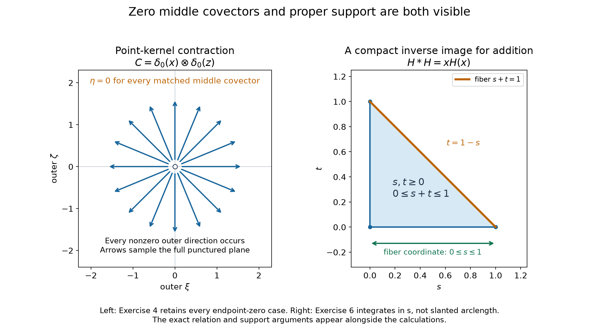

# Singular inputs and zero covectors in hyperfunction kernels

*Original exposition and proofs: GPT-6 Astra (OpenAI), Ultra, October 2026. Self-checked by the writing AI; no independent review. CC0.*

A kernel can carry a singularity at its output even when the input contributes no nonzero covector. When two kernels meet, their common covector can also be zero. We retain these cases while constructing kernel action and contraction for hyperfunctions. Proper addition then gives convolution, including unbounded supports and a direct proof of associativity.

Write \(W(u)=\operatorname{WF}_A(u)\). All spaces below are Euclidean open sets, all maps used for substitution are real analytic, and scalar integration uses Lebesgue density. The actual operations and proofs are supplied by [Analytic substitution for hyperfunctions](analytic-substitution-for-hyperfunctions.md), Theorems 4, 7 and 10 and Proposition 5; [Tensor directions and admissible hyperfunction products](tensor-directions-and-admissible-hyperfunction-products.md), Theorems 1, 4, 6 and 7; and [Integrating hyperfunctions over proper fibers](integrating-hyperfunctions-over-proper-fibers.md), Theorems 2 and 6 and Propositions 7–8.

## A relation with its support zero section

For a kernel \(K\in\mathcal B(X\times Y)\), use the primed relation
\[
 R(K)=\{(x,\xi;y,\eta):(x,y;\xi,-\eta)\in W(K)\}.
 \tag{R1}
\]
Its joint covector is nonzero, but either endpoint separately may vanish. Put
\[
 \begin{aligned}
 A(K)&=\{(x,\xi):\exists y,\ (x,\xi;y,0)\in R(K)\},\\
 B(K)&=\{(y,\eta):\exists x,\ (x,0;y,\eta)\in R(K)\},\\
 \widetilde R(K)&=R(K)\cup
       \{(x,0;y,0):(x,y)\in\operatorname{supp}K\}.
 \end{aligned}
 \tag{R2}
\]
The covectors displayed in \(A(K)\) and \(B(K)\) are nonzero. These projected sets need not be closed without further support information.

**Lemma 1 (the closed extended relation).** The set \(\widetilde R(K)\) is closed in the full product cotangent space.

**Proof.** For a convergent sequence whose limiting joint covector is nonzero, a subsequence of nonzero joint covectors lies in the closed set \(W(K)\); a sequence of joint zeros cannot have this limit. If the limiting joint covector is zero, every base point in the sequence belongs to \(\operatorname{supp}K\), because a hyperfunction vanishing near a point has empty wavefront there. The support is closed, so the limit belongs to the added zero section. The priming sign is a linear homeomorphism and preserves this argument. \(\square\)

## Acting on a singular input

Let \(p(x,y)=x\) and \(q(x,y)=y\). Properness of a closed set over a base means its inverse image over each compact base set is compact.

**Theorem 2 (kernel action).** Suppose \(u\in\mathcal B(Y)\),
\[
 B(K)\cap W(u)=\varnothing,\qquad
 T=\operatorname{supp}K\cap(X\times\operatorname{supp}u)
        \ \text{is proper over }X.
 \tag{A1}
\]
Then the operation
\[
 Ku=p_*\bigl(K\,q^*u\bigr)
 \tag{A2}
\]
is defined, has support contained in the closed set \(p(T)\), and satisfies
\[
 \begin{split}
 W(Ku)\subset {}&
 \{(x,\xi):\exists y\in\operatorname{supp}u,\
                          (x,\xi;y,0)\in R(K)\}\\
 &{}\cup\{(x,\xi):\xi\ne0,\ \exists(y,\eta)\in W(u),\
                          (x,\xi;y,\eta)\in R(K)\}.
 \end{split}
 \tag{A3}
\]
The right side is locally closed off zero. The construction is linear in each variable on admissible sums and agrees with the earlier distributional kernel action when both inputs are distributions.

**Proof.** Exact covariance under the projection gives
\[
 W(q^*u)=\{(x,y;0,\eta):(y,\eta)\in W(u)\},
 \qquad q^*u=1\otimes u.
 \tag{A4}
\]
An opposite covector in \(W(K)\) would have the form \((0,-\eta)\), giving precisely a point of \(B(K)\cap W(u)\). Thus the product in (A2) exists. Its support is contained in \(T\), so proper integration exists and has the asserted support.

For an output covector \(\xi\ne0\), the full product bound followed by integration requires a summed covector \((\xi,0)\). If the input factor contributes its support zero, the kernel contributes \((\xi,0)\) over \(y\in\operatorname{supp}u\); this is the first line of (A3). If the input contributes \((0,\eta)\), \(\eta\ne0\), the kernel contributes \((\xi,-\eta)\), giving the second line. A nonzero covector from the input alone has output component zero. It cannot create a further term in (A3).

For closedness, take output pairs in the right side converging to a nonzero pair. Their base points lie in a compact subset of \(X\). Properness of \(T\) places the chosen fiber points in a compact subset of \(Y\). If infinitely many pairs use the first line, pass to that subsequence and use closedness of \(W(K)\) and of the supports. Otherwise write their matched input covectors as \(\eta_j\). If these were unbounded, divide the kernel and input covectors by \(|\eta_j|\), pass to a unit-direction subsequence and obtain
\[
 (x,y;0,-\eta_*)\in W(K),\qquad
 (y,\eta_*)\in W(u),\qquad |\eta_*|=1.
 \tag{A5}
\]
This contradicts (A1). The input covectors are therefore bounded. A convergent subsequence with nonzero limit gives the second line of (A3); a zero limit gives the first, since the limiting fiber point remains in \(\operatorname{supp}u\). No extra closure is needed.

Finite unions of proper support sets are proper. The wavefront of a sum is contained in the union of the wavefronts, so the same exclusion applies to admissible sums. Linearity of product and integration proves the assertion. The actual distributional comparisons for projection pullback, product and proper integration identify (A2) with the previously constructed distributional action in [Keeping zero covectors in kernel operations](keeping-zero-covectors-in-kernel-operations.md), Theorem 5. \(\square\)

A compactly supported input always satisfies the support part of (A1). Alternatively, properness of \(\operatorname{supp}K\) over \(X\) allows arbitrary input support. The stated intersected-support hypothesis also covers cases in which neither stronger condition holds. For analytic \(u\), only the first line of (A3) remains.

## Contracting the middle variables of two kernels

Let \(K_1\in\mathcal B(X\times Y)\), \(K_2\in\mathcal B(Y\times Z)\), and put
\[
 S=\{(x,y,z):(x,y)\in\operatorname{supp}K_1,\
                         (y,z)\in\operatorname{supp}K_2\}.
 \tag{C1}
\]

**Theorem 3 (kernel contraction and its full relation).** Assume \(S\) is proper over \(X\times Z\) and
\[
 B(K_1)\cap A(K_2)=\varnothing.
 \tag{C2}
\]
With \(j(x,y,z)=(x,y,y,z)\) and \(p(x,y,z)=(x,z)\), the contracted kernel
\[
 C=p_*j^*(K_1\otimes K_2)
 \tag{C3}
\]
exists, has support in \(p(S)\), and obeys
\[
 R(C)\subset
       \bigl(\widetilde R(K_1)\circ\widetilde R(K_2)\bigr)
                 \setminus\{(\xi,\zeta)=(0,0)\}.
 \tag{C4}
\]
Relation composition matches the middle base point and covector, including middle covector zero. Its right side is locally closed off the joint outer zero. For distributional kernels, (C3) is the distributional tensor-restriction-integral construction and agrees with the earlier kernel composition wherever that theorem's hypotheses hold.

**Proof.** The transpose derivative of the middle diagonal is
\[
 Dj^T(\xi,\alpha,\beta,\gamma)
                      =(\xi,\alpha+\beta,\gamma).
 \tag{C5}
\]
Its nonzero normals are \((0,\alpha,-\alpha,0)\), \(\alpha\ne0\). The full tensor bound could contain such a normal only if the first kernel has \((0,\alpha)\) and the second has \((-\alpha,0)\) at the same middle base point. In primed notation these give the same nonzero middle covector \(-\alpha\) in \(B(K_1)\) and \(A(K_2)\), contradicting (C2). Thus \(j^*\) exists. Its support lies in \(S\), so the assumed properness permits integration.

One can equivalently use the product of the two pulled-back kernels:
\[
 j^*(K_1\otimes K_2)
             =\pi_{XY}^*K_1\,\pi_{YZ}^*K_2.
 \tag{C6}
\]
Indeed the pullback of their tensor by the diagonal of \(X\times Y\times Z\) factors through \(j\). Tensor naturality and pullback functoriality identify these constructions. Each individual projection is a submersion; an opposing pair of lifted kernel covectors is exactly the pure-middle pair excluded above. Hence every intermediate operation in this factorization is admitted.

The pullback and integration bounds require \(\alpha+\beta=0\). Set \(\eta=-\alpha=\beta\) and \(\zeta=-\gamma\). The two tensor factors then give
\[
 (x,\xi;y,\eta)\in\widetilde R(K_1),\qquad
 (y,\eta;z,\zeta)\in\widetilde R(K_2).
 \tag{C7}
\]
The joint outer covector is nonzero. This is exactly (C4). If both factors have nonzero joint covectors, (C7) is their full ordinary relation composition, still allowing \(\eta=0\). If one factor has joint covector zero, its base point lies in its support, giving respectively
\[
 \begin{aligned}
 &\{(x,\xi;z,0):\exists y,\
       (x,\xi;y,0)\in R(K_1),\ (y,z)\in\operatorname{supp}K_2\},\\
 &\{(x,0;z,\zeta):\exists y,\
       (x,y)\in\operatorname{supp}K_1,\ (y,0;z,\zeta)\in R(K_2)\}.
 \end{aligned}
 \tag{C8}
\]
Both joint zeros would give the deleted outer zero.

For closedness, properness of \(S\) bounds the middle base points over compact outer base sets. If matched middle covectors become unbounded along a sequence with bounded outer covectors, normalize them to obtain the forbidden pure-middle pair in (C2). Otherwise extract a convergent middle covector and use Lemma 1 for both extended relations. The limiting outer pair remains nonzero. This proves closedness. Finally the actual tensor, pullback and integration comparisons identify (C3) with their distributional counterparts. Under the hypotheses of Theorem 6 in the earlier kernel lesson, that theorem identifies the same expression with the composed distributional operator. \(\square\)

Properness of \(\operatorname{supp}K_2\) over \(Z\) is a useful sufficient condition: over compact \((x,z)\), it bounds \((y,z)\), and the remaining \(x\)-coordinates are compact. The theorem permits the more general properness of the joint set \(S\).

The theorem constructs the contracted kernel and its complete direction bound. Comparing its action on a third singular hyperfunction with two successive actions requires an additional interchange theorem. That composed-action identity is a further part of the hyperfunction calculus.

## Compact representatives for an entire proper sum

The next lemma permits algebraic convolution identities without multiplying hyperfunctions by smooth cutoffs.

**Lemma 4 (simultaneous compact replacement).** Let \(u_i\in\mathcal B(\mathbb R^n)\), \(1\le i\le N\), with nonempty supports \(S_i\), and suppose the total sum map is proper on \(\prod_i S_i\). For any relatively compact output open \(V\), there exist compactly supported global hyperfunctions \(a_i\), represented by real analytic functionals, and an open ball \(D\), such that:

1. \(a_i=u_i\) on \(D\).
2. Total addition is proper on \(\prod_i U_i\), where \(U_i=S_i\cup\operatorname{supp}a_i\).
3. Every tuple \(t_i\in U_i\) with \(\sum_i t_i\in\overline V\) has all its coordinates in \(D\).

**Proof.** Choose \(0<\varepsilon<1/N\). Properness makes
\[
 \{(s_i)\in\textstyle\prod_i S_i:
               \sum_i s_i\in\overline V+\overline{\mathbb B}\}
 \tag{L1}
\]
compact. Choose \(R>3\) so every coordinate of every such tuple has norm less than \(R-2\); an empty set imposes no constraint. Define
\[
 H_i=\overline{B_{R+2}}\cap
                   \{x:\operatorname{dist}(x,S_i)\le\varepsilon\}.
 \tag{L2}
\]
Prescribe \(u_i\) on \(B_{R+1}\) and zero outside \(H_i\). These prescriptions agree on the overlap: a point of \(S_i\) in that ball belongs to \(H_i\). The full gluing and extension theorem in [Hyperfunctions from local analytic sources](hyperfunctions-from-local-analytic-sources.md), Theorems 3 and 8, extends this section to the whole space while retaining its prescribed zeros. The extension \(a_i\) has support in the compact set \(H_i\). Proposition 4 of that lesson identifies it with a compact real analytic functional.

Every \(t_i\in U_i\) is within distance \(\varepsilon\) of \(S_i\). Choose a nearest \(s_i\in S_i\). Such a point exists: a minimizing sequence can be confined to a closed bounded ball, which is compact, and its limit remains in the closed set. If \(\sum_i t_i\in\overline V\), then
\[
 \left|\sum_i s_i-\sum_i t_i\right|
               \le\sum_i|s_i-t_i|\le N\varepsilon<1.
 \tag{L3}
\]
Thus the tuple \((s_i)\) belongs to (L1), and \(|t_i|<R-1\). Take \(D=B_{R+1}\); this proves the third assertion with room to spare.

For any compact output set \(K\), the same argument puts the corresponding \((s_i)\) in the compact inverse image of \(K+\overline{\mathbb B}\) under the original sum map. The coordinates \(t_i\) are then bounded. The inverse image of \(K\) in \(\prod_i U_i\) is closed in Euclidean space, hence compact. This proves the second assertion. The first was part of the extension prescription. \(\square\)

The support of \(a_i\) may extend slightly beyond \(S_i\). The enlarged-support properness and the simultaneous conclusion in part 3 control precisely those extra points.

## Proper convolution and its surviving directions

**Theorem 5 (proper convolution).** Let \(u,v\in\mathcal B(\mathbb R^n)\), and suppose addition is proper on \(\operatorname{supp}u\times\operatorname{supp}v\). Define
\[
 u*v=p_*F^*(u\otimes v),\qquad
 F(x,t)=(x-t,t),\quad p(x,t)=x.
 \tag{Q1}
\]
Then
\[
 \begin{aligned}
 \operatorname{supp}(u*v)&\subset
                  \operatorname{supp}u+\operatorname{supp}v,\\
 W(u*v)&\subset
 \{(s+t,\xi):(s,\xi)\in W(u),\ (t,\xi)\in W(v)\}.
 \end{aligned}
 \tag{Q2}
\]
The support sum is closed and the wavefront bound is locally closed off zero. Formula (Q1) is also the action of the kernel \(K(x,t)=u(x-t)\) on \(v\). It agrees with distributional convolution and, for compact analytic functionals, with
\[
 (a*b)(\phi)=(a\otimes b)\bigl(\phi(s+t)\bigr).
 \tag{Q3}
\]

**Proof.** The map \(F\) is an analytic linear diffeomorphism with absolute determinant one. Its inverse is \((s,t)\mapsto(s+t,t)\). Properness of addition on the support is therefore exactly the required properness for the projection in (Q1). The actual coordinate and integration operations define it.

Under \(DF^T\), a tensor covector \((\xi,\eta)\) becomes
\[
 (\xi,\eta-\xi).
 \tag{Q4}
\]
Integration requires \(\eta=\xi\), and the output covector is nonzero. Each factor must therefore contribute a nonzero wavefront covector; neither support-zero term survives. This proves (Q2). Properness bounds the two base points over compact output sets, while the two covectors are the same bounded output covector. Closedness follows by taking subsequences, with nonzero limit. The same argument without covectors proves that the support sum is closed.

Tensor naturality and product pullback identify
\[
 F^*(u\otimes v)=d^*u\,q^*v,\qquad
 d(x,t)=x-t,\quad q(x,t)=t.
 \tag{Q5}
\]
The exact submersion formula gives \(W(d^*u)=\{(x,t;\xi,-\xi):(x-t,\xi)\in W(u)\}\). Thus \(B(K)\) is empty. Theorem 2 applies, and (Q5) proves equality with kernel action, including its normalization.

For compact \(a,b\), the inverse-Jacobian formula, with determinant one, and the compact projection pairing give (Q3) on every admissible holomorphic germ. This is the convolution of Proposition 7 in Analytic tests and real carriers. The exact comparisons of tensor, analytic coordinate change and proper integration give distributional agreement for general proper supports as well. \(\square\)

One compact factor suffices for properness: if \(s+t\) remains in a compact set and, for example, \(t\) remains in a fixed compact set, then \(s\) is bounded; closedness completes the argument. The theorem also covers two unbounded supports, such as the two nonnegative half-lines.

**Theorem 6 (the convolution algebra on proper supports).** Every admissible pair satisfies
\[
 u*v=v*u,\qquad
 \partial^\alpha(u*v)=(\partial^\alpha u)*v
                         =u*(\partial^\alpha v),\qquad
 \delta_c*u=\tau_cu,
 \tag{Q6}
\]
where \((\tau_cu)(x)=u(x-c)\). If total addition is proper on three nonempty supports, both iterated convolutions are defined and
\[
 (u*v)*w=u*(v*w).
 \tag{Q7}
\]
More generally, for finitely many nonempty supports with proper total addition, every parenthesization is defined and has the same value. Any zero input gives zero in each expression whose intermediate convolutions are defined.

**Proof: compact inputs and localization.** For compact analytic functionals, the two iterated germ pairings defining the tensor agree and are associative. Pairing with \(\phi(s+t)\) proves commutativity. Differentiation in either variable gives the same derivative of this test, with the same minus sign. Pairing a point delta in the first variable gives \(u(\phi(c+\cdot))\), which is precisely translation. Repeated pairing with \(\phi(\sum_i s_i)\) proves all compact-input parenthesizations. These statements use the complete tensor and transport proofs of Proposition 7 in the analytic-functional lesson.

Apply Lemma 4 to an admissible pair and a relatively compact output patch \(V\). On the inverse image of \(V\) under addition, the tensors \(u\otimes v\) and \(a\otimes b\) agree. To verify this at a point, either one coordinate lies outside its enlarged support, where both versions of that factor vanish locally, or both coordinates lie in the enlarged supports. In the latter case Lemma 4 puts both coordinates in \(D\), where the factors agree. Locality of tensor and coordinate pullback, followed by restriction compatibility of proper integration, gives
\[
 (u*v)|_V=(a*b)|_V.
 \tag{Q8}
\]
The enlarged-support condition ensures every convolution used in this comparison is defined. It proves commutativity and derivative identities locally from their compact versions. Derivatives preserve support and local agreement, so the same replacements work for every fixed \(\alpha\). Gluing proves them globally. For the translation formula, the same reasoning can keep the already compact factor \(\delta_c\): choose the second representative to agree near \(\overline V-c\). Its pairing gives the stated translation locally and hence globally.

**Proof: three factors.** If all supports are nonempty, fixing one point in the third support proves properness for addition on the first two supports; a compact pair-sum set translates to a compact total-sum set. Similarly the other pair is proper. Addition on \((S_1+S_2)\times S_3\) is proper: lift any sequence with total sum in a compact set to \((s_1,s_2,s_3)\). Total properness gives a convergent subsequence of the lifts. The intermediate support sum is closed by pair properness. This proves compactness of the inverse image, including its closedness. The actual support of \(u_1*u_2\) is a closed subset of that sum, so its further convolution is admitted.

Choose the three compact replacements from Lemma 4, with enlarged supports \(U_i\). The same properness argument applies to these enlarged supports. Put
\[
 O_{12}=V-U_3=\bigcup_{t\in U_3}(V-t).
 \tag{Q9}
\]
This is open. The tensors \(u_1\otimes u_2\) and \(a_1\otimes a_2\) agree over the inverse image of \(O_{12}\) under pair addition: for a contributing pair, choose \(t\in U_3\) making its total sum lie in \(V\). Lemma 4 then puts its two coordinates in \(D\). The other points have a factor zero locally, as in (Q8). Hence the two pair convolutions agree on \(O_{12}\).

The support of their difference misses \(O_{12}\), so its sum with \(\operatorname{supp}u_3\subset U_3\) misses \(V\). Also, a contributing sum from \(\operatorname{supp}(a_1*a_2)\) and \(U_3\) can be lifted to coordinates in \(U_1,U_2,U_3\); Lemma 4 puts the third coordinate in \(D\). There \(u_3-a_3\) vanishes. The support bound thus gives, on \(V\),
\[
 (u_1*u_2)*u_3=(a_1*a_2)*a_3.
 \tag{Q10}
\]
Every sum and difference used here is admissible because its support is contained in a finite union of the proper enlarged support sums. Repeating the argument for the other grouping gives \(u_1*(u_2*u_3)=a_1*(a_2*a_3)\) on \(V\). Compact associativity and gluing prove (Q7).

For a finite number of factors, fixing points in the omitted nonempty supports proves properness of every subsum. Its support sum is closed. At any split into two blocks, lift a bounded total sum to the original tuple to prove properness of addition of the two block support sums. Thus every parenthesization is defined. Two adjacent regroupings are equal by the three-factor argument applied to the three block convolutions whenever their supports are nonempty; their total support addition is proper by the same lifting argument. If a block convolution is zero, the corresponding regrouping equals zero by bilinearity, with admissibility already ensured by the containing support sums. Repeatedly moving parentheses to the left, by induction on the number of leaves, connects every parenthesization to the fully left-associated one. This proves the finite assertion. \(\square\)

The nonempty-support qualification is useful: a zero third factor does not imply properness for an unrelated first pair. When the needed pair convolutions exist, bilinearity gives the expected zero without that false implication.

For a zero-dimensional factor, the space is a point or empty. Hyperfunctions on a point are scalars, with no nonzero covectors. Tensoring, integration and convolution reduce to scalar multiplication; empty factors give zero. The displayed constructions and bounds have these interpretations.

## Exercises with complete solutions

**Exercise 1 (basic) — an output-axis singularity.** Let \(A\) be a compactly supported hyperfunction on \(X\), let \(K=A\otimes1\) on \(X\times\mathbb R^m\), and let \(u\) be any compactly supported hyperfunction on \(\mathbb R^m\). Find \(Ku\).

**Solution.** The input-normal set \(B(K)\) is empty, since exact projection covariance gives covectors \((\xi,0)\) with \(\xi\ne0\). Tensor and product naturality identify \(Kq^*u=A\otimes u\). Compact germ pairing followed by integration gives
\[
 Ku=u(1)A.
 \tag{E1}
\]
With \(u=\delta_b\), this is \(A\). The relation term involving a nonzero input covector is empty, while the output-axis term retains the wavefront of \(A\). The first line of (A3) is therefore essential.

**Exercise 2 (intermediate) — translating a singular input.** For \(K(x,y)=\delta_c(x-y)\), calculate its action on any hyperfunction \(u\) and its primed relation.

**Solution.** Theorem 5 identifies its action with \(\delta_c*u=\tau_cu\). The support graph \(x=y+c\) has one fiber point for each output, so the properness condition holds for every \(u\). Exact submersion covariance gives
\[
 R(K)=\{(y+c,\xi;y,\xi):\xi\ne0\}.
 \tag{E2}
\]
The relation and both endpoint-normal exclusions agree with this translation formula. Applying the inverse translation and its wavefront bound also proves equality of the translated wavefront sets.

**Exercise 3 (basic) — testing the normal exclusion.** On \(\mathbb R_x\times\mathbb R_y\), take \(K=1\otimes\delta_0\) and input \(u=\delta_0\). Does Theorem 2 apply?

**Solution.** Exact projection covariance gives all covectors \((0,\eta)\), \(\eta\ne0\), over \(y=0\). After priming, \(B(K)\) contains both nonzero directions at zero, as does \(W(u)\). Condition (A1) fails. In fact the proposed product would contain the same-variable delta square. The theorem supplies no such product; proper fiber support alone does not supply the missing normal exclusion.

**Exercise 4 (advanced) — all outer directions with middle covector zero.** In one-dimensional factor spaces set
\[
 K_1=\delta_0(x)\otimes\delta_0(y),\qquad
 K_2=1(y)\otimes\delta_0(z).
 \tag{E3}
\]
Compute the contraction and explain every part of (C4).

**Solution.** The set \(A(K_2)\) is empty, because its joint covectors are \((0,\zeta)\), \(\zeta\ne0\). Thus (C2) holds, even though \(B(K_1)\) is nonempty. The joint support has \(x=y=z=0\), so it is proper. Formula (C6), tensor naturality and integration of the middle delta give
\[
 C=\delta_0(x)\otimes\delta_0(z).
 \tag{E4}
\]
A point delta in two dimensions has every nonzero ordinary covector: its localized Fourier transform is a nonzero constant. Hence its analytic wavefront also contains every nonzero covector, and cannot contain more. In the matched relation for (E3), the middle covector is always zero, because the first component of every covector of \(K_2\) is zero. If both outer components are nonzero, both factors have nonzero joint covectors. If one outer component is zero, the appropriate factor contributes its support zero, producing a term in (C8). Together these give the whole punctured outer cotangent plane. Removing the middle zero would lose all of it.

**Exercise 5 (advanced) — convolving infinite point measurements.** Suppose point-carried functionals have the convergent expansions
\[
 a(\phi)=\sum_\alpha c_\alpha\partial^\alpha\phi(0),\qquad
 b(\phi)=\sum_\beta d_\beta\partial^\beta\phi(0).
 \tag{E5}
\]
Find the moments of \(a*b\), prove convergence, and give a nondistribution example in one dimension.

**Solution.** The exact tensor germ pairing gives coefficients
\[
 e_\gamma=\sum_{\alpha+\beta=\gamma}c_\alpha d_\beta.
 \tag{E6}
\]
The point-moment theorem in the analytic-functional lesson gives, for every \(\rho>0\), bounds
\(|c_\alpha|\le C_\rho\rho^{|\alpha|}/\alpha!\) and
\(|d_\beta|\le D_\rho\rho^{|\beta|}/\beta!\).
The coordinatewise binomial identity therefore gives
\[
 |e_\gamma|\le C_\rho D_\rho
                  \frac{(2\rho)^{|\gamma|}}{\gamma!}.
 \tag{E7}
\]
Taking \(\rho\) half of any prescribed radius proves the required every-radius bound. Absolute convergence on a sufficiently small complex neighborhood, followed by the Cauchy derivative bounds for the test, justifies regrouping the double series. Equivalently the complete tensor germ theorem gives the same pairing and coefficients.

In one dimension choose \(c_k=d_k=(k!)^{-2}\). The bounds above hold since \(\rho^{-k}/k!\le e^{1/\rho}\). Formula (E6) gives
\[
 e_N=\frac1{(N!)^2}\sum_{k=0}^N\binom Nk^2
                      =\frac{\binom{2N}N}{(N!)^2}.
 \tag{E8}
\]
The last identity compares the coefficient of \(t^N\) in
\((1+t)^N(1+t)^N=(1+t)^{2N}\). Every \(e_N\) is positive. A point-supported distribution has finite order \(k\) on a compact neighborhood. Theorem 1.1 of the supplied jet lesson makes it vanish on tests whose derivatives through order \(k\) vanish at that point. Subtracting a cutoff times the degree-\(k\) Taylor polynomial therefore expresses its pairing as a finite derivative sum. Uniqueness of the analytic moment expansion makes every higher coefficient zero. Thus the convolution just constructed is not a distribution.

**Exercise 6 (intermediate) — properness is a separate condition.** Compare the formal convolutions of the two functions \(H(t)\) and \(H(-t)\) with the convolution of two copies of \(H(t)\), where \(H\) is the indicator of the positive half-line.

**Solution.** For opposite half-lines, the fiber over zero contains \((s,-s)\), \(s\ge0\), and is unbounded. Addition is not proper. The ordinary positive integrand for their convolution has infinite integral on each output fiber, so this example does not define a convolution by (Q1). For two nonnegative half-lines, \(s,t\ge0\) and \(s+t\) in a compact set bound both variables. Addition is proper, and
\[
 (H*H)(x)=
 \begin{cases}x,&x>0,\\0,&x<0.\end{cases}
 \quad\text{Thus }H*H=xH(x).
 \tag{E9}
\]
Indeed the allowed first variable is \(0<s<x\) for \(x>0\), and there is no allowed interval for \(x<0\). Endpoint choices affect neither distribution. The output is analytic off zero and fails to be smooth at zero. Ordinary wavefront projection and real Fourier conjugation symmetry force both ordinary directions there, and hence both analytic directions. The bound (Q2) attains precisely these directions.

*Left: Exercise 4 has every nonzero outer covector \((\xi,\zeta)\) at the origin while the matched middle covector is zero. The displayed arrows are samples of the full punctured plane. Right: the inverse image of \(0\le x\le1\) under \(x=s+t\), restricted to \(s,t\ge0\), is the closed compact triangle. At \(x=1\), integration in the fiber coordinate \(s\) gives length one; this is coordinate integration, not Euclidean arclength on the slanted segment. Exercise 6 proves the general output \(xH(x)\). [Editable figure source](../figures/hyperfunction-kernel-fibers.py).*

**Exercise 7 (intermediate) — a finite family with unbounded supports.** Compute \(H^{*N}\), \(N\ge1\), and justify every parenthesization.

**Solution.** Total addition is proper on \([0,\infty)^N\): if the sum is bounded above, every coordinate is bounded between zero and that upper bound. Theorem 6 permits every parenthesization. Starting with \(N=1\), direct integration gives inductively, for \(x>0\),
\[
 \int_0^x\frac{s^{N-1}}{(N-1)!}\,ds
                         =\frac{x^N}{N!}.
 \tag{E10}
\]
All convolutions vanish for \(x<0\). Thus \(H^{*N}=x^{N-1}H(x)/(N-1)!\), as locally integrable distributions and as hyperfunctions. Properness supplies the bounded integration interval at each step.

**Exercise 8 (advanced) — graph kernels and the matching sign.** Let \(a,b\ne0\), \(K_1(x,y)=\delta_0(x-ay)\), and \(K_2(y,z)=\delta_0(y-bz)\). Find their contraction and primed covectors.

**Solution.** The first kernel has joint covectors \((\xi,-a\xi)\), and the second \((\eta,-b\eta)\). Neither has a nonzero pure-middle pair of the kind excluded in (C2). On their common support \(y=bz\) and \(x=abz\), the middle coordinate is determined by \(z\), so properness holds. The analytic coordinate map
\((r,s,z)\mapsto(x=r+a(s+bz),y=s+bz,z)\)
has determinant one. The two kernel arguments become \(r,s\), so their product is the coordinate transform of \(\delta_0(r)\delta_0(s)\). Its distributional pairing is
\(\int\Phi(abz,bz,z)\,dz\). Integrating out \(y\) therefore gives
\[
 C(x,z)=\delta_0(x-abz),\qquad
 \eta=a\xi,\quad \zeta=b\eta=ab\xi.
 \tag{E11}
\]
The derivative in the eliminated \(y\)-argument of the second kernel is one, so no factor \(|a|^{-1}\) or \(|b|^{-1}\) appears in this kernel. The determinant-one pairing verifies that normalization directly. Its action as an operator, if evaluated by integrating in \(z\), has the separate factor \(|ab|^{-1}\); these are different integrations.

## Programme proofs and mathematical source

- [Analytic substitution for hyperfunctions](analytic-substitution-for-hyperfunctions.md), Theorem 4, Proposition 5, Theorems 7 and 10 and Corollary 11, gives the actual map calculus, coordinate normalization, distributional comparison and exact submersion wavefront. [Tensor directions and admissible hyperfunction products](tensor-directions-and-admissible-hyperfunction-products.md), Theorems 1, 4, 6 and 7, gives tensor directions, products, naturality and admissible joint restrictions.
- [Integrating hyperfunctions over proper fibers](integrating-hyperfunctions-over-proper-fibers.md), Theorems 2 and 6 and Propositions 7–8, supplies the actual integral, its support and wavefront bounds and coordinate density. [Hyperfunctions from local analytic sources](hyperfunctions-from-local-analytic-sources.md), Proposition 4 and Theorems 3, 6 and 8, supplies compact sections, gluing, tensor locality and extension retaining prescribed zeros.
- Analytic tests and real carriers, Theorem 2, Theorem 5 and Proposition 7, gives moment convergence, germ uniqueness, exact iterated tensors and compact transport. [Jets, supported distributions and local operators](jets-supported-distributions-and-local-operators.md), Theorem 1.1, gives the vanishing-jet result used for point-supported distributions. [Keeping zero covectors in kernel operations](keeping-zero-covectors-in-kernel-operations.md), Theorems 5–6 and Corollary 7, supplies the full earlier distributional kernel and convolution comparisons.
- The supplied [metric foundation](../prerequisites/U011-free-foundations/metric-foundation-bridges.md), Sections 12–13, and [integration foundation](../prerequisites/U011-free-foundations/banach-foundation-bridges.md), Sections 15–16, give Euclidean compactness, nearest-point subsequences, support arguments, product integration and change of variables. The ordinary wavefront projection and Fourier symmetry used in the examples are in the supplied [Fourier and pullback reading](../prerequisites/U011-free-foundations/smooth-pullback-and-fourier-normal-condition.md), Sections 18.1–18.5.
- Lars Hörmander, *The Analysis of Linear Partial Differential Operators I: Distribution Theory and Fourier Analysis*, reprint of the second edition, Springer, 2003, [doi:10.1007/978-3-642-61497-2](https://doi.org/10.1007/978-3-642-61497-2), Theorem 8.5.5, its convolution consequences and the extension to hyperfunctions in Section 9.3. The organization, compact-replacement argument, examples, exercises and figure here are independently expressed.
