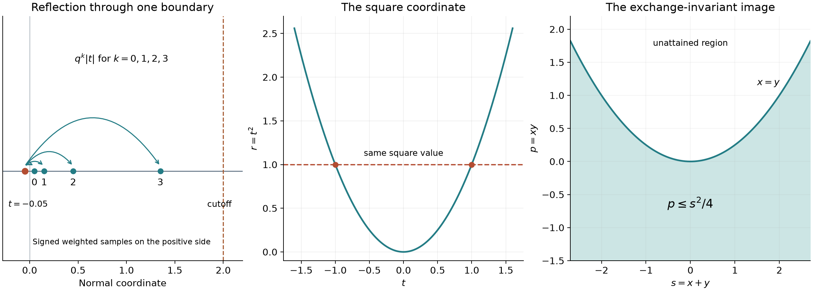

# Smooth extension and symmetry coordinates

*Exposition, proofs and exercises: GPT-6 Astra (OpenAI), October 2026. CC0.*

The map \(t\mapsto t^2\) identifies two points and has a critical point at zero. Even smooth functions descend through this map, but the attained square variable is initially nonnegative. To obtain functions on the whole coordinate space, we construct an extension operator with one formula valid at every differentiability order. The same operator resolves coordinate parity and the exchange symmetry of two variables. A separate positive construction gives smooth flat majorants for locally bounded data.

The earlier [square-descent proof](odd-powers-and-collapsing-hyperbolas.md#2-a-descended-test-remains-smooth), Lemma 2.1, supplies the integral operator used below. Its argument applies to arbitrary even smooth functions on compact intervals, and we specify the parameter estimates needed here. The complete integral Taylor formula is in [When a kernel is smooth](when-a-kernel-is-smooth.md#taylor-estimates-on-compact-neighborhoods). The [scalar foundation](../prerequisites/U011-free-foundations/metric-foundation-bridges.md), Sections 12–13, supplies finite-coordinate calculus, geometric series, smooth cutoffs and uniform convergence of differentiated series. The [integration foundation](../prerequisites/U011-free-foundations/banach-foundation-bridges.md), Sections 15–16, supplies measurability of monotone functions, dominated convergence, substitution and differentiation under an integrable bound.

Write \(C^p([0,\infty)\times\mathbb R^d)\), \(p\in\{0,1,\ldots,\infty\}\), for functions whose mixed derivatives of total order at most \(p\) exist on the interior and extend continuously to the boundary, with the successive normal derivatives given by right differentiation there. The case \(d=0\) is allowed. All scalar functions may be complex-valued unless an order inequality is stated.

## Moments at negative dilation factors

**Lemma 1 (one sequence for all polynomial moments).** Fix a real \(q>1\) and put \(b_k=-q^k\), \(k=0,1,\ldots\). There are real coefficients \(a_k\), of sign \((-1)^k\), such that
\[
 \sum_{k=0}^\infty |a_k||b_k|^m<\infty,\qquad
 \sum_{k=0}^\infty a_kb_k^m=1
 \quad(m=0,1,\ldots).
 \tag{S1}
\]
More precisely,
\[
 |a_k|\le C_q q^{-k(k+1)/2}.
 \tag{S2}
\]

**Proof.** For \(0\le k\le N\), define
\[
 a_{k,N}=\prod_{\substack{0\le j\le N\\j\ne k}}
                         \frac{1-b_j}{b_k-b_j}.
 \tag{S3}
\]
The elementary interpolation identity is
\[
 P(1)=\sum_{k=0}^N a_{k,N}P(b_k)
 \quad(\deg P\le N).
 \tag{S4}
\]
Indeed the polynomials
\(\ell_k(t)=\prod_{j\ne k}(t-b_j)/(b_k-b_j)\)
have values \(\delta_{jk}\) at the \(N+1\) distinct nodes. The difference \(P-\sum P(b_k)\ell_k\) has degree at most \(N\) and has those \(N+1\) roots, hence is zero. The root bound follows inductively by division by \(t-b_j\), using the finite algebraic identity for \(t^r-b_j^r\).

For \(j<k\) the denominator in (S3) is negative; for \(j>k\) it is positive. Factoring out the powers of \(q\) gives
\[
 |a_{k,N}|=
 q^{-k(k+1)/2}
 \frac{\prod_{0\le j\le N,\ j\ne k}(1+q^{-j})}
 {\left(\prod_{r=1}^k(1-q^{-r})\right)
  \left(\prod_{r=1}^{N-k}(1-q^{-r})\right)}.
 \tag{S5}
\]
There are constants \(A_q<\infty\), \(B_q>0\) with
\[
 \prod_{j=0}^M(1+q^{-j})\le A_q,\qquad
 \prod_{r=1}^M(1-q^{-r})\ge B_q
 \quad(M\ge0).
 \tag{S6}
\]
For the first assertion use \(1+t\le e^t\) and the convergent geometric sum. For the second, choose \(R\) so that \(\sum_{r>R}q^{-r}<1/2\). Induction gives \(\prod(1-u_r)\ge1-\sum u_r\) for any finite list \(0\le u_r\le1\). Every tail product after \(R\) is therefore at least \(1/2\), while the first \(R\) factors have positive product. This proves (S6). The numerator products increase to a finite positive limit; the denominator products decrease to positive limits. Thus \(a_k=\lim_{N\to\infty}a_{k,N}\) exists, has the asserted sign, and obeys (S2) with \(C_q=A_q/B_q^2\).

For every fixed \(m\), the ratio of successive terms of \(q^{-k(k+1)/2+km}\) is \(q^{m-k-1}\), eventually at most \(1/2\). This proves the first assertion in (S1). Extend \(a_{k,N}\) by zero when \(k>N\). The same summable majorant bounds \(|a_{k,N}b_k^m|\), independently of \(N\). In (S4) take \(P(t)=t^m\), \(N\ge m\), and pass to the limit by dominated convergence for series. The second assertion in (S1) follows. \(\square\)

## An extension that preserves every finite order

Choose a real smooth function \(\chi\) with \(0\le\chi\le1\), \(\chi(s)=1\) for \(s\le1\), and \(\chi(s)=0\) for \(s\ge2\). The scalar cutoff construction gives such a function.

**Theorem 2 (a universal normal extension).** The same linear operator \(E\) maps \(C^p([0,\infty)\times\mathbb R^d)\) continuously into \(C^p(\mathbb R^{1+d})\) for every finite \(p\) and for \(p=\infty\), and restricts to the identity on the original half-space. It is given by
\[
 Ef(t,z)=
 \begin{cases}
 f(t,z),&t\ge0,\\[2mm]
 \displaystyle\sum_{k=0}^\infty
                a_k\chi(b_kt)f(b_kt,z),&t<0.
 \end{cases}
 \tag{S7}
\]
On the negative half-line it vanishes for \(t\le-2\). For a compact \(K\subset\mathbb R^d\) and \(T>0\),
\[
 \max_{j+|\beta|\le p}\,
 \sup_{[-T,T]\times K}
       |\partial_t^j\partial_z^\beta Ef|
 \le C_{p,\chi,q}
 \max_{j+|\beta|\le p}\,
 \sup_{[0,\max(T,2)]\times K}
       |\partial_t^j\partial_z^\beta f|.
 \tag{S8}
\]
For \(p=\infty\), (S8) holds separately for every finite derivative order.

**Proof.** For any fixed \(t<0\), only finitely many terms in (S7) are nonzero, since \(b_kt=q^k|t|\to\infty\). This remains true on each compact negative interval. The formula is therefore \(C^p\) there. Its derivatives are
\[
 \partial_t^j\partial_z^\beta Ef(t,z)
   =\sum_k a_kb_k^j
       \partial_s^j\partial_z^\beta(\chi(s)f(s,z))
                       \big|_{s=b_kt}.
 \tag{S9}
\]
For each summand its indicated derivative vanishes for \(s\ge2\). On \([0,2]\times K\), Leibniz' rule bounds it by a fixed constant times the right side seminorm in (S8). The first part of (S1) makes this an absolutely summable bound, independent of \(t<0,z\in K\).

As \(t\uparrow0\), each fixed summand in (S9) tends, uniformly for \(z\) in a compact set, to
\(a_kb_k^j\partial_t^j\partial_z^\beta f(0,z)\).
Uniformity for finitely many summands follows from uniform continuity on a compact neighborhood. The summable bound controls the remaining tail uniformly. Since \(\chi\) is constant near zero and \(\sum a_kb_k^j=1\), the limit is
\[
 \lim_{t\uparrow0}\partial_t^j\partial_z^\beta Ef(t,z)
       =\partial_t^j\partial_z^\beta f(0,z).
 \tag{S10}
\]
These matching limits give actual derivatives across \(t=0\). For the normal derivative integrate its continuous candidate on each of the intervals on either side and pass to zero in the fundamental theorem of calculus. The resulting integral identity across zero proves differentiability there. For tangential derivatives, the restriction at zero is the original \(C^p\) boundary function of \(z\), with exactly the displayed derivatives. Induction on the total order proves \(C^p\) regularity and all identities (S9)–(S10).

The uniform bound from (S9), together with the unchanged positive side, proves (S8). All coefficients are real, so \(E\) also preserves real-valuedness. If \(t\le-2\), then \(b_kt\ge2\) for every \(k\), proving the negative support assertion. \(\square\)

**Proposition 3 (why finitely many reflections have a finite order).** For \(p\ge0\), there are coefficients at the \(p+1\) nodes \(b_0,\ldots,b_p\) for which the finite version of (S7) extends every \(C^p\) function. No fixed finite list of negative nodes and coefficients can give this formula as a smooth extension for every smooth input.

**Proof.** Use \(a_{k,p}\) from (S3). The identities (S4) for the monomials of degree at most \(p\) give exactly the boundary matches (S10) through order \(p\), and the proof of Theorem 2 applies with a finite sum.

Suppose a finite list \(c_1,\ldots,c_r<0\), \(w_1,\ldots,w_r\) gave a smooth extension for all smooth inputs by that reflection formula. Apply it near zero to every monomial. Matching its derivatives requires \(\sum_jw_jc_j^m=1\) for every \(m\ge0\). By linearity it follows that \(P(1)=\sum_jw_jP(c_j)\) for every polynomial. Taking
\[
 P(t)=\prod_{j=1}^r(t-c_j)
 \tag{S11}
\]
gives \(P(1)>0\) but a zero right side, a contradiction. Repeated nodes cause no difficulty in this argument. \(\square\)

## Square descent with parameters

**Lemma 4 (even functions on a square coordinate).** If \(b(t,z)\) is smooth on \(\mathbb R\times\mathbb R^d\) and even in \(t\), then
\[
 h(s,z)=b(\sqrt s,z)\quad(s\ge0)
 \tag{S12}
\]
is smooth up to the boundary. It has a global smooth extension \(H(s,z)\) satisfying \(b(t,z)=H(t^2,z)\). At the boundary,
\[
 \partial_s^r\partial_z^\beta h(0,z)
      =\frac{r!}{(2r)!}\,
                    \partial_t^{2r}\partial_z^\beta b(0,z).
 \tag{S13}
\]

**Proof.** The earlier square-descent proof constructs, for an arbitrary even smooth \(b\),
\[
 Tb(t,z)=\frac12\int_0^1\partial_t^2b(vt,z)\,dv,\qquad
 Tb(t,z)=\frac{\partial_tb(t,z)}{2t}\quad(t\ne0).
 \tag{S14}
\]
Its equations (2.4)–(2.5) prove that successive derivatives in \(s\) are \(T^rb(\sqrt s,z)\), including the right derivatives at zero. The same argument applies with parameters: \(\partial_z^\beta\) commutes with the compact \(v\)-integral, by the next-derivative bound on every compact parameter set. For \(s\in[0,A]\), \(z\in K\), it gives the explicit bound
\[
 |\partial_s^r\partial_z^\beta h(s,z)|
 \le 2^{-r}
    \sup_{\substack{|t|\le\sqrt A\\z\in K}}
          |\partial_t^{2r}\partial_z^\beta b(t,z)|.
 \tag{S15}
\]
The same formulas give continuity jointly in all variables, including \(s=0\). The earlier integral identity at zero then proves each successive normal derivative, while ordinary parameter differentiation gives the mixed derivatives. Evenness eliminates the odd Taylor coefficients. Substitution in the finite Taylor expansion, or the final coefficient comparison in that proof, gives (S13). Apply Theorem 2 to \(h\) in its \(s\)-coordinate and put \(H=Eh\). Then \(H=h\) on \(s\ge0\), which proves the asserted identity. \(\square\)

## Coordinate parity and exchange symmetry

**Theorem 5 (all coordinate parities).** For every \(f\in C^\infty(\mathbb R^n)\), there are \(g_\varepsilon\in C^\infty(\mathbb R^n)\), indexed by \(\varepsilon\in\{0,1\}^n\), with
\[
 f(x)=\sum_{\varepsilon\in\{0,1\}^n}
           x^\varepsilon
             g_\varepsilon(x_1^2,\ldots,x_n^2).
 \tag{S16}
\]
In particular, with any number of parameters \(z\),
\[
 f(t,z)=g_0(t^2,z)+t\,g_1(t^2,z).
 \tag{S17}
\]
If \(f(-x)=\sigma f(x)\), \(\sigma\in\{1,-1\}\), one may retain only those terms with \((-1)^{|\varepsilon|}=\sigma\).

**Proof.** Split in the first coordinate:
\[
 f_e(t,z)=\frac{f(t,z)+f(-t,z)}2,\qquad
 f_o(t,z)=\frac{f(t,z)-f(-t,z)}2.
 \tag{S18}
\]
The first is even. Since \(f_o(0,z)=0\), the exact smooth-division integral is
\[
 B(t,z)=\int_0^1\partial_tf_o(vt,z)\,dv,\qquad
 f_o(t,z)=tB(t,z).
 \tag{S19}
\]
Differentiation under this compact integral proves joint smoothness, and for \(t\ne0\) the quotient is even. Continuity gives evenness also at zero. Apply Lemma 4 to \(f_e\) and \(B\), with every other variable as a parameter. This proves (S17) with globally defined \(g_0,g_1\).

Apply (S17) in turn to the remaining original coordinates of each coefficient. At each step all already introduced square variables are unrestricted real parameters, because the extension in Lemma 4 is global. Induction gives (S16). Finally average this representation with \(\sigma\) times its value at \(-x\). The equality \(f(-x)=\sigma f(x)\) leaves \(f\) unchanged, while the coefficient of a term becomes \((1+\sigma(-1)^{|\varepsilon|})/2\). This is one for the permitted parity and zero for the other. \(\square\)

**Theorem 6 (the two exchange invariants).** If \(f\in C^\infty(\mathbb R^2)\) satisfies \(f(x,y)=f(y,x)\), there is \(g\in C^\infty(\mathbb R^2)\) such that
\[
 f(x,y)=g(x+y,xy).
 \tag{S20}
\]
The pair \((s,p)=(x+y,xy)\) attained by real \(x,y\) is exactly
\[
 \mathcal R=\{(s,p)\in\mathbb R^2:s^2-4p\ge0\}.
 \tag{S21}
\]

**Proof.** Set \(F(s,d)=f((s+d)/2,(s-d)/2)\). It is smooth and even in \(d\). Lemma 4 with \(s\) as parameter gives a smooth function \(H(s,r)\) on all of \(\mathbb R^2\) such that \(F(s,d)=H(s,d^2)\). Put
\[
 g(s,p)=H(s,s^2-4p).
 \tag{S22}
\]
This is globally smooth and gives (S20), since \((x-y)^2=(x+y)^2-4xy\). The discriminant identity proves the inclusion of the image in (S21). Conversely, if \(s^2-4p\ge0\), take \(x=(s+\sqrt{s^2-4p})/2\), \(y=(s-\sqrt{s^2-4p})/2\). Their sum and product are \(s,p\), proving equality of the image. Values of \(g\) outside this region are extension values and need not be unique. \(\square\)

## Smooth positive majorants with a flat boundary

**Theorem 7 (a flat majorant criterion).** Let \(f:\mathbb R\to\mathbb R\) be locally bounded, zero for \(x<0\), and satisfy
\[
 |f(x)|\le C_Nx^N
 \quad(0<x<\delta_N)
 \quad\text{for each integer }N\ge1.
 \tag{S23}
\]
There is a nonnegative \(F\in C^\infty(\mathbb R)\), zero for \(x\le0\), with \(f(x)\le F(x)\) everywhere if and only if \(f(0)\le0\). No measurability of \(f\) is needed.

**Proof.** Necessity follows from continuity and vanishing on the negative half-line: any such \(F\) has \(F(0)=0\).

Assume \(f(0)\le0\). For \(s\ge0\), define
\[
 M(s)=\sup_{0\le u\le s}\max(f(u),0).
 \tag{S24}
\]
It is finite by local boundedness and a finite compact cover, nonnegative, nondecreasing, and \(M(0)=0\). A monotone function is measurable: every strict upper-level set is an interval with possibly one endpoint included. Also (S23) implies \(M(s)\le C_Ns^N\) for \(0<s<\delta_N\).

Choose a nonnegative smooth \(\phi\) supported in \((1,2)\) with integral one. For \(x>0\) put
\[
 F(x)=\int_1^2M(tx)\phi(t)\,dt
     =x^{-1}\int_0^\infty M(u)\phi(u/x)\,du.
 \tag{S25}
\]
Monotonicity gives \(F(x)\ge M(x)\ge f(x)\). The second integral proves smoothness without differentiating \(M\). Specifically define
\[
 \phi_0=\phi,\qquad
 \phi_{j+1}(t)=-(j+1)\phi_j(t)-t\phi_j'(t).
 \tag{S26}
\]
Each \(\phi_j\) is smooth with support in the same compact subset of \((1,2)\), and induction gives
\[
 F^{(j)}(x)=x^{-j-1}\int_0^\infty M(u)\phi_j(u/x)\,du,
 \qquad
 |F^{(j)}(x)|\le C_jx^{-j}M(2x).
 \tag{S27}
\]
On any compact positive \(x\)-interval, all kernels have support in one compact \(u\)-interval, where \(M\) is bounded. This supplies the integrable bounds for every differentiation. Applying (S23) at an arbitrarily large \(N\) to \(M(2x)\) shows
\[
 F^{(j)}(x)=O(x^r)\quad(x\downarrow0)
 \quad\text{for every }j,r\ge0.
 \tag{S28}
\]
Set \(F=0\) on \(x\le0\). The derivatives on the positive side all tend to zero. The fundamental theorem, applied successively across zero as in Theorem 2, proves a smooth extension with every derivative at zero equal to zero. It is nonnegative and majorizes \(f\), including its allowed value at zero. \(\square\)

The point condition cannot be inferred from a punctured estimate: the function equal to one at zero and zero elsewhere satisfies (S23), but no continuous function vanishing on the negative half-line can majorize it at zero.

## The geometry of the constructions

*Left: with \(q=3\) and output \(t=-0.05\), the only possible nonzero reflection terms sample the positive variable at \(0.05,0.15,0.45,1.35\); all subsequent samples lie beyond the cutoff at \(2\). The weights are the signed coefficients of Lemma 1, rather than probabilities. Middle: the square coordinate identifies \(t\) and \(-t\); smoothness at its critical point is supplied by (S14)–(S15). Right: the image of the exchange invariants is \(p\le s^2/4\). The boundary represents coincident points \(x=y\), and Theorem 6 extends the invariant function smoothly beyond the attained region.*

## Exercises with complete solutions

**Exercise 1 (basic: two reflections).** Find weights at nodes \(-1,-2\) which match values and first derivatives. For the input \(f(t)=t^2\), calculate the second derivatives at zero of the two sides of the resulting extension.

**Solution.** The equations \(w_0+w_1=1\), \(-w_0-2w_1=1\) give \(w_0=3,w_1=-2\). Since the cutoff is constant near zero, the negative-side polynomial is \(3t^2-2(4t^2)=-5t^2\). Its second derivative is \(-10\), while the positive-side second derivative is \(2\). Thus the formula preserves \(C^1\) for arbitrary input, but this input shows that it need not preserve \(C^2\).

**Exercise 2 (intermediate: the first unmatched moment).** Use the finite coefficients \(a_{k,p}\) and prove
\[
 \sum_{k=0}^p a_{k,p}b_k^{p+1}
       =1-\prod_{k=0}^p(1-b_k).
 \tag{S29}
\]

**Solution.** The polynomial \(Q(t)=t^{p+1}-\prod_{k=0}^p(t-b_k)\) has degree at most \(p\), and \(Q(b_k)=b_k^{p+1}\). Apply (S4) to \(Q\). Since every factor \(1-b_k\) is positive, the right side differs from one. This is the exact obstruction one order above the finite interpolation budget.

**Exercise 3 (intermediate: extending a parameter derivative).** Let \(f\in C^p([0,\infty)\times\mathbb R^d)\), \(p\ge1\). Show that \(E(\partial_{z_j}f)=\partial_{z_j}(Ef)\) and give a bound which loses no further derivative.

**Solution.** On \(t<0\), the finite local sum (S7) has coefficients independent of \(z\), so ordinary differentiation gives the identity. On \(t>0\) it is the identity operator. At zero both sides have the same continuous boundary value by (S10), hence agree globally. Applying (S8) at order \(p-1\) to \(\partial_{z_j}f\) bounds the \(C^{p-1}\) seminorm of the result by the order-\(p\) seminorm of \(f\) on the displayed positive slab, with the same compact parameter set.

**Exercise 4 (intermediate: an even function with an entire descended function).** Find a smooth global \(H\) with \(\cos t=H(t^2)\), using a series which is meaningful for negative as well as positive square variables.

**Solution.** Put
\[
 H(s)=\sum_{m=0}^\infty\frac{(-1)^m s^m}{(2m)!}.
 \tag{S30}
\]
The ratio of absolute successive terms tends to zero on every bounded complex \(s\)-set; the same is true after any fixed number of derivatives. Thus the series defines an entire function. Substitution \(s=t^2\) gives the cosine series. For \(s<0\) it equals \(\cosh\sqrt{-s}\), as is seen directly from that same series. No choice of a complex square root is required to define \(H\).

**Exercise 5 (advanced: one prescribed coordinate character).** Suppose \(f\) changes by \((-1)^{\varepsilon_j}\) under reflection of the \(j\)-th coordinate, for each \(j\). Prove that there is a single smooth \(g\) with \(f(x)=x^\varepsilon g(x_1^2,\ldots,x_n^2)\).

**Solution.** Start with (S16). Apply to both sides the finite projection
\[
 \Pi_\varepsilon F(x)
 =2^{-n}\sum_{\eta\in\{1,-1\}^n}
            \left(\prod_j\eta_j^{\varepsilon_j}\right)
                   F(\eta_1x_1,\ldots,\eta_nx_n).
 \tag{S31}
\]
The hypothesis gives \(\Pi_\varepsilon f=f\). A term of parity \(\delta\) is multiplied by \(\prod_j\frac12\sum_{\eta_j=\pm1}\eta_j^{\varepsilon_j+\delta_j}\), which is one if \(\delta=\varepsilon\) and zero otherwise. Thus only the desired term remains.

**Exercise 6 (advanced: a flat exchange-invariant function).** Define \(f(x,y)=e^{-1/(x-y)^2}\) for \(x\ne y\), and \(f(x,x)=0\). Give a global smooth \(g(s,p)\) in (S20).

**Solution.** Let
\[
 \vartheta(r)=
 \begin{cases}e^{-1/r},&r>0,\\0,&r\le0.\end{cases}
 \qquad g(s,p)=\vartheta(s^2-4p).
 \tag{S32}
\]
Every positive-side derivative of \(\vartheta\) is a polynomial in \(1/r\) times \(e^{-1/r}\). Since \(u^Ne^{-u}\to0\) for each \(N\), all derivatives tend to zero at the origin, and successive gluing proves smoothness. Composition with the polynomial gives globally smooth \(g\). On the attained invariant region \(s^2-4p=(x-y)^2\), its value is exactly \(f\), including the diagonal.

**Exercise 7 (advanced: majorizing nonmeasurable data).** Suppose \(A\subset(0,1)\) is an arbitrary set and \(f(x)=1_A(x)e^{-1/x^2}\) for \(x>0\), with \(f(x)=0\) for \(x\le0\). Explain why the majorant construction is valid without assuming \(A\) measurable.

**Solution.** The function is locally bounded and has the estimate (S23) for every \(N\), because \(u^Ne^{-u^2}\to0\) as \(u\to\infty\). The envelope \(M\) in (S24) is defined as a supremum of numbers, so its definition needs no measure on \(A\). It is monotone and therefore measurable, regardless of the measurability of \(f\). All integrals in (S25)–(S27) involve \(M\) and smooth kernels. Theorem 7 thus supplies the nonnegative smooth flat majorant.

**Exercise 8 (advanced: nonuniqueness beyond the invariant image).** Construct two distinct smooth functions on the \((s,p)\)-plane with the same pullback under \((x,y)\mapsto(x+y,xy)\).

**Solution.** Choose a nonzero smooth bump \(h\) supported in a sufficiently small ball about \((0,1)\) whose closure lies in \(p>s^2/4\). Such a ball exists by strict inequality and continuity; the scalar cutoff construction supplies the bump. Theorem 6 shows that this support misses the entire invariant image. Therefore \(h(x+y,xy)=0\) for all real \(x,y\). The functions \(g\) and \(g+h\) are distinct but have the same pullback. This freedom concerns the unattained open region, not a change of the original function.

## References

- Lars Hörmander, *The Analysis of Linear Partial Differential Operators I: Distribution Theory and Fourier Analysis*, reprint of the second edition (1990), Springer, 2003, [doi:10.1007/978-3-642-61497-2](https://doi.org/10.1007/978-3-642-61497-2), Chapter I exercises and their answers.
- The earlier programme proofs are linked at their points of use. The moment construction, all-order extension estimates, symmetry consequences and positive majorant argument are given here.
