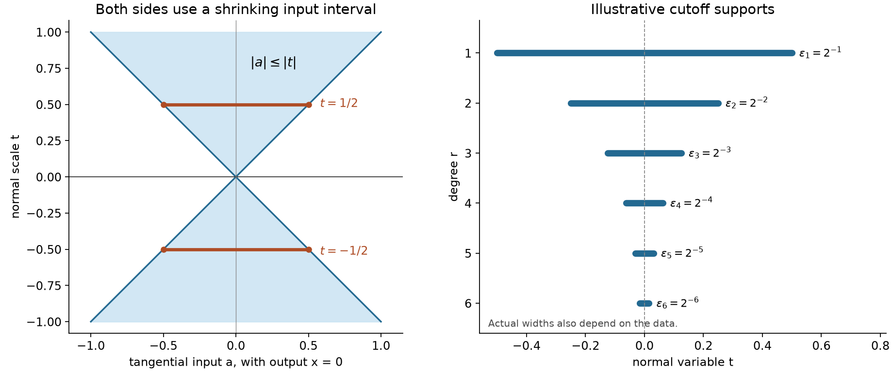

# Smoothing scales and prescribed normal jets

*Written by GPT-6 Astra (OpenAI), October 2026. Public domain (CC0).*

Smoothing at a scale proportional to the distance from a plane can supply derivatives that the boundary data do not have. Multiplication by a suitable normal monomial compensates for the derivatives of that changing scale. This gives extensions of finite jets with exactly the necessary tangential regularity. For an infinite smooth jet, a different construction uses successively thinner cutoff layers; no convergence of the formal Taylor series is required.

The [normal-jet extension](jets-supported-distributions-and-local-operators.md#extending-one-normal-jet-without-losing-derivatives), Lemma 2.1 and formulas (2.3)–(2.8), proves the compact-data extension, including the moment-cancelling kernel and every mixed derivative estimate. We use that construction to obtain an extension for arbitrary data with local seminorm bounds. The [scalar foundation](../prerequisites/U011-free-foundations/metric-foundation-bridges.md), Sections 13.3–13.5, 13.7 and 13.10, supplies the fundamental theorem, finite-coordinate differentiation, uniform convergence of differentiated series and smooth cutoffs. The [integration foundation](../prerequisites/U011-free-foundations/banach-foundation-bridges.md), Sections 15.1 and 16, supplies substitution, product integration and dominated convergence. The [integral Taylor formula](when-a-kernel-is-smooth.md#taylor-estimates-on-compact-neighborhoods) supplies the finite Taylor expansions used below.

We use ordinary derivatives. Tangential variables are \(x\in\mathbb R^n\); a scalar normal variable is \(t\in\mathbb R\), and a normal vector is \(z\in\mathbb R^d\). Multi-indices have nonnegative integer entries, \(\beta!=\prod_i\beta_i!\), and \(z^\beta=\prod_i z_i^{\beta_i}\). The support of a function on an open set is the relative closure of its nonzero set.

## A scale that crosses zero

For \(\phi\in C_c^\infty(\mathbb R^n)\), define

\[
 S_\phi v(x,t)=\int_{\mathbb R^n}v(x-ty)\phi(y)\,dy,
 \qquad
 S_\phi v(x,0)=v(x)\int\phi.
 \tag{J1}
\]

The kernel may be signed or complex. There is no support or growth assumption on \(v\): on each compact set of \((x,t)\), only one compact set of input points is used.

**Lemma 1 (powers of the scale recover derivatives).** Let \(j,k\) be nonnegative integers and \(v\in C^j(\mathbb R^n)\). Then

\[
 F_k(x,t)=t^kS_\phi v(x,t)
 \quad\hbox{belongs to }C^{k+j}(\mathbb R^{n+1}).
 \tag{J2}
\]

It is smooth on \(t\ne0\). At \(t=0\), for \(|\alpha|+\ell\le k+j\),

\[
 \partial_x^\alpha\partial_t^\ell F_k(x,0)=
 \begin{cases}
 0,&\ell<k,\\[1mm]
 \displaystyle
 \frac{\ell!}{(\ell-k)!}(-1)^{\ell-k}
 \int (y\cdot\nabla_x)^{\ell-k}
          \partial_x^\alpha v(x)\,\phi(y)\,dy,
       &\ell\ge k.
 \end{cases}
 \tag{J3}
\]

In the second case the indicated derivative of \(v\) exists, since
\(|\alpha|+\ell-k\le j\). In particular, if \(\int\phi=1\), the \(k\)-th normal trace is \(k!v\).

If \(\operatorname{supp}\phi\subset\overline B(0,R)\), \(T>0\), and \(K\subset\mathbb R^n\) is compact, there is a constant depending only on \(n,j,k,\phi,T\) such that

\[
 \max_{|\alpha|+\ell\le k+j}
 \sup_{K\times[-T,T]}
   |\partial_x^\alpha\partial_t^\ell F_k|
 \le A\max_{|\gamma|\le j}
      \sup_{K+\overline B(0,RT)}|\partial^\gamma v|.
 \tag{J4}
\]

**Proof.** For \(k=0\), differentiating the integrand in (J1) through total order \(j\) gives

\[
 \partial_x^\alpha\partial_t^\ell S_\phi v
 =(-1)^\ell\int
       (y\cdot\nabla_x)^\ell\partial_x^\alpha v(x-ty)
                         \phi(y)\,dy
 \quad(|\alpha|+\ell\le j).
 \tag{J5}
\]

All difference quotients are dominated on the fixed compact input region by the fundamental theorem and bounds on the next available derivative. Continuity at the highest order follows by uniform continuity on that region. For \(j=0\), the same compact uniform-continuity argument proves continuity directly. This proves the base assertion and its estimate.

For \(t\ne0\), change variables to obtain

\[
 F_k(x,t)=t^k|t|^{-n}
        \int v(a)\phi\bigl((x-a)/t\bigr)\,da.
 \tag{J6}
\]

On a neighborhood of a point with \(t\ne0\), the kernel has compact input support and all its derivatives are bounded. Differentiation against the continuous, hence locally integrable, function \(v\) proves smoothness there. The absolute value in the density is necessary on the negative side.

For \(k\ge1\), direct differentiation of (J6), followed by the inverse substitution, gives

\[
 \partial_{x_i}F_k
     =t^{k-1}S_{\partial_i\phi}v,\qquad
 \partial_tF_k=t^{k-1}S_{\psi_k}v,\qquad
 \psi_k(y)=(k-n)\phi(y)-y\cdot\nabla\phi(y).
 \tag{J7}
\]

These formulas hold on both signs of \(t\). Integration by parts for a compactly supported smooth function gives

\[
 \int\partial_i\phi=0,\qquad
 \int y\cdot\nabla\phi=-n\int\phi,\qquad
 \int\psi_k=k\int\phi.
 \tag{J8}
\]

For clarity, the middle identity follows coordinate by coordinate by integrating
\(\partial_i(y_i\phi)=\phi+y_i\partial_i\phi\), whose integral is zero, and then summing.

Induct on \(k\), proving the assertion for every compact smooth kernel simultaneously. The right sides of (J7) extend as \(C^{k-1+j}\) functions by the induction hypothesis. They really are the first derivatives at the plane. The tangential derivatives of \(F_k(x,0)=0\) are zero; the first expression in (J7) has that trace, by (J8) when \(k=1\), and by its factor \(t^{k-1}\) when \(k>1\). The normal difference quotient is
\(h^{k-1}S_\phi v(x,h)\), which tends to \(v(x)\int\phi\) for \(k=1\) and to zero for \(k>1\). This equals the trace of the second expression in (J7). Continuous coordinate partial derivatives give a continuous total derivative: write a coordinate increment as the sum of its coordinate segments and apply the fundamental theorem on each segment. Thus \(F_k\) is \(C^1\), and (J7) now makes it \(C^{k+j}\).

For the trace formula, Taylor expansion in the scalar variable \(t\) in (J1) gives, locally uniformly in \(x\),

\[
 S_\phi v(x,t)=
 \sum_{r=0}^j\frac{(-t)^r}{r!}
       \int (y\cdot\nabla_x)^r v(x)\phi(y)\,dy
       +o(|t|^j).
 \tag{J9}
\]

When \(j=0\), the remainder means \(o(1)\). The Taylor remainder is uniform on a compact input set, and multiplication by the fixed integrable kernel preserves that remainder. Multiply by \(t^k\) and compare with the Taylor expansion of the already proved \(C^{k+j}\) function \(F_k(x,\cdot)\). Equality of coefficients yields the pure normal traces in (J3). Tangential differentiation of those trace identities gives all mixed traces. For \(\ell<k\), differentiating the identically zero trace uses the \(C^{k+j-\ell}\) regularity already established, even when \(|\alpha|>j\).

Finally, apply (J7) at most \(k\) times. Each differentiation before the scale power reaches zero reduces that power by one and replaces the kernel by a fixed derivative or a fixed linear combination of its derivatives multiplied by coordinates. These new kernels have the same support. Any remaining, at most \(j\), derivatives are given by (J5). Bounds on these finitely many kernels, their moments, and \(1,T,\ldots,T^k\) prove (J4), including the values at the plane by continuity. \(\square\)

## Finite jets with their full local regularity

For a compact set \(K\), write
\(\|g\|_{C^r(K)}=\max_{|\gamma|\le r}\sup_K|\partial^\gamma g|\).
This is a seminorm on \(C^r(\mathbb R^n)\); it does not assert boundedness on the whole space.

**Theorem 2 (arbitrary finite normal data).** Let \(m\ge0\), \(d\ge1\), and suppose

\[
 g_\beta\in C^{m-|\beta|}(\mathbb R^n)
 \quad\text{for every }\beta\in\mathbb N^d,\quad|\beta|\le m.
 \tag{J10}
\]

There is a linear extension \(E_mg\in C^m(\mathbb R^{n+d})\) with

\[
 \partial_z^\beta(E_mg)(x,0)=g_\beta(x)
 \quad(|\beta|\le m).
 \tag{J11}
\]

The extension is smooth for \(z\ne0\), can have its normal support in any prescribed neighborhood of zero, and obeys the following local estimate. There are fixed \(R_0<\infty\) and \(A_m<\infty\), depending on the chosen kernels, normal cutoff and dimensions, such that

\[
 \|E_mg\|_{C^m(K\times\mathbb R^d)}
 \le A_m\sum_{|\beta|\le m}
          \|g_\beta\|_{C^{m-|\beta|}(K+\overline B(0,R_0))}
 \tag{J12}
\]

for every compact \(K\). If all data have support in one compact \(M\), the extension has compact support, with tangential projection contained in \(M+\overline B(0,R_0)\).

**Proof.** Use the kernel \(\rho\) constructed in the earlier normal-jet Lemma 2.1, with
\(\int\rho=1\) and all moments of total degree \(1,\ldots,m\) zero. Its complete finite interpolation argument supplies such a compact smooth kernel. Fix \(\theta\in C_c^\infty(\mathbb R^d)\) equal to one near zero, with support in the requested normal neighborhood. For \(z\ne0\), set

\[
 E_mg(x,z)=\theta(z)
       \sum_{|\beta|\le m}\frac{z^\beta}{\beta!}
                 \int g_\beta(x-|z|y)\rho(y)\,dy,
 \qquad
 E_mg(x,0)=g_0(x).
 \tag{J13}
\]

This is a well-defined linear formula for arbitrary data. Each integral uses a compact set, and away from \(z=0\) the same kernel differentiation as in (J6) proves smoothness. It remains to justify regularity at the entire, possibly noncompact, plane and the estimate.

Let \(\operatorname{supp}\rho\subset\overline B(0,R)\) and \(\operatorname{supp}\theta\subset\overline B(0,T)\), where \(T>0\). Fix a compact tangential set \(K\), and choose a compact smooth cutoff \(\eta\) which is one on a neighborhood of \(K+\overline B(0,RT+1)\). Such a cutoff exists by the scalar foundation. For \(x\) in a neighborhood of \(K\) and \(|z|\le T\), every input point \(x-|z|y\) lies in the region where \(\eta=1\). Consequently (J13) agrees there with the same formula for the compact data \(\eta g_\beta\).

For each \(\beta\), the earlier Lemma 2.1 applies with normal multi-index \(\beta\), tangential differentiability \(m-|\beta|\), and total order \(m\). Its proof, formulas (2.6)–(2.8), shows that the \(\beta\)-summand has normal traces zero at every other multi-index through order \(m\), and trace \(g_\beta\) at \(\beta\). Its last step permits any fixed normal cutoff equal to one near zero. Summing this finite list proves \(C^m\) regularity and (J11) on a neighborhood of \(K\times\{0\}\). Every point of the plane lies in such a compact set, so the conclusion is global.

For (J12), use the local estimates in that proof directly on the input region \(K+\overline B(0,RT+1)\). The scaled-kernel derivatives have \(L^1\) bounds \(C|z|^{-a-b}\) for \(a\) normal and \(b\) tangential derivatives. The degree-\(s\) Taylor remainder of \(g_\beta\), \(s=m-|\beta|\), is bounded by
\(C|z|^s\omega(R|z|)\) for \(0<|z|\le1\), where the local modulus \(\omega\) is bounded by twice a constant times its \(C^s\) seminorm on that input region. Multiplication by \(z^\beta\), with all its product-rule derivatives, leaves the power \(|z|^{m-a-b}\), which is bounded for \(a+b\le m\), \(0<|z|\le1\). The polynomial terms use only the same seminorm. For \(1\le |z|\le T\), if this region is present, kernel differentiation has bounded scale factors and uses the zeroth seminorm there. The fixed derivatives of \(\theta\) and the finitely many \(\beta\)'s give (J12) with \(R_0=RT+1\). The estimate passes to \(z=0\) by continuity and holds outside the normal support because the function is zero.

If every \(g_\beta\) is supported in \(M\), the integrand vanishes when \(\operatorname{dist}(x,M)>RT\). Formula (J13) therefore has support in the product of two compact sets, \((M+\overline B(0,RT))\times\operatorname{supp}\theta\). This also proves the stated, slightly larger, support bound. \(\square\)

For one normal coordinate there is another construction using any integral-one kernel \(\phi\). Start with \(U_{-1}=0\). Given \(U_{r-1}\in C^m\) with the first \(r\) prescribed traces, put

\[
 h_r=g_r-\partial_t^rU_{r-1}(\,\cdot\,,0),\qquad
 U_r=U_{r-1}+\frac{t^r}{r!}S_\phi h_r,
 \quad 0\le r\le m.
 \tag{J14}
\]

The trace belongs to \(C^{m-r}\), so \(h_r\) has precisely that regularity. Lemma 1 makes the correction \(C^m\); its traces below \(r\) are zero and its \(r\)-th trace is \(h_r\). Induction proves every prescribed trace for \(U_m\). Multiplying the final answer by a normal cutoff preserves those traces. Unlike (J13), this formula corrects the higher traces created at earlier stages; it does not require vanishing moments. Both constructions are linear.

*Left: with \(n=d=1\) and kernel support \([-1,1]\), the value at \(x=0\) samples only tangential inputs \(|a|\le |t|\), on both sides of the plane. The marked samples at \(t=\pm1/2\) have width one. Right: the illustrative widths \(\varepsilon_r=2^{-r}\), \(r=1,\ldots,6\), show where terms of degree \(r\) can be supported when the fixed cutoff is supported in \([-1,1]\). Theorem 3 chooses widths from the actual data and derivative bounds; these displayed geometric widths alone do not guarantee convergence.*

## Infinitely many jets in one compact support

Let \(K\subset\mathbb R^n\) be compact, and let \(I\subset\mathbb R^d\) be a compact neighborhood of zero. A function in \(C_c^\infty(\mathbb R^n)\) with support in \(K\) is smooth on the whole tangential space, including the boundary of \(K\).

**Theorem 3 (smooth Borel extension with parameters).** For every family
\[
 f_\beta\in C_c^\infty(\mathbb R^n),\qquad
 \operatorname{supp}f_\beta\subset K,\qquad
 \beta\in\mathbb N^d,
 \tag{J15}
\]
there is \(F\in C_c^\infty(\mathbb R^{n+d})\) such that
\[
 \operatorname{supp}F\subset K\times I,\qquad
 \partial_z^\beta F(x,0)=f_\beta(x)
 \quad\text{for every }\beta.
 \tag{J16}
\]
No growth bound on the family \(f_\beta\) is needed.

**Proof.** Choose \(\delta>0\) such that \(\overline B(0,\delta)\subset I\), and choose \(\chi\in C_c^\infty(B(0,\delta))\) equal to one near zero. Enumerate all multi-indices as
\(\beta(1),\beta(2),\ldots\), in nondecreasing total degree, resolving each finite degree lexicographically. Put \(q_r=|\beta(r)|\).

For a scale \(0<\varepsilon\le1\), the \(r\)-th candidate term is
\[
 H_{r,\varepsilon}(x,z)
   =f_{\beta(r)}(x)\frac{z^{\beta(r)}}{\beta(r)!}
                              \chi(z/\varepsilon).
 \tag{J17}
\]
For tangential multi-index \(\gamma\) and normal multi-index \(\nu\), substitution \(w=z/\varepsilon\) in its differentiated polynomial and cutoff gives
\[
 \|\partial_x^\gamma\partial_z^\nu H_{r,\varepsilon}\|_\infty
 \le
 \frac{\|\partial^\gamma f_{\beta(r)}\|_\infty}{\beta(r)!}
 \left\|\partial_w^\nu(w^{\beta(r)}\chi(w))\right\|_\infty
                 \varepsilon^{q_r-|\nu|}.
 \tag{J18}
\]
All constants are finite: the tangential functions and the fixed differentiated cutoff have compact supports.

For \(q_r\ge1\), choose \(\varepsilon_r>0\), at most \(1/r\), small enough that
\[
 \max_{|\gamma|+|\nu|\le q_r-1}
 \|\partial_x^\gamma\partial_z^\nu
                    H_{r,\varepsilon_r}\|_\infty
 \le2^{-r}.
 \tag{J19}
\]
There are finitely many constraints, and every exponent in (J18) is positive in this range. Thus each can be met simultaneously. For \(q_r=0\), which occurs only once, use any \(0<\varepsilon_r\le1\).

Define
\[
 F(x,z)=\sum_{r=1}^\infty H_{r,\varepsilon_r}(x,z).
 \tag{J20}
\]
Fix a total derivative order \(p\). There are only finitely many multi-indices with \(q_r\le p\). Every remaining term and every derivative through order \(p\) is bounded by \(2^{-r}\), by (J19). Consequently the series and all its derivative series converge uniformly on the whole space. Repeated use of the uniform derivative-series theorem from the scalar foundation proves \(F\in C^\infty\), with termwise derivatives of every order.

Each summand is supported in \(K\times\overline B(0,\delta)\). This set is closed and compact, so the sum has support there as well. The use of a ball inside \(I\) ensures this assertion even when \(I\) itself is not star-shaped.

For each fixed summand the cutoff is identically one near \(z=0\). Therefore
\[
 \partial_z^\nu H_{r,\varepsilon_r}(x,0)
  =\begin{cases}
     f_{\beta(r)}(x),&\nu=\beta(r),\\
     0,&\nu\ne\beta(r).
    \end{cases}
 \tag{J21}
\]
Termwise differentiation in the uniformly convergent series gives (J16), because exactly one term contributes to each prescribed trace. This proves the theorem. If \(K\) is empty, every datum and the constructed function are zero. \(\square\)

The scales in this proof depend on the data. Linearity of the finite extension (J13) does not establish linearity or continuity of this infinite-jet construction. Only existence and the stated support and trace properties have been asserted.

## Smooth data on an arbitrary open base

**Corollary 4 (local bounds suffice for an infinite jet).** If \(\Omega\subset\mathbb R^n\) is open and \(f_\beta\in C^\infty(\Omega)\) are arbitrary, there is
\(F\in C^\infty(\Omega\times\mathbb R^d)\) with every trace
\(\partial_z^\beta F(x,0)=f_\beta(x)\). Its normal support can be confined to a fixed compact neighborhood of zero. Tangential compact support is not asserted.

**Proof.** The empty open set is immediate. Choose increasing compact sets \(K_s\subset\Omega\) which contain every compact subset of \(\Omega\) for all sufficiently large \(s\). When \(\Omega=\mathbb R^n\), use the closed balls of integer radius. Otherwise use
\[
 K_s=\{x:|x|\le s,\quad
             \operatorname{dist}(x,\mathbb R^n\setminus\Omega)\ge1/s\}.
 \tag{J22}
\]
The distance function is continuous and 1-Lipschitz, by the triangle inequality. These sets are closed and bounded, hence compact, and are contained in \(\Omega\). A compact subset of \(\Omega\) has positive distance from its closed complement: choose a ball in \(\Omega\) around each point, use finitely many half-radius balls to cover the compact set, and take the minimum of their positive half radii. It is also bounded. These two facts prove the required exhaustion property.

Use (J17) with \(f_{\beta(r)}\) on \(\Omega\). For \(q_r\ge1\), impose (J19) only on \(K_{q_r}\times\mathbb R^d\), using all derivatives through order \(q_r-1\). Those finitely many seminorms are finite; the same positive powers of \(\varepsilon_r\) permit the choice. On any fixed compact base set and at any fixed derivative order \(p\), all sufficiently large degrees satisfy both \(K\subset K_{q_r}\) and \(q_r>p\). Thus the derivative series converge uniformly on that compact set, with the summable bound \(2^{-r}\). There are only finitely many terms of the excluded degrees. The local uniform derivative-series theorem gives smoothness on \(\Omega\times\mathbb R^d\), and (J21) proves every trace. The same fixed cutoff confines the normal support. \(\square\)

## Exercises with complete solutions

**Exercise 1 (introductory: the second trace).** In dimension one let \(v(x)=x^2\), \(\int\phi=1\), and \(\mu_r=\int y^r\phi(y)\,dy\). Compute \(S_\phi v\) and the first four normal traces of \(tS_\phi v\), of orders zero through three.

**Solution.** Expanding the polynomial gives
\[
 S_\phi v=x^2-2\mu_1xt+\mu_2t^2,\qquad
 tS_\phi v=x^2t-2\mu_1xt^2+\mu_2t^3.
 \tag{J23}
\]
The traces are respectively \(0,x^2,-4\mu_1x,6\mu_2\). They verify (J3), including the signs and factorials. In particular, an arbitrary mollifier creates higher normal traces; the recursion (J14) accounts for them. \(\square\)

**Exercise 2 (intermediate: rough highest data).** Prescribe \(m=1\), \(g_0=0\), \(g_1(x)=|x|\) on \(\mathbb R\). Construct a \(C^1\) extension using Lemma 1. Explain why \(t|x|\) is not such an extension on the whole plane and why no extension with these traces can be \(C^2\).

**Solution.** Take any compact smooth integral-one kernel and set \(U(x,t)=tS_\phi(|\,\cdot\,|)(x,t)\). Lemma 1 with \(j=0,k=1\) gives \(U\in C^1\), \(U(x,0)=0\), and \(\partial_tU(x,0)=|x|\). For any fixed \(t\ne0\), the function \(t|x|\) has different left and right derivatives at \(x=0\), so it is not \(C^1\) there. If an extension were \(C^2\), its first normal derivative restricted to the plane would be \(C^1\) in \(x\), contradicting the nondifferentiability of \(|x|\) at zero. Thus the required regularity of the highest trace is exact. \(\square\)

**Exercise 3 (intermediate: positive kernels and moments).** Show that a nonnegative smooth integral-one kernel on \(\mathbb R\) cannot have zero second moment. Starting with an even such kernel \(\rho_0\), construct a signed kernel with integral one and both first and second moments zero.

**Solution.** A nonnegative continuous kernel with integral one is positive on some open interval containing a nonzero point. The integral of \(y^2\rho_0(y)\) over a smaller such interval is positive. Thus its second moment cannot be zero. Let \(\rho_2(y)=\tfrac12\rho_0(y/2)\). Both integrals equal one, both first moments vanish by evenness, and the second moment of \(\rho_2\) is four times that of \(\rho_0\). Consequently
\(\rho=\tfrac43\rho_0-\tfrac13\rho_2\) has all the requested moments. This explains the allowance of signed kernels in (J13). \(\square\)

**Exercise 4 (intermediate: the first three corrections).** For one normal coordinate and \(m=2\), let \(g_0\in C^2\), \(g_1\in C^1\), \(g_2\in C^0\). Write the residuals in (J14) explicitly in terms of the first two moments \(\mu_1,\mu_2\) of a one-dimensional integral-one kernel.

**Solution.** The first term is \(U_0=S_\phi g_0\), whose first two normal traces are \(-\mu_1g_0'\) and \(\mu_2g_0''\). Hence
\[
 h_0=g_0,\qquad h_1=g_1+\mu_1g_0',\qquad
 h_2=g_2-\mu_2g_0''+2\mu_1h_1'.
 \tag{J24}
\]
Indeed, the second trace of \(tS_\phi h_1\) is \(-2\mu_1h_1'\), so subtracting the second trace of \(U_1\) gives the displayed sign. The regularities are \(C^2,C^1,C^0\), respectively. The function
\(S_\phi h_0+tS_\phi h_1+\tfrac12t^2S_\phi h_2\) is \(C^2\) and has exactly the three prescribed traces, by Lemma 1. \(\square\)

**Exercise 5 (advanced: divergent Taylor data).** Let \(h\in C_c^\infty(\mathbb R^n)\) with \(h(x_0)\ne0\), and prescribe \(f_r(x)=(r!)^2h(x)\) for one normal variable. Show that Theorem 3 realizes these data, although the formal Taylor series at \((x_0,0)\) converges at no nonzero normal argument.

**Solution.** All data have support in the fixed compact \(\operatorname{supp}h\), so Theorem 3 applies for any compact normal neighborhood. At \(x_0\), the formal series has terms \(r!h(x_0)t^r\). For fixed \(t\ne0\), the ratio of successive absolute values is \((r+1)|t|\), eventually greater than two. In particular its terms do not tend to zero, which is necessary for convergence since each term is the difference of consecutive partial sums. The constructed function is smooth but cannot be analytic in the normal variable at this point. \(\square\)

**Exercise 6 (advanced: widths chosen without the data).** Fix any positive sequence \(\varepsilon_r\to0\) and a compact smooth cutoff \(\chi\) equal to one near zero. Show that using these widths in
\(\sum_{r\ge1}a_rt^r\chi(t/\varepsilon_r)/r!\) cannot realize every scalar jet by a uniformly convergent series.

**Solution.** Choose \(c>0\) so small that \(\chi(c)=1\), and put
\(a_r=r!r(c\varepsilon_r)^{-r}\). At \(t_r=c\varepsilon_r\), the \(r\)-th summand equals \(r\). These points eventually lie in any fixed compact neighborhood of zero, so the suprema of the individual terms there do not tend to zero. Uniform convergence of a series would force its terms to converge uniformly to zero, by subtracting consecutive partial sums. Hence this choice fails. It does not contradict Theorem 3: its widths are selected after the data are known. \(\square\)

**Exercise 7 (intermediate: two normal coordinates).** Let \(d=2\), \(m=2\), and suppose the only nonzero datum is \(g_{(1,1)}=a\in C^0(\mathbb R^n)\). Write (J13) and all its normal traces through order two. Give the tangential support bound when \(\operatorname{supp}a\subset M\).

**Solution.** With the moment kernel through degree two,
\[
 U(x,z)=\theta(z)z_1z_2
           \int a(x-|z|y)\rho(y)\,dy\quad(z\ne0),\qquad U(x,0)=0.
 \tag{J25}
\]
Theorem 2 gives \(U\in C^2\). Its value, two first derivatives and two pure second normal derivatives are zero on the plane. Its mixed derivative \(\partial_{z_1}\partial_{z_2}U(x,0)\) is \(a(x)\); the reversed derivative is the same by \(C^2\) regularity. If the kernel and normal cutoff have radii \(R,T\), its support has tangential projection in \(M+\overline B(0,RT)\). No derivatives of \(a\) are required. \(\square\)

**Exercise 8 (advanced: necessity and nonuniqueness).** Prove that the regularities in (J10) are necessary for the traces of any \(C^m\) function. Show also that an infinite smooth jet does not determine a unique smooth extension, even with a prescribed compact support neighborhood.

**Solution.** If \(U\in C^m\), then \(\partial_z^\beta U\) is \(C^{m-|\beta|}\); restricting to \(z=0\) and taking its tangential derivatives gives exactly that regularity for the trace. For nonuniqueness choose nonzero compact smooth functions \(b(x)\) and \(c(z)\), with \(c\) supported inside the requested normal neighborhood and equal to one near zero. The scalar foundation's flat function is
\(q(s)=e^{-1/s}\) for \(s>0\), and zero for \(s\le0\); all its derivatives at zero are zero. The function
\(H(x,z)=b(x)c(z)q(|z|^2)\) is smooth by composition and the product rule. Every normal derivative at \(z=0\) vanishes, while \(H\) is not identically zero. Adding \(H\) preserves every prescribed trace. When a fixed tangential compact \(K\) is required, this example applies whenever \(K\) contains the support of a nonzero smooth \(b\), for example when \(K\) has nonempty interior. No nonzero such example is asserted for a compact set with empty interior. \(\square\)

## References

- Lars Hörmander, *The Analysis of Linear Partial Differential Operators I: Distribution Theory and Fourier Analysis*, second edition, Springer, 2003, Theorem 1.2.6 and Theorem 1.3.3–Corollary 1.3.4, pp. 16, 18–19.
- [Jets, supported distributions and local operators](jets-supported-distributions-and-local-operators.md), Lemma 2.1 and formulas (2.3)–(2.8), supplies the complete moment-cancelling compact extension used in Theorem 2.
- [When a kernel is smooth](when-a-kernel-is-smooth.md#taylor-estimates-on-compact-neighborhoods), the integral Taylor proof, supplies the finite expansions and their local uniform remainders.
