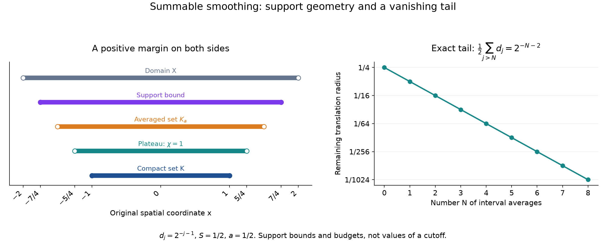

# Summable smoothing and fixed Fourier tests

*Written by GPT-6 Astra (OpenAI), October 2026. Public domain (CC0).*

Directional regularity is usually tested by compact distributions that depend on the derivative order. A nonquasianalytic class admits a simpler test: one compact distribution works at every order. The mechanism is a compact cutoff in the same class. We construct such cutoffs, quantify their derivatives in an arbitrary finite-dimensional norm, and prove the fixed-distribution criterion.

The earlier [derivative-growth lesson](derivative-growth-and-finite-order-localization.md), Lemma 1, Proposition 2 and Theorem 6, proves the fixed-index estimates, algebra properties and full-frequency Fourier criterion. [Cones and derivative-growth wavefronts](cones-and-derivative-growth-wavefronts.md), Lemma 2 and Theorems 3–4, proves the exact conic localization estimates used below. Compactness and continuous extrema have the proofs in the [scalar foundation](../prerequisites/U011-free-foundations/metric-foundation-bridges.md), Sections 12.5–12.7; its Section 13.4 gives the fundamental theorem of calculus. Product integration, domination and affine substitution are proved in the [integration foundation](../prerequisites/U011-free-foundations/banach-foundation-bridges.md), Sections 15.0–15.1 and 16.1–16.2.

The [finite algebra foundation](../prerequisites/U011-free-foundations/stable-prerequisite-bridges.md), Section 10, supplies bases and the alternating determinant identities. We use ordinary derivatives, the Fourier phase \(e^{-ix\cdot\xi}\), and the admissible scales

\[
 L_0=1,\qquad k\le L_k,\qquad L_k\le L_{k+1}\le QL_k .
 \tag{S1}
\]

Here \(C^L(X)\) means that on every compact subset,
\(\lvert\partial^\alpha f\rvert\le A(BL_{|\alpha|})^{|\alpha|}\), with constants independent of \(\alpha\). The expression at order zero is one.

## A smooth probability density from a finite width budget

**Lemma 1 (summable interval averages).** Let \(d_j>0\), \(j\ge1\), with finite sum \(S\). There is a nonnegative \(\rho\in C_c^\infty(\mathbb R)\), of integral one, supported in \([-S/2,S/2]\), such that

\[
 \|\rho^{(k)}\|_1\le \frac{2^k}{d_1\cdots d_k}
 \quad(k\ge0).
 \tag{S2}
\]

An empty product is one. Monotonicity of the widths is not required here.

**Proof.** Put \(H_d=d^{-1}1_{[-d/2,d/2]}\) and
\(\rho_N=H_{d_1}*\cdots*H_{d_N}\). Fubini shows that these functions are nonnegative, have integral one and have support in the sum of the indicated intervals. For a continuous \(f\),

\[
 (H_d*f)'(x)=\frac{f(x+d/2)-f(x-d/2)}d.
 \tag{S3}
\]

Indeed \(H_d*f=d^{-1}\int_{x-d/2}^{x+d/2}f(t)\,dt\), so the fundamental theorem gives (S3). Also \(H_a*H_b\) is continuous and Lipschitz: it is \(1/(ab)\) times the length of the overlap of two intervals, whose change under translation by \(h\) is at most \(2|h|\).

For \(N\ge k+2\), apply (S3) to the first \(k\) factors and leave the next two undifferentiated. It follows inductively that \(\rho_N\) is \(C^k\) and that its \(k\)-th derivative is a signed sum of \(2^k\) translates of the convolution of the remaining densities, divided by \(d_1\cdots d_k\). In particular,

\[
 \|\rho_N^{(k)}\|_1\le\frac{2^k}{d_1\cdots d_k},
 \qquad
 \operatorname{Lip}(\rho_N^{(k)})
 \le M_k:=\frac{2^{k+1}}{d_1\cdots d_{k+2}} .
 \tag{S4}
\]

Convolving a Lipschitz function with a nonnegative density of integral one preserves its Lipschitz bound. If \(M>N\ge k+2\), then \(\rho_M^{(k)}\) is obtained from \(\rho_N^{(k)}\) by averaging translates of size at most \(\frac12\sum_{j>N}d_j\). Consequently

\[
 \|\rho_M^{(k)}-\rho_N^{(k)}\|_\infty
 \le \frac{M_k}{2}\sum_{j>N}d_j .
 \tag{S5}
\]

Each derivative sequence converges uniformly, to a continuous function \(g_k\). Passing to the limit in
\(\rho_N^{(k)}(y)-\rho_N^{(k)}(x)=\int_x^y\rho_N^{(k+1)}(t)\,dt\)
gives \(g_k'=g_{k+1}\). Thus \(\rho=g_0\) is smooth. All functions have support in one fixed compact interval, so uniform convergence also gives convergence in \(L^1\). The integrals, nonnegativity and bounds (S2) follow from the finite ones. \(\square\)

## One-sided averages and their full derivative bounds

Write \(P_a=a^{-1}\mathbf1_{[0,a]}\), and let
\[
 u_N=P_{a_0}*\cdots*P_{a_N},\qquad
 A_N=\sum_{i=0}^N a_i,\qquad a_i>0.                            \tag{B1}
\]
Endpoint values of the indicators do not affect any integral. All finite convolutions are nonnegative, have integral one and are supported in \([0,A_N]\), by finite Fubini and addition of the input supports.

**Corollary 1.1 (one-sided summable averages).** For \(N\ge1\), \(u_N\in C_c^{N-1}(\mathbb R)\). For \(0\le j\le N-1\),
\[
 \begin{aligned}
 \|u_N^{(j)}\|_\infty&\le\frac{2^j}{a_0\cdots a_j},\\
 \|u_N^{(j)}\|_1&\le\frac{2^j}{a_0\cdots a_{j-1}}.
 \end{aligned}                                                \tag{B2}
\]
The second denominator is one when \(j=0\). If \(A=\sum_{i\ge0}a_i<\infty\), these functions and every fixed derivative converge uniformly to a nonnegative \(u\in C_c^\infty(\mathbb R)\), supported in \([0,A]\), with integral one. For every \(j\ge0\),
\[
 |u^{(j)}(x)|\le\frac12\|u^{(j+1)}\|_1
             \le\frac{2^j}{a_0\cdots a_j}.                    \tag{B3}
\]
For \(N\ge j+1\) there is the explicit error bound
\[
 \|u^{(j)}-u_N^{(j)}\|_\infty
 \le\frac{2^{j+1}}{a_0\cdots a_{j+1}}
                   \sum_{i>N}a_i.                           \tag{B4}
\]
No monotonicity of the widths is required for these conclusions.

**Proof.** For continuous \(f\), the fundamental theorem gives
\[
 (P_a*f)'=a^{-1}(f-\tau_af),\qquad \tau_af(x)=f(x-a).
                                                               \tag{B5}
\]
The convolution of two interval densities is continuous and Lipschitz, as proved in Lemma 1 by the overlap-length formula. Apply (B5) to \(j\) of the factors, leaving at least two undifferentiated. This proves the regularity and the exact identity
\[
 u_N^{(j)}
 =\left[\prod_{i=0}^{j-1}a_i^{-1}(1-\tau_{a_i})\right]
       (P_{a_j}*\cdots*P_{a_N}).                              \tag{B6}
\]
It has \(2^j\) signed terms. Each remaining convolution has integral one and supremum at most \(1/a_j\): integrate the bounded factor \(P_{a_j}\) against the other probability densities. Translations preserve both norms. This proves (B2).

The two-interval overlap estimate also gives a Lipschitz constant
\[
 \operatorname{Lip}(u_N^{(j)})
 \le\frac{2^{j+1}}{a_0\cdots a_{j+1}}
 \qquad(N\ge j+1).                                           \tag{B7}
\]
Indeed leave the factors with indices \(j,j+1\) together in (B6), use their Lipschitz constant \(2/(a_ja_{j+1})\), and average over all later densities. Averaging preserves that constant.

For \(M>N\), \(u_M^{(j)}\) is an average of translates of \(u_N^{(j)}\) by numbers in \([0,\sum_{i=N+1}^M a_i]\). Thus (B7) bounds their uniform difference by its constant times that tail. When the total sum is finite, all fixed derivative sequences are uniformly Cauchy. The fundamental-theorem limit argument in Lemma 1 identifies their limits as the derivatives of one smooth function. All supports lie in the same compact interval \([0,A]\), so the convergence is also in \(L^1\); it preserves mass and the bounds in (B2). Letting \(M\to\infty\) proves (B4).

Finally \(g=u^{(j)}\) is compact and smooth. Integration of \(g'\) from either end gives
\[
 |g(x)|\le\min\left(\int_{-\infty}^x|g'|,
                         \int_x^\infty|g'|\right)
          \le\frac12\int_{\mathbb R}|g'|.
\]
Apply the \(L^1\) bound at order \(j+1\) to obtain (B3), including its factor \(1/2\). \(\square\)

**Proposition 1.2 (a divergent sum moves the mass out of every bounded interval).** Suppose \(0<a_i\le B<\infty\) and \(\sum_i a_i=\infty\). The one-sided convolutions in (B1) converge to zero in \(C^\infty\) on every compact interval. More precisely, put
\[
 c_B=\frac{1-e^{-1}}{2B}.
\]
For \(j\ge0\), \(N\ge j+1\), and real \(R\),
\[
 \sup_{x\le R}|u_N^{(j)}(x)|
 \le\frac{2^j}{a_0\cdots a_j}
       \exp\left(\frac R B-c_B\sum_{i=j+1}^N a_i\right).
                                                               \tag{B8}
\]
Every \(u_N\) still has integral one. The conclusion is local convergence, and need not be uniform on the whole line.

**Proof.** For \(0\le t\le B\), convexity of the exponential puts its graph below the chord between the endpoints:
\[
 e^{-t/B}\le1-\frac{1-e^{-1}}{B}t.
\]
Convexity follows, for instance, from its nonnegative second derivative and the fundamental theorem. Averaging over \(0\le t\le a\le B\) gives
\[
 \int e^{-t/B}P_a(t)\,dt\le1-c_Ba\le e^{-c_Ba}.                \tag{B9}
\]
For any finite consecutive product of the densities, write its input variables as \(t_i\). On \(\sum t_i\le R\) one has
\(1\le\exp((R-\sum t_i)/B)\). Integrate this inequality against their product and use Fubini and (B9). The mass of their convolution in \((-\infty,R]\) is at most
\[
 \exp\left(R/B-c_B\sum_i a_i\right).                           \tag{B10}
\]
This proof uses only finite integrals; no infinite product probability space is needed.

The tail density \(P_{a_j}*\cdots*P_{a_N}\), at a point \(x\le R\), is at most \(1/a_j\) times the mass of \(P_{a_{j+1}}*\cdots*P_{a_N}\) in \((-\infty,R]\). This follows directly from integrating that tail over \([x-a_j,x]\). In (B6) every translation has a nonnegative displacement, so all its evaluations still occur at points at most \(R\). Summing its \(2^j\) terms and applying (B10) proves (B8). The tail sum diverges for each fixed \(j\), proving the asserted convergence. The total mass is always one by finite Fubini, so convergence cannot hold in global \(L^1\). Solution 7 also shows why global uniform convergence cannot be asserted. \(\square\)

*Left: for \(a_i=1/(i+1)\), the mean \(A_N/2\) moves to the right. The band of radius one about that mean contains at least \(5/6\) of the mass for every \(N\), by the exact second-moment calculation in Solution 7. It is a mass bound, not a graph of the density. Right: the union of disks of radius \(1/4\) centered on \([-1,2]\), the holomorphic domain in [Derivative budgets and unique jets, Theorem 7](derivative-budgets-and-unique-jets.md#factorial-bounds-and-complex-neighborhoods) for \(K=4\). Dashed boundaries are excluded. [Figure source](../figures/escaping-averages-and-analytic-tubes.py).*

## Directional derivatives in the original norm

**Lemma 2 (a norm-adapted basis).** In a real normed space \(V\) of dimension \(n\ge1\), there is a basis \(e_1,\ldots,e_n\), with coordinate functionals \(\ell_i\), for which

\[
 \|e_i\|=1,\qquad
 |\ell_i(v)|\le\|v\|,\qquad
 \|v\|\le \sum_i|\ell_i(v)|\le n\max_i|\ell_i(v)|.
 \tag{S6}
\]

**Proof.** Start with any basis. The triangle inequality bounds the given norm by a constant times the Euclidean coordinate norm and makes it continuous in those coordinates. Its minimum on the Euclidean unit sphere is positive, by compactness, continuity and positivity of a norm. Hence its closed unit ball is compact in these same coordinates. On the product of \(n\) such balls, maximize the absolute coordinate determinant. The maximum is positive because some scaled basis lies in the balls. A maximizing tuple is a basis, and every member has norm one: otherwise increasing that vector to norm one increases the determinant. Replacing its \(i\)-th column by any unit-ball vector \(v\) multiplies the determinant by \(\ell_i(v)\). Maximality gives \(|\ell_i(v)|\le1\); scaling gives the first inequality for every \(v\). The expansion \(v=\sum_i\ell_i(v)e_i\) and the triangle inequality give the rest. This uses the finite determinant identity, not an ellipsoid comparison. \(\square\)

**Theorem 3 (cutoffs with a prescribed summable budget).** Let \(X\subset V\) be open, \(K\subset X\) compact, \(n=\dim V\ge1\), and

\[
 d=\operatorname{dist}(K,V\setminus X).
 \tag{S7}
\]

Distance to the empty set is infinity. Given a nonincreasing positive sequence \(d_j\) with \(S=\sum_jd_j<d\), there is \(\chi\in C_c^\infty(X)\), equal to one near \(K\), with \(0\le\chi\le1\) and

\[
 |D^k\chi(x)[v_1,\ldots,v_k]|
 \le \frac{(2n^2)^k}{d_1\cdots d_k}
       \prod_{j=1}^k\|v_j\|
 \quad(k\ge1).
 \tag{S8}
\]

**Proof.** If \(K\) is empty take \(\chi=0\). Otherwise \(d>0\): a finite cover of \(K\) by balls whose doubled balls lie in \(X\) supplies a positive uniform distance. Use the coordinates (S6) and coordinate Lebesgue measure. Apply Lemma 1 with widths \(d_j/n\), and take the product \(R\) of \(n\) copies of the resulting density. Its integral is one and its support lies in the norm ball of radius \(S/2\). For \(|\alpha|=k\), Fubini and (S2) imply

\[
 \|\partial^\alpha R\|_1
 \le \frac{(2n)^k}
 {\prod_{i=1}^n(d_1\cdots d_{\alpha_i})}
 \le \frac{(2n)^k}{d_1\cdots d_k}.
 \tag{S9}
\]

For the last inequality, concatenate the \(n\) blocks of indices. The index within each block never exceeds its position in the concatenated list. Since \(d_j\) is nonincreasing, each denominator factor in that list is at least the factor with the corresponding global index.

Choose a finite \(a\) with \(S/2<a<d-S/2\). Write
\(K_a=\{x:\operatorname{dist}(x,K)<a\}\), and set
\(\chi=1_{K_a}*R\). This is a compact smooth function: \(K_a\) is bounded, and differentiation under its integral is justified by the continuous derivatives of the compact smooth factor. It lies between zero and one. It is one on \(K_{a-S/2}\), since every point used in the convolution then belongs to \(K_a\). Its support lies in the closed set
\(\{\operatorname{dist}(x,K)\le a+S/2\}\), which is compact and lies inside \(X\). The derivative supremum is bounded by the corresponding \(L^1\) norm in (S9).

Expand each direction as \(v_j=\sum_i\ell_i(v_j)e_i\) in the \(k\)-linear differential. There are \(n^k\) terms. Bound every coefficient by \(\|v_j\|\) using (S6), and every coordinate derivative by (S9). This gives (S8), in the original norm and for every choice of the directions. \(\square\)

*Theorem 3 in one dimension: \(K=[-1,1]\), \(X=(-2,2)\), \(a=1/2\), and \(d_j=2^{-j-1}\). The density has support radius at most \(1/4\); the cutoff is one on \((-5/4,5/4)\) and has support in \([-7/4,7/4]\). The second panel gives the exact remaining translation radius after \(N\) averages, \(2^{-N-2}\). These are support and error-budget diagrams, not sampled values of the limiting cutoff. [Vector figure](../figures/summable-cutoff-margins.svg) · [Figure source](../figures/summable-cutoff-margins.py).*

## Flat functions and compact cutoffs

A class is **quasianalytic in one dimension** if a member on any connected open interval whose derivatives of every order vanish at one point vanishes throughout that interval. It is **nonquasianalytic** if this implication fails. This definition refers to uniqueness from an infinite jet; it does not assert that a Taylor series converges.

**Theorem 4 (the compact-cutoff equivalence).** For a scale (S1), the following are equivalent:

1. \(C^L\) is nonquasianalytic in one dimension.
2. There is a nonzero compactly supported function in \(C^L(\mathbb R)\).
3. For every \(n\ge1\), open \(X\subset\mathbb R^n\), and compact \(K\subset X\), there is a real \(\chi\in C_c^L(X)\), with \(0\le\chi\le1\), equal to one near \(K\).

**Proof.** For \(1\Rightarrow2\), take a flat witness \(f\) at \(x_0\) and a point where it is nonzero. Reflect and translate the variable so that \(x_0=0\) and this point lies to its right. Among the points of the segment where \(f\ne0\), let \(a\) be their infimum. If \(a>0\), \(f\) vanishes on \((0,a)\), so all its derivatives vanish at \(a\) by continuity. If \(a=0\), flatness was assumed. There are points with \(f\ne0\) arbitrarily close to the right of \(a\). Choose such a point \(a+b\), \(b>0\), with \([a,a+2b]\) lying inside the original interval. Define

\[
 h(t)=
 \begin{cases}
 |f(a+t)f(a+2b-t)|^2,&0<t<2b,\\
 0,&t\notin(0,2b).
 \end{cases}
 \tag{S10}
\]

At each endpoint one factor is flat. All derivatives of the inside expression therefore approach zero there, by Leibniz' rule, and its extension is smooth. It is nonnegative and \(h(b)=|f(a+b)|^4>0\).

Here the growth estimates also survive the extension. On the fixed compact \([a,a+2b]\), use common constants \(A,B\) for \(f\) and its conjugate. In every \(k\)-th derivative of the four factors, monotonicity gives
\(\prod_{\nu=1}^4L_{k_\nu}^{k_\nu}\le L_k^k\), while the multinomial coefficients sum to \(4^k\). Thus \(\|h^{(k)}\|_\infty\le A^4(4BL_k)^k\). At the endpoints the derivatives are zero, so this bound is global. This proves \(2\).

For \(2\Rightarrow3\), first square the absolute value of the nonzero compact function and divide by its positive integral. Translation and dilation give a nonnegative compact \(C^L\) density of mass one with arbitrarily small support about zero. Products in the separate coordinates give such a density \(R\) in \(\mathbb R^n\), with arbitrarily small Euclidean support radius \(r\). The derivative estimates follow from
\(\prod_i L_{\alpha_i}^{\alpha_i}\le L_{|\alpha|}^{|\alpha|}\); scaling merely changes the constant \(B\).

If \(K\ne\varnothing\), choose \(r<a<d-r\), where \(d=\operatorname{dist}(K,\mathbb R^n\setminus X)>0\), and set \(\chi=1_{K_a}*R\). The support and plateau assertions follow exactly as in Theorem 3. Also
\(\|\partial^\alpha\chi\|_\infty\le\|\partial^\alpha R\|_1\le A'(B'L_{|\alpha|})^{|\alpha|}\), using the fixed compact support of \(R\). Hence \(\chi\in C_c^L(X)\). For \(K=\varnothing\) use zero.

Finally, \(3\Rightarrow2\) follows by taking \(n=1\) and a nonempty compact \(K\) in a bounded interval. A nonzero compact function is flat at any point outside its support but does not vanish on \(\mathbb R\), so \(2\Rightarrow1\). \(\square\)

**Corollary 5 (a summable sufficient condition).** If

\[
 \sum_{j=1}^\infty L_j^{-1}<\infty,
 \tag{S11}
\]

then \(C^L\) is nonquasianalytic and admits the cutoffs in Theorem 4. In particular this holds for \(L_j=j^s\), \(j\ge1\), whenever \(s>1\).

**Proof.** In Theorem 3 put \(d_j=\varepsilon/L_j\), choosing \(\varepsilon>0\) so that their sum is smaller than the distance to the complement. Then

\[
 \frac{(2n^2)^k}{d_1\cdots d_k}
 = (2n^2/\varepsilon)^k\prod_{j=1}^k L_j
 \le (2n^2L_k/\varepsilon)^k.
 \tag{S12}
\]

In Euclidean coordinates the coordinate vectors have norm one, so this is the defining \(C^L\) estimate. A nonempty compact \(K\) in a bounded interval gives the nonzero compact function required by Theorem 4. For \(j^s\), monotonicity and the integral of \(t^{-s}\) give
\(\sum_{j\ge1}j^{-s}\le1+1/(s-1)<\infty\); (S1) holds with \(Q=2^s\). \(\square\)

The implication (S11) is sufficient. The compact-cutoff equivalence in Theorem 4 uses the definition of nonquasianalyticity and does not assume a numerical characterization of all scales.

## One compact distribution for every Fourier order

Recall that \((x_0,\xi_0)\notin\operatorname{WF}_L(u)\) means that a bounded sequence \(u_N\in\mathcal E'(X)\) equals \(u\) on a fixed neighborhood \(U\) of \(x_0\), and that on an open cone \(\Gamma\) about \(\xi_0\ne0\),

\[
 |\widehat{u_N}(\xi)|\le A(BL_N/|\xi|)^N
 \quad(N\ge1,\ \xi\in\Gamma).
 \tag{S13}
\]

The constants do not depend on \(N,\xi\). A bounded compact sequence has common compact support and a common finite distributional order, as proved in Lemma 5 of the derivative-growth lesson.

**Theorem 6 (fixed Fourier witnesses).** If \(C^L\) is nonquasianalytic, the following are equivalent for \(u\in\mathcal D'(X)\):

1. \((x_0,\xi_0)\notin\operatorname{WF}_L(u)\).
2. There is \(\chi\in C_c^L(X)\), equal to one near \(x_0\), such that

\[
 |\widehat{\chi u}(\xi)|\le A(BL_N/|\xi|)^N
 \quad\text{for every }N\ge1
 \text{ on one open cone about }\xi_0 .
 \tag{S14}
\]

3. There is one \(v\in\mathcal E'(X)\), equal to \(u\) near \(x_0\), satisfying the same all-\(N\) estimate on one open cone.

In \(1\Rightarrow2\), the support of \(\chi\) may be chosen inside any prescribed neighborhood of \(x_0\) contained in the witness neighborhood \(U\).

**Proof.** Theorem 4 gives such a \(\chi\) with support compactly contained in that neighborhood. The constant sequence \(a_N=\chi\) is controlled in the sense of the earlier conic localization theorem. In detail, for a fixed multi-index \(\alpha\), the fixed-shift estimate gives

\[
 \sup|\partial^{\alpha+\beta}\chi|
 \le C_\alpha D_\alpha^{|\beta|}L_{|\beta|}^{|\beta|}
 \le C_\alpha(D_\alpha L_N)^{|\beta|}
 \quad(|\beta|\le N).
 \tag{S15}
\]

The case \(\beta=0\) is included. Choose an open cone about \(\xi_0\) whose angular closure is contained in \(\Gamma\). The full local-transfer proof, Theorem 3 of the conic lesson, applied to \(a_N\) and (S13), gives (S14) on this smaller cone. That proof keeps both the common polynomial bound outside \(\Gamma\) and the all-order bound within it, so no estimate on the omitted directions is assumed. The support choice was arbitrary as specified. Taking \(v=\chi u\) proves \(2\Rightarrow3\). For \(3\Rightarrow1\), the constant sequence \(u_N=v\) is bounded in \(\mathcal E'(X)\) and satisfies the definition. \(\square\)

**Corollary 7 (compact families of regular directions).** Let \(K\subset X\) be compact, \(F\subset\mathbb R^n\) a closed cone, and
\(\operatorname{WF}_L(u)\cap(K\times(F\setminus\{0\}))=\varnothing\). For every fixed \(\chi\in C_c^L(X)\) supported in \(K\), (S14) holds for all \(\xi\in F\setminus\{0\}\), with constants depending on \(\chi,K,F,u\). A finite order bound for \(u\) near \(K\) remains an order bound for \(\chi u\).

**Proof.** Equation (S15) makes the constant sequence controlled on \(K\). Apply Theorem 4, compact localization, of the conic lesson; its proof gives a single estimate over the full compact angular set and preserves the finite order. No nonquasianalytic assumption is needed for this implication when the stated \(\chi\) is already given. That assumption guarantees the existence of useful plateaux in Theorem 6. \(\square\)

## Exercises with full solutions

**Exercise 1 (an exact tail bound).** Take \(d_j=a2^{-j}\), \(a>0\). Find the support radius of the density in Lemma 1, its derivative \(L^1\) bound, and an explicit uniform error bound for the \(k\)-th derivative after \(N\ge k+2\) factors.

**Solution.** The sum is \(a\) and the tail is \(a2^{-N}\). Also
\(\prod_{j=1}^k d_j=a^k2^{-k(k+1)/2}\). Thus the support radius is at most \(a/2\) and

\[
 \|\rho^{(k)}\|_1\le a^{-k}2^{k+k(k+1)/2},\qquad
 \|\rho^{(k)}-\rho_N^{(k)}\|_\infty
 \le a^{-k-1}2^{\,k+(k+2)(k+3)/2-N}.
 \tag{S16}
\]

The second formula is (S5) with (S4), after letting the upper index tend to infinity. It holds for every real \(x\); the possibly large constant depends on \(k,a\), but not on \(N\). These estimates prove convergence of each fixed derivative, not uniform convergence simultaneously in all orders.

**Exercise 2 (a quantitative Gevrey plateau).** Let \(X=(-2,2)\), \(K=[-1,1]\), and \(s>1\). Give a compact cutoff equal to one near \(K\) with a fully specified derivative bound of order \((k!)^s\).

**Solution.** Set \(B_s=1+1/(s-1)\), \(\varepsilon=(2B_s)^{-1}\), and \(d_j=\varepsilon j^{-s}\). Their sum is at most \(1/2<d=1\). Theorem 3 in the ordinary one-dimensional norm gives
\(\|\chi^{(k)}\|_\infty\le(2/\varepsilon)^k(k!)^s=(4B_s)^k(k!)^s\).
Together with \(0\le\chi\le1\) this covers every order, including zero. Its support is compactly contained in \((-2,2)\). The support and plateau can be chosen with \(a=1/2\), since \(S\le1/2\) gives \(S/2<a<1-S/2\).

**Exercise 3 (why the analytic full-frequency test needs sequences).** Put \(L_k=k\) for \(k\ge1\), and let \(u=1\) near zero. Show that no \(v\in\mathcal E'(\mathbb R)\), equal to \(u\) there, can satisfy (S14) in *all* nonzero frequency directions. Explain why this does not contradict analytic regularity of \(u\).

**Solution.** If it did, the constant sequence \(v\) would meet the full-frequency criterion of Theorem 6 in the derivative-growth lesson. Hence \(v\), regarded as a distribution on \(\mathbb R\), would be represented locally everywhere by a \(C^L\) function, with the local representatives agreeing because their distributions agree. Its Proposition 3 identifies the scale \(k+1\) with the analytic class; \(k\le k+1\le2k\) for \(k\ge1\) shows that the scale here gives the same class. The resulting analytic function is zero off the compact support and is therefore identically zero by the analytic identity argument proved in its Exercise 2. This contradicts \(v=1\) near zero. The original definition allows a bounded sequence whose high derivatives grow with \(N\); the cutoff and Fourier characterization in that lesson apply to the analytic function \(1\). There is no claim here that a fixed witness fails on every individual cone for every analytic distribution.

**Exercise 4 (a fixed Gevrey detector).** In a class \(L_k=k^s\), \(s>1\), suppose that \(\xi_0\) is a regular direction of \(u\) at \(x_0\). Let \(W\) be any open neighborhood of \(x_0\) contained in the neighborhood where its sequence witness agrees with \(u\). Show that a single cutoff supported in \(W\) detects that direction, and give the corresponding exponential Fourier bound.

**Solution.** Choose a closed ball about \(x_0\) compactly contained in \(W\). Corollary 5 and Theorem 6 give one \(\chi\in C_c^L(W)\), equal to one on a neighborhood of that ball, and
\(|\widehat{\chi u}(\xi)|\le A(BN^s/|\xi|)^N\) on a smaller cone. For \(r=|\xi|\) with \(T=(r/(2B))^{1/s}\ge2\), choose \(N=\lfloor T\rfloor\), so \(BN^s/r\le1/2\) and \(N\ge T/2\). Therefore

\[
 |\widehat{\chi u}(\xi)|
 \le A\exp\!\left[-\frac{\log2}{2(2B)^{1/s}}|\xi|^{1/s}\right]
 \quad(T\ge2).
 \tag{S17}
\]

For bounded \(r\), the polynomial bound of the one compact distribution bounds its transform, so increasing the prefactor extends this estimate over the entire smaller cone. The cutoff and cone are fixed for all \(r\).

**Exercise 5 (rescaling the original norm).** Replace \(\|\cdot\|\) in Theorem 3 by \(c\|\cdot\|\), \(c>0\), and every width \(d_j\) by \(cd_j\). Show that the resulting directional bound has the same numerical right side as (S8).

**Solution.** Distances and the width sum are both multiplied by \(c\), so the strict gap assumption is preserved. In order \(k\), the product of direction norms is multiplied by \(c^k\), while the width product is multiplied by the same \(c^k\). They cancel exactly. This shows why it matters to retain the input directions and the original norm in the estimate.

**Exercise 6 (a telescoping width budget).** For \(a_i=d/[(i+1)(i+2)]\), \(d>0\), calculate the support interval, the bound in (B3) and the error bound in (B4).

**Solution.** The identity \(1/[(i+1)(i+2)]=1/(i+1)-1/(i+2)\) gives \(A=d\) and \(\sum_{i>N}a_i=d/(N+2)\). Also
\[
 \prod_{i=0}^j a_i=\frac{d^{j+1}}{(j+1)!(j+2)!}.
\]
Consequently the limit is supported in \([0,d]\), and
\[
 \begin{aligned}
 \|u^{(j)}\|_\infty&\le\frac{2^j(j+1)!(j+2)!}{d^{j+1}},\\
 \|u^{(j)}-u_N^{(j)}\|_\infty
 &\le\frac{2^{j+1}(j+2)!(j+3)!}{d^{j+1}(N+2)}
 \quad(N\ge j+1).
 \end{aligned}                                               \tag{B11}
\]
These estimates have a fixed derivative order; they do not assert a single convergence rate uniform over every order.

**Exercise 7 (local decay without global uniform decay).** Set \(a_i=1/(i+1)\). Prove that \(u_N\to0\) in every local \(C^j\) norm but \(\|u_N\|_\infty\ge5/12\) for all \(N\ge1\). Establish the mass statement in the figure.

**Solution.** The width sum diverges by comparison with \(\int_1^{N+2}dt/t\), and all widths are at most one. Proposition 1.2 proves local convergence. Put \(m_N=A_N/2\) and \(v_N(x)=u_N(x+m_N)\). Direct integration of \(P_a\) gives mean \(a/2\) and centered second moment \(a^2/12\). Finite Fubini applied to the sum of the input variables gives mean \(m_N\); in the centered square all mixed terms vanish because each centered input has integral zero. Thus
\[
 \int x^2v_N(x)\,dx=\frac1{12}\sum_{i=0}^N a_i^2
 \le\frac16.
\]
Here \(\sum_{k\ge1}k^{-2}\le1+\int_1^\infty t^{-2}dt=2\). On \(|x|>1\), \(1\le x^2\), so the mass there is at most \(1/6\). At least \(5/6\) lies in \([-1,1]\), an interval of length two, implying \(\|v_N\|_\infty\ge5/12\). Translation preserves the supremum norm. In the original coordinates this is the asserted band \([m_N-1,m_N+1]\), whose center diverges. Local loss of all mass is consistent with this moving concentration.

## Sources

- Lars Hörmander, *The Analysis of Linear Partial Differential Operators I: Distribution Theory and Fourier Analysis*, second edition, Springer, 2003, Sections 1.3–1.4, especially the summable-convolution construction and Theorem 1.4.2; Section 8.4, the fixed-distribution characterization following Theorem 8.4.5.
- The earlier programme proofs linked above supply the derivative-growth algebra, fixed-shift estimates, conic localization and integration foundations.
