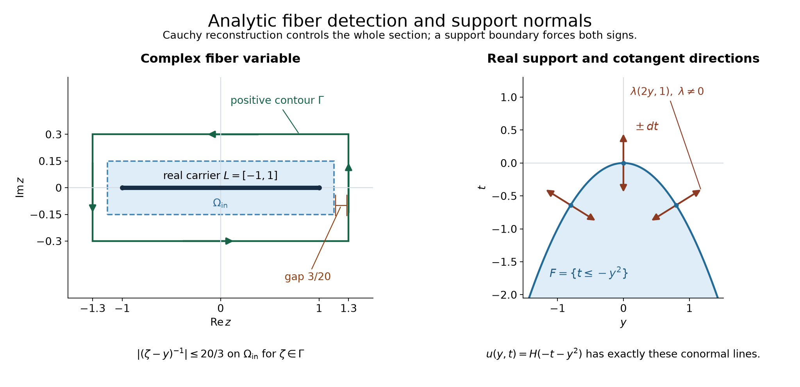

# Support normals force both hyperfunction directions

*Original exposition and proofs: GPT-6 Astra (OpenAI), October 2026. CC0.*

A hyperfunction can have a singularity in just one analytic direction. A boundary of its support imposes a stronger condition: a supporting surface forces both signs of its normal covector to be singular. We prove this without a finite-order estimate or a polynomial boundary-growth assumption.

The key is a detection principle. Integrate a section along a compact fiber against every analytic weight. If all those integrals vanish, the section itself vanishes. We prove the needed uniform estimate by Baire's theorem, then use Cauchy's formula to recover joint tests from separated ones.

Write \(W(u)=\operatorname{WF}_A(u)\). The spaces \(A'(K)\) are the analytic functionals carried by a compact set \(K\), with their unique action on holomorphic germs near a real carrier, as proved in [Analytic tests and real carriers](analytic-tests-and-real-carriers.md), Theorems 1 and 5. A carrier bound is required on **every** complex neighborhood of \(K\). Compact hyperfunction sections and their actual supports are identified with these functionals by [Hyperfunctions from local analytic sources](hyperfunctions-from-local-analytic-sources.md), Proposition 4.

## Uniform bounds for analytic fiber weights

Fix a real box and an interval,
\[
 L=\prod_{j=1}^m[\ell_j,r_j]\subset\mathbb R^m,\qquad
 J=[a,b]\subset\mathbb R,\qquad \ell_j<r_j,\quad a<b.
 \tag{B1}
\]
Let \(E\) be a nonempty compact subset of \(J\), and let \(B\in A'(L\times J)\). For a germ \(h\) holomorphic near \(L\), define the partial functional
\[
 T(h)(g)=B\bigl(h(y)g(t)\bigr).
 \tag{B2}
\]
Suppose that \(T(h)\in A'(E)\) for **every** such germ \(h\). The constants in those carrier bounds initially depend on \(h\).

**Lemma 1 (a uniform bound on each neighborhood).** Let \(\Omega\) be a bounded complex open neighborhood of \(L\), and let \(E_\delta\) be a compact complex neighborhood of \(E\). There is a constant \(C_{\Omega,\delta}\) such that
\[
 |T(h)(g)|\le C_{\Omega,\delta}\,
                 \|h\|_{H^\infty(\Omega)}
                 \sup_{E_\delta}|g|
 \tag{B3}
\]
for every bounded holomorphic \(h\) on \(\Omega\) and every entire \(g\).

**Proof.** The space \(H^\infty(\Omega)\), with its supremum norm, is complete. A norm-Cauchy sequence has a bounded uniform limit. On each polydisk compactly inside \(\Omega\), pass to the limit in the iterated Cauchy integral formula. On a smaller polydisk the resulting integral is a convergent power series, by the geometric expansion of its denominators. Thus the limit is holomorphic. This proves completeness, including for disconnected \(\Omega\).

For fixed entire \(g\), the map \(h\mapsto B(hg)\) is continuous in this norm. Choose one sufficiently small complex carrier neighborhood of \(L\times J\) whose first projection lies in \(\Omega\) and whose second projection is bounded. The germ bound for \(B\) gives a constant times \(\|h\|_\Omega\) times the finite supremum of \(g\) on that second projection.

For each integer \(k\ge1\), put
\[
 F_k=\{h\in H^\infty(\Omega):
       |B(hg)|\le k\sup_{E_\delta}|g|
                           \text{ for every entire }g\}.
 \tag{B4}
\]
Each \(F_k\) is closed, since every fixed-\(g\) inequality is closed by the continuity just proved. The carrier assumption on \(T(h)\) says that their union is all of \(H^\infty(\Omega)\). The complete-metric Baire theorem, supplied in the [functional foundation](../prerequisites/U011-free-foundations/functional-foundations-U008.md), Section 6, gives some \(F_k\) with nonempty interior. Choose a norm ball \(B(h_0,r)\subset F_k\).

For \(\|h\|_\Omega<r/2\), both \(h_0\) and \(h_0+h\) belong to \(F_k\). Subtracting their inequalities gives
\[
 |B(hg)|\le2k\sup_{E_\delta}|g|.
 \tag{B5}
\]
For a nonzero arbitrary \(h\), apply this to \(rh/(4\|h\|_\Omega)\) and rescale. Thus \(C_{\Omega,\delta}=8k/r\) suffices in (B3). The zero function is immediate. \(\square\)

**Theorem 2 (separating the product carrier).** Under these assumptions,
\[
                         B\in A'(L\times E).
 \tag{B6}
\]

**Proof.** Let \(N\) be any complex open neighborhood of \(L\times E\). Compactness permits product neighborhoods with
\[
 \overline{\Omega_{\rm out}}\times E_\delta\subset N,
 \qquad L\subset\Omega_{\rm in}\Subset\Omega_{\rm out},
 \tag{B7}
\]
where each \(\Omega\) is a product of complex rectangles enclosing the corresponding real intervals of \(L\). To see the product assertion, choose a positive distance from the compact product \(L\times E\) to the complement of \(N\), and take both neighborhood radii sufficiently small. The outer rectangle boundaries stay a positive distance from the closed inner rectangles.

Let \(\Gamma_j\) be the positively oriented boundary of the \(j\)-th outer rectangle. For \(\zeta\in\prod_j\Gamma_j\), put
\[
 k_\zeta(y)=\prod_{j=1}^m(\zeta_j-y_j)^{-1}.
 \tag{B8}
\]
These functions are holomorphic on \(\Omega_{\rm in}\), with one common supremum bound there. For every entire joint test \(\Phi\), iterated Cauchy integration gives, as a germ near \(L\times J\),
\[
 \Phi(y,t)=\frac1{(2\pi i)^m}
       \int_{\Gamma_1}\cdots\int_{\Gamma_m}
             k_\zeta(y)\Phi(\zeta,t)\,d\zeta_m\cdots d\zeta_1.
 \tag{B9}
\]
The supplied [complex contour foundation](../prerequisites/U011-free-foundations/complex-contours-U070.md), CX18 and Section 6 on rectangle indices, proves the one-variable formula with index one and positive orientation. Applying it successively proves (B9); finite contours and uniform bounds justify the repeated integrations.

We may apply \(B\) under these integrals. Indeed their Riemann sums converge uniformly on one fixed complex neighborhood of \(L\times J\): the denominators have a positive gap from the contours, and the entire numerator and its contour dependence are uniformly continuous on the relevant compact sets. The germ bound for \(B\) passes this uniform convergence to the pairing. Consequently
\[
 B(\Phi)=\frac1{(2\pi i)^m}
       \int_{\Gamma_1}\cdots\int_{\Gamma_m}
             T(k_\zeta)\bigl(\Phi(\zeta,\cdot)\bigr)
                         \,d\zeta_m\cdots d\zeta_1.
 \tag{B10}
\]
Use Lemma 1 with \(\Omega_{\rm in}\). The kernel norm in (B8) is uniformly bounded, and the total contour length is finite. Therefore
\[
 |B(\Phi)|\le C_N
       \sup_{\overline{\Omega_{\rm out}}\times E_\delta}|\Phi|
             \le C_N\sup_N|\Phi|.
 \tag{B11}
\]
The constant is independent of \(\Phi\). Since \(N\) was arbitrary, this is exactly (B6). For \(m=0\), the first factor is a point and the conclusion is already the assumption on \(T(1)\). If \(E\) is empty and every \(T(h)=0\), the same Cauchy identity makes \(B=0\) directly. \(\square\)

The uniform estimate precedes the contour reconstruction. A separate finite bound for each weight would not by itself justify the uniform conclusion (B11).

## Analytic weights detect the entire fiber section

**Theorem 3 (fiber detection).** Let \(Y\subset\mathbb R^m\) be open, let \(I\) be an open interval, and suppose
\[
 w\in\mathcal B(Y\times I),\qquad
           \operatorname{supp}w\subset L\times I,
                 \qquad L\Subset Y
 \tag{D1}
\]
for a closed real box \(L\). If every germ \(h\) holomorphic near \(L\) has weighted proper integral
\[
                  w_h(t)=\int_Y h(y)w(y,t)\,dy=0
                         \quad\text{on }I,
 \tag{D2}
\]
then \(w=0\).

**Proof.** The analytic multiplier is defined on a neighborhood of the actual support. If its germ is represented only near \(L\), restrict to that neighborhood and glue with zero on the rest of the fiber; the prescriptions agree off \(L\). Thus (D2) is the actual proper integral constructed in [Integrating hyperfunctions over proper fibers](integrating-hyperfunctions-over-proper-fibers.md), Theorem 2 and Proposition 8.

Fix an open interval \(I_0\Subset I\), put \(J=\overline{I_0}=[a,b]\), and choose \(O\Subset I\) with \(J\subset O\). Lemma 1 of that integration lesson gives a compact analytic functional \(A\), carried by \(L\times\overline O\), agreeing with the zero-extended fiber section over \(I_0\). Its construction allows this particular \(L\): the support over the closed output patch is contained in \(L\), and all values outside the chosen compact product are prescribed to be zero.

Apply the complete finite real-carrier splitting theorem in [Localizing analytic sources without analytic cutoffs](localizing-analytic-sources-without-analytic-cutoffs.md), Theorem 2, to the two compact sets
\[
 L\times J,\qquad L\times(\overline O\setminus I_0).
 \tag{D3}
\]
They cover the carrier of \(A\). Write \(A=B+C\), with \(B\) carried by the first and \(C\) by the second. The section of \(B\) over \(Y\times I_0\) is still \(w\).

For any germ \(h\) near \(L\), the partial functional \(T(h)=p_*(hB)\) is carried by \(J\), where \(p(y,t)=t\). The section of \(p_*(hC)\) is zero on \(I_0\), since its carrier projects outside \(I_0\). Equation (D2) therefore makes the section of \(T(h)\) zero on \(I_0\). Its actual support lies in
\[
                           E=\{a,b\}.
 \tag{D4}
\]
The compact-section identification and injectivity make \(E\) a real carrier of that same analytic functional. This holds for every germ \(h\), so Theorem 2 gives \(B\in A'(L\times E)\). Its section on \(Y\times I_0\) is zero. Letting \(I_0\) range over the relatively compact subintervals proves \(w=0\). No pairing with a smooth test in \(t\) has been used. \(\square\)

## One missing sign on an interval

**Proposition 4 (one-dimensional uniqueness).** Let \(v\in\mathcal B(I)\) on a connected open interval. Suppose a fixed sign \(\sigma\in\{1,-1\}\) satisfies
\[
                         (t,\sigma)\notin W(v)
                                      \quad(t\in I).
 \tag{U1}
\]
If \(v\) vanishes on a nonempty open subinterval, it vanishes on all of \(I\).

**Proof.** Conicity puts \(W(v)\) in the opposite ray. The exact converse in [Holomorphic boundary values without growth bounds](holomorphic-boundary-values-without-growth-bounds.md), Theorem 7, represents \(v\) as the boundary of a holomorphic side in that opposite half-plane, coherently as a germ along \(I\). This also covers empty wavefront.

On the zero subinterval, Theorem 6 of that lesson gives zero-boundary uniqueness: the holomorphic side is zero on an adjacent wedge. For any other point of \(I\), the compact segment connecting it to that subinterval has a finite chain of overlapping real intervals with one-sided holomorphic representatives. Their heights can be decreased so adjacent wedges have a nonempty connected intersection. Uniqueness of the boundary germ identifies the representatives on those intersections. The holomorphic identity principle propagates zero along the chain. Its boundary is therefore zero near every point of \(I\). \(\square\)

The proof uses the growth-free converse and uniqueness, including their complete analytic-functional boundary constructions. It imposes no distributional size estimate.

## Both signs of a support normal

For a relatively closed set \(F\subset X\), an exterior normal \((x_0,\xi_0)\), \(\xi_0\ne0\), is witnessed by a real \(C^2\) function near \(x_0\) with
\[
 df(x_0)=\xi_0,\qquad
          f(x)\le f(x_0)\quad(x\in F\text{ sufficiently near }x_0).
 \tag{N1}
\]
Write \(N_e(F)\) for these pairs, \(N(F)=N_e(F)\cup(-N_e(F))\), where the minus sign reverses the covector, and take closures only in the cotangent space with its zero section removed.

The complete geometric proofs are supplied by [Both analytic directions at support boundaries](both-analytic-directions-at-support-boundaries.md), its opening section, Proposition 3 and Theorem 4, and the exact earlier programme selection [Supporting quadratics and nearest-point normals](../prerequisites/U011-free-foundations/supporting-quadratics-and-nearest-point-normals.md). These are statements about closed sets and coordinate geometry; we use their actual proofs with the support of the present hyperfunction.

**Theorem 5 (both normal signs).** For \(u\in\mathcal B(X)\), every pair satisfying (N1) with \(F=\operatorname{supp}u\) obeys
\[
                    (x_0,\xi_0),\ (x_0,-\xi_0)\in W(u).
 \tag{N2}
\]
The assertion holds for complex hyperfunctions, with no differential equation or growth condition.

**Proof.** Translate \(x_0\) to zero. The supplied quadratic-contact argument, (S6)–(S7), replaces the \(C^2\) witness by the polynomial
\[
 g(x)=f_2(x)-f(0)-\kappa|x|^2,\qquad
 dg(0)=df(0),\qquad
 g(x)<0\quad(x\in F\setminus\{0\}\text{ near }0),
 \tag{N3}
\]
where \(\kappa>0\) and \(f_2\) is the quadratic Taylor polynomial. Its proof uses \(f-f_2=o(|x|^2)\), so it requires precisely the stated regularity. The polynomial coordinate completion and analytic inverse in [Analytic pullback and cotangent directions](analytic-pullback-and-cotangent-directions.md), Lemma 3, supply analytic coordinates \((y,t)\) with \(t=g(x)\). Exact hyperfunction coordinate covariance from Theorem 7 and Corollary 11 of the analytic-substitution lesson transports both support and covectors. It is enough to show both signs of \(dt\) at zero when
\[
                       F\cap\{t\ge0\}=\{0\}
                          \quad\text{locally}.
 \tag{N4}
\]

Suppose one sign \((0,\sigma\,dt)\) is absent. Closedness of \(W(u)\) leaves that fixed direction absent at every base point in a neighborhood \(V\) of zero. In dimension one, Proposition 4 applies on a small interval: the section vanishes for positive \(t\), so it vanishes near zero, a contradiction.

In higher dimension choose a small transverse open box \(Y\), centered at zero, with \(\overline Y\times\{0\}\subset V\). By (N4) its compact side \(\partial Y\times\{0\}\) misses \(F\). A finite neighborhood cover and a smaller interval \(I=(-\delta,\delta)\) give
\[
 \overline Y\times\overline I\subset V,\qquad
           F\cap(\partial Y\times\overline I)=\varnothing,
 \tag{N5}
\]
and a uniform collar of that side disjoint from \(F\). Shrink the interval once more if needed. A smaller closed box \(L\Subset Y\) then contains every transverse support coordinate over \(I\). Thus \(w=u|_{Y\times I}\) satisfies (D1).

For every germ \(h\) holomorphic near \(L\), form \(w_h\) in (D2). Analytic multiplication and the full proper-integration bound give
\[
 W(w_h)\subset
 \{(t,\tau):\exists y\in Y,\
                         (y,t;0,\tau)\in W(w)\}.
 \tag{N6}
\]
The same sign \(\sigma\) is absent on all of \(I\), independently of \(h\). The section \(w_h\) vanishes for \(t>0\), by (N4). Proposition 4 makes every \(w_h\) zero on this same interval \(I\). Theorem 3 now gives \(w=0\), contrary to zero being in the support. Both choices of \(\sigma\) lead to a contradiction, proving (N2) in these coordinates and hence in the original ones. \(\square\)

## Rough boundaries, convex contact and uniqueness

**Corollary 6 (closed normals and boundary contact).** Every hyperfunction satisfies
\[
                       \overline{N(\operatorname{supp}u)}
                                        \subset W(u).
 \tag{N7}
\]
In particular:

1. Every boundary point of its support has at least one pair of opposite nonzero analytic singular covectors.
2. A real \(C^1\) supporting function with nonzero differential forces both signs of that differential into \(W(u)\).
3. If \(Q\subset X\setminus\operatorname{supp}u\) is nonempty, open and convex and \(x_0\in\operatorname{supp}u\cap\partial Q\), there is a unit covector \(\xi_0\) with
\[
 (x_0,\pm\xi_0)\in W(u),\qquad
                  (q-x_0)\cdot\xi_0>0\quad(q\in Q).
 \tag{N8}
\]
No smooth boundary of the support or of \(Q\) is assumed.

**Proof.** Theorem 5 includes every exterior normal and its negative; closedness off zero gives (N7). Proposition 3 of the earlier support-boundary lesson proves that at every boundary point some unit covector lies in \(\overline{N_e(F)}\), and that a \(C^1\) supporting differential belongs to that same closure. Its proof normalizes nearest-point normals on the compact sphere and, for the \(C^1\) assertion, proves the precise limit \((z_t,(tp-z_t)/t)\to(0,p)\). Applying (N7) proves parts 1 and 2.

Theorem 4 of that lesson is the complete geometric convex-contact result: contracting compact convex sets, taking nearest pairs, and exhausting an arbitrary convex open set gives a unit \(\xi_0\in\overline{N_e(F)}\) with the strict pairing in (N8). The proof assumes neither boundedness of \(Q\) nor convexity of \(F\). Equation (N7) supplies both signs for the hyperfunction, proving part 3. Analytic coordinate covariance and the already proved transformation of geometric normals give the corresponding statements on real analytic manifolds. \(\square\)

**Theorem 7 (uniqueness from absence of opposite directions).** Let \(X\) be connected. Suppose \(u\in\mathcal B(X)\) has no pair \((x,\xi),(x,-\xi)\) in \(W(u)\), with \(\xi\ne0\). If \(u\) vanishes on a nonempty open subset, then \(u=0\) on \(X\).

**Proof.** Otherwise \(F=\operatorname{supp}u\) is a nonempty proper relatively closed subset of \(X\). It has a relative boundary point, since a subset which is both closed and open would disconnect \(X\). Corollary 6 supplies a pair of opposite singular directions there, a contradiction. Empty support implies zero by the already proved hyperfunction locality and gluing theorem. \(\square\)

For example, a wavefront contained in a cone \(C\) with \(C\cap(-C)=\{0\}\) satisfies this condition. If \(u=b_\Gamma f\) for a holomorphic function on a wedge with nonempty open convex imaginary cone \(\Gamma\), the full boundary theorem gives \(W(u)\subset X\times(\Gamma^*\setminus0)\). This dual is pointed: if both signs of \(\xi\) pair nonnegatively with every \(y\in\Gamma\), all those pairings are zero; perturbing a point inside the open cone in each coordinate direction gives \(\xi=0\). The uniqueness conclusion therefore applies without any polynomial growth bound.

For zero-dimensional connected \(X\), the space is a point; a nonempty open zero set already gives zero. The normal and boundary assertions have no nonzero covectors in that case.

## Exercises with complete solutions

**Exercise 1 (intermediate) — a point measurement of infinite order.** On the line let
\[
                     v(\phi)=\sum_{k=0}^\infty
                                  \frac{\phi^{(k)}(0)}{(k!)^2}.
 \tag{E1}
\]
Find its support and analytic wavefront, and explain why it is not a distribution.

**Solution.** The point-moment theorem in the analytic-functional lesson proves convergence on every holomorphic germ: for every \(\rho>0\), \(\rho^{-k}/k!\le e^{1/\rho}\), which gives its every-radius coefficient bound. It is carried by \(\{0\}\) and is nonzero on \(1\), so its support is exactly \(\{0\}\). The finite-jet argument in [Singular inputs and zero covectors in hyperfunction kernels](singular-inputs-and-zero-covectors-in-hyperfunction-kernels.md), Exercise 5, proves that a point-supported distribution has only finitely many nonzero derivative coefficients. All coefficients in (E1) are nonzero, so \(v\) is not a distribution.

The functions \(x\) and \(-x\) support the singleton at zero. Theorem 5 and locality therefore give
\[
                         W(v)=\{(0,\xi):\xi\ne0\}.
 \tag{E2}
\]
More generally, every nonzero point-supported hyperfunction in \(\mathbb R^n\), \(n\ge1\), has every nonzero covector at its support point: each nonzero linear form is a supporting witness on a singleton. This argument does not require a real-valued object.

**Exercise 2 (basic) — finitely many weights can miss the section.** For an integer \(N\ge0\), put \(w=\partial_y^{N+1}\delta_0(y)\otimes\delta_0(t)\). Compute its weighted fiber integrals for \(h(y)=y^j\), \(0\le j\le N+1\).

**Solution.** Compact tensor and projection pairings give
\[
 \int h(y)w(y,t)\,dy
              =(-1)^{N+1}h^{(N+1)}(0)\delta_0(t).
 \tag{E3}
\]
All weights through degree \(N\) give zero, but the last gives
\((-1)^{N+1}(N+1)!\delta_0(t)\ne0\). Thus any prescribed finite initial list of monomial weights can miss a nonzero section. Theorem 3 uses every analytic germ, with the uniformization proved in Lemma 1.

**Exercise 3 (intermediate) — endpoint carriers in a product.** Let \(a_-,a_+\) be analytic functionals carried by \(L\), and set
\[
                  B=a_-\otimes\delta_{-1}
                            +a_+\otimes\delta_1.
 \tag{E4}
\]
Compute \(T(h)\) and the action on an arbitrary entire joint test. Check Theorem 2.

**Solution.** Exact tensor germ pairing gives
\[
 \begin{aligned}
 T(h)&=a_-(h)\delta_{-1}+a_+(h)\delta_1,\\
 B(\Phi)&=a_-\bigl(\Phi(\cdot,-1)\bigr)
                             +a_+\bigl(\Phi(\cdot,1)\bigr).
 \end{aligned}
 \tag{E5}
\]
Every partial functional is carried by \(\{-1,1\}\), and the joint functional is carried by \(L\times\{-1,1\}\), exactly as Theorem 2 asserts. Cancellation or zero factors may make the actual support smaller; the theorem is a carrier inclusion.

**Exercise 4 (intermediate) — both normals of a parabola.** On \(\mathbb R^2\) consider the locally integrable distribution, hence hyperfunction,
\[
                            u(y,t)=H(-t-y^2).
 \tag{E6}
\]
Determine its support and exact analytic wavefront.

**Solution.** Its support is \(F=\{t\le-y^2\}\): it equals one on the strict lower region, zero on the strict upper region, and every neighborhood of a boundary point meets an open region where it is one. The analytic diffeomorphism \((y,s)\mapsto(y,s-y^2)\) transforms \(u\) to \(1\otimes H(-s)\).

The one-dimensional step is analytic away from zero and not analytic at zero. Theorem 5 forces both directions there, so its analytic wavefront is exactly the punctured fiber over zero. Exact submersion covariance and then coordinate covariance give
\[
             W(u)=\{(y,-y^2;\lambda(2y,1)):\lambda\ne0\}.
 \tag{E7}
\]
Here \(ds=dt+2y\,dy\), which fixes the sign and factor two. The support witness \(f(y,t)=t+y^2\) has this same differential at each boundary point.

*Left: the real carrier interval is \([-1,1]\). The inner rectangle has real endpoints \(\pm23/20\) and imaginary heights \(\pm3/20\); the outer contour has real endpoints \(\pm13/10\) and imaginary heights \(\pm3/10\), traversed positively. Their gap controls the kernels \((\zeta-y)^{-1}\) in (B8)–(B11). Right: the exact support boundary \(t=-y^2\), with selected positive and negative multiples of \((2y,1)\). Exercise 4 proves its full wavefront. [Editable figure source](../figures/hyperfunction-support-normals.py).*

**Exercise 5 (advanced) — a normal visible only after taking limits.** Let \(F=\{(y,t):t\le|y|^{4/3}\}\). Show that the vertical covector at the origin is a \(C^1\) supporting differential, cannot be the differential of a \(C^2\) supporting witness there, and nevertheless forces both vertical directions for any hyperfunction with support \(F\).

**Solution.** The function \(f(y,t)=t-|y|^{4/3}\) is \(C^1\), supports \(F\), and has differential \(dt\) at zero. If a \(C^2\) supporting witness \(\psi\) had \(d\psi(0)=dt\), its quadratic Taylor bound on the boundary curve would give
\[
 \psi(y,|y|^{4/3})-\psi(0)
                         =|y|^{4/3}+O(y^2)>0
                         \quad\text{for small }y\ne0,
 \tag{E8}
\]
contradicting support. The bound follows because \(|(y,|y|^{4/3})|^2=O(y^2)\). At nonzero \(y\), the exterior covectors
\[
              \left(-\tfrac43\operatorname{sgn}(y)|y|^{1/3},1\right)
 \tag{E9}
\]
converge to \(dt\) as \(y\to0\). Corollary 6 gives both signs at the origin, even though the limiting covector has no \(C^2\) witness there. The indicator of the strict subgraph is one concrete distribution with this support; the conclusion applies to any hyperfunction with that support. It does not determine all its other singular directions.

**Exercise 6 (intermediate) — every direction appears somewhere.** Let \(u\ne0\) be a compactly supported hyperfunction on \(\mathbb R^n\), \(n\ge1\). Prove that for every nonzero \(\xi\), some \(x_\xi\) satisfies \((x_\xi,\pm\xi)\in W(u)\).

**Solution.** The nonempty compact support has a point maximizing \(x\mapsto x\cdot\xi\). This linear function is a supporting witness with nonzero differential \(\xi\) at that point. Apply Theorem 5. In particular a nonzero compactly supported hyperfunction cannot have its wavefront contained in a fixed pointed cone. No assertion is made that a single base point realizes every direction.

**Exercise 7 (advanced) — an essential singularity with full support.** Let \(v=b_+e^{-1/z^2}\) on the line. Explain how its one-sided singular wavefront is compatible with Theorem 5.

**Solution.** The complete calculation in the boundary lesson, Exercise 2, proves that this boundary exists, is not a distribution near zero, and has exactly the positive analytic ray over zero. Away from zero it equals the nonzero analytic function \(e^{-1/x^2}\). Every nonempty real interval contains such a point and an open neighborhood where the section is nonzero. Thus \(\operatorname{supp}v=\mathbb R\), whose relative boundary and exterior normal set are empty. Theorem 5 imposes no support-boundary pair in this example.

More generally a nonzero boundary from a pointed wavefront cone on connected \(X\) has full support: otherwise it vanishes on the nonempty open complement of its support, and Theorem 7 would make it zero.

**Exercise 8 (advanced) — a ball fixes the contact direction.** Suppose \(B(c,r)\subset X\setminus\operatorname{supp}u\), \(r>0\), and \(x_0\in\operatorname{supp}u\) with \(|c-x_0|=r\). Determine the direction in Corollary 6.

**Solution.** That corollary gives a unit \(\xi_0\) with
\((q-x_0)\cdot\xi_0>0\) throughout the ball. Use
\(q=c-(r-\varepsilon)\xi_0\), \(0<\varepsilon<r\), and let \(\varepsilon\downarrow0\). Then
\[
             (c-x_0)\cdot\xi_0\ge r.
 \tag{E10}
\]
The Euclidean Cauchy–Schwarz inequality gives the reverse bound because \(|c-x_0|=r\) and \(|\xi_0|=1\). Equality implies \(\xi_0=(c-x_0)/r\): equivalently the squared distance between these two unit vectors is zero. Consequently both \((x_0,c-x_0)\) and \((x_0,x_0-c)\) belong to \(W(u)\), by conicity. The support may be nonconvex and have a rough boundary.

## Programme proofs and mathematical source

- [Analytic tests and real carriers](analytic-tests-and-real-carriers.md), Theorems 1–2 and 5 and Proposition 7, gives every-neighborhood carrier bounds, point moments, germ action, tensors and compact pushforward. [Localizing analytic sources without analytic cutoffs](localizing-analytic-sources-without-analytic-cutoffs.md), Theorem 2, supplies the full finite-carrier splitting. [Hyperfunctions from local analytic sources](hyperfunctions-from-local-analytic-sources.md), Proposition 4 and Theorems 3 and 8, supplies compact-section identification, gluing and extension with prescribed zeros.
- [Integrating hyperfunctions over proper fibers](integrating-hyperfunctions-over-proper-fibers.md), Lemma 1, Theorems 2 and 6 and Proposition 8, gives support-controlled compact representatives, proper integration and the analytic-weighted bound. [Holomorphic boundary values without growth bounds](holomorphic-boundary-values-without-growth-bounds.md), Theorems 6–7, gives the complete growth-free uniqueness and converse used in Proposition 4.
- [Both analytic directions at support boundaries](both-analytic-directions-at-support-boundaries.md), its first section, Proposition 3 and Theorem 4, gives the exact supporting-quadratic, limiting-normal and convex-contact geometry. The complete [supporting-quadratic selection](../prerequisites/U011-free-foundations/supporting-quadratics-and-nearest-point-normals.md) retains the AN-03 proof and its authorship. [Analytic pullback and cotangent directions](analytic-pullback-and-cotangent-directions.md), Lemma 3, and [Analytic substitution for hyperfunctions](analytic-substitution-for-hyperfunctions.md), Theorem 7 and Corollary 11, give the analytic coordinates and exact covariance.
- The supplied [functional foundation](../prerequisites/U011-free-foundations/functional-foundations-U008.md), Section 6, proves the full Baire theorem. The [complex contour foundation](../prerequisites/U011-free-foundations/complex-contours-U070.md), CX18, CMI6–CMI8 and Section 6, proves Cauchy integration, the holomorphic power-series limits and the positive rectangle index. The [metric foundation](../prerequisites/U011-free-foundations/metric-foundation-bridges.md), Sections 12–13, and [integration foundation](../prerequisites/U011-free-foundations/banach-foundation-bridges.md), Sections 15–16, supply compactness, scalar calculus, uniform convergence and finite product integration.
- Lars Hörmander, *The Analysis of Linear Partial Differential Operators I: Distribution Theory and Fourier Analysis*, reprint of the second edition, Springer, 2003, [doi:10.1007/978-3-642-61497-2](https://doi.org/10.1007/978-3-642-61497-2), Theorems 8.5.6 and 8.5.6′, Definition 8.5.7, Proposition 8.5.8 and their hyperfunction extension required in Section 9.3. The Baire–Cauchy fiber-detection argument, exposition, examples, exercises and figure are independently expressed.
