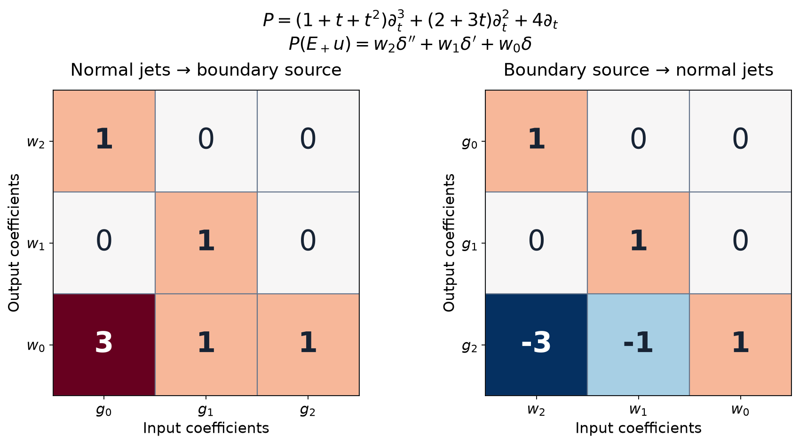

# Supported division and one-sided Cauchy data

A hyperfunction solution on one side of a surface always has extensions across it, but those extensions need not have the same boundary source. A noncharacteristic analytic equation selects one extension: applying the equation leaves only finitely many normal derivatives of a delta. Their coefficients determine its Cauchy data.

The construction uses analytic test functions. We solve a transpose Cauchy problem near the support, retain a uniform estimate for its solution, and transpose that solution map. This produces division for arbitrary hyperfunctions supported on the surface, including sources of infinite distributional order.

## The equation and the available proofs

Let \(X\subset\mathbb R^n\) be open, with coordinates \((x',t)\), and put
\[
 X_+=X\cap\{t>0\},\quad X_-=X\cap\{t<0\},\quad
 X_0=X\cap\{t=0\}=Y\times\{0\}.
 \tag{S1}
\]
Here \(Y\) is open in \(\mathbb R^{n-1}\). We use ordinary derivatives and complex-linear pairings. Let \(P\) have analytic, possibly complex-valued coefficients, total order \(m\geq1\), and write
\[
 P=\sum_{k=0}^m P_k(x',t,\partial')\partial_t^k,\qquad
 \operatorname{ord}P_k\leq m-k,\qquad
 P_m=a(x',t),\quad a(x',0)\neq0.
 \tag{S2}
\]
Thus the plane is noncharacteristic. The formal transpose is
\[
 {}^tP\phi=\sum_{|\alpha|\leq m}(-\partial)^\alpha(a_\alpha\phi).
 \tag{S3}
\]
Its top normal coefficient is \((-1)^ma\), also nonzero on the plane.

We use [Analytic tests and real carriers](analytic-tests-and-real-carriers.md), Theorem 5 and Proposition 7, for germ action, differentiation, tensors and analytic multiplication. [Hyperfunctions from local analytic sources](hyperfunctions-from-local-analytic-sources.md), Proposition 4 and Theorems 3, 6 and 8, identifies compact sections with analytic functionals, proves locality and gluing, and extends sections without requiring a smooth cutoff. [Analytic Cauchy data on small polydiscs](analytic-cauchy-data-on-small-polydiscs.md), Theorems 4–5 and Corollary 6, supplies quantitative existence and uniqueness of analytic Cauchy germs. [Noncharacteristic equations for hyperfunctions](noncharacteristic-equations-for-hyperfunctions.md), Proposition 5 and Theorem 6, supplies two-sided traces and Holmgren uniqueness.

For \(v_j\in\mathcal B(Y)\), the notation \(v_j\otimes\delta^{(j)}\) means its tensor with the ordinary \(j\)-th derivative of the point delta in \(t\), restricted to \(X\). On compact representatives its pairing is
\[
 (v_j\otimes\delta^{(j)})(\phi)
       =v_j\bigl((-\partial_t)^j\phi(\,\cdot,0)\bigr).
 \tag{S4}
\]
This convention fixes every sign below.

## One bound for all transpose tests

**Lemma 1 (the transpose solution map near a compact set).** Let \(K\subset X_0\) be compact, with projection \(K'\subset Y\). For entire \(\psi(z',t)\) and entire \(\psi_0(z'),\ldots,\psi_{m-1}(z')\), there is a unique holomorphic germ along \(K\) satisfying
\[
 {}^tP\Phi=\psi,\qquad
       (-\partial_t)^j\Phi(z',0)=\psi_j(z'),\quad 0\leq j<m.
 \tag{S5}
\]
The germ depends linearly on these inputs. For every complex neighborhood \(Q\) of \(K\) and \(Q'\) of \(K'\), there are a complex neighborhood \(\omega\) of \(K\) and a constant \(C\), independent of the inputs, such that a representative of this germ satisfies
\[
 \sup_\omega|\Phi|
       \leq C\left(\sup_Q|\psi|+\sum_{j<m}\sup_{Q'}|\psi_j|\right).
 \tag{S6}
\]
Infinite right sides are allowed; bounded smaller neighborhoods suffice for the estimates.

**Proof.** Holomorphically extend the finitely many coefficients near \(K\). At each of its points, normalize the nonzero leading normal coefficient of \({}^tP\). Choose a small closed tangential polydisc, with a larger concentric polydisc still inside \(Q'\), and a full complex neighborhood inside \(Q\) and the coefficient domain. The radii and coefficient bounds are fixed before choosing the inputs.

The polynomial
\[
 \Phi_0(z',t)=\sum_{j<m}\frac{(-1)^j\psi_j(z')}{j!}t^j
 \tag{S7}
\]
has the prescribed jets. Cauchy estimates on the larger tangential polydisc bound all its tangential derivatives used by \({}^tP\), on the smaller input polydisc, by a fixed constant times \(\sum_j\sup_{Q'}|\psi_j|\). Its finite normal derivatives have the same kind of bound. After normalization, the forcing for the zero-data remainder is \(\psi-{}^tP\Phi_0\), divided by the leading coefficient.

The thin-polydisc theorem chooses a normal thickness from the fixed coefficient bounds and tangential radius. Its estimate
\(\|v\|\leq2(R\delta)^m\|f\|/m!\) on the smaller output polydisc gives (S6) there, after adding \(\Phi_0\). In particular, neither the output neighborhood nor its constant depends on the tests.

Use finitely many such polydiscs whose smaller outputs cover \(K\). Their normal centers are all zero. Any nonempty intersection of two output polydiscs is connected and meets \(t=0\); their tangential intersections are products of convex disk intersections. On this slice the data agree. Germ uniqueness gives agreement on a nonempty open subset of every intersection, and the identity principle gives agreement throughout it. The solutions therefore glue on their union \(\omega\). Take the largest of the finitely many constants. Germ uniqueness at each point of \(K\) proves uniqueness along \(K\), and also proves linearity. \(\square\)

The test neighborhoods in (S6) are arbitrary. This is the feature needed for an analytic functional to have precisely the stated real carrier.

## Dividing a source supported on the plane

**Theorem 2 (supported division with exact support).** Every \(f\in\mathcal B(X)\) supported in \(X_0\) has a unique decomposition
\[
 f=Pv+\sum_{j=0}^{m-1}v_j\otimes\delta^{(j)},\qquad
 v\in\mathcal B(X),\quad\operatorname{supp}v\subset X_0,\quad
 v_j\in\mathcal B(Y).
 \tag{S8}
\]
The components depend linearly and locally on \(f\), and
\[
 \operatorname{supp}f
    =\operatorname{supp}v\ \cup\
                \bigcup_{j<m}\bigl(\operatorname{supp}v_j\times\{0\}\bigr).
 \tag{S9}
\]

**Proof: compact uniqueness.** First suppose all supports in (S8) lie in one compact \(K\subset X_0\). The compact-section theorem identifies these hyperfunctions with \(f,v\in A'(K)\) and \(v_j\in A'(K')\). Equality (S8) is equivalent to
\[
 f(\phi)=v({}^tP\phi)
           +\sum_{j<m}v_j\bigl((-\partial_t)^j\phi(\,\cdot,0)\bigr).
 \tag{S10}
\]
It holds for holomorphic germs near \(K\), not just entire tests. Indeed all terms have continuous germ action with a bound on each neighborhood; the entire approximation and its derivative convergence on smaller neighborhoods in the germ-action theorem extend the entire-test equality to these germs.

If \(f=0\), take \(\phi=\Phi\) from (S5). The entire inputs \(\psi,\psi_j\) are independent. Setting all but one to zero shows successively that \(v\) and every \(v_j\) vanish on all entire tests. They are zero analytic functionals. This proves compact uniqueness.

**Proof: compact existence and support.** Now let \(f\) have compact support \(K\subset X_0\). Define linear functionals by
\[
 v(\psi)+\sum_{j<m}v_j(\psi_j)=f(\Phi),
 \tag{S11}
\]
where each individual component is obtained by setting the other inputs to zero. The germ \(\Phi\) is unique, so this is well-defined. The bound for \(f\) on the neighborhood \(\omega\) in Lemma 1 gives
\[
 |f(\Phi)|\leq C_f C
       \left(\sup_Q|\psi|+\sum_{j<m}\sup_{Q'}|\psi_j|\right).
 \tag{S12}
\]
Since \(Q,Q'\) were arbitrary, \(v\in A'(K)\) and \(v_j\in A'(K')\). Given an entire \(\phi\), choose the inputs \({}^tP\phi\) and its signed normal jets as germs on the fixed coefficient neighborhood. Equivalently apply Lemma 1 to these holomorphic inputs on smaller neighborhoods; its proof and estimate use no values outside those neighborhoods. Uniqueness gives \(\Phi=\phi\) near \(K\). Thus (S10) holds and proves (S8).

Here the extension of (S11) from entire inputs to germs can also be checked by entire approximation: approximate each input on a larger neighborhood, use (S6) to obtain convergence of its solution germs on one smaller neighborhood, and pair with \(f\). This agrees with the unique germ action of the constructed \(v,v_j\). Therefore the use of \({}^tP\phi\), whose coefficients need not be entire, introduces no extra assumption.

The construction puts every component inside \(\operatorname{supp}f\). Any other compact decomposition agrees with it by compact uniqueness, applied on the union of the compact supports. Conversely (S8) and locality put \(\operatorname{supp}f\) inside the union of component supports. This proves (S9) in the compact case, including the empty-support case.

**Proof: local compact replacements.** Choose any relatively compact open \(V\Subset Y\). On \(X\cap(V\times\mathbb R)\) retain \(f\), and on \(X\setminus(\overline V\times\{0\})\) prescribe zero. On their overlap \(t\neq0\), and \(f=0\), so the sections glue. The extension theorem extends this glued section to \(X\). Call it \(f_V\). It agrees with \(f\) on the first open set and with zero on the second, hence
\[
 \operatorname{supp}f_V\subset\overline V\times\{0\}.
 \tag{S13}
\]
This is compact in \(X\). No multiplication of a hyperfunction by a smooth cutoff occurs.

Divide \(f_V\) by the compact result. For two choices \(V,W\), subtract the compact decompositions. Equation (S9) for their difference implies that their components agree wherever \(f_V=f_W\), in particular over \(V\cap W\). The \(v\)-components on the corresponding tubes, together with zero off \(X_0\), therefore glue; so do the \(v_j\)-components on \(Y\). They give (S8) on all of \(X\).

**Proof: uniqueness, locality and support for arbitrary sections.** Consider a decomposition of zero. Near a chosen point of \(X_0\), replace \(v\) by a compact section supported on the plane and agreeing with it on a smaller tube, using (S13)'s construction. Replace each \(v_j\) by a compact extension agreeing on the smaller tangential neighborhood; the support-controlled extension theorem on \(Y\) does this. Form the compact source from these replaced components. It is zero on the smaller tube, since the original decomposition was zero. Compact equality (S9) forces every replaced component to be zero there. Hence the original components vanish near the chosen point. They vanish everywhere by locality.

Subtracting two decompositions now proves uniqueness and linearity. Restricting (S8) to a smaller open subset and using uniqueness proves locality. The same argument on a neighborhood where \(f=0\) makes all components zero there, giving one inclusion in (S9); (S8) gives the other. \(\square\)

## The canonical extension from one side

**Corollary 3 (a unique extension with a finite boundary source).** If \(u\in\mathcal B(X_+)\) satisfies \(Pu=0\), there is a unique \(E_+u\in\mathcal B(X)\) such that
\[
 E_+u=u\text{ on }X_+,\qquad E_+u=0\text{ on }X_-,
 \qquad
 P(E_+u)=\sum_{j<m}w_j\otimes\delta^{(j)}
 \tag{S14}
\]
for \(w_j\in\mathcal B(Y)\). The extension and its coefficients are linear and local. If all \(w_j\) vanish, \(u\) vanishes on a neighborhood of \(X_0\) within \(X_+\).

**Proof.** First extend the section which equals \(u\) on \(X_+\) and zero on \(X_-\), using the hyperfunction extension theorem. Call an extension \(U\). Its source \(PU\) is supported in \(X_0\). Divide it by Theorem 2:
\(PU=Pv+\sum w_j\otimes\delta^{(j)}\), and set \(E_+u=U-v\).
The support of \(v\) ensures the required side values.

If two extensions have the required form, their difference \(h\) is supported on \(X_0\), and
\[
 0=Ph-\sum_{j<m}(w_j-\widetilde w_j)\otimes\delta^{(j)}.
 \tag{S15}
\]
Uniqueness in Theorem 2 forces \(h=0\) and equality of the coefficients. This also proves independence of the initial arbitrary extension, linearity and locality. If the coefficients vanish, \(P(E_+u)=0\) while \(E_+u=0\) on the negative side. Holmgren uniqueness at each point of the noncharacteristic plane gives zero on a neighborhood of that point. Their union proves the final assertion. \(\square\)

The last conclusion is local near the plane. It does not identify components of \(X_+\) that never meet that plane.

## From boundary sources to normal jets

**Proposition 4 (the exact jump matrix).** For \(g=(g_0,\ldots,g_{m-1})\in\mathcal B(Y)^m\), define
\[
 (J_Pg)_\ell=
 \sum_{k=\ell+1}^m\ \sum_{j=\ell}^{k-1}
 (-1)^{j-\ell}\binom j\ell
       (\partial_t^{\,j-\ell}P_k)(x',0,\partial')g_{k-1-j},
 \qquad 0\leq\ell<m.
 \tag{S16}
\]
This is a bijective linear map \(\mathcal B(Y)^m\to\mathcal B(Y)^m\), with an inverse given by finitely many analytic multiplications and tangential differentiations. Its row \(\ell=m-1-r\) is
\[
 (J_Pg)_{m-1-r}=a(x',0)g_r+
                 \text{terms involving only }g_0,\ldots,g_{r-1}.
 \tag{S17}
\]
For a \(C^m\) function \(u\) on the closed positive side, with \(g_r=\partial_t^ru|_{t=0}\), its distributional extension by zero satisfies
\[
 P(1_{\{t>0\}}u)
    =1_{\{t>0\}}Pu+
                  \sum_{\ell<m}(J_Pg)_\ell\otimes\delta^{(\ell)}.
 \tag{S18}
\]

**Proof.** Integration by parts on \(t>0\) gives the endpoint sign
\[
 \partial_t(1_{\{t>0\}}u)
       =1_{\{t>0\}}\partial_tu+g_0\otimes\delta.
 \tag{S19}
\]
Induction gives
\[
 \partial_t^k(1_{\{t>0\}}u)
 =1_{\{t>0\}}\partial_t^ku+
              \sum_{j=0}^{k-1}g_{k-1-j}\otimes\delta^{(j)}.
 \tag{S20}
\]
For an analytic coefficient \(c(x',t)\), the definition of delta derivatives and the finite Leibniz rule give
\[
 c(x',t)\bigl(h(x')\otimes\delta^{(j)}(t)\bigr)
   =\sum_{r=0}^j(-1)^r\binom jr
       \bigl((\partial_t^rc)(x',0)h\bigr)\otimes\delta^{(j-r)}.
 \tag{S21}
\]
For arbitrary hyperfunction \(h\), this follows first on compact analytic-functional representatives by pairing germs, then locally by extension and gluing. Tangential differentiation acts on \(h\) before the coefficient multiplication. Applying \(P_k\) to (S20) and collecting the coefficient of \(\delta^{(\ell)}\) gives precisely (S16) and (S18).

In row \(\ell=m-1-r\), the index \(k-1-j\) is at most \(r\). Equality forces \(k=m,j=\ell\); its coefficient is \(P_m=a\), proving (S17). Since \(a(x',0)\neq0\), its reciprocal is analytic. The rows in the order \(m-1,m-2,\ldots,0\) therefore determine \(g_0,g_1,\ldots,g_{m-1}\) successively and uniquely. Each step is an allowed analytic differential operation. \(\square\)

For example, in one normal variable take
\[
 P=(1+t+t^2)\partial_t^3+(2+3t)\partial_t^2+4\partial_t.
 \tag{S22}
\]
Then
\[
 \begin{pmatrix}
 w_2\\
 w_1\\
 w_0
 \end{pmatrix}
   =\begin{pmatrix}
 1&0&0\\
 0&1&0\\
 3&1&1
 \end{pmatrix}
 \begin{pmatrix}
 g_0\\
 g_1\\
 g_2
 \end{pmatrix},
 \qquad
 g_2=w_0-w_1-3w_2.
 \tag{S23}
\]

The two matrices give the exact forward map in (S23) and its inverse. Rows and columns retain the displayed order of the data. The coefficient \(3\) includes normal derivatives of the coefficients of \(P\). Replacing every coefficient by its value at zero before differentiating would give a different matrix.

## Distributional solutions really have the stated traces

We give the distributional regularity argument needed for comparison. The order in the next theorem is the order in \(t\); the tangential operators may have any finite differential orders.

**Theorem 5 (normal regularity, including an extendible endpoint).** Let \(I\subset\mathbb R\) be an interval and
\[
 \partial_t^m u+\sum_{j<m}A_j(t,x',\partial')\partial_t^j u=f
 \tag{S24}
\]
on \(Y\times I\), with smooth coefficients. If \(u\) is a distribution and \(f\) is continuous in \(t\) with values in \(\mathcal D'(Y)\), then \(u\) is \(C^m\) in \(t\) with values in \(\mathcal D'(Y)\). Continuity and differentiability hold in the strong distribution topology.

At an endpoint, the same conclusion holds up to that endpoint provided the coefficients are smooth there, \(f\) is continuous up to it, and \(u\) extends as a distribution to a larger open product containing it. In particular an extendible distributional solution of \(Pu=0\) under (S2) has all the required one-sided normal traces.

**Proof: continuous primitives with a parameter.** Theorem 6.1 of [Fundamental solutions, continuation and approximation](fundamental-solutions-continuation-and-approximation.md) writes every distribution locally as a finite sum of derivatives of continuous functions. Its proof also gives a parameter version using only tangential derivatives. Here are the needed uniform details.

Localize a continuous family \(f_t\) by one compact tangential cutoff. For \(t\) in a compact interval, the resulting compact distributions have one common finite order and constant. Indeed their pairings with each smooth test are bounded by continuity in \(t\); the Baire argument of [Derivative growth and finite-order localization](derivative-growth-and-finite-order-localization.md), Lemma 5, gives a uniform finite-seminorm bound. That argument uses the closed sets defined by the supremum of these pairings and applies unchanged to this compact, possibly uncountable index set.

Let the bound have order \(q\), and choose \(N>q\). In the tangential dimension \(d=n-1>0\), set
\[
 A_N(x')=\prod_{\nu=1}^d\frac{(x'_\nu)_+^N}{N!},
 \qquad
 Q_N=(\partial_{x'_1}\cdots\partial_{x'_d})^{N+1}.
 \tag{S25}
\]
The cited continuous-primitives proof gives \(Q_NA_N=\delta_0\) and \(A_N\in C^q\). Pairing the localized \(f_t\) with \(A_N(x'-\,\cdot)\), using a fixed cutoff near its compact support, defines a jointly continuous function of \((x',t)\). To check joint continuity, approximate these kernel tests on a compact \(x'\)-set in the \(C^q\) norm by smooth kernels. The uniform order bound makes the approximation error uniform in \(t,x'\). Each smoothed pairing is continuous by continuity of \(f_t\) and its uniform bound; the uniform limit is continuous. The proper-convolution identity in that proof gives \(f_t=Q_Nv_t\) where the cutoff is one. This is the desired representation with tangential derivatives only. For \(d=0\), it is simply the given scalar continuous function.

**Proof: remove one normal derivative at a time.** Reduce (S24) to a first-order system by taking the vector \((u,\partial_tu,\ldots,\partial_t^{m-1}u)\). Its equation has the form
\[
 \partial_tU+A(t,x',\partial')U=F,
 \tag{S26}
\]
where \(A\) is a matrix of tangential differential operators and \(F\) is continuous as a distributional family. Initially the local continuous-primitives theorem writes
\[
 U=\sum_{\alpha,k\leq\nu}\partial'^\alpha\partial_t^k c_{\alpha k},
 \tag{S27}
\]
with finitely many continuous vector coefficients. At an endpoint, apply that theorem to the given distributional extension on a larger product, so the \(c_{\alpha k}\) are continuous up to and across the endpoint.

Commuting each smooth coefficient of \(A\) through the derivatives in (S27) gives a finite sum of derivatives of continuous coefficients, with normal exponents still at most \(\nu\). This follows inductively from \(b\partial_\ell c=\partial_\ell(bc)-(\partial_\ell b)c\); it does not increase a normal exponent. The parameter representation of \(F\) uses exponent zero. Consequently
\[
 \partial_tU=\sum_{\alpha,k\leq\nu}
                    \partial'^\alpha\partial_t^k b_{\alpha k},
 \tag{S28}
\]
with continuous coefficients. For \(k\geq1\), remove one \(\partial_t\) from the corresponding term; for \(k=0\), replace \(b_{\alpha0}\) by \(\int_{t_*}^t b_{\alpha0}(x',s)\,ds\). The resulting distribution \(V\) has \(\partial_tV=\partial_tU\), and a representation with maximum normal exponent at most \(\max(\nu-1,0)\).

The difference \(W=U-V\) is independent of \(t\). To prove this without a regularity assumption, choose \(\rho\in C_c^\infty(I)\) with \(\int\rho=1\). For any test \(\phi(x',t)\), subtract \(\rho(t)\int_I\phi(x',s)\,ds\). The difference has a compactly supported \(t\)-primitive within \(I\). Its pairing with \(W\) is zero because \(\partial_tW=0\). Hence \(W=w(x')\otimes1\), where \(w\) is the distribution obtained by pairing \(W\) with \(\rho(t)\psi(x')\). Represent \(w\) by tangential derivatives of continuous functions using the same continuous-primitives theorem in \(d\) dimensions.

If \(\nu\geq1\), this reduces its maximum normal exponent by one. Iterate finitely many times. We obtain \(U\) as tangential derivatives of continuous functions; thus \(U\) is a continuous \(\mathcal D'(Y)\)-valued family. Equation (S26) makes \(\partial_tU\) continuous as well. The strong assertion follows directly on every bounded set of tests: all supports lie in one compact set and their finitely many derivatives in the representation are uniformly bounded. Uniform continuity of the continuous coefficients on compact products controls the corresponding pairings. Smooth multiplication and tangential differentiation preserve this continuity.

Finally the scalar fundamental theorem applied to each pairing gives
\(U(t)-U(s)=\int_s^t(F-AU)(r)\,dr\).
The preceding uniform bounds make the difference quotients converge uniformly on each bounded test set, proving strong \(C^1\). The components of \(U\) then give strong \(C^m\) for \(u\).

At an endpoint all integrations and coefficient operations above remain continuous on the closed half-interval. The same finite reduction therefore reaches that endpoint; the last fundamental-theorem argument supplies the one-sided derivatives. Local constructions agree on overlaps because their distributional representatives agree, so they give the assertions on \(Y\). \(\square\)

## Canonical data and their comparisons

**Theorem 6 (one-sided normal data).** For \(u\in\mathcal B(X_+)\) with \(Pu=0\), let \(w\) be its unique boundary coefficient vector from (S14). Define
\[
 \gamma^+u=(\gamma^+_0u,\ldots,\gamma^+_{m-1}u)=J_P^{-1}w.
 \tag{S29}
\]
These are well-defined local linear hyperfunctions on \(Y\). They agree with ordinary normal derivatives for \(C^m\) solutions up to the plane, and with the distributional one-sided normal derivatives of every distributional solution which extends across the plane as a distribution. If all these data vanish, the solution vanishes near the plane.

**Proof.** The first assertion follows from Corollary 3 and Proposition 4. For a \(C^m\) solution, (S18) makes its ordinary zero extension satisfy the defining condition (S14). Uniqueness identifies that extension with \(E_+u\), and the invertibility of \(J_P\) identifies its normal jets.

For an extendible distributional solution, divide by the nonvanishing coefficient \(a\) near the plane and apply Theorem 5 with \(f=0\). This gives a strong \(C^m\) normal family up to the plane. Its zero extension is a distribution: on each compact tangential test support the family's pairings have one finite order bound, uniformly on a compact normal interval, so their normal integral is continuous in the joint test seminorms.

Integration by parts for these distribution-valued families gives (S19). This can be checked on a general joint test: differentiate its moving tangential test as well as the family, using the same uniform finite-order bounds. The ordinary fundamental theorem yields the endpoint term, with the sign in (S19). Iteration and the finite coefficient identity (S21) give (S18) in distributions. Their faithful inclusion into hyperfunctions preserves these operations. Uniqueness and \(J_P^{-1}\) therefore give the stated agreement. Finally \(J_P\) is invertible, so vanishing of the normal data is equivalent to vanishing of every \(w_j\); Corollary 3 applies. \(\square\)

**Theorem 7 (two-sided traces and analytic coordinates).** If a hyperfunction \(v\) is defined on both sides near \(X_0\), has no nonzero conormal wavefront there, and satisfies \(Pv=0\), then
\[
 E_+(v|_{X_+})=1_{\{t>0\}}v,\qquad
        \gamma^+_r(v|_{X_+})=i^*(\partial_t^rv),\quad 0\leq r<m.
 \tag{S30}
\]
The product on the right is the admissible hyperfunction product. In particular these formulas apply to every two-sided solution of \(Pv=0\), by noncharacteristic regularity.

On an analytic noncharacteristic hypersurface with a selected local side, the canonical extension glues across analytic flattening charts. Its normal data transform by the usual finite chain and Leibniz formulas for normal jets.

**Proof: the delta–trace identity.** Put \(g_r=i^*\partial_t^rv\). All these traces exist by the analytic pullback theorem. Locally split \(v\) into finitely many adapted holomorphic sides and an analytic remainder, using Proposition 3 of [Analytic substitution for hyperfunctions](analytic-substitution-for-hyperfunctions.md). Since the singular cones avoid the normal line, each side can use an approach cone containing a tangential vector \((h,0)\), \(h\neq0\).

Take a small cone of the form
\(\{(y',s):y'\in H,\ |s|<\epsilon|y'|\}\)
strictly inside that approach cone, with \(H\) a sufficiently narrow tangential cone about \(h\). Its closed angular directions are compactly inside the original cone, so it has a uniform holomorphic height on a smaller real product. The map \((z',t)\mapsto(z',\theta t)\), \(0\leq\theta\leq1\), remains in this smaller wedge. For the side \(F\), the identity
\[
 F(z',t)=F(z',0)+tR(z',t),\qquad
 R(z',t)=\int_0^1\partial_tF(z',\theta t)\,d\theta
 \tag{S31}
\]
therefore defines a holomorphic \(R\). On compact subsets differentiation under this finite integral proves holomorphy; the whole path stays within the original domain. The boundary of \(F(z',0)\) is the projection pullback of the trace of this side, by the actual pullback construction.

The boundary \(r\) of \(R\) has no normal singular covectors, since its open approach cone contains \((h,0)\). Thus \(r\delta\) is admissible. The product and analytic multiplier rules in [Tensor directions and admissible hyperfunction products](tensor-directions-and-admissible-hyperfunction-products.md), Theorems 4 and 7, give \(\delta\,(tr)=(t\delta)r=0\). The independent-factor identity gives \((\pi^*g_0)\delta=g_0\otimes\delta\). Summing the finite sides and the analytic remainder proves
\[
                         v\,\delta=g_0\otimes\delta.
 \tag{S32}
\]
For \(n=1\), absence of the normal covectors is absence of all wavefront at the point, so \(v\) is analytic there and the ordinary Taylor identity proves (S31)–(S32).

Derivatives of \(v\) retain the same wavefront exclusion. The Heaviside function and all its derivatives have wavefront only on the normal line at the plane: they are analytic off the plane and are projection pullbacks of one-variable distributions. Hence every product used here is admissible. The hyperfunction Leibniz rule and (S32), applied successively to \(\partial_t^kv\), give exactly (S19)–(S20) for \(1_{\{t>0\}}v\). Equation (S21) then gives (S18) with its actual traces \(g_r\). Since \(Pv=0\), this product has the defining boundary-source form (S14), proving (S30) by uniqueness.

**Proof: coordinate compatibility.** A finite boundary source
\(\sum_{j<m}h_j\otimes\delta^{(j)}\)
remains such a source under an analytic diffeomorphism sending the plane to the plane. To check this locally, replace its tangential coefficients by compact analytic-functional representatives. The exact coordinate formula pairs them with
\((\phi\circ\kappa^{-1})|\det D\kappa^{-1}|\).
Taking at most \(j\) original normal derivatives gives finitely many derivatives of \(\phi\) on the new plane, with new normal order at most \(j\). Tangential derivatives can be transferred to the tangential analytic functionals. All coefficients and the nonzero Jacobian factor are analytic. This proves the asserted finite normal-order preservation; the inverse coordinate map proves equality of the source classes.

The transformed operator has the same total order and is noncharacteristic on the transformed surface, by the principal-symbol chain rule. The scalar hyperfunction coordinate pullback commutes with the transformed differential operator, and preserves the selected side. Thus the transformed canonical extension satisfies exactly the same uniqueness characterization (S14). It is the canonical extension in the new chart. These extensions therefore agree on chart overlaps.

For the jets, first identify the tangential arguments by the boundary diffeomorphism. The ordinary chain and Leibniz expansion then gives a finite analytic tangential differential matrix \(T\) relating the two lists of the first \(m\) normal jets. A new normal derivative of order \(r<m\) expands into old derivatives of total order at most \(r\), hence old normal orders at most \(r\). All remaining derivatives are tangential and all coefficient derivatives are retained.

The corresponding boundary-source identity is \(J_{\widetilde P}T=\kappa^*J_P\), with the right side interpreted by the finite source transformation just proved. To verify it as an identity of tangential differential operators, prescribe arbitrary analytic jets in the first chart; the analytic Cauchy theorem supplies a local solution, for which the classical jump calculation proves the identity. Analytic polynomial test jets isolate every finite differential coefficient, so the operator identity follows. It consequently holds on arbitrary hyperfunction jet vectors as well. Invertibility of \(J_{\widetilde P}\) proves the asserted transformation rule. Analytic flattening charts themselves are supplied by the proved analytic inverse theorem in [Analytic pullback and cotangent directions](analytic-pullback-and-cotangent-directions.md), Lemma 3. \(\square\)

This construction supplies boundary data for a given solution. It makes no assertion that an arbitrary hyperfunction jet vector is realized by a solution on the chosen side.

For an operator of order zero, \(P=a\) with \(a(x',0)\neq0\), division has no delta remainder. On a neighborhood of the plane set \(v=f/a\), and set \(v=0\) off the plane; these local prescriptions agree on their overlaps because \(f\) is supported on the plane. They give the unique plane-supported solution of \(av=f\), with the same support as \(f\). A one-sided solution of \(au=0\) already vanishes near the plane, where \(a\) is invertible. It therefore glues with zero on the other side without a boundary source. The data vector is empty in this case; no positive-order jet assertion is needed.

## Exercises with complete solutions

**Exercise 1 (basic) — division by one normal derivative.** Let \(P=\partial_t\). For \(h\in\mathcal B(Y)\) and \(q\geq0\), divide \(f=h\otimes\delta^{(q)}\) as in (S8).

**Solution.** If \(q=0\), take \(v=0,v_0=h\). If \(q\geq1\), take \(v=h\otimes\delta^{(q-1)}\), \(v_0=0\). Differentiation gives the required identity, and Theorem 2 gives uniqueness. These formulas allow arbitrary hyperfunction \(h\), including one which is not a distribution.

**Exercise 2 (intermediate) — an infinite point source.** In one variable let
\[
 f(\phi)=\sum_{k=0}^{\infty}\frac{\phi^{(k)}(0)}{(k!)^2}.
 \tag{E1}
\]
Compute its division by \(\partial_t\), including convergence of the quotient.

**Solution.** Put \(v_0=1\) and
\[
 v(\psi)=-\sum_{\ell=0}^{\infty}
                    \frac{\psi^{(\ell)}(0)}{((\ell+1)!)^2}.
 \tag{E2}
\]
For every holomorphic germ on a disk of radius \(r>0\), Cauchy's estimate bounds the absolute \(\ell\)-th term by a constant times
\(\ell!r^{-\ell}/((\ell+1)!)^2\).
The ratio of successive numerical terms is \(r^{-1}(\ell+1)/(\ell+2)^2\), tending to zero, so the series converges and has an every-neighborhood bound. It defines an analytic functional carried by zero. Then
\[
 (\partial_tv)(\phi)
 =-v(\phi')=\sum_{k\geq1}\frac{\phi^{(k)}(0)}{(k!)^2},
\]
so \(f=\partial_tv+\delta\). All derivative coefficients of \(f\) are nonzero; the point-moment and finite-order criterion in the analytic-functional lesson proves that \(f\) is not a distribution. The division theorem has not silently imposed finite order.

**Exercise 3 (intermediate) — the second-order coefficient correction.** For
\(P=a(t)\partial_t^2+b(t)\partial_t+c(t)\), with \(a(0)\neq0\), compute \(w_1,w_0\) and recover \(g_0,g_1\).

**Solution.** Formula (S16) gives
\[
 w_1=a(0)g_0,\qquad
 w_0=a(0)g_1+(b(0)-a'(0))g_0.
 \tag{E3}
\]
Indeed \(a(t)g_0\delta'=a(0)g_0\delta'-a'(0)g_0\delta\). Thus
\(g_0=w_1/a(0)\) and
\(g_1=[w_0-(b(0)-a'(0))g_0]/a(0)\).
The zero-order coefficient \(c\) produces no delta. For tangentially dependent coefficients, the same calculation uses the tangential operator \(P_1(0,\partial')\) in place of \(b(0)\), with the indicated order of application.

**Exercise 4 (intermediate) — verify the illustrated matrix.** Derive (S23) from (S22), retaining every normal coefficient derivative.

**Solution.** For a third-order operator with scalar normal coefficients,
\[
 \begin{aligned}
 w_2&=a_3g_0,\\
 w_1&=a_3g_1+(a_2-2a_3')g_0,\\
 w_0&=a_3g_2+(a_2-a_3')g_1+
                          (a_1-a_2'+a_3'')g_0,
 \end{aligned}
 \tag{E4}
\]
where all coefficients are evaluated at zero. The derivatives in (S22) give
\(a_3=1,a_3'=1,a_3''=2,a_2=2,a_2'=3,a_1=4\).
Substitution yields \(w_2=g_0,w_1=g_1,w_0=g_2+g_1+3g_0\), exactly (S23).

**Exercise 5 (basic) — zero data and a distant component.** Explain why all canonical data zero imply vanishing near \(X_0\), but need not imply vanishing everywhere in \(X_+\).

**Solution.** Invertibility of \(J_P\) makes all boundary coefficients zero; Corollary 3 then uses Holmgren uniqueness at every point of \(X_0\). For the global limitation take \(X=(-1,1)\cup(2,3)\subset\mathbb R\), \(P=\partial_t\), and let \(u=0\) on \((0,1)\), \(u=1\) on \((2,3)\). The equation holds and the only Cauchy datum at zero is zero. The component \((2,3)\) never meets the plane and the solution remains one there.

**Exercise 6 (intermediate) — distributional regularity and analytic existence have different hypotheses.** Apply Theorem 5 to \(\partial_tu=\partial_x^2u\). Explain why it does not establish analytic Cauchy existence for the datum \(u(x,0)=(1-x)^{-1}\).

**Solution.** The equation is first order in \(t\), with tangential operator \(-\partial_x^2\). Theorem 5 says that a distributional solution already given on an open product is a \(C^1\) normal family; applying the equation repeatedly and the same argument gives its interior higher normal regularity. At an endpoint the stated distributional extendibility hypothesis is still required.

Analytic Cauchy existence instead uses total order two and requires a nonzero coefficient of \(\partial_t^2\), which this operator lacks. If an analytic solution with the proposed datum existed, its normal Taylor coefficients at \(x=0\) would be \((2k)!/k!\), by repeated differentiation of the equation. Their successive ratio is \(2(2k+1)\), so the normal power series has radius zero. This contradicts analyticity. Theorem 5 is a regularity theorem for an existing distribution, and asserts no existence of such an analytic germ.

**Exercise 7 (intermediate) — a higher delta product.** Under the nonconormal hypothesis in Theorem 7, prove
\[
 v\,\delta^{(q)}
   =\sum_{r=0}^q(-1)^r\binom qr
                 g_r\otimes\delta^{(q-r)},\qquad
 g_r=i^*(\partial_t^rv).
 \tag{E5}
\]

**Solution.** The case \(q=0\) is (S32). All products remain admissible under differentiation, since derivatives do not enlarge wavefront. Differentiate the formula for \(q-1\) and subtract the same formula applied to \(\partial_tv\). The derivative of \(g_r\otimes\delta^{(q-1-r)}\) in \(t\) raises only the delta order; the traces for \(\partial_tv\) are \(g_{r+1}\). The two coefficients combine by Pascal's identity, giving (E5), including both endpoint terms.

**Exercise 8 (intermediate) — independence of the arbitrary extension.** Starting with an arbitrary extension \(U\) in the proof of Corollary 3, replace it by \(U+h\), where \(h\) is any hyperfunction supported on \(X_0\). Track both components of the division and show that the canonical extension and normal data do not change.

**Solution.** If \(PU=Pv+\sum w_j\delta^{(j)}\), then
\(P(U+h)=P(v+h)+\sum w_j\delta^{(j)}\).
This is an admitted decomposition with the quotient still supported on the plane. Theorem 2 makes it the unique decomposition. Subtraction gives
\((U+h)-(v+h)=U-v\), while the coefficients \(w_j\) remain the same. Applying \(J_P^{-1}\) gives exactly the same canonical normal data, with no restriction on the distributional order of \(h\).

## Programme proofs and mathematical source

- All analytic-functional, hyperfunction, Cauchy, support and pullback inputs are identified at their exact programme results above. The continuous-primitives and finite-order arguments used in Theorem 5 are supplied by [Fundamental solutions, continuation and approximation](fundamental-solutions-continuation-and-approximation.md), Theorem 6.1, and [Derivative growth and finite-order localization](derivative-growth-and-finite-order-localization.md), Lemma 5. Their [functional-analysis foundations](../prerequisites/U011-free-foundations/functional-foundations-U008.md) prove the Baire step. The [calculus](../prerequisites/U011-free-foundations/metric-foundation-bridges.md), [integration](../prerequisites/U011-free-foundations/banach-foundation-bridges.md) and [complex contour](../prerequisites/U011-free-foundations/complex-contours-U070.md) foundations supply the finite integration, compactness and Cauchy estimates.
- Lars Hörmander, *The Analysis of Linear Partial Differential Operators I: Distribution Theory and Fourier Analysis*, reprint of the second edition, Springer, 2003, [doi:10.1007/978-3-642-61497-2](https://doi.org/10.1007/978-3-642-61497-2), Theorems 4.4.8–4.4.8′ and 9.5.3, Corollary 9.5.4 and the following normal-data construction. The transpose continuity, local compact replacement, explicit coefficient matrix, trace comparisons, coordinate argument, illustration and exercises are given here in original exposition.
