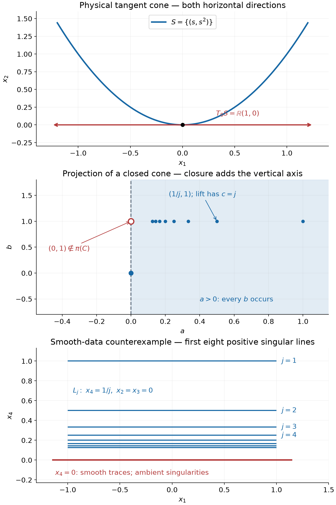

# Tangent support and analytic directions

*Exposition, proofs and exercises: GPT-6 Astra (OpenAI), October 2026. CC0.*

There are two different geometries at a singular point. The support has directions in physical space along which it approaches the point. The analytic wavefront has a closed set of directions in the cotangent fiber. A normal to this latter set must point along the physical tangent cone, with both signs. This relation propagates analytic regularity through convex regions of a fiber and explains why analytic Cauchy data control all normal frequencies near a noncharacteristic boundary. An explicit smooth counterexample shows the force of the analytic hypothesis.

Pairings are complex-linear, \(D_j=-i\partial_j\), and the Fourier sign is \(e^{-ix\cdot\xi}\). A Euclidean scalar product identifies vectors and covectors when distances or normals are taken inside one fiber. Analytic changes of coordinates retain the intrinsic tangent and cotangent meanings.

The Gaussian transform of a compact hyperfunction, represented by an analytic functional, is
\[
 G_\lambda u(z)=u_y\!\left(e^{-\lambda(z-y)^2/2}\right),
 \qquad \lambda>0,\quad z\in\mathbb C^n,
 \qquad (z-y)^2=\sum_{j=1}^n(z_j-y_j)^2.
 \tag{T1}
\]
The distance estimate, local representative independence and exact exponential criterion for analytic wavefronts are [Gaussian windows and analytic directions](gaussian-windows-and-analytic-directions.md), Theorems 1 and 4 and Corollary 5. The finite closed-cone decomposition and its holomorphic sides are [Directional splitting and holomorphic compatibility](directional-splitting-and-holomorphic-compatibility.md), Lemma 1 and Theorem 2. Analyticity when the whole fiber is regular, and agreement with the distributional analytic wavefront, are [Holomorphic boundary values without growth bounds](holomorphic-boundary-values-without-growth-bounds.md), Theorem 3; its Theorem 7 gives the converse holomorphic wedge representation used in Theorem 2 below. Compact representatives and localization are proved in [Hyperfunctions from local analytic sources](hyperfunctions-from-local-analytic-sources.md).

The geometry of \(C^2\) supporting functions and their strict quadratic replacements is [Both analytic directions at support boundaries](both-analytic-directions-at-support-boundaries.md), (1)–(4); its Theorem 4 proves the convex contact assertion used below. The maximum principle is [Positive derivatives and canonical representatives](positive-derivatives-and-canonical-representatives.md), Theorem 3.4, and subharmonicity of the logarithm of a holomorphic function is [Compactness and complex-line positivity](compactness-and-complex-line-positivity.md), Proposition 3.2. Finite-dimensional compactness, derivatives, integration and limiting operations use the supplied [scalar](../prerequisites/U011-free-foundations/metric-foundation-bridges.md) and [integration](../prerequisites/U011-free-foundations/banach-foundation-bridges.md) foundations.

## Distances between dual cones

For a closed convex cone \(C\subset\mathbb R^n\), put
\[
 C^\circ=\{r:r\cdot q\le0\text{ for every }q\in C\}.
 \tag{T2}
\]

**Lemma 1 (orthogonal cone projections).** For every \(\eta\in\mathbb R^n\) there is a unique nearest point \(p\in C\). If \(r=\eta-p\), then \(r\) is the nearest point of \(C^\circ\) to \(\eta\), \(p\cdot r=0\), and
\[
 d(\eta,C)^2+d(\eta,C^\circ)^2=|\eta|^2.
 \tag{T3}
\]
Consequently, if \(\Gamma\) is a closed pointed convex cone and
\(G=\operatorname{int}\Gamma^*\), where \(\Gamma^*=\{y:y\cdot\xi\ge0\ \forall\xi\in\Gamma\}\), then
\[
 d(\eta,G)^2=|\eta|^2-d(\eta,-\Gamma)^2.
 \tag{T4}
\]

**Proof.** Since \(0\in C\), a minimizing sequence can be confined to a fixed closed ball: a point \(q\) with \(|q|>2|\eta|+1\) cannot improve the competitor \(0\). Compactness and closedness give a minimizer. Strict convexity of squared distance gives uniqueness, since the midpoint of two distinct minimizers in \(C\) would be closer.

Differentiate the squared distance along the segment from \(p\) to \(q\in C\):
\[
 (\eta-p)\cdot(q-p)\le0.
 \tag{T5}
\]
The choices \(q=0,2p\) give \(r\cdot p=0\); (T5) then gives \(r\in C^\circ\). For \(s\in C^\circ\), one has \(p\cdot(s-r)\le0\). Expanding \(|\eta-s|^2=|p+r-s|^2\) proves that \(r\) minimizes distance to \(\eta\) in \(C^\circ\). Orthogonality proves (T3).

For the last assertion, the cone-duality identities proved in Lemma 3 of the directional-splitting lesson give
\(\overline G=\Gamma^*\) and \((\Gamma^*)^\circ=-\Gamma\). Distance to an open set equals distance to its closure. Apply (T3) with \(C=\Gamma^*\). \(\square\)

## Gaussian growth after magnifying a point

Translate the point under study to \(0\). For a compact hyperfunction \(u\), let
\[
 F=\{\xi\ne0:(0,\xi)\in\operatorname{WF}_A(u)\},\qquad
 W=F\cup\{0\},\qquad
 h_W(\eta)=\frac{|\eta|^2-d(\eta,-W)^2}{2}.
 \tag{T6}
\]
The set \(W\) is a closed cone. Adjoining \(0\) matters when the fiber is empty: then \(W=\{0\}\) and \(h_W=0\). For \(\delta>0\), write \(u_\delta=M_\delta^*u\), where \(M_\delta(x)=\delta x\). This is composition with \(M_\delta\) for functions, with the usual inverse-Jacobian factor in a distributional pairing.

**Theorem 2 (the rescaled growth profile).** Let \(K\subset\mathbb C^n\) be compact and let \(\Phi\) be continuous on a neighborhood of \(K\), with
\[
 \Phi(z)>h_W(\operatorname{Im}z)\qquad(z\in K).
 \tag{T7}
\]
There is \(\delta_0>0\) such that, for every \(0<\delta<\delta_0\), a constant \(C_\delta>0\) satisfies
\[
 |G_\lambda u_\delta(z)|\le C_\delta e^{\lambda\Phi(z)}
 \qquad(z\in K,\ \lambda>0).
 \tag{T8}
\]
No uniform bound on \(C_\delta\) as \(\delta\downarrow0\) is asserted.

**Proof.** Cover the unit sphere by finitely many small closed spherical caps whose cones \(\Gamma_j\) are convex and pointed. The closed-cone decomposition gives local summands with wavefronts confined to these cones, and holomorphic representatives on wedges with imaginary direction in \(G_j=\operatorname{int}\Gamma_j^*\). On a smaller common real neighborhood \(X\) of \(0\), choose compact representatives of all the summands. Their sum differs from \(u\) by a compact hyperfunction zero on \(X\).

A cone missing \(F\) gives a summand whose entire fiber at \(0\) is regular. That summand is analytic on a smaller neighborhood by the analytic-singular-support theorem, so it has a representative holomorphic on a full small complex tube. There are finitely many such shrinkings. The other cones meet \(F\). Let \(C\) be their union, with \(0\) adjoined.

We first control how much the cones enlarge \(W\). Suppose their angular diameters are at most \(\varepsilon\), and \(|\eta|\le R\). A nearest point \(q\) in \(-C\) can be chosen with \(|q|\le2R\), using \(0\) as competitor. If \(q\ne0\), its cone meets \(F\); at the same radius there is a point \(q'\in-W\) with \(|q-q'|\le2R\varepsilon\). Thus
\[
 0\le d(\eta,-W)-d(\eta,-C)\le2R\varepsilon.
 \tag{T9}
\]
If \(C=\{0\}\), all summands are analytic and the same conclusion is immediate. Both distances are at most \(R\), so their squared difference tends to zero uniformly on bounded \(\eta\)-sets as the caps shrink. The positive minimum of \(\Phi-h_W\) on \(K\) therefore permits a finite decomposition for which
\[
 h_C(\operatorname{Im}z)<\Phi(z)\qquad(z\in K).
 \tag{T10}
\]

For a singular summand, (T4) gives
\[
 \frac12d(\eta,G_j)^2
 =\frac{|\eta|^2-d(\eta,-\Gamma_j)^2}{2}
 \le h_C(\eta).
 \tag{T11}
\]
Fix \(z_*\in K\), with \(\eta_*=\operatorname{Im}z_*\). Choose \(q\in G_j\) with \(|\eta_*-q|^2/2<\Phi(z_*)\). Take a small convex approach cone about \(q\) whose angular closure lies in \(G_j\). The wedge representative has a fixed positive height on this smaller cone over a sufficiently small real base. Intersecting the cone with a small ball gives a convex imaginary set \(\Omega\), with \(0\in\overline\Omega\). For all sufficiently small \(\delta\), \(\delta q\in\Omega\), hence
\[
 \frac12d(\operatorname{Im}z,\Omega/\delta)^2
 \le \frac12|\operatorname{Im}z-q|^2<\Phi(z)
 \tag{T12}
\]
on a neighborhood of \(z_*\). A finite cover of \(K\), and the finite number of summands, give one real base and one upper bound for \(\delta\). This argument uses fixed heights only on strict approach cones.

The other hypothesis in the Gaussian carrier estimate is
\[
 \Phi(z)>
 \frac{|\operatorname{Im}z|^2-d(\operatorname{Re}z,\mathbb R^n\setminus(X/\delta))^2}{2}.
 \tag{T13}
\]
It holds uniformly on \(K\) for small \(\delta\), because \(X\) contains a ball about \(0\) and the displayed real distance tends to infinity. The carrier estimate now proves (T8) for each singular summand. For an analytic summand take \(\Omega\) to be a ball about \(0\); its dilates eventually contain every imaginary point in \(K\), so the imaginary distance is zero. Here \(\Phi>h_W\ge0\). Finally the zero-on-\(X\) remainder needs only (T13), by the zero-region part of the same carrier estimate. Sum the finitely many constants. \(\square\)

## A subharmonic barrier between two ends of a segment

**Lemma 3 (rectangle barrier).** Let \(a,b>0\), and let \(v\) be subharmonic on \(0<x<a,\ |y|<b\), with
\[
 v(x+iy)\le(\max(0,-y))^2.
 \tag{T14}
\]
Suppose \(v<-b^2/3\) on a collar of the left edge. Set
\[
 A(x)=\frac b3\,\frac{\sinh(\pi(a-x)/b)}{\sinh(\pi a/b)}.
 \tag{T15}
\]
For \(0<x<a\) and \(|y|<A(x)/2\),
\[
 v(x+iy)<-A(x)\bigl(2y+A(x)\bigr).
 \tag{T16}
\]
The corresponding statement at the right edge follows by \(x+iy\mapsto a-x+iy\).

**Proof.** Fix \(0<d<b\), and work on the smaller rectangle
\(0<x<a,\ -d<y<b-d\). The function
\[
 v_d(x+iy)=v(x+iy)-d^2+
 bA(x)\sin\!\left(\frac{\pi(y+d)}b\right)
 \tag{T17}
\]
is subharmonic, since \(A''=(\pi/b)^2A\) makes the last term harmonic. Its upper boundary limits are nonpositive. On the bottom and top this follows from (T14) and the vanishing sine. On the right \(A=0\) and \(v\le d^2\). On the left the negative collar bound and \(bA(0)=b^2/3\) give a strict negative margin. The maximum principle gives \(v_d\le0\); the strong maximum principle makes the inequality strict, since a zero maximum in the interior would force constancy, contrary to the left collar.

When \(0<y+d<b/2\), the elementary inequality
\(\sin(\pi(y+d)/b)>2(y+d)/b\) gives
\(v<d^2-2A(x)(y+d)\). At the point under consideration choose \(d=A(x)\). Since \(0<A(x)<b/3\) and \(|y|<A(x)/2\), the required sine interval holds, and the last inequality is (T16). Reflection of the real coordinate preserves subharmonicity and the sign of \(y\), proving the last assertion. \(\square\)

## The tangent cone of support

If \(x_0\) belongs to a relatively closed set \(S\), define
\[
 T_{x_0}S=
 \left\{\,\lim_{j\to\infty}t_j(x_j-x_0):
 x_j\in S,\ x_j\to x_0,\ t_j>0,\ t_j\to\infty\,\right\}.
 \tag{T18}
\]

**Lemma 4 (closure, coordinates and missing directions).** This is a closed cone containing \(0\). If \(\psi\) is a \(C^1\) diffeomorphism near \(x_0\), then
\[
 T_{\psi(x_0)}\psi(S)=D\psi(x_0)\,T_{x_0}S.
 \tag{T19}
\]
If a compact set \(B\) misses \(T_{x_0}S\), then
\[
 (x_0+\delta B)\cap S=\varnothing
 \quad\text{for every sufficiently small }\delta>0.
 \tag{T20}
\]

**Proof.** The constant sequence \(x_j=x_0\) gives \(0\), and multiplying the parameters \(t_j\) by a positive constant gives conicity. If \(v_k\in T_{x_0}S\) tends to \(v\), choose from the defining sequence for \(v_k\) a point \(x_k\) and parameter \(t_k>k\) such that \(|x_k-x_0|<1/k\) and \(|t_k(x_k-x_0)-v_k|<1/k\). This diagonal sequence proves closedness.

The differentiability remainder in
\(\psi(x)-\psi(x_0)=D\psi(x_0)(x-x_0)+o(|x-x_0|)\)
vanishes after multiplication by \(t_j\), because \(t_j|x_j-x_0|\) is bounded. This gives one inclusion in (T19); the inverse diffeomorphism gives the other.

If (T20) failed, there would be \(\delta_j\downarrow0\) and \(b_j\in B\) with \(x_0+\delta_jb_j\in S\). A convergent subsequence in \(B\), together with \(t_j=\delta_j^{-1}\), would give a point of \(B\cap T_{x_0}S\). \(\square\)

## Normals to a singular fiber

For a relatively closed \(E\subset\mathbb R^n\setminus\{0\}\), an exterior normal at \(\xi_0\in E\) is a nonzero vector \(df(\xi_0)\), where \(f\) is real \(C^2\), \(f(\xi_0)=0\), and \(f\le0\) on \(E\) near \(\xi_0\). Interior normals are the negatives of exterior normals. We also allow limits of these pairs inside the punctured fiber.

**Theorem 5 (fiber normals lie in both tangent directions).** Let \(u\) be a hyperfunction near \(x_0\in\operatorname{supp}u\), and set
\[
 F=\{\xi\ne0:(x_0,\xi)\in\operatorname{WF}_A(u)\},
 \qquad T=T_{x_0}(\operatorname{supp}u).
 \tag{T21}
\]
For every exterior or interior normal \(\nu\) to \(F\), and for every limit of such normal vectors with a nonzero limiting base covector,
\[
                         \nu,\ -\nu\in T.
 \tag{T22}
\]
When \(F=\varnothing\), there is no normal assertion.

**Proof: the normal-distance inequality.** Translate \(x_0\) to \(0\), choose a compact representative, and let \(\xi_0\in F\) have exterior normal \(\nu\). The strict quadratic construction recalled above replaces its \(C^2\) witness by a quadratic polynomial \(f\) with the same differential, \(f(\xi_0)=0\), and \(f<0\) on nearby \(F\setminus\{\xi_0\}\). Let \(\Sigma=\{f=0\}\) near \(\xi_0\), and write \(\nu_\xi=df(\xi)\). Shrink the patch so \(|\nu_\xi|\) has a positive lower bound.

There is \(t_0>0\) such that
\[
 d(\xi+t\nu_\xi,W)\ge t|\nu_\xi|
 \quad(\xi\in\Sigma\text{ near }\xi_0,\ 0\le t<t_0),
 \qquad W=F\cup\{0\}.
 \tag{T23}
\]
Indeed Taylor's formula, uniformly on a small patch, gives
\(\nu_\xi\cdot(q-\xi)\le C|q-\xi|^2\) for nearby \(q\in F\), since \(f(q)\le0=f(\xi)\). Hence
\[
 |\xi+t\nu_\xi-q|^2
 \ge t^2|\nu_\xi|^2+(1-2Ct)|q-\xi|^2.
 \tag{T24}
\]
Choose \(2Ct<1\). Points of \(W\) outside a fixed neighborhood of \(\xi_0\), including \(0\), have a uniformly positive distance from the smaller patch; decreasing \(t_0\) makes their distances at least \(t|\nu_\xi|\) as well. Taking the infimum proves (T23).

**Proof: a missing physical direction gives an exponential gap.** Suppose one of \(\nu,-\nu\) misses \(T\). Lemma 4 gives a fixed ball about that vector, and a slightly larger ball with compact closure disjoint from \(T\), on which \(u_\delta\) vanishes for all small \(\delta\). The Gaussian zero-region estimate consequently gives a constant \(c>0\), independent of small \(\delta\), such that
\[
 V_\delta(z):=\frac2\lambda
       \log\frac{|G_\lambda u_\delta(z)|}{C_\delta}
 \le |\operatorname{Im}z|^2-c
 \tag{T25}
\]
near the corresponding endpoint of \([-\nu,\nu]-i\xi_0\), for every \(\lambda>0\). To obtain this fixed \(c\), use the positive distance from the smaller real ball to the complement of the larger zero ball, and take a strict margin in the carrier estimate.

For any \(\varepsilon>0\), Theorem 2, on a compact neighborhood of the same segment, gives
\[
 V_\delta(z)\le
 \varepsilon+|\operatorname{Im}z|^2
                  -d(\operatorname{Im}z,-W)^2.
 \tag{T26}
\]
Here \(\delta\) is sufficiently small depending on \(\varepsilon\). Increase \(C_\delta\) so that both estimates hold. For fixed \(\lambda,\delta\), the restriction of \(V_\delta\) to every complex line is subharmonic, or identically \(-\infty\).

For real \(x\) near \(0\), \(\xi\in\Sigma\) near \(\xi_0\), and \(w=s+it\), put
\[
 H(w)=
 \frac{V_\delta(x-i\xi-w\nu_\xi)-\varepsilon-|\xi|^2
                         -2t\,\xi\cdot\nu_\xi}{|\nu_\xi|^2}.
 \tag{T27}
\]
The subtracted \(t\)-term is harmonic. By (T23) for \(t\ge0\), and by the trivial nonnegativity of distance for \(t<0\), (T26) gives
\(H(s+it)\le(\max(0,-t))^2\).

Choose \(b>0\) small. On a collar of the endpoint \(s=-1\) or \(s=1\) corresponding to the missing direction, (T25) gives
\(H\le t^2-c/|\nu_\xi|^2\). Uniform upper and lower bounds on \(|\nu_\xi|\) therefore permit \(b\) and the parameter neighborhoods to be chosen so that \(H<-b^2/3\) on that collar for \(|t|<b\). Apply Lemma 3 with \(a=2\), using \(1+w\) at the left endpoint and \(1-\overline w\) at the right endpoint. The latter reflection preserves the imaginary part.

On a fixed neighborhood of \(w=0\), the conclusion gives a uniform negative bound. Returning to (T27), and then shrinking \(|t|\) to absorb the linear term, gives
\[
 V_\delta(x-i\xi-it\nu_\xi)\le
                       \varepsilon+|\xi|^2-c_0
 \tag{T28}
\]
for some \(c_0>0\) independent of \(\varepsilon,\delta,\lambda\). The map
\((x,\xi,t)\mapsto x-i(\xi+t\nu_\xi)\), with \(\xi\in\Sigma\), is a real local diffeomorphism at \((0,\xi_0,0)\): the tangent space of \(\Sigma\), together with its nonzero normal \(\nu_{\xi_0}\), spans the imaginary coordinates. The finite-dimensional inverse theorem, proved in [Regular level sets and transverse convolution](regular-level-sets-and-transverse-convolution.md), Lemmas 0.1–0.2, applies. Thus these points fill a complex neighborhood of \(-i\xi_0\).

Choose \(\varepsilon<c_0/4\) and shrink the \(\xi\)-patch so that \(\bigl||\xi|^2-|\xi_0|^2\bigr|<c_0/4\). Estimate (T28) gives a Gaussian exponential rate strictly smaller than \(|\xi_0|^2/2\) on that neighborhood. The exact Gaussian wavefront criterion makes \((0,\xi_0)\) regular for \(u_\delta\).

This is impossible. The analytic coordinate formula and its wavefront equality, [Analytic substitution for hyperfunctions](analytic-substitution-for-hyperfunctions.md), Theorem 7 and Corollary 11, give
\(\operatorname{WF}_A(M_\delta^*u)_0=\delta F=F\), by positive conicity. Hence both signs lie in \(T\). Interior normals are the reversed exterior normals, and limits are covered by the closedness of \(T\). \(\square\)

## Affine sections of a singular fiber

An affine section can have normals which are not normals to the full set. The appropriate physical set is the closure of a projection of the tangent cone.

**Theorem 6 (normals to every affine section).** Use \(F,T\) from Theorem 5. Let \(L\subset\mathbb R^n\) be a linear subspace, let \(E=\xi_*+L\), and let \(\pi_L\) be orthogonal projection onto \(L\). Every exterior or interior normal \(\nu\in L\) to \(F\cap E\), taken inside the open set \(E\setminus\{0\}\), satisfies
\[
                 \nu,\ -\nu\in\overline{\pi_L(T)}.
 \tag{T29}
\]
The same holds for limits of such normals. In quotient notation, this is the closure of the image of \(T\) in \(\mathbb R^n/L^\perp\).

**Proof.** There is no nonzero normal when \(\dim L=0\), and \(\dim L=n\) is Theorem 5. For the remaining cases choose orthonormal coordinates \(\xi=(\xi_1,\xi',\xi'')\), with \(E=\{\xi''=\xi_0''\}\), and let \(\xi_0\in F\cap E\) be the point under consideration.

The strict quadratic replacement, now within \(E\), and the finite-dimensional implicit theorem give a smooth function \(g(\xi')\) such that, on a sufficiently small closed ball \(K\) about \(\xi_0\), disjoint from \(0\),
\[
 \xi\ne\xi_0,\quad \xi''=\xi_0'',\quad
 \xi_1\ge g(\xi')
       \quad\Longrightarrow\quad \xi\notin F.
 \tag{T30}
\]
The chosen exterior normal is a positive multiple of
\((1,-dg(\xi_0'))\). Suppose one of its signs is absent from \(\overline{\pi_L(T)}\). This set is closed and conic. Shrinking \(K\), continuity ensures that the same sign of \((1,-dg(\xi'))\) remains absent for every \(\xi\in K\).

There is \(M>0\) such that
\[
 h(\xi):=\xi_1-g(\xi')-M|\xi''-\xi_0''|^2<0
                     \qquad(\xi\in F\cap\partial K).
 \tag{T31}
\]
Otherwise choose \(M_j\to\infty\) and \(\xi_j\in F\cap\partial K\) with \(h_j(\xi_j)\ge0\). The boundedness of \(\xi_1-g(\xi')\) on \(\partial K\) forces \(\xi_j''\to\xi_0''\). A convergent subsequence gives a point of \(F\cap\partial K\cap E\) with \(\xi_1\ge g(\xi')\), contrary to (T30).

The maximum of \(h\) on the nonempty compact set \(F\cap K\) is at least \(h(\xi_0)=0\). By (T31) it is attained at an interior point \(q\) of \(K\). Thus
\[
 dh(q)=\bigl(1,-dg(q'),-2M(q''-\xi_0'')\bigr)
 \tag{T32}
\]
is a nonzero exterior normal to \(F\). Theorem 5 puts both signs of (T32) in \(T\). Their projections are the two signs of \((1,-dg(q'))\), contradicting the excluded sign. This proves (T29), including interior normals. Closedness of the right side gives the limiting assertion. \(\square\)

## Convex propagation inside one fiber

Let
\[
                         A=T\cap(-T).
 \tag{T33}
\]
This is a closed symmetric cone. By Theorem 5 every normal to \(F\), including every nonzero limit of such normals, has its vector in \(A\).

**Theorem 7 (convex propagation of regularity).** Let \(V_1\subset V_2\subset\mathbb R^n\setminus\{0\}\) be nonempty open convex sets. Suppose \(V_1\cap F=\varnothing\) and every affine hyperplane with a nonzero normal in \(A\) which meets \(V_2\) also meets \(V_1\). Then
\[
                              V_2\cap F=\varnothing.
 \tag{T34}
\]
In particular the conclusion holds under the stronger condition using every nonzero normal in \(T\).

**Proof: a finite determining core.** Fix \(y_0\in V_1\) and \(y_1\in V_2\), put \(y_t=(1-t)y_0+ty_1\), and let \(\Sigma=A\cap S^{n-1}\). For each \((\nu,t)\in\Sigma\times[0,1]\), the plane
\(\nu\cdot(x-y_t)=0\) meets \(V_1\). Choose a point \(z\) in that intersection and a closed ball \(\overline B(z,r)\subset V_1\). For nearby \((\nu',t')\), the inequality
\(|\nu'\cdot(z-y_{t'})|<r/2\) ensures that the corresponding plane meets \(B(z,r)\).

Compactness gives finitely many such balls covering all parameters. Add a small closed ball about \(y_0\), and let \(K\) be their convex hull. It is a compact convex subset of \(V_1\), with \(y_0\in\operatorname{int}K\). For compactness, group the points of any convex combination according to their balls: \(K\) is the continuous image of the product of finitely many compact balls and the finite closed simplex. Every plane \(\nu\cdot(x-y_t)=0\), \(\nu\in\Sigma\), meets \(\operatorname{int}K\). If \(\Sigma=\varnothing\), just take the ball about \(y_0\).

**Proof: the first possible contact is impossible.** Set
\[
                         K_t=\operatorname{conv}(K\cup\{y_t\}).
 \tag{T35}
\]
These are nested compact subsets of \(V_2\). They equal \(K\) for small \(t\), since \(y_0\) is an interior point. Suppose \(F\cap K_1\ne\varnothing\), and let \(\tau\) be the infimum of the parameters with \(F\cap K_t\ne\varnothing\). Compactness gives \(0<\tau\le1\) and a contact point \(q\in F\cap K_\tau\).

The interior of \(K_\tau\) misses \(F\). To see this, for \(s<\tau\) one has
\[
 y_0+\frac{s}{\tau}(K_\tau-y_0)\subset K_s.
 \tag{T36}
\]
This follows by applying the homothety to the convex combinations defining \(K_\tau\); it sends \(y_\tau\) to \(y_s\) and sends \(K\) into \(K\). Every fixed interior point of \(K_\tau\) belongs to the left side for \(s<\tau\) sufficiently close to \(\tau\), by slightly expanding that point about \(y_0\) while remaining in \(K_\tau\). Hence an interior point in \(F\) would contradict the definition of \(\tau\).

Apply the convex contact theorem cited above to \(Y=\operatorname{int}K_\tau\) and \(q\in F\cap\partial Y\). It gives a unit limiting exterior normal \(\nu\) to \(F\), with
\[
                   \nu\cdot(z-q)>0\qquad(z\in\operatorname{int}K_\tau).
 \tag{T37}
\]
Theorem 5 gives \(\nu\in\Sigma\); if \(\Sigma\) is empty this is already a contradiction. By continuity, all of \(K_\tau\) lies in the closed positive half-space of (T37).

If \(\nu\cdot(y_\tau-q)=0\), the determining-core property says that this plane meets \(\operatorname{int}K\), contradicting (T37). If \(\nu\cdot(y_\tau-q)>0\), write \(q=\alpha k+(1-\alpha)y_\tau\), \(k\in K\), \(0\le\alpha\le1\). Nonnegativity of both scalar products forces \(1-\alpha=0\), so \(q\in K\subset V_1\), again a contradiction. Thus \(F\cap K_1=\varnothing\), in particular \(y_1\notin F\). Since \(y_1\) was arbitrary, (T34) follows. \(\square\)

**Corollary 8 (translation in a physical support normal).** Suppose \(\eta\ne0\) is an exterior or interior normal to \(\operatorname{supp}u\) at \(x_0\). If \((x_0,\xi)\in\operatorname{WF}_A(u)\), then
\[
 (x_0,\xi+t\eta)\in\operatorname{WF}_A(u)
           \qquad(t\in\mathbb R,\ \xi+t\eta\ne0).
 \tag{T38}
\]

**Proof.** Reverse \(\eta\) if necessary to make it exterior. Along a sequence defining \(v\in T\), the first-order Taylor remainder of its supporting function, multiplied by the positive parameter in (T18), tends to zero. Its supporting inequality therefore gives \(\eta\cdot v\le0\). Applying this to \(v,-v\in T\) yields
\[
                              A\subset\eta^\perp.
 \tag{T39}
\]

First suppose \(\xi\) is not parallel to \(\eta\). If \(\xi+t\eta\) were regular, choose an open ball \(V_1\) about it which misses \(F\), with radius smaller than the distance from the line \(\xi+\mathbb R\eta\) to \(0\). The cylinder \(V_2=V_1+\mathbb R\eta\) is open, convex and avoids \(0\). For \(\nu\in A\), the scalar product \(\nu\cdot(b+s\eta)\) equals \(\nu\cdot b\) by (T39). Thus a plane with normal in \(A\) meets \(V_2\) exactly when it meets \(V_1\). Theorem 7 would make \(\xi\) regular, a contradiction.

If \(\xi\) is parallel to \(\eta\), [Support normals force both hyperfunction directions](support-normals-force-both-hyperfunction-directions.md), Theorem 5, puts both signs of \(\eta\) in the wavefront at \(x_0\). Positive conicity then gives every nonzero point of that line, which is precisely the required conclusion. \(\square\)

## Analytic data control every normal frequency

Use coordinates \((x',t)\in\mathbb R^{n-1}\times\mathbb R\), \(n\ge2\), on a neighborhood of \((x_0',0)\). Let \(P\) have analytic, possibly complex coefficients, total order \(m\ge1\), and principal symbol \(p_m\), with
\[
                             p_m(x_0',0;0,1)\ne0.
 \tag{T40}
\]
Let \(u\) be a hyperfunction on the positive side, satisfying \(Pu=0\). Its canonical ordinary normal derivatives
\(g_k=\gamma_k^+u\), \(0\le k<m\), are the data constructed in [Supported division and one-sided Cauchy data](supported-division-and-one-sided-cauchy-data.md), Theorem 6.

**Theorem 9 (analytic boundary regularity).** Suppose \(\xi_0'\ne0\) and
\[
           (x_0',\xi_0')\notin\operatorname{WF}_A(g_k)
                            \qquad(0\le k<m).
 \tag{T41}
\]
There are neighborhoods \(V\) of \(x_0'\), \(U\) of \(\xi_0'\) in \(\mathbb R^{n-1}\setminus\{0\}\), and \(\varepsilon>0\), such that
\[
 ((x',t),(\xi',\tau))\notin\operatorname{WF}_A(u)
 \quad\text{for }x'\in V,\ 0<t<\varepsilon,\ \xi'\in U,\ \tau\in\mathbb R.
 \tag{T42}
\]
The assertion includes all normal frequencies, without a bound on \(\tau\).

**Proof: the boundary forcing.** Corollary 3 and Proposition 4 of the one-sided Cauchy lesson give the canonical zero-side extension \(v=E_+u\), with \(v=0\) for \(t<0\), and
\[
 Pv=\sum_{j=0}^{m-1} w_j\otimes\delta^{(j)}(t),
 \qquad (w_0,\ldots,w_{m-1})=J_P(g_0,\ldots,g_{m-1}).
 \tag{T43}
\]
Here the displayed jump matrix \(J_P\) has finite-order tangential differential operators with analytic coefficients. Analytic multiplication and differentiation do not enlarge the analytic wavefront, as proved in (Q3) of [Noncharacteristic equations for hyperfunctions](noncharacteristic-equations-for-hyperfunctions.md). Thus all \(w_j\) are regular on a common product neighborhood \(V_0\times U_0\) of \((x_0',\xi_0')\), with \(U_0\) bounded and disjoint from \(0\).

The full tensor bound in [Tensor directions and admissible hyperfunction products](tensor-directions-and-admissible-hyperfunction-products.md), Theorem 1, makes every term in (T43) regular over this tangential neighborhood for every \(\tau\). Its possible zero-tangential-covector term cannot occur because \(\xi'\in U_0\ne0\). Away from \(t=0\) the forcing is zero. Hence \(Pv\) is regular at every pair under consideration in a full small real tube.

**Proof: high normal frequencies and the boundary fiber.** The coefficient of \(\tau^m\) in \(p_m(x',t;\xi',\tau)\) stays bounded away from zero after the real tube is shrunk. For bounded \(\xi'\), the remaining terms have modulus at most \(C|\tau|^{m-1}\) when \(|\tau|\ge1\), uniformly on a smaller compact real neighborhood. Consequently there is \(M\) such that
\[
                  p_m(x',t;\xi',\tau)\ne0\qquad(|\tau|>M).
 \tag{T44}
\]
The analytic regularity theorem for arbitrary hyperfunctions, Theorem 2 of the noncharacteristic-equations lesson, now gives regularity of \(v\) at these high normal frequencies.

At a boundary point \((x',0)\) outside \(\operatorname{supp}v\), the entire fiber is regular. At a boundary point in its support, the function \(-t\) is a supporting function because \(v\) vanishes on \(t<0\). Its exterior normal is \(-dt\). If any \((\xi',\tau)\), \(\xi'\in U_0\), were singular there, Corollary 8 would make \((\xi',\tau+s)\) singular for every real \(s\). All these covectors are nonzero because \(\xi'\ne0\). This contradicts (T44). Thus every normal frequency is regular at every boundary point in the smaller tangential neighborhood.

Choose compact smaller neighborhoods in \(V_0\) and \(U_0\). Their product with \(\{t=0\}\) and \([-M,M]\) is compact and disjoint from the closed analytic wavefront. Finitely many open regularity neighborhoods give one positive \(\varepsilon\) valid for all these bounded normal frequencies. Decrease it to remain inside the high-frequency tube already covered by (T44). This proves the corresponding statement for \(v\) across the boundary, and restriction to \(t>0\) gives (T42). \(\square\)

The exclusion of \(\xi_0'=0\) is essential to the tensor argument: zero extension can create pure conormal singularities even for analytic data. In dimension one there is no nonzero tangential covector. An order-zero operator nonvanishing at the boundary instead gives \(u=0\) locally by multiplication with its analytic reciprocal.

## Smooth data with singularities arbitrarily close to the boundary

**Proposition 10 (an explicit \(C^2\) counterexample).** On \(\mathbb R^4\), let
\[
 P(D)=D_1D_2+D_3^2+D_4^2,\qquad
 A=1+ix_1,\quad \rho^2=x_3^2+x_4^2,
\]
\[
 U(x)=\int_1^\infty r^{-4}A^{-1}
       \exp\!\left(irx_2-\frac{r\rho^2}{4A}\right)\,dr.
 \tag{T45}
\]
Then \(U\in C^2(\mathbb R^4)\), \(PU=0\), and
\[
                \operatorname{sing\,supp}U
                    =L:=\{x_2=x_3=x_4=0\}.
 \tag{T46}
\]
The series
\[
 u(x)=\sum_{j=1}^\infty e^{-j^2}
                    U(x_1,x_2,x_3,x_4-j^{-1})
 \tag{T47}
\]
defines a \(C^2\) solution of \(Pu=0\). Both \(u|_{x_4=0}\) and
\(\partial_4u|_{x_4=0}\) are \(C^\infty\). Nevertheless there is one fixed covector \(\xi=(\xi',\xi_4)\), with \(\xi'\ne0\), such that
\[
       ((0,0,0,j^{-1}),\xi)\in\operatorname{WF}(u)
                         \qquad(j\ge1).
 \tag{T48}
\]
Thus Theorem 9 fails with the smooth wavefront in place of the analytic wavefront, even for a constant-coefficient operator and an ordinary \(C^2\) solution.

**Proof: differentiability and the equation.** On every compact real set, \(A\ne0\), \(\operatorname{Re}(A^{-1})>0\), and each derivative of order at most two of the integrand in (T45) is bounded by a constant times \(r^{-2}\). Indeed every differentiation contributes at most one factor of \(r\), its other factors are bounded on the compact set, and the exponential has modulus at most one. The integrable majorant proves \(C^2\) regularity and differentiation under the integral.

For fixed \(r\), set \(F_r=A^{-1}\exp(irx_2-r\rho^2/(4A))\). Direct differentiation gives
\[
 \partial_1\partial_2F_r=-r\partial_AF_r,\qquad
 (\partial_3^2+\partial_4^2)F_r=r\partial_AF_r.
 \tag{T49}
\]
Since \(P(D)=-(\partial_1\partial_2+\partial_3^2+\partial_4^2)\), the integrand solves \(PF_r=0\). The justified differentiations prove \(PU=0\).

**Proof: the exact singular support of \(U\).** If \(\rho>0\), exponential decay permits differentiation of every order locally. If \(x_2\ne0\), put
\[
                     q=\frac{\rho^2}{4A}-ix_2.
 \tag{T50}
\]
For real \(x\), \(\operatorname{Re}q\ge0\), and \(q\ne0\) wherever \(\rho>0\) or \(x_2\ne0\). With \(f(r)=r^{-4}\), integration by parts \(N\) times gives
\[
 \int_1^\infty f(r)e^{-rq}\,dr
 =e^{-q}\sum_{\ell=0}^{N-1}\frac{f^{(\ell)}(1)}{q^{\ell+1}}
       +\frac1{q^N}\int_1^\infty f^{(N)}(r)e^{-rq}\,dr.
 \tag{T51}
\]
All endpoint terms at infinity vanish even when \(\operatorname{Re}q=0\), since every derivative of \(f\) tends to zero. On a compact set where \(|q|\) is bounded below, any prescribed number \(k\) of real derivatives of the last integrand has an integrable bound \(C_{N,k}r^{-4-N+k}\), provided \(N\) is sufficiently large. The derivatives of \(q^{-N}\) are bounded there. Thus (T51) proves smoothness wherever \(q\ne0\), including points with \(\rho=0,\ x_2\ne0\).

On the plane \(x_3=x_4=0\),
\[
 U=A^{-1}\int_1^\infty r^{-4}e^{irx_2}\,dr.
 \tag{T52}
\]
For \(x_2>0\), its third \(x_2\)-derivative is
\(-iA^{-1}\int_1^\infty r^{-1}e^{irx_2}\,dr\).
The latter oscillatory integral converges locally uniformly for \(x_2>0\): one integration by parts bounds its tail from \(R\) by \(2/(Rx_2)\). This also justifies differentiating the twice differentiated integral on compact positive intervals, using the uniform derivative convergence theorem. Its real part satisfies
\[
 \int_1^\infty\frac{\cos(rx_2)}r\,dr
   =\int_{x_2}^\infty\frac{\cos s}s\,ds
   =-\log x_2+O(1)\qquad(x_2\downarrow0).
 \tag{T53}
\]
To obtain the bounded remainder, subtract \(1/s\) on \((0,1)\); \((\cos s-1)/s\) is integrable there, while the tail from \(1\) converges by integration by parts. The third derivative therefore becomes unbounded. Since \(A^{-1}\ne0\), \(U\) is not \(C^3\) at any point of \(L\). Together with the smoothness off \(L\), this proves (T46).

**Proof: summing translated lines and taking the traces.** The translated functions in (T47) have common \(C^2\) bounds on each compact set, because their fourth-coordinate shifts lie in \([0,1]\). The summability of \(e^{-j^2}\) therefore proves uniform convergence through order two and \(Pu=0\).

On \(x_4=0\), the parameter for the \(j\)-th summand has
\[
 \operatorname{Re}q_j
   =\frac{x_3^2+j^{-2}}{4(1+x_1^2)}
   \ge \frac{1}{4(1+R^2)j^2}
                     \qquad(|x_1|\le R).
 \tag{T54}
\]
Any fixed tangential derivative of that summand, or of its first normal derivative, is bounded on a compact tangential set by an integral of the form
\(C\int_1^\infty r^N e^{-cr/j^2}\,dr\). Substitution \(s=cr/j^2\) bounds it by \(C_Nj^{2N+2}\); the finite integral \(\int_0^\infty s^Ne^{-s}ds=N!\) follows by \(N\) integrations by parts. Multiplication by \(e^{-j^2}\) makes these bounds summable for every \(N\). The uniform derivative theorem proves that both traces are \(C^\infty\).

Let \(L_j=\{x_2=x_3=0,\ x_4=j^{-1}\}\) and \(L_0=L\). Near a point of a fixed \(L_j\), its fourth coordinate has a positive distance from every other \(L_\ell\) and from \(L_0\). All other summands consequently have uniform Gaussian decay there, through every derivative. Their sum is smooth. The nonzero multiple \(e^{-j^2}U(\,\cdot-j^{-1}e_4)\) retains its singularity, so \(L_j\subset\operatorname{sing\,supp}u\).

Away from the closed union \(L_0\cup\bigcup_jL_j\), the parameters \(q_j\) have a common positive lower bound in modulus locally. Formula (T51) gives uniform bounds for every derivative of all summands, so the sum is smooth there. Singular support is closed, by its definition as the complement of the open smooth locus. The accumulation of the \(L_j\)'s therefore gives
\[
             \operatorname{sing\,supp}u
                          =L_0\cup\bigcup_{j\ge1}L_j.
 \tag{T55}
\]

**Proof: one fixed nonzero tangential direction.** The smooth wavefront projects onto smooth singular support, by the full cutoff and Fourier-inversion argument in the supplied [smooth pullback reading](../prerequisites/U011-free-foundations/smooth-pullback-and-fourier-normal-condition.md), §18.1. Hence there is \(\xi\ne0\) with \((0,\xi)\in\operatorname{WF}(U)\). The inclusion
\(\operatorname{WF}(U)\subset\operatorname{WF}_A(U)\) is [Cones and derivative-growth wavefronts](cones-and-derivative-growth-wavefronts.md), Theorem 6; its analytic wavefront agrees with the hyperfunction one by the comparison cited above. Since \(PU=0\), analytic differential regularity puts that wavefront in
\[
                    \xi_1\xi_2+\xi_3^2+\xi_4^2=0.
 \tag{T56}
\]
A nonzero pure fourth covector does not satisfy (T56). Thus \(\xi'=(\xi_1,\xi_2,\xi_3)\ne0\).

For completeness, smooth wavefronts translate with their base points and retain their covectors. If \(T_av(x)=v(x-a)\) and \(\chi_a(x)=\chi(x-a)\), direct substitution in the localized distributional Fourier pairing gives
\[
             \widehat{\chi_aT_av}(\zeta)
                  =e^{-ia\cdot\zeta}\widehat{\chi v}(\zeta).
 \tag{T57}
\]
The phase has modulus one, so rapid decrease on a cone is unchanged; applying the inverse translation gives equality of the regular sets. Also adding a smooth function leaves the wavefront unchanged: its compactly localized Fourier transform is rapidly decreasing in every direction, and subtraction gives the converse inclusion.

At each point \((0,0,0,j^{-1})\), the smooth remainder established above leaves precisely the wavefront of the nonzero multiple of the translated \(U\). The same \(\xi\) therefore gives (T48). The plane \(x_4=0\) is noncharacteristic because the coefficient of \(D_4^2\) is \(1\). The two ordinary traces are the canonical data by the \(C^m\) comparison in the one-sided Cauchy theorem. They are smooth at every tangential covector, whereas (T48) approaches the plane with a fixed \(\xi'\ne0\). This is the asserted counterexample. \(\square\)

## Three geometric models

*Left: the parabola \(S=\{(s,s^2)\}\) has tangent cone \(\mathbb R(1,0)\) at the origin (Exercise 2). This panel concerns physical support geometry, not a computed wavefront. Middle: projection of the closed cone \(a,c\ge0,\ ac\ge b^2\) onto \((a,b)\) contains \(a>0\) and the origin, but no other point on \(a=0\). The indicated points \((1/j,1)\) tend to the missing point \((0,1)\); their lifts have \(c=j\) (Exercise 3). Right: at \(x_2=x_3=0\), Proposition 10 has singular lines \(x_4=1/j\) and their limiting line \(x_4=0\). Only the first eight positive lines are drawn. The line at zero is singular in the ambient space even though both Cauchy traces there are smooth. [Vector figure](../figures/tangent-cones-and-boundary-lines.svg) · [Figure source](../figures/tangent-cones-and-boundary-lines.py).*

## Exercises with complete solutions

**Exercise 1 (basic) — orthant growth.** Let \(W=[0,\infty)^n\). Compute the nearest points to \(W\) and \(-W\), and the profile \(h_W\) in (T6). Compute also the profile for \(W=\{0\}\).

**Solution.** Squared Euclidean distance is the sum of independent coordinate squares. Its minimum under \(q_i\ge0\) is attained at \(q_i=\max(\eta_i,0)\); under \(q_i\le0\), it is attained at \(q_i=\min(\eta_i,0)\). Therefore
\[
 d(\eta,-W)^2=\sum_i\max(\eta_i,0)^2,\qquad
 h_W(\eta)=\frac12\sum_i\min(\eta_i,0)^2.
 \tag{T58}
\]
The profile vanishes in the positive orthant and reaches \(|\eta|^2/2\) in the negative orthant. This sign agrees with evaluation near \(x-i\xi\) for a singular covector \(\xi\). If \(W=\{0\}\), distance is \(|\eta|\), so the profile is identically zero. The strict inequality in (T7) still allows any positive rate on a compact set; it does not assert a constant uniform in \(\delta\).

**Exercise 2 (basic) — tangent cones of a curve and its half.** Compute the tangent cone at the origin of \(S=\{(s,s^2):s\in\mathbb R\}\), and of \(S_+=\{(s,s^2):s\ge0\}\). Compute \(T\cap(-T)\) in each case.

**Solution.** If \(t_j(s_j,s_j^2)\) converges and \(s_j\to0\), the first coordinates \(t_js_j\) are bounded, and the second coordinates \((t_js_j)s_j\) tend to zero. Thus every tangent vector is horizontal. Conversely, for any real \(a\), choose \(s_j=a/j\), \(t_j=j\); then \(t_j(s_j,s_j^2)\to(a,0)\). Hence \(T_0S=\mathbb R(1,0)\). For \(S_+\) the first coordinate is nonnegative, and the same construction with \(a\ge0\) gives \(T_0S_+=[0,\infty)(1,0)\). Their symmetric parts are respectively the whole horizontal line and \(\{0\}\). The difference explains why both signs in (T22) impose more than membership in a one-sided tangent cone.

**Exercise 3 (intermediate) — a closed tangent cone whose projection is not closed.** In coordinates \((a,b,c)\), let
\[
 C=\{(a,b,c):a\ge0,\ c\ge0,\ ac\ge b^2\}.
 \tag{T59}
\]
Prove that \(C\) is a closed convex cone, equals its tangent cone at the origin, and has
\[
 \pi(C)=\{(a,b):a>0,\ b\in\mathbb R\}\cup\{(0,0)\},
 \qquad
 \overline{\pi(C)}=\{(a,b):a\ge0\},
 \tag{T60}
\]
where \(\pi(a,b,c)=(a,b)\).

**Solution.** The inequalities are closed and homogeneous under nonnegative scaling. They are equivalent to
\[
 ar^2+2brs+cs^2\ge0\qquad(r,s\in\mathbb R).
 \tag{T61}
\]
For \(a>0\), completing the square gives
\(a(r+bs/a)^2+(c-b^2/a)s^2\). For \(a=0\), nonnegativity for all \(r\) forces \(b=0\), leaving \(c\ge0\). Conversely (T61) implies \(a,c\ge0\) by the coordinate choices; the same square computation, or the \(a=0\) case, gives \(ac\ge b^2\). Each inequality (T61) is a closed linear half-space in \((a,b,c)\), so their intersection is convex.

If \(v\in C\), then \(v/j\in C\) and \(j(v/j)=v\), so \(v\in T_0C\). Conversely every rescaled point in a defining tangent sequence remains in \(C\), and closedness keeps its limit there. Thus \(T_0C=C\).

For \(a>0\), any \(b\) has a lift \(c=b^2/a\). For \(a=0\), the inequality forces \(b=0\). This proves the first identity in (T60); approaching \(a=0\) through positive values proves the second. In particular \((1/j,1,j)\in C\), whereas the limit \((0,1)\) of its projections has no lift. The third coordinates escape to infinity, so closedness of \(C\) offers no convergent lifted subsequence. This is why projection cannot in general replace its closure in Theorem 6.

**Exercise 4 (intermediate) — the size and direction of the barrier.** In Lemma 3 take \(a=2\). Determine its bound at \(x=1,y=0\), and explain why a small negative collar at either end suffices.

**Solution.** The identity \(\sinh(2q)=2\sinh q\cosh q\), obtained directly from the exponential definitions, gives
\[
 A(1)=\frac{b}{6\cosh(\pi/b)},\qquad
 v(1)<-\frac{b^2}{36\cosh^2(\pi/b)}.
 \tag{T62}
\]
The quantity on the right is strictly negative for every \(b>0\), however small. Reflection \(x+iy\mapsto2-x+iy\) preserves \(y\), so the majorant \(y_-^2\) is unchanged and the same estimate follows from the right collar. Reflection through the origin would change the sign of \(y\) and would require a different majorant. In Theorem 5 this distinction permits either missing physical normal sign to yield the same contradiction.

**Exercise 5 (intermediate) — why a cylinder transfers regularity.** Suppose \(S\) agrees near the origin with the closed half-space \(x_n\ge0\). Compute \(T_0S\) and its symmetric part \(A\). If a ball \(B\) in the punctured covector space misses \(F\) and the cylinder \(B+\mathbb R e_n\) avoids zero, prove that the cylinder misses \(F\).

**Solution.** Tangent sequences have nonnegative last coordinate. Conversely any \(v_n\ge0\) is attained using \(x_j=v/j\), \(t_j=j\), which eventually lies in the given local half-space. Thus \(T_0S=\{v:v_n\ge0\}\) and \(A=\{v:v_n=0\}\). For every \(\nu\in A\), the quantity \(\nu\cdot(b+se_n)\) equals \(\nu\cdot b\). A hyperplane with such a nonzero normal therefore meets the cylinder exactly when it meets \(B\). The hypotheses of Theorem 7 hold with \(V_1=B\), \(V_2=B+\mathbb R e_n\); its conclusion proves the claim. The assumption excluding zero is needed because the theorem is formulated in the punctured fiber.

**Exercise 6 (intermediate) — an explicit high-frequency threshold.** Suppose, on a compact real neighborhood and for \(|\xi'|\le R\),
\[
 p_m(x;\xi',\tau)=a_m(x)\tau^m+
                   \sum_{\ell=0}^{m-1}b_\ell(x,\xi')\tau^\ell,
 \qquad |a_m(x)|\ge a>0,\quad |b_\ell(x,\xi')|\le B_\ell.
 \tag{T63}
\]
Give a uniform sufficient condition for nonvanishing, allowing complex coefficients.

**Solution.** Put \(B=\sum_{\ell<m}B_\ell\). For \(|\tau|\ge1\), the triangle inequality gives
\[
 |p_m|\ge a|\tau|^m-B|\tau|^{m-1}
          =|\tau|^{m-1}(a|\tau|-B).
 \tag{T64}
\]
Thus \(|\tau|>\max(1,2B/a)\) gives \(|p_m|\ge(a/2)|\tau|^m>0\). If \(B=0\), the same conclusion follows directly. No ordering or reality of the coefficients is used. The bound controls both positive and negative normal frequencies and is uniform in the bounded tangential neighborhood, as required in Theorem 9.

**Exercise 7 (advanced) — weights for accumulating singular lines.** Replace \(e^{-j^2}\) in (T47) by nonzero complex coefficients \(c_j\) satisfying
\[
                    \sum_{j=1}^\infty j^N|c_j|<\infty
                    \qquad\text{for every integer }N\ge0.
 \tag{T65}
\]
Prove that the same smooth-data counterexample and the same singular support remain valid.

**Solution.** The case \(N=0\) gives absolute convergence through order two using the common compact \(C^2\) bound for translated \(U\). Hence the sum is \(C^2\) and solves the equation. For each specified order of tangential differentiation of either trace, (T54) bounds the \(j\)-th differentiated trace by \(Cj^M\) for some finite integer \(M\). Condition (T65) gives uniform absolute convergence of that derivative series on compact tangential sets. Both traces are smooth.

Near a fixed \(L_j\), all other translated lines are separated by a fixed positive fourth-coordinate distance. The other terms therefore have common bounds at every derivative order, by Gaussian damping. Their weighted sum is smooth by \(\sum|c_\ell|<\infty\). Since \(c_j\ne0\), the remaining term has exactly the nonempty translated wavefront of \(U\); no cancellation by the smooth remainder is possible. This proves (T48) with the same fixed covector and establishes singularity along every \(L_j\). Off the closed union, (T51) provides common derivative bounds, so the sum is smooth; closedness of singular support then includes \(L_0\). These are exactly the arguments proving (T55), with (T65) supplying the necessary convergence. The nonzero assumption on each \(c_j\) is what retains each particular line.

**Exercise 8 (advanced) — arbitrarily high finite regularity is insufficient.** For an integer \(k\ge2\), replace \(r^{-4}\) in (T45) by \(r^{-k-2}\), obtaining \(U_k\). Show that the translated sum with coefficients \(e^{-j^2}\) is \(C^k\), has smooth Cauchy data at \(x_4=0\), and still violates the smooth version of (T42).

**Solution.** Derivatives through order \(k\) cost at most \(r^k\), leaving the integrable majorant \(Cr^{-2}\) on compact real sets. Thus \(U_k\in C^k\), and the identities (T49) still prove \(PU_k=0\). The integration-by-parts argument (T51), now with \(f(r)=r^{-k-2}\), proves smoothness away from \(L\): its last integrand after \(N\) integrations and \(d\) derivatives is bounded by \(Cr^{-k-2-N+d}\), integrable for sufficiently large \(N\).

On \(x_3=x_4=0\), the \((k+1)\)-st \(x_2\)-derivative for \(x_2>0\) is
\[
 i^{k+1}A^{-1}\int_1^\infty r^{-1}e^{irx_2}\,dr.
 \tag{T66}
\]
Uniform convergence of its tails on compact positive intervals follows as in (T53), justifying the derivative. Its modulus is unbounded as \(x_2\downarrow0\), because the real part of the integral grows as \(-\log x_2\) and \(i^{k+1}A^{-1}\ne0\). Thus \(\operatorname{sing\,supp}U_k=L\).

The translated sum converges through order \(k\). At the boundary every derivative of either Cauchy trace is bounded termwise by a polynomial in \(j\), by the same exponential estimate (T54); the weights make the derivative series converge. Near each positive line all other summands are smooth. Projection of the smooth wavefront gives a nonzero covector for \(U_k\) at zero; the characteristic constraint (T56) excludes a pure fourth covector. Translation supplies that fixed covector at every positive line of the sum. Consequently no finite prescribed \(C^k\) regularity, even together with smooth Cauchy data, supplies the analytic boundary conclusion.

## References

- Lars Hörmander, *The Analysis of Linear Partial Differential Operators I: Distribution Theory and Fourier Analysis*, reprint of the second edition, Springer, 2003, [doi:10.1007/978-3-642-61497-2](https://doi.org/10.1007/978-3-642-61497-2), §9.6, pp. 363–368: Gaussian scaling, tangent support, convex propagation and analytic boundary regularity. The exposition, proofs, geometric examples, integral counterexample, exercises and figure here are independently expressed. The earlier programme proofs used in the arguments are linked at their points of use.
