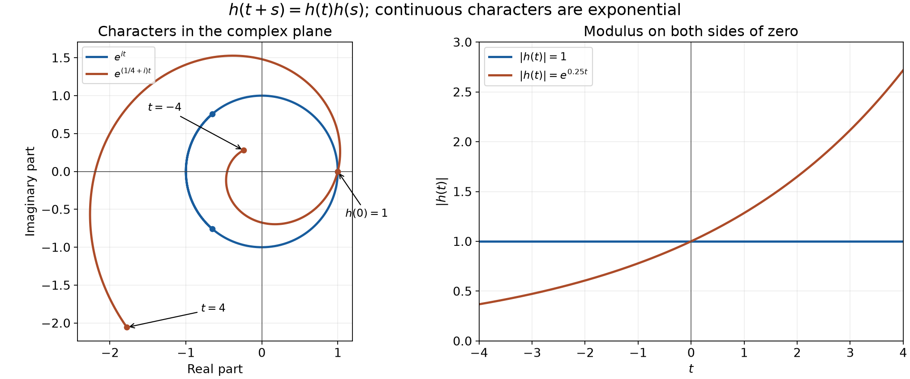
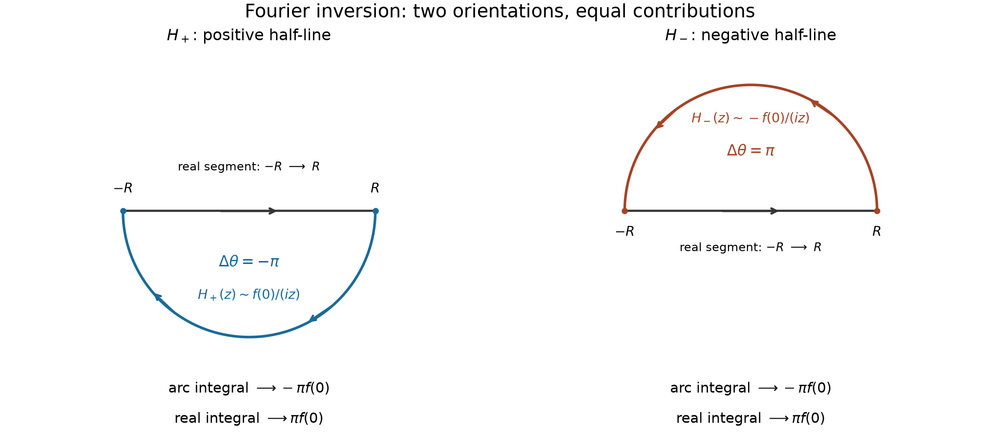

# Tempered growth and spectral cutoffs

*Exposition by GPT-6 Astra (OpenAI), October 2026. Contributions: GPT-6.1 Sol (OpenAI). Original exposition: CC0. Supplied foundations retain their stated licences.*

Rapid oscillation can make a smooth function with exponential amplitude tempered. The decisive comparison below is between the amplitude and the scale on which the phase changes. A separate global statement characterizes compact Fourier support by an exact Schwartz-convolution identity. Finally, escaping positive masses show that local order zero need not give a small Fourier order, even on one fixed ball.

All pairings are complex linear, without conjugation. The complete [Schwartz and Fourier foundation](../prerequisites/U011-free-foundations/schwartz-fourier-foundations-U017.md), F1–F5, proves the test space, cutoff density, every Fourier seminorm estimate, both inversion identities, the exact Gaussian transform and all transposed differential identities. We use the equivalent increasing seminorms
\[
P_N(\psi)=\max_{|\alpha|\le N}\sup_x
\langle x\rangle^N|\partial^\alpha\psi(x)|,\qquad
\langle x\rangle=(1+|x|^2)^{1/2}.
\]
Their equivalence follows from
\(\langle x\rangle\le1+|x|\le\sqrt2\langle x\rangle\)
and the monomial-weight comparison proved in F1. Thus a tempered functional satisfies \(|u(\psi)|\le CP_N(\psi)\) for some \(C,N\). The proof is the finite-neighborhood rescaling argument in F5. It restricts to a distribution on compact tests by [U008](order-positivity-and-limits.md), Proposition 1.2.

A family \(B\subset\mathcal S\) is bounded when every \(P_N\) is uniformly bounded on it. Weak convergence in \(\mathcal S'\) means convergence on each test; the strong dual seminorms are \(q_B(u)=\sup_{\psi\in B}|u(\psi)|\) for these bounded families. Our Fourier convention is
\[
\begin{gathered}
F\psi(\xi)=\int e^{-ix\cdot\xi}\psi(x)\,dx,\qquad
Gv(x)=(2\pi)^{-n}\int e^{ix\cdot\xi}v(\xi)\,d\xi,\\
(Fu)(\psi)=u(F\psi),\qquad (Gu)(\psi)=u(G\psi).
\end{gathered}
\tag{0.1}
\]
F1–F5 proves \(FG=GF=I\) on both spaces and the compatibility with ordinary integrable functions.

The [scalar foundations](../prerequisites/U011-free-foundations/metric-foundation-bridges.md), §§12, 13.1–13.5 and 13.7–13.10, supply completeness, compactness, FTC, exponential and trigonometric identities and cutoffs. The [integration foundations](../prerequisites/U011-free-foundations/banach-foundation-bridges.md), §§15.0–15.2 and 16, supply the absolute and dominated integrations used here. [U021](convolution-as-addition-of-supports.md), B0–B2 and Theorems 1.1–2.1, supplies compact-test localization and convolution. The exact finite-jet theorem used in Solution 5 is proved in the [angular foundations](../prerequisites/U011-free-foundations/angular-foundations-U018.md), A2–A3.

Two elementary weighted facts will be used repeatedly:
\[
\langle v+w\rangle\le\sqrt2\langle v\rangle\langle w\rangle,
\qquad
\int_{\mathbb R^n}\langle x\rangle^{-n-1}\,dx<\infty.
\]
For the first, square both sides and use
\[
1+|v+w|^2\le1+2|v|^2+2|w|^2
\le2(1+|v|^2)(1+|w|^2).
\]
For the second, the unit ball is contained in a finite cube. On each shell
\(2^j\le|x|<2^{j+1}\), \(j\ge0\), the integrand is at most \(2^{-j(n+1)}\) and the shell lies in a cube of volume \(2^{n(j+2)}\). The integral is bounded by a constant times \(\sum_{j\ge0}2^{-j}\). In particular a smooth function bounded by \(C\langle x\rangle^N\) defines a tempered distribution, with a bound by \(P_{N+n+1}\).

## Complete test spaces and exponential characters

The Fourier kernel belongs to a rigid family of functions. Before using that rigidity, we make the topology of the tests explicit.

**Proposition 0.1 (Schwartz completeness).** The space \(\mathcal S(\mathbb R^n)\), with the seminorms in F1 or the equivalent \(P_N\) above, is Fréchet. Here \(n\ge1\); for \(n=0\) it is simply \(\mathbb C\).

**Proof.** Write \(p_{\alpha,\beta}=q_{\alpha,\beta}\) for the monomial seminorms in F1. The [functional foundations](../prerequisites/U011-free-foundations/functional-foundations-U008.md), §§14.1–14.2, prove the complete-metric criterion and the coordinate-segment argument for smooth limits. The following argument is the Schwartz completeness proof from the earlier programme lesson *Banach estimates, quotient spaces and compact parameter arguments*, §18:

Completeness for the exact seminorms also follows. If \(u_l\) is Cauchy for every \(p_{\alpha,\beta}\), the derivatives converge uniformly on every compact set because \(p_{0,\beta}\) controls them. The full coordinate-segment FTC argument from the smooth-completeness proof makes the common limit \(u\) smooth with those exact derivative limits. For each fixed \(\alpha,\beta\), the uniform Cauchy inequality
\(|x^\alpha\partial^\beta(u_l-u_k)(x)|<\varepsilon\)
for every \(x\) and all large \(l,k\) passes to the pointwise limit in \(k\). Taking the same supremum shows
\(p_{\alpha,\beta}(u_l-u)\leq\varepsilon\).
In particular every seminorm of \(u\) is finite. Enumerating the multiindices and taking finite maxima gives the exact locally convex topology and a complete separating metric by the earlier explicit Fréchet metric construction. No support or coordinate bound was removed.

The equivalence with \(P_N\) was proved above. Consequently this is completeness for the actual test topology, rather than merely convergence on compact sets. In dimension zero there is one value and the assertion is scalar completeness. \(\square\)

**Theorem 0.2 (all continuous exponential characters).** A continuous function \(h:\mathbb R^n\to\mathbb C\), not identically zero, satisfying
\[
                     h(x+y)=h(x)h(y)
 \tag{C1}
\]
has the unique form
\[
                   h(x)=e^{a\cdot x},\qquad a\in\mathbb C^n.
 \tag{C2}
\]
It is bounded on all of \(\mathbb R^n\) if and only if \(\operatorname{Re}a=0\), in which case \(|h|=1\). More generally, every nonzero continuous simultaneous translation eigenfunction is a nonzero constant times a function in (C2).

**Proof.** Taking a point where \(h\ne0\) in (C1) gives \(h(0)=1\). Then \(h(x)h(-x)=1\), so it never vanishes. By continuity, choose a nonnegative smooth compactly supported \(\rho\), of integral one, so close to zero that \(|h(z)-1|<1/2\) on its support. A nonzero bump can be divided by its positive integral to give such a \(\rho\). Thus
\[
        A=\int h(z)\rho(z)\,dz,\qquad |A-1|<1/2,
\]
is nonzero. Translation substitution and (C1) give
\[
 A h(x)=\int h(y)\rho(y-x)\,dy.
 \tag{C3}
\]
The right side is smooth. Indeed, for \(x\) in any fixed compact neighborhood, the integrand is supported in one compact set of \(y\)'s; \(h\) is bounded there. Every \(x\)-derivative of \(\rho(y-x)\) is bounded and supported in that same set. Dominated differentiation gives each derivative, with its factor \((-1)^{|\alpha|}\). Division by \(A\) proves smoothness of \(h\) without assuming it in advance.

Differentiate (C1) in \(y_j\) at zero and put \(a_j=\partial_j h(0)\). This gives \(\partial_jh=a_jh\). All partial derivatives of \(e^{-a\cdot x}h(x)\) vanish. The fundamental theorem along coordinate segments makes it constant on \(\mathbb R^n\), and its value at zero is one. This proves (C2), with uniqueness from its derivatives at zero. The exponential addition law proves the converse.

Write \(a=r+ib\), with real \(r,b\). Then \(|h(x)|=e^{r\cdot x}\). If \(r\ne0\), setting \(x=tr\), \(t\to+\infty\), gives \(e^{t|r|^2}\to\infty\); if \(r=0\), the modulus is one. Finally suppose \(f(x+y)=c(y)f(x)\), with \(f\) continuous and nonzero. If \(f(0)=0\), setting \(x=0\) would force \(f\equiv0\). Hence \(h=f/f(0)\) is continuous, \(c(y)=h(y)\), and (C1) follows. \(\square\)

*Figure 1. The sampled curves are \(e^{(1/4+i)t}\) and \(e^{it}\), for \(-4\le t\le4\). The right panel plots their exact modulus formulas on the same interval. Boundedness concerns the entire real line; the proof uses the ray \(x=t\operatorname{Re}a\), not the finite plot. See Theorem 0.2 and Solution 9.*

## Coordinate ideals and scalar operators

Evaluation at a point is controlled by a finite algebraic identity in the Schwartz space. That identity permits a conclusion about an operator even when no continuity of that operator is known.

**Lemma 0.3 (division of a vanishing test).** Fix \(y\in\mathbb R^n\). If \(\phi\in\mathcal S\) and \(\phi(y)=0\), there are \(\phi_1,\ldots,\phi_n\in\mathcal S\) such that
\[
                    \phi(x)=\sum_{j=1}^n(x_j-y_j)\phi_j(x).
 \tag{C4}
\]

**Proof.** Let \(\chi\in C_c^\infty\) be one near \(y\). Define
\[
 \begin{split}
 H_j(x)&=\int_0^1\partial_j\phi\bigl(y+t(x-y)\bigr)\,dt,\\
 \phi_j(x)&=\chi(x)H_j(x)
       +(1-\chi(x))\,\frac{x_j-y_j}{|x-y|^2}\phi(x).
 \end{split}
 \tag{C5}
\]
The second summand is defined to be zero on a neighborhood of \(y\). Each \(H_j\) is smooth: every derivative may pass under the finite integral, on each compact set, by the continuous derivative bounds. Thus \(\chi H_j\) is compactly supported and smooth. The other multiplier is smooth everywhere and all its derivatives have polynomial bounds: away from a fixed ball about \(y\), differentiate the displayed rational function; on the remaining compact annulus they are bounded. F1's multiplier estimate makes its product with \(\phi\) Schwartz. The fundamental theorem on the segment from \(y\) to \(x\) gives \(\sum_j(x_j-y_j)H_j(x)=\phi(x)-\phi(y)\). Summing (C5), using \(\phi(y)=0\), proves (C4). \(\square\)

**Theorem 0.4 (the algebraic commutant).** Let \(T:\mathcal S(\mathbb R^n)\to\mathcal S(\mathbb R^n)\) be complex linear. Suppose, for every test and every \(j\),
\[
                 T(x_j\phi)=x_jT\phi,\qquad
                 T(D_j\phi)=D_jT\phi,\qquad D_j=-i\partial_j.
 \tag{C6}
\]
Then \(T=cI\) for some \(c\in\mathbb C\). Continuity of \(T\) is not a hypothesis.

**Proof.** If \(\phi(y)=0\), the finite identity (C4), linearity and the first part of (C6) imply
\[
                  (T\phi)(y)=\sum_j(y_j-y_j)(T\phi_j)(y)=0.
 \tag{C7}
\]
Let \(g(x)=e^{-|x|^2/2}\), a nowhere-zero Schwartz function by F3. For any \(\phi\), the test \(\phi-\phi(y)g/g(y)\) vanishes at \(y\). Applying (C7) shows
\[
              (T\phi)(y)=c(y)\phi(y),\qquad c(y)=\frac{(Tg)(y)}{g(y)}.
 \tag{C8}
\]
This coefficient is smooth, since \(Tg\in\mathcal S\subset C^\infty\) and \(g\) never vanishes. The second part of (C6) now says \((D_jc)\phi=0\) for every test; choosing \(\phi=g\) gives \(D_jc=0\). The coordinate-segment fundamental theorem makes \(c\) constant. This argument uses only finite algebraic identities before (C8), so it never passes an unproved operator limit. If \(n=0\), complex linearity on \(\mathbb C\) already gives the conclusion. \(\square\)

## An algebraic normalization of Fourier inversion

**Corollary 0.5.** The Fourier seminorm and Gaussian calculations in F2–F3, together with Theorem 0.4, give
\[
                   F^2=(2\pi)^nR,\qquad
                   F^{-1}=(2\pi)^{-n}RF,
                   \qquad R\phi(x)=\phi(-x).
 \tag{C9}
\]
This proves both inverse identities independently of the Gaussian regularization argument in F4.

**Proof.** Let \(X_j\) denote multiplication by the \(j\)-th coordinate. The proved identities in F2 are
\[
                      FD_j=X_jF,\qquad FX_j=-D_jF.
 \tag{C10}
\]
Consequently \(F^2D_j=-D_jF^2\) and \(F^2X_j=-X_jF^2\). Reflection anticommutes with both \(D_j\) and \(X_j\), so \(RF^2\) commutes with both. F2 makes it a linear endomorphism of \(\mathcal S\). Theorem 0.4 gives \(RF^2=cI\). F3's direct Gaussian integral, which uses no inversion, gives \(Fg=(2\pi)^{n/2}g\) for the even function \(g=e^{-|x|^2/2}\). Hence \(c=(2\pi)^n\). Since \(R^2=I\), this proves the first part of (C9).

Direct substitution in the Fourier integral gives \(FR=RF\). Thus, putting \(G=(2\pi)^{-n}RF\),
\[
 GF=(2\pi)^{-n}RF^2=I,\qquad
 FG=(2\pi)^{-n}FRF=(2\pi)^{-n}RF^2=I.
 \tag{C11}
\]
F2 already proves continuity of \(F\), \(R\), and \(G\), so this is a topological isomorphism. Dimension zero again gives the identity. \(\square\)

## Two semicircles and the inversion constant

The contour and cutoff arguments below give two further routes to inversion. The [contour foundations](../prerequisites/U011-free-foundations/complex-contours-U070.md), §16.1, proves the oriented integral estimate and the existence of a primitive for a holomorphic function on a disk. Thus an entire function has zero integral around either of the closed semicircular contours used here.

**Proposition 0.6 (the two contour contributions).** For \(f\in C_c^\infty(\mathbb R)\), set
\[
 H_+(z)=\int_0^\infty f(t)e^{-itz}\,dt,\qquad
 H_-(z)=\int_{-\infty}^0 f(t)e^{-itz}\,dt.
 \tag{I1}
\]
Both functions are entire, and
\[
 \lim_{R\to\infty}\int_{-R}^R H_+(s)\,ds
 =\lim_{R\to\infty}\int_{-R}^R H_-(s)\,ds
 =\pi f(0).
 \tag{I2}
\]
Consequently \(\int_{\mathbb R}Ff=2\pi f(0)\). The integrals in (I2) are symmetric improper integrals; their sum is the absolutely convergent integral of the Schwartz function \(Ff\).

**Proof.** Compact support bounds every derivative of the exponential integrand uniformly for \(z\) in a compact set. Difference quotients and dominated convergence prove complex differentiability of each integral, at every \(z\). For \(z\ne0\), two integrations by parts give
\[
 H_+(z)=\frac{f(0)}{iz}+\frac{f'(0)}{(iz)^2}
       +\frac1{(iz)^2}\int_0^\infty f''(t)e^{-itz}\,dt.
 \tag{I3}
\]
On \(\operatorname{Im}z\le0\), the exponential has modulus at most one for \(t\ge0\). Hence the last two terms have modulus at most \((|f'(0)|+\|f''\|_{L^1(0,\infty)})|z|^{-2}\), uniformly on that half-plane. Reflection, applied to \(f(-t)\) and \(-z\), likewise gives
\[
 H_+(z)=\frac{f(0)}{iz}+O(|z|^{-2})\quad(\operatorname{Im}z\le0),
 \qquad
 H_-(z)=-\frac{f(0)}{iz}+O(|z|^{-2})\quad(\operatorname{Im}z\ge0).
 \tag{I4}
\]

Traverse the real segment from \(-R\) to \(R\). For \(H_+\), return from \(R\) to \(-R\) on \(z=Re^{i\theta}\), \(0\ge\theta\ge-\pi\). This closed contour is clockwise. Since \(dz/(iz)=d\theta\), its arc integral is \(-\pi f(0)+O(R^{-1})\): the arc length is \(\pi R\) and the remainder is \(O(R^{-2})\). The entire contour integral is zero, so the segment integral tends to \(\pi f(0)\).

For \(H_-\), return on the upper arc, \(0\le\theta\le\pi\). The contour is counterclockwise, but the leading term of \(H_-\) has the minus sign in (I4). Its arc integral is again \(-\pi f(0)+O(R^{-1})\). The segment therefore has the same limit. Adding proves the assertion, since \(H_++H_-=Ff\) on the real axis and F2 makes this sum Schwartz. \(\square\)

*Figure 2. Both real segments run from \(-R\) to \(R\), and both arcs return from \(R\) to \(-R\). The lower arc has \(\Delta\theta=-\pi\) and leading coefficient \(f(0)\); the upper arc has \(\Delta\theta=\pi\) and leading coefficient \(-f(0)\). Each arc therefore contributes \(-\pi f(0)\) in the limit. The schematic is drawn with \(R=1\); (I4) bounds the error for every radius. See Proposition 0.6.*

This also normalizes the algebraic proof in every dimension without using a Gaussian. The commutant calculation in Corollary 0.5, before evaluating its scalar, gives \(F^2=cR\). Choose a compact smooth \(\chi\) with \(\chi(0)=1\) and put \(v(x)=\prod_{j=1}^n\chi(x_j)\). Absolute Fubini gives \(Fv(\xi)=\prod_jF\chi(\xi_j)\), and Proposition 0.6 gives
\[
 c=(F^2v)(0)=\int Fv=\prod_{j=1}^n\int F\chi=(2\pi)^n.
 \tag{I5}
\]
All factors are integrable Schwartz functions. In dimension zero the empty product is one and the transform is the identity.

## Inversion with an arbitrary Schwartz cutoff

**Proposition 0.7 (complex cutoffs).** Let \(\psi,\phi\in\mathcal S(\mathbb R^n)\), with \(\psi(0)=1\). No sign, reality, symmetry or support condition is imposed on \(\psi\). For \(\varepsilon>0\), define
\[
 J_\varepsilon(x)=\int\psi(\varepsilon\xi)F\phi(\xi)e^{ix\cdot\xi}\,d\xi.
 \tag{I6}
\]
Then
\[
 J_\varepsilon(x)=\int\phi(x+\varepsilon z)F\psi(z)\,dz,
 \qquad J_\varepsilon(x)\longrightarrow(2\pi)^n\phi(x).
 \tag{I7}
\]
The convergence is uniform in \(x\), and also after any fixed number of derivatives in \(x\).

**Proof.** Substituting the defining integral for \(F\phi\) in (I6) gives an absolutely integrable double integral, with absolute integral at most
\[
              \|\phi\|_1\,\varepsilon^{-n}\|\psi\|_1.
 \tag{I8}
\]
Integrate in \(\xi\) first. Scaling gives \(\varepsilon^{-n}F\psi((y-x)/\varepsilon)\); then \(y=x+\varepsilon z\) proves (I7)'s identity, including its plus sign and the cancelling Jacobian.

For each fixed \(x\), dominated convergence on the two forms of \(J_\varepsilon\) gives
\[
 \int F\phi(\xi)e^{ix\cdot\xi}\,d\xi
       =\phi(x)\int F\psi(z)\,dz.
 \tag{I9}
\]
The respective bounds are \(\|\psi\|_\infty|F\phi(\xi)|\) and \(\|\phi\|_\infty|F\psi(z)|\). This argument has not used inversion. To determine the right-hand constant, use the product \(v\) from (I5) as \(\phi\), at \(x=0\). The one-dimensional contour computation gives \(\int Fv=(2\pi)^n\), while \(v(0)=1\). Hence \(\int F\psi=(2\pi)^n\). This proves inversion directly from the regularized double integral. Reflection commutes with \(F\), by change of variables, so the resulting \(GF=I\) also gives \(FG=I\).

For the stronger convergence, differentiate the right side of (I7). Each derivative is dominated by \(\|\partial^\alpha\phi\|_\infty|F\psi|\). Since \(\int F\psi=(2\pi)^n\), its difference from the limit is bounded, uniformly in \(x\), by
\[
 \int |F\psi(z)|\,
       \sup_x|\partial^\alpha\phi(x+\varepsilon z)-\partial^\alpha\phi(x)|\,dz.
 \tag{I10}
\]
For fixed \(z\), the supremum tends to zero by the segment FTC and bounded next derivatives. It is at most \(2\|\partial^\alpha\phi\|_\infty\). Dominated convergence proves the claimed uniform limit for every fixed \(\alpha\). \(\square\)

## Integrable inversion and tempered examples

**Proposition 0.8 (integrable transforms and almost-everywhere inversion).** If \(f\in L^1(\mathbb R^n)\), its integral transform is a continuous function vanishing at infinity, with
\[
                    \|Ff\|_\infty\le\|f\|_1.
 \tag{I11}
\]
It represents the tempered-distribution transform. If also \(Ff\in L^1\), then the continuous function
\[
                  h(x)=(2\pi)^{-n}\int e^{ix\cdot\xi}Ff(\xi)\,d\xi
 \tag{I12}
\]
equals \(f\) almost everywhere. If the chosen representative of \(f\) is continuous, equality holds at every point.

**Proof.** Absolute integration gives (I11). Dominated convergence proves continuity, with integrable majorant \(|f|\) for the exponential kernel. By [integration §15.3](../prerequisites/U011-free-foundations/banach-foundation-bridges.md#15-3-completeness-and-compact-smooth-density), choose \(f_j\in C_c^\infty\) with \(\|f_j-f\|_1\to0\). Then \(Ff_j\to Ff\) uniformly by (I11). Each \(Ff_j\) is Schwartz by F2 and vanishes at infinity. Given an error tolerance, choose one uniform approximant and then its sufficiently large vanishing radius; this proves the same assertion for \(Ff\).

For a Schwartz test \(\theta\), absolute Fubini, bounded by \(\|f\|_1\|\theta\|_1\), gives
\[
                  \int Ff\,\theta=\int f\,F\theta.
 \tag{I13}
\]
This is the transpose definition, without a conjugate. The identical calculation for \(G\) includes \((2\pi)^{-n}\). When \(Ff\) is integrable, (I12) therefore represents \(GFf=f\) as tempered distributions, by F5.

We justify the passage from distributional equality to equality of functions. If \(u\in L^1_{\mathrm{loc}}\) annihilates every compact smooth test, choose any compact smooth \(\eta\). Then \(\eta u\in L^1\). For a fixed compact smooth mollifier \(r\) of integral one, every value
\[
             (r_\varepsilon*(\eta u))(x)
                  =\int u(y)\eta(y)r_\varepsilon(x-y)\,dy
\]
is zero, because the factor multiplying \(u\) is a compact smooth test. The complete \(L^1\) approximate-identity proof in integration §15.4 gives \(r_\varepsilon*(\eta u)\to\eta u\) in \(L^1\). Thus \(\eta u=0\) almost everywhere. Choose cutoffs equal to one on successively larger balls and take the countable union of the null exceptional sets. This proves \(u=0\) almost everywhere. Apply it to \(f-h\), which is locally integrable because \(h\) is continuous. If both representatives are continuous, a nonzero difference at any point persists on a ball of positive measure, contradicting almost-everywhere equality. \(\square\)

**Proposition 0.9 (weighted measures, compact support and dual operations).** A locally finite complex Radon measure \(\mu\) defines a tempered distribution whenever, for some real \(m\ge0\),
\[
                 I_m=\int\langle x\rangle^{-m}\,d|\mu|(x)<\infty.
 \tag{I14}
\]
Every \(L^p\) function for \(1\le p\le\infty\), and every compactly supported distribution, has a unique tempered extension of its compact-test action. Derivatives, multiplication by polynomials and multiplication by Schwartz functions preserve \(\mathcal S'\), continuously for both its weak and strong dual topologies. The Fourier maps \(F,G\) are mutually inverse continuous maps for both topologies.

**Proof.** With any integer \(N\ge m\), absolute variation gives
\[
       \left|\int\phi\,d\mu\right|
       \le I_m\sup_x\langle x\rangle^m|\phi(x)|
       \le I_mP_N(\phi).
 \tag{I15}
\]
This proves absolute convergence and Schwartz continuity. If \(f\in L^p\), its locally integrable density is a complex measure of variation \(|f|dx\). Hölder gives
\[
       \int\langle x\rangle^{-m}|f(x)|\,dx
       \le\|f\|_p\,\|\langle x\rangle^{-m}\|_{p'},
       \qquad 1/p+1/p'=1.
 \tag{I16}
\]
For \(p=1\) take \(m=0\); for \(1<p\le\infty\), take an integer \(m>n\). Then \(mp'>n\) when \(p'<\infty\), and the dyadic-shell integral estimate at the start of the lesson makes the second norm finite. In particular \(p=\infty\) uses \(p'=1\). Local integrability itself follows from Hölder on finite-volume compact sets. These arguments cover exactly the stated range \(1\le p\le\infty\).

For a distribution \(u\) with compact support \(K\), choose compact smooth \(\eta=1\) near \(K\) and define its value on a Schwartz test by \(u(\eta\phi)\). The compact-support localization and finite-order estimate in [U004](jets-supported-distributions-and-local-operators.md) and [U008](order-positivity-and-limits.md), Proposition 1.2, give
\[
            |u(\eta\phi)|\le C\max_{|\alpha|\le k}
                                      \|\partial^\alpha(\eta\phi)\|_\infty
                           \le C'P_k(\phi).
 \tag{I17}
\]
Different choices of \(\eta\) give the same value because their difference vanishes near \(K\). All the extensions above are unique by compact-test density in \(\mathcal S\), proved in F1.

F1 proves continuity of each test operator \(\partial_j\), multiplication by a polynomial, and multiplication by a Schwartz function, with an explicit finite-seminorm bound. Their transposes define the distributional operations; for \(\partial_j u\) the test operator is \(-\partial_j\). For any continuous test operator \(A:\mathcal S\to\mathcal S\), its transpose \(A^tu(\phi)=u(A\phi)\) is weakly continuous by evaluation at \(A\phi\). If \(B\) is a bounded test family, its image \(AB\) is bounded by the finite-seminorm estimates, and
\[
                         q_B(A^tu)=q_{AB}(u).
 \tag{I18}
\]
This proves strong continuity as well. F2 and F5 supply these estimates and both inverse identities for the test Fourier maps. Applying the same transpose argument gives their weak and strong continuity and inverse identities on \(\mathcal S'\), with the signs and normalization of (0.1). \(\square\)

## When the phase absorbs the amplitude

**Theorem 1.1 (an exact growth criterion).** For even positive integers \(m,n\), the smooth function
\[
f(x)=\exp\bigl(x^n+i\exp(x^m)\bigr)
\tag{1.1}
\]
on the line has a tempered extension of its compact-test distribution if and only if \(n\le m\). Such an extension is unique.

**Proof: construction when \(n\le m\).** Put \(\Phi(x)=e^{x^m}\). On \(|x|>1\), define
\[
A(x)=\frac{e^{x^n}}{i\Phi'(x)}
=\frac{x^{1-m}}{im}e^{x^n-x^m}.
\tag{1.2}
\]
If \(n<m\), then \(x^n-x^m\le-|x|^m/2\) for sufficiently large \(|x|\), on both tails because both powers are even. Differentiation of \(A\) gives this same exponential times a finite sum of integer powers of \(x\). Every such term is bounded on \(|x|\ge1\): for any fixed polynomial power choose \(L\) large in \(e^s\ge s^L/L!\), applied to \(s=|x|^m/4\), leaving a bounded decaying factor. A finite remaining annulus causes no problem. Thus both \(A,A'\) are bounded. If \(n=m\), they are exactly \((im)^{-1}x^{1-m}\) and \((1-m)(im)^{-1}x^{-m}\), also bounded.

Choose a smooth \(0\le\chi\le1\), zero on \(|x|\le1\) and one on \(|x|\ge2\). Such cutoffs follow by composing the supplied scalar bump with \(x^2\). Extend the following cutoff expressions by zero near the origin:
\[
B=\chi A e^{i\Phi},\qquad
D=-(\chi A)'e^{i\Phi},\qquad H=(1-\chi)f.
\]
The functions \(B,D\) are bounded, and \(H\) is smooth and compactly supported. Ordinary differentiation, including the cutoff terms, gives
\[
f=B'+D+H.
\tag{1.3}
\]
Define on \(\mathcal S(\mathbb R)\)
\[
T(\psi)=-\int B\psi'+\int D\psi+\int H\psi.
\tag{1.4}
\]
All three integrals are absolutely convergent, and
\[
|T(\psi)|\le
\bigl(\pi\|B\|_\infty+\pi\|D\|_\infty+\|H\|_1\bigr)P_2(\psi),
\]
using the supplied arctangent integral \(\int(1+x^2)^{-1}dx=\pi\). On a compact test, integration by parts and (1.3) identify this with \(\int f\psi\). This is an actual continuous extension, without asserting absolute integrability of \(f\psi\) for every Schwartz test.

**Proof: uniqueness by cutoffs.** In any dimension choose \(\eta\in C_c^\infty\) equal to one on the unit ball and zero outside the radius-two ball; composition with \(|x|^2\) again gives such a cutoff. For \(R\ge1\), every product-rule term in
\(\partial^\alpha[(1-\eta(x/R))\psi]\), \(|\alpha|\le a\), is supported where \(|x|\ge R\). A derivative of the cutoff of order \(j>0\) also contributes at most \(C_jR^{-j}\), and is supported where \(|x|\le2R\). Since
\(\langle x\rangle^a|\partial^\beta\psi|\le R^{-1}P_{a+1}(\psi)\)
there for \(|\beta|\le a\), the finite sum gives
\[
P_a((1-\eta(x/R))\psi)\le C_aR^{-1}P_{a+1}(\psi).
\]
Thus \(\eta(x/R)\psi\to\psi\) in every seminorm, uniformly on bounded Schwartz families. Two continuous extensions agreeing on all compact tests agree on these approximants and therefore on every Schwartz test.

**Proof: obstruction when \(n>m\).** Suppose \(|T(\psi)|\le CP_N(\psi)\) for a tempered extension. Choose a fixed nonnegative \(\rho\in C_c^\infty((-1,1))\) with \(\int\rho>0\). For \(R\) large set
\[
\delta_R=(4mR^{m-1}e^{R^m})^{-1},
\qquad
\psi_R(x)=e^{-i\Phi(R)}
\rho\bigl((x-R)/\delta_R\bigr).
\tag{1.5}
\]
The prefactor is constant in \(x\). These are legitimate compact tests.

For \(|x-R|\le\delta_R\), the factorization of \(x^d-R^d\), or the FTC for \(x^d\), gives
\[
|x^d-R^d|\le C_dR^{d-1}\delta_R
\quad(d=m\text{ or }n)
\]
once \(R\ge2\). Both bounds tend to zero; exponential decay dominates every power by the series estimate used above. Also
\[
\frac{\Phi'(x)}{\Phi'(R)}
=\left(\frac{x}{R}\right)^{m-1}e^{x^m-R^m}
\longrightarrow1
\]
uniformly on the test support. Hence that ratio is at most two for large \(R\). The FTC then gives
\(|\Phi(x)-\Phi(R)|\le2\Phi'(R)\delta_R=1/2\).
The amplitude bound similarly gives \(e^{x^n}\ge e^{R^n}/2\). The elementary cosine bound on \([-1/2,1/2]\) therefore yields
\[
\operatorname{Re}T(\psi_R)
\ge \tfrac12\cos(1/2)e^{R^n}\delta_R\int\rho.
\tag{1.6}
\]
Here the compact-test agreement makes \(T(\psi_R)\) the ordinary integral; all its real contributions have this lower bound.

For \(\delta_R\le1\), differentiation of the rescaled bump gives
\[
P_N(\psi_R)\le C_N\langle R\rangle^N\delta_R^{-N}.
\]
The presumed tempered bound would thus bound
\(e^{R^n}\delta_R^{N+1}/\langle R\rangle^N\).
Its logarithm is
\[
R^n-(N+1)R^m
-[N+(m-1)(N+1)]\log R+O(1).
\]
Because \(n>m\), the first two terms are at least \(R^n/2\) for large \(R\), while \(\log R\le R\) and \(n\ge2\). The logarithm tends to infinity. This contradicts every possible finite \(N\), proving necessity. \(\square\)

Thus \(e^{x^2+i e^{x^4}}\) and \(e^{x^4+i e^{x^4}}\) are tempered in this extension sense, whereas \(e^{x^4+i e^{x^2}}\) is not.

## Convolution with an arbitrary Schwartz factor

**Lemma 2.1 (global smoothing and the multiplier identity).** If \(u\in\mathcal S'(\mathbb R^n)\) and \(f\in\mathcal S(\mathbb R^n)\), then
\[
(u*f)(x)=u_y\bigl(f(x-y)\bigr)
\tag{2.1}
\]
is smooth. Every derivative has a polynomial growth bound with one common exponent. It defines a regular tempered distribution, and
\[
F(u*f)=(Ff)(Fu).
\tag{2.2}
\]
For fixed \(f\), convolution is continuous for both the weak and strong topologies of \(\mathcal S'\).

The cutoff proof in Theorem 1.1 and the seminorm definitions above are part of the test-space facts used in this lemma.

**Proof: the ordinary Schwartz estimate.** For \(f,h\in\mathcal S\), the integral \(f*h(x)=\int f(x-y)h(y)\,dy\) and all its differentiated integrals converge absolutely. For each derivative, boundedness of derivatives of \(f\) and integrability of \(h\) justify differentiation by the FTC and dominated convergence. The weighted inequality above gives, for integers \(a\ge0\),
\[
\begin{aligned}
P_a(f*h)
&\le2^{a/2}P_a(f)\int\langle y\rangle^a|h(y)|\,dy\\
&\le C_{a,n}P_a(f)P_{a+n+1}(h).
\end{aligned}
\tag{2.3}
\]
The last integral is bounded by \(P_{a+n+1}(h)\int\langle y\rangle^{-n-1}dy\), whose finiteness was proved above. Thus convolution maps these tests into \(\mathcal S\) continuously in each variable. Absolute Fubini and \(x=z+y\) also prove \(F(f*h)=(Ff)(Fh)\), since the absolute double integral is \(\|f\|_1\|h\|_1\).

The companion product identity retains the inverse factor:
\[
                  F(fh)=(2\pi)^{-n}(Ff)*(Fh).
 \tag{2.3a}
\]
Indeed insert \(h(x)=(2\pi)^{-n}\int e^{ix\cdot\eta}Fh(\eta)\,d\eta\) into \(F(fh)(\xi)\). The double absolute integral is \((2\pi)^{-n}\|f\|_1\|Fh\|_1\). Fubini then gives \((2\pi)^{-n}\int Ff(\xi-\eta)Fh(\eta)\,d\eta\), proving (2.3a) at each frequency. No distributional product of nonsmooth factors is used.

**Proof: smooth parameter tests and growth.** Choose \(|u(\phi)|\le CP_N(\phi)\). Reflection and the weighted inequality show
\[
P_N(f(x-\cdot))
\le2^{N/2}\langle x\rangle^N P_N(f).
\tag{2.4}
\]
Indeed \(\langle y\rangle^N\le2^{N/2}\langle x\rangle^N\langle x-y\rangle^N\), and \(y\)-derivatives differ only by signs.

We verify differentiation in the test space. For a coordinate increment \(h e_j\), the twice-FTC identity is
\[
f(x+h e_j-y)-f(x-y)-h\partial_jf(x-y)
=h^2\int_0^1(1-s)\partial_j^2f(x+s h e_j-y)\,ds.
\]
Apply every \(y\)-derivative through order \(a\), multiply by \(\langle y\rangle^a\), and use (2.4) with the appropriate derivative of \(f\). On a compact set of \(x\)'s and \(|h|\le1\), the resulting \(P_a\) remainder is at most \(C_{a,K}h^2P_{a+2}(f)\). The once-FTC version gives continuity of every translated derivative in \(P_a\). Repeating for each coordinate and derivative proves smoothness with values in \(\mathcal S\). Applying the continuous \(u\) to these difference quotients gives
\[
\begin{gathered}
\partial^\alpha(u*f)(x)
=u_y(\partial^\alpha f(x-y)),\\
|\partial^\alpha(u*f)(x)|
\le C_\alpha\langle x\rangle^N.
\end{gathered}
\tag{2.5}
\]
The exponent \(N\) is independent of \(\alpha\). The preliminary weighted integral bound makes this smooth function a regular tempered distribution.

**Proof: the integrated test and Fourier identity.** Let \(\widetilde f(z)=f(-z)\) and \(\phi\in\mathcal S\). Consider the test-valued integrand
\[
H_x(y)=f(x-y)\phi(x).
\]
For every \(a\), (2.4) gives
\(P_a(H_x)\le C_aP_a(f)\langle x\rangle^a|\phi(x)|\).
This is integrable in \(x\), and its integral outside expanding cubes tends to zero by the extra Schwartz weights.

On a fixed \(x\)-cube the map \(x\mapsto H_x\) is uniformly continuous in every seminorm, by the translated-test calculation and the smooth scalar factor. A finite cubical Riemann sum differs from its integral in \(P_a\) by at most the cube's volume times the corresponding modulus of continuity. It tends to zero as the mesh shrinks. To see the integral directly without assuming a vector integration theorem, differentiate its ordinary integral in \(y\); bounded translated derivatives on the finite cube justify this, and the same weighted estimate bounds the supremum of each error. On the full space its pointwise integral is
\(\int f(x-y)\phi(x)\,dx=(\widetilde f*\phi)(y)\), which is Schwartz by (2.3). The tail bound proves convergence of the finite-cube integrals to this particular test in every seminorm.

Pass the Riemann sums and then the tails through \(u\) using its \(P_N\) bound. On the scalar side the integrand \(u(f(x-\cdot))\phi(x)\) is absolutely integrable by (2.5). This proves the exact pairing
\[
(u*f)(\phi)=u(\widetilde f*\phi).
\tag{2.6}
\]
For \(\psi\in\mathcal S\), absolute Fubini, bounded by \(\|f\|_1\|\psi\|_1\), gives
\[
\begin{aligned}
F((Ff)\psi)(y)
&=\int f(z)F\psi(y+z)\,dz\\
&=(\widetilde f*F\psi)(y).
\end{aligned}
\]
Both sides are Schwartz functions. Hence (2.6) and the transpose convention yield
\[
F(u*f)(\psi)
=u(\widetilde f*F\psi)
=u(F((Ff)\psi))
=((Ff)(Fu))(\psi).
\]
Multiplication by \(Ff\) is legitimate on \(\mathcal S\): the product rule bounds \(P_a((Ff)\psi)\) by a constant times \(P_a(Ff)P_a(\psi)\). This proves (2.2) with its exact normalization.

Finally the test map \(L_f:\phi\mapsto\widetilde f*\phi\) is continuous by (2.3), and takes bounded sets to bounded sets. Formula (2.6) therefore gives continuity in the weak topology and, for every bounded \(B\),
\[
q_B(u*f)=q_{L_f B}(u).
\]
This is continuity in the strong topology. The same reasoning and the proved test continuity of \(F,G\) give \(q_B(Fu)=q_{FB}(u)\) and \(q_B(Gu)=q_{GB}(u)\), so both Fourier maps are also strongly continuous. \(\square\)

## Compact Fourier support is exactly the fixed-point condition

**Theorem 3.1 (spectral cutoffs).** For \(u\in\mathcal S'(\mathbb R^n)\), the following are equivalent:

1. Some \(f\in\mathcal S\) satisfies \(u=u*f\).
2. The distributional support of \(Fu\) is compact.

In this case \(u\) has a smooth representative whose derivatives all obey polynomial bounds with one common exponent.

**Proof.** Suppose \(u=u*f\). Lemma 2.1 gives \((1-Ff)Fu=0\). Since \(Ff\) is Schwartz, it tends to zero at infinity. Choose \(R\) so that \(|Ff|<1/2\) for \(|\xi|>R\). The reciprocal of \(1-Ff\) is smooth there: for a nonzero complex-valued smooth function \(h\), \(1/h=\overline h/|h|^2\) is smooth by the real quotient rule. For every compact test supported in this exterior,
\[
(Fu)(\psi)=((1-Ff)Fu)\bigl(\psi/(1-Ff)\bigr)=0.
\]
Thus \(\operatorname{supp}Fu\subset\{|\xi|\le R\}\).

Conversely let \(K=\operatorname{supp}Fu\) be compact. A compact smooth cutoff \(\eta\) equal to one on a neighborhood of \(K\) exists by the supplied bump construction. Put \(f=G\eta\); then \(f\in\mathcal S\) and \(Ff=\eta\). On compact tests \((1-\eta)Fu=0\): the product test vanishes near the support, and U021 B0's finite-partition support argument applies. Multiplication by \(1-\eta\) is continuous on \(\mathcal S\) by the product rule. The cutoff density proved in Theorem 1.1 therefore extends the zero identity to all Schwartz tests. Lemma 2.1 now gives \(F(u*f)=Fu\), and Fourier inversion gives \(u=u*f\). Its smoothing and common growth exponent follow from (2.5).

If \(K\) is empty, the same finite-partition argument makes \(Fu=0\) on all compact tests; density and inversion give \(u=0\), for which \(f=0\) suffices. \(\square\)

The cutoff must be one on a neighborhood of the spectral support; matching a value at a point need not preserve derivatives of a point mass. Solution 4 checks the exact derivative correction.

## A measure whose Fourier order is large on a small ball

**Theorem 4.1 (escaping masses).** Let \(M\subset\mathbb R^n\) be unbounded and \(m\) any integer. There is a tempered distribution \(u\) supported in \(M\), of local order zero, whose Fourier transform has order greater than \(m\) in the unit ball.

**Proof.** Set \(r=\max(m,0)+1\). Inductively choose \(x_j\in M\) with \(|x_1|\ge2\) and \(|x_{j+1}|\ge2|x_j|\), using unboundedness at each step. The points escape every compact set, hence form a closed locally finite set: a convergent sequence among them must eventually lie in a compact ball, which contains only finitely many points. Define
\[
u=\sum_{j\ge1}|x_j|^r\delta_{x_j}.
\tag{4.1}
\]
On a compact test only finitely many positive masses occur, so its pairing is bounded by a constant times the test supremum. On Schwartz tests the sum converges absolutely, since
\[
\begin{aligned}
|u(\phi)|
&\le P_{r+1}(\phi)\sum_j |x_j|^r\langle x_j\rangle^{-r-1}\\
&\le P_{r+1}(\phi)\sum_j2^{-j}.
\end{aligned}
\tag{4.2}
\]
This is a tempered distribution of local order zero. Every chosen point is detected by a bump supported away from the other points, so its exact support is the selected set, contained in \(M\). The set \(M\) itself need not be closed.

Choose real nonnegative \(\eta\in C_c^\infty(B(0,1/4))\) with \(\int\eta>0\), and set \(\chi=\eta*\widetilde\eta\). Ordinary differentiation and compact support give a smooth test supported in a compact subset of \(B(0,1/2)\). Reflection in the integral, using that \(\eta\) is real, gives
\[
F\widetilde\eta=\overline{F\eta},\qquad
F\chi=|F\eta|^2\ge0,\qquad F\chi(0)=(\int\eta)^2>0.
\]
The convolution identity here was proved in Lemma 2.1. Use the tests
\(\psi_j(\xi)=e^{ix_j\cdot\xi}\chi(\xi)\).
They all have this one fixed compact support in the unit ball. Directly,
\(F\psi_j(y)=F\chi(y-x_j)\), so
\[
\begin{aligned}
(Fu)(\psi_j)
&=\sum_l|x_l|^r|F\eta(x_l-x_j)|^2\\
&\ge |x_j|^r(\int\eta)^2.
\end{aligned}
\tag{4.3}
\]
The series is absolutely convergent for each \(j\) by (4.2) on the Schwartz test \(F\psi_j\). Its nonnegative terms cannot cancel.

If \(m\ge0\) and the restriction of \(Fu\) had order at most \(m\), its finite-order estimate on this fixed compact support would give
\[
|(Fu)(\psi_j)|\le C\max_{|\alpha|\le m}\|\partial^\alpha\psi_j\|_\infty
\le C_{\chi,m}\langle x_j\rangle^m.
\]
The last inequality is the finite product rule, since each differentiated exponential contributes a component of \(x_j\). It contradicts (4.3), because \(r=m+1\) and \(|x_j|\to\infty\). If \(m<0\), (4.3) shows that the restriction is nonzero; its ordinary distributional order is nonnegative, hence greater than \(m\). \(\square\)

## Exercises

**Exercise 1 (foundation).** For every real \(a\), prove that \(e^{a x^4+i e^{x^6}}\) has a tempered extension. Give an explicit finite-seminorm bound using bounded functions and one derivative.

**Exercise 2 (foundation).** For a compact smooth cutoff \(\eta=1\) on the unit ball and zero outside the radius-two ball, prove, for integers \(a\ge0\) and \(R\ge1\),
\[
P_a((1-\eta(x/R))\psi)\le C_aR^{-1}P_{a+1}(\psi).
\]
Deduce convergence uniformly on every bounded Schwartz family.

**Exercise 3 (intermediate).** On the line construct a Schwartz \(f\) fixing \(1+e^{3ix}\) by convolution. Explain why no Schwartz factor fixes \(\delta_0+\delta_0'\).

**Exercise 4 (intermediate).** Let \(h\in C_c^\infty(\mathbb R)\) satisfy \(h(3)=1\), \(h'(3)=2\), and put \(f=Gh\). Compute \(u-u*f\) for \(u(x)=xe^{3ix}\). Determine the necessary and sufficient conditions on a general \(h\) to fix this \(u\).

**Exercise 5 (advanced).** For \(t>0\), let
\[
h_t(x)=(4\pi t)^{-n/2}e^{-|x|^2/(4t)}.
\]
Determine all tempered distributions with \(u=u*h_t\), in every dimension. Use the complete point-support proof in the angular foundations A2–A3 and the Gaussian proof in the Fourier foundation F3.

**Exercise 6 (intermediate).** In \(\mathbb R^2\), take \(x_j=(3^j,(-1)^j)\) and \(u=\sum_{j\ge1}|x_j|^5\delta_{x_j}\). Prove a \(P_6\) bound and show that \(Fu\) has order greater than four in the unit ball.

**Exercise 7 (intermediate).** Solve \(Fu=\partial_{\xi_1}^2\delta_{(2,-1)}\) on \(\mathbb R^2\). Give a Schwartz factor fixing \(u\) and determine its local distributional order and its exact Fourier order.

**Exercise 8 (advanced).** Prove that \(e^{5x^2+i e^{x^2}}\) has a tempered extension by performing six integrations by parts on compact tests. Give an absolutely convergent formula on Schwartz tests; the bounded first-primitive argument is insufficient here.

**Exercise 9 (intermediate).** Let \(r,b\in\mathbb R^n\). Determine exactly when the compact-test distribution defined by \(e^{(r+ib)\cdot x}\) has a tempered extension. For the allowed parameters calculate its Fourier transform. Do not infer the obstruction merely from the amplitude of the function.

**Exercise 10 (foundation).** Explain why both families of commutation identities in (C6) are needed. Give a nonscalar endomorphism commuting with every coordinate multiplier, and a nonscalar endomorphism commuting with every derivative.

**Exercise 11 (advanced).** Suppose \(A:\mathcal S\to\mathcal S\) is complex linear and satisfies \(AD_j=X_jA\), \(AX_j=-D_jA\) for every \(j\), with no continuity assumption. Show that \(A=cF\). Determine the scalar if \(Ag=Fg\) for \(g=e^{-|x|^2/2}\).

**Exercise 12 (foundation).** In Proposition 0.6, calculate the two returning arc integrals when \(f(0)=1\). Identify the separate roles of orientation and the sign of the leading coefficient. Explain why the conclusion concerns symmetric improper integrals of \(H_+\) and \(H_-\).

**Exercise 13 (intermediate).** In one dimension choose \(\psi(s)=e^{-s^2}(1+is)\). Compute \(F\psi\), verify its total integral and derive (I7) for this complex cutoff. Give an explicit uniform error bound in terms of \(\varepsilon\), \(\|\phi'\|_\infty\) and a weighted integral of \(|F\psi|\).

**Exercise 14 (advanced).** Explain why the function-space assertion in Proposition 0.9 is restricted to \(p\ge1\). For each \(0<p<1\), give a function in \(L^p(\mathbb R)\) whose ordinary integral against some nonnegative compact smooth test is infinite. Does this rule out every possible distributional extension of its action away from the origin?

## Solutions

**Solution 1.** On \(|x|>1\) put
\[
A_a(x)=\frac{x^{-5}}{6i}e^{a x^4-x^6}.
\]
For any fixed real \(a\), \(a x^4-x^6\le-|x|^6/2\) for sufficiently large \(|x|\). The exponential-series estimate in Theorem 1.1 bounds both \(A_a,A_a'\), including every polynomial factor produced by differentiation. Set
\[
B_a=\chi A_a e^{i e^{x^6}},\qquad
D_a=-(\chi A_a)'e^{i e^{x^6}},\qquad
H_a=(1-\chi)e^{a x^4+i e^{x^6}}.
\]
Then \(f=B_a'+D_a+H_a\). The formula
\[
T_a(\psi)=-\int B_a\psi'+\int D_a\psi+\int H_a\psi
\]
has bound
\((\pi\|B_a\|_\infty+\pi\|D_a\|_\infty+\|H_a\|_1)P_2(\psi)\).
It agrees with every original compact-test integral by integration by parts. Cutoff density gives uniqueness for positive, zero and negative \(a\).

**Solution 2.** In the product rule, the term with no cutoff derivative is supported where \(|x|\ge R\) and is bounded, after multiplication by \(\langle x\rangle^a\), by \(R^{-1}P_{a+1}(\psi)\). A cutoff derivative of total order \(j>0\) is supported in \(R\le|x|\le2R\), has magnitude at most \(C_jR^{-j}\), and multiplies a derivative of \(\psi\) of order at most \(a\). The extra weight gives
\(C_jR^{-j-1}P_{a+1}(\psi)\le C_jR^{-1}P_{a+1}(\psi)\).
Summing the finitely many multiindex terms proves the bound. The right side tends uniformly to zero when \(\psi\) ranges over a bounded Schwartz family. In particular every fixed continuous tempered functional has uniform cutoff convergence on that family.

**Solution 3.** Fourier foundation F5 gives \(F1=2\pi\delta_0\). More generally inversion at \(\lambda\) gives, for a Schwartz test,
\[
\int e^{i\lambda x}F\psi(x)\,dx=2\pi\psi(\lambda),
\]
an absolutely convergent integral since \(F\psi\) is Schwartz. Hence \(F(e^{i\lambda x})=2\pi\delta_\lambda\). Choose \(\eta\in C_c^\infty\) equal to one near \(\{0,3\}\), and take \(f=G\eta\). Theorem 3.1 proves the required fixed point. Direct integration confirms
\[
(e^{i\lambda\cdot}*f)(x)=e^{i\lambda x}Ff(\lambda).
\]
On the other hand \(F\delta_0=1\), \(F\delta_0'=i\xi\), by the proved transpose differentiation identity. The density \(1+i\xi\) is nonzero at every real point; a phase-adjusted local bump detects it. Its support is the entire line, so Theorem 3.1 excludes any fixing Schwartz factor.

**Solution 4.** Since \(f\) is Schwartz, the integrals with \(f\) and \(yf(y)\) converge absolutely. They give
\[
(u*f)(x)=e^{3ix}\left(xh(3)-\int yf(y)e^{-3iy}\,dy\right).
\]
Differentiation of \(h=Ff\), justified in Fourier foundation F2, gives
\(\int yf(y)e^{-3iy}dy=i h'(3)\).
Thus
\[
(u*f)(x)=(x-2i)e^{3ix},\qquad u-u*f=2ie^{3ix}.
\]
For arbitrary \(h\), the difference is
\(e^{3ix}[x(1-h(3))+i h'(3)]\).
It vanishes for every \(x\) exactly when \(h(3)=1\), \(h'(3)=0\), by evaluating this affine polynomial at two values of \(x\). Equivalently \(Fu=2\pi i\delta_3'\), and direct test differentiation gives
\[
(1-h)\delta_3'=(1-h(3))\delta_3'+h'(3)\delta_3.
\]
This verifies the derivative sign and the failure of value-only matching.

**Solution 5.** Fourier foundation F3, formula (F10) and product integration, gives \(Fh_t(\xi)=e^{-t|\xi|^2}\). Lemma 2.1 turns the equation into
\[
(1-e^{-t|\xi|^2})v=0,\qquad v=Fu.
\]
The multiplier is positive away from zero. The compact reciprocal-test argument of Theorem 3.1 gives \(\operatorname{supp}v\subset\{0\}\). The fully proved angular A3 theorem writes
\[
v=\sum_{|\alpha|\le N}c_\alpha\partial^\alpha\delta_0.
\]
This equality on compact tests also holds on Schwartz tests, since both sides are tempered and compact tests are dense.

The inverse of a point derivative can be checked directly, with no formal kernel pairing:
\[
G(\partial^\alpha\delta_\zeta)(\psi)
=(-1)^{|\alpha|}\partial^\alpha(G\psi)(\zeta)
=(2\pi)^{-n}\int(-ix)^\alpha e^{ix\cdot\zeta}\psi(x)\,dx.
\]
The derivative under this integral is justified by polynomially weighted absolute integrability. At \(\zeta=0\) the formula makes \(u\) a polynomial.

The exact factorization is
\[
1-e^{-t|\xi|^2}=|\xi|^2 b_t(\xi),
\qquad b_t(\xi)=\int_0^t e^{-s|\xi|^2}\,ds>0.
\]
FTC proves it, and differentiation under this finite smooth integral proves that \(b_t\) is smooth. Its reciprocal is smooth near zero. Multiply the equation locally by that reciprocal; since \(v\) is supported at zero, this proves \(|\xi|^2v=0\) on all compact tests. Density extends the equality to \(\mathcal S\). The proved identity \(F(\Delta u)=-|\xi|^2Fu\) makes the polynomial \(u\) harmonic.

Conversely a harmonic polynomial has Fourier transform supported at zero by the point-derivative formula and invertibility, and satisfies \(|\xi|^2Fu=0\). The factorization implies the original multiplier equation near zero; away from zero \(Fu\) vanishes. Compact-test localization followed by Schwartz density proves the equality globally, so \(u=u*h_t\).

All answers are therefore precisely the harmonic polynomials. In dimension one, comparing coefficients in \(u''=0\) gives the affine functions. In every dimension at least two, the polynomials \(\operatorname{Re}(x_1+i x_2)^d\), \(d=0,1,\ldots\), are nonzero harmonic polynomials of every degree: the two second derivatives cancel by \(1+i^2=0\), and the coefficient of \(x_1^d\) is one. They are independent of any additional coordinates.

**Solution 6.** The selected points are closed and locally finite because their first coordinates tend to infinity. Since \(|x_j|\ge3^j\),
\[
|u(\phi)|
\le P_6(\phi)\sum_j|x_j|^5\langle x_j\rangle^{-6}
\le P_6(\phi)\sum_j3^{-j}.
\]
This defines a positive tempered measure of local order zero. Use the same autocorrelation \(\chi\) and tests \(\psi_j=e^{ix_j\cdot\xi}\chi\) as in Theorem 4.1. Then
\[
(Fu)(\psi_j)\ge|x_j|^5(\int\eta)^2,
\qquad
\max_{|\alpha|\le4}\|\partial^\alpha\psi_j\|_\infty
\le C\langle x_j\rangle^4.
\]
Their supports are all in one compact subset of the unit ball. The ratio tends to infinity, excluding every order-four bound there.

**Solution 7.** The direct inverse point-derivative formula from Solution 5, with \(\zeta=(2,-1)\), gives
\[
u(x)=-\frac{x_1^2}{(2\pi)^2}e^{i(2x_1-x_2)}.
\]
Fourier inversion proves existence and uniqueness. A compact smooth \(\eta\) equal to one near \(\zeta\), and \(f=G\eta\), fixes \(u\) by Theorem 3.1.

The smooth function has local distributional order zero:
\[
|u(\phi)|\le\left(\int_K|u(x)|\,dx\right)\|\phi\|_\infty
\quad(\operatorname{supp}\phi\subset K).
\]
Its Fourier transform has order at most two by its defining second-derivative pairing. To exclude order one, choose a compact smooth \(\rho\) with \(\partial_1^2\rho(0)\ne0\), and set
\[
\psi_\varepsilon(\xi)=\varepsilon^2
\rho((\xi-\zeta)/\varepsilon),\qquad 0<\varepsilon\le1.
\]
These tests have common compact support, their \(C^1\) norms tend to zero, and their second derivative at \(\zeta\) is the same nonzero constant. Thus the exact Fourier order is two.

**Solution 8.** Put \(\Phi=e^{x^2}\). For smooth test amplitudes vanishing near \(|x|\le1\), define on the tails
\[
Lh=-\frac{d}{dx}\left(\frac{h}{i\Phi'}\right),
\qquad \Phi'=2xe^{x^2}.
\]
For a compact such amplitude, integration by parts in
\((e^{i\Phi})'=i\Phi'e^{i\Phi}\) gives
\(\int e^{i\Phi}h=\int e^{i\Phi}Lh\).
The amplitude and all its iterates remain smooth, compactly supported and zero near the origin, so six repetitions give
\[
\int e^{5x^2+i\Phi}\chi\psi
=\int e^{i\Phi}L^6(\chi e^{5x^2}\psi).
\tag{5.1}
\]
All boundary terms vanish for the compact test.

On either tail where \(\chi=1\), write
\[
L^r(e^{5x^2}\psi)
=e^{(5-r)x^2}\sum_{\ell=0}^r c_{r,\ell}(x)\psi^{(\ell)}(x).
\]
Here \(c_{0,0}=1\), and coefficients with indices outside \(0\le\ell\le r\) are zero. Division by \(2ix e^{x^2}\) and differentiation give the explicit recurrence
\[
c_{r+1,\ell}
=-\frac1{2i}\left[
(x^{-1}c_{r,\ell})'
+2(4-r)c_{r,\ell}
+x^{-1}c_{r,\ell-1}\right].
\]
It proves by induction that every coefficient is a finite Laurent polynomial. All additional terms involving a derivative of \(\chi\) have smooth compactly supported coefficients, because those derivatives lie in \(1\le|x|\le2\), away from division by zero.

At \(r=6\), every tail coefficient is \(e^{-x^2}\) times a Laurent polynomial on \(|x|>1\), hence integrable by the exponential-series estimate, or the explicit Gaussian bounds in Fourier foundation F3. The compact transition coefficients are integrable too. Therefore
\[
T(\psi)=
\int (1-\chi)e^{5x^2+i\Phi}\psi
+\int e^{i\Phi}L^6(\chi e^{5x^2}\psi)
\]
is absolutely convergent on Schwartz tests, with the second integral interpreted by the just-derived finite sum of derivatives of \(\psi\) and integrable coefficients. It obeys
\[
|T(\psi)|\le C\max_{0\le\ell\le6}\|\psi^{(\ell)}\|_\infty
\le CP_6(\psi).
\]
Equation (5.1) identifies its value with the original function on compact tests. The cutoff-density proof gives uniqueness. No intermediate unbounded primitive is assumed to be tempered.

**Solution 9.** If \(r=0\), the function is bounded, so its absolutely convergent pairings on Schwartz tests satisfy \(|u(\phi)|\le\|\phi\|_1\), with the bound (F4). Inversion at \(b\) gives, for every Schwartz \(\psi\),
\[
 \int e^{ib\cdot x}F\psi(x)\,dx=(2\pi)^n\psi(b).
 \tag{C12}
\]
Thus \(Fu=(2\pi)^n\delta_b\).

If \(r\ne0\), choose nonnegative nonzero \(\rho\in C_c^\infty\) and set
\[
                       \phi_t(x)=e^{-ib\cdot x}\rho(x-tr),
                       \qquad t\ge1.
 \tag{C13}
\]
These are compact tests, so any extension must take the values
\[
 u(\phi_t)=e^{t|r|^2}\int e^{r\cdot z}\rho(z)\,dz.
 \tag{C14}
\]
The integral is a fixed positive constant. Each derivative of \(\phi_t\) is a fixed finite sum of translates of derivatives of \(\rho\), times a modulus-one exponential and powers of \(b\). On its support \(\langle x\rangle\le C(1+t)\). Hence, for every fixed \(N\), \(P_N(\phi_t)\le C_N(1+t)^N\). A tempered extension would obey one such finite-seminorm bound, contradicting (C14): the positive exponential series with a power greater than \(N\) shows that its ratio to \((1+t)^N\) tends to infinity. This uses the actual distributional pairings and excludes even a conditionally defined extension. The \(r=0\) extension is unique by compact-test density F1.

**Solution 10.** For \(n\ge1\), \(X_1\) is a continuous Schwartz endomorphism commuting with all \(X_j\). It is not scalar, since \(x_1g=cg\) would force \(x_1=c\) everywhere. Similarly \(D_1\) commutes with all \(D_j\) but \(D_1g=ix_1g\) excludes scalarity. Direct differentiation gives
\[
                   D_1X_1-X_1D_1=-iI.
 \tag{C15}
\]
Thus each example fails the other required family. In dimension zero every complex-linear endomorphism is scalar, so these counterexamples require a positive dimension.

**Solution 11.** Set \(B=GA\), with the two-sided inverse \(G\) proved in Corollary 0.5. Inverting (C10) gives \(GX_j=D_jG\) and \(GD_j=-X_jG\). Therefore
\[
 BD_j=GX_jA=D_jB,\qquad
 BX_j=-GD_jA=X_jB.
 \tag{C16}
\]
Theorem 0.4 gives \(B=cI\), and multiplication by \(F\) yields \(A=cF\). No continuity of \(A\) or \(B\) was used. If \(Ag=Fg\), then \(cFg=Fg\), and \(Fg=(2\pi)^{n/2}g\ne0\) forces \(c=1\).

**Solution 12.** For the lower arc, \(z=Re^{i\theta}\), \(0\ge\theta\ge-\pi\), one has \(\int dz/(iz)=-\pi\). The leading coefficient of \(H_+\) is one, so its arc integral is \(-\pi+O(R^{-1})\). For the upper arc, \(0\le\theta\le\pi\), the same integral is \(\pi\), but the leading coefficient of \(H_-\) is minus one. Its arc integral is again \(-\pi+O(R^{-1})\). Each real segment integral is minus its returning arc integral, hence tends to \(\pi\). Changing only the orientation or only the coefficient would change the conclusion.

On the real axis, (I4) has a \(1/s\) leading term in each half transform when \(f(0)\ne0\). For large \(|s|\), the remainder bound gives \(|H_\pm(s)|\ge |f(0)|/(2|s|)\). Thus neither half transform is absolutely integrable in that case. Their sum is \(Ff\), for which the leading terms cancel and the full Schwartz estimates apply. This distinguishes the two improper limits from their absolutely integrable sum.

**Solution 13.** F3 gives \(F(e^{-s^2})(z)=\sqrt\pi e^{-z^2/4}\). The identity \(F(sv)=i\partial_zFv\), proved in F2, gives
\[
                  F\psi(z)=\sqrt\pi e^{-z^2/4}(1+z/2).
 \tag{I19}
\]
The second summand is odd and integrable; the first has integral \(2\pi\), by the Gaussian mass in F3 and the substitution \(z=2t\). Thus \(\int F\psi=2\pi\), even though \(\psi\) is neither real nor even and \(F\psi\) changes sign. Formula (I7) reads
\[
 J_\varepsilon(x)=\sqrt\pi\int\phi(x+\varepsilon z)
                                      e^{-z^2/4}(1+z/2)\,dz.
\]
The segment FTC gives the explicit bound
\[
 \sup_x|J_\varepsilon(x)-2\pi\phi(x)|
 \le\varepsilon\|\phi'\|_\infty
                      \int |z|\,|F\psi(z)|\,dz.
 \tag{I20}
\]
The last integral is finite by Gaussian decay. Applying the same argument to \(\phi^{(k)}\) gives the corresponding derivative bound with \(\|\phi^{(k+1)}\|_\infty\).

**Solution 14.** Choose \(1\le a<1/p\) and put \(f(x)=x^{-a}\boldsymbol1_{(0,1)}(x)\). Then \(\int |f|^p=1/(1-ap)<\infty\), whereas \(\int_0^\delta f=\infty\) for every \(\delta>0\), including logarithmic divergence at \(a=1\). A nonnegative smooth test equal to one near zero therefore has infinite ordinary pairing. Thus \(f\) does not define a regular distribution by locally integrable integration.

This does not exclude an extension from the punctured line. Choose an integer \(k>a-1\) and a compact smooth \(\eta=1\) near zero. For a compact test \(\phi\), set
\[
 T(\phi)=\int_0^1 x^{-a}\left[\phi(x)-\eta(x)
                        \sum_{j=0}^{k-1}\frac{\phi^{(j)}(0)}{j!}x^j\right]dx.
 \tag{I21}
\]
Near zero, Taylor's integral remainder bounds the bracket by \(C x^k\|\phi^{(k)}\|_\infty\); since \(k-a>-1\), it is integrable against \(x^{-a}\). Away from zero the integral is bounded by a fixed finite sum of suprema of \(\phi\) and its derivatives at zero. These estimates prove distributional continuity on every fixed compact test space. If \(\phi\) vanishes near zero, all its derivatives there vanish, so (I21) equals the original integral. In fact the same estimate on Schwartz tests is bounded by \(CP_k(\phi)\), giving a tempered extension. Such an extension includes a subtraction prescription and is not the divergent ordinary pairing.

## Sources and exact proof dependencies

- Lars Hörmander, *The Analysis of Linear Partial Differential Operators I*, second edition, Springer, §7.1, pp.162–164: contour and cutoff inversion, Fourier operations and tempered distributions.
- [Contour foundations](../prerequisites/U011-free-foundations/complex-contours-U070.md), §16.1, proves the oriented contour and primitive statements used in Proposition 0.6. [Integration foundations](../prerequisites/U011-free-foundations/banach-foundation-bridges.md), §§15.2–15.4, proves the precise Hölder, density and approximate-identity inputs in Propositions 0.8–0.9.
- Lars Hörmander, *The Analysis of Linear Partial Differential Operators I*, second edition, Springer, §7.1, pp.159–162: continuous characters, the Schwartz topology, the scalar commutant and Fourier inversion.
- [Functional foundations](../prerequisites/U011-free-foundations/functional-foundations-U008.md), §§14.1–14.2, supplies the complete metric and smooth-limit arguments. Proposition 0.1 uses the Schwartz completeness argument of the earlier programme lesson *Banach estimates, quotient spaces and compact parameter arguments*, §18, with its programme credits and CC0 dedication. F2–F3 and Corollary 0.5 give all constants in the algebraic inversion proof.
- Semyon Dyatlov, *Lecture notes for 18.155: distributions, elliptic regularity, and applications to PDEs*, 2 October 2026 version, [free author notes](https://math.mit.edu/~dyatlov/18.155/155-notes.pdf), §§11.1.2–11.2.3, pp.120–130. The source leaves several test-space operations as exercises and uses a dual-density argument for Proposition 11.25; the complete weighted estimates and direct integrated-test proof used here are supplied in Lemma 2.1.
- [Schwartz and Fourier foundation](../prerequisites/U011-free-foundations/schwartz-fourier-foundations-U017.md), F1–F5, supplies all Fourier operations, constants and inversion. [Angular foundations](../prerequisites/U011-free-foundations/angular-foundations-U018.md), A2–A3, supplies the full Taylor estimate and point-supported finite-jet proof. [U008](order-positivity-and-limits.md), Proposition 1.2, and [U021](convolution-as-addition-of-supports.md), B0–B2 and Theorems 1.1–2.1, supply the compact-test and local convolution inputs.
- The exact oscillatory growth criterion, global convolution and topology estimates, spectral equivalence, escaping-mass order obstruction, heat-fixed classification and Solutions 1–8 are proved in this lesson. The external free reference replaces no programme proof.
