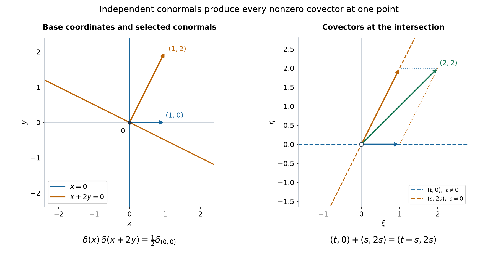

# Tensor directions and admissible hyperfunction products

*Original exposition and proofs: GPT-6 Astra (OpenAI), Ultra, October 2026. Self-checked by the writing AI; no independent review. CC0.*

A tensor can be singular while one of its covector components is zero. This occurs already for a singular object that is constant in an extra variable. Keeping those zero components gives the correct condition for restricting a tensor to the diagonal, and hence for multiplying hyperfunctions. We prove this construction and its calculus directly with holomorphic sides and the existing pullback.

Throughout, \(X\subset\mathbb R^n\), \(Y\subset\mathbb R^m\) are open. Write \(W(u)=\operatorname{WF}_A(u)\), and distinguish
\[
 E(u)=W(u)\cup\{(x,0):x\in\operatorname{supp}u\},
 \qquad K_x(u)=W(u)_x\cup\{0\}.
 \tag{Z1}
\]
The set \(E(u)\) records support at zero frequency. The set \(K_x(u)\) allows zero at every base point and will be used in sufficient conditions on several factors. Neither notation declares a zero covector singular.

The existing tensor, differential and analytic multiplier operations are [Hyperfunctions from local analytic sources](hyperfunctions-from-local-analytic-sources.md), Theorem 6; their compact-carrier proofs are Analytic tests and real carriers, Proposition 7. Boundary uniqueness, the positive-dual bound and the converse are [Holomorphic boundary values without growth bounds](holomorphic-boundary-values-without-growth-bounds.md), Theorems 4 and 6–7. We use the full conic splitting and convex duality in [Directional splitting and holomorphic compatibility](directional-splitting-and-holomorphic-compatibility.md), Theorem 2 and Lemma 3. Finally [Analytic substitution for hyperfunctions](analytic-substitution-for-hyperfunctions.md), Theorems 4, 7 and 10, Proposition 5, Lemma 8 and Corollary 11, supplies the actual pullback, its composition law, tensor-boundary identity and distributional agreement.

## Both components of a tensor covector

**Theorem 1 (the full tensor bound).** For arbitrary hyperfunctions \(u\in\mathcal B(X)\), \(v\in\mathcal B(Y)\),
\[
 W(u\otimes v)\subset
 \{(x,y;\xi,\eta):(x,\xi)\in E(u),\
                  (y,\eta)\in E(v),\ (\xi,\eta)\ne(0,0)\}.
 \tag{T1}
\]
In expanded form this includes all three terms
\[
 \begin{split}
 W(u\otimes v)\subset {}&
 W(u)\times W(v)\\
 &{}\cup W(u)\times(\operatorname{supp}v\times\{0\})\\
 &{}\cup(\operatorname{supp}u\times\{0\})\times W(v).
 \end{split}
 \tag{T2}
\]
The factors are ordered by their base and covector variables.

**Proof.** The existing tensor is zero off the product of supports. At a point of that product outside the right side of (T1), at least one nonzero covector component is regular for its factor. Suppose it is \(\xi_0\ne0\) for \(u\) at \(x_0\).

The compact unit singular fiber of \(u\) can be covered by finitely many small closed convex pointed cones \(C_j\), each excluding \(\xi_0\). Openness of the regular locus gives one smaller base neighborhood on which the closed complementary cone has no wavefront. The full conic splitting and wedge converse therefore give
\[
 u=g+\sum_j b_{G_j}f_j,\qquad
 G_j=\operatorname{int}C_j^*,
 \tag{T3}
\]
with analytic \(g\). For \(v\), use any finite pointed-cone decomposition on a small neighborhood of \(y_0\), with cones \(D_k\), approach cones \(H_k=\operatorname{int}D_k^*\), and an analytic remainder. An empty singular fiber means just the analytic remainder.

The exact tensor-boundary identity gives
\[
 (b_{G_j}f_j)\otimes(b_{H_k}h_k)
                 =b_{G_j\times H_k}(f_j\otimes h_k).
 \tag{T4}
\]
The positive dual of \(G_j\times H_k\) is \(C_j\times D_k\): setting one component arbitrarily close to zero isolates the other pairing, and the converse follows by adding the two nonnegative pairings. An analytic factor has the full space as approach cone and dual \(\{0\}\). Thus every summand involving the \(u\)-side in (T3) has first wavefront component in its \(C_j\); summands involving \(g\) have first component zero. None contains \(\xi_0\). Finite summation proves regularity at \((x_0,y_0;\xi_0,\eta_0)\). Interchanging factors handles a regular nonzero \(\eta_0\), proving (T1) and (T2). \(\square\)

For example, the exact projection result already proved gives
\[
 W(u\otimes1)=
 \{(x,y;\xi,0):(x,\xi)\in W(u)\}.
 \tag{T5}
\]
Deleting the zero-component terms from (T2) would incorrectly make this tensor analytic whenever \(u\) is singular. No equality for two arbitrary singular factors is asserted by Theorem 1.

## Differentiating a holomorphic side

**Lemma 2 (boundary differentiation).** For a holomorphic side \(f\) with approach cone \(G\),
\[
 \partial^\alpha(b_Gf)=b_G(\partial^\alpha f).
 \tag{D1}
\]
Consequently every differential operator \(P\) with real analytic coefficients satisfies
\[
 W(Pu)\subset W(u).
 \tag{D2}
\]

**Proof.** It is enough to check one derivative. On a relatively compact bounded open set \(V\), choose the exact compact boundary representative \(a\) and its translated integral
\[
 a_y(\phi)=\int_V f(x+iy)\phi(x+iy)\,dx.
 \tag{D3}
\]
For every prescribed complex neighborhood of \(\partial V\), \(a-a_y\) is carried in that neighborhood for sufficiently small strict approach \(y\). Differentiation preserves any complex carrier by the full Cauchy estimate in Proposition 7 of the analytic-functional lesson.

Let \(c_y\) be (D3) with \(\partial_j f\) in place of \(f\). The derivative convention gives
\[
 (\partial_j a_y-c_y)(\phi)
       =-\int_V\partial_{x_j}
                  \bigl(f(x+iy)\phi(x+iy)\bigr)\,dx.
 \tag{D4}
\]
This difference is carried arbitrarily close to the translated boundary. Indeed choose a smooth cutoff \(\chi\in C_c^\infty(V)\) equal to one off a sufficiently thin boundary collar. Subtract the integral of the compact divergence
\(\partial_{x_j}(\chi f\phi)\), which is zero. The remaining terms contain only \(\phi,\partial_j\phi\) in the collar. A fixed small complex radius and the Cauchy estimate bound them by the supremum of \(\phi\) on any prescribed neighborhood of the translated boundary. The coefficients are bounded on its compact image for each fixed positive height. No estimate uniform as the height tends to zero is required for this carrier assertion.

Combining (D4) with the carrier bound for \(\partial_j(a-a_y)\) gives exactly the shrinking-boundary-carrier characterization of \(b_G\partial_j f\). Uniqueness identifies it with \(\partial_j b_Gf\). Iteration proves (D1).

At a pair outside \(W(u)\), take the fine conic decomposition (T3) with every singular cone excluding the given covector. Differentiating its sides preserves their approach cones; the analytic remainder remains analytic. The boundary bound and the sum rule prove \(W(\partial^\alpha u)\subset W(u)\). Analytic multiplication has this same wavefront inclusion by Theorem 4 of the preceding pullback lesson. Applying it to every coefficient and summing proves (D2). \(\square\)

## When two sides share an approach direction

**Lemma 3 (noncancelling cone sums).** Let \(C,D\subset\mathbb R^n\) be closed convex pointed cones, including zero, with
\[
 C\cap(-D)=\{0\}.
 \tag{G1}
\]
Then \(C+D\) is closed, convex and pointed. There is \(c>0\) such that
\[
 |a+b|\ge c(|a|+|b|)\qquad(a\in C,\ b\in D),
 \tag{G2}
\]
unless both cones are zero, when the assertion is immediate. Moreover
\[
 \operatorname{int}(C+D)^*
             =\operatorname{int}C^*\cap\operatorname{int}D^*
             \ne\varnothing.
 \tag{G3}
\]

**Proof.** Minimize \(|a+b|\) on the compact set
\(\{(a,b)\in C\times D:|a|+|b|=1\}\). A zero minimum would contradict (G1). Scaling gives (G2). If a sequence of sums converges, (G2) bounds both summands; a convergent subsequence proves closedness of \(C+D\). Convexity is immediate. If
\(a_1+b_1=-(a_2+b_2)\), then \(a_1+a_2=-(b_1+b_2)\) lies in \(C\cap(-D)\). Both sums are zero, and pointedness of the individual cones makes all four summands zero. Thus the sum is pointed.

The previously proved strict-pairing characterization of dual interiors says that a vector lies in \(\operatorname{int}Q^*\) exactly when it pairs positively with every nonzero vector of a closed pointed cone \(Q\). Applied to \(C,D,C+D\), this gives (G3): a nonzero sum has at least one nonzero summand, while the other implication follows by taking one summand zero. Nonemptiness follows from pointedness of the closed sum. Zero cones have full-space dual and fit the same argument. \(\square\)

Suppose \(u,v\) have no opposite singular covectors at \(x_0\). Their compact unit singular fibers have positive separation after one is reflected. Consequently their finite conic decompositions can use arbitrarily small \(C_j,D_k\) with
\[
 C_j\cap(-D_k)=\{0\}\quad\hbox{for every }j,k.
 \tag{G4}
\]
To justify one simultaneous choice, otherwise take successively smaller cones about the compact fibers containing an opposite unit pair, then pass to a convergent subsequence; its limit would be a forbidden opposite pair in the original fibers. Shrinking the base neighborhood preserves these choices. Analytic remainders correspond to the zero cone. Formula (G3) then supplies a nonempty common approach cone for every pair of holomorphic sides.

## Multiplication on the diagonal

**Theorem 4 (admissible product and its calculus).** Assume
\[
 (x,\xi)\in W(u)\ \Longrightarrow\ (x,-\xi)\notin W(v).
 \tag{P1}
\]
The diagonal \(\Delta(x)=(x,x)\) is noncharacteristic for \(u\otimes v\). Define
\[
 uv=\Delta^*(u\otimes v).
 \tag{P2}
\]
This product is local, has support in
\(\operatorname{supp}u\cap\operatorname{supp}v\), and satisfies
\[
 W(uv)\subset
 \{(x,\xi+\eta):(x,\xi)\in E(u),\
     (x,\eta)\in E(v),\ \xi+\eta\ne0\}.
 \tag{P3}
\]
It agrees with the existing product on distributional inputs, and with analytic multiplication when one factor is analytic. It is commutative and bilinear whenever the stated pairings are admissible. Every derivative satisfies the full Leibniz formula
\[
 \partial^\alpha(uv)
   =\sum_{\beta\le\alpha}\binom{\alpha}{\beta}
         (\partial^\beta u)(\partial^{\alpha-\beta}v).
 \tag{P4}
\]
Every product on the right is admissible.

**Proof: definition and bound.** The transpose differential of the diagonal is
\[
 D\Delta^T(\xi,\eta)=\xi+\eta.
 \tag{P5}
\]
Its nonzero normals are \((\xi,-\xi)\) with \(\xi\ne0\). The tensor bound (T1) and (P1) exclude them. The actual hyperfunction pullback therefore exists, and its sharp bound gives (P3). Locality and the tensor support inclusion give the support assertion.

For distributions, the tensor agrees with the existing distribution tensor. Analytic normal exclusion implies the ordinary smooth exclusion, because smooth wavefront is contained in analytic wavefront. The distributional agreement theorem for pullback identifies (P2) with the product in [Keeping zero covectors in kernel operations](keeping-zero-covectors-in-kernel-operations.md), Theorem 4. This is agreement of the constructions, not only of their bounds.

**Proof: the holomorphic formula.** Use the simultaneous finite decompositions in (G4). For one pair let
\(G=\operatorname{int}C^*\), \(H=\operatorname{int}D^*\). The tensor-boundary identity and diagonal pullback give
\[
 (b_G f)(b_H h)=b_{G\cap H}(fh).
 \tag{P6}
\]
Indeed the complex diagonal sends \(z\) to \((z,z)\), and its inverse image of \(G\times H\) is \(G\cap H\). Lemma 3 makes this cone nonempty. On any strictly smaller approach cone the definition of pullback is precisely composition of \(f\otimes h\) with that diagonal; boundary cone independence identifies the displayed boundary. If a factor is analytic, its full-space approach cone gives the existing analytic multiplier identity.

The ordinary holomorphic identity \(fh=hf\), expanded over the finite decompositions, proves commutativity. Tensor bilinearity and linearity of pullback give bilinearity: if two pairings with the same factor satisfy (P1), their sum does too, by the wavefront sum inclusion.

By Lemma 2, derivatives of the inputs have no larger wavefront, so every product in (P4) is defined. On each common wedge in (P6), ordinary holomorphic differentiation gives the first-derivative product rule. Apply Lemma 2 and sum the pieces to obtain that rule for the hyperfunctions. Induction on \(|\alpha|\), using Pascal's identity for each coordinate, gives all coefficients in (P4). \(\square\)

The sum set on the right of (P3) is closed off zero locally; no additional closure is hidden. The sets \(E(u),E(v)\) are closed in the full cotangent space: if a wavefront covector tends to zero, its base limit still belongs to the closed support. On a compact base set, normalize \(|\xi|+|\eta|=1\). A sequence for which \(|\xi+\eta|\to0\) would converge to a forbidden opposite pair. Thus a uniform version of (G2) holds. A convergent sequence of nonzero sums has bounded lifts, and their convergent subsequence proves the assertion.

## Pulling back products

**Lemma 5 (tensor naturality).** If \(F:X'\to X\) is noncharacteristic for \(u\), and \(G:Y'\to Y\) is noncharacteristic for \(v\), then \(F\times G\) is noncharacteristic for \(u\otimes v\), and
\[
 (F\times G)^*(u\otimes v)=F^*u\otimes G^*v.
 \tag{N1}
\]

**Proof.** A nonzero covector in (T1) has at least one nonzero component. Its corresponding transpose image is nonzero, by the hypotheses, so the block transpose cannot kill the pair. This proves admissibility.

On small patches choose adapted representations of \(u,v\) whose singular cones have the required transpose norm margins. Their tensor is the finite sum of the sides (T4), including analytic remainders. On a common strictly smaller joint approach cone, pulling back such a side by \(F\times G\) gives the holomorphic function
\[
 (f\otimes h)\circ(F^{\mathbb C}\times G^{\mathbb C})
                   =(f\circ F^{\mathbb C})\otimes
                                      (h\circ G^{\mathbb C}).
 \tag{N2}
\]
The two compositions are defined on sufficiently small separate wedges by the proved composition lemma. Choose a strict joint cone inside their product to compare with the left side. The tensor-boundary identity and boundary cone independence identify its boundary with the right side of (N1). Finite summation and locality prove the result. This argument includes analytic factors without requiring a positive imaginary component in their variables. \(\square\)

**Theorem 6 (chain rule and product compatibility).** If \(F:X\to Y\) is real analytic and noncharacteristic for \(u\), then
\[
 \partial_{x_j}F^*u
   =\sum_{k=1}^{m}(\partial_{x_j}F_k)\,
                                  F^*(\partial_{y_k}u).
 \tag{N3}
\]
Suppose \(u,v\) satisfy (P1) on \(Y\), and also, for every \(x\in X\),
\[
 \xi\in K_{F(x)}(u),\quad\eta\in K_{F(x)}(v),\quad
 DF(x)^T(\xi+\eta)=0
       \ \Longrightarrow\ \xi=\eta=0.
 \tag{N4}
\]
Then all operations in
\[
 F^*(uv)=(F^*u)(F^*v)
 \tag{N5}
\]
are defined, and the equality holds.

**Proof.** Lemma 2 makes \(F\) noncharacteristic for every derivative of \(u\). On each adapted side, differentiate its holomorphic composition with \(F^{\mathbb C}\). The ordinary chain rule, boundary differentiation and the existing analytic multiplier identity give exactly (N3). Sum and glue.

In (N4), set one covector zero to obtain admissibility of the individual pullbacks. The product bound (P3) gives admissibility of \(F^*(uv)\). The pullback bounds also show that \(F^*u,F^*v\) have no opposite singular covectors: such a pair would lift to \(\xi,\eta\) whose sum is killed by \(DF^T\), contradicting (N4).

Now the two analytic maps into \(Y\times Y\) satisfy
\[
 \Delta_Y\circ F=(F\times F)\circ\Delta_X.
 \tag{N6}
\]
The tensor bound and (N4) make this common composite noncharacteristic for \(u\otimes v\). The map \(\Delta_Y\) is noncharacteristic by (P1), and \(F\times F\) is noncharacteristic by Lemma 5. Apply the proved pullback composition law to each side of (N6), then Lemma 5:
\[
 F^*\Delta_Y^*(u\otimes v)
  =\Delta_X^*(F\times F)^*(u\otimes v)
  =\Delta_X^*(F^*u\otimes F^*v).
 \tag{N7}
\]
These are precisely the two sides of (N5). \(\square\)

For an analytic diffeomorphism, (N4) follows from (P1), since its transpose is invertible. Thus the product respects the existing scalar hyperfunction coordinate convention. The construction and wavefront bound consequently glue on real analytic manifolds; no choice of coordinates or extra density is introduced.

## Several factors and the joint condition

**Theorem 7 (finite admissible products).** Let \(u_1,\ldots,u_r\in\mathcal B(X)\). Suppose, at every \(x\),
\[
 \xi_j\in K_x(u_j),\quad
       \xi_1+\cdots+\xi_r=0
       \ \Longrightarrow\ \xi_1=\cdots=\xi_r=0.
 \tag{J1}
\]
With \(\Delta_r(x)=(x,\ldots,x)\), define
\[
 \prod_{j=1}^r u_j
       =\Delta_r^*(u_1\otimes\cdots\otimes u_r).
 \tag{J2}
\]
This operation exists, is invariant under reordering, and agrees with every successive parenthesization into admissible binary products. Its support lies in the intersection of the supports, and
\[
 W\left(\prod_j u_j\right)\subset
 \left\{\left(x,\sum_j\xi_j\right):
        (x,\xi_j)\in E(u_j),\ \sum_j\xi_j\ne0\right\}.
 \tag{J3}
\]

**Proof.** Induction using (T1) gives the tensor bound in all \(r\) variables, retaining zero components at their support points. The tensor's transpose normal condition for \(\Delta_r\) is the sum of its \(r\) components. Hypothesis (J1) excludes every nonzero normal, proving (J2), (J3) and the support bound.

Setting some of the \(\xi_j\) to zero shows that every subfamily satisfies the same joint condition. Consider a split of the factors into two nonempty consecutive groups, of sizes \(p,q\). The block diagonal
\[
 B:X\times X\longrightarrow X^{p+q},\qquad
 B(x,y)=(\underbrace{x,\ldots,x}_{p},
                       \underbrace{y,\ldots,y}_{q})
 \tag{J4}
\]
is noncharacteristic for the tensor: its transpose sums each block, and vanishing of a block sum is excluded by the joint condition for that subfamily at its own base point. Lemma 5, applied to \(\Delta_p,\Delta_q\), identifies \(B^*\) of the tensor with the tensor of the two group products.

These group products satisfy the binary condition. Otherwise their wavefront bounds would give tuples in the two groups with nonzero opposite sums at the same base point; combined, they contradict (J1). Finally
\(B\circ\Delta_2=\Delta_{p+q}\). Both \(B\) and this composite are noncharacteristic, so the pullback composition law identifies the product of the group products with (J2). Induction proves the assertion for every binary parenthesization.

The existing tensor is associative by its compact iterated pairings, and a permutation of its variables permutes its factors by the same pairings. Its real coordinate permutation has absolute Jacobian one. Since permuting \(\Delta_r\)'s outputs leaves the diagonal unchanged, pullback composition proves invariance under reordering. This also allows nonconsecutive groupings.

For completeness, the sum bound is locally closed off zero. On any compact base set normalize \(\sum_j|\xi_j|=1\). Compactness and (J1) give a positive lower bound for \(|\sum_j\xi_j|\), just as in (G2). Bounded lifts then prove closedness of the image. \(\square\)

The case of a zero-dimensional open set is ordinary scalar multiplication: the only cotangent vector is zero and all the exclusion conditions are empty. For \(r=1\), (J2) is the identity; for \(r=0\), the empty product is the analytic unit \(1\).

## Exercises with complete solutions

**Exercise 1 (basic) — why an analytic factor still contributes.** Let \(v\) be a singular hyperfunction on a line and let \(u=1\) on another line. Determine the wavefront of \(u\otimes v\). Explain precisely which term of (T2) is needed.

**Solution.** Projection equality gives
\[
 W(1\otimes v)=
       \{(x,y;0,\eta):(y,\eta)\in W(v)\}.
 \tag{X1}
\]
The constant factor has empty wavefront but full support. Thus the third term of (T2) supplies all these covectors, while its first and second terms are empty. The zero first component means that this singularity has no frequency in the unused variable.

**Exercise 2 (intermediate) — two transverse delta sheets.** On \(\mathbb R^2\), let
\[
 u(x,y)=\delta_0(x),\qquad
 v(x,y)=\delta_0(x+2y).
 \tag{X2}
\]
Verify admissibility, compute \(uv\), and find its full analytic wavefront.

**Solution.** Each linear map in (X2) is a submersion. Exact submersion equality gives the nonzero conormals to the respective lines:
\[
 \begin{split}
 W(u)&=\{(0,y;t,0):t\ne0\},\\
 W(v)&=\{(x,y;s,2s):x+2y=0,\ s\ne0\}.
 \end{split}
 \tag{X3}
\]
The lines meet only at the origin, and \((t,0)=-(s,2s)\) forces \(s=t=0\), so the product is admissible.

Use the analytic diffeomorphism \(A(x,y)=(x,x+2y)\), whose determinant is \(2\). In its target coordinates the product of the two independent deltas is their tensor \(\delta_{(0,0)}\). This follows also from the existing distribution product: take separate-variable smooth approximations, whose products are their tensors, and apply the proved conic convergence in Theorem 4 of the earlier kernel-operations lesson. The coordinate pullback formula therefore gives
\[
 uv=A^*\delta_{(0,0)}=\tfrac12\delta_{(0,0)}.
 \tag{X4}
\]
All nonzero covectors occur for a point delta: any cutoff equal to one at its point has constant Fourier transform, so no direction satisfies ordinary rapid decrease, and ordinary wavefront is contained in analytic wavefront. Hence
\[
 W(uv)=\{(0,0;\xi,\eta):(\xi,\eta)\ne(0,0)\}.
 \tag{X5}
\]
The bound (P3) is exact here, because \((t,0)+(s,2s)=(t+s,2s)\) ranges over the whole covector plane.

*Left: the exact lines \(x=0\), \(x+2y=0\), with selected conormals \((1,0)\), \((1,2)\) drawn using the Euclidean coordinate identification. Right: their covector lines and the selected sum \((2,2)\). The nonzero sums fill the entire cotangent fiber at the intersection. The scalar product is \(\frac12\delta_{(0,0)}\), from the absolute determinant \(2\), as proved in Exercise 2. [Editable figure source](../figures/transverse-hyperfunction-products.py).*

**Exercise 3 (intermediate) — an analytic zero can remove a singularity.** Compute \(x^r\partial_x^k\delta_0\) for nonnegative integers \(r,k\), and compare this with the wavefront inclusion for analytic multiplication.

**Solution.** The analytic factor is always admissible, and the new product agrees with existing multiplication. On a test \(\phi\), the pairing is \((-1)^k(x^r\phi)^{(k)}(0)\). Only the term with exactly \(r\) derivatives on \(x^r\) survives when \(r\le k\); none survives otherwise. Therefore
\[
 x^r\partial_x^k\delta_0=
 \begin{cases}
 (-1)^r\dfrac{k!}{(k-r)!}\partial_x^{k-r}\delta_0,&r\le k,\\
 0,&r>k.
 \end{cases}
 \tag{X6}
\]
In particular \(x\delta_0=0\). The inclusion can be strict. If an analytic multiplier is nonzero at the base point, its reciprocal is analytic nearby, by its convergent geometric-series expansion; applying the inclusion to the multiplier and its reciprocal gives equality of wavefront fibers there.

**Exercise 4 (advanced) — a product outside distributions.** Put \(w=b_+\exp(-1/z^2)\) on the real line. Show that \(w^2\) is defined and is again not a distribution.

**Solution.** The growth-free boundary lesson proves that \(w\) is nonanalytic only at zero, with just the positive analytic covector ray there, and is not a distribution. Two positive rays cannot be opposite, so (P6) gives
\[
 w^2=b_+\exp(-2/z^2).
 \tag{X7}
\]
This boundary is not analytic at zero: otherwise uniqueness would identify its side with a holomorphic germ across zero, contradicting the essential singularity. Its wavefront is therefore exactly the positive ray, by the boundary bound and projection theorem. If it were a distribution, the polynomially bounded wedge converse and uniqueness, with its analytic remainder absorbed, would give a polynomial height bound for this same side on a smaller upper approach. But at \(z=it\) it equals \(e^{2/t^2}\), which exceeds every inverse power as \(t\downarrow0\). This contradiction proves the assertion.

**Exercise 5 (advanced) — pairwise conditions do not imply the joint condition.** Let \(b=b_+(1/z)\), and on \(\mathbb R^2\) consider
\[
 u_1=b(x),\qquad u_2=b(y),\qquad u_3=b(-x-y),
 \tag{X8}
\]
where each expression is the already defined submersion pullback. Prove that every pair is admissible, but (J1) fails at the origin.

**Solution.** The boundary bound puts \(W(b)\) in the positive ray at zero. It is nonanalytic there: an analytic boundary germ would, by uniqueness, extend \(1/z\) across its pole. Thus the projection theorem makes that positive ray the entire nonempty singular fiber. The three exact submersion formulas give positive multiples of
\[
 e_1=(1,0),\qquad e_2=(0,1),\qquad -e_1-e_2=(-1,-1)
 \tag{X9}
\]
over their respective zero lines. No two rays are opposite, so every pair satisfies (P1). At their common point, taking each of the displayed covectors once gives a zero sum with no zero summand. Hence (J1) fails. This does not by itself prove that every possible iterated product is impossible; it proves that pairwise admissibility does not supply the hypothesis of the finite-product theorem.

**Exercise 6 (intermediate) — a chain rule with two terms.** Let \(p(x,y)=x+y^2\), and let \(a\) be any hyperfunction on the line. Compute the \(y\)-derivative and second \(y\)-derivative of \(p^*a\).

**Solution.** The map is a submersion since \(\partial_xp=1\), so all pullbacks are defined. Applying (N3) twice and the analytic-factor product rule gives
\[
 \partial_y p^*a=2y\,p^*a',
 \qquad
 \partial_y^2p^*a=2\,p^*a'+4y^2p^*a''.
 \tag{X10}
\]
The first term in the second derivative comes from differentiating the coefficient \(2y\). No regularity of \(a\) beyond being a hyperfunction was used.

**Exercise 7 (advanced) — a pullback that creates an opposite pair.** In the preceding exercise, take instead \(u(x,y)=b(x)\), \(v(x,y)=b(y)\), with \(b=b_+(1/z)\), and \(F(t)=(t,-t)\). Check individual admissibility and determine why Theorem 6 does not assert \(F^*(uv)=(F^*u)(F^*v)\).

**Solution.** The two positive input rays are \((a,0)\), \((0,b)\), with \(a,b>0\); they are nonopposite, so \(uv\) exists. Their separate transpose images under \(DF^T=(1,-1)\) are \(a\) and \(-b\), both nonzero. Thus the individual pullbacks exist. Exact one-dimensional diffeomorphism covariance identifies their singular rays as positive and negative, respectively. They are opposite, so the sufficient product criterion for the right side fails. Taking \(a=b\) gives
\[
 DF^T\bigl((a,0)+(0,a)\bigr)=0,
 \tag{X11}
\]
which violates (N4). Individual admissibility cannot replace that condition. No claim about all alternative input-specific definitions is needed.

**Exercise 8 (intermediate) — positive directional families.** Suppose that for each base point all nonzero covectors of \(u_1,\ldots,u_r\) pair strictly positively with one fixed vector \(h\). Prove (J1) at that point, and describe all finite products when every factor has only the positive ray in one dimension.

**Solution.** In a tuple from the \(K_x(u_j)\), each nonzero summand has positive pairing with \(h\), and zero summands have zero pairing. Thus a tuple with at least one nonzero term has a strictly positive total pairing and cannot sum to zero. This proves (J1). Compactness of the unit singular fibers supplies the positive margin used in the theorem's local bounds. On the line choose \(h=1\). All finite parenthesizations and reorderings agree; their nonzero wavefront covectors, if any remain, are positive. If all factors are upper-side boundaries, repeated (P6) identifies the result with the upper boundary of the product of their holomorphic representatives.

## Programme proofs and mathematical source

- Analytic tests and real carriers, Proposition 7, and [Hyperfunctions from local analytic sources](hyperfunctions-from-local-analytic-sources.md), Theorems 6–7, supply the actual tensor, derivative, multiplier and coordinate operations.
- [Holomorphic boundary values without growth bounds](holomorphic-boundary-values-without-growth-bounds.md), Theorems 4 and 6–7, and [Directional splitting and holomorphic compatibility](directional-splitting-and-holomorphic-compatibility.md), Theorem 2 and Lemma 3, supply the exact boundary and conic proofs.
- [Analytic substitution for hyperfunctions](analytic-substitution-for-hyperfunctions.md), Theorems 4, 7 and 10, Proposition 5, Lemma 8 and Corollary 11, supplies the pullback and its actual compatibility with the preceding operations. [Keeping zero covectors in kernel operations](keeping-zero-covectors-in-kernel-operations.md), Theorems 1 and 4 and Proposition 4a, gives the already constructed distributional calculus used for comparison.
- Lars Hörmander, *The Analysis of Linear Partial Differential Operators I: Distribution Theory and Fourier Analysis*, reprint of the second edition, Springer, 2003, [doi:10.1007/978-3-642-61497-2](https://doi.org/10.1007/978-3-642-61497-2), Section 9.3, equation (9.3.3) and its extension of the computation rules in Section 8.5, particularly Theorem 8.5.3. The proofs, organization, examples, exercises and figure here are independently expressed.

Proper integration and general kernel action and composition require their further proofs. The operations established here provide the tensor and product inputs for that calculus.
