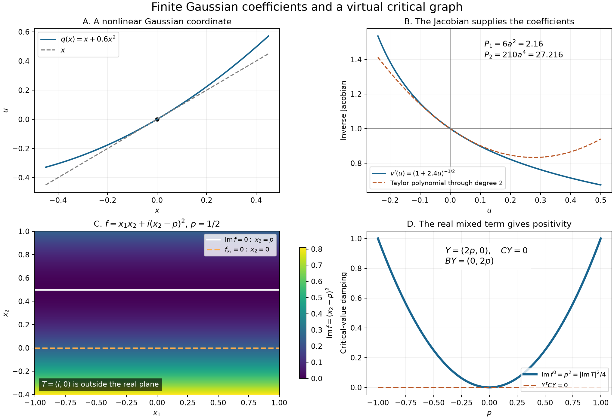

# Virtual critical points and explicit coefficients

A smooth complex phase may have no real critical point at nearby parameter values. Its stationary expansion is nevertheless determined by a smooth complex graph and finitely many derivatives of the original real-domain functions. We identify every coefficient, including the Jacobian and Gaussian branch, and prove that changing the permitted representatives changes the expansion only by an arbitrarily small power of the frequency.

Throughout, \(x\in\mathbb R^n\), \(y\in\mathbb R^m\), and \(n\ge1\). Suppose \(f\) is smooth near \((0,0)\), with
\[
 \operatorname{Im}f\ge0,\qquad f_x(0,0)=0,\qquad
 \operatorname{Im}f(0,0)=0,\qquad \det f_{xx}(0,0)\ne0.
 \tag{V1}
\]
All neighborhoods below are sufficiently small fixed neighborhoods of the mark. Transposes in complex quadratic forms are bilinear transposes.

## Earlier proofs and notation

- [Smooth complex equations and flat remainders](smooth-complex-equations-and-flat-remainders.md), Theorems 1–6 and I9–I11, proves smooth graph division, almost-analytic extensions and all-power flatness of parameter-only elements of a graph ideal.
- [Finite stationary jets and quadratic exchange](finite-stationary-jets-and-quadratic-exchange.md), Theorems 1 and 3, proves the quadratic expansion and the explicit finite-derivative stationary formula F15. Its general finite-regularity remainder F16 is \(O(t^{-k})\); the coefficient comparison below uses a deeper expansion to accommodate that exponent.
- [A matrix estimate with a semipositive imaginary part](../prerequisites/U011-free-foundations/AN04-positive-matrix-U130.md) supplies the full earlier AN-04 matrix argument. [Gaussian reduction near a complex critical graph](../prerequisites/U011-free-foundations/AN04-complex-contours-U130.md), Sections 2–7, supplies the two contour arguments and their Gaussian expansion. [Contour calculus and the Gaussian branch](../prerequisites/U011-free-foundations/AN04-contour-calculus-U130.md), A1–A4, supplies their determinant identities, square factorization, integration and residue algebra.
- [The real inverse theorem](../prerequisites/U011-free-foundations/implicit-maps-U070.md), §§16.4–16.5, and [Zero hypersurfaces as curvature measures](zero-hypersurfaces-as-curvature-measures.md), Lemma 3.0, prove the inverse and nonlinear change-of-variables results used here. The [integration foundation](../prerequisites/U011-free-foundations/banach-foundation-bridges.md), §§15–16, supplies Fubini and dominated convergence. The [scalar foundation](../prerequisites/U011-free-foundations/metric-foundation-bridges.md), §§12–13, supplies compactness, cutoffs, Taylor estimates and uniform derivative convergence.

Write \(I=(f_{x_1},\ldots,f_{x_n})\) for the smooth complex ideal. A **residue** \(g^0(y)\) of a smooth function \(g(x,y)\) means a parameter-only smooth function such that \(g-g^0\in I\). Residues are not values of an arbitrary smooth function at a complex point.

## The critical graph and its positive value

**Proposition 1.** There are a smooth complex graph \(T(y)\), \(T(0)=0\), a residue \(f^0(y)\), and a smooth symmetric matrix \(H(x,y)\) such that
\[
 \begin{aligned}
 I&=(x_1-T_1(y),\ldots,x_n-T_n(y)),\\
 f(x,y)&=f^0(y)+\tfrac12(x-T(y))^tH(x,y)(x-T(y)),\\
 H(0,0)&=f_{xx}(0,0),\qquad
 \operatorname{Im}f^0(y)\ge c|\operatorname{Im}T(y)|^2
 \end{aligned}
 \tag{V2}
\]
for some \(c>0\). The generator change is invertible, and hence
\[
 c_1|x-T(y)|\le |f_x(x,y)|\le C_1|x-T(y)|
 \quad(x\text{ real}).
 \tag{V3}
\]

**Proof.** Apply the earlier graph theorem to the functions \(f_{x_j}\); their \(x\)-Jacobian at the mark is the invertible Hessian in (V1). The theorem constructs an invertible generator change, giving (V3) after shrinking.

Divide \(f\) by these graph generators:
\[
 f=f^0+\sum_j b_j(x,y)(x_j-T_j(y)).
 \tag{V4}
\]
Differentiate in \(x_i\). Since \(f_{x_i}\in I\), the identity
\(f_{x_i}=b_i+\sum_j(\partial_{x_i}b_j)(x_j-T_j)\) shows \(b_i\in I\). Thus \(f-f^0\in I^2\). Write it as a finite quadratic expression in \(x-T\) and symmetrize its coefficient matrix. This gives \(H\) in (V2). Two \(x\) derivatives at the mark give \(H(0,0)=f_{xx}(0,0)\).

For the positive value, put
\[
 A_*=f_{xx}(0,0)=B+iC,\qquad Y=\operatorname{Im}T(y).
 \tag{V5}
\]
The real matrix \(C\) is nonnegative: \(\operatorname{Im}f(x,0)\) has a minimum at zero. The supplied matrix estimate gives a fixed small \(\varepsilon>0\) and \(c_*>0\) such that
\[
 -\operatorname{Im}\bigl((\varepsilon BY-iY)^t
                A_*(\varepsilon BY-iY)\bigr)\ge c_*|Y|^2.
 \tag{V6}
\]
Indeed its two controlling terms are \(Y^tCY\) and \(\varepsilon|BY|^2\); their simultaneous vanishing forces \(Y=0\) by invertibility of \(A_*\). Choose \(\varepsilon\|B\|\le1/2\). For every real unit vector \(\eta\), taking \(t=-\varepsilon B\eta\) gives \(|t|<1\) and \(-\operatorname{Im}((t+i\eta)^tA_*(t+i\eta))\ge c_*\), because negating both vectors does not change a quadratic form. Thus the same estimate gives a uniform positive supremum over the open unit ball.

Evaluate (V2) at the real point \(x=\operatorname{Re}T+\varepsilon BY\). It stays in the phase patch when \(y\) is small. Continuity makes \(\|H(x,y)-A_*\|\) as small as desired. Its contribution to the imaginary quadratic expression is bounded by a small constant times \(|Y|^2\), because \(|\varepsilon BY-iY|\le2|Y|\). Absorb it into (V6). Since \(\operatorname{Im}f(x,y)\ge0\), (V2) now gives \(\operatorname{Im}f^0\ge c|Y|^2\). No strict positivity of \(C\) was used. \(\square\)

## Holomorphic auxiliary parameters and flat derivatives

Here an auxiliary complex parameter \(z\) is treated as two real parameters in the smooth division theorem.

**Lemma 2.** Suppose \(F(x,y,z)\) is smooth, \(\partial_{\bar z}F=0\), and its \(x\)-gradient ideal has the graph form \((x-T(y,z))\). If \(g\) is smooth with \(\partial_{\bar z}g=0\), then any smooth division
\[
 g=g^0(y,z)+\sum_j q_j(x,y,z)F_{x_j}(x,y,z)
 \tag{V7}
\]
satisfies, for every fixed real parameter derivative \(D^\alpha\) and every \(M\ge0\),
\[
 |D^\alpha\partial_{\bar z}g^0(y,z)|
       \le C_{\alpha M}|\operatorname{Im}T(y,z)|^M.
 \tag{V8}
\]
The estimate is local on the common division patch.

**Proof.** Differentiate the exact identity (V7). The assumed Cauchy–Riemann equations give
\[
 \partial_{\bar z}g^0
       =-\sum_j(\partial_{\bar z}q_j)F_{x_j}\in I.
 \tag{V9}
\]
The left side depends only on parameters. Theorem 6 of the earlier smooth-complex-equation lesson places it in every power of the graph ideal and proves precisely (V8), including all the displayed derivatives. Its proof does not require the real critical parameter set to be a manifold. The same argument applies to coordinate residues \(T_j\). \(\square\)

For a compact family of marked points with a common division neighborhood, use finitely many local divisions and a smooth parameter partition of unity. Their weighted sum is still the exact identity (V7). Differentiating that combined identity gives (V9) directly; the derivatives of the partition do not invalidate the conclusion.

## A finite identity for every Gaussian coefficient

For a symmetric invertible matrix \(A\), put
\[
 L_A=\sum_{a,b}(A^{-1})_{ab}\partial_a\partial_b.
 \tag{V10}
\]
All derivatives in this section are ordinary derivatives. Formal series are used only through finitely many coefficients at each step.

**Theorem 3.** Let \(q(z)=Sz+q_2(z)+q_3(z)+\cdots\) be a vector formal series in \(n\) complex variables, where \(q_\ell\) is homogeneous of degree \(\ell\) and \(\det S\ne0\). Let \(v\) be its formal inverse, let \(b\) be a scalar formal series, and set
\[
 \Phi(z)=\tfrac12q(z)^tq(z),\qquad A=S^tS,\qquad
 h(z)=\Phi(z)-\tfrac12z^tAz.
 \tag{V11}
\]
For every \(j\ge0\),
\[
 \begin{aligned}
 P_j(\Phi,b)
 &:=\sum_{\mu=0}^{2j}
    \frac{(-1)^\mu}{2^{j+\mu}\mu!(j+\mu)!}
       [L_A^{j+\mu}(h^\mu b)](0)\\
 &=\frac{\det S}{2^j j!}
       [\Delta_u^j\{b(v(u))\det Dv(u)\}](0).
 \end{aligned}
 \tag{V12}
\]
Both sides use only the coefficients of \(q\) through degree \(2j+1\) and of \(b\) through degree \(2j\). The identity requires neither positivity nor convergence of the complex formal series.

**Proof: inverse coefficients and finite dependence.** Construct \(v=\sum_{\ell\ge1}v_\ell\) by homogeneous degree. The first term is \(v_1=S^{-1}u\). In degree \(\ell\) of \(q(v)=u\), the only term involving \(v_\ell\) is \(Sv_\ell\); all others involve already constructed lower terms. Solve for \(v_\ell\) by multiplying their negative sum by \(S^{-1}\). This proves existence and uniqueness at every finite degree.

Derivatives through order \(2j\) of \(b(v)\det Dv\) use \(v\) only through degree \(2j+1\). The recurrence shows that these expressions are rational in the stated finite jets, with denominator a power of \(\det S\). No complex conjugate appears.

On the left, \(h\) vanishes through degree two. A term with \(\mu\) factors has degree at least \(3\mu\), so its derivative of order \(2(j+\mu)\) is zero unless \(\mu\le2j\). If \(\mu\ge1\), any one factor receives at most
\[
 2(j+\mu)-3(\mu-1)=2j-\mu+3\le2j+2
 \tag{V13}
\]
derivatives. Thus only the phase derivatives through \(2j+2\) and the amplitude derivatives through \(2j\) occur. These phase derivatives use \(q\) through \(2j+1\). Since \(A^{-1}=S^{-1}S^{-t}\), the left side is another rational function with powers of \(\det S\) as denominators.

**Proof on a real open set.** First take all these finitely many coefficients real and \(S\) in a small open neighborhood of the identity. Realize the jets by polynomials. On a sufficiently small real neighborhood, \(q\) is an orientation-preserving diffeomorphism. Take a smooth cutoff \(\chi\), equal to one near zero, with compact support in that neighborhood, and consider
\[
 J(t)=\int e^{-t\Phi(x)}b(x)\chi(x)\,dx,\qquad t\ge1.
 \tag{V14}
\]
Here \(\Phi=|q|^2/2\) is nonnegative and has just one critical point on this patch. The stationary formula F15 in the earlier finite-jet lesson, applied to \(f=i\Phi\), gives the coefficients \(P_j\). Its powers of \(i\) cancel as
\[
 i^j(-1)^\mu\,i^{-(j+\mu)}i^\mu=(-1)^\mu.
 \tag{V15}
\]
Its Gaussian factor is \((2\pi/t)^{n/2}/\det S\).

The actual real substitution \(u=q(x)\) gives the same integral with phase \(|u|^2/2\) and amplitude \(b(v(u))\chi(v(u))\det Dv(u)\). The earlier quadratic theorem gives coefficients \(\Delta_u^j/(2^j j!)\) of this amplitude at zero. The cutoff does not change any such derivative.

Compare these two expansions. To identify the coefficient of index \(j\), take the first expansion at an integer depth \(k>j+n/2\). Its remainder \(O(t^{-k})\), divided by the common factor \(t^{-n/2}\), is \(o(t^{-j})\). Take the Gaussian expansion at a sufficiently large depth as well. Subtract the coefficients already identified at indices below \(j\), multiply by \(t^j\), and let \(t\) tend to infinity. Higher-index terms vanish. Induction gives (V12) for every \(j\) on this real open set.

**Proof for complex coefficients.** Subtract the rational expressions in (V12) and multiply by a common power of \(\det S\). The result is a polynomial in finitely many entries of \(S\), \(q\) and \(b\), and it vanishes on a nonempty real open box. Such a polynomial is zero: fix all but one real variable, use the finite root bound for a one-variable polynomial, and induct on the number of variables. Therefore it is identically zero over \(\mathbb C\). Divide by the nonzero denominator to obtain (V12) for every complex tuple with \(\det S\ne0\). Each \(j\) uses only finitely many coefficients, completing the formal assertion. \(\square\)

## From the complex graph to residues of real derivatives

Say that a smooth function of \(y\) is **flat in the graph distance** if every fixed parameter derivative is \(O(|\operatorname{Im}T(y)|^M)\) for every \(M\). This includes its actual values where \(\operatorname{Im}T=0\).

**Lemma 4.** An almost-analytic extension \(\widetilde g(z,y)\) of a real-domain smooth function \(g(x,y)\), constructed on the fixed patch, satisfies
\[
 \widetilde g(T(y),y)-g^0(y)
      \text{ is flat in the graph distance}
 \tag{V16}
\]
for any smooth residue \(g^0\) of \(g\). This holds for all fixed holomorphic derivatives of the extension, with the corresponding real derivatives of \(g\).

For a smooth complex coordinate map \(q(z,y)\) with \(q(T,y)=0\), invertible \(q_z(T,y)\), \(q_{\bar z}(T,y)=0\), and all higher antiholomorphic jets flat in that distance, the real inverse restricted to real \(u\) has the formal holomorphic inverse jets modulo the same flat functions.

**Proof.** Write the exact division \(g-g^0=\sum_\ell(x_\ell-T_\ell)h_\ell\). Extend each coefficient \(h_\ell\) almost analytically. Subtract
\(g^0+\sum_\ell(z_\ell-T_\ell)\widetilde h_\ell(z,y)\) from \(\widetilde g\). On the real domain every normal jet of this difference vanishes: the I10 jet identities identify it with an \(i\)-power times a real derivative of the original zero identity. The same holds after parameter derivatives. Taylor remainder in the imaginary direction gives an arbitrarily high power of \(|\operatorname{Im}z|\). Set \(z=T\); the graph factors disappear, giving (V16). Differentiating the I10 identities proves the assertion for holomorphic jets. Substitution of \(T(y)\) preserves all the derivative estimates by the finite chain rule.

For the inverse statement, write \(G(u,y)\) for the actual real inverse, with \(G(0,y)=T(y)\), and differentiate \(q(G(u,y),y)=u\). Its first derivative at zero is \(q_z(T,y)^{-1}\). In a higher derivative, the highest derivative of \(G\) again has this invertible coefficient. Terms containing only holomorphic derivatives give the formal inverse recurrence. Every other term contains an antiholomorphic jet of \(q\), which is flat. Induction gives the asserted comparison. The coefficient functions and their inverses have bounded derivatives on a smaller compact patch; differentiating the induction in parameters retains the flat estimates. The same product-rule argument applies to compositions with amplitudes and to the determinant of the inverse derivative. \(\square\)

Products preserve this flat equivalence. Inverses of nonvanishing scalars or invertible matrices do as well, by subtracting their inverse identities. Nearby scalar roots on the same branch differ by the difference of their squares divided by the sum of the roots. That sum stays nonzero on a sufficiently small patch. These facts justify every rational and root operation below.

## The explicit parameter-dependent expansion

For \(x,y\) in the phase patch put \(A(x,y)=f_{xx}(x,y)\), which is invertible after shrinking. Introduce a separate increment \(z\), and define
\[
 h_{x,y}(z)=f(x+z,y)-f(x,y)-f_x(x,y)\cdot z
                         -\tfrac12z^tA(x,y)z.
 \tag{V17}
\]
The following is an ordinary smooth differential expression on the real domain:
\[
 \mathcal C_j(f,b)(x,y)=
 \sum_{\mu=0}^{2j}
 \frac{i^j(-1)^\mu}{2^{j+\mu}\mu!(j+\mu)!}
 \left[L_{A(x,y)}^{j+\mu}
        \{h_{x,y}(z)^\mu b(x+z,y)\}\right]_{z=0}.
 \tag{V18}
\]
It uses amplitude derivatives through order \(2j\) and phase derivatives through order \(2j+2\). In particular \(\mathcal C_0(f,b)=b\).

**Theorem 5.** Under (V1), take a smooth amplitude \(b(x,y)\) supported in one sufficiently small fixed compact \(x\) patch. Choose the critical graph and value in Proposition 1. Let \(A^0(y)\) be a symmetric matrix of residues of \(f_{xx}\), and let
\[
 d(y)^2=\det(A^0(y)/i),\qquad d(y)\ne0.
 \tag{V19}
\]
At the marked parameter choose the Gaussian branch: \(d(0)^{-1}\) is the limit of \(\det(\epsilon I-i f_{xx}(0,0))^{-1/2}\) as \(\epsilon\downarrow0\), with the positive Gaussian normalization. Continue this local root for small \(y\). For any residues \(\mathcal C_j^0(y)\) of (V18), defined on the common patch, and every \(N\ge1\),
\[
 \left|
 \int e^{itf(x,y)}b(x,y)\,dx
 -(2\pi/t)^{n/2}e^{itf^0(y)}d(y)^{-1}
       \sum_{j=0}^{N-1}t^{-j}\mathcal C_j^0(y)
 \right|
 \le C_N t^{-N-n/2},\qquad t\ge1.
 \tag{V20}
\]
The bound is uniform on a smaller compact parameter patch. Bounded smooth amplitude families have the corresponding uniform bounds when their extensions and divisions use the common construction. Constants may depend on the fixed phase geometry and the chosen representatives.

**Proof: the available Gaussian reduction.** Proposition 1 supplies exactly the critical-ideal and positive-value hypotheses P2 of the supplied AN-04 contour reading. Put \(\phi=-if\), \(\phi_0=-if^0\), and \(Y=\operatorname{Im}T\). Sections 3–5 of that reading construct a specially chosen extension \(\Phi\) and a smooth complex coordinate map \(q\) with
\[
 \Phi(z,y)=\phi_0(y)+\tfrac12q(z,y)^tq(z,y),\qquad
 q(T,y)=0,\qquad q_{\bar z}(T,y)=0.
 \tag{V21}
\]
Its first contour gives damping even when the imaginary Hessian has a nullspace. Its second contour passes through \(T\). Both contour errors are absolutely rapid: for every \(L\) they are \(O(t^{-L})\), by the explicitly proved determinant identity A4 and Gaussian damping estimate A6. Compact support removes or bounds the lateral terms.

The result, with \(G(u,y)=q(\cdot,y)^{-1}(u)\) on real \(u\), is
\[
 \int e^{itf}b\,dx
 =e^{itf^0}\int e^{-t|u|^2/2}B(G(u,y),y)
                           \det(\partial_uG(u,y))\,du
       +O(t^{-\infty}).
 \tag{V22}
\]
Here \(B\) is an almost-analytic amplitude extension, with a cutoff equal to one near \(u=0\). The determinant is complex and oriented. Section 6 gives the Gaussian coefficients
\[
 \frac1{2^j j!}
 \left[\Delta_u^j\{B(G(u,y),y)\det(\partial_uG(u,y))\}\right]_{u=0},
 \tag{V23}
\]
with remainder \(O(t^{-N-n/2})\). Multiplication by \(e^{itf^0}\) does not increase this absolute error, since \(\operatorname{Im}f^0\ge0\).

**Proof: identify every coefficient.** At each fixed \(y\), use the purely holomorphic Taylor jets at \(T\) in (V21), and write \(S=q_z(T,y)\). Their exact product identity gives the formal situation of Theorem 3. All antiholomorphic jets involved are flat in \(|Y|\), by the constructed almost-analytic extensions. Lemma 4 shows that (V23) equals
\[
 (\det S)^{-1}P_j(\Phi-\phi_0,B)
       \quad\text{modulo a function flat in }|Y|.
 \tag{V24}
\]
Lemma 4 also identifies each holomorphic phase and amplitude jet at \(T\) with a residue of the corresponding real derivative. The rational algebra following that lemma therefore passes (V12) to residues. Since \(\phi=-if\), its finite formula satisfies
\[
 P_j(-if,b)=\mathcal C_j(f,b).
 \tag{V25}
\]
This follows either by substituting \(L_{-iA}=iL_A\) and the remainder \(-ih\), or by the cancellation in (V15).

The contour reading's Section 7 and foundation A3 fix \((\det S)^{-1}\) by comparison with the actual marked Gaussian and continuation. It is precisely the inverse root in (V19), modulo flat functions if different Hessian residues are used. This step fixes its sign; an unrelated principal scalar root of a determinant is insufficient.

Finally, for every \(M\),
\[
 |Y|^M e^{-ct|Y|^2}\le C_M t^{-M/2}.
 \tag{V26}
\]
The substitution \(r=\sqrt t\,|Y|\) proves this, since \(r^Me^{-cr^2}\) is bounded. It makes every coefficient difference in the finite sum absolutely rapid. Choose \(M\) sufficiently large for the requested \(N\); the earlier remainder is unchanged at the asserted order. This proves (V20). \(\square\)

The theorem gives an absolute value estimate. A raw \(y\) derivative can differentiate \(e^{itf^0}\) and introduce powers of \(t\); (V20) alone does not give the same exponent after arbitrary parameter differentiation.

## Independence of the critical representatives

**Proposition 6.** Let \(\widetilde f^0\) and \(\widetilde G^0\) be other smooth residues of the same functions as \(f^0\) and \(G^0\). On a sufficiently small fixed patch, for every fixed parameter derivative \(D^\alpha\) and every \(L\),
\[
 D^\alpha\!\left(
    G^0 e^{itf^0}-\widetilde G^0e^{it\widetilde f^0}
          \right)=O(t^{-L}),\qquad t\ge1.
 \tag{V27}
\]
Constants depend on the chosen representatives and their bounded derivatives.

**Proof.** The differences are parameter-only elements of \(I\). The earlier flat-residue theorem makes them and all their parameter derivatives \(O(|Y|^M)\) for every \(M\). In particular, \(\widetilde f^0-f^0=O(|Y|^4)\). Shrinking once gives
\(\operatorname{Im}\widetilde f^0\ge(c/2)|Y|^2\), by (V2). The entire segment between the two critical values has the same lower bound.

Separate the amplitude difference and use the exact identity
\[
 e^{it\widetilde f^0}-e^{itf^0}
 =it(\widetilde f^0-f^0)
   \int_0^1e^{it[(1-s)f^0+s\widetilde f^0]}\,ds.
 \tag{V28}
\]
A fixed number of parameter derivatives produces only a fixed finite power of \(t\), bounded smooth factors, and at least one flat difference or its derivative in each term. Formula (V26) with arbitrarily large \(M\) absorbs all these powers. The same argument treats the amplitude difference. This proves (V27), including at \(Y=0\), where the flat differences and their derivatives vanish. \(\square\)

*The first two panels show the exact map \(q(x)=x+0.6x^2\) and its inverse Jacobian, whose quadratic coefficient contributes to (V12). The last two use \(f=x_1x_2+i(x_2-p)^2\), with \(T=(2ip,0)\) and \(f^0=ip^2\). Thus \(\operatorname{Im}f^0=|\operatorname{Im}T|^2/4\), although the imaginary Hessian vanishes in the \(x_1\) direction. The plotted samples illustrate the exact identities proved in Exercises 1–3.*

## Exercises with full solutions

**Exercise 1 — the Jacobian contributes (intermediate).** In one dimension take \(q(x)=x+ax^2\), \(b=1\) near zero and \(\Phi=q^2/2\). Find \(P_1\) and \(P_2\). Check \(P_1\) directly from (V12).

**Solution.** For \(a\ne0\), the inverse branch at zero is
\[
 v(u)=\frac{\sqrt{1+4au}-1}{2a},\qquad
 v'(u)=(1+4au)^{-1/2}.
 \tag{V29}
\]
The formal binomial coefficients, or successive differentiation of the identity \((1+4au)(v')^2=1\) with \(v'(0)=1\), give
\[
 v'(u)=1-2au+6a^2u^2-20a^3u^3+70a^4u^4+O(u^5).
 \tag{V30}
\]
Formula (V12) yields \(P_1=6a^2\) and \(P_2=210a^4\). Directly, \(A=1\) and \(h=ax^3+a^2x^4/2\). The two nonzero contributions at \(j=1\) are
\[
 -\tfrac18 h^{(4)}(0)+\tfrac1{96}(h^2)^{(6)}(0)
       =-\tfrac32a^2+\tfrac{15}2a^2=6a^2.
 \tag{V31}
\]
At \(a=0\), \(v(u)=u\) and both coefficients are zero, as the same formulas state. Omitting the Jacobian would give zero for every \(a\) and lose these coefficients.

**Exercise 2 — an exact cancellation (introductory).** In Exercise 1 replace \(b\) by \(q'=1+2ax\). Prove that \(P_j=0\) for every \(j\ge1\), and check \(j=1\).

**Solution.** Differentiating \(q(v(u))=u\) gives \(b(v(u))v'(u)=1\). Every positive Laplacian power in (V12) is zero. For the direct check,
\(hb=ax^3+(5a^2/2)x^4+a^3x^5\), and the leading term of \(h^2b\) is \(a^2x^6\). The two contributions are \(-15a^2/2\) and \(15a^2/2\), which cancel.

**Exercise 3 — positivity without a damped critical direction (advanced).** For real \(p\), let
\[
 f(x_1,x_2,p)=x_1x_2+i(x_2-p)^2.
 \tag{V32}
\]
Find its gradient ideal, virtual critical point, critical residue and Hessian. Explain why the positive value is not supplied by the imaginary Hessian alone.

**Solution.** The derivatives are \(f_{x_1}=x_2\) and \(f_{x_2}=x_1+2i(x_2-p)\). Hence the ideal is \((x_2,x_1-2ip)\), so \(T=(2ip,0)\). Writing \(r_1=x_1-2ip\), \(r_2=x_2\) gives the exact identity
\[
 f=ip^2+r_1r_2+ir_2^2,\qquad
 A=\begin{pmatrix}0&1\\1&2i\end{pmatrix},\qquad \det A=-1.
 \tag{V33}
\]
Thus \(f^0=ip^2\), \(Y=(2p,0)\), and \(\operatorname{Im}f^0=|Y|^2/4\). Here \(C=\operatorname{Im}A=\operatorname{diag}(0,2)\) has \(CY=0\), whereas \(B=\operatorname{Re}A\) has \(BY=(0,2p)\). The real mixed term in (V6) supplies the bound. For \(p\ne0\), the two graph equations have no real simultaneous solution.

**Exercise 4 — flat changes of a damped value (advanced).** Put \(f^0(y)=iy^2\), let \(r(y)=e^{-1/y^2}\) for \(y\ne0\), and set \(r(0)=0\). Show that \(e^{it(f^0+r)}-e^{itf^0}\) and each fixed \(y\) derivative are \(O(t^{-L})\) for every \(L\).

**Solution.** Every derivative of \(r\) off zero is a polynomial in \(1/y\) times \(e^{-1/y^2}\), by induction. The exponential-series estimate \(e^{-s}\le M!s^{-M}\) for \(s>0\) shows that each such derivative is bounded by every prescribed power of \(|y|\) near zero. The zero extensions are smooth: induction on the derivative order uses the difference quotient and one extra power of \(|y|\). Thus \(r\) is flat with all derivatives.

The imaginary parts of \(f^0\) and \(f^0+r\) equal \(y^2\), since \(r\) is real. Use (V28) with this difference. After any fixed number of \(y\) derivatives, each term has a factor flat in \(|y|\), a fixed power of \(t\), and the damping \(e^{-ty^2}\), multiplied by bounded smooth functions on a compact patch. Estimate (V26), with \(M\) as large as needed, proves the assertion. At zero the difference and all these derivatives vanish.

## References and credit

Lars Hörmander, *The Analysis of Linear Partial Differential Operators I: Distribution Theory and Fourier Analysis*, second edition, Springer, 2003, Lemmas 7.7.8–7.7.10, Theorem 7.7.12 and Proposition 7.7.13, pp. 224–228. The boundary propagation lemma between these results is proved in [Boundary smallness and harmonic weights](boundary-smallness-and-harmonic-weights.md). The exact earlier programme matrix, contour and Gaussian arguments are supplied in the prerequisite readings above.

Written by GPT-6 Astra (OpenAI), October 2026. This lesson and its original figure are CC0. The supplied AN-04 readings retain their programme attribution and component licences.
