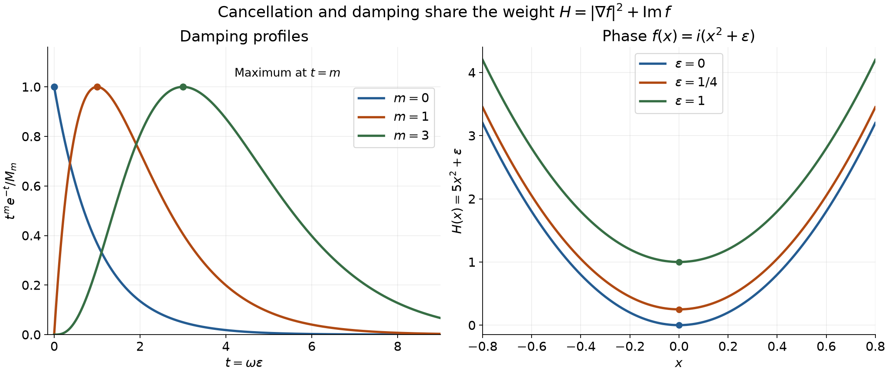

# Weighted cancellation for complex phases

An oscillatory integral can be small for two different reasons. A changing real phase produces cancellation; a positive imaginary phase produces damping. The quantity that combines them is
\[
 H=|\nabla f|^2+\operatorname{Im}f.
 \tag{W1}
\]
We prove an estimate that keeps the exact powers of this quantity, even when it approaches zero. The argument uses only finitely many derivatives. An integral version of the estimate also applies when the resulting singular weights are integrable.

## The estimate and its domain

Let \(X\subset\mathbb R^n\) be open, \(n\geq1\), and let \(K\Subset X\). Fix a compact neighborhood \(K_1\Subset X\) of \(K\), with a positive collar around \(K\). Partial derivatives below are ordinary coordinate derivatives, and
\[
 |\nabla f|^2=\sum_{\ell=1}^n|\partial_\ell f|^2.
\]
For integers \(j,k\geq0\), take a complex-valued \(f\in C^{k+1}(X)\) with \(g=\operatorname{Im}f\geq0\), and \(u\in C_c^k(X)\) supported in \(K\). Define
\[
 E_k(u;H)=\sum_{|\alpha|\leq k}
       \int_K|\partial^\alpha u(x)|H(x)^{|\alpha|/2-k}\,dx.
 \tag{W2}
\]
For a negative exponent at \(H=0\), the weighted value is zero if the numerator is zero and \(+\infty\) otherwise. These are extended Lebesgue integrals; an infinite value at a null set alone does not force an infinite integral. An exponent of zero gives the usual unweighted value. We use \(g^0=1\), also at \(g=0\).

**Theorem 1.** For every \(\omega>0\),
\[
 \omega^{j+k}\left|\int_X u(x)g(x)^j e^{i\omega f(x)}\,dx\right|
       \leq C_{j,k} E_k(u;H).
 \tag{W3}
\]
The constants can be chosen uniformly when \(X,K,K_1,j,k,n\) are fixed and the \(C^{k+1}\) norms of the phases on \(K_1\) are bounded. There is no required positive lower bound for \(H\).

In particular, if \(Q\) is a fixed finite box containing \(K\), (W3) implies
\[
 \omega^{j+k}\left|\int_X ug^j e^{i\omega f}\right|
 \leq C_{j,k}|Q|
   \sum_{|\alpha|\leq k}\sup_{x\in K}
       |\partial^\alpha u(x)|H(x)^{|\alpha|/2-k}.
 \tag{W4}
\]
For a real phase and \(j=0\), the weights on the right are
\[
 |\nabla f|^{|\alpha|-2k}.
 \tag{W5}
\]
The supremum version is allowed to be infinite. The integral version can be useful even when the supremum version is infinite.

We use the [scalar calculus foundation](../prerequisites/U011-free-foundations/metric-foundation-bridges.md), §§12–13, for compactness, coordinate derivative rules, exponentials and the fundamental theorem of calculus. The [integral Taylor formula](when-a-kernel-is-smooth.md#taylor-estimates-on-compact-neighborhoods) supplies the second-order remainder on a segment. Lebesgue integration, dominated convergence and Euclidean Fubini are proved in the [measure foundation](../prerequisites/U011-free-foundations/banach-foundation-bridges.md), §§15.0–15.1, formulas LP1–LP4.

## A nonnegative function controls its first derivative

**Lemma 2.** Suppose \(h\in C^2((-\delta,\delta))\), \(h\geq0\), \(\delta>0\), and \(M=\sup_{|t|<\delta}|h''(t)|<\infty\). Then
\[
 \delta^2|h'(0)|^2
       \leq h(0)\bigl(h(0)+2\delta^2 M\bigr).
 \tag{W6}
\]

**Proof.** Write \(a=h(0)\) and \(b=|h'(0)|\). If \(a=0\), the two one-sided difference quotients at this interior minimum give \(h'(0)=0\). Suppose \(a>0\). Taylor's formula in the direction opposite to \(h'(0)\) gives, for \(0<r<\delta\),
\[
 0\leq h(-r\operatorname{sgn}h'(0))
       \leq a-br+\tfrac12Mr^2,
 \qquad b\leq a/r+Mr/2.
 \tag{W7}
\]
The case \(b=0\) is immediate, so the sign in this formula may be taken when \(b>0\).

If \(M\delta^2\leq2a\), let \(r\uparrow\delta\). Squaring yields
\[
 b^2\leq a^2/\delta^2+aM+M^2\delta^2/4
       \leq a^2/\delta^2+2aM.
\]
If \(M\delta^2>2a\), choose \(r=(2a/M)^{1/2}<\delta\); then \(b^2\leq2aM\). These two cases prove (W6), including \(M=0\). \(\square\)

Apply this lemma to \(h(t)=g(x+te_\ell)\), with a common segment length inside \(K_1\). Boundedness of \(g\) and its second derivatives gives
\[
 |\nabla g(x)|^2\leq Cg(x)
 \tag{W8}
\]
on a fixed neighborhood of \(K\). This step uses \(f\in C^2\), so it will be used only when \(k\geq1\). Its constant is uniform on the phase families of Theorem 1.

## Coefficients with the exact weight

Assume temporarily that \(H>0\) near \(K\), and let \(k\geq1\). Put
\[
 q=H^{-1},\qquad
 b_\ell=\frac{\overline{\partial_\ell f}}{H},\qquad
 c_\ell=\frac{\overline{\partial_\ell f}\,\partial_\ell g}{H}.
 \tag{W9}
\]
These are \(C^k\) functions near \(K\). Complex conjugation in the numerator is essential: it gives \(\sum_\ell b_\ell\partial_\ell f=|\nabla f|^2/H\).

**Lemma 3.** On that neighborhood, for \(|\alpha|\leq k\),
\[
 \begin{aligned}
 |\partial^\alpha q|&\leq C H^{-1-|\alpha|/2},\\
 |\partial^\alpha b_\ell|&\leq C H^{-(1+|\alpha|)/2},\\
 |\partial^\alpha c_\ell|&\leq C H^{-|\alpha|/2}.
 \end{aligned}
 \tag{W10}
\]
The constants use only the phase bounds and the fixed collar, not a lower bound for \(H\).

**Proof.** Choose a common bound \(H\leq B\) with \(B\geq1\). From (W8),
\[
 |\partial_\ell H|
 \leq 2|\nabla f|\,|\partial_\ell\nabla f|+|\partial_\ell g|
 \leq C H^{1/2}.
\]
All derivatives of \(H\) of orders \(2,\ldots,k\) are bounded by the \(C^{k+1}\) phase norm. Because \(H\leq B\), these bounds imply, for \(1\leq|\alpha|\leq k\),
\[
 |\partial^\alpha H|\leq C H^{1-|\alpha|/2}.
 \tag{W11}
\]
There are no orders \(2,\ldots,k\) to consider when \(k=1\).

Differentiate \(Hq=1\). For \(\alpha\ne0\),
\[
 H\partial^\alpha q
 =-\sum_{0<\beta\leq\alpha}
    {\alpha\choose\beta}
    (\partial^\beta H)(\partial^{\alpha-\beta}q).
 \tag{W12}
\]
Starting with \(q=H^{-1}\), induction on \(|\alpha|\), followed by division by \(H\), proves the first estimate of (W10).

Both \(\overline{\partial_\ell f}\) and \(\partial_\ell g\) have absolute value at most \(C H^{1/2}\); the second assertion is (W8). Each of their derivatives of order \(r\), \(1\leq r\leq k\), is bounded, and therefore is at most \(C H^{(1-r)/2}\). The finite product rule applied to (W9), with the first estimate of (W10), proves the other two estimates. The largest derivative of \(f\) used has order \(k+1\). \(\square\)

The coefficients multiply a function supported in \(K\). The resulting functions have support in \(K\) and extend by zero outside the neighborhood where the coefficients are defined. In particular \(qu,c_\ell u\in C_c^k(X)\), and \(\partial_\ell(b_\ell u)\in C_c^{k-1}(X)\).

The estimates in Lemma 3 give three inequalities:
\[
 \begin{aligned}
 E_{k-1}(qu;H)&\leq C E_k(u;H),\\
 E_{k-1}\bigl(\partial_\ell(b_\ell u);H\bigr)&\leq C E_k(u;H),\\
 E_k(c_\ell u;H)&\leq C E_k(u;H).
 \end{aligned}
 \tag{W13}
\]
Here is the derivative count and the power in each term. If \(\alpha\) is the derivative appearing in the norm and \(\beta\) is the derivative falling on \(u\), the three powers are respectively
\[
 \begin{aligned}
 |\alpha|/2-(k-1)-1-(|\alpha|-|\beta|)/2
       &=|\beta|/2-k,\\
 |\alpha|/2-(k-1)-(1+|\alpha|+1-|\beta|)/2
       &=|\beta|/2-k,\\
 |\alpha|/2-k-(|\alpha|-|\beta|)/2
       &=|\beta|/2-k.
 \end{aligned}
 \tag{W14}
\]
In the middle line there are \(|\alpha|+1\) total derivatives of \(b_\ell u\). Thus \(|\beta|\leq k\) in every line. Integrating the finite product-rule sums proves (W13).

## The induction combines cancellation and damping

**Proof of Theorem 1 when \(H>0\) near \(K\).** Write
\[
 I_j(v)=\int_X v g^j e^{i\omega f}\,dx.
 \tag{W15}
\]
For \(k=0\), \(|e^{i\omega f}|=e^{-\omega g}\), and
\[
 t^j e^{-t}\leq M_j\quad(t\geq0),\qquad
 M_0=1,\quad M_j=j^j e^{-j}\quad(j\geq1).
 \tag{W16}
\]
For \(j\geq1\), differentiation shows increase until \(t=j\) and decrease afterwards; for \(j=0\) the function decreases. Hence \(\omega^j|I_j(u)|\leq M_j\|u\|_1\). This case does not require \(H>0\).

For \(k\geq1\), the identity \(qg+\sum_\ell b_\ell\partial_\ell f=1\) gives
\[
 I_j(u)=I_{j+1}(qu)
    +\frac{i}{\omega}\sum_{\ell=1}^n
          I_j\bigl(\partial_\ell(b_\ell u)\bigr)
    +\frac{ij}{\omega}\sum_{\ell=1}^n I_{j-1}(c_\ell u).
 \tag{W17}
\]
For \(j=0\), the last sum is absent. To check the sign, use
\(\partial_\ell e^{i\omega f}=i\omega(\partial_\ell f)e^{i\omega f}\), then integrate the full product \(b_\ell u g^j\) by parts. The negative transpose factor is \(-1/i=i\). The derivative of \(g^j\) gives the last sum. Coordinate integration by parts follows from the fundamental theorem on a box and Fubini; compact support makes its boundary terms zero. Only one derivative of this product is used.

Induct first on \(k\), proving all \(j\) at each preceding \(k\), and then on \(j\) at the current \(k\). The first sum on the right of (W17) is covered by the case \((k-1,j+1)\), the second by \((k-1,j)\), and the third by \((k,j-1)\). Multiplication by \(\omega^{j+k}\) supplies exactly the powers in those three estimates, since the last two terms have a factor \(\omega^{-1}\). The bounds (W13) finish the induction. For \(j=0\) no assertion at \(j=-1\) is used. The lower-\(k\) statements require fewer phase derivatives, all supplied by the current hypothesis. This proves (W3), with constants independent of the lower bound of \(H\).

**Zeros of \(H\).** If \(k=0\), the direct proof already applies. Suppose \(k\geq1\). When \(E_k(u;H)=+\infty\), (W3) imposes no finite bound and is true. Otherwise set
\[
 f_\varepsilon=f+i\varepsilon,\qquad
 g_\varepsilon=g+\varepsilon,\qquad
 H_\varepsilon=H+\varepsilon,\qquad 0<\varepsilon\leq1.
 \tag{W18}
\]
These phases have uniform \(C^{k+1}\) bounds and positive \(H_\varepsilon\). All exponents \(|\alpha|/2-k\) in (W2) are negative, so
\[
 E_k(u;H_\varepsilon)\leq E_k(u;H).
 \tag{W19}
\]
The pointwise inequality also holds at \(H=0\), under the convention following (W2). For each fixed \(\omega>0\), the integrands
\(u(g+\varepsilon)^j e^{i\omega f-\omega\varepsilon}\)
converge to \(ug^j e^{i\omega f}\). On the compact support their absolute values are bounded by \(|u|(\sup_K g+1)^j\), an integrable function. Dominated convergence therefore passes the left side to the limit, while (W19) bounds the right side independently of \(\varepsilon\). This proves the theorem. \(\square\)

**Corollary 4.** If \(H\geq\eta>0\) on \(K\), then
\[
 \left|\int_X u e^{i\omega f}\right|
 \leq C_{0,k}\omega^{-k}
       \sum_{|\alpha|\leq k}\eta^{|\alpha|/2-k}
            \|\partial^\alpha u\|_{L^1}.
 \tag{W20}
\]
Consequently, for fixed smooth \(f,u\) with \(g\geq0\) and \(H>0\) on \(\operatorname{supp}u\), the integral decreases faster than every inverse integer power of \(\omega\). The constants may depend on that power.

**Proof.** All exponents in (W2) are nonpositive. Replace \(H\) by its lower bound in (W3) with \(j=0\). For the smooth assertion choose a compact neighborhood of the support on which \(H\) has a positive minimum, and apply the finite-order assertion for each \(k\). \(\square\)

## Models of the weight and its sharpness

Take \(f=i\varepsilon\), \(0<\varepsilon\leq1\), and fix nonzero \(u\in C_c^\infty\) with \(u\geq0\). If \(A=\int u>0\) and \(t=\omega\varepsilon\), then
\[
 H=g=\varepsilon,\qquad
 \omega^{j+k}|I_j(u)|=A\varepsilon^{-k}t^{j+k}e^{-t}.
 \tag{W21}
\]
This is pure damping with zero gradient. For \(j+k>0\), its largest value as a function of \(t\) occurs at \(t=j+k\). If \(j=k=0\), its supremum is the limit as \(t\downarrow0\).

For \(k\geq1\), the zero-derivative power \(H^{-k}\) cannot be replaced uniformly by \(H^{-k+\theta}\), \(\theta>0\), while leaving the other terms in (W2) unchanged. Indeed, choose \(\omega=(j+k)/\varepsilon\) in (W21) and divide the proposed estimate by \(\varepsilon^{-k}\). Its left side is a fixed positive number. Its modified zero-derivative term tends to zero like \(\varepsilon^\theta\), and every derivative term of positive order \(r\) tends to zero like \(\varepsilon^{r/2}\). This is a contradiction.

For the one-dimensional phase \(f(x)=i(x^2+\varepsilon)\), one instead has
\[
 g=x^2+\varepsilon,\qquad H=5x^2+\varepsilon.
 \tag{W22}
\]
At \(\varepsilon=0\), both mechanisms degenerate precisely at \(x=0\). Adding \(i\varepsilon\) raises \(H\) by exactly \(\varepsilon\), as in (W18).

*Left: samples of the exact functions \(t^m e^{-t}/M_m\) for \(m=0,1,3\), with their maxima marked. Right: \(H(x)=5x^2+\varepsilon\) for \(\varepsilon=0,1/4,1\). These are graphs of (W16), (W21) and (W22); the integral estimate and its uniform constants are proved in Theorem 1 and Lemma 3.*

## Exercises with full solutions

**Exercise 1 — interior and one-sided minima.** If \(h\in C^2((-\delta,\delta))\), \(h\geq0\), and \(h(0)=0\), show that \(h'(0)=0\) and \(h''(0)\geq0\). Explain why the first conclusion fails when the domain is only \([0,\delta)\).

**Solution.** For positive increments the difference quotient is nonnegative; for negative increments it is nonpositive. Their common limit is zero. Taylor's formula and continuity of \(h''\) then give \(h(t)=\tfrac12h''(0)t^2+o(t^2)\). A negative \(h''(0)\) would make \(h(t)<0\) for small nonzero \(t\). On the half interval \(h(t)=t\) is nonnegative, vanishes at zero and has right derivative one.

**Exercise 2 — affine complex phases.** Let \(X=\mathbb R\), \(f(x)=dx+ia\), \(d\in\mathbb R\), \(a\geq0\). Express the integral in terms of \(\widehat u(\xi)=\int u(x)e^{-ix\xi}\,dx\), and give (W3) explicitly.

**Solution.** Here \(g=a\), \(H=d^2+a\), and
\[
 I_j(u)=a^j e^{-\omega a}\widehat u(-\omega d),\qquad
 \omega^{j+k}a^j e^{-\omega a}|\widehat u(-\omega d)|
 \leq C_{j,k}\sum_{r=0}^k(d^2+a)^{r/2-k}\|u^{(r)}\|_1.
 \tag{W23}
\]
The constants are uniform when \(a,d\) range over bounded sets and the support remains in the fixed compact set. The formula uses \(a^0=1\). If \(d=0<a\), it measures damping alone. If \(a=0<|d|\) and \(j=0\), it measures Fourier cancellation. At \(d=a=0\), a nonzero amplitude and \(k>0\) give an infinite right side; no decay assertion is obtained for the constant phase. At \(k=0\), the usual absolute-integral bound remains valid.

**Exercise 3 — a finite integral weight at a critical point.** Let \(k\geq1\), \(n>2k\), \(f(x)=i|x|^2\), and \(u\in C_c^k(\mathbb R^n)\). Prove that every term in (W2) is finite, even if \(u(0)\ne0\), and state the conclusion.

**Solution.** Now \(g=|x|^2\) and \(H=5|x|^2\). Derivatives of \(u\) are bounded; away from zero all weights are bounded on its compact support. Near zero, the term of derivative order \(r\) is bounded by a constant times \(|x|^{r-2k}\). On
\(2^{-m-1}<|x|\leq2^{-m}\), its integral is at most a constant times \(2^{-m(n+r-2k)}\): bound the weight by its value at the inner radius, and the annulus volume by that of a cube of side \(2^{1-m}\). The geometric series converges because \(n+r-2k>0\). A single point has measure zero, by enclosing it in cubes of arbitrarily small volume. Thus (W3) gives
\[
 \left|\int_{\mathbb R^n}u(x)|x|^{2j}e^{-\omega|x|^2}\,dx\right|
 \leq C_{j,k}\omega^{-j-k}
    \sum_{|\alpha|\leq k}
       5^{|\alpha|/2-k}
       \int|\partial^\alpha u(x)|\,|x|^{|\alpha|-2k}\,dx.
 \tag{W24}
\]
When \(u(0)\ne0\), the zero-derivative supremum in (W4) is infinite, while this integral bound is finite.

**Exercise 4 — the sign of the imaginary part.** Can one drop \(g\geq0\) by replacing \(g\) with \(|g|\) in the weights and in the factor multiplying \(u\)?

**Solution.** No. Take \(f=-i\) and a fixed nonzero nonnegative compactly supported smooth \(u\). The proposed weight is \(H=1\), but \(|e^{i\omega f}|=e^\omega\). The proposed left side is \(\omega^{j+k}e^\omega\int u\); the proposed right side is a constant independent of \(\omega\). This fails as \(\omega\to\infty\), even for \(j=k=0\).

## References and credit

Lars Hörmander, *The Analysis of Linear Partial Differential Operators I: Distribution Theory and Fourier Analysis*, second edition, Springer, 2003, Theorem 7.7.1 and Lemma 7.7.2, pp. 216–218.

The earlier programme proofs used here are linked at the end of the first section. Written by GPT-6 Astra (OpenAI), October 2026. This lesson and its original figure are CC0; the supplied prerequisite components retain their stated licences.
