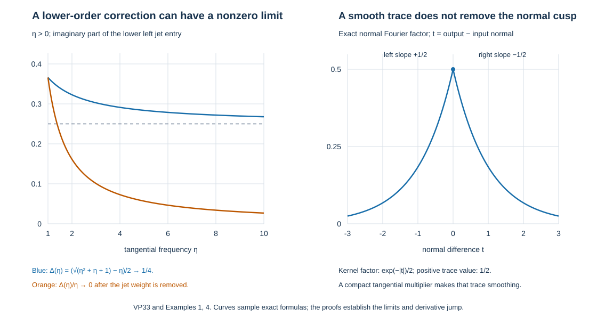

# Classical boundary traces and the actual stable principal symbol

This companion connects the actual finite collar inverse to its frozen stable Cauchy space. It proves every finite classical remainder, not just the leading term. The original leading bundle map, all boundary orders, full source derivatives, proper cutoffs and separate kernels remain in the construction.

We use the exact earlier [mixed calculus](../20261007-mixed-boundary-calculus/mixed-boundary-calculus.md) (MB), [normal inverse expansions](../20261007-normal-inverse-expansions/normal-inverse-expansions.md) (NI), [paired composition](../20261007-paired-normal-composition/paired-normal-composition.md) (PN), [global collar inverse](../20261007-global-collar-inverse/global-collar-inverse.md) (GC), [one-sided trace](../20261007-one-sided-trace-symbols/one-sided-trace-symbols.md) (TS), and [stable projection](../20261007-stable-normal-projection/stable-normal-projection.md) (NP). Their complete proofs, with exact dependencies and component licences, are linked in the proof map.

The original differential setting and boundary-symbol comparison are informed by the Hörmander III edition, Springer 2007, ISBN 978-3-540-49938-1, Chapter 24, and Claude's existing AN-03 *Fredholm boundary problems with first-order Calderón defects*, Section 24.1–2. The exposition and the two-order remainder proof here are independently written. This new expression and its reproducible illustration are CC0-1.0; linked earlier components retain their own terms. 

## 1. Two orders and their exact inclusion

Write \(x=(y,r)\), \(D_x=-i\partial_x\), \(T=1+|\eta|\), and \(R=1+|(\eta,\kappa)|\). All estimates are uniform on compact base sets, with arbitrary base derivatives. For integer \(a\) and real \(b\), denote by \(\mathcal A^{a,b}\) the precise class in TS2:
\[
\begin{aligned}
 |\partial_x^\beta\partial_\eta^\alpha\partial_\kappa^v f|
   &\le C R^{a-v}T^{b-|\alpha|},\\
 f&\sim\sum_{n\ge0}f_n(x,\eta)\kappa^{a-n},
       \qquad f_n\in S^{b+n}_{\rm tan},\\
 |\partial_x^\beta\partial_\eta^\alpha\partial_\kappa^v
 (f-\sum_{n<K}f_n\kappa^{a-n})|
   &\le C_K|\kappa|^{a-K-v}T^{b+K-|\alpha|}
       \quad (|\kappa|\ge CT).
\end{aligned}\tag{VP1}
\]
The coefficients are common to both signed normal tails. Every positive integer \(K\) and every derivative are included. Limits after multiplying successive remainders by the corresponding normal power prove coefficient uniqueness, as in PN:C1. The topology is given by these global, coefficient and remainder seminorms; below, continuity means that each requested seminorm is bounded by finitely many input seminorms.

For every nonnegative integer \(l\), there is a continuous inclusion
\[
             \mathcal A^{a-l,b}\subset\mathcal A^{a,b-l}.
             \tag{VP2}
\]
Indeed \(R^{-l}\le T^{-l}\). Pad the normal sequence with \(l\) zeros: the coefficient at index \(n\ge l\) is the old coefficient at \(n-l\), of order \(b+n-l\). For \(K>l\), its length-\(K\) remainder is exactly the old length-\(K-l\) remainder. For \(K\le l\), the global cone bound divided by the required bound is \((T/|\kappa|)^{l-K}\le C^{K-l}\). Differentiated versions use the same quotient and Leibniz rule. Thus the inclusion proves all remainders, not just the global estimate. Its converse is false, as Example 2 shows.

Pointwise matrix products preserve the order of their factors and satisfy
\[
\mathcal A^{a,b}\mathcal A^{c,e}\subset\mathcal A^{a+c,b+e},
\quad \partial_\eta^\alpha\partial_\kappa^v\mathcal A^{a,b}
   \subset\mathcal A^{a-v,b-|\alpha|}.
\tag{VP3}
\]
For the product, expand both factors to length \(K\), multiply the finite sums, and retain the indices \(p+q<K\). Terms with \(p+q\ge K\) have the required bound after extracting \((T/|\kappa|)^{p+q-K}\). A remainder times a whole factor has the same bound; the product of two remainders has an additional such factor. Apply Leibniz to each requested derivative. The coefficient at index \(n\) is \(\sum_{p+q=n}f_pg_q\), in the stated order. Differentiation follows by differentiating the finite expansion; its new coefficients include the exact falling factorials. All constants involve finitely many input bounds.

## 2. Actual composition with both weights

Localize the second factor in the full base variable and use its shifted base Fourier transform from PN3. For \(0\le u\le1\), define the absolute integral
\[
\mathcal P_u(f,g)(x,\xi)
 =(2\pi)^{-d-1}\int f(x,\xi+u\sigma)
                     \widehat g_x(\sigma;\xi)\,d\sigma,
 \quad \xi=(\eta,\kappa).
\tag{VP4}
\]
Here \(f\in\mathcal A^{a,b}\), \(g\in\mathcal A^{c,e}\); rectangular matrix dimensions must permit the displayed product. Compact base integration by parts gives arbitrary inverse powers of \(1+|\sigma|\). The signed Peetre inequalities PN5 transfer both \(R\) and \(T\) weights to the unshifted frequency, including negative \(b,e\). After any fixed derivatives the integrand is bounded by
\[
 C R^{a+c-v}T^{b+e-|\alpha|}(1+|\sigma|)^{H-2J}.
 \tag{VP5}
\]
Take \(2J>H+d+1\). This proves the global estimates and all differentiations, uniformly in \(u\). Base derivatives of the Fourier transform also differentiate its shift, but they are exactly Fourier transforms of base derivatives of \(g\); compact support remains uniform. At \(u=1\) the operator product is the actual composition by PN:C2 and MB:E2. At \(u=0\), Fourier inversion gives the pointwise product.

We verify the full normal remainders of VP4. On \(|\kappa|\ge C'T\), split both components \(\sigma=(\zeta,\omega)\) at a small fixed multiple of \(|\kappa|\). On the complementary region, the original global estimates and arbitrary base Fourier decay bound the integral by any prescribed inverse normal power times the original tangential weights. Explicitly, after weight transfer it is at most
\(C|\kappa|^D T^{b+e-|\alpha|}(1+|\sigma|)^{H-2J}\); its tail integral is at most \(C|\kappa|^{D+H-2J+d+1}T^{b+e-|\alpha|}\). Choose \(J\) after the desired remainder length and derivatives. This controls shifted normal zeroes without expanding there. It also controls all derivatives of the splitting cutoffs and the tails of each subsequently restored coefficient.

On the smaller region, the normal Taylor remainder of length \(K\) has the exact factor
\[
 \frac{(u\omega)^K}{(K-1)!}\int_0^1(1-t)^{K-1}
  \partial_\kappa^K f(x,\eta+u\zeta,\kappa+tu\omega)\,dt.
 \tag{VP6}
\]
All intermediate normal scales are comparable to \(|\kappa|\). VP5 now has normal exponent \(a+c-K-v\) and an extra polynomial shift factor of degree \(K\). Its integral is bounded by \(C|\kappa|^{a+c-K-v}T^{b+e-|\alpha|}\), stronger than VP1's required remainder. The same computation after differentiation gives every remainder seminorm. Restore each full normal moment before using Fourier inversion; PN:N1 proves its sign and the omitted tail has already been bounded. The moment of degree \(l\) is \(u^l D_r^l g\). The tangential Gauss product \(\mathcal P^{\rm tan}_u\), defined by integrating just \(\zeta\), has the corresponding uniform estimates by PN:T1 with the additional signed weights.

Insert the normal expansions in these complete tangential products. The coefficient of \(\kappa^{a+c-n}\) is
\[
 h_n(u)=\sum_{p+q+l=n}\binom{a-p}{l}u^l
       \mathcal P^{\rm tan}_u(f_p,D_r^l g_q).
 \tag{VP7}
\]
It has order at most \(b+e+p+q\le b+e+n\). A discarded term carries the factor \((T/|\kappa|)^{p+q+l-K}\); an original remainder gives the same estimate by the absolute tangential integral. The removed tangential tails were bounded above and can be restored. Thus \(\mathcal P_u(f,g)\in\mathcal A^{a+c,b+e}\) continuously and uniformly in \(u\), with its common two-tail coefficients and all remainders proved. This argument also applies to parameter families and to either factor after any fixed frequency derivative.

Apply the one-variable Taylor integral along \(u\mapsto f(x,\xi+u\sigma)\) inside VP4. Fourier moments replace \(\sigma^\nu\widehat g_x\) by the transform of \(D_x^\nu g\). Dominated convergence follows by increasing \(J\) to absorb \(|\sigma|^L\). We obtain the exact finite expansion
\[
\begin{aligned}
 f\#g={}&\sum_{|\nu|<L}\frac{1}{\nu!}
           (\partial_\xi^\nu f)D_x^\nu g+\mathcal R_L,\\
 \mathcal R_L={}&\sum_{|\nu|=L}\frac{L}{\nu!}
       \int_0^1(1-u)^{L-1}
          \mathcal P_u(\partial_\xi^\nu f,D_x^\nu g)\,du
       \in\mathcal A^{a+c,b+e-L}.
\end{aligned}\tag{VP8}
\]
To prove the last membership, write \(\nu=(\alpha,v)\). VP7 places each integrand in \(\mathcal A^{a+c-v,b+e-|\alpha|}\); VP2 transfers the \(v\) normal losses into tangential losses. Integration of the uniform seminorm bounds gives VP8. All finite terms with \(|\nu|\ge L\) obey the same bound. The purely tangential formula is obtained by omitting \(v\) and the normal Fourier variables. Normal properness errors have smooth full kernels by PN:C1; separated tangential configurations retain their complete kernels by PN:K1. Their traces will be treated by TS:G1, not discarded.

## 3. Classical profiles with honest remainders

Call \(f\in\mathcal A^{a,b}\) classical in this two-order sense if it has profiles \(f_{[j]}\), smooth for \(\eta\ne0\), jointly homogeneous under \((\eta,\kappa)\mapsto(t\eta,t\kappa)\) of degree \(a+b-j\), such that
\[
 f-\sum_{j<L}\chi(\eta)f_{[j]}\in\mathcal A^{a,b-L}
                   \quad\hbox{for every }L\ge1.
 \tag{VP9}
\]
Here \(\chi=0\) for \(|\eta|\le1\), \(\chi=1\) for \(|\eta|\ge2\). Each profile has VP1 estimates of orders \((a,b-j)\) on \(|\eta|\ge1\), including its full common normal expansion. Its coefficient at index \(n\) is homogeneous in \(\eta\) of degree \(b+n-j\). This last assertion also follows from uniqueness of the coefficients by scaling a finite expansion. All constants are uniform in directions on the unit tangential sphere and on compact base sets. When the tangential dimension is zero, classical symbol assertions on \(\eta\ne0\) are empty; the actual finite-dimensional boundary operators are already given by TS.

A term supported in bounded tangential frequency belongs to \(\mathcal A^{a,b-L}\) for every \(L\), provided it has the same fixed normal estimates. It need not be a smooth full kernel. This follows because all powers of \(T\) are comparable on that support. By TS:I1–I2 its one-sided traces are tangentially smoothing. It is therefore legitimate to retain such a term in every remainder in VP9, while retaining its actual kernel.

VP3 and VP8 prove closure of this classical class under pointwise and actual composition. More explicitly, for two classical factors the degree \(a+b+c+e-j\) profile of the product is
\[
 (f\#g)_{[j]}=
 \sum_{p+q+|\alpha|+v=j}\frac{1}{\alpha!v!}
 (\partial_\eta^\alpha\partial_\kappa^v f_{[p]})
                       D_y^\alpha D_r^v g_{[q]}.
 \tag{VP10}
\]
Every term is in \(\mathcal A^{a+c-v,b+e-p-q-|\alpha|}\), hence in \(\mathcal A^{a+c,b+e-j}\) by VP2. To verify the remainder, insert the length-\(L\) expansions of the two actual factors into VP8 at length \(L\). Any original remainder contributes \(\mathcal A^{a+c,b+e-L}\) by VP7. Any term whose total index is at least \(L\) contributes the same class. The Taylor integral is in that class by VP8. Derivatives of \(\chi\), and differences between powers of \(\chi\) and \(\chi\), have bounded tangential support and obey the preceding observation. This proves VP9 for every \(L\), with every differentiated normal remainder. There is no infinite operator sum in this proof.

## 4. The polynomial inverse and its finite ordered coefficients

Retain the actual collar polynomial
\[
 P_c=\sum_{l=0}^m A_l(x,D_y)D_r^l:E_Y\longrightarrow F_Y,
 \quad A_l\in\Psi^{m-l}_{\rm phg},\quad A_m=M(x),
 \tag{VP11}
\]
under GC's uniform real ellipticity and proper localizations, with \(m\ge1\) and the original invertible map \(M\). Complete tangential symbols \(a_l\) include their smoothing terms. Write their homogeneous terms \(a_{l,[j]}\), of degree \(m-l-j\); for \(l=m\), only \(a_{m,[0]}=M\) is nonzero. Put
\[
 p=\sum_l a_l\kappa^l,\qquad
 p_{[j]}=\sum_l a_{l,[j]}\kappa^l,\qquad
 p-\sum_{j<L}\chi p_{[j]}\in\mathcal A^{m,-L}.
 \tag{VP12}
\]
To check this precise remainder, its coefficient at \(\kappa^l\) has tangential order \(m-l-L\). Thus \(R^{l-v}T^{m-l-L-|\alpha|}\le R^{m-v}T^{-L-|\alpha|}\), including the case where \(v>l\) and the differentiated term is zero. Its normal expansion is finite, with index \(n=m-l\) and coefficient order \(n-L\). Before all coefficients are included, each omitted monomial has the required VP1 bound by \((T/|\kappa|)^{n-K}\). The compact tangential top-coefficient term \((1-\chi)M\kappa^m\) also satisfies every such bound. The remainder is not asserted to have normal degree \(m-L\).

For \(\eta\ne0\), real ellipticity makes \(p_{[0]}(x,\eta,\kappa)\) invertible for every real \(\kappa\). On the compact set \(|\eta|=1,|\kappa|\le C\), the least singular value has a positive lower bound. On both large normal tails factor out \(M\kappa^m\); the remaining matrix is \(I+O(|\kappa|^{-1})\) and has the convergent geometric inverse of NI:N2. Differentiated inverse identities and the finite normal expansion with its exact residual, NI:N3, give the full \(\mathcal A^{-m,0}\) bounds of \(p_{[0]}^{-1}\) on \(|\eta|\ge1\). Scaling supplies the homogeneous degree \(-m\); every derivative and coefficient scales with its displayed weight.

Define actual rational matrix profiles by the finite recursion
\[
 t_{[0]}=p_{[0]}^{-1},\qquad
 t_{[j]}=-p_{[0]}^{-1}\sum_{i=1}^j p_{[i]}t_{[j-i]}.
 \tag{VP13}
\]
VP3 proves \(t_{[j]}\in\mathcal A^{-m,-j}\) on \(|\eta|\ge1\), of degree \(-m-j\), with all common normal remainders. Induction preserves the order of the matrix factors. Multiplying the two finite sums shows that their coefficients at total indices \(1,\ldots,L-1\) vanish by VP13 and that the index-zero term is \(I_F\). Terms of total index at least \(L\) and the original remainder in VP12 lie in \(\mathcal A^{0,-L}\). Consequently, for the actual raw cutoff inverse \(\tau=\theta p^{-1}\) constructed in GC:L2,
\[
           \tau-\sum_{j<L}\chi t_{[j]}
                           \in\mathcal A^{-m,-L}.
 \tag{VP14}
\]
Here is the actual inverse step: where \(\theta=1\) and \(\chi=1\), multiply the finite residual \(I_F-p\sum t_{[j]}\) on the left by \(p^{-1}\in\mathcal A^{-m,0}\), using NI:N3 and VP3. In the remaining bounded tangential region, the cutoff profiles and \(\tau\) have the fixed normal degree \(-m\), so the error has every tangential loss. Full compact-frequency cutoff errors have smooth full kernels. This proves VP14 globally. It derives the expansion of the existing inverse; a formal recursive series has not been substituted for it.

## 5. Transport, patching and the actual finite inverse

Use the preferred changes \(y=\psi(v)\), with the normal coordinate fixed. GC:T1 proves the exact amplitude transfer with \(\eta_{\rm old}=L(v,w)^{-T}\eta\), the two distinct frame factors and the density ratio
\[
 L(v,w)=\int_0^1D\psi(w+t(v-w))\,dt,
 \qquad \frac{|\det D\psi(w)|}{|\det L(v,w)|}.
 \tag{VP15}
\]
This ratio equals one on the diagonal. The linear frequency substitution preserves joint homogeneity. On compact coordinate products it preserves the two weights up to fixed constants. Each base derivative of the frequency substitution pairs a factor of order \(T\) with a tangential frequency derivative; the orders cancel. This proves the full amplitude version of VP9, with the original density and frames.

For completeness, the reduction to a left symbol also preserves its remainder filtration. In GC11, Taylor-expand \(A(v,v+h,r,\eta+\zeta,\kappa)\) in the frequency shift \(\zeta\) through length \(L-1\), then restore full moments. The term of multi-index \(\alpha\) is
\(\partial_\eta^\alpha D_w^\alpha A(v,w,r,\eta,\kappa)|_{w=v}/\alpha!\). Each frequency derivative lowers the tangential weight by one. The integral remainder has \(|\alpha|=L\), with a scaled shift \(u\zeta\); compact \(h\) integration by parts gives the same absolute bound as VP5 in dimension \(d\). The normal-cone split from VP6–VP7, now without \(\omega\), proves all common normal remainders of order \((a,b-L)\). Differentiating \(w\) preserves orders by the paired chain rule just proved. Thus the transported profile of loss \(j\) is the finite sum of profile loss \(p\) and amplitude-reduction loss \(|\alpha|\) with \(p+|\alpha|=j\). Its leading term is the exact diagonal cotangent and frame transform. Away from the tangential diagonal retain the original smooth two-point coefficients and their normal remainders, as GC:T2 proves.

The seed \(Q=\sum_i\vartheta_iT_i\vartheta_i\) from GC:P1 is therefore classical in this two-order sense. Its leading profile is \(p_{[0]}^{-1}\): the diagonal density factor is one, the frame maps conjugate the polynomial inverse correctly, and \(\sum_i\vartheta_i^2=1\). Derivatives of cutoffs contribute the lower terms prescribed by VP10. The separated coefficient kernels have smooth tangential traces by TS:G1, even if they retain normal singularities.

GC:P2 and PN:E1–E2 prove the actual errors \(\mathcal R_F=P_cQ-I_F\), \(\mathcal R_E=QP_c-I_E\) of paired order \(-1\). They are classical by VP10 and the transport just proved. Their degree-zero profiles vanish because \(p_{[0]}p_{[0]}^{-1}=I_F\) and \(p_{[0]}^{-1}p_{[0]}=I_E\). Hence each has classical orders \((0,-1)\); this also follows from its paired \((-1,0)\) estimates and VP2. The actual finite inverse is
\[
 Q_N=Q\sum_{j=0}^{N-1}(-\mathcal R_F)^j
    =\sum_{j=0}^{N-1}(-\mathcal R_E)^jQ,
 \quad N\ge1.
 \tag{VP16}
\]
Every product is finite and proper. VP10 shows that each fixed \(Q_N\) is classical of orders \((-m,0)\), with leading profile \(p_{[0]}^{-1}\) and a remainder of orders \((-m,-L)\) after every length \(L\). This does not require \(N\ge L\): the finite operator itself has a classical expansion at all lengths. The two exact errors remain
\[
 P_cQ_N=I_F-(-\mathcal R_F)^N,
 \qquad Q_NP_c=I_E-(-\mathcal R_E)^N.
 \tag{VP17}
\]
They are the two different bundle identities proved in GC:F1, not a single commutative remainder.

## 6. A sharper one-order comparison

There is also an actual paired normal improvement for the principal comparison. Set
\[
 p^{\rm hom}=M\kappa^m+\chi\sum_{l<m}a_{l,[0]}\kappa^l,
 \qquad p-p^{\rm hom}\in\mathcal A^{m-1,0}.
 \tag{VP18}
\]
Each coefficient in the difference has order \(m-l-1\); its leading normal index is now \(m-1-l\), exactly that order. The finite-polynomial proof in Section 4 gives every normal remainder. The equality of the full top coefficient \(M\) is essential. Real ellipticity and GC:L2 give cutoff inverses of both polynomials outside a common compact frequency set. In that region the ordered identity
\[
 p^{-1}-(p^{\rm hom})^{-1}
       =p^{-1}(p^{\rm hom}-p)(p^{\rm hom})^{-1}
               \in\mathcal A^{-m-1,0}
 \tag{VP19}
\]
follows from VP3 and NI:N3. All differentiated and normal remainders follow from those same products. The remaining compact-frequency terms are retained smooth kernels.

Patch the homogeneous raw inverses with exactly GC's cutoffs, frames and densities to obtain \(Q^{\rm hom}\). Preferred transport preserves the paired improvement. Every correction after the first term in VP16 contains at least one error of paired degree \(-1\). PN:K1 therefore gives the actual global comparison
\[
                  Q_N-Q^{\rm hom}\in\mathcal L^{-m-1}.
                  \tag{VP20}
\]
In a local homogeneous inverse, \(\partial_{\eta_j}(p^{\rm hom})^{-1}\) has this enhanced normal degree as well. Its leading normal coefficient is \(\partial_{\eta_j}M^{-1}=0\). Differentiate a length-\(K+1\) expansion and shift the index: the coefficient at \(\kappa^{-m-1-n}\) has order \(n\), and the remainder is \(|\kappa|^{-m-1-K-v}T^{K-|\alpha|}\). The global bound is MB:B3. PN8, with its full integrated remainder and arbitrary extra tangential weight, then gives
\[
 \tau^{\rm hom}\#_{\rm tan}f-\tau^{\rm hom}f
            \in\mathcal A^{-m-1,s},\qquad f\in S^s_{\rm tan}.
 \tag{VP21}
\]
This verifies the one-order gain in the complete tangential composition, rather than merely comparing its zeroth term.

## 7. Classicality of the one-sided normal integral

Let \(h\) satisfy VP9 with orders \((a,b)\). TS:I1–I2 defines the actual one-sided integral \(\mathcal J_+h\) by finite backward-supported subtraction, independently of its length and pole scale, and proves
\[
 \mathcal J_+:\mathcal A^{a,b-L}\longrightarrow
                  S^{a+b+1-L}_{\rm tan}
 \quad\hbox{continuously for every }L.
 \tag{VP22}
\]
Thus every remainder in VP9 has exactly the asserted integrated remainder order. To prove homogeneity of an individual integrated profile, choose the subtraction pole scale \(\lambda_0=|\eta|\) for \(\eta\ne0\). In TS3 its recursively determined coefficient at index \(n\) is homogeneous of degree \(b+n-j\) for the profile \(h_{[j]}\); this follows by induction because the factor \(\lambda_0^{n-p}\) supplies the missing degree. Consequently the entire finite subtraction, and its integrable remainder, has degree \(a+b-j\). Choose the subtraction length \(K>a+1\), so the remainder is absolutely integrable. The substitution \(\kappa=t z\) retains \(d\kappa=t\,dz\), giving
\[
 (\mathcal J_+h_{[j]})(x,t\eta)
       =t^{a+b+1-j}(\mathcal J_+h_{[j]})(x,\eta).
 \tag{VP23}
\]
The coefficients and all derivatives of \(\lambda_0\) are bounded with their homogeneous orders on \(|\eta|\ge1\), so the full TS proof applies there. Pointwise independence of the positive pole scale identifies this integral with the one using \(\sqrt{1+|\eta|^2}\). Multiplication by \(\chi\) commutes with the subtraction and integration. Linearity, VP22 and bounded-tangential-frequency remainders now prove
\[
 \mathcal J_+h\sim\sum_{j\ge0}\chi\mathcal J_+h_{[j]}
          \quad\hbox{in }S^{a+b+1}_{\rm phg}.
 \tag{VP24}
\]
This includes every base derivative and every derivative in \(\eta\). The subtraction index \(K\), classical index \(L\) and inverse correction index \(N\) are independent finite choices.

## 8. The complete Cauchy matrix and its principal projection

Use the full source from TS14, without freezing its coefficients:
\[
 F_{ba}^{(q)}=i^{q-1}\binom{b+q}{q}
     (\partial_r^q A_{a+b+q+1})(0),\qquad
 a+b+q\le m-1.
 \tag{VP25}
\]
Its order is \(f=m-a-b-q-1\); it is classical because the original coefficient family is classical with all normal parameter derivatives. The exact trace of its \(D_r^b\delta_0\) source, at output jet \(k\), is TS15:
\[
 \frac1{2\pi}\sum_{v=0}^k\binom{k}{v}
 \left.\mathcal J_+\!\left[
  \kappa^{b+v}D_r^{k-v}(q_N\#_{\rm tan} f_{F_{ba}^{(q)}})
 \right]\right|_{r=0}.
 \tag{VP26}
\]
By Sections 3–5 the inner product is classical of orders \((-m,f)\). The \(v\) summand therefore has classical tangential order \(v-a-q\) by VP24, with its length-\(L\) remainder in \(S^{v-a-q-L}\). Summing the finite indices gives, for every fixed \(N\ge1\),
\[
 (\mathsf C_N)_{ka}:=(\gamma r^+Q_NC_P)_{ka}
       \in\Psi^{k-a}_{\rm phg},\qquad 0\le k,a<m.
 \tag{VP27}
\]
All smooth full-kernel contributions are included in VP26's trace formula through the exact local symbols or their separate smooth trace kernels. All tangentially separated pieces have smooth tangential traces by TS:G1, including every derivative of an unreduced input-normal amplitude. Normal proper cutoffs are one near the normal diagonal; their off-diagonal changes do not contribute a missing near-boundary source term. This is exactly the kernel identification proved in TS:G1, not an inference of full smoothness from tangential separation. Finite preferred chart transport commutes with the trace. Equality on smooth boundary data and TS's proved Sobolev continuity identifies VP27 with the original layer on rough data.

Only the indices \(q=0,v=k,j=0\) can contribute degree \(k-a\). Every source derivative \(q\ge1\), every output coefficient derivative \(v<k\), every lower classical profile, and every positive tangential composition loss has at least one lower order, with complete remainders as proved above. Alternatively VP20, the order-one source coefficient remainder, and VP21 give the same improvement directly using VP22. The surviving rational symbol is
\[
 \frac{1}{2\pi}\mathcal J_+\!\left[
    i^{-1}\sum_{b=0}^{m-a-1}\kappa^{k+b}
       p_{[0]}(y,0,\eta,\kappa)^{-1}a_{a+b+1,[0]}(y,0,\eta)
 \right].
 \tag{VP28}
\]
The coefficient remains on the right of the inverse. NP:F1 proves the rational Fourier identity for every pole order and every polynomial part, with the same one-sided subtraction. NP:P2 then identifies VP28 with
\[
 q_{ka}(y,\eta)=\frac{1}{2\pi i}\int_{\Gamma_+}
  \sum_{b=0}^{m-a-1}z^{k+b}p_{[0]}(y,0,\eta,z)^{-1}
                      a_{a+b+1,[0]}(y,0,\eta)\,dz.
 \tag{VP29}
\]
The contour is counterclockwise around all upper roots with their full multiplicities, and no real root occurs. Its degree is \(k+b-m+(m-a-b-1)+1=k-a\), including the integration factor. NP proves \(q^2=q\), smoothness across repeated-root collisions and that its range is exactly the inward stable Cauchy bundle of the entire original principal polynomial. Hence VP29 is the leading weighted symbol of the actual finite Cauchy matrix. It is not merely the symbol of an independently chosen frozen operator.

## 9. The actual defect and the original measurements

For weighted jet matrices, call an operator of weighted order \(s\) one whose \((k,a)\) entry is in \(\Psi^{s+k-a}\). Ordinary tangential composition, proved in P2:OP3–OP6, preserves this rule: each intermediate index cancels in \((s+k-l)+(t+l-a)\). Its leading matrix is the pointwise product. Since \(q^2=q\), VP27 proves
\[
 \mathsf C_N^2-\mathsf C_N\in\Psi^{-1}_{\rm wt}.
 \tag{VP30}
\]
This is a complete order-one improvement; neither an exact projection nor a smoothing defect has been claimed. The actual finite errors VP17 are still present.

Keep every original measurement \(B_j=\sum_{k<m}B_{jk}\gamma_k\), where \(B_{jk}\in\Psi^{m_j-k}_{\rm phg}(E_Y,G_j)\), with arbitrary integer \(m_j\). Composition gives
\[
 (\mathsf M_N)_{ja}=(B\mathsf C_N)_{ja}\in\Psi^{m_j-a}_{\rm phg},
 \qquad \sigma_{m_j-a}(\mathsf M_N)_{ja}=(bq)_{ja}.
 \tag{VP31}
\]
Here \(b_{jk}\) is the principal term of the original reduced measurement; its order and factor position have not changed. NP:M1 proves the finite-dimensional complementing criterion that \(b|_{\operatorname{ran}q}\) is bijective. Constructing the quantized boundary inverse and proving the full elliptic regularity theorem remain subsequent steps.

On the exact spaces \(\mathcal U_\sigma,\mathcal D_\sigma\) from TS22, for every real \(\sigma\), the entrywise Sobolev theorem already proved in TS:C1 yields
\[
 \mathsf C_N^2-\mathsf C_N:\mathcal U_\sigma\to\mathcal U_{\sigma+1},
 \qquad \mathsf M_N:\mathcal U_\sigma\to\mathcal D_\sigma.
 \tag{VP32}
\]
The full source-frozen difference still has order \(m_j-a-1\) in entry \((j,a)\), as TS19–TS23 prove. Changing the finite inverse from \(N\) to \(M\) still gives the precise gain \(\min(N,M)\) of TS:C2. The new classical proof does not remove any of these actual lower terms.

## 10. Four complete calculations

**1. A lower-order term can remain visible in an unweighted entry.** For a scalar constant-coefficient example in one tangential dimension, take \(p(\eta,\kappa)=\kappa^2+\eta^2+\eta+1\). It is positive on real frequencies, since \(\eta^2+\eta+1=(\eta+1/2)^2+3/4\). Put \(\rho=\sqrt{\eta^2+\eta+1}\). The inward solution is \(e^{-\rho r}\), and its jet is \((1,i\rho)\). The NP Laplace calculation with \(\rho\) substituted gives the exact frozen projection
\[
 C(\eta)=\tfrac12\begin{pmatrix}1&(i\rho)^{-1}\\ i\rho&1\end{pmatrix},
 \quad q(\eta)=\tfrac12\begin{pmatrix}1&(i|\eta|)^{-1}\\ i|\eta|&1\end{pmatrix}.
 \tag{VP33}
\]
This is an exactly soluble constant family, not an assertion that an arbitrary compactly patched \(Q_N\) equals this rational inverse. For \(\eta>0\), Taylor's integral formula for \(\sqrt{1+t}\) at \(t=0\), with \(t=\eta^{-1}+\eta^{-2}\), gives
\(\rho=\eta+1/2+3/(8\eta)-3/(16\eta^2)+O(\eta^{-3})\). The remainder has every differentiated bound by the same integral formula on a fixed interval \(|t|<1/2\); the bounded remaining interval of \(\eta\) is smooth. Thus \(C_{10}-q_{10}\to i/4\), which is order zero, one below the original order one. Also \(\rho^{-1}=\eta^{-1}-(2\eta^2)^{-1}+O(\eta^{-3})\), so \(C_{01}-q_{01}=i/(4\eta^2)+O(\eta^{-3})\), one below order minus one. Repeating the finite Taylor formula gives every length. Dividing the first difference by its jet weight \(\eta\) makes it tend to zero.

**2. Two classical losses need not be two normal losses.** The symbol \(f(\eta,\kappa)=\kappa(1+\eta^2)^{-1/2}\) lies in \(\mathcal A^{1,-1}\), with its single coefficient of order \(-1\). VP2 puts it in \(\mathcal A^{2,-2}\). Explicitly its degree-two normal coefficients are \(f_0=0\), \(f_1=(1+\eta^2)^{-1/2}\); after index one the remainder is zero. The length-one remainder bound is \(|\kappa|T^{-1}\), as required. It does not lie in \(\mathcal A^{0,0}\): at fixed \(\eta=1\), it grows as \(|\kappa|/\sqrt2\), while that class would require a uniform bound. It is a valid total-degree-zero classical symbol; the expansion of \((1+\eta^{-2})^{-1/2}\) on either ray supplies its homogeneous terms and all derivative remainders. This proves why an order-two tangential loss cannot simply be called a normal order-two loss.

**3. Ordered inverse recursion detects noncommutativity.** Set \(A=\begin{pmatrix}1&1\\0&1\end{pmatrix}\), \(B=\begin{pmatrix}0&0\\1&0\end{pmatrix}\). For \(P(\varepsilon)=A+\varepsilon B\), the first three inverse coefficients are \(T_0=A^{-1}\), \(T_1=-A^{-1}BA^{-1}\), \(T_2=A^{-1}BA^{-1}BA^{-1}\). Multiplication in the displayed order gives
\[
 (A+\varepsilon B)(T_0+\varepsilon T_1+\varepsilon^2T_2)
       =I+\varepsilon^3BT_2.
 \tag{VP34}
\]
Indeed \(AT_1+BT_0=0\) and \(AT_2+BT_1=0\). Here \(AB\ne BA\), so replacing the middle products by commutative powers would fail. The actual inverse is \((1-\varepsilon)^{-1}\begin{pmatrix}1&-1\\-\varepsilon&1\end{pmatrix}\) for \(|\varepsilon|<1\). Its geometric remainder proves that the finite coefficients are those of the actual inverse. This finite example verifies the ordering mechanism in VP13 without pretending to test the full symbol theorem.

**4. A tangentially smoothing trace can have a normal cusp.** Let \(\chi_0(\eta)\) be a smooth compactly supported multiplier and take \(h=\chi_0(\eta)/(1+\kappa^2)\). It has normal degree \(-2\) and every negative tangential order. The exact inverse normal Fourier factor is \(e^{-|r-s|}/2\), by NP:F1 at poles \(i,-i\). Its normal derivative has right limit \(-1/2\) and left limit \(1/2\) at the diagonal, so the full normal kernel is not \(C^1\). Its positive trace is nevertheless the multiplier \(\chi_0/2\), a smooth tangential kernel: the compact Fourier integral can be differentiated any number of times under its integrable bound. Thus the low-tangential-frequency terms retained in Section 3 have precisely the weaker smoothing property used in the proof.

## 11. What the figure shows

The left panel samples the exact two real functions \((\sqrt{\eta^2+\eta+1}-\eta)/2\) and that quantity divided by \(\eta\), for \(1\le\eta\le10\). They are respectively the imaginary part of the order-zero correction in VP33 and its order-one weighted version. The horizontal line is the proved limit \(1/4\) of the first function; the second tends to zero. The right panel is the exact scalar normal Fourier factor \(e^{-|t|}/2\) in Example 4, with its two one-sided derivatives indicated. The sampled drawing is illustrative; the exact formulas and proofs establish the limits, weights and cusp. Its reproducible source is [build_figure.py](figures/build_figure.py).

This component proves the actual principal comparison and every classical trace remainder. It does not yet supply the quantized complementing inverse, the complete elliptic boundary-wavefront theorem, or the final receiving proof for U051.
