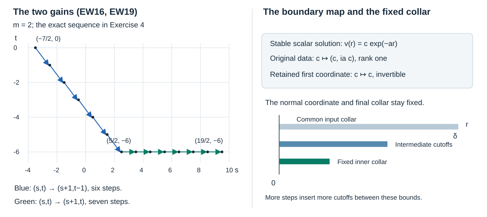

# Elliptic boundary regularity from rough data

A solution may start far below the Sobolev order at which its normal traces are available by an ordinary trace theorem. The first part of the proof raises its normal order while preserving the sum of its two regularity indices. After reaching the trace range, the actual volume and boundary inverse raises regularity at a fixed tangential index. We keep one final tester and one final collar throughout this argument.

This independent exposition is CC0. The mathematical source is Lars Hörmander, *The Analysis of Linear Partial Differential Operators III*, Springer 2007, ISBN 978-3-540-49938-1, particularly the elliptic boundary calculus of Section 20.1 and its use in Section 24.2. The existing AN-03 *Boundary wave fronts for elliptic systems*, Sections 1–9, supplied the source comparison. The proofs below use the exact earlier programme components recorded in the proof map, including the full volume parametrix VB. Earlier linked components retain their own licences. 

## 1. The domain and the two conclusions

Use the fixed inward coordinate \(r\ge0\), \(D_r=-i\partial_r\), and the intrinsic supported representatives of the dual conormal class \(\mathcal A'\). The earlier CNF and BW components prove the actual pairing, injectivity of interior restriction and the compressed wavefront set. Write
\[
 \mathcal N=\{u\in\mathcal A':
       \operatorname{WF}_b(u)|_Y\subset T^*Y\setminus0\}.
 \tag{EW1}
\]
The embedded boundary cotangent bundle has compressed normal component zero. Membership in \(\mathcal N\) is not a claim about every ambient extension of an interior distribution.

First take the generalized elliptic cylinder and complementing boundary system of VB:P1:
\[
 P=\sum_{l=0}^m P_l(r)D_r^l:E\to F,
 \quad P_l\in\Psi_{\rm tan}^{m-l},\quad P_m=M(r)\text{ invertible},
 \qquad B_j=\sum_{k<m}B_{jk}\gamma_k,\quad B_{jk}\in\Psi^{m_j-k}.
 \tag{EW2}
\]
The full principal normal polynomial is elliptic for nonzero real covectors; its stable Cauchy space maps bijectively to the measurement bundle. All original component orders \(m_j\), bundle maps and lower-order coefficients remain. Locally in the normal collar, for \(u\in\mathcal N\), \(Pu=f\) in the interior and \(B_ju=g_j\), we prove
\[
 \operatorname{WF}_b(u)|_Y
   =\operatorname{WF}_b(f)|_Y\ \cup\ \bigcup_j\operatorname{WF}(g_j).
 \tag{EW3}
\]
All equations and derivatives here use the intrinsic representatives when extended to the boundary. The proof below also shows \(f\in\mathcal N\).

Second, for an original differential \(P\) with noncharacteristic boundary, only local ellipticity at one nonzero tangential covector is required. Its boundary measurements may have redundant output coordinates. We will prove the local inclusion using injectivity, not require surjectivity of those original measurements. This second assertion supplies the elliptic part of the boundary-reflection lesson.

## 2. Intrinsic normal derivatives and their traces

We first prove the boundary-supported correction lemma. If \(h\) is a boundary distribution, let \(Th=h\otimes\delta_0\), with the density and bundle factors in CNF:J2. Then
\[
 \operatorname{WF}_b(Th)|_Y\subset
       \{(y,\eta,0):(y,\eta)\in\operatorname{WF}(h)\}.
 \tag{EW4}
\]
This assertion concerns the wavefront set on all supported distributions; \(Th\) need not belong to \(\mathcal A'\). To prove it, take a compactly localized compressed order-zero operator \(A\). The exact boundary action GB:B1 applied to its transpose, which belongs to the same calculus by GB:C10, gives
\(ATh=T A_\partial h\), where \(A_\partial\) is the transpose of the boundary action of \(A^{\mathrm t}\). Its principal symbol is the restriction of the principal symbol of \(A\) to compressed normal frequency zero. More precisely every residual full symbol restricts to a residual tangential symbol, by the complete boundary formula GL24 and its transpose. This identity follows by pairing both sides with a smooth compact test and taking its boundary value; it retains the actual density factors.

At a boundary covector outside the equator, choose the full symbol of \(A\) supported in a compressed cone disjoint from the equator, and elliptic at that covector. Its boundary symbol is residual, so \(A_\partial h\) is smooth. At an equatorial covector outside \(\operatorname{WF}(h)\), choose the full symbol supported over a smaller regular tangential cone. The full ordinary pseudolocal theorem and its residual terms make \(A_\partial h\) smooth there; use an output cutoff inside the regular base region. In either case \(T A_\partial h\) is conormal, with its exact delta order from CNF:S2. Thus \(A\) is a regularizing tester in the defining compressed wavefront intersection. Proper realization and conic cutoffs are GB:C6 and E2–E3. This proves EW4, including the pure compressed normal directions.

For \(u\in\mathcal A'\), its intrinsic normal derivative is
\[
 D_r^{\rm int}u=D_r^{\rm amb}u+i(\gamma_0u)\otimes\delta_0.
 \tag{EW5}
\]
CNF:J3 proves that this belongs to \(\mathcal A'\), has the intended interior derivative, and is weakly continuous. BW:W9–W10 proves the ordinary ambient differential inclusion, including its normal commutator. BW:S3–S4 proves \(\operatorname{WF}(\gamma_0u)\subset\operatorname{WF}_b(u)|_Y\). Combine those results with EW4 and the finite-sum tester BW:W8. In the interior the delta term is absent, so the same inclusion holds there. Induction therefore proves
\[
 \operatorname{WF}_b((D_r^{\rm int})^ku)\subset\operatorname{WF}_b(u),
 \qquad (D_r^{\rm int})^ku\in\mathcal N\quad(u\in\mathcal N),
 \qquad
 \operatorname{WF}(\gamma_ku)\subset\operatorname{WF}_b(u)|_Y.
 \tag{EW6}
\]
This holds for every integer \(k\ge0\). Smooth coefficient multiplication, product rules and changes of frames are CNF:J4. We henceforth write \(D_r^ku\) for the intrinsic derivative where the representative matters.

The intrinsic trace agrees with the mixed Sobolev trace whenever the latter exists. Here is the needed identification. For a compact tangential test \(\phi\) and \(u\in\overline H_{(s,t)}\), \(s>k+1/2\), choose a full extension. Fourier Cauchy–Schwarz in the normal frequency uses the finite integral of \(|\kappa|^{2k}(1+|\eta|^2+\kappa^2)^{-s}\); the arbitrary tangential decay of \(\widehat\phi\) absorbs the remaining fixed powers. Dominated convergence gives continuity at zero of \(\langle D_r^ku(r),\phi\rangle\), independently of the extension, as in MH:TR1–TR3. Pairing the intrinsic representative with the positive approximate delta from CNF:J2 tends to this value: its tangential approximate identity converges on \(\phi\), and its positive normal support shrinks to zero. The same approximants converge in the conormal topology that defines the intrinsic pairing. The two limits agree. Thus later Sobolev estimates concern the same \(\gamma_k\) as EW2, not newly assigned boundary values.

## 3. One collar for all smoothing remainders

Fix compact input and output base sets for the local proper operators. After multiplying by a larger fixed cutoff, regard them inside one compact boundary manifold. For \(u\in\mathcal N\), there is a collar \(0\le r<\delta\) on these compact sets with no pure-normal interior wavefront covectors of \(u\). Indeed such covectors at distances tending to zero, normalized in the compressed cosphere, would have a convergent subsequence with a pure compressed normal boundary limit. Closedness and EW1 exclude that limit. The compactness and coordinate law used here are BW:W1–W2 and GB:G6. By EW6 the same collar excludes pure-normal interior covectors of every intrinsic normal derivative of \(u\).

Let \(R(r)\) be any smooth tangentially smoothing family with the specified compact proper input and output supports. Then, on this one collar,
\[
 R(r)D_r^ku\in C^\infty\quad(k\ge0).
 \tag{EW7}
\]
At the boundary, BW:T6–T12 puts this output in \(\mathcal N\) and gives empty boundary wavefront, because the entire tangential symbol is residual. In the interior a tangentially smooth kernel can only transmit a pure-normal covector. We give the precise estimate needed for that last assertion. Localize near any positive \(r_0<\delta\), and partition its compact input in the tangential variable. Absence of pure-normal input wavefront gives arbitrary Fourier decay in a cone \(|\eta|\le c|\kappa|\), after slightly enlarging the compact input patches. Fourier transformation of the smooth localized kernel in its two tangential variables and its normal base parameter gives arbitrary powers of decay in both tangential frequencies and in the difference of input and output normal frequencies. Split the input integral into that regular cone and its complement. On the cone use the arbitrary input decay. On the complement \(|\eta|>c|\kappa|\), arbitrary tangential kernel decay defeats the fixed polynomial input distribution order and every prescribed output derivative. The part with separated normal frequencies is controlled by the arbitrary decay in their difference. Choosing each decay power larger than the finite input order, requested derivative order and integration dimension makes the integrals absolutely convergent and rapidly decreasing in the full output frequency. The Fourier/distributional formula follows first for smooth input and then by regularization and these same integrable bounds, exactly as in BW:T13 and P3:L1. A finite input partition proves interior smoothness at \(r_0\).

The output thus has no wavefront anywhere in this collar. Multiply it by a normal cutoff compactly supported in the collar. It remains in \(\mathcal A'\); BW:S1–S2, using the full conormal intersection theorem, makes it smooth up to zero. This proves EW7. The collar was chosen from the wavefront set of the original input, not from \(R\) or \(k\). Constants may depend on these operators and derivatives. This distinction allows arbitrarily long finite arguments on one fixed final collar.

Tangential operators of order \(d\) act on every real mixed restriction space by
\[
 T(r):\overline H_{(s,t)}\longrightarrow\overline H_{(s,t-d)}.
 \tag{EW8}
\]
For a compact localization the full symbol, independent of \(\kappa\), is in \(S^{0,d}\); all its positive normal-frequency derivatives vanish. MB:F1 gives the full-space bound with all real indices, including its smooth tangential kernel part. Because the operator is normal-local, two extensions with the same positive restriction have the same positive output. Taking extension infima proves EW8. Finite preferred coordinate and bundle changes are GC:H1. Normal derivatives similarly map \((s,t)\) to \((s-k,t)\), by their Fourier ratios and the same restriction argument.

## 4. Localizers with the correct bundle domains

Choose a fixed base-cone neighborhood of \(q_0\in T^*Y\setminus0\) where \(f\) and every \(g_j\) are microlocally smooth. BW:S5 supplies a tangential tester \(T_f\), elliptic on a smaller such neighborhood, for which \(T_ff\) is smooth on a fixed collar. Its construction permits a symbol independent of \(r\) near zero. The ordinary boundary tester gives corresponding operators for the finitely many \(g_j\). Shrink the base-cone neighborhood into all their elliptic regions, and choose the common collar of EW7 for \(u,f\). All later normal cutoffs have support strictly inside this fixed collar.

For any prescribed finite number of steps, choose nested base-cone regions and nested normal cutoffs between two fixed regions. The innermost operator \(A_0^E\) is fixed, scalar in local input frames and elliptic at \(q_0\). Each outer \(A_{j+1}^E\) is elliptic on a neighborhood of the full microsupport of \(A_j^E\), including its normal derivatives, and its normal scalar factor is one on their normal support. Construct each tangential kernel with one fixed compact proper-support bound. Smooth conic cutoffs and the full proper parametrices K:K3–K4 and P2:OP4–OP6 give these operators. At zero their positive normal derivatives vanish. Write
\[
 A_j^F=M A_j^E M^{-1},\qquad A_j^F M=M A_j^E.
 \tag{EW9}
\]
Both have the same scalar principal symbol. Their bundle domains are \(E\to E\) and \(F\to F\). Even if \(A_j^E\) is normal-independent near zero, \(A_j^F\) need not be; the original \(M(r)\) is retained. Use the same scalar boundary principal symbol to define \(A_j^{G_l}\) on each measurement bundle.

Every \(A_j^Ff\) is smooth on the fixed working collar. To see uniformity of the collar, construct the full parameter-dependent tangential parametrix for the one fixed \(T_f\) on the closure of the chosen base-cone region. Finite symbolic recursion followed by the complete asymptotic sum K:K1–K3 gives
\(A_j^F=Q_jT_f+R_j\), with \(R_j\) tangentially smoothing and all its normal derivatives so. The construction includes normal derivatives among its compact parameter seminorms, so the same full symbol identities hold throughout the normal support. The first term acts on the fixed smooth output \(T_ff\); EW7 makes the second smooth on the same collar for every \(j\). Similarly \(A_j^{G_l}g_l\) is smooth by the ordinary boundary parametrix and smooth-kernel action. No order-one principal-symbol comparison is substituted for these full remainders.

For \(A=A_j^E\), \(A^F=A_j^F\), the exact normal expansion is
\[
 \begin{split}
 P_lD_r^lA-A^FP_lD_r^l
  &=(P_lA-A^FP_l)D_r^l\\
  &\quad+P_l\sum_{h=0}^{l-1}\binom lh
                     (D_r^{l-h}A)D_r^h.
 \end{split}
 \tag{EW10}
\]
The top first term vanishes by EW9. For \(l<m\), the scalar principal symbols commute with the rectangular \(P_l\), so \(P_lA-A^FP_l\) has order at most \(m-l-1\). The coefficient in the second line on the jet \(h<l\) has order \(m-l\le m-h-1\). Thus, with every matrix factor in its original order,
\[
 PA_j^E-A_j^FP=\sum_{k<m}C_{jk}(r)D_r^k,
 \qquad C_{jk}\in\Psi_{\rm tan}^{m-k-1}.
 \tag{EW11}
\]
The complete product rule includes all normal cutoff derivatives. For the boundary commutator, put \(A_a=(D_r^aA)|_{r=0}\). Intrinsic differentiation and the boundary trace give
\[
 \begin{split}
 B_lA-A_j^{G_l}B_l
  &=\sum_{k<m}(B_{lk}A_0-A_j^{G_l}B_{lk})\gamma_k\\
  &\quad+\sum_{k<m}\sum_{a=1}^{k}\binom ka B_{lk}A_a\gamma_{k-a}
   =\sum_{k<m}C_{jlk}\gamma_k,\qquad
 C_{jlk}\in\Psi^{m_l-k-1}.
 \end{split}
 \tag{EW12}
\]
The first sum loses one order. A second-sum coefficient on jet \(h=k-a\) has order \(m_l-k=m_l-h-a\le m_l-h-1\). CNF:J4 and BW:T6 justify the intrinsic product rules by their weak continuity and injective interior restriction. At the chosen boundary plateaux the positive \(A_a\) vanish, but the full formula explains why no term is missing in general.

We now justify insertion of the outer localizer in every coefficient of EW11–EW12. The complete symbolic product shows that these coefficients have full microsupport inside that of the inner localizer, modulo tangentially smoothing families. A full outer parametrix therefore factors each as \(L_kA_{j+1}^E+R_k\), with \(L_k\) of the same order and \(R_k\) tangentially smoothing. Choose the factorization with normal output support inside the inner coefficient support. On that support the outer normal cutoff is identically one and its positive derivatives are zero. Hence
\(L_kA_{j+1}^ED_r^ku=L_kD_r^k(A_{j+1}^Eu)\) there, exactly. In the boundary formula its zero-order normal plateau similarly gives \(A_{j+1}^E(0)\gamma_ku=\gamma_k(A_{j+1}^Eu)\). All residual terms on intrinsic jets are smooth on the fixed collar by EW7, and all boundary residuals are smooth on distributions. This proves the actual insertion statement, including the terms outside the principal symbol.

## 5. The first stage reaches the trace range

A fixed compact localization of the supported representative of \(u\) has finite distribution order. Testing it against the compactly cut-off exponential bounds its Fourier transform by \(C\langle(\eta,\kappa)\rangle^L\). Choose one real \(s_0<-L-(\dim Y+1)/2\), and set \(t_0=0\). The Fourier integral is then finite. Every outer order-zero tangential localizer belongs to \(\overline H_{(s_0,t_0)}\) by EW8. The indices \(s_0,t_0\) are fixed as the number of nested operators increases; only norm constants can change.

Assume \(w=A_{j+1}u\in\overline H_{(s,t)}\), and set \(v=A_ju\). Outer factorization gives \(v\in\overline H_{(s,t)}\). From EW11, its insertion just proved and the smooth localized forcing,
\[
 Pv=A_j^Ff+\sum_{k<m}C_{jk}D_r^ku
       \in\overline H_{(s-m+1,t)}.
 \tag{EW13}
\]
Indeed a coefficient of order \(m-k-1\) acting on \(D_r^kw\) gives \((s-k,t-m+k+1)\), which embeds into \((s-m+1,t)\): the quotient of target to source Fourier weights is \((\lambda/q)^{m-k-1}\le1\). This all-real inequality survives extension infima. Every term uses the full compact tangential input of \(w\).

For a lower original term, the same calculation gives
\[
 P_kD_r^kv\in\overline H_{(s-k,t-m+k)}
       \subset\overline H_{(s-m+1,t-1)}\quad(k<m).
 \tag{EW14}
\]
Multiplication by \(M^{-1}\) is bounded on these spaces by MH:M1 or MB:F1. Solving for the highest normal derivative in the original equation thus gives
\[
 D_r^mv=M^{-1}\left(Pv-\sum_{k<m}P_kD_r^kv\right)
       \in\overline H_{(s-m+1,t-1)}.
 \tag{EW15}
\]
The restriction-space normal recovery needed now is an exact instance of MH:R1–R2, with the ordinary differential polynomial \(D_r^m\): put \(r_1=s,q_1=t,r_2=s+1,q_2=t-1\) in HS14. Its three inequalities hold at \((a,b)=(s+1,t-1)\). Consequently
\[
 v\in\overline H_{(s+1,t-1)},\qquad
 D_r^lv\in\overline H_{(s-l+1,t-1)}\quad(0\le l\le m).
 \tag{EW16}
\]
The latter statements follow by the actual restriction derivative maps. MH:R1 is stated locally; here the output has compact normal support, so a finite partition of that support, including its boundary charts, gives the asserted full restriction-space membership. This use of the pure normal polynomial is valid although the coefficients of EW2 are pseudodifferential tangentially. For reference its full-space Fourier inequality is
\[
 |\kappa|^l q^{s-l+1}\lambda^{t-1}
 \le 2^{m/2}\left(q^s\lambda^t+
                  |\kappa|^m q^{s-m+1}\lambda^{t-1}\right).
 \tag{EW17}
\]
On \(|\kappa|\le\lambda\), divide by the first weight to obtain \((q/\lambda)(|\kappa|/q)^l\le\sqrt2\). On the complementary region, divide by the second to obtain \((q/|\kappa|)^{m-l}\le2^{(m-l)/2}\). The real exponents cancel. The quotient-space argument of MH:R1, based on its actual first normal step HS10, is essential; applying Plancherel directly to an arbitrary choice of restriction representative would not prove EW16.

Repeat EW16 a fixed finite \(J\) times until \(s_1=s_0+J\ge m\), with \(t_1=t_0-J\). The sum \(s_1+t_1=s_0+t_0\) is unchanged. Both \(J\) and \(t_1\) are independent of how many later regularity gains are requested.

## 6. The second stage and the generalized equality

Now suppose the outer localized input is in \(\overline H_{(s,t_1)}\), \(s\ge m\). EW13 gives forcing in \(\overline H_{(s+1-m,t_1)}\). The mixed traces of the outer input exist and, by Section 2, are its intrinsic traces. EW12 and the proved outer insertion give
\[
 B_lv=A_j^{G_l}g_l+\sum_{k<m}C_{jlk}\gamma_ku
       \in H^{s+t_1-m_l+1/2}.
 \tag{EW18}
\]
The index is exactly \((s+t_1-k-1/2)-(m_l-k-1)\). Thus these are the full data spaces in VB20. The actual left identity VB16, with all its retained errors, proves
\[
 A_ju\in\overline H_{(s+1,t_1)}.
 \tag{EW19}
\]
The coefficient cylinder of EW2 is the one used in VB. Normal cutoffs have compact support there, so the data and the solution in each use are genuine cylinder inputs. If one starts with its original shorter collar, VB:S2–S3 supplies the exact return with every normal cutoff commutator; the support plateaux chosen above also retain those terms. No tangentially separated input has been discarded from a Sobolev estimate.

For every integer \(L\ge0\), insert enough intermediate cutoffs between the same fixed outer and inner supports to make \(J\) first-stage steps and then \(L\) second-stage steps. The initial order, \(J\), \(t_1\), final \(A_0\), and working collar are fixed. The common smoothing argument in Section 3 and the one fixed forcing tester in Section 4 ensure that the same collar works for every finite family. Hence
\[
 A_0u\in\bigcap_{L\ge0}\overline H_{(s_1+L,t_1)}.
 \tag{EW20}
\]
The weight inequality \(q^s\lambda^{t_1}\ge q^{s+\min(t_1,0)}\) and the Fourier Sobolev proof in VB:S3 show that this is smooth up to the boundary on the fixed inner collar. The tangential tester theorem BW:S5 excludes \(q_0\) from \(\operatorname{WF}_b(u)\). This proves the reverse inclusion in EW3.

For the forward inclusion, EW6 and BW:T6–T12 show that every \(P_kD_r^ku\) lies in \(\mathcal N\) and has boundary wavefront contained in that of \(u\). The finite-sum theorem proves the same for \(f\). Each intrinsic \(\gamma_ku\) has the inclusion EW6, and ordinary tangential pseudolocality applies to every actual \(B_{jk}\). Therefore the forcing and all boundary-data wavefronts are contained in \(\operatorname{WF}_b(u)|_Y\). Together with EW20 this proves EW3, with separate input and output bundles. In tangential dimension zero the nonzero tangential cotangent bundle is empty; EW1 and the compact-cosphere/smoothness argument already give local smoothness, and the equality is vacuous as a statement about those covectors.

## 7. The locally elliptic differential problem

Let now \(P\) be the original differential operator of order \(m\), with invertible highest normal coefficient, on an arbitrary boundary chart. Its homogeneous principal normal polynomial is
\[
 p(y,r,\eta,\kappa)=\sum_{k=0}^m p_k(y,r,\eta)\kappa^k,
 \qquad p_k(y,r,\lambda\eta)=\lambda^{m-k}p_k(y,r,\eta).
 \tag{EW21}
\]
Keep boundary rows of the form EW2, allowing a larger output rank than the stable space. At a nonzero tangential covector where \(p(y,0,\eta,\kappa)\) is invertible for every real \(\kappa\), NP:C1–S1 identifies the bounded normal solutions with their stable Cauchy subspace \(V^+_{y,\eta}\). Repeated roots and their polynomial factors are included in that proof. Let \(\beta=b|_{V^+}\) be the original weighted principal measurement. Define
\[
 \operatorname{Char}(P;B)=\{(y,\eta)\ne0:
       p(y,0,\eta,\kappa)\text{ is singular for some real }\kappa,
       \ \text{or }\beta\text{ is not injective}\}.
 \tag{EW22}
\]
We prove
\[
 \operatorname{WF}_b(u)|_Y\subset\operatorname{Char}(P;B)
       \cup\operatorname{WF}_b(f)|_Y\cup\bigcup_j\operatorname{WF}(g_j)
 \quad(u,f\in\mathcal N,\ Pu=f,\ Bu=g).
 \tag{EW23}
\]
The characteristic alternative is local and conic. No compactness or global ellipticity of this original differential problem is assumed.

Fix \(q_0=(y_0,\eta_0)\) outside EW22 and the data wavefronts, and choose local frames. Let \(d_+=\dim V^+_{q_0}\). The injective matrix \(\beta\) has a nonzero square minor of size \(d_+\), by finite Gaussian elimination QF:A0. Retain those actual output coordinates and their original row orders. The resulting \(\beta^0:V^+_{q_0}\to\mathbb C^{d_+}\) is bijective. For \(d_+=0\), retain no rows; the map of zero spaces is bijective. All discarded equations remain original data equations, but are unnecessary for regularity.

We construct the required global generalized auxiliary problem explicitly. Rescale the tangential chart to a small cube inside a flat torus \(\mathbb T^d\), and take trivial bundles of the original input/output ranks there. Choose a smooth base and normal cutoff \(\theta(y,r)\), equal to one on a smaller cube and collar about \((y_0,0)\), supported strictly inside the original coordinate region. Choose a degree-zero angular cutoff \(\psi(\eta)\), equal to one in a narrow cone about \(\eta_0\), supported in a slightly larger narrow cone, with a fixed smooth low-frequency completion. Put \(e_0=\eta_0/|\eta_0|\). If \(a_k(y,r,\eta)\) and \(c_{jk}(y,\eta)\) are the complete original coefficient symbols, choose smooth classical symbols \(a_k^0(\eta),c_{jk}^0(\eta)\) whose high-frequency terms are
\[
 a_k^0(\eta)=|\eta|^{m-k}p_k(y_0,0,e_0),\quad k<m,
 \qquad c_{jk}^0(\eta)=|\eta|^{m_j-k}b_{jk}(y_0,e_0).
 \tag{EW24}
\]
For example multiply these expressions by a radial cutoff zero near the origin and one for \(|\eta|\ge2\); arbitrary fixed smooth low-frequency terms are allowed. Define
\[
 \begin{aligned}
 \widetilde a_k&=a_k^0+\theta\psi(a_k-a_k^0),&& k<m,\\
 \widetilde M&=M_0+\theta(M-M_0),&& M_0=M(y_0,0),\\
 \widetilde c_{jk}&=c_{jk}^0+\theta(y,0)\psi(c_{jk}-c_{jk}^0).
 \end{aligned}
 \tag{EW25}
\]
Products supported by \(\theta\) extend smoothly by zero outside the coordinate cube; the frozen terms are independent of the torus base. In the smaller high-frequency base-cone region all original coefficient symbols agree to every order, and \(\widetilde M=M\) exactly. The leading normal coefficient is never made frequency dependent. Near and outside the remaining normal support the family is frozen, so all normal derivatives are uniformly bounded on the full line. First extend the original coefficients smoothly across zero by BW:T1. Its shrinking-radius construction includes the countable seminorms of every homogeneous coefficient and every classical remainder as well as the symbol seminorms: at its j-th radius impose the first j such bounds. The same convergent differentiated series therefore gives a classical-symbol-valued extension. Continuity permits the small negative collar to obey the same principal-coefficient closeness estimates used below.

Quantize these periodic-base symbols as actual tangential operators on the torus, with the following local construction. In the Euclidean lifted cube use their inverse Fourier kernels in the tangential difference, multiply by a fixed smooth difference cutoff equal to one near zero and supported at distance less than one third of the torus period, and sum the translates of that cut-off kernel. This is a well-defined distributional kernel on the torus: on each compact lifted coordinate pair only finitely many translates occur. Its near-diagonal left symbol is the specified symbol modulo a tangentially smoothing symbol, by the complete off-diagonal integrations and amplitude reduction P2:OP4–OP5. Those integrations include every normal-parameter derivative, since the coefficient bounds are uniform. Away from the diagonal its kernel is smooth tangentially. Thus its full local agreement with the original operator is modulo smooth tangential kernels, with every normal power retained. Quantize \(\widetilde M\) as exact multiplication. This produces the complete normal polynomial \(\widetilde P\) and the retained boundary rows \(\widetilde B\) on a compact boundary manifold, of exactly the class used in GC and VB.

We prove their ellipticity uniformly. At \(|\eta|=1\), let \(p^0(\kappa)=p(y_0,0,e_0,\kappa)\). Choose \(L\ge1\) so large that, for \(|\kappa|\ge L\), the sum of lower terms in \(M_0^{-1}p^0(\kappa)\kappa^{-m}\) has norm at most \(1/4\). On the compact interval \([-L,L]\), the minimum singular value \(c_0\) of \(p^0\) is positive: otherwise a converging sequence of unit vectors and real parameters would give a nonzero null vector. Shrink the support of \(\theta\) and the angular support of \(\psi\) until all normalized original lower coefficients there, and the original \(M\) on the base support, are close enough to their frozen values. On \([-L,L]\), the sum of their differences times \(|\kappa|^k\) is then less than \(c_0/2\); convex multiplication by \(0\le\theta\psi\le1\) preserves that estimate. On the tails, make \(\|M_0^{-1}(\widetilde M-M_0)\|<1/4\) and the lower normalized sum less than \(1/2\), increasing \(L\) once if needed. The convergent finite-matrix Neumann argument gives a bound
\[
 \|\widetilde p(y,r,\eta,\kappa)v\|
       \ge c(|\eta|+|\kappa|)^m\|v\|
       \quad((\eta,\kappa)\ne0),
 \tag{EW26}
\]
for its homogeneous polynomial. Homogeneity supplies \(|\eta|\ne1\); at \(\eta=0\) the expression is \(\widetilde M\kappa^m\). Low tangential frequencies are handled by the smooth coefficient completion and the high-frequency inverse construction of GC:L2, not by asserting that the original low-frequency operator is invertible.

The stable measurement remains bijective. Normalize Cauchy component \(k\) by \(|\eta|^{-k}\) and measurement component \(j\) by \(|\eta|^{-m_j}\), only as pointwise homogeneous matrix weights. The normalized companion matrix and its fixed-contour projection vary continuously with the finitely many normalized coefficients, by NP:P1 and G1. The original spectrum has a positive distance from the real axis; compact contour resolvent bounds and the exact resolvent identity preserve that contour after the same small perturbations. If \(q^0\) and \(\widetilde q\) are the stable projections, shrink until \(\|\widetilde q-q^0\|<1\). The map \(\widetilde q:\operatorname{ran}q^0\to\operatorname{ran}\widetilde q\) is injective, since a vector in its kernel satisfies \(\|v\|\le\|q^0-\widetilde q\|\|v\|\). The reverse restriction of \(q^0\) is also injective, so the two finite dimensions agree and this map is an isomorphism. On the fixed space \(\operatorname{ran}q^0\), the retained normalized map \(\widetilde b\widetilde q\) is arbitrarily close to \(\beta^0\). If its difference has norm less than half the positive minimum singular value of \(\beta^0\), it is injective, and equality of dimensions makes it bijective. In rank zero this statement is immediate. This proves the stable complementing condition at every nonzero tangential covector of the auxiliary problem, with all original row weights retained.

Choose cutoffs equal to one on a smaller neighborhood of \(q_0\) and extend the localized original \(u\) by zero to the torus collar. It belongs to \(\mathcal N\): smooth multiplication and the original coordinate/extension identifications preserve the intrinsic class and its local wavefront condition. Across the artificial tangential edge it is identically zero on a neighborhood. Its normal cutoff is smooth and equals one near the boundary. Let this extension be \(\widetilde u\). The auxiliary forcing \(\widetilde f=\widetilde P\widetilde u\) and retained measurements \(\widetilde g=\widetilde B\widetilde u\) are then actual data of the globally elliptic generalized system. By EW6 and tangential action they belong to the required intrinsic classes.

Choose an order-zero tangential tester \(A\) with full microsupport in the smaller region where \(\theta=\psi=1\), and choose its actual proper kernel with both base variables inside the region where the leading normal coefficients agree. Complete symbol agreement and the full composition formula give
\[
 A(\widetilde P-P)=\sum_{k<m}R_k(r)D_r^k,
 \qquad A(\widetilde B_j-B_j)=\sum_{k<m}S_{jk}\gamma_k,
 \qquad R_k,S_{jk}\in\Psi_{\rm tan}^{-\infty}.
 \tag{EW27}
\]
The leading normal difference is zero on the full input-output neighborhood and is multiplication, so no \(D_r^m\) remainder occurs. Every derivative of the complete difference symbol vanishes on the tester's microsupport. Each finite composition remainder therefore has arbitrarily negative tangential order; the off-diagonal and periodic kernel terms already have that order. Terms from the artificial base and normal cutoffs are supported away from this working region; the differential interior operator is local, and subsequent tangential proper localization leaves only the same tangentially smoothing normal-jet errors. The boundary pseudodifferential rows have ordinary smoothing off-diagonal terms. EW7 makes every \(R_kD_r^ku\) smooth on the fixed smaller collar; each \(S_{jk}\gamma_ku\) is smooth on the boundary. Thus \(\widetilde f\) and \(\widetilde g\) have no wavefront point at \(q_0\), because the original data do not.

Apply EW3 to the constructed auxiliary system and \(\widetilde u\). It gives \(q_0\notin\operatorname{WF}_b(\widetilde u)\), hence the same for the original \(u\), which agrees near that point. This proves EW23. Coordinate invariance follows from the exact compressed law GB:G6 and the ordinary matrix/frame transformations; the conclusion is local on the original manifold. Forward pseudolocality proved in Section 6 also gives equality between solution and data wavefronts on the complement of \(\operatorname{Char}(P;B)\), including all discarded original measurements.

## 8. Checks, examples and the reflection interface

**1. The delta correction for a smooth boundary value.** Let \(u(r)=e^{-r}\) on \(r\ge0\), represented by \(He^{-r}\). Then
\[
 D_r^{\rm amb}(He^{-r})=iHe^{-r}-i\delta_0,
 \qquad D_r^{\rm int}u=iHe^{-r}.
 \tag{EW28}
\]
The intrinsic trace is \(i\). The raw ambient derivative is not in \(\mathcal A'\): subtracting the smooth representative would put a nonzero boundary delta in that class, contradicting CNF interior injectivity. Both terms in EW5 are therefore necessary, even in this smooth example.

**2. Why the output localizer depends on the normal variable.** Take two trivial rank-two bundles, \(M(y,r)=\left(\begin{smallmatrix}1&r h(y)\\0&1\end{smallmatrix}\right)\), and any scalar tangential operator \(A\). Direct matrix multiplication gives
\[
 MAM^{-1}=\begin{pmatrix}A&r[h,A]\\0&A\end{pmatrix}.
 \tag{EW29}
\]
If \([h,A]\ne0\), this depends on \(r\). Its principal symbol is still the scalar principal symbol of \(A\), because the commutator drops one tangential order. Here is an exact example on the circle: take \(h=e^{iy}\) and \(A=I+(1+D_y^2)^{-1/2}\), whose actual classical multiplier and Fourier action are proved in GE:G1–G2. Its multiplier is \(a(n)=1+(1+n^2)^{-1/2}\), so \([h,A]e^{iny}=(a(n)-a(n+1))e^{i(n+1)y}\). At \(n=0\) the coefficient is \(1-1/\sqrt2\ne0\), while the principal symbol of \(A\) is one. Yet \((MAM^{-1})M=MA\) is exact. This is the cancellation needed for the highest normal term, irrespective of normal independence.

**3. The complete cubic commutator.** Write \(P=P_3D_r^3+P_2D_r^2+P_1D_r+P_0\), \(P_3=M\), and \(A^F=MAM^{-1}\). Then
\[
 \begin{aligned}
 PA-A^FP={}&(P_2A-A^FP_2+3M D_rA)D_r^2\\
 &+(P_1A-A^FP_1+2P_2D_rA+3M D_r^2A)D_r\\
 &+P_0A-A^FP_0+P_1D_rA+P_2D_r^2A+M D_r^3A.
 \end{aligned}
 \tag{EW30}
\]
The three coefficient orders are at most \(0,1,2\), respectively, which are \(m-k-1\) for \(k=2,1,0\). There is no derivative of \(A^F\) in this formula because it stands on the left of \(P\); derivatives fall on the right-hand \(A\). For a boundary row \(B=B_2\gamma_2+B_1\gamma_1+B_0\gamma_0\), the extra normal-derivative terms are \(2B_2A_1\gamma_1+B_2A_2\gamma_0+B_1A_1\gamma_0\). Their orders have exactly the loss in EW12.

**4. A rough start and a fixed final tester.** Take \(m=2\), \(s_0=-7/2\), \(t_0=0\). Six applications of EW16 give \((s_1,t_1)=(5/2,-6)\); the total index remains \(-7/2\). Seven further applications of EW19 give \((19/2,-6)\), which embeds into ordinary \(H^{7/2}\). For any larger target, keep the same final tester and \(t_1=-6\), and insert more intermediate cutoffs. Merely proving smoothness on collars whose widths tend to zero would not give this statement. The common collar in EW7 and fixed initial Fourier order are exactly what make the construction valid.

**5. Redundant equations and the elliptic reflection region.** For the scalar frozen polynomial \(\kappa^2+a^2\), \(a>0\), the bounded solutions are \(v(r)=c e^{-ar}\), with Cauchy vector \((c,ia c)\). The two measurements \(v(0)\) and \(D_rv(0)\) give
\[
 c\longmapsto(c,ia c).
 \tag{EW31}
\]
This map is injective but not onto \(\mathbb C^2\). Retaining the first coordinate gives a bijection; all original data remain available for the forward inclusion. Thus redundant rows do not place a point in EW22. With Dirichlet data alone, the boundary map is already bijective. In the reflection setting the elliptic region has the local frozen principal polynomial \(\kappa^2-R_0(y,\eta)\) with \(R_0<0\); set \(a=\sqrt{-R_0}>0\). EW23 and the forward inclusions give precisely
\[
 \mathcal E\cap\operatorname{WF}_b(u)|_Y
 =\mathcal E\cap\left(\operatorname{WF}_b(f)|_Y
                                  \cup\operatorname{WF}(\gamma_0u)\right),
 \qquad \mathcal E=\{R_0<0\}.
 \tag{EW32}
\]
All original lower terms are retained by EW25–EW27. This proves the RF15 elliptic interface; the transverse propagation and full boundary theorem U051 also use the hyperbolic and glancing arguments.

**6. A convex mixture needs the small-neighborhood proof.** Scalar invertible symbols \(1\) and \(-1\) have singular midpoint zero. For matrices the same example times the identity suffices. Therefore ellipticity of two endpoint polynomials alone would not justify EW25. Our proof uses uniform proximity to one frozen polynomial on a compact real-frequency interval and a separate leading-coefficient bound on the tails. For a scalar example \(p^0(\kappa)=\kappa^2+1\), perturb it to \(\kappa^2+1+e\), with \(|e|<1/2\). Every convex mixture has real part at least \(\kappa^2+1/2\) for real \(\kappa\), so it is uniformly elliptic. These are the quantitative mechanisms used in EW26, not a general convexity claim about invertible matrices.

## 9. The two gains on one neighbourhood

The first panel plots the exact index sequence in Exercise 4. Diagonal arrows keep \(s+t\) fixed until \(s\ge m\); horizontal arrows then increase \(s\) at fixed \(t\). The second panel distinguishes the original possibly redundant boundary map from the selected invertible minor and shows the fixed final collar inside the common input collar. It represents the support nesting, not a change of normal coordinate.

The complete proof covers intrinsic jets, every full commutator, the fixed-collar smoothing argument, all real initial indices, both stages of the bootstrap and the local differential theorem with redundant data. Its local auxiliary operator is explicitly constructed on a compact boundary; no global ellipticity of the original problem has been presumed. The companion establishes the elliptic input for U051. Reflection and hyperbolic or glancing propagation require their own hypotheses and proofs.
