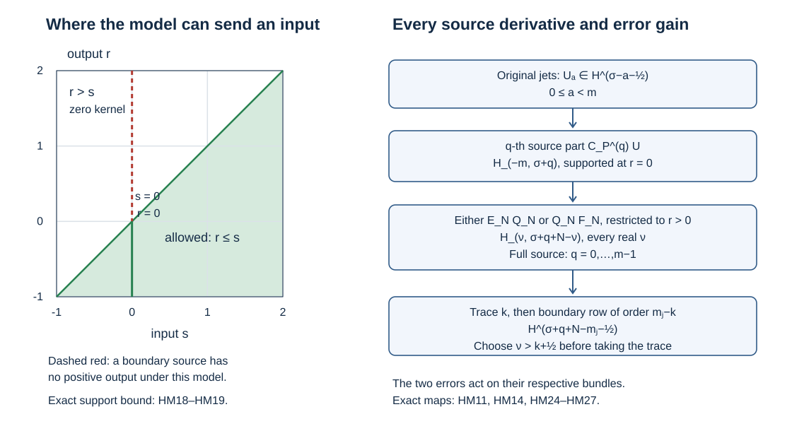

# Half-space operators and complete boundary sources

An inverse on a doubled collar must still act on a zero-extended right-hand side and on the source concentrated at the boundary. Those are different inputs. This companion proves the two maps, calculates the entire boundary source of the original variable-coefficient operator, and retains the precise improvement of each finite inverse error.

This independent exposition is CC0. Its mathematical antecedent is the edition of Hörmander III, Springer 2007, ISBN 978-3-540-49938-1, especially the collar calculus of Section 20.1 and the two-weight spaces of Appendix B.2. The existing AN-03 *Fredholm boundary problems with first-order Calderón defects*, Sections 19–20, supplied a comparison of the complete source algebra and the half-space argument. The item-level proof map records that comparison. Earlier linked components retain their own licences. 

## 1. What the two maps assert

Keep the inward normal coordinate \(r\), with the physical side \(r>0\), and \(D_r=-i\partial_r\). Tangential coordinates are \(y\in\mathbb R^d\), with dual variables \((\eta,\kappa)\). Our Fourier transform has phase \(e^{-i(y\cdot\eta+r\kappa)}\) and inverse coefficient \((2\pi)^{-d-1}\). Write
\[
 T=1+|\eta|,\quad R=1+|(\eta,\kappa)|,\quad
 \lambda=\sqrt{1+|\eta|^2},\quad q=\sqrt{\lambda^2+\kappa^2}.
 \tag{HM1}
\]
Thus \(\lambda\le T\le\sqrt2\lambda\), \(q\le R\le\sqrt2q\), and \(1\le\lambda\le q\). The full-space norm is
\[
 \|u\|_{s,t}^2=(2\pi)^{-d-1}
       \int q^{2s}\lambda^{2t}|\widehat u(\eta,\kappa)|^2\,d\eta\,d\kappa.
 \tag{HM2}
\]
The bar space \(\overline H_{(s,t)}\) is restriction to \(r>0\), with the infimum norm over full-space extensions. A distribution supported at \(r=0\) remains a full-space distribution. Its restriction to the open positive side is zero, but its image under a nonlocal operator need not be zero.

Let \(A:F_Y\to E_Y\) belong to the complete paired class \(\mathcal L^a\) of PN:C1–C2, for an integer \(a\). In particular its mixed symbol has order \((a,0)\), and for every \(L\ge1\) it has the same complete coefficient operators \(H_j(r)\in\Psi^j(F_Y,E_Y)\) on both normal-frequency tails:
\[
 h\sim\sum_{j\ge0}h_j(y,r,\eta)\kappa^{a-j},\qquad
 \left|\partial_{y,r}^{\beta}\partial_\eta^\alpha\partial_\kappa^v
 \left(h-\sum_{j<L}h_j\kappa^{a-j}\right)\right|
 \le C|\kappa|^{a-L-v}T^{L-|\alpha|}
 \quad(|\kappa|\ge CT).
 \tag{HM3}
\]
The corresponding expansions of tangentially separated kernels, including their smooth coefficient kernels, are part of this hypothesis. Keep the preferred charts, actual bundles and densities of GC:T1–T2. All statements apply on a compact collar localization. With the uniform cylinder bounds and fixed-width normal properness in GC, they also give uniform full-cylinder maps. Cutoffs and every coefficient seminorm used below are included in the constants.

We will prove
\[
 \begin{aligned}
 r^+Ae^+ &: \overline H_{(s,t)}(F_Y)
                  \longrightarrow\overline H_{(s-a,t)}(E_Y),
                         &&s\ge0,\ t\in\mathbb R,\\
 r^+A &: \{w\in H_{(-m,\tau)}(F_Y):\operatorname{supp}w\subset Y\}
                  \longrightarrow\overline H_{(\nu,\tau-m-a-\nu)}(E_Y),
                         &&m\ge1,\ \tau,\nu\in\mathbb R.
 \end{aligned}
 \tag{HM4}
\]
Here \(m\) is an integer. The zero extension in the first line will be defined through normal \(L^2\), not assumed bounded at the full positive normal order. Each requested \(\nu\) in the second line has its own finite constant. We do not assert one bound uniform in all \(\nu\).

The exact earlier inputs are MH:B1–B3 for the Hilbert spaces and Fourier multipliers, MH:Q1 and MH:I1 for [restriction and its normal L2 interpretation](../20261005-mixed-halfspace-foundations/halfspace-support-and-duality.md), MH:TR1–TR3 for traces, MB:D1 and MB:F1 for [composition and all-real mixed mapping](../20261007-mixed-boundary-calculus/mixed-boundary-calculus.md), PN for the [complete paired class](../20261007-paired-normal-composition/paired-normal-composition.md), and GC for its [chart, bundle and density transfer](../20261007-global-collar-inverse/global-collar-inverse.md). The proof map gives their individual source versions and locators.

## 2. The boundary input as a complete finite polynomial

First characterize the entire supported input in the second line of HM4. A distribution concentrated on \(r=0\), localized in a compact tangential set, has finite normal order. Here is the argument rather than an appeal to a structure theorem. Continuity on tests supported in a fixed compact neighborhood bounds its value by a constant times the largest derivative of total order at most some integer \(B\): a neighborhood of zero in the test-function topology involves only finitely many such seminorms, and scaling gives that bound.

Suppose a test \(\phi(y,r)\) has \(\partial_r^j\phi(y,0)=0\) for \(0\le j\le B\). Taylor's integral formula gives \(\partial_y^\alpha\partial_r^j\phi=O(|r|^{B+1-j})\), uniformly on the compact set, whenever \(|\alpha|+j\le B\). Multiply by a smooth cutoff \(\chi(r/\varepsilon)\) equal to one near zero. Each derivative of total order at most \(B\) of this product is \(O(\varepsilon)\). The distribution has the same pairing with this product as with \(\phi\), by its support, and that pairing tends to zero. It therefore annihilates every such \(\phi\). Subtracting the finite normal Taylor polynomial of a general test, multiplied by a fixed cutoff, expresses the distribution uniquely as
\[
 w=\sum_{b=0}^{B}f_b(y)\otimes D_r^b\delta_0.
 \tag{HM5}
\]
The coefficients are tangential distributions; testing separately against the normal monomials proves uniqueness. A finite tangential partition gives a common finite \(B\) on compact \(Y\).

Membership in \(H_{(-m,\tau)}\) forces precisely \(b<m\). To see this without presupposing regular coefficients, take the Fourier transform of HM5. The resulting distribution is \(\sum_b\kappa^b\widehat f_b(\eta)\). The Hilbert assumption represents it by a locally square-integrable function. Integrate that function against a finite family of compactly supported \(\kappa\)-tests dual to the monomials. Such a family exists: the moment matrix of the monomials against a nonnegative smooth cutoff positive on an interval is positive definite, since the squared modulus of a nonzero polynomial has strictly positive integral there. Its inverse gives the dual tests. Cauchy–Schwarz on compact \((\eta,\kappa)\)-sets shows that each recovered coefficient is locally square integrable in \(\eta\). Thus the Fourier polynomial equality holds almost everywhere. Fubini now applies to the weighted square norm. A nonzero polynomial of degree at least \(m\) has an infinite integral against \((\lambda^2+\kappa^2)^{-m}\,d\kappa\). Its highest coefficient must vanish almost everywhere; descending induction removes all indices \(b\ge m\).

For the remaining coefficients define the full real symmetric matrix
\[
 G^{(m)}_{bc}=\int_{\mathbb R}z^{b+c}(1+z^2)^{-m}\,dz,
 \qquad 0\le b,c<m,
 \qquad v_b(\eta)=\lambda^b\widehat f_b(\eta).
 \tag{HM6}
\]
All entries are absolutely integrable: the largest exponent is \(2m-2\), giving tail order \(-2\). Odd entries vanish by reflection. For a nonzero complex vector \(v\), the integral of \(|\sum_bv_bz^b|^2(1+z^2)^{-m}\) is positive. The quadratic form of \(G^{(m)}\) is therefore positive definite. Continuity and compactness of the finite-dimensional unit sphere give constants \(0<\gamma_-\le\gamma_+<\infty\) bounding that form by \(\gamma_\pm|v|^2\). The same constants apply componentwise to finite Hermitian bundle fibers.

Substitute \(\kappa=\lambda z\) into the entire polynomial norm, retaining its cross terms. This proves the exact equality and its two-sided consequence:
\[
 \begin{aligned}
 \|w\|_{-m,\tau}^2
   &=(2\pi)^{-d-1}\int\lambda^{2\tau-2m+1}
                      v(\eta)^*G^{(m)}v(\eta)\,d\eta,\\
 \frac{\gamma_-}{2\pi}\sum_{b=0}^{m-1}
       \|f_b\|_{H^{\tau-m+b+1/2}}^2
   &\le\|w\|_{-m,\tau}^2
    \le\frac{\gamma_+}{2\pi}\sum_{b=0}^{m-1}
       \|f_b\|_{H^{\tau-m+b+1/2}}^2.
 \end{aligned}
 \tag{HM7}
\]
Conversely any tuple in these coefficient spaces defines HM5 with \(b<m\), and the same computation proves its required Hilbert membership. This gives necessity, sufficiency and bounded coefficient recovery. In tangential dimension zero the integral over \(\eta\) is the mass-one singleton; every statement remains valid.

GC:H1 transports these norms between the preferred charts. A partition acts at fixed \(r\), so the unique delta coefficients patch as actual bundle distributions. The exact constants in HM7 refer to the flat norm; global equivalence constants include the chart and partition bounds.

## 3. The source of the original operator

Write the normal polynomial with its actual left ordering as
\[
 P=\sum_{\ell=0}^{m}A_\ell(r)D_r^\ell:E_Y\longrightarrow F_Y,
 \qquad A_\ell(r)\in\Psi^{m-\ell}(E_Y,F_Y).
 \tag{HM8}
\]
This is the GC polynomial after the index change \(A_\ell=P_{m-\ell}\). No leading coefficient is normalized away. For a smooth positive-side section put \(U_a=D_r^au|_{0+}\), \(0\le a<m\), and write \(u^0\) for zero extension. One differentiation gives \(D_ru^0=(D_ru)^0-iU_0\delta_0\). Applying \(D_r\) successively proves
\[
 D_r^\ell u^0=(D_r^\ell u)^0
       -i\sum_{k=0}^{\ell-1}U_{\ell-1-k}\otimes D_r^k\delta_0,
 \qquad
 P u^0=(Pu)^0+C_PU.
 \tag{HM9}
\]
The normal derivative acts before \(A_\ell(r)\), so that coefficient then multiplies the entire supported distribution.

For any smooth tangential family \(A(r)\), testing the product against a smooth dual section and using the finite Leibniz rule gives
\[
 A(r)(f\otimes D_r^k\delta_0)
   =\sum_{q=0}^{k}\binom{k}{q}i^q
        ((\partial_r^qA)(0)f)\otimes D_r^{k-q}\delta_0.
 \tag{HM10}
\]
Indeed the ordinary delta-derivative product has coefficient \((-1)^q\binom{k}{q}\). Converting both delta powers to \(D_r\) multiplies this coefficient by \((-i)^k/(-i)^{k-q}\), giving \(i^q\binom{k}{q}\). The argument uses the actual transpose of the tangential operator on the test; no factors are commuted.

In HM9 set \(a=\ell-1-k\) and \(b=k-q\). This reversible substitution gives every term of the complete source:
\[
 C_PU=\sum_{q=0}^{m-1}C_P^{(q)}U,\qquad
 C_P^{(q)}U=
 \sum_{\substack{a,b\ge0\\a+b+q\le m-1}}
   i^{q-1}\binom{b+q}{q}
   ((\partial_r^qA_{a+b+q+1})(0)U_a)\otimes D_r^b\delta_0.
 \tag{HM11}
\]
Freezing the coefficients at \(r=0\) gives \(C_0=C_P^{(0)}\), so \(\Delta^c=C_P-C_0=\sum_{q\ge1}C_P^{(q)}\). The defect vanishes identically for \(m=1\). For larger \(m\), its exact matrix from input jet \(a\) to delta coefficient \(b\) is
\[
 \mathfrak F_{ba}
   =\sum_{q=1}^{m-1-a-b}i^{q-1}\binom{b+q}{q}
           (\partial_r^qA_{a+b+q+1})(0),\qquad a+b\le m-2.
 \tag{HM12}
\]
The source freeze preserves a particular tuple precisely when \(\sum_a\mathfrak F_{ba}U_a=0\) for every \(b\). It preserves every tuple precisely when every displayed operator entry is zero. Necessity follows by prescribing one jet at a time with \(u(r)=\chi(r)\sum_{a<m}(ir)^aU_a/a!\), where \(\chi=1\) near zero, and using uniqueness of HM5. Sufficiency follows by substitution. Cancellation between coefficient derivatives is permitted; their separate vanishing is not necessary.

There is an exact gain for each part, stronger than counting delta derivatives. Define
\[
 \mathcal U_\sigma(E_Y)=\bigoplus_{a=0}^{m-1}H^{\sigma-a-1/2}(Y,E_Y).
 \tag{HM13}
\]
The coefficient operator in a term \((a,b,q)\) of HM11 has order \(m-a-b-q-1\). The ordinary tangential Sobolev map, equivalently MH:T1 at normal index zero for the fixed family, sends \(U_a\) into \(H^{\sigma-m+b+q+1/2}\). Formula HM7 consequently proves
\[
 C_P^{(q)}:\mathcal U_\sigma\longrightarrow H_{(-m,\sigma+q)},
 \quad C_P:\mathcal U_\sigma\longrightarrow H_{(-m,\sigma)},
 \quad \Delta^c:\mathcal U_\sigma\longrightarrow H_{(-m,\sigma+1)}.
 \tag{HM14}
\]
In the last formula the sum is empty if \(m=1\). The continuous tangential embeddings for larger \(q\) justify the common target. For jets arising from \(u\in\overline H_{(s,t)}\), MH:TR1–TR3 gives \(U\in\mathcal U_{s+t}\) when \(s>m-1/2\). Below that strict threshold no ordinary trace of a general volume input is claimed.

We used a fixed product density to express HM5. If a chosen input density includes a smooth positive factor \(J(y,r)\), multiply the source by \(J\) using HM10. The coefficient of \(D_r^b\delta_0\) contributes to indices \(b-q\), with all derivatives of \(J\) present. Its Sobolev order is at least the required order for that lower index. This is a bounded finite triangular change on the coefficient spaces in HM7. Applying the same reasoning to \(J^{-1}\) proves its bounded inverse. Preferred bundle transfers are independent of \(r\); their actual matrices and tangential Jacobians give the corresponding bounded changes without discarding any coefficient.

## 4. A finite model whose kernel points toward larger input normals

We next construct a useful decomposition of the actual \(A\). In one Euclidean tangential chart put \(\Lambda=\lambda(D_y)\). For a requested integer \(L\ge1\), recursively define the complete tangential operators
\[
 U_0=H_0,\qquad
 U_n=H_n-\sum_{j<n}\binom{a-j}{n-j}U_j(i\Lambda)^{n-j}
       \quad(1\le n<L),\qquad
 V_L=\sum_{j<L}U_j(r)(D_r+i\Lambda)^{a-j}.
 \tag{HM15}
\]
The binomial coefficient for any integer upper argument is the finite falling product divided by the factorial, including when that upper argument is negative. The multiplier on the right has no base dependence. The exact Fourier composition formula therefore gives the left symbol \(u_j(y,r,\eta)(i\lambda)^{n-j}\) for each recursive product, not an asymptotic replacement. Inductively \(U_n\in\Psi^n\), with all parameter derivatives and its full smoothing part.

For \(|\kappa|\ge C'T\), choose \(C'\ge2\). Expanding \((1+i\lambda/\kappa)^{a-j}\) to length \(L-j\) shows that the coefficient of \(\kappa^{a-n}\) in the model is exactly \(h_n\), by HM15. Use the real-parameter Taylor integral along \(t\mapsto(1+tz)^{a-j}\), \(0\le t\le1\), with \(z=i\lambda/\kappa\) and \(|z|\le1/2\). For negative powers every derivative of the rational function is bounded on that disk, by direct differentiation and \(|1+tz|\ge1/2\); for nonnegative powers the finite polynomial identity gives the same remainder, possibly zero. The derivative bounds for \(\lambda\) are MH:B2. The product rule now bounds the difference by
\[
 g_L=h-v_L\in S^{a-L,L},\qquad
 |\partial_{y,r}^{\beta}\partial_\eta^\alpha\partial_\kappa^v g_L|
        \le C R^{a-L-v}T^{L-|\alpha|}.
 \tag{HM16}
\]
For clarity, before multiplication by \(u_j\), the remainder bound is \(C|\kappa|^{a-L-v}T^{L-j-|\alpha|}\). Splitting any tangential derivatives between this remainder and \(u_j\in S^j\) gives exactly the displayed final tangential exponent. Base derivatives keep the same orders. This proves HM16 on both high-normal cones. In the complementary region \(|\kappa|\le C'T\), \(R\) and \(T\) are comparable. Direct differentiation of each term, using \(|\kappa+i\lambda|=q\), bounds it by \(CT^{a-v-|\alpha|}\), which is precisely the bound in HM16 there. No derivative is taken of the nonsmooth weights \(R,T\). Each full model term also lies in \(S^{a,0}\), since its bound \(CR^{a-j-v}T^{j-|\alpha|}\) and \(T\le R\) give that order.

The direction of the model kernel is essential. For an integer \(h\ge1\), the ordinary Laplace integral, or MH:J2 with reflection, gives
\[
 (\kappa+i\lambda)^{-h}
   =\frac{(-i)^h}{(h-1)!}\int_0^\infty t^{h-1}e^{-\lambda t}e^{it\kappa}\,dt.
 \tag{HM17}
\]
The identity follows by repeated integration by parts starting with \(\int_0^\infty e^{-(\lambda-i\kappa)t}dt=(\lambda-i\kappa)^{-1}\); the phase factor uses \(\kappa+i\lambda=i(\lambda-i\kappa)\). Tested Fourier inversion and absolute convergence give the exact inverse kernel in the normal difference \(\theta=r-s\):
\[
 K_{-h}(\theta,\eta)=
 \frac{(-i)^h}{(h-1)!}1_{\theta<0}(-\theta)^{h-1}e^{\lambda\theta}.
 \tag{HM18}
\]
There is no choice of a point value at zero in this locally integrable distribution. For a nonnegative exponent \(p\), the inverse kernel is instead \(\sum_{v=0}^p\binom pv(i\lambda)^{p-v}D_\theta^v\delta_0\). Both forms have support in \(\theta\le0\), or \(r\le s\). Tangential operators \(U_j(r)\) act at fixed output normal and preserve that support. Equivalently the multiplier is holomorphic in the upper normal half-plane; its possible pole is \(-i\lambda\). The explicit integral proves the support and phase without relying on that description.

Here are the support and separated-kernel details needed for a genuine operator decomposition. Localize the original input and output tangentially and use its exact complete symbol, including all smoothing terms. Choose an additional compact tangential input cutoff \(\psi'\) equal to one around the localized input support. Then \(A\psi'=A\) and \(H_j\psi'=H_j\). Replace the constructed model by \(V_L\psi'\). The exact difference is \((A-V_L)\psi'\), whose mixed order remains \((a-L,L)\) by MB:D1. The complete matched coefficients and the relation \(r\le s\) are unchanged.

For normal properness multiply the model kernel by a fixed smooth cutoff in \(r-s\), equal to one near zero. Away from zero, HM18 and all derivatives have exponential decay \(e^{-\varepsilon\lambda}\); the powers of \(\lambda\), \(\theta\), and those produced by any coefficient derivative are absorbed by that exponential and its normal decay. Integration by parts in the normal difference then gives every normal-frequency decay, while tangential Fourier differentiation gives every tangential-frequency decay. Thus the removed kernel is smooth with all required rapidly decreasing frequency estimates. For polynomial model kernels it is identically zero. Retain the entire change in \(G_L\).

For a tangentially separated piece, keep the actual smooth two-point coefficient kernels from PN:C2. Repeat the finite recursion with \((\kappa+i)^{a-j}\), using the fixed pole \(-i\) instead of the tangential multiplier. The matched difference has normal order \(a-L\) with all base derivatives and is smooth in both tangential variables. Integration by parts in the compact input tangential variable gives arbitrary decay in its tangential Fourier variable. Comparing \(R\) with \(\langle\kappa\rangle\) as in GC:H1 puts this remainder in \(S^{a-L,L}\). The same comparison places each separated model term in \(S^{a,0}\), absorbing any additional tangential powers by that arbitrary decay. The model still has \(r\le s\) support; its normal properness change is fully smooth because the tangential coefficient already is smooth.

Finally take the finite chart partition of the original operator, preserving every separated piece. GC:T1–T2 transfers both arbitrary real mixed orders with the original density and frame factors; those transfers leave the normal coordinate fixed. We have proved the exact decomposition
\[
 A=V_L+G_L,\qquad
 V_L\text{ has mixed order }(a,0),\qquad
 G_L\text{ has mixed order }(a-L,L),\qquad
 \operatorname{supp}K_{V_L}\subset\{r\le s\}.
 \tag{HM19}
\]
All statements are estimates of complete kernels and symbols. No finite error has been declared infinitely smoothing. The smooth changes introduced for properness are included in \(G_L\), and its stated order follows because those changes have every mixed order.

## 5. Zero extension of volume data

Let \(s\ge0\). The inequality \(\lambda\le q\) gives \(\|U\|_{0,s+t}\le\|U\|_{s,t}\) for every full extension \(U\). Taking extension infima gives \(\overline H_{(s,t)}\hookrightarrow\overline H_{(0,s+t)}\). Partial normal Plancherel identifies the latter with \(L^2(\mathbb R_+;H^{s+t}(Y))\), locally with the exact Fourier coefficient and globally with the fixed equivalent norms. Extension by zero in the normal variable is an isometry in the flat \(L^2\) description. This defines
\[
 e^+u\in H_{(0,s+t)},\qquad
 \|e^+u\|_{0,s+t}\le\|u\|_{\overline H_{(s,t)}}
 \quad\text{in the flat norm}.
 \tag{HM20}
\]
It is the ordinary distributional zero extension of that Hilbert-valued function. No full positive normal derivative is taken in HM20.

The model in HM19 maps any backward-supported distribution to a backward-supported distribution. This follows first by testing its kernel support \(r\le s\), and then on the Hilbert domains by the distributional continuity in MB:E2 and the supported density in MH:D1. Two extensions of the same positive-side input have a backward-supported difference. Thus the positive restriction of \(V_Le^+u\) equals that of \(V_LU\) for every full \(H_{(s,t)}\) extension \(U\). When needed, both inputs belong to a common lower mixed space, so this equality is an equality of the same distributional operator, not a comparison of incompatible extensions. MB:F1 and infimizing over \(U\) bound the model output in \(\overline H_{(s-a,t)}\).

Choose an integer \(L\ge\max(1,s)\). From HM16 and HM20, MB:F1 places \(G_Le^+u\) in \(H_{(L-a,s+t-L)}\). Its weight dominates the target weight because
\[
 \frac{q^{L-a}\lambda^{s+t-L}}{q^{s-a}\lambda^t}
         =(q/\lambda)^{L-s}\ge1.
 \tag{HM21}
\]
Restricting and adding the two pieces proves the first line of HM4. The proof includes \(s=0\), all real \(t\), arbitrary positive \(s\), and negative output normal order. The model's one-sided support is the reason the stronger estimate survives the rough zero extension.

## 6. Boundary layers at every requested normal order

For each term \(f_bD_r^b\delta_0\) in HM5, use the actual operator \(AD_r^b\). Its left symbol is exactly \(h\kappa^b\), since the right normal derivative is a constant multiplier. It belongs to \(\mathcal L^{a+b}\), with the same complete coefficient sequence and shifted normal powers. Apply HM19 to that operator. Its model maps \(f_b\delta_0\) into \(r\le0\), so the positive-side layer equals the positive restriction of the remainder, whose mixed order is \((a+b-L,L)\).

The required input estimate follows by direct normal-frequency integration. For every \(\rho<-1/2\) and real \(\sigma\),
\[
 \|f\delta_0\|_{\rho,\sigma}^2
    =\frac{c_\rho}{2\pi}\|f\|_{H^{\rho+\sigma+1/2}}^2,
 \qquad c_\rho=\int_{\mathbb R}(1+z^2)^\rho\,dz<\infty.
 \tag{HM22}
\]
The equality is the substitution \(\kappa=\lambda z\) in HM2; convergence is immediate from \(2\rho<-1\) on the tails. Fix the desired \(\nu\), put \(t_* =\tau-m-a-\nu\), and choose \(L\) so large that \(\rho=\nu+a+b-L<-1/2\). Set \(\sigma=t_*+L\). Then \(\rho+\sigma+1/2=\tau-m+b+1/2\), exactly the coefficient space in HM7. MB:F1 maps the remainder from \(H_{(\rho,\sigma)}\) into \(H_{(\nu,t_*)}\). The lower bound of HM7 controls all its coefficient inputs by the original norm of \(w\). Summing the finitely many terms proves the second line of HM4. A single \(L\) chosen for the largest \(b<m\) suffices for that requested output norm.

This also supplies traces of these special layers at every integer order. For a fixed \(k\ge0\), choose \(\nu>k+1/2\) and apply MH:TR1–TR3 to the output in HM4. Its tangential trace order is
\[
 \gamma_k r^+Aw\in H^{\tau-m-a-k-1/2}(Y,E_Y).
 \tag{HM23}
\]
The resulting trace is independent of the chosen larger \(\nu\): the two outputs are the same distribution on the open half-space, and the earlier trace proof identifies their continuous one-sided values. This is a mapping theorem for boundary-supported inputs, not a formula for the complete symbol of the trace operator. That formula is a later step.

## 7. Both finite errors and the full source

Apply the preceding results to the actual global finite inverse of GC:F1. Use the notation
\[
 Q_NP_c=I_E-E_N,\qquad P_cQ_N=I_F-F_N,
 \quad E_N=(-\mathcal R_E)^N,\quad F_N=(-\mathcal R_F)^N.
 \tag{HM24}
\]
The exact classes are \(Q_N\in\mathcal L^{-m}\) and \(E_N,F_N\in\mathcal L^{-N}\); the errors act on different bundles. The volume maps for \(s\ge0\) are
\[
 r^+Q_Ne^+:\overline H_{(s,t)}(F_Y)\to\overline H_{(s+m,t)}(E_Y),
 \qquad
 r^+E_Ne^+,\ r^+F_Ne^+:\overline H_{(s,t)}\to\overline H_{(s+N,t)}
 \tag{HM25}
\]
on the respective original bundle. For a supported source in \(H_{(-m,\tau)}\), HM4 gives \(r^+Q_Nw\in\overline H_{(\nu,\tau-\nu)}\). For either error alone it gives \(\overline H_{(\nu,\tau-m+N-\nu)}\). These statements hold at every real \(\nu\), with constants depending on the chosen indices and \(N\).

More precisely feed the whole source from HM11 into the inverse, keeping its separate parts. The estimates are
\[
 \begin{aligned}
 r^+Q_NC_P^{(q)}U
      &\in\overline H_{(\nu,\sigma+q-\nu)},\\
 r^+E_NQ_NC_P^{(q)}U,\quad r^+Q_NF_NC_P^{(q)}U
      &\in\overline H_{(\nu,\sigma+q+N-\nu)}
                    &&(U\in\mathcal U_\sigma).
 \end{aligned}
 \tag{HM26}
\]
PN:T1 places both ordered error-layer products in \(\mathcal L^{-m-N}\); their actual factors have the displayed matching bundle domains. Apply HM4 with \(\tau=\sigma+q\) and use HM14. No extra assumption about commuting coefficients enters this step.

Taking a trace of order \(k\) by choosing \(\nu>k+1/2\) gives tangential orders \(\sigma+q-k-1/2\) in the first line and \(\sigma+q+N-k-1/2\) in the second. A boundary row \(B_{jk}\in\Psi^{m_j-k}(E_Y,G_j)\), composed on the left, consequently has error target
\[
 B_{jk}\gamma_k r^+E_NQ_NC_P^{(q)}U,\quad
 B_{jk}\gamma_k r^+Q_NF_NC_P^{(q)}U
           \in H^{\sigma+q+N-m_j-1/2}(Y,G_j).
 \tag{HM27}
\]
Finite addition preserves every prescribed boundary order \(m_j\). The full source has \(q=0\) as its least regular contribution; the freezing defect has at least the additional one-order gain from \(q\ge1\). These are weighted estimates of the actual ordered products. They do not make a finite error smooth, nor establish a boundary condition or a stable-space projection.

## 8. Worked checks of the mechanisms

**1. The cross terms of a three-jet source.** For \(m=3\), compute the matrix in HM6. Substitution \(z=\tan\theta\) turns its even moments into the integrals of \(\cos^4\theta\), \(\sin^2\theta\cos^2\theta\), and \(\sin^4\theta\) on \((-\pi/2,\pi/2)\). The double-angle identities give \(3\pi/8,\pi/8,3\pi/8\); every odd moment vanishes. Therefore
\[
 G^{(3)}=\frac\pi8
       \begin{pmatrix}3&0&1\\0&1&0\\1&0&3\end{pmatrix}.
 \tag{HM28}
\]
Its eigenvectors \((0,1,0)\), \((1,0,-1)\), and \((1,0,1)\) give eigenvalues \(\pi/8,\pi/4,\pi/2\). These are the extremal constants in HM7. The first and third coefficients interact; replacing this matrix by its diagonal would change the exact source norm.

**2. A source freeze that changes the data, and one that does not.** For \(m=2\), HM11 gives
\(\Delta^cU=A_2'(0)U_0\delta_0\). Taking \(A_2(r)=1+\tfrac14\tanh r\), \(A_1=0\), and \(A_0=1+D_y^2\) keeps an elliptic principal polynomial and yields \(\Delta^cU=\tfrac14U_0\delta_0\). The sign also follows from \(rD_r\delta_0=i\delta_0\). For \(m=3\), the entire defect is
\[
 \Delta^cU=2A_3'(0)U_0D_r\delta_0+
     \bigl[A_2'(0)U_0+A_3'(0)U_1+iA_3''(0)U_0\bigr]\delta_0.
 \tag{HM29}
\]
Choosing \(A_3=2+r^2\) and \(A_2=-2ir\) near zero makes this defect zero for all tuples, although both coefficients vary. This second example tests the algebra only; no ellipticity of that cubic polynomial is asserted.

**3. Exact direction and phase of the simple model.** At \(\eta=0\), \(\lambda=1\), HM18 with \(h=1\) is \(-i1_{\theta<0}e^\theta\). Its Fourier transform is \(-i/(1-i\kappa)=(\kappa+i)^{-1}\), by a directly convergent integral. Acting on \(\delta_0\) gives a distribution supported on \(r\le0\), with zero positive restriction. With an input point at \(s>0\), however, the kernel is nonzero for \(0<r<s\). Thus the model can act on positive volume data while making no positive boundary layer.

**4. Why the full source identity must distinguish its interior defect.** Let \(P_0=\sum_\ell A_\ell(0)D_r^\ell\). Applying HM9 to \(P_0\), then subtracting the original interior equation, gives the exact identity
\[
 P_0u^0-(Pu)^0
   =C_0U+1_{r>0}\sum_\ell(A_\ell(0)-A_\ell(r))D_r^\ell u.
 \tag{HM30}
\]
The last term is supported throughout the positive collar in general. It is not \(\Delta^cU\), which is concentrated at the boundary. On the other hand \(Pu^0-(Pu)^0=C_PU\) does include every derivative in HM11. These two equalities identify which operation is being compared and prevent an interior coefficient change from being hidden in a boundary source estimate.

## 9. Reading the support picture

The shaded region is the kernel support bound from HM19; it is not a claim that every model kernel is nonzero at every allowed point. The lower-pole example in Exercise 3 supplies an actual nonzero kernel in its interior. The original operator \(A\) need not have this one-sided support: its remaining layer is carried by \(G_L\). The right panel uses the exact original source parts HM11 and the gains HM26–HM27. Full trace symbols, stable-space projection and U051's elliptic boundary theorem use the corresponding trace, projection and elliptic regularity arguments.
