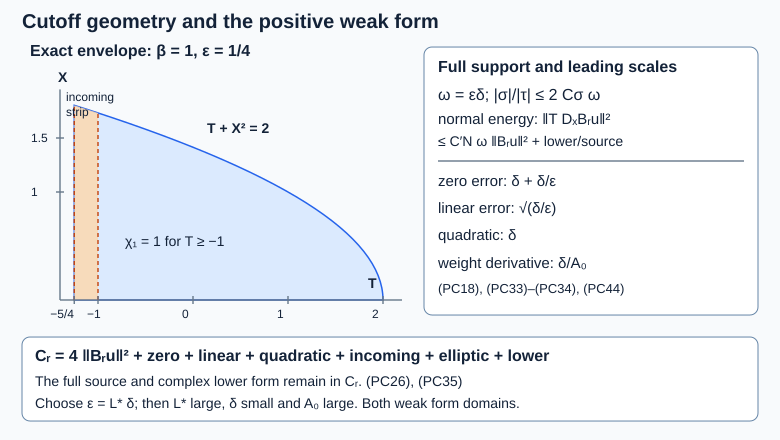

# A positive commutator at glancing, with variable coefficients

*AN04-U063. Receiving exposition by GPT-6.1 Sol (OpenAI), Ultra. Original eligible new expression is CC0-1.0. *

The normal-energy, quadratic-error and weak-commutator chapters now fit together. This chapter constructs the actual legal regularized commutants, computes their complete leading weak form, controls the incoming and elliptic cutoff errors, and proves a uniform positive estimate. The frequency regularizer is allowed to fail to commute with the equation. Its differentiated symbol is included in the error coefficients.

We use the complete current [local boundary actions and commutators](../20261005-local-boundary-calculus/boundary-tests-and-lacunary-symbols.md), [actual adjoints and composition](../20261005-local-boundary-calculus/boundary-adjoints-composition-and-distributions.md), [L2 and form-domain maps](../20261005-local-boundary-calculus/boundary-bounds-and-conormal-action.md), [positive-order half-space bounds](../20261005-positive-boundary-orders/positive-order-halfspace-bounds.md), and [proper global calculus and both ordered parametrices](../20261005-global-boundary-operators/global-boundary-operator-calculus.md). These are the earlier AN-03 proofs with their current foundation connections. The receiving prerequisites are the [uniform-family and antidual rules](../20261007-restored-uniform-microsupport/uniform-microsupport-and-dual-sources.md), [mixed localization estimate](../20261007-restored-sharp-form/sharp-boundary-form-defect.md), [normal energy and linear error](../20261007-restored-glancing-normal-operator/glancing-normal-energy-and-operator-errors.md), [quadratic normal error and norm-specific removal](../20261007-restored-quadratic-normal-regularizer/quadratic-normal-errors-and-regularization.md), and [weak commutator with its sharp lower defect](../20261007-restored-weak-commutator/weak-commutators-and-variable-regularizers.md). Their exact hypotheses remain in force.

The proof map records exact versions and proof locators. The elementary L2 and Cauchy–Schwarz proofs, [differential, compactness and smooth-cutoff proofs](../20261004-free-stationary-phase/proof-map.html), and the preceding lesson's complete weak-form actions remain in force. All coefficient families have the common compact norm supports specified there; all ordinary derivatives remain intrinsic on the Neumann domain and are supported H1 derivatives on the Dirichlet domain.

The primary route is [András Vasy's paper](https://math.stanford.edu/~andras/psmcrrb.pdf), complete PDF pages 35–42 and 44–48, together with his complete [two-page correction](https://math.stanford.edu/~andras/psmc-corr.pdf). The correction changes the linear normal-error scale. The argument below supplies the full receiving weak-form calculation for a smooth single boundary face, variable time coefficients and complex matrix lower terms. External paper text, images and PDF payloads are not reproduced.

## 1. The estimate and its exact hypotheses

Use the full wave form (GN1)–(GN3), on \(X=[0,\infty)_x\times\mathbb R^d_y\times\mathbb R_t\), with either \(V=H^1_0(X;\mathbb C^N)\) or \(V=H^1(X;\mathbb C^N)\). The scalar real spatial principal matrix \(G\ge\kappa I>0\) is smooth, its normal/tangential cross block vanishes at \(x=0\), and all complex matrix lower coefficients are retained. Coefficients have bounded smooth extensions for the global form. Write
\[
 p=\tau^2-a\xi^2-2\xi b\cdot\zeta-\zeta^TC\zeta,\qquad
 G=\begin{pmatrix}a&b^T\\b&C\end{pmatrix},
 \quad b(0,z)=0,\quad C(0,z)=B_b(z),\quad z=(t,y).
 \tag{PC1}
\]
Let \(Pu=f\) be the actual weak equation, with \(u\in V,f\in V^*\). Work in one fixed compact normalized conic patch where \(\tau\) has a fixed sign and \(|\tau|\) is elliptic. Put \(\kappa_\tau=|\tau|\), and write the compressed normal momentum as \(\sigma=x\xi\). The constant \(\kappa\) in the spatial positivity assumption is distinct from the function \(\kappa_\tau\).

Fix a boundary glancing point \(q_0\), and let \(\nu\) be any prescribed finite target order. Set
\[
 s=\nu-\tfrac12,\qquad
 Q_-\in\Psi_b^{s-1},\quad Q_f\in\Psi_b^{s+1/2},\qquad
 X_-=\|u\|_V+\|Q_-u\|_V,\quad
 Y=\|f\|_{V^*}+\|Q_ff\|_{V^*}.
 \tag{PC2}
\]
Both testers are elliptic on a fixed larger compact phase neighborhood containing every cutoff used below; assume \(X_-,Y<\infty\). Thus the lower solution order is \(\nu-3/2\), and the forcing order is \(\nu\). Full uniform microsupport, residual bounds, proper support and common compact kernel supports have the meanings of U058. A finite covering handles compact sets of anchors; all leading geometric constants below can be chosen uniformly on such a covering.

The incoming hypothesis will be a tester \(Q_{\rm in}\in\Psi_b^{s-1/2}\), elliptic on the compact incoming derivative region defined in Section 4, with 
\[
 I=\|u\|_V+\|Q_{\rm in}u\|_V<\infty.
 \tag{PC3}
\] The theorem proved below gives a fixed compactly localized 
\(B_0\in\Psi_b^\nu\), elliptic at \(q_0\), such that 
\[
 \|B_0u\|_{L^2}^2\le C_{\nu,\epsilon,\delta,A_0}
          (X_-^2+Y^2+I^2).
 \tag{PC4}
\] It also gives an elliptic energy tester of order 
\(\nu-1\) whose value on \(u\) belongs to \(V\). The coefficient on the right is finite at fixed widths; uniformity is in the regularizer. This smooth-face theorem is a smooth-face analytic estimate. It does not assert a physical-corner calculus, crossing-system theorem or the general trajectory criterion RW4.

## 2. Transverse functions, including the defining function of glancing

On the boundary set
\[
 p_b=\tau^2-\zeta^TB_b(t,y)\zeta,\quad
 V_b=\kappa_\tau^{-1}H_{p_b},\quad
 \theta=(\operatorname{sign}\tau)(t-t_0),\quad
 d_0=1-\tau^{-2}\zeta^TB_b(t,y)\zeta.
 \tag{PC5}
\]
These act on the boundary cosphere coordinates \((t,y,\zeta/\tau)\); \(V_b\theta=2\). Time dependence gives
\[
 V_bd_0=-2d_0\,\frac{\partial_t(\zeta^TB_b\zeta)}
                            {\tau\kappa_\tau}.
 \tag{PC6}
\]
Indeed \(H_{p_b}p_b=0\), \(H_{p_b}\tau=\partial_t(\zeta^TB_b\zeta)\), and differentiate \(\tau^{-2}p_b\). Thus \(V_bd_0(q_0)=0\). At glancing \(\zeta\ne0\), so differentiation in \(\zeta/\tau\) shows \(dd_0(q_0)\ne0\).

Choose \(2d\) smooth real functions \(\rho_j\) with
\[
 \rho_1=d_0,\qquad \rho_j(q_0)=0,\qquad V_b\rho_j(q_0)=0,
 \qquad d\theta,d\rho_1,\ldots,d\rho_{2d}
        \text{ linearly independent at }q_0.
 \tag{PC7}
\]
Here is an explicit local construction. In the \(2d+1\) coordinates above, take the nonzero covector \(dd_0(q_0)\), extend it to a basis of the annihilator of \(V_b(q_0)\) by finite-dimensional linear algebra, and use affine functions with these remaining differentials. Retain the actual nonlinear \(d_0\) as the first function. The independent covector \(d\theta\) completes the basis because \(V_b\theta=2\).

No flow-invariant transverse coordinate system is assumed. If \(h=q-q_0\), Taylor's formula and the least singular value of this differential give
\[
 |h|\le C\big(|\theta|+|\rho|\big)
 \tag{PC8}
\]
after shrinking the coordinate patch: the Taylor remainder is at most \(C_2|h|^2\), and half of the linear lower bound absorbs it. Smoothness and \(V_b\rho_j(q_0)=0\) then give
\[
 \Omega_0=\sum_j\rho_j^2,\quad \Omega=x^2+\Omega_0,\qquad
 |V_b\Omega_0|\le C\sqrt{\Omega_0}
                      \big(\sqrt{\Omega_0}+|\theta|\big).
 \tag{PC9}
\]
For compact anchor sets, choose the affine basis first at finitely many centers, project its covectors to the annihilator of the nearby \(V_b\), and retain \(dd_0\) as the first basis covector. Independence persists on smaller neighborhoods. The least singular values, Taylor constants and derivative bounds are then uniformly positive or finite. No selection across a nonunique ray is needed.

**Uniform choice of the transverse frame.** At a fixed center the annihilator has dimension \(2d\): the map \(\alpha\mapsto\alpha(V_b)\) is onto because it sends \(d\theta/2\) to one. Row elimination extends its nonzero member \(dd_0\) to a basis. Near this center project each of the remaining fixed covectors \(\alpha\) by \(\alpha\mapsto\alpha-\alpha(V_b)d\theta/2\), and retain the actual \(dd_0\) at each glancing anchor. The latter annihilates \(V_b\) by (PC6). These covectors depend smoothly on the anchor, and the nonzero determinant with \(d\theta\) persists on a smaller patch. For the Taylor lower bound, the continuous function \(|Dh|\) on the unit sphere has a positive minimum when \(D\) is injective: otherwise compactness gives a unit vector in its kernel. The same minimum stays positive on a sufficiently small closed anchor patch. The integral Taylor remainder is bounded by a uniform second derivative constant times \(|h|^2/2\). Taking \(|h|\) small enough absorbs that remainder. A finite cover of the compact anchor set proves the stated uniformity.

The exact lifted Hamilton computation, with \(n=\xi/\kappa_\tau\), is
\[
 \kappa_\tau^{-1}H_p\Omega=f_0+f_1 n+f_2n^2,\qquad
 |f_0|\le C\sqrt\Omega(\sqrt\Omega+|\theta|),\qquad
 |f_1|+|f_2|\le C\sqrt\Omega .
 \tag{PC10}
\]
The coefficient functions are smooth degree-zero functions on the compressed patch. To verify all terms, write
\[
 \begin{split}
 f_0={}&V_b\Omega_0
 -2(C-B_b)\zeta\cdot\partial_y\Omega_0/\kappa_\tau
 -4x\,b\cdot\zeta/\kappa_\tau\\
 &+\kappa_\tau^{-1}\partial_t(\zeta^T(C-B_b)\zeta)
                         \partial_\tau\Omega_0
 +\kappa_\tau^{-1}\sum_i\partial_{y_i}
       (\zeta^T(C-B_b)\zeta)\partial_{\zeta_i}\Omega_0,\\
 f_1={}&-4ax-2b\cdot\partial_y\Omega_0
       +2\sum_j(\partial_t b_j)\zeta_j\partial_\tau\Omega_0
       +2\sum_{i,j}(\partial_{y_i}b_j)\zeta_j
                                          \partial_{\zeta_i}\Omega_0,\\
 f_2={}&\kappa_\tau\big((\partial_t a)\partial_\tau\Omega_0
                  +\sum_i(\partial_{y_i}a)\partial_{\zeta_i}\Omega_0\big).
 \end{split}
 \tag{PC11}
\]
The boundary cross block and its tangential derivatives are \(O(x)\); the same is true of \(C-B_b\) and its tangential derivatives. Base derivatives of \(\Omega_0\) are \(O(\sqrt{\Omega_0})\), and its fiber derivatives are \(O(\kappa_\tau^{-1}\sqrt{\Omega_0})\). These facts, (PC9), and \(x\le\sqrt\Omega\) prove (PC10). In particular the term \(-4ax\) is retained. It is the missing normal-coordinate derivative that the primary correction warns about.

## 3. Frequency weights whose differentiated errors are uniform

For an integer \(L\ge\max(1,\nu)\), put
\[
 \eta=(\sigma,\zeta,\tau),\qquad
 m_r(\eta)=(1+r(1+|\eta|^2))^{-L/2},\quad
 w_r=\kappa_\tau^s m_r,\qquad 0<r\le1.
 \tag{PC12}
\]
Use a fixed low-frequency extension on the chosen conic patch. Differentiation of that extension produces a uniformly residual error. The high-frequency formulas below hold where \(\kappa_\tau\ge1\). The family \(m_r\) is bounded in \(S^0\), each individual member is in \(S^{-L}\), and
\[
 \frac{\partial_\eta^\alpha m_r}{m_r}\in S^{-|\alpha|}
 \quad\text{uniformly in }r,\qquad
 m_r-1=O(\sqrt r)\text{ in }S^1.
 \tag{PC13}
\]
For completeness, \(\partial_{\eta_j}\log m_r=-Lr\eta_j/(1+r(1+|\eta|^2))\). Successive derivatives are sums of polynomials times powers of that denominator. Multiplying a derivative of order \(a\ge1\) by \(\langle\eta\rangle^a\) leaves bounded powers of \(r\langle\eta\rangle^2/(1+r\langle\eta\rangle^2)\). Induction using \(\partial m=m\,\partial\log m\) proves the first assertion for every multiindex. For the difference, the inequality
\(\min(1,r\langle\eta\rangle^2)\le\sqrt r\langle\eta\rangle\), together with the same differentiated formulas, proves the last assertion. All base derivatives of this weight are zero in these coordinates.

The differentiated weight is not discarded:
\[
 \kappa_\tau^{-1}H_p\log w_r
       =k_{0,r}+k_{1,r}n+k_{2,r}n^2,\qquad
 \sum_{j=0}^2|k_{j,r}|\le K_{s,L}.
 \tag{PC14}
\]
Every coefficient family is bounded in \(S^0\) with all derivatives, on the fixed larger patch, independently of \(r,\epsilon,\delta\). To check it, use
\[
 \begin{split}
 H_p\sigma={}&(-2a+x\partial_xa)\xi^2
       +2(-b+x\partial_xb)\cdot\zeta\,\xi
       +x\partial_x(\zeta^TC\zeta),\\
 H_p\zeta_i={}&(\partial_{y_i}a)\xi^2
       +2\partial_{y_i}b\cdot\zeta\,\xi
       +\partial_{y_i}(\zeta^TC\zeta),\\
 H_p\tau={}&(\partial_ta)\xi^2
       +2\partial_tb\cdot\zeta\,\xi
       +\partial_t(\zeta^TC\zeta).
 \end{split}
 \tag{PC15}
\]
Then \(H_p\log w_r=s(H_p\tau)/\tau-Lr(\sigma H_p\sigma+
\zeta\cdot H_p\zeta+\tau H_p\tau)/(1+r(1+|\eta|^2))\).
Collect powers of \(n\). The weight contribution is a bounded polynomial in
\((\sigma,\zeta,\tau)/\kappa_\tau\), the coefficients of \(G\), and
\(r\kappa_\tau^2/(1+r(1+|\eta|^2))\). The patch has
\(\kappa_\tau\) comparable to \(\langle\eta\rangle\). This proves both the pointwise and full symbol bounds. The family \(\log m_r\) itself is not claimed bounded in \(S^0\).

We use leading full symbols modulo lower **uniform target** orders. A regularized individual operator has negative order, so its classical principal symbol at a higher order can vanish. That fact does not remove the nonzero uniformly leading expressions in (PC14).

## 4. Two widths and a shrinking compressed-normal cutoff

Choose \(0<\epsilon<1\), \(\delta>0\), put \(\omega=\epsilon\delta\), and allow \(\beta\in[1/2,1]\). Let
\[
 \phi=\theta+\frac{\Omega}{\epsilon^2\delta},\quad
 v=A_0^{-1}(1+\beta-\phi/\delta),\quad
 h_{\rm in}=(\theta+\delta)/(\epsilon\delta)+\beta,\quad
 j=\frac{\sigma^2}{C_\sigma^2\kappa_\tau^2\omega^2}.
 \tag{PC16}
\]
Here \(C_\sigma\ge32/\sqrt\kappa\) is a fixed large number; increase it if necessary when choosing a common conic patch. Take \(\chi_0(v)=e^{-1/v}\) for \(v>0\), zero otherwise. Take a smooth increasing \(\chi_1\), zero on \((-\infty,0]\), one on \([1,\infty)\), with derivative compactly supported in \((0,1)\). Take real \(\chi_2\), equal to one on \([-1,1]\), supported in \((-4,4)\).

Define the full symbols
\[
 a_r=w_r\chi_0(v)\chi_1(h_{\rm in})\chi_2(j),\qquad
 b_r=\kappa_\tau^{1/2}w_r(A_0\delta)^{-1/2}
                   \frac{\chi_0(v)}v\chi_1(h_{\rm in})\chi_2(j),
 \tag{PC17}
\]
where \(\chi_0(v)/v\) is zero for \(v\le0\). It is smooth there: every derivative is a finite sum of \(v^{-M}e^{-1/v}\), and these tend to zero because the exponential series bounds \(e^{1/v}\) below by every fixed power of \(1/v\). Thus \(a_r,b_r\) are legal smooth symbols. At \(q_0\), \(v=(1+\beta)/A_0>0\), \(h_{\rm in}=\epsilon^{-1}+\beta>1\), \(j=0\); \(b_0\) is elliptic.

On their support,
\[
 |\theta|\le2\delta,\qquad
 \sqrt\Omega\le2\epsilon\delta=2\omega,\qquad
 |\sigma|/\kappa_\tau\le2C_\sigma\omega,\qquad
 0<1+\beta-\phi/\delta\le4.
 \tag{PC18}
\]
The proof uses \(h_{\rm in}\ge0\), \(\phi\le(1+\beta)\delta\), and \(\Omega\ge0\). The incoming derivative region is contained in
\[
 -\delta-\epsilon\delta\le\theta
               \le-\delta+\tfrac12\epsilon\delta,\qquad
 \sqrt\Omega\le2\epsilon\delta.
 \tag{PC19}
\]
The elliptic derivative region has
\[
 C_\sigma\omega\le|\sigma|/\kappa_\tau\le2C_\sigma\omega,
 \qquad x\le2\omega.
 \tag{PC20}
\]
The cutoff in \(\sigma\) therefore shrinks with the glancing width. This is needed to apply the full normal-energy estimate to \(B_r\).

The whole support lies in a \(C_w\omega\) neighborhood of a fixed compact glancing set in the larger patch. In fact \(|d_0|\le2\omega\). On the boundary replace \(\zeta\) by \(\zeta/\sqrt{1-d_0}\) to make \(d_0=0\); the displacement in normalized coordinates is \(O(\omega)\). Also set \(x=\sigma=0\). Formula (PC18) proves the claimed distance, with \(C_w\) depending on the fixed \(C_\sigma\) and metrics. No estimate of the longitudinal distance \(|\theta|\) by \(\omega\) is asserted.

Choose actual properly supported scalar operators \(A_r,B_r\) with the displayed symbols, output in \(x\le2\omega\), and fixed proper kernel cutoffs. They have uniform target orders \(s,\nu\); individual orders \(s-L,\nu-L\) are nonpositive. Both actual adjoints preserve the two form domains. The ordinary normal derivative of \(B_ru\) is an L2 value for each \(r>0\). Low-frequency terms and proper-support corrections retain their full uniformly residual topology.

## 5. Compute the full leading polynomial and its actual weak remainder

The weak principal commutator is the real form
\[
 \mathcal C_r=i\big(q_0(u,A_r^*A_ru)-q_0(A_r^*A_ru,u)\big).
 \tag{PC21}
\]
Use (WC5), retaining all coefficient derivatives and normal commutators. Its leading physical polynomial is \(-H_p(a_r^2)\). Here is the sign and coefficient check. For the real principal coefficient matrix \(g=\operatorname{diag}(1,-G)\), let \(m=a_r^2\). The commutator \([g_{ij},M]\) has leading symbol
\(i(\,x\partial_xg_{ij}\partial_\sigma m+
\partial_zg_{ij}\cdot\partial_{(\tau,\zeta)}m\,)\).
The normal commutator has symbols \(-i\partial_xm\) and
\(-i\partial_\sigma m\,D_x\), and the tangential commutators have symbols
\(-i\partial_zm\). Thus (WC5)'s leading polynomial is
\[
 \sum_{i,j}\xi_i\xi_j\,\partial_qg_{ij}\cdot\partial_{\xi_{\rm phys}}m
       -2\sum_{i,j}g_{ij}\xi_j\partial_{q_i}m
       =-H_pm.
 \tag{PC22}
\]
For the normal base derivative the last derivative means
\(\partial_xm+\xi\partial_\sigma m\); the physical normal fiber derivative is \(x\partial_\sigma m\). This explains every compressed chain-rule term in (PC15). This equality is a coefficient calculation in the polynomial in the ordinary normal momentum, before imposing any characteristic equation.

Differentiating (PC17) now gives the exact leading identity
\[
 -H_p(a_r^2)
   =b_r^2(4+r_{0,r}+r_{1,r}n+r_{2,r}n^2)
                  +e_{{\rm in},r}+e_{{\rm ell},r},
 \qquad
 r_{j,r}=\frac{2f_j}{\epsilon^2\delta}-2\Gamma k_{j,r},
 \tag{PC23}
\]
with
\[
 \Gamma=\frac{\delta}{A_0}(1+\beta-\phi/\delta)^2,\quad
 0\le\Gamma\le16\delta/A_0,\qquad
 \begin{split}
 e_{{\rm in},r}&=-\frac{4\kappa_\tau w_r^2}{\epsilon\delta}
          \chi_0^2\chi_1\chi_1'\chi_2^2,\\
 e_{{\rm ell},r}&=-2w_r^2\chi_0^2\chi_1^2\chi_2\chi_2' H_pj.
 \end{split}
 \tag{PC24}
\]
All cutoff values have their arguments in (PC16). The factor 4 comes from differentiating the square of \(\chi_0\) and from
\(\kappa_\tau^{-1}H_p\theta=2\). The logarithmic weight derivative is precisely the term \(-2\Gamma k_{j,r}\), including \(m_r\). No stationary commutation hypothesis has been used.

Extend \(r_{j,r}\) with a real cutoff equal to one on the support of \(b_r\), within slightly larger support bounds of the same type. Numerical constants may increase by a fixed factor. With a fixed geometric constant \(C_g'\) and \(K=K_{s,L}\), the full extensions can be chosen to satisfy
\[
 |r_{0,r}|\le C_g'(\delta+\delta/\epsilon)+32K\delta/A_0,\qquad
 |r_{1,r}|+|r_{2,r}|
                \le C_g'/\epsilon+64K\delta/A_0 .
 \tag{PC25}
\]
Their derivatives are uniformly bounded at fixed widths; derivative bounds may grow as the widths shrink.

Realize the full leading symbols \(r_{0,r}\), \(r_{1,r}/\kappa_\tau\),
\(r_{2,r}/\kappa_\tau^2\) as \(R_{0,r}\), \(R_{1,r}\), \(R_{2,r}\), respectively. Symmetrize \(R_0,R_2\) with their actual coefficient adjoints. The resulting exact weak identity is
\[
 \begin{split}
 \mathcal C_r={}&4\|B_ru\|^2+(R_{0,r}B_ru,B_ru)
       +\operatorname{Re}(R_{1,r}D_xB_ru,B_ru)\\
 &+(R_{2,r}D_xB_ru,D_xB_ru)
       +(E_{{\rm in},r}u,u)+\mathcal E_{{\rm ell},r}[u,u]
       +\mathcal H_r[u,u].
 \end{split}
 \tag{PC26}
\]
Here \(E_{\rm in}\) has uniform target order \(2s+1\); the elliptic error is a mixed form with zero-, one- and two-normal-derivative coefficient orders \(2s+1,2s,2s-1\). Their full uniform microsupports lie in slightly larger versions of (PC19), (PC20), respectively. The enlargement for the incoming support can be made inside any given open incoming regularity neighborhood.

For clarity, the remainder is a finite sum of coefficient pairings of the forms
\[
 (H_{ij,r}D_ju,D_i u),\quad (H_{j,r}D_ju,u),
 \quad (u,\widetilde H_{j,r}D_ju),\quad (H_{0,r}u,u),
 \tag{PC27}
\]
with uniform coefficient orders \(2s-2,2s-1,2s-1,2s\), all full microsupports in the larger testing patch. The coefficients have individual nonpositive orders.

To prove that (PC26) is exact, first insert the actual leading coefficient formulas preceding (PC22) into (WC5). Composition and actual-adjoint errors in \(M=A_r^*A_r\) have order \(2s-1\). Their normal commutators have a zero-derivative coefficient of order \(2s-1\) and a coefficient before \(D_x\) of order \(2s-2\); multiplication commutators have order \(2s-2\). Every subsequent symbol-composition error drops one further target order relative to the leading array. Tangential derivatives can be composed into coefficient operators; their differentiated coefficients are retained. No ordinary normal derivative is transposed.

Next expand the displayed positive and error forms in (PC26), using
\([D_x,B_r]=U_r+V_rD_x\), with orders \(\nu,\nu-1\). The leading arrays agree coefficient by coefficient with (PC23); each composition, adjoint or commutator discrepancy has exactly the orders in (PC27). This defines \(\mathcal H_r\) as their difference and proves the claimed identity, rather than discarding lower terms. The calculus's full microsupport rule localizes these discrepancies; low-frequency discrepancies are uniformly residual. Since \(L\ge\nu\), each zero-, one- or two-derivative coefficient in the initial exact arrays is individually of nonpositive order. All actual coefficient-adjoint moves are therefore legal on the initial L2 factors. Density, or the exact form-domain commutator maps, extends the equality to \(u\in V\).

Apply (WC8) to (PC27). A two-derivative pairing has mixed orders \(2s-2,0\); a one-derivative pairing has orders \(2s-1,-1\); a zero-derivative pairing has orders \(2s-1,-1\). Their means are all \(s-1\). Hence
\[
 |\mathcal H_r[u,u]|\le C_{\rm low}X_-^2.
 \tag{PC28}
\]
This is the full lower remainder, uniform in \(r\) at fixed widths.

## 6. The elliptic derivative region costs no new hypothesis

We prove the required energy estimate on (PC20) directly. Let \(T_r\) be any scalar family of target order \(k=s-1/2\), microsupported in a slightly larger guard
\(|\sigma|/\kappa_\tau>\tfrac12 C_\sigma\omega\), output in \(x\le2\omega\), with individual nonpositive orders. Assume the lower solution and source testers of orders \(k-1/2,k+1/2\) there. They are supplied by (PC2) and the lower-order transfer lemma U058.

A fixed order-zero operator \(J\), with full leading symbol \(\tau/\sigma\) near the guard and a cutoff away from \(\sigma=0\), has leading bound
\[
 |j_0|\le M=\frac{2}{C_\sigma\omega},\qquad
 D_tT_r-JxD_xT_r\in\Psi_b^k
                 \text{ uniformly in }r.
 \tag{PC29}
\]
The cancellation is the b-symbol identity \(\tau a-(\tau/\sigma)\sigma a=0\). Choose the compact full microsupport of the enlarged guard strictly within \(|\sigma|/\kappa_\tau>C_\sigma\omega/2\). A real cutoff between zero and one, equal to one near that compact set and supported in this open region, gives a full extension \(j_0\) bounded by \(M\). Thus the estimate is on the whole realized symbol. The error in (PC29) has full target order \(k\), and its L2 value is bounded by \(CX_-\) by (SF5).

**The guard norm remainder as an actual quadratic form.** Apply the complete matrix-series proof (QR9)–(QR11), with \(\alpha=2M\), to realize \(c=((2M)^2I-j_0^*j_0)^{1/2}\) by \(C\). Its radicand is bounded below by \(3M^2I\). The actual coefficient adjoint and composition give \(J^*J+C^*C=4M^2I+R_{-1}\), where \(R_{-1}\in\Psi_b^{-1}\), including every quantization remainder. Put \(v=xD_xT_ru\). The full normal commutator of \(T_r\) shows that \(v\) is a mixed expression of order \(k\), and \(R_{-1}v\) has order \(k-1\). Both have common compact norm supports and legal individual coefficients. Their mean order is \(k-1/2=s-1\), precisely the order of \(Q_-\). The complete pairing proof (WC8) therefore gives \(|(R_{-1}v,v)|\le CX_-^2\). Nonnegativity of \(\|Cv\|^2\) yields \(\|Jv\|^2\le4M^2\|v\|^2+CX_-^2\). Together with (PC29) and the elementary inequality \(\|a+b\|^2\le2\|a\|^2+2\|b\|^2\), this supplies the factor \(8M^2\) below. No assertion about a squared order-minus-one norm is needed.

Since the input \(T_ru\) has output support \(x\le2\omega\), (PC29) yields
\[
 \|D_tT_ru\|^2\le8M^2(2\omega)^2\|D_xT_ru\|^2+CX_-^2
              \le\frac{\kappa}{2}\|D_xT_ru\|^2+CX_-^2 .
 \tag{PC30}
\]
The last inequality follows from \(C_\sigma\ge32/\sqrt\kappa\).

The full coarse spatial-energy estimate in U060, at target order \(k\), gives
\(\kappa\|D_{\rm sp}T_ru\|^2\le\|D_tT_ru\|^2+C(X_-^2+Y^2)\).
Absorb (PC30). The L2 value \(T_ru\) is already controlled by the lower solution tester through (SF5), so
\[
 \|T_ru\|_V^2\le C_{\rm ell}(X_-^2+Y^2).
 \tag{PC31}
\]
All constants are uniform in the regularizer at fixed guard. Choose an elliptic \(T_0\) on the compact guard and regularize it as in U061. The V-specific removal lemma gives \(T_0u\in V\) and (PC31), including the zero Dirichlet trace when that domain is used. Denote this exact tester by \(Q_{\rm ell}\).

The two cutoff errors in (PC26) are therefore bounded:
\[
 |(E_{{\rm in},r}u,u)|+
 |\mathcal E_{{\rm ell},r}[u,u]|
             \le C_{\rm cut}(I^2+X_-^2+Y^2).
 \tag{PC32}
\]
For the incoming zero-derivative coefficient use (WC8) with mean order \(s-1/2\) and \(Q_{\rm in}\). The elliptic two-, one- and zero-derivative arrays have the same mean order \(s-1/2\), and use the now-proved \(Q_{\rm ell}\). This argument does not replace an elliptic boundary proof with a citation.

## 7. Uniform small-symbol bounds for the three normal errors

Write \(Z^2=X_-^2+Y^2\). On the support of \(B_r\), the full normal-energy estimate and (PC18) give
\[
 \|T D_xB_ru\|^2\le C_N'\omega\|B_ru\|^2+C_{\rm width}Z^2,
 \quad T\in\Psi_b^{-1},\quad \sigma(T)=\kappa_\tau^{-1}.
 \tag{PC33}
\]
Here \(C_N'=C_NC_w\), after enlarging the fixed glancing compact set and its neighborhood as in Section 4. The lower solution order is \(\nu-3/2\); the normal estimate's lower source order \(\nu-1/2\) follows from \(Q_f\) of order \(\nu\). No ordinary normal smoothing by a negative b-order is asserted.

The principal-to-operator bounds used in U060–U061 also hold for bounded full symbol families \(F_r\) with the same full uniform microsupport. To verify this extension, take a fixed bound \(M\) on their full leading symbols. The matrix series in (QR9) has radicand \((2M)^2I-f_r^*f_r\), uniformly separated from zero. The ordered-product derivative estimates are uniform because all seminorms of \(f_r\) are bounded. Actual compositions leave a bounded family in \(\Psi_b^{-1}\). The fixed parametrix tails and their separated coefficient topology are unchanged. Applying (WC8) bounds these lower pairings by \(CX_-^2\). Thus the entire proofs of (GN27) and (QR15), including their actual tails, apply uniformly; they do not require the coefficient operator to be independent of \(r\). The case \(M=0\) has a uniformly lower-order coefficient and follows directly from (WC8).

Let \(M_0=C_g'(\delta+\delta/\epsilon)+32K\delta/A_0\), and \(M_1=M_2=C_g'/\epsilon+64K\delta/A_0\), enlarged if needed to bound each coefficient separately. For every \(\gamma>0\), the result is
\[
 \begin{split}
 |(R_{0,r}B_ru,B_ru)|&\le(2M_0+\gamma)\|B_ru\|^2+C_\gamma Z^2,\\
 |(R_{1,r}D_xB_ru,B_ru)|&\le
       (2M_1\sqrt{C_N'\omega}+\gamma)\|B_ru\|^2+C_\gamma Z^2,\\
 |(R_{2,r}D_xB_ru,D_xB_ru)|&\le
       (2M_2C_N'\omega+\gamma)\|B_ru\|^2+C_\gamma Z^2.
 \end{split}
 \tag{PC34}
\]
The quadratic line retains both normal factors and every signed parametrix correction. In particular, the linear geometric leading term is proportional to
\(\sqrt{\delta/\epsilon}\), whereas the quadratic geometric term is proportional to \(\delta\). The weight-induced parts are proportional to \(\delta/A_0\), times a bounded constant or a normal smallness factor.

*Figure PC-F1.* The left panel is the exact support envelope in
\(T=\theta/\delta,\ X=\sqrt\Omega/(\epsilon\delta)\ge0\), for
\(\beta=1,\epsilon=1/4\): \(T\ge-5/4,\ T+X^2\le2\).
The incoming shaded strip bounds the support of \(\chi_1'\).
The right panel records the full compressed-normal cutoff and the three leading error scales; omitted lower terms in that panel are the explicit fixed-width norms in (PC28), (PC32), (PC34), (PC38), (PC42).
The bottom identity is (PC26), with all three errors and its cutoff/lower terms retained. The complete arguments are Sections 4–10; Vasy's paper and correction supply the credited primary route. This normalized support diagram is not a plot of a Hamilton trajectory.

## 8. Retain and control the complex lower form

The exact source identity from U062 is
\[
 \mathcal C_r=-2\operatorname{Im}\langle A_rf,A_ru\rangle
       +2\operatorname{Im}q_1(A_ru,A_ru)-2\operatorname{Im}\Delta_{1,r},
 \qquad |\Delta_{1,r}|\le CX_-^2.
 \tag{PC35}
\]
We retain the two ordinary-normal pairings separately. Let \(\ell_j,m_j\) be the coefficients in (GN3), with absent terms set to zero. Tangential derivatives can be composed into b-coefficients using their actual tangential adjoints; their coefficient derivatives are retained as lower terms. The normal derivative stays on its original weak-form factor. The exact identity is
\[
 \begin{split}
 q_1(A_ru,A_ru)={}&(L_0B_ru,B_ru)
       +(L_{\ell}D_xB_ru,B_ru)+(L_mB_ru,D_xB_ru)
       +\mathcal J_r[u,u],\\
 &|\mathcal J_r[u,u]|\le CX_-^2 .
 \end{split}
 \tag{PC36}
\]
The full leading coefficient symbols are
\[
 \begin{split}
 l_0&=\Gamma\left((\ell_t+m_t)\frac{\tau}{\kappa_\tau}
        +\sum_j(\ell_{y_j}+m_{y_j})\frac{\zeta_j}{\kappa_\tau}\right),\\
 l_{\ell}&=\frac{\Gamma}{\kappa_\tau}\ell_x,\qquad
 l_m=\frac{\Gamma}{\kappa_\tau}m_x .
 \end{split}
 \tag{PC37}
\]
They are complex matrices in the displayed order. Choose \(C_\ell\) to bound both \(\|l_0\|A_0/\delta\) and the sum \(\kappa_\tau(\|l_\ell\|+\|l_m\|)A_0/\delta\) on their full compact extensions. All three bounds are finite at fixed coefficients, independently of the target order and widths, because \(\Gamma\le16\delta/A_0\).

**Coefficient-by-coefficient proof without a normal transpose.** Write \(D_xA_r=A_rD_x+U_r+V_rD_x\), with target orders \(s,s-1\) for \(U_r,V_r\), and use the corresponding formula for \(B_r\). In the first normal pairing, the coefficient before \(D_xu\) after moving only \(A_r^*\) is \(A_r^*\ell_xA_r\), with full leading symbol \(a_r^2\ell_x\). In the second normal pairing the coefficient on \(u\) against \(D_xu\) is \(A_r^*m_xA_r\), with leading symbol \(a_r^2m_x\). The ratio \(a_r^2=(\Gamma/\kappa_\tau)b_r^2\) makes these agree with \(B_r^*L_\ell B_r\) and \(B_r^*L_mB_r\), respectively. Their differences have coefficient order \(2s-1\). Every \(U,V\) term, the \(c\) term, and each tangential coefficient derivative contributes either a zero-derivative coefficient of order \(2s\), or a coefficient of order \(2s-1\) before one original normal derivative. Full composition and adjoint errors have these same orders. Their mixed means are \(s-1\); (WC8) bounds their sum by \(CX_-^2\). The initial individual coefficient orders are nonpositive because \(L\ge\nu\), and the identity extends to either form domain by its proved density. This proves (PC36) with its actual lower form.

The second normal pairing has the same linear-error bound as the first: \((L_mB_ru,D_xB_ru)=\overline{(L_m^*D_xB_ru,B_ru)}\). This moves only the bounded coefficient adjoint. Apply the uniform version of (GN27) to \(L_\ell\) and \(L_m^*\), and the zero-error bound to \(L_0\). Divide the chosen Young parameter among the finitely many terms. The result, with the above definition of \(C_\ell\), is
\[
 |q_1(A_ru,A_ru)|\le
 \left(\frac{2C_\ell\delta}{A_0}
       (1+\sqrt{C_N'\omega})+\gamma\right)\|B_ru\|^2
       +C_\gamma Z^2.
 \tag{PC38}
\]
This factor placement matters for the Neumann form domain. Already for the scalar half-line profile \(v(x)=e^{-x}\), \(D_xv=i e^{-x}\), so \((v,D_xv)=-i/2\) whereas \((D_xv,v)=i/2\). An ordinary-normal transpose would change the weak form. The exact paired expression above retains its boundary contribution.

## 9. The source has the stated order

Choose a fixed scalar \(T_{1/2}\in\Psi_b^{-1/2}\) with leading symbol
\(\kappa_\tau^{-1/2}\), and a left parametrix \(T_+\in\Psi_b^{1/2}\) such that
\(T_+T_{1/2}=I+E\), with full microsupport of \(E\) disjoint from all testing symbols. Antidual action gives the exact trade
\[
 \langle A_rf,A_ru\rangle
   =\langle T_+^*A_rf,T_{1/2}A_ru\rangle
                     -\langle A_rf,E A_ru\rangle.
 \tag{PC39}
\]
**Order of the antidual balance.** By the actual dual action, \(\langle T_+^*h,w\rangle=\langle h,T_+w\rangle\). With \(h=A_rf\), \(w=T_{1/2}A_ru\), the first term in (PC39) is therefore \(\langle A_rf,T_+T_{1/2}A_ru\rangle\). Substitution of the displayed left-parametrix identity gives exactly (PC39), including its negative remainder. Both ordered parametrices are available from the earlier proper calculus; here it is the left product that is required. Each actual combined source operator \(T_+^*A_r\) has individual order \(\nu-L\le0\), so its antidual action is supplied by its genuine adjoint on \(V\).

The first source factor has target order \(s+1/2=\nu\), so its \(V^*\) norm is at most \(CY\). The tail is bounded by \(C\|f\|_{V^*}\|u\|_V\): move the actual coefficient \(A_r^*\) to obtain \(f(A_r^*E A_ru)\), whose full uniform residual topology gives the required V bound. No unbounded source factor is estimated separately.

Set \(W_r=T_{1/2}A_r\), of target order \(\nu-1\). The exact leading ratio is
\[
 \tau\kappa_\tau^{-1/2}a_r
     =g_0 b_r,\qquad
 g_0=(\operatorname{sign}\tau)\sqrt{\delta/A_0}
                                     (1+\beta-\phi/\delta),
 \quad |g_0|\le4\sqrt{\delta/A_0}.
 \tag{PC40}
\]
Actual realization leaves
\(D_tW_r-G_0B_r\in\Psi_b^{\nu-1}\), uniformly, with full microsupport in the larger testing patch. Its L2 value is controlled by \(CX_-\) through (SF5). For \(G_0B_ru\), use the actual square-root norm identity from Section 6 with \(v=B_ru\) and \(M=4\sqrt{\delta/A_0}\). A zero-derivative coefficient of order \(\nu\) lies in \(\mathcal M_{\nu-1}\); the order-minus-one remainder applied to it lies in \(\mathcal M_{\nu-2}\). Their mean is \(\nu-3/2\), precisely the available lower tester order. Thus \(\|G_0B_ru\|\le8\sqrt{\delta/A_0}\|B_ru\|+CX_-\). Consequently
\(\|D_tW_ru\|\le8\sqrt{\delta/A_0}\|B_ru\|+CX_-\).
Apply U060's full coarse energy estimate at target order \(\nu-1\), with lower solution/source orders \(\nu-3/2,\nu-1/2\). It gives
\[
 \|W_ru\|_V\le C\sqrt{\delta/A_0}\|B_ru\|+C_{\rm width}Z.
 \tag{PC41}
\]
All operator tails, coefficient lower terms and source terms are included in that coarse estimate. Combining (PC39)–(PC41) and Young's inequality proves, for every \(\gamma>0\),
\[
 |\langle A_rf,A_ru\rangle|
           \le\gamma\|B_ru\|^2+C_{{\rm width},\gamma}Z^2.
 \tag{PC42}
\]
This establishes the forcing order \(\nu\), not \(\nu+1/2\).

## 10. Absorption, removal and the energy conclusion

Insert (PC28), (PC32), (PC34), (PC35), (PC38) and (PC42) into (PC26). This yields
\[
 4\|B_ru\|^2\le\Lambda_{\rm lead}\|B_ru\|^2
                       +C_{\rm width}(X_-^2+Y^2+I^2),
 \tag{PC43}
\]
where
\[
 \begin{split}
 \Lambda_{\rm lead}\le{}&
 C_1(\delta+\delta/\epsilon)
 +C_2\sqrt{\delta/\epsilon}+C_3\delta\\
 &+\frac{C_{s,L,\ell}\delta}{A_0}
                         (1+\sqrt\omega+\omega)+C_4\gamma .
 \end{split}
 \tag{PC44}
\]
The geometric constants \(C_1,C_2,C_3,C_4\) are independent of the regularization exponent, target order and widths on the fixed patch. The explicit weight/lower-form constant may depend on \(s,L,\ell,m\). Lower constants remain fixed-width constants.

First choose a number \(L_*>1\) so large that
\(C_1/L_*+C_2/\sqrt{L_*}<1/4\). Put \(\epsilon=L_*\delta<1\). Choose \(\delta\) small enough for all support/collar requirements and
\((C_1+C_3)\delta<1/4\); the choice of \(\delta\) does not depend on \(s,L\). For the prescribed target order, choose \(A_0\) large enough that the weight/lower-form term in (PC44) is less than \(1/4\). Finally take \(C_4\gamma<1/4\). All choices are finite, and \(\Lambda_{\rm lead}<1\). Subtract it from the left side of (PC43). We have proved a uniform fixed-width L2 bound on \(B_ru\), with \(r\downarrow0\).

The linear proper quantization can be fixed for all \(r\). From (PC13) and its continuity, \(B_r-B_0=O(\sqrt r)\) in \(\Psi_b^{\nu+1}\). **Full boundary-supported convergence.** Use the actual supported transpose proof of U061: for any smooth compact test, including one nonzero at the boundary, the transpose error is \(O(\sqrt r)\) in the required smooth seminorms and has common compact input support. Proper normal-ratio localization and the supported/restricted b-actions give this statement also at the boundary. Pairing with the supported distribution \(u_0\), or with its restricted representative as appropriate, identifies the full distribution limit with the actual \(B_0u\). A finite partition gives the same conclusion on the entire compact support. No boundary-supported difference is inferred to vanish from interior tests alone. The L2-specific removal lemma (QR24)–(QR25), with its full weak compactness proof, now proves (PC4). No stronger norm is inferred from an L2 bound.

For the energy conclusion, choose a fixed \(T\in\Psi_b^{-1}\) with leading symbol \(\kappa_\tau^{-1}\). Then
\(D_tTB_r-G B_r\in\Psi_b^{\nu-1}\), where \(G\) has bounded order-zero symbol \(\tau/\kappa_\tau\). The already-proved L2 bound and (SF5) control the time derivative. U060's coarse energy estimate for \(TB_r\), at target order \(\nu-1\), gives a uniform V bound. Proper quantization and the same distributional convergence identify the limit as \(TB_0u\). The V-specific removal lemma yields
\[
 TB_0u\in V,\qquad
 \|TB_0u\|_V^2\le C_{\rm width}(X_-^2+Y^2+I^2).
 \tag{PC45}
\]
Its leading symbol is elliptic at \(q_0\) and has order \(\nu-1\). When \(V=H^1_0\), the closed zero-trace subspace is preserved in the weak V limit. This proves the finite-order smooth-face glancing estimate with all stated forcing and lower solution orders.

## 11. Three graded exercises with complete solutions

**Exercise 1 — The factor from differentiating a square (foundation, 5 points).** Assume \(\Omega=0\), all other cutoffs are one, \(w_r\) is constant along the field, and \(\kappa_\tau^{-1}H_p\theta=2\). Compute \(-H_p(a_r^2)/b_r^2\) from (PC17). Explain why changing the sign of \(\tau\) does not change it when \(\theta\) has the stated sign.

**Solution.** Differentiation gives
\(-H_p(a_r^2)=2w_r^2\chi_0\chi_0'(A_0\delta)^{-1}H_p\theta\).
The denominator is
\(b_r^2=\kappa_\tau w_r^2(A_0\delta)^{-1}\chi_0\chi_0'\).
Their ratio is \(2H_p\theta/\kappa_\tau=4\). With
\(\theta=\operatorname{sign}(\tau)(t-t_0)\), the derivative is
\(\operatorname{sign}(\tau)2\tau=2|\tau|\), for either cone. Omitting either the square's factor 2 or the signed clock changes the conclusion.

**Exercise 2 — Why the normal cutoff must shrink (intermediate, 7 points).** On the exact model \(p=\tau^2-(1-x)\zeta^2-\xi^2\), take \(\tau=\zeta=1\). Compare a fixed compressed cutoff \(|\sigma|\le c\) with the cutoff \(|\sigma|\le2C_\sigma\omega\), at \(x\le2\omega\), \(|d_0|\le2\omega\). Identify why the derivative guard is elliptic for small \(\omega\), and why its energy estimate cannot use a fixed bound on \(\tau/\sigma\).

**Solution.** The characteristic equation is \(\xi^2=x\) on the exact invariant slice, so
\(|\sigma|=x|\xi|=x^{3/2}\le(2\omega)^{3/2}\).
More generally the normalized characteristic equation with \(|d_0|\le2\omega\) gives \(|\xi|/|\tau|\le C\sqrt\omega\), hence \(|\sigma|/|\tau|\le2C\omega^{3/2}\). This is smaller than \(C_\sigma\omega\) for small \(\omega\), so the guard (PC20) is disjoint from the characteristic set. A fixed \(\sigma\) cutoff permits full symbol support a fixed distance from the glancing set and cannot directly meet the \(\omega\)-neighborhood hypothesis in (PC33). On the shrinking guard, however, \(|\tau/\sigma|\) is of order \(1/\omega\); its actual upper bound is \(2/(C_\sigma\omega)\). The explicit \(x\le2\omega\) cancels that growth in (PC30), leaving a small coefficient proportional to \(C_\sigma^{-2}\). Neither factor can be suppressed.

**Exercise 3 — Variable coefficients and the regularizer (intermediate, 8 points).** In a tangential interior model take \(p=\tau^2-c(t)\zeta^2\), \(c>0\), and \(m_r=(1+r(1+\zeta^2+\tau^2))^{-L/2}\). Compute \(\kappa_\tau^{-1}H_p\log(\kappa_\tau^s m_r)\). Check that it is uniformly bounded on a fixed \(\zeta/\tau\) patch, and identify its coefficient in (PC23).

**Solution.** Since \(H_p\tau=c'(t)\zeta^2\), \(H_p\zeta=0\), differentiation gives
\[
 \kappa_\tau^{-1}H_p\log(\kappa_\tau^s m_r)
 =\frac{s\,c'(t)\zeta^2}{\tau\kappa_\tau}
  -\frac{Lr\,\tau c'(t)\zeta^2}
              {\kappa_\tau(1+r(1+\zeta^2+\tau^2))}.
 \tag{PC46}
\]
The first term is bounded by \(|s c'|\,|\zeta/\tau|^2\). The second is bounded by \(L|c'|\,|\zeta/\tau|^2\), since \(r\tau^2/(1+r(1+\zeta^2+\tau^2))\le1\). It generally is nonzero for \(r>0\). Its contribution is \(-2\Gamma k_{0,r}\), so it is small after multiplication by \(\Gamma\le16\delta/A_0\). The proof controls this derivative rather than asserting that the regularizer commutes with a time-dependent equation.

## 12. What this closes and what still has to be translated

For the full smooth-face wave principal form and arbitrary complex matrix lower terms, the finite-order uniform positive estimate, source trade, incoming cutoff bound, elliptic guard estimate and norm-specific removal are proved above. The ordinary normal errors have the corrected unsquared and squared scales. The regularizer's nonzero commutator is represented in its complete leading coefficients and lower weak-form remainder.

The geometric argument must relate the incoming region (PC19) uniformly to the parabolic back-flow windows in U056, and to carry the finite-order induction through a common neighborhood for smooth wave fronts. The parameter \(\beta\) was retained precisely for nested cutoffs; that iteration and the exact RW4 clock/window translation are not declared proved here.  The exact current transitive provider chain is recorded in the proof map. 

## Sources and contribution

Vasy's paper supplies the positive-test and source-trade route; his complete correction supplies the corrected linear normal scale and the normal-coordinate derivative. The current programme proves every adopted step, including the Hörmander III antecedent in the boundary calculus.  Mathematical exposition, solutions and illustration: GPT-6.1 Sol (OpenAI), Ultra; GPT-6 Astra (OpenAI), Ultra. The independently written exposition, exercise solutions and original figure are CC0-1.0; linked components keep their own terms.   
