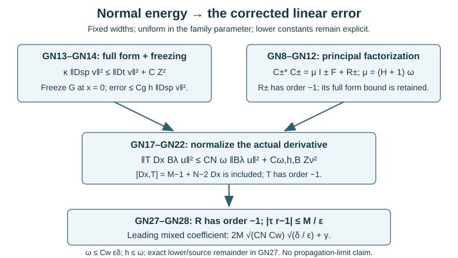

# Normal energy and the actual glancing error operators

*AN04-U060. Receiving exposition by GPT-6.1 Sol (OpenAI), Ultra. Original eligible new expression is CC0-1.0. The writer has checked the stated arguments; independent review has not occurred.*

A characteristic covector at a tangency has zero normal momentum. We need a corresponding estimate for a localized weak solution, with the source and all lower-order terms retained. The [exact Fourier model](../20261007-restored-glancing-normal-energy/glancing-normal-energy-model.md) established the mechanism when coefficients depended only on the normal variable. Here coefficients may depend on every base variable. The result applies to a scalar wave principal form acting on a fixed finite-dimensional vector space, with complex matrix lower-order terms and either Dirichlet or weak Neumann data.

The complete [sharp form lesson](../20261007-restored-sharp-form/sharp-boundary-form-defect.md), [uniform-family lesson](../20261007-restored-uniform-microsupport/uniform-microsupport-and-dual-sources.md) and [weak-domain lesson](../20261007-restored-boundary-form/boundary-form-localization.md) supply the receiving estimates and admissible tests. The complete current [local boundary action and commutator proof](../20261005-local-boundary-calculus/boundary-tests-and-lacunary-symbols.md), [ordered products and actual adjoints](../20261005-local-boundary-calculus/boundary-adjoints-composition-and-distributions.md), [L2 and Sobolev bounds](../20261005-local-boundary-calculus/boundary-bounds-and-conormal-action.md) and [positive-order half-space proof](../20261005-positive-boundary-orders/positive-order-halfspace-bounds.md), especially (PS4)–(PS5), supply every local action used below. The complete [proper global calculus](../20261005-global-boundary-operators/global-boundary-operator-calculus.md), Sections 2.2–2.4 and 4.1, supplies realization, exact remainders and both ordered parametrices. These are the earlier AN-03 proofs with current prerequisite connections.

The proof map binds exact versions and locators. Elementary inputs are the complete [L2 and Cauchy–Schwarz proofs](../20261004-free-intrinsic-graph/prerequisites/measure-and-l2.md), [compact smooth cutoffs](../20261004-free-stationary-phase/proof-map.html#U001-A4), [differential rules and the fundamental theorem](../20261004-free-stationary-phase/proof-map.html#FTC-TAYLOR-COMPACT-PARAMETERS), and [positive roots](../20261004-free-stationary-phase/proof-map.html#P8-root). Each linked component retains its own terms.

The primary mathematical route is [Vasy's Lemma 7.1](https://math.stanford.edu/~andras/psmcrrb.pdf), PDF pages 42–44, with the actual linear error identified in his [December 1, 2008 correction](https://math.stanford.edu/~andras/psmc-corr.pdf), pages 1–2. Our proof is newly written in the form-domain framework. Neither the external paper expression nor its images are reproduced.

## 1. Keep the equation, both domains and all constants

Use \(X=[0,\infty)_x\times\mathbb R^d_y\times\mathbb R_t\), Lebesgue measure, \(D=-i\partial\), and the L2 inner product linear in its first argument. Functions take values in \(\mathbb C^N\), with \(N\) fixed finite. Set \(z=(t,y)\). Let \(V=H^1_0(X;\mathbb C^N)\) or \(V=H^1(X;\mathbb C^N)\). On a fixed compact collar patch take a smooth real symmetric spatial matrix \(G(x,z)\) satisfying
\[
 G\ge\kappa I>0,\qquad
 G(0,z)=\begin{pmatrix}a_b(z)&0\\0&B_b(z)\end{pmatrix},\qquad
 a_b\ge a_*>0,\quad B_b\ge b_*I>0,
 \tag{GN1}
\]
and
\[
 \|G(x,z)-G(0,z)\|_{\mathrm{op}}\le C_gx.
 \tag{GN2}
\]
The spatial derivative vector is \(D_{\mathrm{sp}}=(D_x,D_y)\). The scalar entries of \(G\) act componentwise and can vary in time. For the global definition of the form on \(V\), assume the coefficients have smooth extensions with bounded derivatives. The estimates use only the fixed collar supports. Shrink \(h_0\) so that \(2h_0\) remains in that collar. The principal boundary cross terms vanish in the displayed coordinates; this is an explicit collar hypothesis. Smooth boundary-normal coordinates for a metric wave operator have this property. This lesson does not assert a simultaneous normal-coordinate construction at a corner.

Let
\[
 q(u,w)=(D_tu,D_tw)
   -\sum_{i,j}(G_{ij}D_{\mathrm{sp},j}u,D_{\mathrm{sp},i}w)
   +\sum_j(\ell_jD_ju,w)+\sum_i(m_i u,D_iw)+(cu,w),
 \tag{GN3}
\]
where \(\ell,m,c\) are fixed smooth complex matrices; here \(D_j,D_i\) range over all base variables. No self-adjointness of the full form is assumed. Suppose \(u\in V\), \(f\in V^*\), and \(q(u,w)=\langle f,w\rangle\) for every \(w\in V\).

Fix a compact glancing anchor set \(K_g\) in the positive cosphere, lying in \(x=0\), with compressed normal momentum zero and
\[
 \tau^2-\zeta^TB_b(z)\zeta=0,\qquad |\tau|\ge c_\tau>0
 \quad\hbox{on the chosen normalized patch}.
 \tag{GN4}
\]
On a slightly larger compact conic patch the degree-zero function
\[
 d_0(z,\zeta,\tau)=1-\tau^{-2}\zeta^TB_b(z)\zeta
 \tag{GN5}
\]
is smooth and vanishes on \(K_g\). Thus in a cosphere neighborhood \(U_\omega\) of radius \(\omega\), with \(0<\omega\le\omega_0\),
\[
 |d_0|\le H\omega,
 \tag{GN6}
\]
where \(H\) is independent of \(\omega\). Join a point to a closest anchor in one of finitely many slightly larger convex coordinate patches and apply the mean-value formula. A uniform first-derivative bound, and the fixed equivalence of the coordinate and cosphere metrics, gives \(H\). Shrink \(\omega_0\) so that \(\tau\) stays elliptic throughout the larger patch.

Let \(A_\lambda\) be a scalar componentwise family, bounded in \(\Psi_b^s\), with common compact kernel support, output in \(x\le h\), \(0<h\le h_0\), and uniform microsupport in a compact \(K_A\subset U_\omega\). Each individual operator has nonpositive order. The full uniform rapid-decay and residual topology of U058 is required. Choose elliptic scalar testers \(Q\in\Psi_b^{s-1/2}\) and \(Q_f\in\Psi_b^{s+1/2}\) near \(K_A\), with \(Qu\in V\), \(Q_ff\in V^*\), and write
\[
 X^2=\big(\|u\|_V+\|Qu\|_V\big)^2,\qquad
 Y^2=\big(\|f\|_{V^*}+\|Q_ff\|_{V^*}\big)^2,
 \qquad Z^2=X^2+Y^2.
 \tag{GN7}
\]
All lower constants are independent of \(\lambda\) at fixed \((\omega,h)\). They may depend on family seminorms, off-microsupport decay, cutoffs, coefficients and testers. They need not stay bounded as \(\omega,h\) shrink. The leading constants \(\kappa,a_*,C_g,H\) stay fixed on the compact collar.

### 1.1. Actual actions and common support conventions

Use U059 Section 1.1 throughout: on the Neumann form space ordinary derivatives are intrinsic restricted derivatives; on the Dirichlet form space the supported H1 zero extension has the same first L2 derivatives, by compact-interior density. Boundary-supported parts of \(f\) stay in the actual antidual. All operator identities below use those proved distribution actions. No raw zero-extension derivative is substituted for a Neumann weak derivative.

Every family, including \(B_\lambda\) in Section 4, has common compact kernel support and the full uniform symbol and residual bounds of U058. Auxiliary kernels are properly supported and have compact input/output localizations wherever a norm is estimated. Constants multiplying the identity are the stated exception; their localized corrections have compact kernel support. All supports are fixed when the widths are fixed. Derivatives of width-dependent cutoffs contribute to the lower constants. This supplies the support hypotheses of U059's mixed estimates; properness alone on an unbounded base would not be a global norm bound.

The collar assumptions (GN1)–(GN2) hold on the closed patch through \(2h_0\), as do the fixed constants. For each vector-valued \(v\), the pointwise real symmetric spatial form is at least \(\kappa|D_{\mathrm{sp}}v|^2\); integrate the sum of its \(N\) component inequalities. Thus its integrated value is real even though \(q(v,v)\) need not be. When extracting spatial energy we bound \(\operatorname{Re}q(v,v)\) by \(|q(v,v)|\), and each complex lower term by its modulus.

## 2. A small principal symbol has a small leading form bound

Let \(F=F^*\in\Psi_b^0\) be scalar, with real principal symbol \(f_0\) supported in \(U_\omega\) and \(|f_0|\le H\omega\). Put \(\mu=(H+1)\omega\). Realize the two smooth order-zero principal symbols
\[
 c_\pm=(\mu\pm f_0)^{1/2}
 \tag{GN8}
\]
as actual scalar operators \(C_\pm\). The radicands are at least \(\omega>0\). Outside the symbol patch use the constant \(\sqrt\mu\), so \(C_\pm\) is that constant times the identity plus a properly supported compactly localized operator. Composition and actual adjoints give
\[
 C_\pm^*C_\pm=\mu I\pm F+R_\pm,
 \qquad R_\pm\in\Psi_b^{-1}.
 \tag{GN9}
\]
The lower remainders have microsupport in the fixed larger patch. They are fixed for the chosen widths and retain every quantization remainder. Their seminorms can grow with \(\omega^{-1}\).

**Realization with full lower terms.** Here \(f_0\) denotes a real smooth homogeneous representative at high frequency, extended with a fixed low-frequency cutoff. For the auxiliary \(F\) used below choose a compactly localized realization of \(f_0\) and replace it by half its sum with its actual adjoint. This leaves the principal symbol unchanged and makes \(F=F^*\) on L2; the complete order-minus-one change remains part of \(F\). Its full microsupport lies in a slightly larger fixed patch. An arbitrary preassigned \(F\) with the same principal symbol could have additional lower terms elsewhere; those terms must be retained, not inferred away from its principal support.

To realize \(C_\pm\), quantize \(c_\pm-\sqrt\mu\) with the compact localization and add \(\sqrt\mu I\). The positive radicand is at least \(\omega\); the positive-root proof and repeated chain rule give every symbol derivative bound, with constants allowed to depend on \(\omega\). Products and adjoints have the principal symbols \(\mu\pm f_0\), so their exact difference from \(\mu I\pm F\) is \(R_\pm\) of order minus one. Its compactly localized lower terms and all residual tails are retained. The same construction in Section 5 uses the gap \(\alpha_0^2-|\sigma_0(F_R)|^2\ge3M^2/\epsilon^2>0\), giving every required derivative bound for \(C_R\). No exact square root of a full noncommutative operator is asserted.

For every \(w\in L^2\), nonnegativity of \(\|C_\pm w\|^2\) implies
\[
 |(Fw,w)|\le\mu\|w\|^2+
       \max\{|(R_+w,w)|,|(R_-w,w)|\}.
 \tag{GN10}
\]
Indeed \(F=\mu I+R_--C_-^*C_-\) gives the upper bound, and \(F=C_+^*C_+-\mu I-R_+\) gives the lower bound. Its pairing is real because \(F=F^*\). Only the principal symbols were squared; (GN9) retains the full operator errors. Smooth density proves the identity on all of L2, since every displayed operator is L2 bounded.

Apply this to \(w=D_tA_\lambda u\). In the notation of U059,
\[
 D_tA_\lambda\in\mathcal M_s,\qquad
 R_\pm D_tA_\lambda\in\mathcal M_{s-1}.
 \tag{GN11}
\]
Their displayed coefficients have individual nonpositive order: \(D_tA=A D_t+[D_t,A]\), and the tangential commutator has the same order as \(A\). The coefficient-only balanced-pair lemma (SF7) bounds both remainder pairings by \(C_{\omega,A}X^2\). Thus
\[
 |(F D_tA_\lambda u,D_tA_\lambda u)|
 \le(H+1)\omega\|D_tA_\lambda u\|^2+C_{\omega,A}X^2.
 \tag{GN12}
\]
A large derivative seminorm of a narrow cutoff enters \(C_{\omega,A}\); it does not replace the explicitly small principal coefficient.

## 3. Prove normal-energy smallness for the full weak equation

Set \(v=A_\lambda u\). (SF17) gives \(|q(v,v)|\le C Z^2\). Every lower-order term of \(q(v,v)\) is also at most \(C X^2\): pair \(\ell D_jA\in\mathcal M_s\) with \(A\in\mathcal M_{s-1}\), or pair \(mA\in\mathcal M_{s-1}\) with \(D_iA\in\mathcal M_s\); the \(c\) term has the same classification. Conjugate a pairing when its factors are reversed. All matrices keep their multiplication order. The scalar principal part therefore gives
\[
 \kappa\|D_{\mathrm{sp}}v\|^2
 \le\|D_tv\|^2+C_0 Z^2.
 \tag{GN13}
\]
No strong Neumann condition is imposed on \(v\), and no normal integration by parts occurs. The admissible weak test was supplied by U057.

Freeze \(G\) at the boundary using (GN2). Its boundary block is diagonal, so
\[
 a_*\|D_xv\|^2
 \le q_b(v,v)+\frac{C_g h}{\kappa}\|D_tv\|^2+C_1 Z^2,
 \quad
 q_b(v,v)=\|D_tv\|^2-(B_bD_yv,D_yv).
 \tag{GN14}
\]
The freezing error is at most \(C_gh\|D_{\mathrm{sp}}v\|^2\). Substitute (GN13) and move the frozen tangential form to the right. The factor \(C_gh C_0/\kappa\) remains in \(C_1\).

Let \(P_b=D_t^2-\sum_{i,j}D_{y_i}(B_b)_{ij}D_{y_j}\). This b-operator of order two includes the derivatives of \(B_b(z)\), even when \(B_b\) depends on time. Choose \(0\le\psi\le1\), equal to one near \(K_A\), supported in \(U_\omega\), and let \(F=F^*\) have principal symbol \(f_0=\psi d_0\). It satisfies Section 2.

Choose \(\alpha\in\Psi_b^0\) with \(\operatorname{WF}'_b(I-\alpha)\cap K_A=\varnothing\), and full microsupport in the open region where \(\psi=1\). The complete proper realization permits this fixed cutoff. Then
\[
 R_1=(P_b-D_tFD_t)\alpha\in\Psi_b^1,
 \quad
 S_\lambda=(P_b-D_tFD_t)(I-\alpha)A_\lambda
 \quad\hbox{is uniformly residual}.
 \tag{GN15}
\]
The order-two principal term of \(R_1\) is zero: on the microsupport of \(\alpha\), \(\tau^2f_0=\tau^2-\zeta^TB_b\zeta\). The residual assertion uses separated uniform microsupport and every rapid-decay remainder bound of U058. The differentiated variables in \(P_b\) and \(D_tFD_t\) are tangential b-variables. No second ordinary normal derivative is concealed in \(S_\lambda\).

**The exact cutoff identity.** Write \(P_b-D_tFD_t=L\). Then \(LA_\lambda=(L\alpha)A_\lambda+L(I-\alpha)A_\lambda\) exactly in the supported or restricted distribution space; this is (GN15), with no commuting of \(\alpha\) through \(L\). The order-two principal symbol of \(L\alpha\) vanishes on the full symbol support of \(\alpha\), so it has order one including every cutoff and variable-coefficient term. Outside that region \(\alpha\) is residual. The separated product \((I-\alpha)A_\lambda\) is uniformly residual at every order; the tangential b-derivatives in \(L\) preserve that residual property. This proves the full assertion about \(S_\lambda\), without claiming gain of ordinary normal regularity.

The adopted order-one decomposition writes \(R_1\) as order-zero coefficients before \(D_t,D_y,D_x\), including the required left factor \(x\) in its normal coefficient, plus an order-zero remainder. Compose this fixed decomposition with \(A_\lambda\) and use the exact normal and tangential commutators. This gives \(R_1A_\lambda\in\mathcal M_s\), with individually nonpositive coefficient orders. \(S_\lambda\) belongs to that class too. Pair with \(A_\lambda\in\mathcal M_{s-1}\) and apply (SF7). The exact weak identity
\[
 q_b(v,v)=(F D_tv,D_tv)+((R_1A_\lambda+S_\lambda)u,v)
 \tag{GN16}
\]
has its last term bounded by \(C X^2\). It holds first on smooth functions, then by \(V\)-density: every individual \(A\) preserves \(V\), and \(R_1A+S:V\to L^2\) by its one-derivative decomposition. Tangential weak integration introduces no boundary term. All derivatives of \(B_b\) and all cutoff remainders remain in (GN15).

Combining (GN12), (GN14) and (GN16) proves
\[
 \boxed{\ \|D_xA_\lambda u\|^2
 \le\frac{(H+1)\omega+C_gh/\kappa}{a_*}
           \|D_tA_\lambda u\|^2+C_{\omega,h,A}Z^2.\ }
 \tag{GN17}
\]
It is uniform in \(\lambda\) at fixed widths, for both form domains and every complex matrix lower term of (GN3). If \(h\le\omega\), the leading coefficient is at most \(C_*\omega\), where \(C_*=(H+1+C_g/\kappa)/a_*\) is independent of the widths. This proves the normal-energy input for the stated variable-coefficient smooth-boundary wave form.

## 4. Normalize the derivative used by the error operators

Let \(B_\lambda\) be a scalar family bounded in \(\Psi_b^\nu\), each individual operator of nonpositive order, with uniform microsupport in \(K_A\subset U_\omega\) and output collar \(x\le h\le\omega\). Choose a fixed \(T\in\Psi_b^{-1}\) with principal symbol \(\tau^{-1}\) near \(K_A\), and actual parametrices satisfying
\[
 D_tT=I+E_t,\qquad T^-T=I+E,
 \quad
 \operatorname{WF}'_b(E_t)\cap K_A=
 \operatorname{WF}'_b(E)\cap K_A=\varnothing,
 \quad T^-\in\Psi_b^1.
 \tag{GN18}
\]
**Support-controlled time parametrices.** Begin with the right-parametrix construction for \(D_t\) on the conic neighborhood where \(|\tau|\) is elliptic; its reciprocal symbol is \(\tau^{-1}\), with its sign retained. Every recursive correction and its asymptotic sum is realized in that same neighborhood. In a boundary chart choose the inverse-Fourier lacunary cutoff equal to one near zero and supported where the normal ratio \(x_{\rm in}/x_{\rm out}=1-t\) lies strictly between \(1/2\) and \(2\), with \(t\) the inverse normal-frequency variable in the local kernel formula. In particular \(x_{\rm out}<2x_{\rm in}\). Multiplying by such a smooth cutoff gives precisely the lacunary modification of the local proof, whose full difference is residual by the Taylor-integral estimate. Its support is a smaller permitted interval than the original one, so every bound in that proof still applies with the new finite seminorms.

Realize the final summed symbol with this cutoff, and insert an output cutoff equal to one on the input collar \(x\le h\) and supported in \(x<2h\). These changes preserve the full parametrix identity near \(K_A\); derivatives of the output cutoff are away from that input collar, and the kernel truncation contributes only the retained residual. Then apply the left-parametrix construction to this actual \(T\) to obtain \(T^-\), keeping all lower terms. Set \(E_t=D_tT-I\) and \(E=T^-T-I\) as actual operators; each is residual near \(K_A\). The identity term is proper, and all errors composed with the compactly supported family meet U059's support conditions.

Proper kernel and output cutoffs can be chosen with \(TB_\lambda\) supported in \(x\le2h\). Take the normal ratio near the lifted diagonal small enough that \(x_{\rm out}\le2x_{\rm in}\), and an output cutoff equal to one in the smaller collar; the unchanged proper calculus realizes this support. The factor two is retained below. The tester orders are
\[
 Q_u\in\Psi_b^{\nu-3/2},\qquad Q_f\in\Psi_b^{\nu-1/2},
 \quad
 Z_\nu^2=(\|u\|_V+\|Q_uu\|_V)^2
      +(\|f\|_{V^*}+\|Q_ff\|_{V^*})^2.
 \tag{GN19}
\]
The testers are elliptic near \(K_A\), and their values belong to the stated spaces. Apply (GN17) to \(A_\lambda=TB_\lambda\), whose uniform order is \(\nu-1\). Because \(E_tB_\lambda\) is uniformly residual,
\[
 \|D_tTB_\lambda u\|^2
 \le2\|B_\lambda u\|^2+C\|u\|_V^2.
 \tag{GN20}
\]
The exact normal commutator is
\[
 [D_x,T]=M_{-1}+N_{-2}D_x.
 \tag{GN21}
\]
U059's patched normal-commutator proof includes derivatives of both input and output cutoffs in \(M_{-1}\) and \(N_{-2}\). More explicitly, after composition with \(B\), the term \(N_{-2}D_xB\) is \(N_{-2}BD_x+N_{-2}[D_x,B]\). The second commutator again has an order-\(\nu\) zero-derivative coefficient and an order-\(\nu-1\) coefficient before \(D_x\); after multiplication by \(N_{-2}\) these are even lower than the asserted orders. The fixed \(M_{-1}B\) has order \(\nu-1\). Thus no ordinary derivative is silently commuted through \(B\), and no second ordinary normal derivative occurs.

After composition with \(B_\lambda\), its zero-derivative coefficients have order at most \(\nu-1\), and its coefficients before one \(D_x\) have order at most \(\nu-2\). They have uniform microsupport in \(K_A\). These are allowed orders in \(\mathcal M_{\nu-3/2}\); mixed localization bounds its L2 norm by \(C Z_\nu\). Its individual coefficients have nonpositive order. Retain this commutator and use \(\|r+s\|^2\le2\|r\|^2+2\|s\|^2\). We obtain
\[
 \boxed{\ \|T D_xB_\lambda u\|^2
       \le C_N\omega\|B_\lambda u\|^2+C_{\omega,h,B}Z_\nu^2.\ }
 \tag{GN22}
\]
For example \(C_N=4(H+1+2C_g/\kappa)/a_*\) is sufficient. It is independent of \(\lambda,\omega,h\). The lower constant may depend on the widths. Thus \(TD_xB\) has not been replaced by \(D_xTB\) without the exact correction (GN21).

## 5. The linear error has the corrected square-root scale

Take a fixed scalar \(R\in\Psi_b^{-1}\), microlocalized in the larger patch, whose principal symbol obeys
\[
 |\tau r_{-1}|\le M/\epsilon,\qquad M>0,\quad0<\epsilon<1.
 \tag{GN23}
\]
Choose the extension away from that patch so that this bound also holds for the principal symbol of \(F_R=RT^-\); equivalently impose the bound on that full principal symbol there. This extension is part of the operator hypothesis, not an inference about unknown symbols outside the patch. Put \(v=B_\lambda u\), \(w=TD_xv\), and \(\alpha_0=2M/\epsilon\). Quantize the smooth principal square root \((\alpha_0^2-|\sigma_0(F_R)|^2)^{1/2}\) as \(C_R\). Outside the localized symbol support use the constant \(\alpha_0\). Composition gives
\[
 F_R^*F_R+C_R^*C_R=\alpha_0^2I+J,\qquad J\in\Psi_b^{-1}.
 \tag{GN24}
\]
Every lower term remains in \(J\). The families producing \(w\) and \(Jw\) belong to \(\mathcal M_{\nu-1}\) and \(\mathcal M_{\nu-2}\), respectively. Their initial coefficients are individually of nonpositive order. (SF7) gives \(|(Jw,w)|\le C Z_\nu^2\). Nonnegativity in (GN24) yields
\[
 \|F_R w\|\le\frac{2M}{\epsilon}\|w\|+C Z_\nu.
 \tag{GN25}
\]
Use (GN18): \(D_xv=T^-w-E D_xv\). \(RE D_xB_\lambda\) has uniformly residual coefficients before at most one ordinary derivative, by separated microsupport and the exact commutator of \(D_x\) with \(B\). Its L2 norm is at most \(C\|u\|_V\). Therefore
\[
 \|R D_xv\|\le\frac{2M}{\epsilon}\|TD_xv\|+C Z_\nu.
 \tag{GN26}
\]
These identities are legal by \(V\)-density: for each parameter, \(B\) has nonpositive order, \(D_xB:V\to L^2\), \(TD_xB:V\to L^2\), and the parametrix identity expresses \(T^-w\) as an L2 value. No ordinary differential adjoint is moved across the boundary.

Apply (GN22), take its square root, pair with \(v\), and use Young's inequality. For every \(\gamma>0\),
\[
 \boxed{\ |(R D_xv,v)|
 \le\left(2M\sqrt{C_N}\frac{\sqrt\omega}{\epsilon}+\gamma\right)\|v\|^2
       +C_{\omega,h,\epsilon,B,\gamma}Z_\nu^2.\ }
 \tag{GN27}
\]
Explicitly, the lower coefficient can be \(((2M/\epsilon)\sqrt{C_{\omega,h,B}}+C)^2/(4\gamma)\). In corrected glancing support \(\omega\le C_w\epsilon\delta\), \(h\le\omega\), so the leading coefficient is at most
\[
 2M\sqrt{C_N C_w}\sqrt{\delta/\epsilon}+\gamma.
 \tag{GN28}
\]
This proves the scale for the actual order-minus-one b-error, with the principal-to-operator conversion, source, quantization error and parametrix remainder included. A squared normal-energy bound cannot be inserted directly into the unsquared factor in (GN26).

*Figure GN-F1.* This is an estimate diagram for (GN13)–(GN28), with both weak form domains, scalar principal coefficients and componentwise localizers. Its variables, support widths and leading powers are exact. It is not a geometric trajectory or a claim that the lower constants stay uniform as the widths shrink. The complete proof is Sections 2–5; Vasy's Lemma 7.1 and correction supply the credited primary route.

The quadratic normal error, the entire positive commutator, the regularizer limit and the analytic criterion RW4 remain separate obligations. Fixed \(\epsilon=L\delta\) makes (GN28) small by choosing \(L\) large. Lower constants need only be finite at each fixed pair of widths; this does not assert uniform cutoff seminorms as the windows shrink.

## 6. Three graded exercises and complete solutions

**Exercise 1 — Variable coefficients in the leading constant (intermediate, 6 points).** In one spatial tangential variable take \(a_b=1\), \(B(x,y)=1+x+\eta\sin y\), \(0\le\eta\le1/4\), and \(G_{xy}=\lambda x\), \(\lambda\ge0\). Work in \(x\le h\), with \(\lambda h\le1/4\). At \(y=0,\zeta/\tau=1\), restrict to \(|y|\le\omega\), \(|\zeta/\tau-1|\le\omega\le1/4\). Find valid \(\kappa,C_g,H\), and a width-independent leading constant in (GN17) when \(h\le\omega\).

**Solution.** The diagonal entries are 1 and at least \(3/4\). The off-diagonal term has norm at most \(\lambda h\le1/4\), so \(G\ge(1/2)I\); take \(\kappa=1/2\). Its boundary difference is \(x\begin{pmatrix}0&\lambda\\\lambda&1\end{pmatrix}\), with norm at most \((1+\lambda)x\); take \(C_g=1+\lambda\). For \(r=\zeta/\tau\),
\[
 |1-(1+\eta\sin y)r^2|
 \le(2+\omega)\omega+\tfrac14\omega(1+\omega)^2
 \le\frac{169}{64}\omega<3\omega.
 \tag{GN29}
\]
Thus \(H=3\) works for this explicitly described neighborhood. Since \(a_*=1\), the leading coefficient is at most \(4\omega+2(1+\lambda)h\le(6+2\lambda)\omega\). The mixed coefficient contributes to \(C_g\), and its positivity restriction controls \(\kappa\). All source and cutoff constants remain in the lower term.

**Exercise 2 — A large derivative need not be the leading norm (foundation, 4 points).** Choose real \(0\le\chi\le1\), smooth compactly supported, with maximum one. Put \(f_\omega(y)=\omega\chi(y/\omega^2)\), and let \(F_\omega\) multiply by it. Compute its L2 norm and derivative seminorms, and exhibit (GN9) without a remainder.

**Solution.** The multiplication norm is its essential supremum, hence exactly \(\omega\): functions supported arbitrarily close to a maximum give the matching lower bound. For derivative order \(j\), \(\|\partial_y^j f_\omega\|_\infty=\omega^{1-2j}\|\chi^{(j)}\|_\infty\). The first derivative can grow as \(\omega^{-1}\). With \(\mu=2\omega\), take \(C_\pm\) to multiply by \((2\omega\pm f_\omega)^{1/2}\). These smooth real functions have positive radicands and satisfy \(C_\pm^*C_\pm=2\omega I\pm F_\omega\) exactly. Thus \(R_\pm=0\). General quantization introduces the lower remainders in (GN9); the example explains why their growing seminorms do not replace the small principal coefficient.

**Exercise 3 — Choose the ratio once (intermediate, 6 points).** Suppose the leading errors add up to \(8\sqrt{\delta/\epsilon}+4\delta/\epsilon+16\delta\). Take \(L=4096\), \(\epsilon=L\delta\), and \(0<\delta\le1/16384\). Verify admissible widths and a leading error below \(1/2\). Explain what is still needed for propagation.

**Solution.** The widths satisfy \(0<\epsilon\le1/4<1\). Their leading sum is at most
\[
 \frac8{64}+\frac4{4096}+\frac{16}{16384}
   =\frac{65}{512}<\frac12.
 \tag{GN30}
\]
The transverse scale is \(\epsilon\delta=4096\delta^2\), so it is parabolic. The coefficient \(8/\sqrt L\) is small because \(L\) is fixed large; \(\epsilon=\delta\) would leave it equal to 8. This absorbs only the displayed leading terms. The actual positive-commutator inequality, every lower/source bound at these widths, and the regularization limit must still be proved. Lower constants may contain powers of \(\epsilon^{-1},\delta^{-1},\gamma^{-1}\); this calculation does not erase them or prove RW4.

## 7. What this closes in the full propagation proof

(GN17) proves the variable-coefficient normal-energy input for the stated smooth-boundary scalar wave principal form, retaining complex matrix lower terms and both weak form domains. (GN22) is the normalized derivative estimate used in the error; (GN27)–(GN28) establish the corrected linear b-error scale. Vasy's corner theorem and the entire assigned smooth principal-type, systems, crossings and complex-phase scope remain active; this lesson does not replace them by the collar hypothesis.

Next come the quadratic normal operator error, a complete boundary-compatible positive-commutator decomposition, justified regularization and the analytic criterion of the [parabolic-window lesson](../20261007-restored-parabolic-windows/parabolic-wavefront-windows-and-rays.md). The exact current provider chain is recorded in the proof map. 

## Sources and contribution

Vasy's Lemma 7.1 supplies the primary normal-energy route and his December 2008 correction supplies the linear error scale. The current programme proofs supply every mathematical prerequisite, including the valid Hörmander III antecedent retained in the boundary calculus. Citations are credit, not substitute proofs. The preserved receiving argument, three solutions and original estimate diagram were written by GPT-6.1 Sol (OpenAI), Ultra. GPT-6 Astra (OpenAI), Ultra, restored the current exact proof connections and made the support, symbol-realization, cutoff and parametrix details explicit. This independent exposition and original diagram are CC0-1.0; no external paper text, figures or page images are distributed. Linked programme components retain their stated terms. This checked restoration remains private; it is not a new public clearance.
