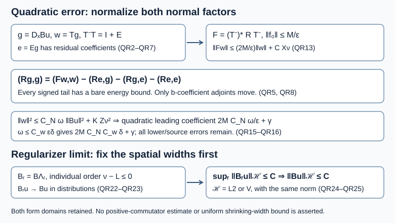

# Quadratic normal errors and removal of a boundary regularizer

*AN04-U061. Receiving exposition by GPT-6.1 Sol (OpenAI), Ultra. Original eligible new expression is CC0-1.0. *

The [normal-energy lesson](../20261007-restored-glancing-normal-operator/glancing-normal-energy-and-operator-errors.md) bounded an actual linear normal error. A quadratic error has one ordinary normal derivative in each factor. Here we prove its bound, keeping the entire complex matrix coefficient and every parametrix correction. We then construct a family of legal boundary tests at any prescribed finite b-order and prove the passage from a uniform norm estimate to the unregularized distribution.

We use the complete current [local boundary actions and commutators](../20261005-local-boundary-calculus/boundary-tests-and-lacunary-symbols.md), especially Lemma 4.4 and Theorem 5.1, [actual adjoints, composition and supported distributions](../20261005-local-boundary-calculus/boundary-adjoints-composition-and-distributions.md), [L2 and energy maps](../20261005-local-boundary-calculus/boundary-bounds-and-conormal-action.md), and [positive-order bounds](../20261005-positive-boundary-orders/positive-order-halfspace-bounds.md), especially (PS4)–(PS5). The [proper global calculus](../20261005-global-boundary-operators/global-boundary-operator-calculus.md) supplies realization and ordered parametrices. These are the earlier AN-03 proofs with their current prerequisite connections. The [uniform-family lesson](../20261007-restored-uniform-microsupport/uniform-microsupport-and-dual-sources.md) and [balanced-pair lesson](../20261007-restored-sharp-form/sharp-boundary-form-defect.md) supply the receiving estimates.

The proof map binds exact sources and locators. Elementary inputs are the complete measure and L2 proofs, [Hilbert representation and finite orthogonal projections](../20261004-free-canonical-composition/compactness-and-essential-norms.md), [actual H1 spaces and density](../20261007-restored-boundary-form/boundary-form-localization.md), [circle Fourier and weak-derivative proofs](../20261007-restored-uniform-microsupport/uniform-microsupport-and-dual-sources.md), and the [elementary differential, cutoff and root proofs](../20261004-free-stationary-phase/proof-map.html). Every linked component retains its stated terms. Vasy's free [paper](https://math.stanford.edu/~andras/psmcrrb.pdf), PDF pages 37–38 and 48, identifies the quadratic operator and regularized tests; his [two-page correction](https://math.stanford.edu/~andras/psmc-corr.pdf) fixes the glancing scale. The arguments and exercise solutions below are newly written; external proof-paper expression and images are not reproduced.

## 1. The normal input and a separated-pair lemma

Keep every equation and collar hypothesis of U060: \(X=[0,\infty)_x\times\mathbb R^d_y\times\mathbb R_t\), \(D=-i\partial\), Lebesgue measure, a scalar wave principal form with the boundary block (GN1), and all smooth complex matrix lower terms. Functions take values in a fixed \(\mathbb C^m\). The inner product is linear in its first argument. Choose either \(V=H^1_0(X;\mathbb C^m)\) or \(V=H^1(X;\mathbb C^m)\). The full weak equation is \(q(u,\varphi)=\langle f,\varphi\rangle\) for every \(\varphi\in V\), with \(u\in V\) and \(f\in V^*\).

Let \(B_\lambda\) be scalar, componentwise, bounded in \(\Psi_b^\nu\), with common compact kernel support, output in \(x\le h\le\omega\), and full uniform microsupport in a compact \(K\subset U_\omega\). Each individual \(B_\lambda\) has nonpositive order. The family topology includes every off-microsupport rapid-decay bound, as in U058. Fix elliptic testers near \(K\), with

\[
 Q_u\in\Psi_b^{\nu-3/2},\quad Q_f\in\Psi_b^{\nu-1/2},\quad
 X_\nu=\|u\|_V+\|Q_uu\|_V,\quad
 Y_\nu=\|f\|_{V^*}+\|Q_ff\|_{V^*},\quad
 Z_\nu^2=X_\nu^2+Y_\nu^2<\infty .
 \tag{QR1}
\]

Use the actual time operators \(T\in\Psi_b^{-1}\), \(T^-\in\Psi_b^1\) of (GN18), with principal symbols \(\tau^{-1}\), \(\tau\) near \(K\), and

\[
 T^-T=I+E,\qquad \operatorname{WF}'_b(E)\cap K=\varnothing .
 \tag{QR2}
\]

All these operators are properly supported on the fixed collar. \(E\) is an actual order-zero remainder with separated full microsupport. The normalized normal estimate (GN22), including its doubled output collar and normal commutator, states

\[
 v_\lambda=B_\lambda u,\quad g_\lambda=D_xv_\lambda,\quad w_\lambda=Tg_\lambda,
 \qquad
 \|w_\lambda\|^2\le C_N\omega\|v_\lambda\|^2+K_{\omega,h,B}Z_\nu^2 .
 \tag{QR3}
\]

Here \(C_N=4(H+1+2C_g/\kappa)/a_*\) is independent of the widths; \(K_{\omega,h,B}\) is uniform in \(\lambda\) at each fixed pair of widths. No uniformity of this lower constant as the widths shrink is assumed.

### 1.1. Actual domains and common norm supports

Use U060 Section 1.1 and U059 Section 1.1 throughout. Ordinary derivatives on the Neumann form space are restricted weak derivatives. On the Dirichlet space the supported H1 zero extension has the same first L2 derivatives, proved by interior density. The full source remains in the actual form antidual. Auxiliary kernels are properly supported and compactly localized on input and output wherever norms are used; multiples of the identity are the explicit exception. These localizations are common for a family at fixed widths. Their derivatives and all full lower remainders contribute to the lower constants. Properness alone on an unbounded base would not supply a global norm estimate.

We first isolate a useful remainder argument. Put \(D_0=I\). Suppose

\[
 F_\lambda=\sum_{i=0}^{d+2}F_{i,\lambda}D_i,\qquad
 H_\lambda=\sum_{j=0}^{d+2}H_{j,\lambda}D_j ,
 \tag{QR4}
\]

where the sum includes all ordinary base derivatives, each coefficient family is bounded at its finite stated b-order, and each individual coefficient has nonpositive order. Suppose every product \(F_{i,\lambda}^*H_{j,\lambda}\) is uniformly residual. This holds if one set of coefficient families is uniformly residual, or if their full uniform microsupports are separated. Then

\[
 |(F_\lambda u,H_\lambda u)|\le C\|u\|_V^2 .
 \tag{QR5}
\]

**Proof.** Expand the finite sum and use only actual b-coefficient adjoints:
\((F_iD_i u,H_jD_j u)=(D_i u,F_i^*H_jD_j u)\).
The individual nonpositive orders make this an L2 identity. Uniform residual coefficients are uniformly L2 bounded by the adopted order-zero theorem. Since \(D_j:V\to L^2\), each second factor is at most a constant times \(\|u\|_V\); the same is true of \(D_i u\). Cauchy–Schwarz and the finite sum give (QR5). Uniform residual composition follows from U058; an individually smoothing family without uniform residual bounds does not suffice. This proof uses at most one ordinary derivative on each input. It does not move \(D_x\) across the boundary or put two ordinary normal derivatives on a residual coefficient.

## 2. The exact quadratic parametrix identity

Let \(R\in\Psi_b^{-2}\) be a properly supported complex \(m\)-by-\(m\) matrix operator. It need not be Hermitian. Keep a fixed positive \(M\) and \(0<\epsilon<1\). Define the actual operator

\[
 F=(T^-)^*RT^-\in\Psi_b^0,\qquad f_0=\sigma_{b,0}(F),\qquad
 \|f_0\|_{\mathrm{op}}\le M/\epsilon .
 \tag{QR6}
\]

The last bound is an explicit hypothesis on its full principal extension in the chosen patch, with \(f_0=0\) outside a compact base and cosphere patch. Near \(K\) it is the familiar bound on \(\tau^2\sigma_{b,-2}(R)\). A local bound there alone does not certify the displayed global principal extension. Extra separated pieces can instead be retained and bounded by (QR5). Lower symbol seminorms of \(F,R\) may depend on the fixed widths.

Suppress the parameter temporarily. By (QR2), put

\[
 e=Eg,\qquad k=T^-w=g+e .
 \tag{QR7}
\]

The exact normal commutator has the form
\(D_xB=B D_x+M_B+N_BD_x\), with \(M_B\in\Psi_b^\nu\), \(N_B\in\Psi_b^{\nu-1}\) uniformly, and uniform microsupport in \(K\). Thus \(g\) has finite-order b-coefficients before at most one ordinary derivative, and all its individual coefficients have nonpositive order. Separation in (QR2) makes every coefficient of \(E D_xB\) uniformly residual. Consequently \(\|e\|\le C\|u\|_V\).

Use the actual adjoint in (QR6) and expand \(k=g+e\):

\[
 (Rg,g)=(Fw,w)-(Re,g)-(Rg,e)-(Re,e).
 \tag{QR8}
\]

Each of the three displayed corrections has a bound \(C\|u\|_V^2\) by (QR5). In particular, simply bounding \(\|g\|\) by a high-order family norm is unnecessary and would lose the lower-energy estimate.

The identity is legal for a weak solution. For each fixed parameter, approximate \(u\) in \(V\) by smooth functions in its respective dense test class. The nonpositive coefficient maps give \(g_j\to g\) and \(e_j\to e\) in L2, and \(w_j=Tg_j\to w\) in L2. Although \(T^-\) has positive order, its value here is identified by the exact identity \(T^-w_j=g_j+e_j\); these values converge in L2 to \(g+e\), and distributional continuity identifies the limit as \(T^-w\). \(F\) and \(R\) are L2 bounded. The smooth identity therefore passes to the limit. No ordinary normal differential adjoint or strong Neumann boundary condition is introduced.

## 3. A matrix principal norm bound with the full lower remainder

Set \(\alpha=2M/\epsilon\) and define, on the symbol patch,

\[
 Z=\alpha^{-2}f_0^*f_0,\qquad \|Z\|_{\mathrm{op}}\le\tfrac14,\qquad
 c=\alpha\sum_{j=0}^{\infty}\binom{1/2}{j}(-Z)^j .
 \tag{QR9}
\]

This gives a smooth Hermitian order-zero matrix symbol and \(c=\alpha I\) outside the patch. Here is a direct justification which does not require commuting matrix derivatives. The binomial coefficients have absolute value at most one: their recurrence is
\(\binom{1/2}{j+1}=\binom{1/2}{j}(1/2-j)/(j+1)\).
The undifferentiated series therefore converges in matrix norm. For a derivative of total order \(a\), the product rule for \(Z^j\) gives at most \(C_a j^a\) ordered terms. For \(j\ge a\), each term contains at least \(j-a\) undifferentiated factors, whose norms are at most \(1/4\); the remaining differentiated factors have the required finite symbol bounds. The finitely many \(j<a\) terms are harmless. The summable majorant \(C_a j^a4^{-(j-a)}\), with the appropriate frequency weights, proves convergence of every derivative and the symbol estimates. Matrix products retain their order throughout this argument.

For completeness, the scalar series \(h(z)=\sum_j\binom{1/2}{j}(-z)^j\) satisfies \(2(1-z)h'(z)=-h(z)\) by its coefficient recurrence and \(h(0)=1\). Absolute derivative convergence on \(|z|<1\) implies \((h(z)^2/(1-z))'=0\), so \(h(z)^2=1-z\). The same absolutely convergent Cauchy product evaluated at the single matrix \(Z\) is valid: powers of that matrix commute with each other, regardless of whether its derivatives commute. Thus

\[
 c^*c=c^2=\alpha^2I-f_0^*f_0 .
 \tag{QR10}
\]

Realize \(c\) by an actual matrix b-operator \(C\), equal to \(\alpha I\) plus a properly supported localized operator. The complete composition and adjoint calculus gives the full identity

\[
 F^*F+C^*C=\alpha^2I+J,\qquad J\in\Psi_b^{-1}.
 \tag{QR11}
\]

Only the leading symbols canceled. Every quantization remainder stays in \(J\); its finite seminorms are allowed to depend on the fixed widths.

In the mixed notation (SF4), \(w=T D_xB_\lambda u\) is produced by an expression in \(\mathcal M_{\nu-1}\), and \(Jw\) by one in \(\mathcal M_{\nu-2}\). The actual normal commutator of \(B_\lambda\) gives these assertions with all displayed individual coefficients of nonpositive order. Their full uniform microsupport is in \(K\). The balanced-pair lemma (SF7), at \(s=\nu-1\), therefore gives

\[
 |(Jw,w)|\le C_J X_\nu^2,\qquad
 \|Fw\|^2+\|Cw\|^2=\alpha^2\|w\|^2+(Jw,w).
 \tag{QR12}
\]

The right pairing is real because (QR11) makes \(J\) self-adjoint as an actual operator. Nonnegativity and \(\sqrt{a+b}\le\sqrt a+\sqrt b\) give

\[
 \|Fw\|\le\alpha\|w\|+\sqrt{C_J}X_\nu .
 \tag{QR13}
\]

This converts a matrix principal norm bound into an actual operator bound with its lower error. A Calderón–Vaillancourt bound using all derivatives of \(f_0\) as the leading constant would erase the required smallness mechanism.

## 4. The complete quadratic normal error

Write \(K_0=K_{\omega,h,B}\) and \(C_0=\sqrt{C_J}\). Equations (QR3), (QR8) and (QR13) imply

\[
 \begin{split}
 |(Rg,g)|
 &\le\alpha\|w\|^2+C_0Z_\nu\|w\|+C_{\rm tail}Z_\nu^2\\
 &\le\alpha C_N\omega\|v\|^2
     +C_0\sqrt{C_N\omega}\,Z_\nu\|v\|
     +(\alpha K_0+C_0\sqrt{K_0}+C_{\rm tail})Z_\nu^2 .
 \end{split}
 \tag{QR14}
\]

For each \(\gamma>0\), apply Young's inequality to the sole mixed term. We have proved, uniformly in the regularizer at fixed widths,

\[
 \boxed{\ 
 |(R D_xB_\lambda u,D_xB_\lambda u)|
 \le\left(\frac{2M C_N\omega}{\epsilon}+\gamma\right)\|B_\lambda u\|^2
      +C_{\omega,h,\epsilon,B,\gamma}Z_\nu^2 .\ }
 \tag{QR15}
\]

One possible lower coefficient is
\(\alpha K_0+C_0\sqrt{K_0}+C_{\rm tail}+C_0^2C_N\omega/(4\gamma)\).
In corrected glancing support \(\omega\le C_w\epsilon\delta\), the leading coefficient in (QR15) is at most

\[
 2M C_N C_w\delta+\gamma .
 \tag{QR16}
\]

The linear error in (GN28) has scale \(\sqrt{\delta/\epsilon}\); this quadratic one has scale \(\delta\), because both normal factors receive (QR3). The full complex pairing is bounded, including its imaginary part. The proof does not discard a non-Hermitian principal matrix or silently change a form domain.

The same coefficient-only calculation works for a finite direct sum of factors if their combined normalized normal estimate is already available and the block principal symbol satisfies (QR6). That observation does not prove the missing analytic input at a physical corner with several independent boundary faces. U034's kernel corner geometry alone supplies no such conclusion.

*Figure QR-F1.* Exact estimate and limit diagram for (QR3), (QR8), (QR15)–(QR16), and (QR20)–(QR25). Each normal factor contains one ordinary derivative. The two paths share the same legal-test framework; the lower constants remain fixed-width constants. The diagram asserts no Hamilton trajectory and no positive-commutator estimate. The complete proofs are Sections 1–5; Vasy's free paper and correction supply the credited primary mathematical route.

## 5. Construct legal tests and pass a uniform estimate to the limit

This construction uses a fixed scalar, properly supported \(B\in\Psi_b^\nu\) with compact kernel support. Choose an integer \(L\ge1\) with \(L\ge\nu\). In the full compressed covariable \(\xi\), including the normal b-covariable, put

\[
 m_r(\xi)=(1+r\langle\xi\rangle^2)^{-L/2},
 \qquad 0<r\le1,\qquad \langle\xi\rangle=(1+|\xi|^2)^{1/2}.
 \tag{QR17}
\]

The family is bounded in \(S^0\); each member lies in \(S^{-L}\), with constants at that negative order allowed to depend on \(r\). Moreover

\[
 m_r-1\longrightarrow0\quad\hbox{in }S^1,\qquad
 p_{1,a}(m_r-1)\le C_a\sqrt r
 \tag{QR18}
\]

for every derivative seminorm at order one. **All derivative bounds.** Put \(R_\xi=\langle\xi\rangle\) and \(a=rR_\xi^2\). For a nonzero multi-index \(\beta\), repeated differentiation gives a finite sum of terms
\(c_{\beta,j,\gamma}r^j\xi^\gamma(1+rR_\xi^2)^{-L/2-j}\), where
\(\lceil|\beta|/2\rceil\le j\le|\beta|\) and \(|\gamma|=2j-|\beta|\).
This follows by induction: differentiating the polynomial lowers its degree by one and leaves \(j\) unchanged; differentiating the last factor raises \(j\) by one and the polynomial degree by one. Terms with negative degree are absent. Each term is bounded by
\(C_\beta R_\xi^{-|\beta|}a^j(1+a)^{-L/2-j}\).
For \(a\le1\), \(j\ge1\) bounds the last factor by \(a\); for \(a\ge1\), it is at most one. Thus every derivative has the factor \(\min(a,1)\). The undifferentiated difference has the same factor by the mean-value theorem for \((1+a)^{-L/2}\) near zero and the bound one for \(a\ge1\). Multiplication by the order-one seminorm weight gives
\(R_\xi^{-1}\min(rR_\xi^2,1)\le\sqrt r\), proving (QR18). The corresponding order-zero seminorms of \(m_r\) are uniformly bounded. For fixed \(r>0\), the bound
\((1+a)^{-L/2-j}\le a^{-L/2-j}\) gives
\(C_{\beta,L}r^{-L/2}R_\xi^{-L-|\beta|}\), also for \(\beta=0\). This proves the individual negative order. Base derivatives are absent until the fixed localization below and then differentiate only fixed cutoffs. These b-symbol statements assert no gain in ordinary normal Sobolev regularity.

**Localize before the lacunary modification.** Choose fixed compact smooth cutoffs \(\chi_1,\chi_2\) with \(\chi=\chi_1\chi_2=1\) near the input projection of the kernel support of \(B\), all inside a fixed larger patch. Apply the current local Lemma 4.4 to \(\chi_1m_r\), which has its required base decay, by convolving in the normal compressed covariable with the fixed Schwartz function \(\rho\). Its Fourier transform equals one near zero and is supported in \((-1/2,1)\). This continuous operation preserves every uniform and individual order and (QR18). Since \(\int\rho=1\), the limit is exactly \(\chi_1\). Quantize with a fixed proper kernel cutoff equal to one on the diagonal and retain the lacunary normal-ratio support. Multiply on the right by \(\chi_2\), and call the resulting family \(\Lambda_r\). This is also left multiplication by \(\chi_1\) of the localized quantization of the convolved frequency symbol, because convolution acts only on the frequency. Then

\[
 \{\Lambda_r\}\text{ is bounded in }\Psi_b^0,\quad
 \Lambda_r\in\Psi_b^{-L}\ (r>0),\quad
 \Lambda_0=\chi,\quad
 \Lambda_r-\Lambda_0=O(\sqrt r)\text{ in }\Psi_b^1 .
 \tag{QR19}
\]

The notation at \(r=0\) is an actual operator: quantizing the constant one gives the identity delta kernel, and the diagonal cutoff leaves it unchanged. Multiplication by the two base cutoffs gives exactly \(\chi\). All symbol and residual seminorm conclusions in (QR19) follow from the continuous fixed lacunary modification and proper quantization, rather than from a union of the individual wavefront sets.

The order-zero energy theorem and actual adjoint theorem imply uniform maps \(\Lambda_r,\Lambda_r^*:V\to V\), for either \(V\). In particular they preserve the Dirichlet zero trace. They need not preserve the strong Neumann operator domain; only \(H^1\) is needed.

We claim the stronger, useful convergence

\[
 \Lambda_r a\longrightarrow\chi a\quad\hbox{in }V
 \qquad(a\in V).
 \tag{QR20}
\]

**Proof.** For a smooth compactly supported member \(a\) of the dense test class, (QR19), the exact order-one decomposition (PS5), and the actual ordinary derivative commutators give
\(\|(\Lambda_r-\chi)a\|_{H^1}\le C\sqrt r\,\|a\|_{H^2}\)
on the fixed support patch. Indeed the order-one operator maps \(H^1\) to L2; tangential commutators have order one, and the normal commutator is an order-one coefficient plus an order-zero coefficient before \(D_x\). Apply these maps to \(a\) and its first derivatives. Every required seminorm is \(O(\sqrt r)\) by (QR19). This proves convergence for the dense class. For general \(a\in V\), approximate it in \(V\) by such an \(a_j\). The uniform order-zero \(V\)-bound gives
\[
 \|(\Lambda_r-\chi)a\|_V
 \le C\|a-a_j\|_V+\|(\Lambda_r-\chi)a_j\|_V .
 \tag{QR21}
\]
First fix \(j\) with the first term small and then let \(r\) tend to zero. This proves (QR20), including convergence in \(H^1_0\) for the Dirichlet choice.

Now put \(B_r=B\Lambda_r\). Composition, the common proper support, and the full uniform microsupport theorem give

\[
 B_r\in\Psi_b^{\nu-L}\subset\Psi_b^0\ (r>0),\qquad
 \{B_r\}\text{ bounded in }\Psi_b^\nu,\qquad
 \operatorname{WF}'_b(\{B_r\})\subset\operatorname{WF}'_b(B).
 \tag{QR22}
\]

Thus \(B_r,B_r^*\) preserve both form domains for every \(r>0\), and \(B_r^*B_ru\) is an admissible weak test. Their individual order-zero norms may grow with \(r^{-1}\); the bounded target-order topology is what enters the uniform estimates.

**Identify the full supported distribution.** For \(a\in L^2(X)\), write \(a_0\) for its zero extension as an ambient L2 function. For the Neumann choice this need not be an ambient H1 extension. The supported transpose action in local Theorem 9.1(b) agrees with \((Aa)_0\) for each order-zero operator \(A\): it agrees on smooth functions up to the boundary, and L2 density, the order-zero L2 bound and distributional continuity extend that identity to all L2 inputs. Proper localization gives the same statement for the present operators.

Consequently \(B_r u_0=(B_r u)_0\), since each individual \(B_r\) has nonpositive order. Likewise \(\Lambda_r u_0=(\Lambda_r u)_0\). For any ambient compact smooth test \(\varphi\), the actual adjoint sends \(\varphi|_X\) to a smooth function up to the boundary with compact input support, hence to an L2 function. Supported duality and (QR20) therefore give
\((B\Lambda_r u_0,\varphi)=(\Lambda_r u,B^*(\varphi|_X))\to(\chi u,B^*(\varphi|_X))=(B u_0,\varphi)\).
Here the exact kernel input condition gives \(B\chi=B\), and actual composition agrees with supported composition by Theorem 9.1(e). Thus convergence holds against all these tests, including ones nonzero at the boundary. In particular,

\[
 B_ru\longrightarrow Bu\quad\hbox{as distributions in }X^\circ .
 \tag{QR23}
\]

In the removal lemma, the supported object is \(Bu_0\); its restricted action is \(Bu\). The argument below will identify \(Bu_0\) with the zero extension of the resulting function. It thereby accounts for boundary-supported terms instead of discarding them by definition.

**Removal lemma.** If

\[
 \sup_{0<r\le1}\|B_ru\|_{\mathcal H}\le C
 \quad\hbox{for }\mathcal H=L^2(X;\mathbb C^m)\text{ or }\mathcal H=V ,
 \tag{QR24}
\]

then the distribution \(Bu\) belongs to that same Hilbert space and

\[
 \|Bu\|_{\mathcal H}\le C .
 \tag{QR25}
\]

**Full proof.** Both Hilbert spaces are separable. L2 has a countable dense set of step functions with rational data; its H1 graph is an isometric subspace of a finite direct sum of L2 spaces via \(a\mapsto(a,D_1a,\ldots,D_{d+2}a)\). A subspace of a separable metric space is separable: for each radius \(1/j\), take the countable ambient balls from a countable base that meet the subspace and choose one point from each nonempty intersection. Their union is dense. This applies also to the closed Dirichlet subspace. Gram–Schmidt on a countable dense set, discarding zero residual vectors, gives a countable orthonormal basis.

**Details of the Hilbert extraction.** The density proof in the measure/L2 lesson, M7, approximates finite-measure sets by finite unions of boxes. Approximate each box endpoint and each complex coefficient by rational data: the measure of the symmetric difference tends to zero, by the finite product formula for box volumes, and the squared L2 error of indicators equals that measure. Truncate first to finite support and bounded coefficients as in M7. Rational step functions therefore give the claimed countable dense family on Euclidean space and, by restriction, on \(X\); take finite component products for \(\mathbb C^m\). Completeness of L2 is M6. H1 completeness follows from its closed weak-derivative graph, proved in the boundary-form lesson, Section 1.1; H1 zero trace here means the closed interior-test completion.

For Gram–Schmidt, subtract from the next dense vector its projections on the already selected unit vectors, then normalize a nonzero residual. Pythagoras proves the finite projection formula and Bessel inequality. Every original dense vector is in the closure of the constructed span. A finite terminating family is handled by the same argument with a finite index set. For each bounded complex coordinate sequence, repeated subdivision of a containing closed square selects nested closed squares of side tending to zero, each containing infinitely many indices. Choose increasing indices from these squares; completeness gives convergence. Apply this successively to the coordinates and take the diagonal subsequence.

Take \(r_n=1/n\). In such a basis \((e_j)\), the coefficients \((B_{r_n}u,e_j)_{\mathcal H}\) are bounded by \(C\). Successive subsequences and a diagonal choice make each coefficient converge to \(a_j\). For each finite \(J\), orthogonal projection and (QR24) give \(\sum_{j\le J}|a_j|^2\le C^2\). Hence \(\sum_j a_je_j\) converges in \(\mathcal H\) to a vector \(b\) with \(\|b\|_{\mathcal H}\le C\). On each finite basis span the chosen subsequence converges weakly to \(b\); approximation by that span, using the uniform bound \(C\), proves convergence against every element of \(\mathcal H\).

For every ambient compact smooth \(\varphi\), the linear functional \(b\mapsto(b_0,\varphi)\) is continuous on \(\mathcal H\), since its modulus is at most \(\|b\|_{L^2(X)}\|\varphi|_X\|_{L^2(X)}\). The fully proved Hilbert representation theorem T1 in the compactness lesson represents it as an inner product with an element of \(\mathcal H\). Thus the established weak convergence applies to this functional. Combined with the full supported convergence above it gives \(b_0=Bu_0\) as ambient distributions, and hence \(b=Bu\) in the restricted space. This proves (QR25), with no unexamined boundary remainder. For \(\mathcal H=H^1_0\), the limit is in that closed Hilbert space and retains zero trace. A uniform L2 estimate supplies only L2 membership; Exercise 3 proves the distinction explicitly.

This lemma takes an already proved uniform estimate as its hypothesis. All spatial widths and coefficient cutoffs must be fixed during its use; (QR24) requires a single finite \(C\). A bound whose constant diverges along a simultaneous shrinking-width path does not meet that hypothesis. For variable coefficients, \([P,\Lambda_r]\) is generally nonzero; its complete commutator estimate belongs to the subsequent positive-commutator argument.

## 6. Three graded exercises and complete solutions

**Exercise 1 — Complex quadratic errors and three signed tails (intermediate, 6 points).** On a periodic interior model let \(T\) be the multiplier \(\langle n\rangle^{-1}\), let \(R=iaT^*T\) with \(a>0\), and let \(g\) have a single nonzero Fourier mode \(n\). Compute \((Rg,g)\) and the normalized operator \(F\) for the exact inverse \(T^-\). Then check (QR8) in a one-dimensional scalar algebra model with \(g=1\), \(e=t\in\mathbb R\), \(R=ia\) and \(k=1+t\).

**Solution.** In the periodic model \(T^-=T^{-1}\) on smooth functions, \(F=(T^-)^*RT^-=iaI\). The inner product convention gives
\[
 (Rg,g)=ia\langle n\rangle^{-2}\|g\|^2=ia\|Tg\|^2 .
 \tag{QR26}
\]
Its real part is zero and its modulus is \(a\|Tg\|^2\); estimating only its real part would omit the complete error. In the scalar algebra model, \((Rk,k)=ia(1+t)^2\), \((Re,g)=iat\), \((Rg,e)=iat\), \((Re,e)=iat^2\). Thus (QR8) subtracts \(ia(2t+t^2)\) and leaves \(ia\). Dropping just the last tail leaves \(ia(1+t^2)\). This exact algebra checks the signs; the toy scalar parameter is not a construction of a boundary parametrix. The complete boundary identity and remainder bounds are those of Section 2.

**Exercise 2 — Legal order without convergence in operator norm (foundation, 5 points).** For target order \(\nu=7/3\), choose the smallest positive integer \(L\) in (QR17). Find the individual order of \(B_r\). On the periodic interior Fourier model show that \(\Lambda_r\to I\) strongly on L2 although \(\|\Lambda_r-I\|_{L^2\to L^2}=1\) for every \(r>0\).

**Solution.** The integer is \(L=3\), giving individual order \(7/3-3=-2/3\), while the family is still measured at target order \(7/3\). For the Fourier model \(0<m_r(n)\le1\), \(m_r(n)\to1\) at each fixed \(n\), and \(m_r(n)\to0\) as \(|n|\to\infty\) for each fixed \(r\). Parseval shows the operator norm is \(\sup_n|m_r(n)-1|=1\): the upper bound is one, and single modes with \(|n|\) large give the lower bound. For \(a=\sum a_ne^{iny}\), first choose a finite set whose squared coefficient tail is small. On the finite set the factors converge to one, and on the tail their differences are at most one. Hence the squared difference norm tends to zero. Strong convergence suffices for (QR23); uniform operator-norm convergence is neither available nor required. The boundary construction adds the fixed lacunary modification and proper cutoffs, which Section 5 proves preserve the corresponding energy convergence.

**Exercise 3 — A uniform L2 bound cannot pass an H1 conclusion (intermediate, 7 points).** On the circle with its orthonormal Fourier basis, let \(a=\sum_{n\ge1}n^{-1}e_n\), and regularize by the multiplier (QR17), with any integer \(L\ge1\). Prove that each \(\Lambda_r a\) lies in H1, their L2 norms are uniformly bounded, their H1 norms are unbounded as \(r\downarrow0\), and the limit does not belong to H1.

**Solution.** Orthogonality gives \(\|a\|_{L^2}^2=\sum_{n\ge1}n^{-2}<\infty\); the tail is bounded by the integral of \(x^{-2}\). Its formal H1 squared norm contains \(\sum_{n\ge1}(1+n^2)n^{-2}\), which diverges since each summand is at least one. Parseval applied to the distributional derivative therefore excludes H1 membership. For fixed \(r>0\),
\[
 \|\Lambda_r a\|_{H^1}^2
 =\sum_{n\ge1}\frac{1+n^2}{n^2}(1+r(1+n^2))^{-L}<\infty ,
 \tag{QR27}
\]
because the summands are at most \(2r^{-L}n^{-2L}\), a convergent series. Their L2 squared norms are at most \(\sum n^{-2}\). For any finite \(J\), the first \(J\) terms in (QR27) tend to \(\sum_{n\le J}(1+n^2)n^{-2}\ge J\). Since \(J\) is arbitrary, the H1 norms diverge. The strong L2 limit is \(a\), as in Exercise 2. Thus the removal lemma correctly yields an L2 conclusion from an L2 estimate and requires a separate uniform V estimate for a V conclusion.

## 7. Scope of the regularization estimate

We have proved the full quadratic normal error (QR15), its corrected leading scale (QR16), the explicit family of legal tests (QR17)–(QR22), and the removal lemma (QR23)–(QR25). Neither a positive-commutator estimate nor its uniform norm hypothesis is asserted here. Those still require the complete boundary-compatible decomposition, every source and forcing term, every incoming and elliptic cutoff error, and the variable-coefficient regularizer commutator. The analytic window criterion RW4 in the [parabolic-window lesson](../20261007-restored-parabolic-windows/parabolic-wavefront-windows-and-rays.md) remains unproved.

The smooth-collar scalar-principal hypothesis does not replace the assigned systems, crossings, general glancing and complex-phase scope. Physical corner estimates need their own full input. The exact current transitive provider chain is in the proof map. 

## Sources and contribution

Vasy's paper supplies the quadratic-error and regularization route, and his December 2008 correction supplies the glancing scale. Every mathematical input used here has its programme proof, including the Hörmander III antecedent in the boundary calculus.  Mathematical exposition, three solutions and illustration: GPT-6.1 Sol (OpenAI), Ultra; GPT-6 Astra (OpenAI), Ultra. This independent exposition and original diagram are CC0-1.0; linked components retain their own terms.   
