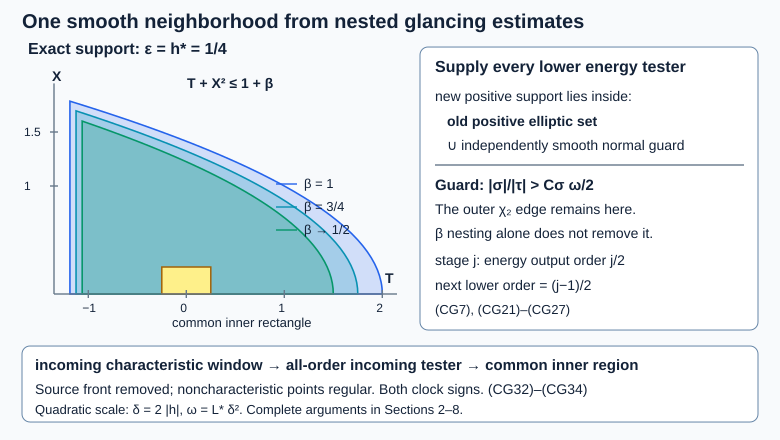

# Smooth glancing regularity in parabolic windows

*AN04-U064. Receiving exposition by GPT-6.1 Sol (OpenAI). Original eligible new expression is CC0-1.0. *

The [finite-order positive estimate](../20261007-restored-compensated-glancing/compensated-glancing-positive-commutator.md) gives more than an L2 value: its order-\((\nu-1)\) energy output supplies the next induction hypothesis. We prove that the iteration leaves one open phase neighborhood at every order. We also supply the noncharacteristic estimates needed to turn an empty characteristic window into incoming regularity. The resulting criterion is for the full smooth single-face scalar wave principal form of U063, with time-variable coefficients, complex matrix lower terms and either weak form domain.

We use the complete current [local boundary actions and commutators](../20261005-local-boundary-calculus/boundary-tests-and-lacunary-symbols.md), [actual adjoints and composition](../20261005-local-boundary-calculus/boundary-adjoints-composition-and-distributions.md), [L2 and form-domain maps](../20261005-local-boundary-calculus/boundary-bounds-and-conormal-action.md), [positive-order half-space bounds](../20261005-positive-boundary-orders/positive-order-halfspace-bounds.md), and [proper global calculus and both ordered parametrices](../20261005-global-boundary-operators/global-boundary-operator-calculus.md). The receiving interfaces are [uniform localization and antidual action](../20261007-restored-uniform-microsupport/uniform-microsupport-and-dual-sources.md), [mixed localization](../20261007-restored-sharp-form/sharp-boundary-form-defect.md), [full normal-energy algebra](../20261007-restored-glancing-normal-operator/glancing-normal-energy-and-operator-errors.md), [same-norm removal](../20261007-restored-quadratic-normal-regularizer/quadratic-normal-errors-and-regularization.md), and the [full weak commutator](../20261007-restored-weak-commutator/weak-commutators-and-variable-regularizers.md). All their actual-adjoint, support, residual and form-domain hypotheses remain in force.

The proof map gives exact current programme proofs. The [elementary calculus and compactness proofs](../20261004-free-stationary-phase/proof-map.html), L2 completeness, and [parabolic-window geometry](../20261007-restored-parabolic-windows/parabolic-wavefront-windows-and-rays.md) supply the explicitly used foundations and receiving geometry.

The free primary route is [Vasy's paper](https://math.stanford.edu/~andras/psmcrrb.pdf): the energy wavefront definition on PDF page 22, the complete Proposition 4.6 on pages 26–28 and weak Neumann discussion on pages 28–29, and the nested-cutoff conclusion on page 48. Its [correction](https://math.stanford.edu/~andras/psmc-corr.pdf) is already retained in U063's normal-error input. The present argument writes out the common-neighborhood induction and receiving elliptic estimates, including the full variable and complex lower terms. No external paper text, images or PDF payloads are reproduced.

## 1. Fix the meaning of smooth energy wavefront

Keep \(u\in V\), \(f\in V^*\), \(Pu=f\), and all coefficients of (PC1), (GN1)–(GN3). Thus \(V=H^1_0\) or \(H^1\), the inner product is linear first, and the principal spatial matrix satisfies \(G\ge\kappa I\). All local kernels have common compact support and the proper normal-ratio support of the unchanged providers. We work on a compact normalized patch where \(\tau\) has fixed sign and \(\kappa_\tau=|\tau|\) is elliptic. A point is written
\[
 \dot q=(x,\bar z,\sigma/\kappa_\tau),\qquad
 \bar z=(t,y,\zeta/\tau),\qquad \sigma=x\xi .
 \tag{CG1}
\]
Normalization is by the positive scale \(|\tau|\); the sign of \(\tau\) is retained.

For \(W=V\), \(w=u\), or \(W=V^*\), \(w=f\), say that \(w\) is regular of order \(k\) at \(\dot q\) if some actual scalar \(Q\in\Psi_b^k\), elliptic there, satisfies \(Qw\in W\). Write its complement as \(\mathrm{WF}_b^{W,k}(w)\). Positive-order action on \(V^*\) is the actual antidual action on smooth tests, as in U058; membership in \(V^*\) is part of the assertion. Define smooth regularity by one order-zero test \(A\), elliptic at \(\dot q\), such that
\[
 L_mAw\in W\quad\text{for every integer }m\ge0,
 \qquad L_m\in\Psi_b^m
 \text{ elliptic with leading symbol }\kappa_\tau^m .
 \tag{CG2}
\]
It suffices to choose proper \(L_m\) on the fixed patch. This is conormal smoothness relative to the stated energy space; it is not an unproved assertion of ordinary normal Sobolev gains. Denote the complementary closed set by \(\mathrm{WF}_b^{W,\infty}(w)\).

We justify the common-neighborhood content of this definition. U058's same-space transfer says that if \(Qw\in W\), \(Q\) has order \(k\) and is elliptic on a compact set \(K\), then every properly supported operator of order at most \(k\), with full microsupport in \(K\), has value in \(W\). Its proof uses a fixed parametrix and order-zero/residual maps on \(W\); no ordinary normal smoothing is inferred. A finite collection of tests can be combined: choose nonnegative phase cutoffs \(\psi_i\), supported in their elliptic sets, with \(\sum_i\psi_i=1\) near \(K\). The operator \(\sum_iL_k\psi_i\) has elliptic leading symbol \(\kappa_\tau^k\) near \(K\), and each summand has value in \(W\) by that transfer.

**A finite phase partition with controlled support.** For each point of \(K\), choose a ball whose doubled closure is in one tester's elliptic set; compactness gives a finite subcover by the smaller balls. Put a nonnegative smooth bump on each doubled ball, positive on its smaller ball, and let \(S\) be their sum. It is positive on an open neighborhood of \(K\). Choose a smooth cutoff \(\chi\), equal to one near \(K\), with compact support in that neighborhood. The functions \(\psi_i=\chi b_i/S\) there, extended by zero elsewhere, are smooth: their supports stay a positive distance from \(S=0\). They sum to \(\chi\) and stay within the respective elliptic sets. Extend them homogeneously at large frequency and use the proper realization with full microsupport there. The zero-frequency part is residual. Thus each actual \(L_k\psi_i\) is covered by the same-space transfer, including on the antidual, and the leading symbol of their sum is elliptic near \(K\). This proves the finite gluing used below without a uniform-in-order assertion.

Consequently
\[
 \mathrm{WF}_b^{W,\infty}(w)
 =\overline{\bigcup_{m\ge0}\mathrm{WF}_b^{W,m}(w)}
 \quad\text{in the working phase patch}.
 \tag{CG3}
\]
For the first inclusion, a fixed smoothness test in (CG2) has one open elliptic set disjoint from every finite-order front, by transfer. For the reverse inclusion, outside the closure choose an open set disjoint from all finite-order fronts, then a compact smaller neighborhood \(K\). For each \(m\), combine finitely many order-\(m\) tests as just described. Choose one \(A\in\Psi_b^0\), elliptic at the original point, with microsupport in \(K\). Transfer gives \(L_mAw\in W\) for every \(m\). The same argument with half-integer orders suffices, because transfer lowers any larger order to a prescribed real order. Exercise 3 explains why the closure and the common test cannot be omitted.

From now on let \(O\) be an open normalized phase region disjoint from \(\mathrm{WF}_b^{V^*,\infty}(f)\). Every compact subset of \(O\) therefore has a source tester of each finite order, with value in \(V^*\). These norms need only be finite; no uniform bound as the phase window shrinks is assumed.

## 2. A finite-order elliptic estimate outside the compressed image

Let \(A_r\) be a full uniform family of target order \(k\), each individual order nonpositive, with output in \(x\le h\). Take the legal radial regularizer of U061, with integer exponent large enough for that target. Assume a solution tester of order \(k-1/2\) and source tester of order \(k+1/2\) near its complete microsupport. Put
\[
 X_k=\|u\|_V+\|Q_{k-1/2}u\|_V,\qquad
 Y_k=\|f\|_{V^*}+\|\widetilde Q_{k+1/2}f\|_{V^*}.
 \tag{CG4}
\]
The full localization identity (SF17) and its balanced bounds give \(|q(A_ru,A_ru)|\le C(X_k^2+Y_k^2)\). All complex lower terms have the same bound, pairing one derivative with a zeroth factor at mean order \(k-1/2\). Spatial positivity therefore gives the complete algebraic estimate
\[
 \kappa\|D_{\rm sp}A_ru\|^2
 \le\|D_tA_ru\|^2+C(X_k^2+Y_k^2).
 \tag{CG5}
\]
This is the proof of (GN13), using only the form and localization assumptions just stated. Here we have repeated its receiving algebra without imposing a glancing anchor condition. No ordinary normal derivative is moved between factors.

Suppose the microsupport lies in the open guard \(|\sigma|/\kappa_\tau>c>0\). A fixed \(J\in\Psi_b^0\), equal to \(\tau/\sigma\) near that compact microsupport and cut off within this open guard, satisfies
\[
 |j_0|\le M=1/c,\qquad
 D_tA_r-JxD_xA_r\in\Psi_b^k .
 \tag{CG6}
\]
**Apply the actual quadratic remainder.** Choose the symbol cutoff between zero and one and strictly inside the open guard; then its full extension satisfies \(|j_0|\le M\). U063's guard lemma realizes \(C\) with \(J^*J+C^*C=4M^2I+R_{-1}\), retaining the complete order-minus-one remainder. Here \(v=xD_xA_ru\) is a mixed expression of target order \(k\), and \(R_{-1}v\) has order \(k-1\), by the full normal commutator. The arbitrary-gap pairing (WC8) has mean \(k-1/2\), so \(|(R_{-1}v,v)|\le CX_k^2\). It follows that \(\|Jv\|^2\le4M^2\|v\|^2+CX_k^2\). The order-\(k\) error in (CG6) has L2 norm at most \(CX_k\) by (SF5) and transfer. Applying \(\|a+b\|^2\le2\|a\|^2+2\|b\|^2\) now gives exactly the factor \(8M^2\) in (CG7). The input \(A_ru\) is supported in \(x\le h\). Thus
\[
 \|D_tA_ru\|^2
 \le8M^2h^2\|D_xA_ru\|^2+CX_k^2,
 \qquad h\le\frac{\sqrt\kappa}{4M}
 \ \Longrightarrow\ 8M^2h^2\le\kappa/2 .
 \tag{CG7}
\]
Absorb this in (CG5), then bound the time derivative by (CG7). The L2 value of \(A_ru\) is controlled by (SF5) with the same lower tester. We obtain
\[
 \|A_ru\|_V^2\le C(X_k^2+Y_k^2).
 \tag{CG8}
\]
All constants are uniform in \(r\) at this fixed guard. Same-\(V\) removal from U061 gives \(A_0u\in V\). The closed zero-trace subspace is retained in the Dirichlet case. This proves a half-order energy improvement at each boundary point with \(\sigma\ne0\), after choosing its collar thin enough. In U063's derivative guard, \(c=C_\sigma\omega/2\), \(h=2\omega\), and \(C_\sigma\ge32/\sqrt\kappa\) satisfy (CG7). Its outer normal cutoff can therefore be treated by this independent elliptic argument.

## 3. The boundary region with negative tangential characteristic form

The other boundary elliptic region has \(\sigma=0\) and
\[
 d_0=1-\tau^{-2}\zeta^TB_b(t,y)\zeta<-d<0
 \quad\text{on a slightly larger compact patch}.
 \tag{CG9}
\]
Use the same \(A_r,X_k,Y_k\) as above. Choose a real degree-zero function \(\widetilde d\), equal to \(d_0\) near its microsupport and at most \(-d/2\) everywhere: take
\[
 \widetilde d=-d/2+\psi(d_0+d/2),\qquad
 0\le\psi\le1,\quad \psi=1\text{ near the microsupport},
 \quad\operatorname{supp}\psi\subset\{d_0<-d\}.
 \tag{CG10}
\]
Outside that support it is the constant \(-d/2\). Realize it as an actual self-adjoint \(F\). The smooth root \((-\widetilde d-d/4)^{1/2}\), with constant extension outside the patch, gives an actual \(C\in\Psi_b^0\) and exact identity
\[
 C^*C=-F-(d/4)I+R_{-1},\qquad R_{-1}\in\Psi_b^{-1}.
 \tag{CG11}
\]
The radicand is at least \(d/4\). Every lower quantization and adjoint error is in \(R_{-1}\), and its support is fixed. Pairing with \(D_tA_ru\) bounds its remainder by \(CX_k^2\) using (WC8).

Let \(q_b(v,v)=\|D_tv\|^2-(B_bD_yv,D_yv)\). The exact tangential operator \(P_b\), including every derivative of \(B_b(t,y)\), and the separated cutoff construction of (GN15) give
\[
 q_b(A_ru,A_ru)
 =(FD_tA_ru,D_tA_ru)+\text{a mixed lower pairing}
 \le-\frac d4\|D_tA_ru\|^2+CX_k^2 .
 \tag{CG12}
\]
Indeed \(P_b-D_tFD_t\) has order one after a cutoff equal to one near the family; its off-cutoff product is uniformly residual. Its order-one decomposition retains the left \(x\) in its normal coefficient. Pairing that decomposition with \(A_r\) uses mean order \(k-1/2\). Only tangential weak integration is involved.

Freeze \(G\) at \(x=0\), where its cross block vanishes. The actual matrix difference has norm at most \(C_gh\), so (CG5) gives
\[
 a_*\|D_xA_ru\|^2
 \le q_b(A_ru,A_ru)
       +(C_gh/\kappa)\|D_tA_ru\|^2+C(X_k^2+Y_k^2).
 \tag{CG13}
\]
Choose \(h\) so that \(C_gh/\kappa\le d/8\); if \(C_g=0\), no such restriction is needed. Combining (CG12)–(CG13) yields
\[
 a_*\|D_xA_ru\|^2+\frac d8\|D_tA_ru\|^2
 \le C(X_k^2+Y_k^2),\qquad
 \|A_ru\|_V^2\le C'(X_k^2+Y_k^2).
 \tag{CG14}
\]
The last inequality also uses (CG5) for all spatial derivatives and (SF5) for L2. Remove the regularizer in \(V\) as before. This proves the same half-order gain at every negative-\(d_0\) boundary point, for both domains and all lower matrices. It has used no incoming propagation hypothesis.

## 4. Interior ellipticity and the actual compressed characteristic set

Away from \(x=0\), an ordinary normal derivative is \(x^{-1}(xD_x)\), with bounded smooth coefficient on a compact interior patch. The unchanged proper calculus therefore supplies an actual microlocal parametrix for the full interior operator \(P\) wherever its scalar principal symbol \(p\) is nonzero. The finite matrix lower terms are retained in its composition expansion; the leading inverse is \(p^{-1}I_N\), and subsequent ordered finite matrix products are the same calculus.

We spell out the source mapping that this use needs. An interior-supported operator \(S\in\Psi_b^{-2}\) satisfies
\[
 S:V^*\longrightarrow V .
 \tag{CG15}
\]
To prove it, use the Hilbert representation of a functional in \(V^*\): there is \(g\in V\) with \(\langle f,w\rangle=(g,w)_V\). On interior tests this writes \(f=g+\sum_jD_j(D_jg)\). After an interior input cutoff it becomes
\[
 f=f_0+\sum_jD_jf_j,\qquad
 f_j\in L^2\text{ with compact interior support},\qquad
 \sum_{j\ge0}\|f_j\|\le C\|f\|_{V^*}.
 \tag{CG16}
\]
The differentiated input cutoff contributes only further L2 terms to \(f_0\). Now \(Sf_0\) and \(SD_jf_j\) belong to H1: their output derivatives have respective orders \(-1\) and \(0\), bounded on L2 by the provider. All normal coefficients are bounded on the interior support. Output support is interior, so their H1 value also has zero trace when \(V=H^1_0\). The actual antidual definition agrees with these distributional compositions. This proves (CG15), including boundary-source functionals whose interior restriction is being taken.

For any compact interior elliptic set and finite \(k\), choose \(Q_f\in\Psi_b^k\) elliptic on a larger compact set with \(Q_ff\in V^*\), and its fixed inverse \(J_f\in\Psi_b^{-k}\). A parametrix \(E_P\) of \(P\), with every remainder, gives
\[
 Q_ku=Q_kE_PJ_f(Q_ff)+R_ku+S_kf,
 \quad Q_kE_PJ_f\in\Psi_b^{-2},
 \quad R_k,S_k\text{ interior-supported residual}.
 \tag{CG17}
\]
Here \(S_k\) is the separated source-parametrix remainder; its kernel is smooth with both supports interior. It maps \(V^*\) to \(V\) by the same proof as (CG15), or directly by bounded derivatives of its kernel. \(R_k:V\to V\). Thus the interior elliptic set is smooth relative to \(V\) when \(f\) is smooth relative to \(V^*\).

In the chosen patch the compressed characteristic set is exactly
\[
 \dot\Sigma=
 \begin{cases}
  \{\dot q:p(x,t,y,\sigma/x,\zeta,\tau)=0\},&x>0,\\
  \{x=0,\ \sigma=0,\ d_0\ge0\},&x=0 .
 \end{cases}
 \tag{CG18}
\]
It is the closed image of the ordinary characteristic set under compression, with the homogeneous normalization fixed. To verify its boundary description, spatial positivity on \(p=0\) gives
\[
 |\xi|^2+|\zeta|^2\le\tau^2/\kappa,\qquad
 |\sigma|/\kappa_\tau\le x/\sqrt\kappa .
 \tag{CG19}
\]
Hence every boundary limit has \(\sigma=0\). At \(x=0\), the equation is \(a_b\xi^2=\tau^2d_0\), so its real lifts exist exactly for \(d_0\ge0\). These lifts are limits of interior characteristic points: when \(d_0>0\), solve for a nonzero normal root by the implicit function theorem; at \(d_0=0\), vary the nonzero tangential radial covector slightly, where the derivative of \(p\) is nonzero, to solve the nearby equation with \(\xi=0\). The lifts remain bounded by (CG19). Compactness then proves closedness on each working patch.

Sections 2–3 treat all boundary points outside (CG18), and interior ellipticity treats the rest of its complement. After the all-order bootstrap in Section 5 they imply
\[
 \mathrm{WF}_b^{V,\infty}(u)\cap O\subset\dot\Sigma .
 \tag{CG20}
\]
This receiving containment is proved here, rather than assumed when a characteristic window is declared empty.

## 5. Bootstrap the elliptic guard on one fixed neighborhood

Both boundary estimates have the following local interface: a compact subset of their open elliptic region has an order-\(k\) energy tester whenever an order-\((k-1/2)\) tester is known on a slightly larger compact set, and the order-\((k+1/2)\) source tester is finite there. The leading collar/elliptic constants are fixed on a sufficiently small outer compact set. Cutoff derivatives affect only finite lower constants.

Here is the full all-order argument. For a desired compact \(K\) choose \(r_*>0\) so its closed \(r_*\)-neighborhood stays in one such open elliptic region and in \(O\). Use the phase metric of the fixed chart and let
\[
 r_j=r_*/2+r_*2^{-j-1},\qquad
 K_j=\{\dot q:\operatorname{dist}(\dot q,K)\le r_j\},
 \quad K_{j+1}\subset\operatorname{int}K_j .
 \tag{CG21}
\]
If necessary a finite chart covering replaces this one chart. At stage \(j=1\), apply the estimate at \(k=1/2\) with the order-zero lower information \(u\in V\). At stage \(j\), the tester from stage \(j-1\) is elliptic on \(K_{j-1}\); transfer supplies the order-\((j-1)/2\) lower tester near \(K_j\). The source tester of order \((j+1)/2\) is finite because \(K_0\subset O\). Legal regularization, the uniform estimate and same-\(V\) removal give
\[
 Q_ju\in V,\qquad Q_j\in\Psi_b^{j/2}
 \text{ elliptic on }K_j,\quad j\ge1 .
 \tag{CG22}
\]
All stages are finite constructions. They need not have uniformly bounded norms as \(j\) grows. The limit neighborhood of radius \(r_*/2\) contains \(K\). One order-zero cutoff supported there, followed by any finite-order test, is controlled by a sufficiently high \(Q_j\) through U058. Formula (CG2) follows on a fixed neighborhood. This proves (CG20) and, independently, smooth energy regularity on the entire compact outer normal-cutoff guard used below. No positive-commutator or incoming hypothesis was used in this guard bootstrap.

## 6. Nest the positive cutoffs without losing the smooth neighborhood

Fix one glancing anchor \(q\in O\), the transverse coordinates of (PC5)–(PC11), and the geometric widths of U063. Shrink \(\delta\) so that \(\epsilon=L_*\delta<1/4\), and put \(\omega=\epsilon\delta\). The number \(L_*\) and the sufficiently small geometric \(\delta\) are independent of the target order by (PC44). Choose all complete supports in \(O\).

Suppose the compact incoming region (PC19), including all compressed momenta in (PC18), is disjoint from \(\mathrm{WF}_b^{V,\infty}(u)\). It then has a source-independent order-\(k\) solution tester for every \(k\), by Section 1. We show that the anchor has one smooth neighborhood. Use
\[
 \beta_j=\tfrac12+2^{-j-1},\qquad
 \nu_j=1+j/2,\qquad
 \nu_j-\tfrac32=(j-1)/2,\quad \nu_j-1=j/2 .
 \tag{CG23}
\]
Here \(j\ge1\); stage zero is the already known \(u\in V\). For each stage, choose the regularizer exponent and \(A_{0,j}\) large enough for that finite target. Changing \(A_{0,j}\) changes the positive amplitude, not its support or its open elliptic set.

The monotone incoming cutoff has a genuine positivity threshold
\[
 h_*=\inf\{h:\chi_1(h)>0\},\quad 0<h_*<1,\qquad
 \chi_1(h)>0\Longleftrightarrow h>h_* .
 \tag{CG24}
\]
The strict lower bound follows because \(\chi_1'\) is compactly supported inside \((0,1)\); the upper bound follows because it is one before the upper endpoint. Monotonicity gives the stated positivity equivalence. No positivity for every \(h>0\) is presumed.

Let \(K_j^a\) be the closed full symbol support of the stage-\(j\) commutant. On it \(\phi\le(1+\beta_j)\delta\) and \(h_{{\rm in},j}\ge h_*\). Since \(\beta_{j-1}>\beta_j\),
\[
 1+\beta_{j-1}-\phi/\delta\ge\beta_{j-1}-\beta_j>0,
 \quad h_{{\rm in},j-1}\ge h_*+\beta_{j-1}-\beta_j>h_* .
 \tag{CG25}
\]
Where \(|\sigma|/\kappa_\tau<C_\sigma\omega\), the old \(\chi_2\) is one, so the preceding energy tester \(TB_{0,j-1}\) is elliptic. Where this strict inequality is not enough, the open guard \(|\sigma|/\kappa_\tau>C_\sigma\omega/2\) covers every remaining point of \(K_j^a\). Its regularity at every order was independently proved in Section 5. The symbol support also has \(x^2\le(3+\epsilon)\omega^2<4\omega^2\), leaving a strict collar margin inside \(x<2\omega\).

Thus \(K_j^a\) lies in the union of the preceding energy elliptic set and the all-order elliptic guard. This union is open. Enlarge the complete microsupports of all stage-\(j\) arrays inside it; compactness and the strict inequalities allow the enlargement. The full symbol and residual construction in U058 ensures the off-support tails are uniformly residual. Derivatives of these increasingly close cutoffs can grow with \(j\), but only the finite lower constants change. Geometric leading bounds remain those of U063 on the fixed larger patch.

At stage one the lower order is zero, so \(u\in V\) supplies it. At each later stage, combine the preceding order-\((j-1)/2\) energy tester with a guard tester of that same order, using the finite gluing argument of Section 1. It supplies exactly \(\nu_j-3/2\), not an inferred stronger order from the L2 conclusion. The incoming tester has order \(j/2\) and is finite by the incoming smoothness hypothesis. The source tester has order \(\nu_j\) and is finite in \(O\). U063, with same-norm removal already proved there, now gives the next energy tester of order \(j/2\).

The fixed compact inner region
\[
 |\theta|\le\delta/4,\qquad
 \sqrt\Omega\le\omega/4,\qquad
 |\sigma|/\kappa_\tau\le C_\sigma\omega/4
 \tag{CG26}
\]
lies in every positive elliptic set: \(\phi/\delta\le5/16<3/2\), \(h_{\rm in}\ge3/(4\epsilon)+1/2>1\), and the \(\chi_2\) argument is at most \(1/16\). Each finite \(A_{0,j}\) leaves \(\chi_0(v)/v>0\) there. Choose one order-zero phase cutoff \(A\), elliptic at the anchor, with complete microsupport in the interior of a slightly smaller version of (CG26). The energy outputs and transfer prove
\[
 L_mAu\in V\quad\text{for every integer }m\ge0.
 \tag{CG27}
\]
This proves common-neighborhood conormal smoothness at glancing. It proves no uniform bound as \(m\to\infty\), and requires none.

## 7. Both directions of the boundary clock

The preceding proof must work with incoming information on either side. For \(d\in\{1,-1\}\), use
\[
 V_d=dV_b,\qquad \theta_d=d(\operatorname{sign}\tau)(t-t_q),
 \qquad V_d\theta_d=2 .
 \tag{CG28}
\]
The transverse first jets annihilate both fields. Replace \(\theta\) by \(\theta_d\) in the symbols, and use the signed weak commutator \(\mathcal C_d=d\mathcal C\). Its complete source identity is
\[
 \mathcal C_d
 =d\{-2\operatorname{Im}\langle A_rf,A_ru\rangle
       +2\operatorname{Im}q_1(A_ru,A_ru)
       -2\operatorname{Im}\Delta_{1,r}\}.
 \tag{CG29}
\]
Its leading polynomial is \(-dH_p(a_r^2)\). Differentiating the square of the flat cutoff against \(d\kappa_\tau^{-1}H_p\theta_d=2\) produces the same positive factor \(4b_r^2\). The \(\Omega\) and weight derivatives have their signs multiplied by \(d\); their absolute bounds and all zero/linear/quadratic error estimates are unchanged. The incoming derivative term has the same negative orientation relative to \(\theta_d\). The source and complex lower-form bounds use absolute values, so (CG29) changes none of them. Every actual weak remainder changes by its displayed sign, without removing any coefficient. Therefore Sections 2–6 and the common inner neighborhood hold for both \(d\). This is a sign calculation, not an assumption of stationary coefficients or a time reversal of the weak boundary data.

## 8. Translate the incoming tube to a uniform parabolic window

Let \(\Phi_h\) be the smooth flow of \(V_b\) on the normalized boundary phase coordinates \(\bar z\). Let \(K\) be a compact glancing anchor set in \(O\). The finite coordinate constructions of (PC7)–(PC9) give uniform inverse-coordinate and derivative constants on a finite cover of \(K\). The geometric threshold \(\delta_0>0\) and \(L_*\) can also be chosen uniformly, independently of the finite target orders.

For any nonzero small \(h\), put
\[
 \delta=2|h|,\qquad \epsilon=L_*\delta,\qquad
 \omega=L_*\delta^2,\qquad d=-\operatorname{sign}h .
 \tag{CG30}
\]
Since \(V_b((\operatorname{sign}\tau)(t-t_q))=2\) exactly on the fixed-sign patch, \(\theta_d(\Phi_h(\bar z_q))=-\delta\) exactly. Each transverse \(\rho_j\) vanishes at the anchor and has \(V_b\rho_j=0\) there. Uniformly bounded \(V_b^2\rho_j\), integrated twice along the smooth flow, therefore gives
\[
 |\rho(\Phi_h(\bar z_q))|\le(M_2/2)h^2 .
 \tag{CG31}
\]
The estimate holds for both signs, by oriented integration. In a smaller convex coordinate patch the map \(\bar z\mapsto(\theta_d,\rho)\) has a uniformly bounded inverse Lipschitz constant \(C_F\): subtract its linearization at the anchor for two points, bound the difference of its derivatives by a small fraction of the least singular value, and absorb. This also follows from the explicit Taylor proof in (PC8) with that two-point estimate.

**Uniform two-point coordinate bound.** Write \(F_q=(\theta_d,\rho)\) and \(A_q=DF_q(\bar z_q)\). The transverse-frame proof in U063 gives a uniform \(m>0\) such that \(|A_qv|\ge m|v|\), on each of finitely many anchor patches. Smooth dependence and a smaller convex patch give \(\|DF_q(z)-A_q\|\le m/2\) there. Integrating the derivative along the segment from \(z'\) to \(z\) gives
\(F_q(z)-F_q(z')=A_q(z-z')+\int_0^1(DF_q(z'+t(z-z'))-A_q)(z-z')\,dt\).
The triangle inequality yields \(|F_q(z)-F_q(z')|\ge(m/2)|z-z'|\). Thus one may take \(C_F=2/m\), increasing it over the finite cover. This proves the bound for two distinct points, including the moving flow center, rather than only displacement from the anchor.

Every point of the incoming compact region (PC19) has \(|\theta_d+\delta|\le\omega\), \(|\rho|\le2\omega\), \(x\le2\omega\). Thus
\[
 \begin{split}
 x&\le8L_*h^2,\\
 |\bar z-\Phi_h(\bar z_q)|
 &\le C_F(3\omega+(M_2/2)h^2)
   =(12C_FL_*+C_FM_2/2)h^2 .
 \end{split}
 \tag{CG32}
\]
Let \(C_I\) be the maximum of these two coefficients. The constants depend on the compact anchor set and chosen coordinates, not on the order or on a nonunique generalized ray.

Define the characteristic window using all its normal lifts:
\[
 \mathcal W(q,h,\eta)=
 \{\dot q'\in\dot\Sigma:\ 0\le x'\le\eta|h|,
       \ |\bar z'-\Phi_h(\bar z_q)|\le\eta|h|\}.
 \tag{CG33}
\]
There exist \(C_K>0,h_K>0\), uniformly for \(q\in K\), such that
\[
 0<|h|<h_K,\quad C_K|h|\le\eta<1,\quad
 \mathcal W(q,h,\eta)\cap\mathrm{WF}_b^{V,\infty}(u)=\varnothing
 \quad\Longrightarrow\quad
 q\notin\mathrm{WF}_b^{V,\infty}(u).
 \tag{CG34}
\]
**Complete proof.** Take \(C_K=2(C_I+1)\), and shrink \(h_K\) so that the supports in (CG30) fit the common patches and \(O\), \(\epsilon<1/4\), and \(\delta<\delta_0\). Every characteristic point of the incoming compact lies strictly inside the window by (CG32), at at most half its allowed radius. Its compressed normal momentum also lies in the flat part of \(\chi_2\), because (CG19) gives \(|\sigma|/\kappa_\tau\le2\omega/\sqrt\kappa<C_\sigma\omega\). The empty-window hypothesis removes all incoming characteristic points from the solution front. Noncharacteristic incoming points are already regular by (CG20). The whole compact incoming set is therefore disjoint from the closed smooth solution front. It has an open smooth neighborhood, providing all the required incoming testers. Section 6 in direction \(d\), justified by Section 7, proves (CG27) at the anchor. This proves (CG34).

The source front was removed by the choice of \(O\); the difference of fronts is only relatively closed there. No selection of a singular point has been assumed continuous. Contraposition at a singular anchor gives a point of its solution front in every such characteristic window. At \(\eta=L|h|\), \(L\ge C_K\), this is a quadratic, rather than merely linear-width, directional witness.

There is also an exact receiving connection to U056 when the principal form has \(b\equiv0\) throughout the chosen collar. This additional collar hypothesis is explicit. Set
\[
 \widetilde p=-p/a=\xi^2-R,\qquad
 R=(\tau^2-\zeta^TC\zeta)/a,\qquad R_0=p_b/a_b .
 \tag{CG35}
\]
On the glancing set \(p_b=0\), the normalized projected U056 field is
\[
 \widehat W=-\kappa_\tau^{-1}H_{R_0}
             =-a_b^{-1}V_b .
 \tag{CG36}
\]
Let \(\Psi_s\) be its smooth local flow in the chosen positive normalization. For \(h=-a_b(q)^{-1}s\), its center and \(\Phi_h(\bar z_q)\) have the same first-order Taylor term. Uniform smooth coefficient and first-derivative bounds give center difference \(O(s^2)\). Positive bounds on \(a_b\) give \(|h|\asymp|s|\). A witness from (CG34) at width \(L|h|\) is consequently within \(L's^2\) of \(\Psi_s\), with \(x\le L's^2\), uniformly on the compact anchor set. Each compressed characteristic witness has an ordinary real characteristic lift; at the boundary both roots are allowed. Its projected reduced coordinates are exactly \((x,\bar z)\). U056's center/time-change lemma therefore yields its normalized RW4 criterion for this stated smooth-face wave normal form and this lifted closed solution front.

We do not silently set \(b\equiv0\) when only \(b(0,z)=0\) was assumed. For the larger U063 coefficient class, (CG34) itself is proved, while the exact canonical normal-form identification required for that particular U056 formulation remains a receiving obligation. Nor does this section prove the independent non-glancing singular-segment hypotheses of U056's full propagation theorem.

## 9. Exact cutoff diagram and three graded exercises

*Figure CG-F1.* The left panel is the exact projected support envelope in \(T=\theta/\delta\), \(X=\sqrt\Omega/\omega\ge0\), for \(\epsilon=1/4\) and a chosen incoming positivity threshold \(h_*=1/4\). For each displayed \(\beta\), the two bounds are \(T\ge-1+\epsilon(h_*-\beta)\) and \(T+X^2\le1+\beta\). The \(\beta=1/2\) curve is the limiting envelope, not a finite iteration step. The rectangle \(|T|\le1/4,\ X\le1/4\) is the projection of (CG26). The right panel distinguishes the compressed-normal guard from the old positive elliptic region; it shows why nesting \(\beta\) alone does not control the outer \(\chi_2\) edge. The complete arguments are Sections 2–8, with proof locators (CG7), (CG21)–(CG27), (CG32)–(CG34). Vasy's freely readable elliptic and nested-cutoff arguments supply the credited route; the diagram is new receiving expression. It is a phase-support diagram, not a Hamilton trajectory.

**Exercise 1 — The induction uses an energy output (foundation, 5 points).** At stage \(j=7\), give the positive L2 order, energy output order, lower solution order, forcing order and incoming energy order. Explain precisely which stage-six result supplies the lower solution tester.

**Solution.** Formula (CG23) gives \(\nu_7=9/2\). The L2 output has order \(9/2\), the energy output has order \(7/2\), the lower solution tester has order \(3\), the source tester has order \(9/2\) in \(V^*\), and the incoming tester has order \(7/2\) in \(V\). The stage-six energy output has order \(6/2=3\). It is elliptic on the relevant smaller support outside the independently smooth guard; finite gluing with an order-three guard tester supplies the required full lower tester. Its L2 output alone does not give that \(V\)-membership.

**Exercise 2 — A cutoff with a positive threshold (intermediate, 7 points).** Let \(\epsilon=h_*=1/4\). Compute the support's left endpoints for \(\beta=1,3/4,1/2\). Show the first two supports nest strictly away from the old flat \(\chi_0,\chi_1\) edges. Explain why their common \(\chi_2\) edge still requires the guard estimate.

**Solution.** The left endpoint is \(T_{\min}=-1+\epsilon(h_*-\beta)\), giving \(-19/16,-9/8,-17/16\), respectively. Reducing \(\beta\) from \(1\) to \(3/4\) shifts the left endpoint right by \(1/16\) and decreases the upper parabola bound from \(T+X^2=2\) to \(7/4\). The old \(v\)-numerator and old \(h_{\rm in}-h_*\) are therefore at least \(1/4\) on the new closed support, as (CG25) states before dividing the first by \(A_0\). But \(\chi_2\)'s argument contains neither \(\beta\) nor \(A_0\). A point at the common boundary of its nonzero set need not belong to the old positive elliptic set. That edge has \(|\sigma|/\kappa_\tau\ge C_\sigma\omega\), since \(\chi_2=1\) on \([-1,1]\), and lies in the independently regular open guard. This supplies the missing energy tester there.

**Exercise 3 — All finite orders at a point do not supply a common smooth neighborhood (advanced, 10 points).** Construct a one-dimensional \(H^1\) function which is locally \(H^m\) at zero for every finite integer \(m\), but is not smooth on any neighborhood of zero. Show that both cotangent directions over zero belong to its smooth wavefront, although they belong to none of its finite Sobolev wavefronts. This exercise concerns the wavefront distinction itself, not a solution of the equation.

**Solution.** Put \(x_n=2^{-n}\), \(r_n=2^{-n-3}\), choose \(\varphi\in C_c^\infty(-1,1)\) equal to one near zero, and let \(v_n(x)=\varphi((x-x_n)/r_n)(x-x_n)_+^{2n}\). The supports are disjoint and converge to zero. Choose
\[
 a_n=\frac{2^{-n^2}}{1+\sum_{j=0}^{n}\|v_n\|_{H^j}},
 \qquad u=\sum_{n\ge1}a_nv_n .
 \tag{CG37}
\]
Every \(v_n\) belongs to \(H^n\), so the denominator is finite. For fixed \(m\), the tail \(n\ge m\) converges in \(H^m\), because its norm sum is at most \(\sum_{n\ge m}2^{-n^2}\). A small neighborhood of zero excludes the finitely many remaining supports. Thus \(u\) is locally \(H^m\) there for each finite \(m\), and in particular is globally \(H^1\).

Near \(x_n\), only its own summand is present. A smooth cutoff supported in this neighborhood and identically one near \(x_n\), multiplied by \(v_n\) has derivative of order \(2n+1\) equal to \((2n)!\delta_{x_n}\) plus a smooth compactly supported function. Fourier transformation gives leading magnitude a nonzero constant times \(|\xi|^{-2n-1}\), on each of the two frequency half-lines; the smooth term decays faster than every power by repeated integration by parts. The Sobolev integral therefore fails for \(s\ge2n+1/2\). Both covector signs over \(x_n\) have a finite-order singularity. No neighborhood of zero is smooth.

**Sobolev convergence and the jump calculation.** With \(t=x-x_n\), distributional differentiation of \(t_+^r\), \(r\ge1\), gives \(r t_+^{r-1}\): integrate once against a compact test and use the zero boundary value at \(t=0\). The derivative of the Heaviside function is \(\delta_0\), by the same integration with its boundary term retained. Repetition gives \(\partial_t^{2n+1}t_+^{2n}=(2n)!\delta_0\). Every derivative through order \(n\) of \(v_n\) is a bounded, compactly supported function, because derivatives of its cutoff vanish near zero and all remaining powers are nonnegative. Plancherel and the identity \(\widehat{\partial^j v}=(i\xi)^j\widehat v\) therefore give \(v_n\in H^n\). The weighted Fourier description of \(H^m\) is complete by L2 completeness; hence the summable norm bound in (CG37) proves convergence in that space, and in distributions, with the same sum \(u\). The scalar series converges since \(2^{-n^2}\le2^{-n}\).

For the localized summand \(w\), the preceding differentiation gives \((i\xi)^{2n+1}\widehat w=(2n)!e^{-ix_n\xi}+\widehat g(\xi)\), where \(g\) is smooth and compactly supported. Integrating by parts \(N\) times gives \(|\widehat g(\xi)|\le\|g^{(N)}\|_{L^1}|\xi|^{-N}\) for \(|\xi|\ge1\). Thus the numerator has magnitude at least \((2n)!/2\) for sufficiently large \(|\xi|\), on both signs. The \(H^s\) integral dominates a positive multiple of \(\int_R^\infty \xi^{2s-4n-2}\,d\xi\), which diverges exactly when its exponent is at least \(-1\). This proves the stated threshold, including the logarithmic endpoint. For any other spatial cutoff equal to one near \(x_n\), restrict further into this isolated support; multiplication preserves local Sobolev regularity and the same calculation applies. The fixed conic parametrix and local Sobolev mapping theorem therefore identify these failures with both directional Sobolev fronts.

An order-zero microlocal test elliptic over zero in either sign remains elliptic over \(x_n\) in that sign for sufficiently large \(n\), by continuity of its principal symbol. If its value were smooth, its fixed microlocal inverse would remove those finite-order singularities, a contradiction. Thus both signs over zero belong to the smooth front. Each finite \(H^m\) regularity neighborhood found above removes zero from that finite front. This proves the strict need for the closure in (CG3); it also explains why an induction on shrinking neighborhoods without a common inner region would be insufficient.

## 10. Scope closed here and remaining receiving work

For the stated smooth single-face scalar wave principal form, this chapter proves full noncharacteristic energy-wavefront containment, independent all-order elliptic-guard regularity, the common-neighborhood glancing iteration, both clock directions and the uniform parabolic criterion (CG34). Both weak form domains, all time-variable coefficients and all complex lower matrices are retained. For the explicitly narrower collar condition \(b\equiv0\), it also supplies the normalized RW4 input of U056 by the exact sign, positive time-scale and center-change calculation.

Applying the U056 formulation to the larger coefficient class requires the exact canonical normal-form identification. The conditional closed-set geometry supplies at least one singular arc once its full analytic hypotheses are proved; this chapter does not assert that every nonunique continuation is singular. The exact current transitive proof providers are recorded in the proof map.

## Sources and contribution

Vasy's freely readable paper supplies the energy-front, elliptic-form and nested-cutoff route. Its correction remains incorporated through the preceding normal-energy and positive-commutator lessons.  Mathematical exposition, solutions and illustration: GPT-6.1 Sol (OpenAI); GPT-6 Astra (OpenAI). The independent exposition, solutions and original diagram are CC0-1.0; linked components retain their own terms.   
