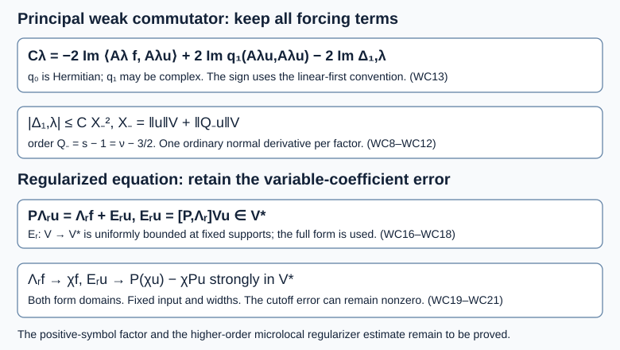

# The weak commutator and the variable-coefficient regularizer error

*AN04-U062. Receiving exposition by GPT-6.1 Sol (OpenAI), Ultra. Original eligible new expression is CC0-1.0. *

A positive-commutator proof has an algebraic side as well as a positive-symbol side. The algebra must use the actual weak boundary realization, include complex lower terms and keep a variable-coefficient regularizer commutator. This chapter proves those identities, sharpens the lower-term localization remainder to the exact induction scale, and proves convergence of the regularized forcing in the natural dual space. The positive-symbol decomposition and its uniform norm estimate are the next obligations.

The complete current [local boundary actions and commutators](../20261005-local-boundary-calculus/boundary-tests-and-lacunary-symbols.md), [actual adjoints, composition and distribution actions](../20261005-local-boundary-calculus/boundary-adjoints-composition-and-distributions.md), [L2 and form-domain maps](../20261005-local-boundary-calculus/boundary-bounds-and-conormal-action.md), [positive-order half-space bounds](../20261005-positive-boundary-orders/positive-order-halfspace-bounds.md), and [proper global calculus](../20261005-global-boundary-operators/global-boundary-operator-calculus.md) supply these earlier AN-03 proofs with their current foundations. We use their existing proofs directly. The [weak-form chapter](../20261007-restored-boundary-form/boundary-form-localization.md), [uniform-family chapter](../20261007-restored-uniform-microsupport/uniform-microsupport-and-dual-sources.md), [balanced-pair chapter](../20261007-restored-sharp-form/sharp-boundary-form-defect.md) and [regularizer chapter](../20261007-restored-quadratic-normal-regularizer/quadratic-normal-errors-and-regularization.md) supply the exact receiving interfaces.

The proof map gives exact versions and locators. Elementary inputs are the [complete measure/L2 proofs](../20261004-free-intrinsic-graph/prerequisites/measure-and-l2.md), [Hilbert representation and actual adjoints](../20261004-free-canonical-composition/compactness-and-essential-norms.md), [closed-subspace projection proof H1](../20261005-mixed-halfspace-foundations/halfspace-support-and-duality.md), and [elementary differential and cutoff proofs](../20261004-free-stationary-phase/proof-map.html). The regularizer lesson supplies its complete countable-basis construction. Every linked component retains its stated terms.

Vasy's freely readable [paper](https://math.stanford.edu/~andras/psmcrrb.pdf), complete Lemma 2.8 on PDF pages 14–15 and the commutator/test discussion on pages 37–38, supplies the primary route. Its stationary special case does not justify discarding the regularizer commutator for variable coefficients. The proofs and exercises below are newly written; external proof-paper expression and images are not reproduced.

## 1. Keep the actual weak realization and its Hermitian principal part

Let \(X=[0,\infty)_x\times\mathbb R^{n-1}_z\), \(D_j=-i\partial_j\), with normal index \(n\). Functions take values in a fixed \(\mathbb C^m\). Use Lebesgue measure and the inner product linear in the first argument. Choose \(V=H^1_0(X;\mathbb C^m)\) or \(V=H^1(X;\mathbb C^m)\), with the usual energy norm and continuous antidual \(V^*\).

Take smooth bounded matrix coefficients, with bounded derivatives on the larger compact patches used below, and define

\[
 \begin{split}
 q_0(u,w)&=\sum_{i,j}(g_{ij}D_ju,D_iw),\qquad g_{ij}^*=g_{ji},\\
 q_1(u,w)&=\sum_j(\ell_jD_ju,w)+\sum_i(m_i u,D_iw)+(cu,w),\\
 q&=q_0+q_1,\qquad \langle Pu,w\rangle=q(u,w)\quad(u,w\in V).
 \end{split}
 \tag{WC1}
\]

The principal form is Hermitian and can be indefinite; \(q_1\) need not be Hermitian. \(P:V\to V^*\) is the bounded weak realization, including its natural weak Neumann data if that domain is chosen. Similarly \(P_0:V\to V^*\) is defined by \(q_0\). These definitions require no strong boundary derivative condition on a localized input. In particular \(P_0\) is not being identified with a strong Neumann operator acting on arbitrary H1 functions.

### 1.1. Bounded forms, actual derivatives and fixed supports

For each coefficient use its matrix operator norm. Cauchy–Schwarz bounds (WC1) by \(C_q\|u\|_V\|w\|_V\), where one may take \(C_q\) to be the sum of the supremum norms of all displayed coefficient matrices. Each ordinary derivative and the inclusion \(V\to L^2\) have norm at most one for the stated energy norm. This proves \(P:V\to V^*\) is bounded; omitting the lower coefficients gives the same assertion for \(P_0\). Conjugate \(q_0(w,u)\), use \(g_{ij}^*=g_{ji}\), and interchange the two finite indices to obtain \(q_0(u,w)\). No positivity is used.

All ordinary derivatives are the intrinsic weak derivatives in the restricted distribution space on the Neumann form domain. On the Dirichlet form domain they also equal derivatives of the supported H1 zero extension, by interior-test density. Use the exact supported or restricted b-actions of U059 Section 1.1 throughout; boundary source functionals remain in the full antidual.

Mixed coefficient families in Section 3 have common compact input and output localizations, as do the localizers in Section 1. Auxiliary parametrices are properly supported, with all norm estimates on fixed compact patches containing the supports of the finite compositions. Fix these patches and their cutoffs before varying either family parameter. The identity term is the stated exception to compact support. Derivatives of fixed cutoffs enter the full lower operators. Every norm bound uses finite symbol and residual seminorms on these common patches; properness alone on an unbounded base would not supply that bound. These are exactly the hypotheses of U059's mixed localization proof.

Let \(Pu=f\), with \(u\in V,f\in V^*\). Let \(\{A_\lambda\}\) be scalar componentwise b-operators, bounded at target order \(s\), with common compact kernel support and full uniform microsupport in a compact \(K\). Each individual operator has nonpositive order. The actual \(L^2\) adjoint preserves either form domain, and

\[
 M_\lambda=A_\lambda^*A_\lambda,\qquad
 v_\lambda=A_\lambda u,\qquad
 S_\lambda=\langle f,M_\lambda u\rangle
            =\langle A_\lambda f,v_\lambda\rangle
 \tag{WC2}
\]

are legal. The source equality is an antidual identity, not an assumed L2 pairing with \(f\).

For an order-zero individual b-operator \(B\), its dual action is
\(\langle Bh,w\rangle=\langle h,B^*w\rangle\).
This convention defines the actual weak commutator
\[
 \langle[P_0,B]_{\!V}u,w\rangle
 =q_0(Bu,w)-q_0(u,B^*w).
 \tag{WC3}
\]
On interior smooth tests it agrees with the differential expression commutator. On the weak Neumann domain it retains whatever boundary contribution this form identity specifies.

## 2. The exact principal commutator, with the correct sign

Since \(M_\lambda^*=M_\lambda\) as an actual L2 operator, define the real number

\[
 \mathcal C_\lambda
 =i\big(q_0(u,M_\lambda u)-q_0(M_\lambda u,u)\big)
 =-2\,\operatorname{Im}q_0(u,M_\lambda u).
 \tag{WC4}
\]

It is the weak pairing associated with \(i[M_\lambda,P_0]\). The sign follows from the linear-first convention and the Hermitian principal form: the second value in parentheses is the complex conjugate of the first.

Put \(C_j^M=[D_j,M]\) and \(K_{ij}^M=[g_{ij},M]\), suppressing the parameter. An exact expression is

\[
 \mathcal C
 =i\sum_{i,j}\big[
   -(K_{ij}^M D_ju,D_i u)
   +(g_{ij}D_ju,C_i^M u)
   -(g_{ij}C_j^M u,D_i u)\big].
 \tag{WC5}
\]

**Full proof.** In \(q_0(u,Mu)\), substitute \(D_iMu=M D_i u+C_i^M u\). Moving only the actual L2 adjoint of \(M\) gives its leading term \((M g_{ij}D_ju,D_i u)\). In \(q_0(Mu,u)\), substitute \(D_jMu=M D_j u+C_j^M u\). Subtracting the leading terms gives \(([M,g_{ij}]D_ju,D_i u)=-(K_{ij}^M D_ju,D_i u)\). The two remaining terms are those of (WC5). Every factor is in L2 for the individual parameter. Multiply by \(i\). The identity holds directly for \(u\in V\), using the adopted commutator maps, or by V-density. No ordinary normal derivative is moved between factors.

The full calculus gives

\[
 K_{ij,\lambda}^M\in\Psi_b^{2s-1},\qquad
 C_{j,\lambda}^M=U_{j,\lambda}
                 +\mathbf1_{j=n}V_\lambda D_x,\qquad
 U_{j,\lambda}\in\Psi_b^{2s},\quad V_\lambda\in\Psi_b^{2s-1}.
 \tag{WC6}
\]

These are uniform orders with full uniform microsupport in \(K\). Individual coefficients have nonpositive order, with the individual normal coefficient at most order minus one. The order drop in \(K_{ij}^M\) uses the scalar componentwise principal symbol of \(M\); it is not valid for an arbitrary noncommuting matrix localizer. Formula (WC6) retains every quantization and actual-adjoint remainder. Substitution into (WC5) yields coefficient operators before at most one ordinary derivative on each input. It contains both zero/one-derivative pairings and one/one-derivative pairings. Calling the whole expression a b-operator and ignoring the ordinary normal derivatives would change the asserted map.

The weak equation supplies

\[
 \mathcal C_\lambda
 =-2\operatorname{Im}S_\lambda
       +2\operatorname{Im}q_1(u,M_\lambda u).
 \tag{WC7}
\]

This identity concerns the Hermitian principal commutator. The full operator \(P\) need not be self-adjoint, so the full commutator cannot be replaced by a principal-only source identity without the last term.

## 3. Balance an arbitrary order gap

We need one refinement of (SF7). Use \(\mathcal M_a\) in its exact mixed meaning:
a finite sum of coefficients in \(\Psi_b^a\) before ordinary derivatives, plus a zero-derivative coefficient in \(\Psi_b^{a+1}\), all with the full uniform microsupport in \(K\).
Suppose \(F_\lambda\in\mathcal M_a\), \(H_\lambda\in\mathcal M_b\), and every coefficient in the displayed initial expressions has individual nonpositive order. Let \(Q\) be a fixed scalar elliptic tester of order \(k=(a+b)/2\) near \(K\), with \(Qu\in V\). Then

\[
 |(F_\lambda u,H_\lambda u)|
 \le C_{F,H}\big(\|u\|_V+\|Qu\|_V\big)^2 .
 \tag{WC8}
\]

**Full proof.** Conjugate and interchange the two factors if necessary to assume \(a\le b\). Choose a fixed scalar \(L\) of order \((a-b)/2\le0\), and its right parametrix \(L_+\) of order \((b-a)/2\), with \(LL_+=I+E_L\) and full microsupport of \(E_L\) disjoint from \(K\). Left composition changes coefficient orders only. Thus \(L_+F\) and \(L^*H\) both belong to \(\mathcal M_k\), and (SF5) bounds their L2 values by constants times \(X_k=\|u\|_V+\|Qu\|_V\).

The exact distributional identity \(F u=LL_+F u-E_LF u\) consists of L2 values here: \(L\) is L2 bounded, and the mixed localization lemma supplies the middle value. Pairing with \(Hu\) gives
\((Fu,Hu)=(L_+Fu,L^*Hu)-(Fu,E_L^*Hu)\).
For the error, write \(F=\sum_i F_iD_i+F_0\). Move only the actual coefficient adjoints to obtain
\(\sum_i(D_i u,F_i^*E_L^*Hu)+(u,F_0^*E_L^*Hu)\).
Separation makes every coefficient of \(E_L^*H\) uniformly residual; finite-order left composition with \(F_i^*,F_0^*\) preserves that property. There remains at most one ordinary derivative on the input of each such expression. Its output is bounded by \(C\|u\|_V\), by (SF5)'s residual case. All original coefficient-adjoint moves are legal because of their individual nonpositive orders. Cauchy–Schwarz bounds the error by \(C_E\|u\|_V^2\). This proves (WC8), including the unequal-gap case. If \(a=b\), the same proof can simply take \(L=L_+=I,E_L=0\).

**Realization and legality of the balance.** If \(a<b\), set \(d=(b-a)/2>0\). In the fixed compressed cosphere patch choose a scalar order-\(-d\) principal symbol equal to \(\langle\xi\rangle^{-d}\) near \(K\), using a conic cutoff equal to one there and a smooth low-frequency extension. The proper realization proof and its ordered right-parametrix construction supply actual \(L,L_+\), with all cutoff and asymptotic remainders in \(E_L=LL_+-I\). This is a right parametrix because the factor \(L\) stands on the left. Its error and the actual adjoint error have separated full microsupport. The same construction includes negative or positive mean order \(k\); only \(L\)'s order is constrained to be nonpositive.

In the chosen initial expansions, \(Fu\) and \(Hu\) are L2. The full mixed localization lemma gives \(z=L_+Fu\in L^2\), even if the displayed coefficients of \(L_+F\) have positive individual order. Distributional composition gives \(Lz=Fu+E_LFu\), and the residual-coefficient bound makes the last term L2. Thus \((Lz,Hu)=(z,L^*Hu)\) is an actual bounded L2 adjoint identity. The other adjoint move is \((E_LFu,Hu)=(Fu,E_L^*Hu)\), since \(E_L\) is order zero. Finally the coefficient-only expansion bounds each tail without placing two ordinary normal derivatives on any factor. This verifies the displayed pairing identity on the stated domains, without assuming graph-norm approximation for a positive-order coefficient.

The lemma does not require the transformed positive-order coefficients to have individual nonpositive order: their L2 values were supplied by (SF5) and the tester hypothesis. It does require that condition for the displayed initial coefficient-adjoint moves. Matrix coefficients and their multiplication order remain allowed throughout.

## 4. The complete lower-term defect has the exact induction order

Define \(\Delta_{1,\lambda}=q_1(v_\lambda,v_\lambda)-q_1(u,M_\lambda u)\).
Use \(K_{h,\lambda}=[h,A_\lambda]\), \(C_j^A=[D_j,A]\), and \(C_i^{A^*}=[D_i,A^*]\). The lower-term portion of the exact defect (BF9) is

\[
 \begin{split}
 \Delta_1={}&\sum_j\big[(K_{\ell_j}D_ju,v)+(\ell_j C_j^Au,v)\big]\\
 &+\sum_i\big[(K_{m_i}u,D_iv)-(m_i u,C_i^{A^*}v)\big]
 +(K_cu,v).
 \end{split}
 \tag{WC9}
\]

Let \(Q_-\) be a fixed scalar tester of order \(s-1\), elliptic near \(K\), and assume

\[
 X_-=\|u\|_V+\|Q_-u\|_V<\infty .
 \tag{WC10}
\]

Then every complex lower coefficient and every actual normal commutator remainder satisfies

\[
 |\Delta_{1,\lambda}|\le C_1 X_-^2
 \quad\hbox{uniformly in }\lambda .
 \tag{WC11}
\]

**Full proof.** The scalar localizer gives \(K_h\in\Psi_b^{s-1}\). The exact commutator \(C_j^A\) lies in \(\mathcal M_{s-1}\), while \(A\) as a zero-derivative expression lies in \(\mathcal M_{s-1}\). Consequently both \(\ell_j\) pairings in (WC9) are covered by (WC8) with \(a=b=s-1\).

The zero-derivative expression \(K_{m_i}\) has coefficient order \(s-1\), hence belongs to \(\mathcal M_{s-2}\). The other factor \(D_iA\) belongs to \(\mathcal M_s\). Their mean order is exactly \(s-1\); apply (WC8).

For the remaining \(m_i\) term, write \(C_i^{A^*}=\widetilde U_i+\mathbf1_{i=n}\widetilde V D_x\), with coefficient orders \(s,s-1\). Move only these coefficient adjoints:
\[
 (m_i u,\widetilde U_iAu)=(\widetilde U_i^*m_i u,Au),\qquad
 (m_nu,\widetilde V D_xAu)=(\widetilde V^*m_nu,D_xAu).
 \tag{WC12}
\]
In the first pairing both factors lie in \(\mathcal M_{s-1}\). In the second they lie in \(\mathcal M_{s-2}\) and \(\mathcal M_s\). Finally \(K_c\) has zero-derivative order \(s-1\) and embeds into \(\mathcal M_{s-1}\); pair with \(A\) in the same class. All coefficients initially moved have individual nonpositive order. All families keep full uniform microsupport in \(K\). Applying (WC8) to the finite list proves (WC11).

Combining (WC7) and (WC9) gives the exact forcing identity

\[
 \boxed{\ 
 \mathcal C_\lambda
 =-2\operatorname{Im}\langle A_\lambda f,v_\lambda\rangle
    +2\operatorname{Im}q_1(v_\lambda,v_\lambda)
    -2\operatorname{Im}\Delta_{1,\lambda} .\ }
 \tag{WC13}
\]

In particular

\[
 |\mathcal C_\lambda|
 \le 2|S_\lambda|+2|q_1(v_\lambda,v_\lambda)|+2C_1X_-^2 .
 \tag{WC14}
\]

*Figure WC-F1.* Exact identity and map diagram for (WC13), (WC16)–(WC21), with \(\nu=s+1/2\) and \(X_-\) defined in (WC10). It describes the two form domains and their antiduals, not a Hamilton trajectory. Its complete arguments are Sections 2–5. No positive-symbol estimate or higher-order microlocal forcing bound is asserted. Vasy's freely readable Lemma 2.8 and Section 6 supply the credited primary route.

The full lower form on \(v_\lambda\) stays in this inequality. Coarsely, its first-order terms are at most \(C_{\ell,m}\|v_\lambda\|_V\|v_\lambda\|\), and its zeroth term at most \(\|c\|_\infty\|v_\lambda\|^2\). These are finite estimates, not permission to absorb an H1 norm into an unproved positive L2 estimate. The ensuing positive-symbol construction must compare the commutant \(A_\lambda\) with its positive output factor.

If that factor has target order \(\nu=s+1/2\), the tester in (WC10) has order \(s-1=\nu-3/2\). This is precisely the lower solution order in (QR1). Thus the lower-term defect now fits the normal-error induction scale without adding an unstated half-order of regularity.

## 5. The full weak regularizer error and its strong dual limit

Use the actual \(\Lambda_r\) of (QR17)–(QR20), taking its fixed base cutoffs real. Write their product as \(\chi\), so \(\Lambda_0=\chi=\chi^*\). All spatial widths are fixed in this section. The family is uniformly order zero; each \(r>0\) has its stated individual negative order. Both \(\Lambda_r,\Lambda_r^*\) preserve \(V\).

For any \(u,w\in V\), set

\[
 \mathcal E_r(u,w)=q(\Lambda_r u,w)-q(u,\Lambda_r^*w).
 \tag{WC15}
\]

With \(K_h=[h,\Lambda_r]\) and \(C_j=[D_j,\Lambda_r]\), its full expansion is

\[
 \begin{split}
 \mathcal E_r(u,w)={}&
 \sum_{i,j}\big[(K_{g_{ij}}D_ju,D_iw)
                +(g_{ij}C_ju,D_iw)
                -(g_{ij}D_ju,[D_i,\Lambda_r^*]w)\big]\\
 &+\sum_j\big[(K_{\ell_j}D_ju,w)+(\ell_jC_ju,w)\big]\\
 &+\sum_i\big[(K_{m_i}u,D_iw)-(m_i u,[D_i,\Lambda_r^*]w)\big]
 +(K_cu,w).
 \end{split}
 \tag{WC16}
\]

**Full proof.** Substitute \(D_j\Lambda_r u=\Lambda_rD_ju+C_ju\) in the first form and \(D_i\Lambda_r^*w=\Lambda_r^*D_iw+[D_i,\Lambda_r^*]w\) in the second. Move only the actual coefficient adjoint \(\Lambda_r^*\). The principal leading difference is \([g_{ij},\Lambda_r]D_ju\); the other two terms remain exactly as displayed. Doing the same substitution in the \(\ell,m,c\) parts gives the last three lines. All factors are L2 because the individual order-zero maps and normal commutator maps are legal on H1. This proves (WC16) with no strong boundary condition or discarded coefficient derivative.

Uniform calculus at order zero gives \(K_h\in\Psi_b^{-1}\),
\(C_j=U_j+\mathbf1_{j=n}V_rD_x\), \(U_j\in\Psi_b^0,V_r\in\Psi_b^{-1}\), and the same assertion for the actual adjoint commutator. Every family is bounded at its asserted order. After moving just the adjoints of \(U_j,V_r\) where needed, (WC16) contains principal one/one-derivative pairings with order-minus-one coefficients, and principal one/zero-derivative pairings with order-zero coefficients. Lower terms have no greater orders or derivative counts. In particular

\[
 |\mathcal E_r(u,w)|\le C_{\rm reg}\|u\|_V\|w\|_V,\qquad
 \mathcal E_r u=[P,\Lambda_r]_{\!V}u\in V^*
 \tag{WC17}
\]

uniformly in \(r\) at the fixed supports. This is a weak commutator map. It does not assert that \(P\Lambda_r u\) is an ordinary L2 function.

For a weak solution the exact regularized equation is

\[
 P\Lambda_r u=\Lambda_r f+\mathcal E_r u\quad\hbox{in }V^*.
 \tag{WC18}
\]

Thus treating \(\Lambda_r u\) as a solution with source only \(\Lambda_r f\) would lose an actual forcing term.

We next prove strong convergence in the source space. The construction (QR19) and continuity of the actual adjoint map give \(\Lambda_r^*-\chi=O(\sqrt r)\) in \(\Psi_b^1\), with uniform order-zero maps. The complete density proof of (QR20), applied to this adjoint family, gives \(\Lambda_r^*a\to\chi a\) in \(V\) for every \(a\in V\). Also \(\Lambda_r a\to\chi a\) in L2 for every \(a\in L^2\): prove this on the dense smooth test class using the order-one \(H^1\to L^2\) map, and extend by the uniform order-zero L2 bound.

**Density fact needed for the dual limit.** The natural embedding \(J:L^2\to V^*\), \(Jg(w)=(g,w)_{L^2}\), has dense image. Here is a Hilbert proof. A separable Hilbert space has a countable orthonormal basis, as proved for \(V\) in U061. For a continuous antilinear functional \(h\), its coefficients \(h(e_j)\) have squared finite sums at most \(\|h\|^2\): test \(h\) against \(\sum_{j\le N}h(e_j)e_j\). Their series constructs a vector \(R h\) with \(h(w)=(Rh,w)_V\) by finite-span approximation, and \(\|Rh\|_V=\|h\|_{V^*}\). This proves the Hilbert representation used here.

**The Hilbert structure of the antidual.** The representing map \(R\) is linear: apply uniqueness to the functional identity for a linear combination. It is onto \(V\), since \(w\mapsto(v,w)_V\) is a bounded antilinear functional for each \(v\in V\), with norm \(\|v\|_V\) by Cauchy–Schwarz and testing on \(v/\|v\|_V\) when \(v\ne0\). Define \((h_1,h_2)_{V^*}=(Rh_1,Rh_2)_V\). This gives the stated norm and completeness: a Cauchy sequence of representatives converges in \(V\), and its limit represents the antidual limit. The countable-basis proof above therefore supplies the full Hilbert structure used in the following projection argument, also for the zero functional.

If the closure of \(J(L^2)\) were a proper subspace of the Hilbert space \(V^*\), a nonzero orthogonal vector \(h\) would exist. Indeed, for a closed subspace, minimizing the squared distance produces an orthogonal remainder: the parallelogram identity makes a minimizing sequence Cauchy, and variation by each subspace vector gives orthogonality. Write \(v=Rh\). Orthogonality to \(Jg\) is \((v,RJg)_V=0\), whereas \((RJg,v)_V=(g,v)_{L^2}\). Conjugation then forces \((v,g)_{L^2}=0\) for every \(g\in L^2\), so \(v=0\) and \(h=0\), a contradiction. This proves density for both form domains, including boundary-source functionals in the weak Neumann antidual.

The dual maps are uniformly bounded because \(\Lambda_r^*:V\to V\). For \(g\in L^2\), the antidual action satisfies \(\Lambda_r Jg=J(\Lambda_r g)\), by the actual L2 adjoint identity. The just-proved L2 convergence thus gives convergence on this dense image. For arbitrary \(h\in V^*\), approximate it by \(Jg\) and use the uniform dual bound, exactly as in (QR21). **Quantified passage from the dense image.** Write \(C_\Lambda=\sup_r\|\Lambda_r\|_{V^*\to V^*}\) and \(C_\chi=\|\chi\|_{V^*\to V^*}\), finite by the actual adjoint maps. The inclusion \(J\) has norm at most one. For any \(g\in L^2\), the difference \((\Lambda_r-\chi)h\) has norm at most the sum of \((C_\Lambda+C_\chi)\|h-Jg\|_{V^*}\) and \(\|(\Lambda_r-\chi)g\|_{L^2}\). First make the first term small by the proved density, then use strong L2 convergence for that fixed \(g\). If both operator constants vanish the conclusion is immediate. This is convergence for every antidual element, including weak Neumann boundary sources. It does not infer norm convergence of adjoints merely from strong convergence on \(V\); the dense L2 image supplies the necessary additional argument. We obtain

\[
 \Lambda_r h\longrightarrow\chi h\quad\hbox{in }V^*
 \qquad(h\in V^*).
 \tag{WC19}
\]

Since \(P:V\to V^*\) is bounded, (QR20) and (WC19), applied to \(Pu\), give the strong commutator limit

\[
 \mathcal E_r u
 =P\Lambda_r u-\Lambda_r Pu
 \longrightarrow P(\chi u)-\chi Pu
 =\mathcal E_0 u\quad\hbox{in }V^* .
 \tag{WC20}
\]

The limit is the cutoff commutator, not automatically zero. For a weak solution, (WC18) therefore converges to the exact equation

\[
 P(\chi u)=\chi f+\mathcal E_0 u.
 \tag{WC21}
\]

This proves convergence for a fixed \(u\) in the unweighted natural dual norm. It does not supply the higher-order, microsupported commutator estimate needed after a positive-order target tester is applied. Nor does it permit a width-dependent cutoff to vary during this strong-limit argument. Those distinctions preserve the remaining analytic work.

## 6. Three graded exercises and complete solutions

**Exercise 1 — The sign and a complex lower term (intermediate, 6 points).** On the half-line use \(q_0(u,w)=\int u'\overline{w'}\), \(q_1(u,w)=ic(u,w)\), with real \(c\). Let \(A\) multiply by real \(\chi\in C_c^\infty((1,2))\), and let \(u=\theta e^{(a+ib)x}\), with real nonzero \(a,b\) and real compact interior \(\theta=1\) near \(\operatorname{supp}\chi\). Define \(f=Pu\) in the weak form. Compute \(\mathcal C\), and check that the constant complex lower term cancels correctly in (WC13).

**Solution.** The imaginary part of \(q_0(u,\chi^2u)\) is \(2b\int\chi\chi'e^{2ax}\,dx\). Compact interior support permits integration of the scalar product:
\(\int\chi\chi'e^{2ax}=-a\int\chi^2e^{2ax}\).
Consequently
\[
 \mathcal C=4ab\int\chi^2e^{2ax}\,dx,\quad
 \operatorname{Im}S=-2ab\int\chi^2e^{2ax}+c\|Au\|^2.
 \tag{WC22}
\]
Since \(cI\) commutes with \(A\), \(\Delta_1=0\), while \(\operatorname{Im}q_1(Au,Au)=c\|Au\|^2\). The two occurrences of \(c\) in (WC13) cancel, leaving (WC22). Using \(+2\operatorname{Im}S\), or dropping the displayed lower form, would give a wrong identity. Both form domains admit this interior \(u\); this elementary form calculation is not a wave propagation theorem.

**Exercise 2 — Check the induction gap (foundation, 5 points).** Suppose \(K_m\) has order \(s-1\) as a zero-derivative coefficient, while \(D_iA\in\mathcal M_s\). Find the tester order for their pairing. Do the same for the ordinary normal part in (WC12), and specialize to \(s=11/6\) and \(\nu=s+1/2\).

**Solution.** A zero-derivative coefficient of order \(s-1\) belongs to \(\mathcal M_{s-2}\). Pairing with \(\mathcal M_s\) has mean \((s-2+s)/2=s-1\). The normal coefficient \(\widetilde V^*m_n\) also has zero-derivative order \(s-1\), while its paired \(D_xA\) is in \(\mathcal M_s\); the same answer follows without moving \(D_x\). For the numerical values, \(s-1=5/6\), \(\nu=7/3\), and
\[
 \nu-\tfrac32=\tfrac73-\tfrac32=\tfrac56=s-1.
 \tag{WC23}
\]
Thus the lower-term remainder needs exactly the lower solution tester already used for the normal errors. Invoking only the half-order-gap lemma at this step would impose an avoidable extra half-order hypothesis.

**Exercise 3 — A variable coefficient prevents commutation (intermediate, 7 points).** On the periodic interior model take \(D=-i\partial_t\), \(P=D(1+\eta\cos t)D\), \(0<\eta<1\), and let \(\Lambda_r\) multiply mode \(e_n\) by \(m_r(n)=(1+r(1+n^2))^{-L/2}\), \(L\ge1\). Compute \([P,\Lambda_r]e_n\), show it is nonzero for \(n=1,r>0\), and explain its limit as \(r\downarrow0\).

**Solution.** Multiplication by \(\cos t\) shifts an orthonormal mode by one in either direction, and \(De_n=ne_n\). Retaining the derivative of the coefficient gives
\[
 Pe_n=n^2e_n+\tfrac{\eta}{2}n(n+1)e_{n+1}
                       +\tfrac{\eta}{2}n(n-1)e_{n-1}.
 \tag{WC24}
\]
Subtracting \(\Lambda_rPe_n\) from \(P\Lambda_re_n\) gives
\[
 [P,\Lambda_r]e_n
 =\tfrac{\eta}{2}n(n+1)\big(m_r(n)-m_r(n+1)\big)e_{n+1}
 +\tfrac{\eta}{2}n(n-1)\big(m_r(n)-m_r(n-1)\big)e_{n-1}.
 \tag{WC25}
\]
For \(n=1\) the last coefficient is zero, and the first is \(\eta(m_r(1)-m_r(2))>0\), since the multiplier strictly decreases with positive \(|n|\). At each fixed mode both differences tend to zero as \(r\downarrow0\). This example has \(\chi=1\), so its limiting cutoff commutator is zero. The boundary construction has fixed compact cutoffs and generally has the nonzero limit (WC20). Positivity of \(1+\eta\cos t\) does not make the finite-\(r\) commutator vanish.

## 7. What remains before the positive estimate

The exact weak principal commutator, source sign and complex lower form are established in (WC4)–(WC14). The complete lower-term defect is controlled at \(s-1=\nu-3/2\). The full variable-coefficient regularizer error is retained in (WC16)–(WC18), and its fixed-input natural-dual limit is proved in (WC19)–(WC21).

To obtain the uniform positive norm hypothesis needed by U061, the programme must still construct the compensated glancing symbol, factor its positive principal term into actual operators, control all incoming and elliptic cutoff terms, compare the commutant with its positive output factor, and estimate the regularizer error at the higher microlocal source order. The [normal-energy chapter](../20261007-restored-glancing-normal-operator/glancing-normal-energy-and-operator-errors.md), its actual linear error, and U061's quadratic error remain the analytic inputs for those steps. The general parabolic criterion RW4 remains unproved.

The full native assignment, including systems, crossings, general glancing and complex phase, remains active. Physical-corner analytic input and further pertinent, nonduplicative source integration remain unfinished. The current transitive provider chain is in the proof map. 

## Sources and contribution

Vasy's Lemma 2.8 supplies the ordinary-normal commutator route, and his Section 6 supplies the regularized-test context. The variable-coefficient weak equation here retains its full forcing error. Each used result has its exact programme proof, including the valid Hörmander III antecedent in the local boundary calculus. Citations give credit and never replace a proof. GPT-6.1 Sol (OpenAI), Ultra, wrote the preserved receiving argument, three complete solutions and original diagram. GPT-6 Astra (OpenAI), Ultra, restored current providers and made the common support hypotheses, ordered parametrix actions and complete antidual-limit argument explicit. This independent exposition and original diagram are CC0-1.0; linked components retain their own terms.   
