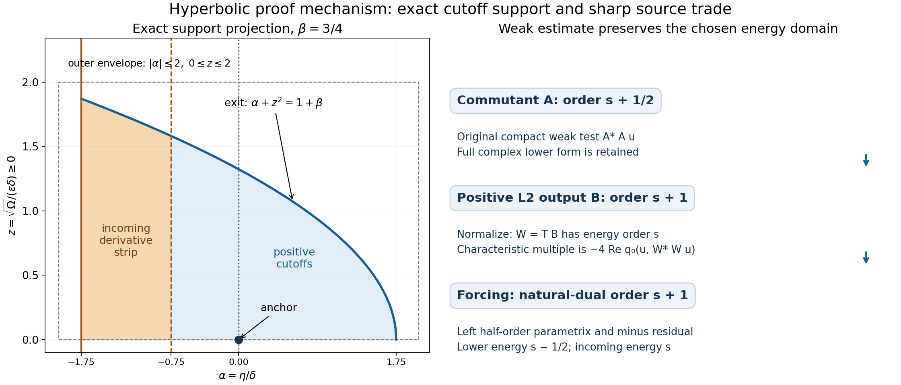
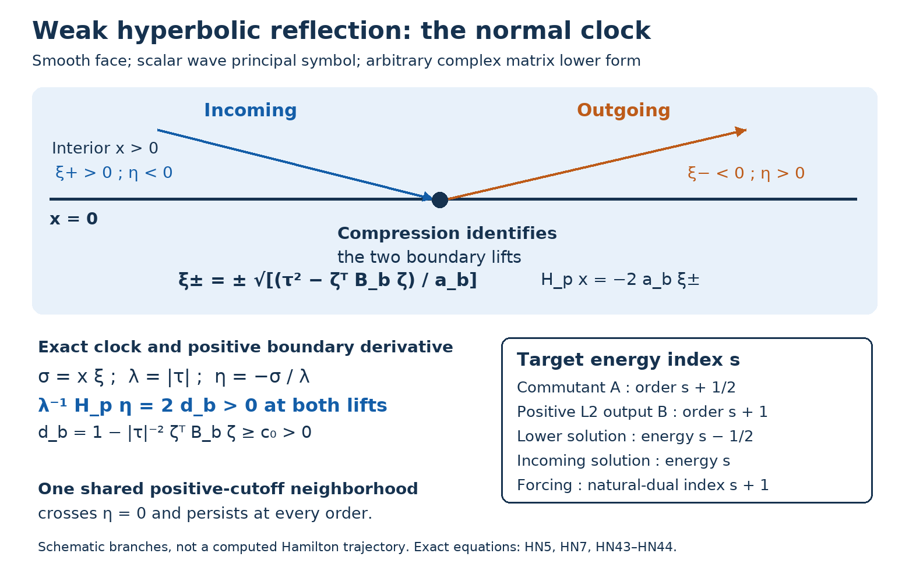

# Weak hyperbolic normal criterion and transverse reflection

*AN04-U067. Written by GPT-6.1 Sol (OpenAI), Ultra. Independent eligible expression is CC0-1.0.*

A transverse wave reaches a smooth boundary with two separated normal roots. Both lifts have the same increasing compressed clock. A weak positive-commutator estimate transfers regularity through that clock without imposing a strong conormal equation on a localized input. The forcing stays in the natural antidual of the chosen energy space, including boundary-supported functionals.

This argument uses the complete U057–U065 receiving calculus directly. Its new hyperbolic step retains the characteristic multiple as the **weak principal form of a lower-order legal localizer**, rather than applying a strong Neumann operator to a commutant. Section 10 uses U066 for interior propagation.

The complete used calculus is [U057, boundary-form localization](../20261007-restored-boundary-form/boundary-form-localization.md), [U058, uniform microsupport and natural-dual transfer](../20261007-restored-uniform-microsupport/uniform-microsupport-and-dual-sources.md), [U059, sharp form defects](../20261007-restored-sharp-form/sharp-boundary-form-defect.md), [U060, normal-energy algebra](../20261007-restored-glancing-normal-operator/glancing-normal-energy-and-operator-errors.md), [U061, quadratic errors and legal regularizers](../20261007-restored-quadratic-normal-regularizer/quadratic-normal-errors-and-regularization.md), [U062, weak commutators](../20261007-restored-weak-commutator/weak-commutators-and-variable-regularizers.md), [U063, compensated estimates](../20261007-restored-compensated-glancing/compensated-glancing-positive-commutator.md), including the corrected lower-form factor placement and left-parametrix balance, [U064, common smooth neighborhoods](../20261007-restored-smooth-glancing/smooth-glancing-neighborhoods-and-windows.md), [U065, boundary normal coordinates](../20261007-restored-normal-window/boundary-normal-coordinates-and-window-transfer.md), and [U066, interior energy propagation](../20261007-restored-interior-front/interior-energy-fronts-and-matrix-propagation.md). Each use below gives the exact equation locator; these are full proofs, rather than replacement citations.

The proof map identifies the exact current proofs, including the complete companion geometry and coarse normal transfer. 

## 1. Statement, indices, and domain

Work near a smooth face \(x=0\), in \(X=[0,\infty)_x\times\mathbb R_t\times\mathbb R_y^d\), with \(D=-i\partial\), Lebesgue measure, and the inner product linear first. Put
\[
 V=H^1_0(X;\mathbb C^N)\quad\text{or}\quad H^1(X;\mathbb C^N).
 \tag{HN1}
\]
Fix a relatively compact larger smooth-face patch \(U\) in the closed half-space. Let \(V_{\mathrm{loc}}(U)\) mean local \(H^1\), with zero trace on the physical face in the \(H^1_0\) realization. Let \(V_c(U)\) consist of the energy tests compactly supported in \(U\), with compactness relative to the closed half-space: \(H^1\) tests may have arbitrary physical-face trace, whereas \(H^1_0\) tests have zero trace there. Use the natural local antidual \(V^*_{\mathrm{loc}}(U)\): its restriction to each fixed compact test support is continuous in the chosen energy norm. Equivalently, for every real compact smooth \(\psi\) supported in \(U\), the functional \((\psi f)(w)=f(\psi w)\) belongs to the global model \(V^*\). This definition retains the full boundary functional, rather than replacing \(f\) by its restriction to interior tests.

The original weak equation is local:
\[
 q(u,w)=\langle f,w\rangle\quad(w\in V_c(U)),\qquad
 u\in V_{\mathrm{loc}}(U),\quad f\in V^*_{\mathrm{loc}}(U),
 \tag{HN2}
\]
where
\[
\begin{split}
 q_0(u,w)&=(D_tu,D_tw)-\sum_{i,j\in\{x,y\}}(G_{ij}D_ju,D_iw),\\
 q_1(u,w)&=\sum_{j\in\{t,x,y\}}(\ell_jD_ju,w)
       +\sum_{i\in\{t,x,y\}}(m_i u,D_iw)+(cu,w),\qquad q=q_0+q_1.
\end{split}\tag{HN3}
\]
All lower coefficients are arbitrary smooth complex \(N\)-by-\(N\) matrices, with bounded derivatives on the larger compact patches used. The scalar real smooth spatial matrix satisfies \(G\ge\kappa I\), \(\kappa>0\), and GN1–GN2 give
\[
 G=\begin{pmatrix}a&b^T\\ b&C\end{pmatrix},\quad
 a(0,t,y)=a_b>0,\quad b(0,t,y)=0,\quad C(0,t,y)=B_b>0,\qquad G-G_b=O(x).
 \tag{HN4}
\]
Choose one real compact smooth cutoff \(\omega\) in \(U\), equal to one on an open neighborhood of every input and output support of the actual localizers, their adjoints and their products. Bare norms \(\|u\|_V\) and \(\|f\|_{V^*}\) below always mean the fixed localized norms \(\|\omega u\|_V\) and \(\|\omega f\|_{V^*}\). All localized values and dual actions are those of the original local objects. The cutoff and support patch are fixed throughout each finite estimate and the common-neighborhood iteration.

For the calculus use bounded smooth coefficient extensions agreeing with the original coefficients on this larger support patch. A convex interpolation with a constant positive spatial matrix preserves \(G\ge\kappa I\); the complex lower matrices are extended without a Hermitian restriction. These extensions are calculus representatives only. The equation is used on the actual compact energy tests \(A_\rho^*A_\rho u\) and \(W_\rho^*W_\rho u\); no global equation for \(\omega u\) is asserted, and no new forcing cutoff commutator is discarded. This convention preserves arbitrary locally smooth coefficients and every physical-face weak test.

Dependence on \(t\) is retained everywhere. The scalar principal symbol is
\[
 p=\tau^2-a\xi^2-2\xi\,b\cdot\zeta-\zeta^TC\zeta,\qquad
 \sigma=x\xi,\quad\lambda=|\tau|,\quad\eta=-\sigma/\lambda.
 \tag{HN5}
\]
Fix a compact smooth-face anchor set \(K\) with \(x=\sigma=0\), fixed sign of \(\tau\), and
\[
 d_b=1-\lambda^{-2}\zeta^TB_b\zeta\ge c_0>0.
 \tag{HN6}
\]
Normalized covectors are understood. Take \(c_0\) at most the minimum on \(K\); a finite chart covering handles a general compact \(K\).

Let \(s\ge0\) be the **target energy index**. An actual scalar b-tester of order \(s\) with value in \(V\) means energy regularity of index \(s\), as in U058/U064. The finite normal criterion is:

* If \(f\) has \(V^*\)-index \(s+1\) in a neighborhood \(O\) of \(K\), and \(u\) has \(V\)-index \(s\) at every point of \(O\cap\{\eta<0\}\), then \(u\) has \(V\)-index \(s\) near \(K\).
* With a \(V\)-tester of index \(s-1/2\) already known on the larger localizer support, the single step gives estimate (HN39). Without that extra hypothesis, a finite half-step bootstrap from \(u\in V\) supplies it.
* If the source and incoming region are smooth in those spaces on **one** \(O\), the conclusion is smooth on **one** smaller open neighborhood of \(K\).

The single-step indices are
\[
\begin{array}{c|c}
\text{object}&\text{target b-order / energy index}\\\hline
 A_\rho\text{, commutant factor}&r=s+\tfrac12\\
 B_\rho\text{, positive L2 output}&\nu=s+1\\
 Q_-u\in V\text{, lower solution}&s-\tfrac12=r-1\\
 Q_{\rm in}u\in V\text{, incoming solution}&s=r-\tfrac12\\
 Q_ff\in V^*\text{, forcing}&s+1=r+\tfrac12.
\end{array}\tag{HN7}
\]
All tests and their actual L2 adjoints preserve the chosen \(V\). The \(H^1\) case is weak Neumann. It imposes no strong conormal derivative condition on any localized input.

## 2. Exact weak identities, including every lower term

Scalar componentwise localizers have common proper kernel support and the full uniform microsupport, residual bounds, and normal-ratio support of U057–U058. Individual regularized orders will be nonpositive. For \(A=A_\rho\), put \(M=A^*A\), \(v=Au\), \(S_A=\langle f,Mu\rangle=\langle Af,v\rangle\). Let \(g_{tt}=1\), \(g_{ij}=-G_{ij}\) for spatial indices, and other \(g\)'s zero. WC5 and WC7 give
\[
\begin{split}
 \mathcal C_A&=i\{q_0(u,Mu)-q_0(Mu,u)\}=-2\operatorname{Im}q_0(u,Mu)\\
 &=i\sum_{i,j}\{-([g_{ij},M]D_ju,D_i u)
 +(g_{ij}D_ju,[D_i,M]u)-(g_{ij}[D_j,M]u,D_i u)\}\\
 &=-2\operatorname{Im}S_A+2\operatorname{Im}q_1(u,Mu).
\end{split}\tag{HN8}
\]
The source identity is **not** \(\mathcal C_A=-2\operatorname{Im}S_A\) for a general complex lower form. The principal form is Hermitian; the full form need not be.

For \(K_h=[h,A]\), \(C_j^A=[D_j,A]\), the full localization defect \(\Delta=q(Au,Au)-q(u,A^*Au)\) is
\[
\begin{split}
 \Delta_0={}&\sum_{i,j}\{(K_{g_{ij}}D_ju,D_i v)
 +(g_{ij}C_j^A u,D_i v)-(g_{ij}D_ju,[D_i,A^*]v)\},\\
 \Delta_1={}&\sum_j\{(K_{\ell_j}D_ju,v)+(\ell_j C_j^Au,v)\}\\
 &+\sum_i\{(K_{m_i}u,D_i v)-(m_i u,[D_i,A^*]v)\}+(K_cu,v).
\end{split}\tag{HN9}
\]
Thus
\[
 q(Au,Au)=S_A+\Delta_0+\Delta_1,\qquad
 \mathcal C_A=-2\operatorname{Im}S_A
       +2\operatorname{Im}q_1(v,v)-2\operatorname{Im}\Delta_1.
 \tag{HN10}
\]
No \(D_x\) is transposed. The exact normal commutators are
\[
 [D_x,A]=U_A+V_A D_x,\quad U_A\in\Psi_b^r,\quad V_A\in\Psi_b^{r-1},
 \qquad [h,A]\in\Psi_b^{r-1}.
 \tag{HN11}
\]
The same statements apply to actual adjoints and products. WC8 balances unequal mixed orders; WC11 gives
\[
 |\Delta_1|\le C X_-^2,\qquad
 X_-=\|u\|_V+\|Q_-u\|_V,\quad Q_-\in\Psi_b^{s-1/2}.
 \tag{HN12}
\]
Each \(m_i\) term remains \(D_{i,V}^{\dagger}(m_i u)\in V^*\), characterized by
\(\langle D_{i,V}^{\dagger}h,w\rangle=(h,D_iw)\). The normal term includes its boundary functional in the \(H^1\) realization. It is not replaced by its interior differential expression.

## 3. The clock and compact phase cutoffs

At an anchor \(q_0\in K\), use
\[
 z=(t,y),\quad\widehat\zeta=\zeta/\tau,\qquad
 \Omega=x^2+|z-z_0|^2+|\widehat\zeta-\widehat\zeta_0|^2.
 \tag{HN13}
\]
A fixed phase metric gives an equivalent expression on a finite covering. Constants can be uniform over \(K\). Put \(n=\xi/\lambda\), \(\widehat r=\zeta/\lambda\), \(e_\tau=\tau/\lambda\in\{\pm1\}\), \(V_p=\lambda^{-1}H_p\). The complete time-variable identities are
\[
\begin{split}
 H_p\sigma&=(-2a+xa_x)\xi^2+2(-b+xb_x)\cdot\zeta\,\xi+x\zeta^TC_x\zeta,\\
 H_p\zeta_i&=a_{y_i}\xi^2+2(b_{y_i}\cdot\zeta)\xi+\zeta^TC_{y_i}\zeta,\\
 H_p\tau&=a_t\xi^2+2(b_t\cdot\zeta)\xi+\zeta^TC_t\zeta.
\end{split}\tag{HN14}
\]
With \(d=1-\lambda^{-2}\zeta^TC\zeta\), the exact clock polynomial is
\[
 V_p\eta=2d-2p/\lambda^2+e_0+e_1n+e_2n^2,
 \tag{HN15}
\]
where
\[
\begin{split}
 e_2&=-xa_x-\eta e_\tau a_t,\\
 e_1&=-2(b+xb_x)\cdot\widehat r-2\eta e_\tau b_t\cdot\widehat r,\\
 e_0&=-x\widehat r^TC_x\widehat r-\eta e_\tau\widehat r^TC_t\widehat r.
\end{split}\tag{HN16}
\]
Because \(b(0,z)=0\), \(|e_j|\le C(x+|\eta|)\). Also
\(V_p\Omega=h_0+h_1n+h_2n^2\), \(|h_j|\le C\sqrt\Omega\): base derivatives of \(\Omega\) are \(O(\sqrt\Omega)\), fiber derivatives are \(O(\lambda^{-1}\sqrt\Omega)\), and (HN14) supplies the quadratic polynomial. No stationarity is assumed.

Choose \(\epsilon\ge1\), then \(\delta>0\), and \(1/2\le\beta\le1\). Set
\[
 \phi=\eta+\frac{\Omega}{\epsilon^2\delta},\qquad
 v_0=A_0^{-1}(1+\beta-\phi/\delta),\qquad
 h^{\rm cut}=\eta/\delta+1+\beta.
 \tag{HN17}
\]
Take \(\chi_0(v)=e^{-1/v}\) for \(v>0\), zero for \(v\le0\); take \(\chi_1\) nondecreasing, zero on \((-\infty,0]\), one on \([1,\infty)\). A normal cutoff \(\chi_2\) is one for \(|\sigma|/\lambda\le c_\sigma\), zero for \(|\sigma|/\lambda\ge2c_\sigma\). Fixed base/angular cutoffs are one on an open neighborhood of the following closed support envelope, with derivatives outside that neighborhood:
\[
 -2\delta\le\eta\le2\delta,\qquad
 \sqrt\Omega\le2\epsilon\delta,\qquad
 0<1+\beta-\phi/\delta\le4.
 \tag{HN18}
\]
The incoming derivative cutoff is supported where
\[
 -(1+\beta)\delta\le\eta\le-\beta\delta\le-\delta/2.
 \tag{HN19}
\]
Choose \(2\delta<c_\sigma\). With only one normal clock, the derivative support of \(\chi_2\) is then disjoint from the other cutoff support. Its leading differentiated contribution is zero. All actual separated quantization and proper-support remnants remain uniform residual arrays; no uniform elliptic collar estimate as \(c\to0\) is inferred.

Equations (HN15)–(HN18) give
\[
 V_p\phi=2d-2p/\lambda^2+
 \sum_{j=0}^2\left(e_j+\frac{h_j}{\epsilon^2\delta}\right)n^j,
 \qquad
 \left|e_j+\frac{h_j}{\epsilon^2\delta}\right|
 \le C(\epsilon\delta+\epsilon^{-1}).
 \tag{HN20}
\]
Hyperbolic localization therefore uses **large \(\epsilon\), then small \(\delta\)**. It does not use the glancing relation \(\epsilon\asymp\delta\).

## 4. Legal regularized symbols and the retained weight derivative

For \(0<\rho\le1\), take the U061 radial regularizer in the full compressed covariable \(\theta=(\sigma,\zeta,\tau)\):
\[
 m_\rho(\theta)=(1+\rho\langle\theta\rangle^2)^{-L/2},\qquad
 w_\rho=\lambda^r m_\rho,\qquad
 L\in\mathbb N,\quad L\ge\max\{1,\lceil s+2\rceil\}.
 \tag{HN21}
\]
Use its fixed lacunary normal modification, proper quantization, and fixed base cutoffs. The complete provider supplies full uniform topology, actual adjoints, and both \(V\)-maps. The underlying positive symbol can be used for the leading calculation: the normal modification has all higher moments zero, so its difference is uniformly residual, with that actual residual retained. Define
\[
\begin{split}
 a_\rho&=w_\rho\chi_0(v_0)\chi_1(h^{\rm cut})\chi_2,\\
 b_\rho&=\lambda^{1/2}w_\rho(A_0\delta)^{-1/2}
       \frac{\chi_0(v_0)}{v_0}\chi_1(h^{\rm cut})\chi_2,\\
 \Gamma&=\lambda a_\rho^2/b_\rho^2
       =\frac{\delta}{A_0}(1+\beta-\phi/\delta)^2\le16\delta/A_0.
\end{split}\tag{HN22}
\]

*Figure HN-F2.* The left panel is the exact two-variable projection \(\alpha=\eta/\delta\), \(z=\sqrt\Omega/(\epsilon\delta)\ge0\) of the positive cutoff region for \(\beta=3/4\). It is a support diagram, not a Hamilton trajectory. The incoming derivative strip is (HN19), the curved exit is \(\alpha+z^2=1+\beta\), and the surrounding rectangle is (HN18). The right panel records the exact orders and legal weak pairings in (HN7), (HN26), (HN30), and (HN37)–(HN39); every normal error is estimated after normalization. Reproducible source: [hyperbolic-cutoff-and-weak-estimate.py](figures/hyperbolic-cutoff-and-weak-estimate.py).

The quotient \(\chi_0(v_0)/v_0\) extends smoothly by zero. Realize \(a_\rho,b_\rho\) by actual scalar \(A_\rho,B_\rho\), retaining lower symbols, proper-support terms, and actual-adjoint remainders. Uniform target orders are \(r,\nu\); individual orders \(r-L,\nu-L\le0\). All displayed weak coefficient-adjoint moves have nonpositive individual orders.

The weight commutator is retained:
\[
 V_p\log w_\rho=k_{0,\rho}+k_{1,\rho}n+k_{2,\rho}n^2,
 \qquad\sup_{\rho,j}|k_{j,\rho}|\le K_{r,L}.
 \tag{HN23}
\]
Indeed
\[
 H_p\log w_\rho=rH_p\lambda/\lambda
 +\partial_\sigma\log m_\rho H_p\sigma
 +\sum_i\partial_{\zeta_i}\log m_\rho H_p\zeta_i
 +\partial_\tau\log m_\rho H_p\tau.
\]
The frequency derivatives of \(\log m_\rho\) have uniform order-minus-one bounds; (HN14) proves (HN23), including \(a_t,b_t,C_t\). No frequency weight is claimed to commute with \(P\).

Differentiating all cutoffs gives the complete leading polynomial
\[
 -H_p(a_\rho^2)=4d\,b_\rho^2-4p\lambda^{-2}b_\rho^2
 +b_\rho^2(\mathfrak r_0+\mathfrak r_1n+\mathfrak r_2n^2)
 +e_{\rm in}+e_{\rm sep},
 \tag{HN24}
\]
where
\[
 \mathfrak r_j=2e_j+\frac{2h_j}{\epsilon^2\delta}-2\Gamma k_{j,\rho},
 \qquad|\mathfrak r_j|\le
 \varrho:=C_g(\epsilon\delta+\epsilon^{-1})+32K_{r,L}\delta/A_0.
 \tag{HN25}
\]
Here \(e_{\rm in}=-2w_\rho^2\chi_0^2\chi_1\chi_1'\chi_2^2\delta^{-1}H_p\eta\) is a polynomial with two, one, and zero normal derivatives. The leading \(e_{\rm sep}\) is zero by the cutoff choice; its actual remnants are separated uniform residual expressions. The derivatives of \(m_\rho\), \(\lambda^r\), and the time-variable clock are all present.

## 5. Ordered exact weak decomposition

Let \(T\in\Psi_b^{-1}\) have leading symbol \(\lambda^{-1}\) and fixed left parametrix \(T^-\in\Psi_b^1\), so \(T^-T=I+E\), with full microsupport of \(E\) separated from the commutants. Put
\(W_\rho=TB_\rho\), \(M_W=W_\rho^*W_\rho\). The target order of \(W_\rho\) is \(s\). Let \(C_h\in\Psi_b^0\) have real leading symbol \(\sqrt d\); shrink the outer patch so \(d\ge c_0/2\).

Apply WC5 with its full coefficient arrays, (HN11), and the ordered composition calculus. Matching (HN24) gives the **exact weak quadratic identity**
\[
\begin{split}
 \mathcal C_A={}&4\|C_hB_\rho u\|^2-4\operatorname{Re}q_0(u,M_Wu)\\
 &+(R_{0,\rho}B_\rho u,B_\rho u)
 +\operatorname{Re}(R_{1,\rho}D_xB_\rho u,B_\rho u)
 +(R_{2,\rho}D_xB_\rho u,D_xB_\rho u)\\
 &+\mathcal E_{{\rm in},\rho}(u)+\mathcal H_\rho(u).
\end{split}\tag{HN26}
\]
Here is the leading weak array before its normal factorization. Write \(m=a_\rho^2\), set \(h_j=\partial_jm\) at fixed compressed covariable, \(v_x=\partial_\sigma m\), and \(k_{ij}=\sum_\ell(\partial_\ell g_{ij})(\partial_{\xi_\ell}m)\), where \(\partial_{\xi_x}m=x\partial_\sigma m\). The leading coefficients of \([g_{ij},M]\), the zeroth part of \([D_j,M]\), and its normal coefficient are respectively \(ik_{ij},-ih_j,-iv_x\). Thus the leading WC5 array is
\[
\begin{split}
 &\sum_{i,j}(k_{ij}D_ju,D_i u)\\
 &-\sum_{i,j}\{(g_{ij}D_ju,h_i u)+(g_{ij}h_j u,D_i u)\}\\
 &-\sum_j(g_{xj}D_ju,v_xD_xu)
   -\sum_i(g_{ix}v_xD_xu,D_i u).
\end{split}\tag{HN26a}
\]
All these leading coefficients are real scalar. This explicitly displays the symmetric first-normal-derivative placement; retaining the actual commutator and composition remainders reduces each corresponding coefficient by one b-order.

The coefficients \(R_0,R_1,R_2\) have orders \(0,-1,-2\); \(R_0,R_2\) are symmetrized with their **actual coefficient adjoints**. Their full principal extensions can be chosen with
\[
 \|\sigma(R_0)\|\le\varrho,\quad
 \|\sigma(R_1T^-)\|\le\varrho,\quad
 \|\sigma((T^-)^*R_2T^-)\|\le\varrho.
 \tag{HN27}
\]
Increase \(C_g\) once to include fixed coefficient-array factors and cutoff extensions. Extensions outside the patch are zero or separated; a local principal bound is not substituted for a global extension bound.

To define (HN26) precisely, subtract its displayed terms from WC5 **as weak forms**. The characteristic multiple is \(-4\operatorname{Re}q_0(u,W^*Wu)\), with leading polynomial \(-4p\lambda^{-2}b_\rho^2\). After tangential derivative rearrangement, the remaining leading polynomial is (HN25). This is coefficient-array matching, not identification of weak realizations from an interior symbol: \(M\) has real scalar leading symbol, so the leading symbols of \([g_{ij},M]\), \(U_j\), and \(V_x\) are respectively \(+ik_{ij}\), \(-ih_j\), and \(-iv_x\), as displayed before (HN26a). Substitution of these signed formulas into WC5 makes its leading normal mixed array a real symmetric pairing. The real part of the characteristic form and the displayed error pairings have that same symmetry. Thus matching their two-, one-, and zero-normal polynomial coefficients cancels the leading weak arrays, without dropping an imaginary antisymmetric normal array that could carry a boundary functional. A normal derivative in the second factor of a real mixed pairing is converted by conjugation and a coefficient adjoint, never by a normal differential adjoint. The remaining exact coefficient arrays have
\[
\begin{array}{c|ccc}
 &\text{two ordinary derivatives}&\text{one}&\text{zero}\\\hline
 \mathcal H_\rho&2r-2&2r-1&2r\\
 \mathcal E_{{\rm in},\rho}&2r-1&2r&2r+1.
\end{array}\tag{HN28}
\]
There is at most one derivative on each input. The first line balances at \(r-1=s-1/2\), the second at \(r-1/2=s\). Full uniform microsupport is preserved; off-support proper kernel errors are separated residuals. WC8 and QR5 give
\[
 |\mathcal H_\rho(u)|\le CX_-^2,\quad
 |\mathcal E_{{\rm in},\rho}(u)|\le CI_s^2,\quad
 I_s=\|u\|_V+\|Q_{\rm in}u\|_V,\quad Q_{\rm in}\in\Psi_b^s.
 \tag{HN29}
\]
The incoming tester is needed only near the compact derivative support (HN19).

The characteristic multiple is controlled at the lower scale. Write
\[
 Y=\|f\|_{V^*}+\|Q_ff\|_{V^*},\quad Q_f\in\Psi_b^{s+1},\qquad Z^2=X_-^2+Y^2.
\]
The complete U059 SF16–SF17 defect and sharp form/source estimate at localizer order \(s\), source order \(s+1/2\), and solution order \(s-1/2\), gives
\(|S_W|=|\langle f,W^*Wu\rangle|\le CZ^2\).
Here \(S_W=q(Wu,Wu)-\Delta(W)\); U058's downward same-space transfer supplies the source \(s+1/2\) tester from the chosen \(s+1\) tester.
The complete \(q_1(u,W^*Wu)\) is bounded by \(CX_-^2\): use (HN9), WC11 at order \(s\), and balance \(q_1(Wu,Wu)\) at \(s-1/2\). The exact equation therefore gives
\[
 q_0(u,M_Wu)=S_W-q_1(u,M_Wu),\qquad |q_0(u,M_Wu)|\le CZ^2.
 \tag{HN30}
\]
This replaces a strong expression such as \(R'Pu\). It keeps the correct antidual, the \(m_i\) boundary terms, and the lower source threshold.

## 6. Coarse normal bound and actual normal-error bounds

Apply the GN13 proof directly at localizer order \(s\) to \(W_\rho=TB_\rho\). That proof uses only SF17, the complete lower-form balance and spatial positivity; the surrounding GN6/GN17/GN22 glancing smallness is not used:
\[
 \kappa\|D_{\rm sp}W_\rho u\|^2\le\|D_tW_\rho u\|^2+CZ^2.
 \tag{HN31}
\]
Its source order \(s+1/2\) is available from \(Y\). The leading symbol of \(D_tT\) is \(\tau/\lambda=\pm1\); its actual order-minus-one remainder on \(B_\rho u\) is lower-controlled. The matrix square-root norm argument gives
\[
 \|D_tW_\rho u\|\le2\|B_\rho u\|+CX_-,\qquad
 \|[D_x,T]B_\rho u\|\le CX_-.
\]
The latter uses the **full** \([D_x,T]=U_{-1}+V_{-2}D_x\) and mixed localization. Thus, for \(g=D_xB_\rho u\), \(w=Tg\), \(v=B_\rho u\),
\[
 \|w\|^2\le D\|v\|^2+CZ^2,\quad D=16/\kappa,\qquad
 \|W_\rho u\|_V^2\le8(1+\kappa^{-1})\|v\|^2+CZ^2.
 \tag{HN32}
\]
The L2 part of the second inequality is lower-controlled. These are coarse hyperbolic bounds; no glancing smallness is used.

The actual norm construction with \(\alpha=2\varrho\), including its order-minus-one remainder, bounds the errors, for any \(\gamma>0\), by
\[
\begin{split}
 |(R_0v,v)|&\le(2\varrho+\gamma)\|v\|^2+C_\gamma Z^2,\\
 |(R_1g,v)|&\le(2\varrho\sqrt D+\gamma)\|v\|^2+C_\gamma Z^2,\\
 |(R_2g,g)|&\le(2\varrho D+\gamma)\|v\|^2+C_\gamma Z^2.
\end{split}\tag{HN33}
\]
The leading constants use the principal norm, not all symbol seminorms. For the quadratic line retain the exact QR8 identity: \(e=Eg\), \(F=(T^-)^*R_2T^-\), and
\[
 (R_2g,g)=(Fw,w)-(R_2e,g)-(R_2g,e)-(R_2e,e).
\]
Each tail is a coefficient-only separated pairing bounded by \(C\|u\|_V^2\). The actual matrix identity
\(F^*F+C_F^*C_F=4\varrho^2I+J_{-1}\) gives
\(\|Fw\|\le2\varrho\|w\|+CX_-\); (HN32) and Young's inequality prove the last line. The linear line uses \(R_1T^-w=R_1g+R_1Eg\) and the same separated tails. No uncontrolled \(\|g\|\) enters the right side.

**The norm remainder at its exact mean order.** Here is the missing intermediate estimate in the preceding norm argument. The full normal commutator makes \(w=TD_xB_\rho u\) a mixed expression of target order \(s\): its one-normal-derivative coefficient has order \(s\), and its zero-derivative coefficient has order at most \(s+1\). Applying \(J_{-1}\) gives a mixed expression of order \(s-1\), including every actual composition remainder. The mean order of the pairing \((J_{-1}w,w)\) is therefore \(s-1/2\). The complete unequal-order pairing proof (WC8), with its actual coefficient adjoints and fixed supports, gives \(|(J_{-1}w,w)|\le C X_-^2\). Dropping the nonnegative \(\|C_Fw\|^2\) in the displayed identity yields \(\|Fw\|^2\le4\varrho^2\|w\|^2+C X_-^2\); taking the nonnegative square root proves the norm bound used in (HN33). The same argument applies to \(R_0v\) and \((R_1T^-)w\): \(v=B_\rho u\) also has mixed order \(s\). This is the actual quadratic-remainder argument already proved in U063, now at the present index. It does not assert a stronger order-minus-one norm estimate. The same mean-order pairing controls the remainder in (HN34) and the norm estimates in (HN36) and (HN38).

Realize \(\sqrt{d-c_0/4}\) on the working patch and retain its actual order-minus-one composition remainder. Pairing that remainder with \(v\) balances at \(s-1/2\), so
\[
 4\|C_hv\|^2\ge c_0\|v\|^2-CX_-^2.
 \tag{HN34}
\]

## 7. Complex lower terms and the sharp dual-source trade

A scalar \(K_\rho\in\Psi_b^{-1/2}\), with symbol
\(k=\lambda^{-1/2}\sqrt{A_0\delta}\,v_0\), satisfies
\(A_\rho=K_\rho B_\rho+E_\rho\), \(E_\rho\in\Psi_b^{r-1}\) uniformly. The leading equality is (HN22); extend \(k\) smoothly outside the support. WC8 bounds every cross pairing with \(E_\rho\) at \(r-1=s-1/2\).

Retaining the order of normal derivatives, the complete lower form is
\[
 q_1(A_\rho u,A_\rho u)
 =(L_0v,v)+(L_xD_xv,v)+(M_xv,D_xv)+\mathcal J_1(u),
 \qquad|\mathcal J_1(u)|\le CX_-^2.
 \tag{HN35}
\]
Here \(L_0\in\Psi_b^0\),
\(L_x=K_\rho^*\ell_xK_\rho\in\Psi_b^{-1}\),
\(M_x=K_\rho^*m_xK_\rho\in\Psi_b^{-1}\).
For time/tangential terms take the ordered expression
\[
 L_0=\sum_{j\ne x}(K_\rho^*\ell_jD_jK_\rho+
                         K_\rho^*D_j\circ m_jK_\rho)
\]
and include its actual lower remainders, the \(c\)-term, and \([D_x,K_\rho]\) in \(\mathcal J_1\). Only time/tangential weak integration is used. Principal symbols are
\[
\begin{split}
 \sigma(L_0)&=\Gamma[(\ell_t+m_t)\tau/\lambda+
                    \sum_{y_j}(\ell_{y_j}+m_{y_j})\zeta_j/\lambda],\\
 \sigma(L_x)&=\Gamma\lambda^{-1}\ell_x,\qquad
 \sigma(M_x)=\Gamma\lambda^{-1}m_x.
\end{split}
\]
The test-side normal term \((M_xv,D_xv)\) is **not** replaced by \((M_xD_xv,v)\). A coefficient adjoint and conjugation may be used to bound its absolute value; a normal differential adjoint would remove its weak boundary functional.

Choose \(C_\ell\) to bound the three normalized principal extensions, including fixed conic tangential ratios and finite sums. With \(\varrho_\ell=16C_\ell\delta/A_0\), the same actual norm and normal estimates give the full complex bound
\[
 |q_1(A_\rho u,A_\rho u)|
 \le\{2\varrho_\ell(1+2\sqrt D)+3\gamma\}\|v\|^2+C_\gamma Z^2.
 \tag{HN36}
\]

For the sharp forcing trade take \(T_{1/2}\in\Psi_b^{-1/2}\), symbol \(\lambda^{-1/2}\), and its **left** parametrix \(T_+\in\Psi_b^{1/2}\), with \(T_+T_{1/2}=I+E_{1/2}\) separated from the full microsupport. The exact antidual identity is
\[
 S_A=\langle T_+^*A_\rho f,T_{1/2}A_\rho u\rangle
          -\langle A_\rho f,E_{1/2}A_\rho u\rangle.
\tag{HN37}
\]
Indeed the first term is \(\langle A_\rho f,T_+T_{1/2}A_\rho u\rangle\), which fixes both the product order and the minus residual sign. This is exactly the ordered left inverse used by the current U063 (PC39) and its complete antidual-balance proof. The proper calculus supplies both inverses; the dual action here selects this left product.
The first source factor has order \(r+1/2=s+1\), with \(V^*\)-norm at most \(C_sY\) by same-space transfer. The second term is exactly
\(\langle f,A_\rho^*E_{1/2}A_\rho u\rangle\); its separated residual maps \(V\to V\), giving \(C\|f\|_{V^*}\|u\|_V\).

For \(H_\rho=T_{1/2}A_\rho\), target order \(s\),
\[
 D_tH_\rho=G_0B_\rho+\text{a lower-controlled operator},\quad
 \sigma(G_0)=\frac{\tau}{\lambda}\sqrt{\delta/A_0}(1+\beta-\phi/\delta),
 \quad|\sigma(G_0)|\le4\sqrt{\delta/A_0}.
\]
Its actual norm estimate is
\(\|D_tH_\rho u\|\le8\sqrt{\delta/A_0}\|v\|+CZ\).
GN13 at order \(s\), requiring source \(s+1/2\), yields
\[
 \|H_\rho u\|_V^2\le128(1+\kappa^{-1})(\delta/A_0)\|v\|^2+CZ^2.
\]
Substitute into (HN37) and apply Young's inequality. For every \(\gamma>0\),
\[
 |S_A|\le\gamma\|v\|^2+C_{s,\gamma}Z^2.
 \tag{HN38}
\]
The source threshold is \(s+1\); a naive order-\(r\) pairing would demand \(s+3/2\). All constants are uniform in \(\rho\) at fixed widths; dependence on \(s,A_0,\delta\), and tester seminorms is allowed.

## 8. Explicit absorption choices and same-domain limit

Set \(C_R=2(1+\sqrt D+D)\). Enlarge \(C_g\) once to cover the geometric normalized extensions. Choose
\[
 \epsilon\ge\max\{1,16C_RC_g/c_0\}.
\]
Choose \(\delta_0>0\) so every support envelope lies in the outer patch, \(d\ge c_0/2\), \(2\delta_0<c_\sigma\), and
\[
 \delta_0\le c_0/(16C_RC_g\epsilon).
\]
For each finite \(s\) and \(0<\delta\le\delta_0\), choose
\[
 A_0\ge\max\left\{1,
   \frac{256C_RK_{r,L}\delta}{c_0},
   \frac{512C_\ell\delta(1+2\sqrt D)}{c_0}\right\},
 \qquad\gamma=c_0/88.
\]
The geometric errors use at most \(c_0/8\), retained weight errors at most \(c_0/8\), twice the lower-form leading error at most \(c_0/8\), and the eleven occurrences of \(\gamma\) at most \(c_0/8\). Combining (HN10), (HN26), and (HN29)–(HN38), at least \(c_0/2\) remains:
\[
 \boxed{\quad
 \|B_\rho u\|_{L^2}^2+\|TB_\rho u\|_V^2
 \le C_s(X_-^2+Y^2+I_s^2),\qquad0<\rho\le1.
 \quad}\tag{HN39}
\]
Residual tails, lower defects, and characteristic-form terms enter only its finite right-side constant. No unspecified normal norm remains.

The legal regularizer satisfies \(m_\rho-1=O(\sqrt\rho)\) in \(S^1\), including the full proper/lacunary topology after localization. Consequently \(B_\rho u\to B_0u\), \(TB_\rho u\to TB_0u\) distributionally. Uniform bounds, weak compactness, and uniqueness of the distributional limit give
\[
 B_0u\in L^2,\qquad TB_0u\in V.
 \tag{HN40}
\]
The second statement uses the **same** energy space. The Dirichlet trace-zero subspace is closed, so its limit remains \(H^1_0\). The actual \(TB_0\in\Psi_b^s\) is elliptic at the anchors and on its positive-cutoff neighborhood.

**The limit as the actual supported operator action.** Fix the compact representative \(\omega u\) from Section 1. The full-topology regularizer convergence in U061 (QR23)–(QR25) and its supported-distribution proof applies to every smooth test up to the physical boundary, through the actual transposed kernels. Hence the supported coefficients of \(B_\rho u\) and \(TB_\rho u\) converge to the supported actions of \(B_0u\) and \(TB_0u\), respectively. For \(H^1\), “supported coefficient” means extension of the \(L^2\) function by zero as a distribution; no \(H^1\) zero-extension claim is made. The weak \(L^2\) and \(H^1\) subsequential limits have these same supported coefficients by their pairings with those tests. Thus they identify the actual operators, including all boundary-supported test actions. The closed trace-zero subspace supplies the \(H^1_0\) conclusion. This is the current U061/U063 supported-limit argument on the original domain.

No regularized equation with a discarded commutator is used. If desired WC16 expresses it exactly as
\[
\begin{split}
 \langle[P,\Lambda_\rho]_Vu,w\rangle={}&
 \sum_{i,j}\{([g_{ij},\Lambda_\rho]D_ju,D_iw)
 +(g_{ij}[D_j,\Lambda_\rho]u,D_iw)
 -(g_{ij}D_ju,[D_i,\Lambda_\rho^*]w)\}\\
 &+\sum_j\{([\ell_j,\Lambda_\rho]D_ju,w)+
                (\ell_j[D_j,\Lambda_\rho]u,w)\}\\
 &+\sum_i\{([m_i,\Lambda_\rho]u,D_iw)-
                 (m_i u,[D_i,\Lambda_\rho^*]w)\}+([c,\Lambda_\rho]u,w).
\end{split}\tag{HN41}
\]
These are bounded weak functionals, including the normal test-adjoint term. WC18 supplies the strong dual limit if this formulation is used; (HN39) tests the original equation directly.

## 9. Half-step bootstrap and one common smooth neighborhood

For finite \(s\), start at zero from \(u\in V\). Apply (HN39) at \(s_j=\min\{j/2,s\}\). The lower index \(s_j-1/2\) is at most the previous index, and source \(s_j+1\le s+1\). Choose complete microsupports and their auxiliary enlargements inside the strict nesting margin, including every proper-support residual. Use slightly nested supports. Every incoming index needed is at most the assumed \(s\). If \(0<s\le1/2\), its nonpositive lower index needs only \(u\in V\). Nonpositive target indices follow from order-zero energy maps.

For smooth regularity fix geometric \(\epsilon,\delta_0\) **before** the iteration; their restrictions involve no \(s\). Take
\[
 \delta_j=\delta_0(1/2+2^{-j-1}),\qquad
 \beta_j=1/2+2^{-j-1}\quad(j\ge0).
 \tag{HN42}
\]
Both limits are positive. At stage \(j\), only \(L_j,A_{0,j}\), tester norms, and lower constants depend on the order. For \(\eta\ge0\), the next support lies strictly in the previous positive-factor elliptic region: increasing the denominator from \(\delta_{j+1}\) to \(\delta_j\) decreases \(\phi\), and
\((1+\beta_{j+1})\delta_{j+1}<(1+\beta_j)\delta_j\).
For \(\eta<0\), use fixed incoming regularity. Enlarge each complete stage microsupport inside this strict previous-stage elliptic margin. A finite partition and same-space transfer supply the next lower tester. All incoming derivative supports lie in a fixed compact subset with \(\eta\le-\delta_0/4\), having testers at every order.

A fixed smaller open \(O_*\) around \(K\) is inside every positive cutoff region. For example take
\[
 |\eta|<\delta_0/16,\qquad
 \sqrt\Omega<\epsilon\delta_0/16
\]
in the finitely many anchor charts and reduce once inside the outer patches. These inequalities are strictly inside every stage's positive region. Use incoming smoothness on its incoming part and positive outputs elsewhere. One scalar order-zero tester supported in \(O_*\), elliptic near \(K\), has all-order values in \(V\) after elliptic weights. U064 CG2–CG3 identifies smooth energy regularity. No intersection of shrinking neighborhoods is called open.

## 10. Exact geometry and transverse reflection

At a hyperbolic face point the characteristic lifts are
\[
 \xi_\pm=\pm\sqrt{\frac{\tau^2-\zeta^TB_b\zeta}{a_b}},
 \qquad H_px|_{x=0}=-2a_b\xi_\pm\ne0.
 \tag{HN43}
\]
The forward incoming germ has \(\xi_+>0\), \(x\) decreasing, \(\eta<0\). The outgoing germ has \(\xi_-<0\), \(x\) increasing, \(\eta>0\). At either lift,
\[
 \lambda^{-1}H_p\eta=2a_b\xi_\pm^2/\lambda^2=2d_b>0.
 \tag{HN44}
\]
The ordinary Hamilton flow is transverse to the face. The implicit function and flow-box theorems give one incoming and one outgoing germ, smoothly and uniformly over compact \(K\). Compression identifies their common boundary point; only the normal root changes. In these normalized coordinates reflection is \((\xi,\zeta,\tau)\mapsto(-\xi,\zeta,\tau)\) at impact. Time dependence does not alter this instantaneous root calculation.

Suppose a compact incoming interior cap has energy index \(s\), and the source has index \(s+1\) in the larger flow neighborhood. U066 IP11/IP18 converts to ordinary Sobolev indices and propagates along the incoming tube. U064's finite elliptic estimates give the same energy index off the compressed characteristic set, with source orders no greater than \(s+1\). Thus the full \(\eta<0\) part of a sufficiently small \(O\) has index \(s\). The normal criterion gives a b-neighborhood of the face point containing short outgoing germs. U066 propagates to the outgoing cap. The smooth version uses the shared flow neighborhood and Section 9. The [geometry bridge, RB1–RB7](weak-reflection-geometry-bridge.md) gives the complete uniform incoming-cap flow map using unchanged U051 RF7–RF10 and U066 IP18–IP19. Section 6 is also consistent with the [coarse normal transfer, CN1–CN6](weak-reflection-coarse-normal-transfer.md); normalization by \(\lambda^{-1}\) here differs from its \(\tau^{-1}\) only by the fixed sign of \(\tau\).

Reverse Hamilton direction for the converse: use clock \(-\eta\), reverse the real principal commutator sign, and repeat the absolute-value estimates. The transverse caps therefore have the same finite/smooth regularity in a source-regular flow neighborhood. A singularity reaching the face on one transverse germ leaves on the other. This proves transverse reflection only, with no strict-diffraction or physical-corner assertion.

*Figure HN-F1.* The branches schematically show ordinary transverse Hamilton flow; they are not a computed trajectory for a chosen \(G\). The impact roots, velocities, clock derivative, indices, and compression map are exact (HN5), (HN7), (HN43)–(HN44). Section 9 retains one neighborhood crossing \(\eta=0\) at every order. Reproducible source: [hyperbolic-normal-clock-figure.py](figures/hyperbolic-normal-clock-figure.py).

## 11. Primary reach and exact density correspondence

The primary proof route is [Vasy, propagation on manifolds with corners](https://math.stanford.edu/~andras/psmcrrb.pdf), Proposition 6.2 and proof, PDF34–42: clock/cutoffs pp34–36; error arrays p37 (6.18); sharp source trade p40 (6.24); weak form pp41–42 (6.25)–(6.26). Lemmas 4.2 and 4.4, PDF23 and25, supply finite dual thresholds; weak Neumann is PDF29 (4.8). Its stationary scalar product metric alone does not cover arbitrary \(G(t,x,y)\) or matrix lower terms.

The broader framework is [Vasy, forms and Lorentzian corners](https://math.stanford.edu/~andras/maxwellrrb.pdf), Section 8, complete PDF34–35, Theorem 8.1: smooth Lorentzian scalar metric, finite Hermitian bundle, compatible essential boundary subbundle, first-order differential plus form-adjoint lower terms. Proposition 5.1, PDF21–25, especially PDF25 (5.19), gives the time-variable hyperbolic error scale \(\epsilon\delta+\epsilon^{-1}+\delta/A_0\). The complex first-order absorption mechanism also appears in [Vasy, Diffraction by edges](https://math.stanford.edu/~andras/sionotes-r.pdf), PDF27; PDF28–29 Proposition 14 gives its scope extension.

For the exact match to (HN3), take contravariant Lorentzian form \(h^{-1}=\operatorname{diag}(1,-G)\), trivial bundle \(E=X\times\mathbb C^N\), and smooth positive fiber Hermitian metric
\[
 \mu=(\det G)^{-1/2},\qquad H_E=\mu^{-1}I_N.
 \tag{HN45}
\]
Section 8 uses the formal adjoint into the selected form antidual, with the Lorentzian cotangent form and positive fiber metric. For \(\nabla=d\), its required symbol is \(i\,\mathrm{Id}\otimes\xi\), and metric density times fiber metric is **exactly** \(\mu H_E=I_N\). The principal weak form is therefore the Lebesgue form (HN3), including variable \(G\); the two \(D=-i\partial\) phase factors cancel. A different smooth connection contributes allowed smooth lower terms. Essential boundary subbundle zero gives \(H^1_0\); full bundle gives \(H^1\). Every \(D_{i,V}^{\dagger}m_i\) stays a Banach adjoint into the chosen natural antidual.

The displayed nonselfadjoint source equality in the 2009 PDF23 (5.10) must not be transplanted without its adjoint/lower-form correction; (HN8)–(HN10) use U062 WC7. The [two-page correction](https://math.stanford.edu/~andras/psmc-corr.pdf) repairs **glancing** Proposition 7.3, including the omitted quadratic-distance derivative and linear normal error. It does not alter this hyperbolic large-\(\epsilon\) argument. Its final source remainder is not silently read as the natural-antidual bound proved in (HN37)–(HN38).

The full receiving argument supplies finite and common-neighborhood smooth transverse reflection at a smooth face. The exact complete U057–U066 providers are used at the displayed scopes.

## 12. Graded exercises with complete solutions

### 12.1. The same increasing clock at both roots — introductory

At the face take \(b=0\), \(a_b>0\),
\(p_b=\tau^2-\zeta^TB_b\zeta>0\), and
\(p=p_b-a_b\xi^2\). Put \(\lambda=|\tau|\),
\(\sigma=x\xi\), and \(e=-\sigma/\lambda\). Compute the two roots,
their normal velocities and \(\lambda^{-1}H_pe\) at the face.
May one discard time derivatives of the coefficients off the face?

**Solution.** The roots are
\(\xi_\pm=\pm\sqrt{p_b/a_b}\), with
\(H_px=-2a_b\xi_\pm\). Thus the positive root approaches the face as
the Hamilton parameter increases; the negative root leaves it. At \(x=0\),
the product rule gives \(H_p(x\xi)=\xi H_px=-2a_b\xi^2\).
The term differentiating \(\lambda^{-1}\) is multiplied by \(x\xi=0\).
Consequently
\[
 \lambda^{-1}H_pe=2a_b\xi_\pm^2/\lambda^2
                 =2p_b/\lambda^2>0 .
 \tag{RE1}
\]
Both compressed branches therefore have the same increasing clock.
Off the face the discarded product-rule factor is generally nonzero,
and \(H_p\tau\) includes \(a_t\xi^2+2b_t\cdot\zeta\,\xi+
\zeta^TC_t\zeta\). These terms belong to the weight and clock errors;
the face calculation gives no permission to delete them from the estimate.

### 12.2. Place the half-order parametrix on the correct side — intermediate

Use the actual antidual action \((Af)(w)=f(A^*w)\).
Let the target energy index be \(s=2\). Give the orders of the commutant
factor, positive \(L^2\) factor, lower energy tester and sharp forcing tester.
For \(T\) of order \(-1/2\), which parametrix identity is required in
\(\langle T_+^*Af,TAu\rangle\)? Derive the residual term and explain
why using the original \(V^*\)-\(V\) pairing directly would lose a half-order.

**Solution.** The orders are \(5/2,3,3/2,3\), respectively. The recovered
energy tester \(T_1B\), with \(T_1\) of order \(-1\), has order two.
The actual dual action gives
\[
 \langle T_+^*Af,TAu\rangle
      =\langle Af,T_+TAu\rangle .
 \tag{RE2}
\]
Choose the left parametrix \(T_+T=I+E\) with its full microsupport
remainder separated from the commutant. Then
\[
 \langle Af,Au\rangle
   =\langle T_+^*Af,TAu\rangle-\langle Af,EAu\rangle .
 \tag{RE3}
\]
The remainder is exactly \(f(A^*EAu)\); uniform residual composition
makes that tester a bounded map on the chosen energy domain.
The transformed source factor has order \(1/2+5/2=3\), while the
transformed solution factor has order two. The coarse energy estimate
and its comparison with \(B\) control the latter factor in \(V\).

A direct estimate of \(Af\) against \(Au\) would need the unknown
order-\(5/2\) value \(Au\) in \(V\). Trading a *whole* order to the known
lower tester of order \(3/2\) would instead require forcing order
\(5/2+1=7/2\). The half-order trade keeps the forcing threshold at three,
with its small positive-output contribution absorbed by the estimate.
The forcing remains in the chosen natural antidual throughout.

### 12.3. Identical interior operators can have different weak reflection data — advanced

On \(x\ge0\) and one tangential time variable \(t\), take a constant complex
matrix \(M\) and the principal wave form
\[
 q_0(u,w)=(D_tu,D_tw)-(D_xu,D_xw).
\]
Choose \(\ell_x=-M,\ m_x=M\), all other lower coefficients zero.
Show that the lower terms cancel on interior tests while retaining a
boundary functional on \(H^1\). Derive the natural weak boundary condition
for a smooth local solution. Compute reflection of a positive-frequency
incoming plane wave. Is a unitary reflection matrix required for preservation
of the vector wavefront?

**Solution.** For smooth functions with compact support in the relevant
local patch, integrate only to identify this example's boundary functional:
\[
 (Mu,D_xw)=(MD_xu,w)-i(Mu(0,\cdot),w(0,\cdot))_{\partial X}.
 \tag{RE4}
\]
Thus
\[
 q_1(u,w)=-i(M\gamma u,\gamma w)_{\partial X}.
 \tag{RE5}
\]
The trace estimate makes this a continuous form on \(H^1\). It vanishes on
\(H^1_0\), and on compact interior tests, but need not vanish on \(H^1\).
The interior differential equation is precisely
\((D_t^2-D_x^2)u=0\) in either realization.
For the \(H^1\) weak realization, the spatial principal form contributes
\((\partial_xu(0,\cdot),w(0,\cdot))_{\partial X}\). Its combination with
(RE5) gives the actual natural boundary condition
\[
 \partial_xu|_{x=0}=iM u|_{x=0}.
 \tag{RE6}
\]
The example's integration verifies a smooth boundary condition; the general
propagation proof continues to use weak forms and never assumes that a
localized input satisfies (RE6) as a strong trace equation.

Write
\[
 u=e^{i\lambda t}
       \bigl(e^{i\lambda x}a+e^{-i\lambda x}R(\lambda)a\bigr),
 \qquad\lambda>2\|M\| .
\]
At the face (RE6) says
\(\lambda(I-R)a=M(I+R)a\). The Neumann series for
\(I+\lambda^{-1}M\), valid in operator norm, gives
\[
 R(\lambda)=(\lambda I+M)^{-1}(\lambda I-M)
            =I-2(\lambda I+M)^{-1}M .
 \tag{RE7}
\]
It is an order-zero smooth matrix symbol with principal value \(I\).
Its inverse is \((\lambda I-M)^{-1}(\lambda I+M)\).
All differentiated Neumann series converge uniformly when
\(\|M\|/\lambda\le1/2\); their \(j\)-th frequency derivatives have the
required order \(-j\). Both multipliers are microlocally elliptic at high
frequency, so their full vector Sobolev fronts, and hence vector smooth
fronts, are the same. This uses the exact ordinary symbol parametrix
and its inverse; it asserts no preservation of each component's front.

For \(M=I+N\), \(N^2=0\), the exact matrix is
\[
 R(\lambda)=\frac{\lambda-1}{\lambda+1}I
              -\frac{2\lambda}{(\lambda+1)^2}N .
 \tag{RE8}
\]
Its scalar coefficient is not of absolute value one. A nonzero \(N\)
also mixes components. Neither effect destroys high-frequency vector
ellipticity. The symbol bound, rather than a unitarity assertion about the
full non-Hermitian form, is what connects this example to reflection.
For the Dirichlet realization, the zero trace condition instead gives
\(R=-I\); the lower boundary functional vanishes on its test space.

To realize a finite-energy singular packet, multiply a positive-frequency
symbol of order \(-2\) by a smooth high-frequency cutoff and superpose the
two plane waves above. Its one-dimensional profile belongs to \(H^1\),
since \(\int^\infty\lambda^2\lambda^{-4}\,d\lambda<\infty\).
An elliptic such symbol gives a nonsmooth conormal profile. Compact local
cutoffs give \(H^1\) waves on the spacetime patch, with cutoff forcing
outside a smaller patch. Equation (RE7) and its inverse preserve the two
profile fronts. This example proves that deleting a lower boundary
functional can change the weak boundary problem even when the interior
operator is unchanged.

### 12.4. Why the hyperbolic geometric widths are chosen in this order — intermediate

Suppose the geometric normalized error is bounded by \(C_g(\epsilon\delta+\epsilon^{-1})\). Given a positive absorption budget \(a\), choose explicit \(\epsilon\ge1\) and \(\delta_0>0\) so the error is at most \(a\) for every \(0<\delta\le\delta_0\). Does setting \(\epsilon=\delta\) and letting \(\delta\to0\) achieve this? Explain how the retained regularizer error \(32K_{r,L}\delta/A_0\) is controlled without changing these widths at each order.

**Solution.** If \(C_g=0\), any permitted geometric widths suffice. Otherwise choose
\[
 \epsilon\ge\max\{1,2C_g/a\},\qquad
 0<\delta_0\le a/(2C_g\epsilon).
 \tag{RE9}
\]
Then \(C_g\epsilon^{-1}\le a/2\) and \(C_g\epsilon\delta\le a/2\). Additional restrictions keeping (HN18) inside the fixed patch and \(2\delta_0<c_\sigma\) can only reduce \(\delta_0\). Setting \(\epsilon=\delta\) leaves the term \(C_g\delta^{-1}\), which grows without bound. For an additional budget \(b>0\), at each fixed order take
\[
 A_0\ge\max\{1,32K_{r,L}\delta/b\}.
 \tag{RE10}
\]
The order-dependent weight bound now costs at most \(b\). Increasing \(A_0\) changes the positive commutant amplitude but not the region \(1+\beta-\phi/\delta>0\). Thus one may fix the geometric neighborhoods before the smooth iteration, retaining every time and frequency derivative in \(K_{r,L}\).

### 12.5. A common neighborhood for all orders — advanced

For (HN42), verify that the fixed region \(|\eta|<\delta_0/16\), \(\sqrt\Omega<\epsilon\delta_0/16\) lies in every stage's positive cutoff region. Give uniform bounds for \(\phi_j/\delta_j\) and \(h_j^{\rm cut}\). Why would pointwise regularity at every finite order, without this common region, be insufficient to exclude the smooth front?

**Solution.** Since \(\delta_j\ge\delta_0/2\),
\[
 \frac{\phi_j}{\delta_j}
 =\frac{\eta}{\delta_j}+\frac{\Omega}{\epsilon^2\delta_j^2}
 <\frac18+\frac1{64}=\frac9{64},\qquad
 h_j^{\rm cut}>-\frac18+1+\frac12=\frac{11}{8}.
 \tag{RE11}
\]
The exit factor has \(1+\beta_j-\phi_j/\delta_j>3/2-9/64>0\); the entrance factor is one because \(h_j^{\rm cut}>1\). Reduce once inside the fixed base/angular patches; the normal cutoff is also one by \(2\delta_0<c_\sigma\). All positive factors remain positive on this same open region for every \(j\), independently of \(L_j,A_{0,j}\). Complete stage microsupports fit within the strict previous-stage margin, which supplies the next lower tester.

The smooth front is the ambient closure of the union of the finite fronts. An all-order statement only at a point does not exclude finite fronts accumulating there: for example, the nested closed sets \(F_k=\{1/j:1\le j\le k+1\}\) each miss zero, while \(0\in\overline{\bigcup_kF_k}\). This example concerns the closure operation, not a claimed PDE wavefront. A common open region missing every finite front has a smaller neighborhood disjoint from their union and closure. The common same-space test in U064 CG2–CG3 gives precisely this stronger conclusion for the solution.

## Prerequisite proofs 

Prerequisite results are linked in the preceding sections. Contributions: GPT-6 Astra (OpenAI), October 2026: mean-order norm remainders and supported limits. Independent exposition and original illustrations: CC0-1.0; linked components retain their terms. 
