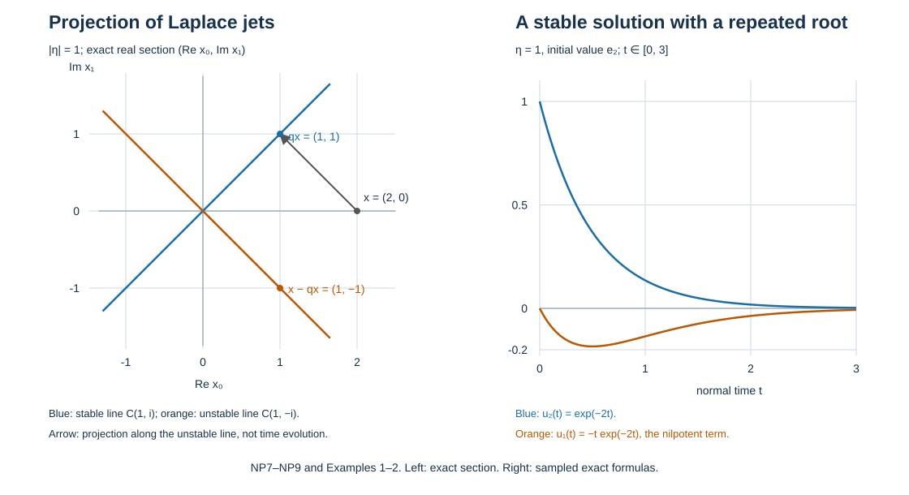

# Stable normal modes and the residue projection

A boundary symbol acts on Cauchy data of solutions that decay into the domain. This companion constructs that space for the whole matrix polynomial and identifies its projection with the one-sided normal integral. It includes repeated roots, a nonidentity leading coefficient, every jet weight and the dimensional qualifications on the stable rank.

The finite spectral algebra is already proved in [QF A0–A6 and A9](../20261005-restored-quadratic-forms/spectral-algebra-and-contour-projections.md). We use those proofs, including their oriented circle integrals, without assuming an eigenbasis. [HM M2](../20261007-halfspace-layers/halfspace-layers.md) and [TS I1–R2](../20261007-one-sided-trace-symbols/one-sided-trace-symbols.md) prove the Fourier identities and actual one-sided limits used below. The proof map binds the exact earlier versions.

This independent exposition is CC0. The mathematical antecedent is the Hörmander III, Springer 2007, ISBN 978-3-540-49938-1, Section 20.1. The existing AN-03 *Stable modes and the algebra of boundary data*, Sections 1–4 and 16.7, and *Cauchy data from jumps and residues*, Sections 2, 3, 8 and 9, give related treatments of the polynomial and boundary maps. Linked components retain their own terms.  The comparison with the variable-coefficient finite inverse and the elliptic boundary theorem remain separate subsequent proofs.

## 1. Keep the leading map and all initial coordinates

Let \(E,F\) be complex vector spaces of the same finite dimension \(N\). Fix \(m\ge1\) and
\[
 p(z)=\sum_{j=0}^{m}A_jz^j:E\longrightarrow F,
 \qquad M=A_m\text{ invertible},\qquad
 \det p(\kappa)\ne0\quad(\kappa\in\mathbb R).
 \tag{NP1}
\]
The determinant statement may be checked in any fixed bases. The variable \(z\) is scalar; the matrices need not commute. We use \(D_t=-i\partial_t\), inward coordinate \(t\), and the original jet space \(\mathcal J=E^{\oplus m}\). Define
\[
 C(x_0,\ldots,x_{m-1})
  =\left(x_1,\ldots,x_{m-1},-\sum_{j<m}M^{-1}A_jx_j\right),
 \qquad Ju=(u,Du,\ldots,D^{m-1}u).
 \tag{NP2}
\]
The equation \(p(D)u=0\) implies \(DJu=CJu\). Conversely the first rows of this system give every component as the indicated derivative of the first; multiplying its last row by \(M\) gives the original equation. QF:A9 proves the convergent matrix exponential and its inverse. Applied to \(iC\), it gives
\[
 u_x(t)=\pi_0e^{itC}x,\qquad Ju_x(0)=x,
 \qquad D^ku_x(t)=\pi_0C^ke^{itC}x.
 \tag{NP3}
\]
For uniqueness, differentiating \(e^{-itC}Ju(t)\) gives zero. Thus the initial-jet map and NP3 are inverse linear maps, and the solution space has dimension \(mN\).

We also need the determinant with its leading factor. In \((zI-C)x\), set \(x_0=y_0\) and \(x_j=zx_{j-1}+y_j\) for \(1\le j<m\). This triangular input change has determinant one. The first rows become \(-y_1,\ldots,-y_{m-1}\); the coefficient of \(y_0\) in the last is \(M^{-1}p(z)\). Moving this block row to the front gives sign \((-1)^{N^2(m-1)}\); the negative identity blocks give \((-1)^{N(m-1)}\). Their product is one because \(N(N+1)(m-1)\) is even. Row additions eliminate the other entries in the first block row. The determinant rules proved in QF:A0–A2 therefore give
\[
 \det(zI_{\mathcal J}-C)=\det(M^{-1})\det p(z).
 \tag{NP4}
\]
It preserves every root and multiplicity. In particular \(C\) has no real spectrum. If \(N=0\), the spaces are zero and the determinants are empty products equal to one; no spectral or unit-sphere argument is needed in that case.

## 2. Bounded first components and stable states

First prove that boundedness of \(u\), rather than an assumed bound for its whole jet, suffices. For \(N>0\) put
\[
 h(x)=\int_0^1\|\pi_0e^{isC}x\|^2\,ds.
 \tag{NP5}
\]
If \(h(x)=0\), continuity and nonnegativity force its integrand to vanish everywhere on the interval. Every derivative at zero of that first component is zero, hence all components of \(x=Ju_x(0)\) are zero. The matrix exponential bounds make \(h\) continuous. Compactness of the finite-dimensional unit sphere, proved in U001:F0-COMP, gives a positive minimum \(c\). Homogeneity and the exponential group identity now give
\[
 c\|Ju(t)\|^2\le\int_0^1\|u(t+s)\|^2\,ds\quad(t\ge0).
 \tag{NP6}
\]
A bounded first component therefore has bounded jet; NP3 bounds every higher derivative as well. For \(t\le0\), use the interval \([-1,0]\), whose same positivity proof gives its own constant.

QF:A3–A5 give the direct sum of generalized eigenspaces of \(C\). On the summand belonging to \(\lambda\), write \(C=\lambda I+N_\lambda\), \(N_\lambda^{d_\lambda}=0\). The absolutely convergent exponential series and its finite binomial expansion imply
\[
 e^{itC}|_{V_\lambda}
   =e^{it\lambda}\sum_{j<d_\lambda}\frac{(it)^jN_\lambda^j}{j!}.
 \tag{NP7}
\]
Let \(q\) be the sum of the upper-half-plane spectral projections. Each term in NP7 and every derivative decays for \(t\to+\infty\) on its range, and for \(t\to-\infty\) on the complementary range. To make the decay estimate explicit, if \(\operatorname{Im}\lambda=b>0\), then \(t^je^{-bt/2}\) is bounded on \([0,\infty)\): for \(j>0\) its derivative changes sign at \(2j/b\), and \(j=0\) is immediate. Thus each summand is bounded by a constant times \(e^{-bt/2}\).

Conversely, if \(e^{itC}x\) is bounded for \(t\ge0\), then
\[
 (I-q)x=e^{-itC}(I-q)e^{itC}x\longrightarrow0.
 \tag{NP8}
\]
Indeed \(e^{-itC}\) on the lower spectral space tends to zero by NP7, while the projected last factor is bounded. The left side is fixed, so it is zero. NP6 now proves that the solutions bounded on the positive half-line have exactly the initial data \(q\mathcal J\). The negative version gives \((I-q)\mathcal J\). Write these spaces of solutions as \(\mathcal M^+\) and \(\mathcal M^-\). Then
\[
 \mathcal J=J\mathcal M^+\oplus J\mathcal M^- ,\qquad
 \dim\mathcal M^+=\sum_{\operatorname{Im}\lambda>0}
          \operatorname{mult}_\lambda(\det p).
 \tag{NP9}
\]
Here and below, \(J\) on a solution space denotes its jet evaluated at zero. The multiplicity equality follows from NP4 and QF:A4, which identifies each generalized dimension with its characteristic multiplicity. Multiple poles and nilpotent time factors have not been omitted.

## 3. Recover the projection in the original polynomial coordinates

For \(x\in\mathcal J\), define the \(F\)-valued polynomial
\[
 U_x(z)=\sum_{a=0}^{m-1}\sum_{b=0}^{m-a-1}A_{a+b+1}z^b x_a.
 \tag{NP10}
\]
This is a bijection onto polynomials of degree less than \(m\). In fact, writing \(U_x(z)=\sum_{b<m}u_bz^b\), its inverse is
\[
 x_r=M^{-1}\left(u_{m-1-r}-\sum_{a<r}A_{m-r+a}x_a\right),
                    \qquad 0\le r<m.
 \tag{NP11}
\]
The coefficient of \(z^{m-1-r}\) in NP10 is \(\sum_{a=0}^r A_{m-r+a}x_a\); its last term is \(Mx_r\). This proves each successive row of NP11, including the empty first sum. It also shows why multiplying the coefficient matrices on the wrong side changes the map.

Solve \((zI-C)w=x\) outside the spectrum. The first rows give
\[
 w_k=z^kw_0-\sum_{a<k}z^{k-1-a}x_a,
 \qquad p(z)w_0=U_x(z).
 \tag{NP12}
\]
For the second identity, substitute the first into the last row and multiply that row by \(M\). The coefficient of each \(x_a\) is precisely \(\sum_{b=0}^{m-a-1}A_{a+b+1}z^b\), including the term with \(A_m=M\). This checks all factor positions in NP12.

Choose a counterclockwise circle \(\Gamma_+\) wholly in the upper half-plane that encloses all upper roots and no lower roots. QF:A6 constructs such a circle from a spectral bound and a positive gap; if the upper spectrum is empty the same construction encloses none. QF:A5 gives \(q=(2\pi i)^{-1}\oint_{\Gamma_+}(zI-C)^{-1}dz\). Integrate NP12. Each subtracted polynomial has integral zero, since \(z^j\) has the primitive \(z^{j+1}/(j+1)\) on the closed circle. Therefore the complete block matrix is
\[
 q_{ka}=\frac1{2\pi i}\oint_{\Gamma_+}
       \sum_{b=0}^{m-a-1}z^{k+b}p(z)^{-1}A_{a+b+1}\,dz,
       \qquad 0\le k,a<m.
 \tag{NP13}
\]
It is the projection onto \(J\mathcal M^+\) along \(J\mathcal M^-\):
\[
 q^2=q,\qquad q|_{J\mathcal M^+}=I,\qquad
 q|_{J\mathcal M^-}=0.
 \tag{NP14}
\]
This proves the residue formula from the resolvent identity. There is no requirement that the projection be orthogonal in a chosen metric.

## 4. The same matrix from the actual one-sided layer

At fixed coefficients the jump source of a jet \(x\) is
\[
 C_px=i^{-1}\sum_{a+b<m}A_{a+b+1}x_aD_t^b\delta_0,
 \qquad a_x(\kappa)=i^{-1}p(\kappa)^{-1}U_x(\kappa).
 \tag{NP15}
\]
The source identity is HM:S1 with constant coefficients. The Fourier transform of \(D^b\delta_0\) is \(\kappa^b\), so \(v=\mathcal F^{-1}a_x\) satisfies \(p(D)v=C_px\). The inverse Fourier coefficient is \((2\pi)^{-1}\). Since \(p(\kappa)^{-1}=O(|\kappa|^{-m})\), \(a_x\) is \(O(|\kappa|^{-1})\).

Here is the rational Fourier calculation, including all poles. Each matrix entry of \(p^{-1}U_x\) is a scalar rational function by the cofactor formula. QF:A1 factors its denominator. At a root \(\lambda\) of multiplicity \(d\), multiply by \((z-\lambda)^d\) and take the first \(d\) Taylor coefficients of the remaining rational function, whose denominator is nonzero near \(\lambda\). These coefficients can be constructed by algebra alone: multiply a polynomial of degree less than \(d\) by that denominator and match the numerator coefficients successively, starting with the nonzero constant denominator coefficient. The unmatched numerator is divisible by the \(d\)-th power of the shifted variable. Subtracting these principal parts at all roots removes every denominator factor: the resulting numerator is divisible by their product, by the coprime divisibility argument in QF:A3. Thus the remainder is a polynomial. For an \(O(1/z)\) function that polynomial is zero. The same reasoning for a rational function with polynomial growth retains its polynomial part.

For \(h\ge1\), \(\lambda=a+i\beta\), \(\beta\ne0\), the actual tested inverse is
\[
 \mathcal F^{-1}[(\kappa-\lambda)^{-h}](t)=
 \begin{cases}
 \displaystyle\frac{i^h}{(h-1)!}\,1_{t>0}t^{h-1}e^{it\lambda},&\beta>0,\\[3pt]
 \displaystyle\frac{(-i)^h}{(h-1)!}\,1_{t<0}(-t)^{h-1}e^{it\lambda},&\beta<0.
 \end{cases}
 \tag{NP16}
\]
For the lower sign this is HM:M2 with rate \(-\beta>0\), followed by the Fourier shift \(\kappa\mapsto\kappa-a\). For the upper sign replace \(\kappa\) by \(-\kappa\) in that lower identity and retain its factor \((-1)^h\). These substitutions on Schwartz test functions prove NP16 as distributions. Polynomial terms give delta derivatives supported at zero. No point value at zero is assigned to them.

For any rational symbol \(r\) with no real pole, this finite partial fraction expansion proves
\[
 \left.\mathcal F^{-1}r\right|_{0+}
       = i\sum_{\operatorname{Im}\lambda>0}c_{\lambda,1}
       =\frac1{2\pi}\oint_{\Gamma_+}r(z)\,dz,
 \qquad \mathcal J_+(r)=2\pi i\sum_{\operatorname{Im}\lambda>0}c_{\lambda,1},
 \tag{NP17}
\]
where \(c_{\lambda,1}\) is the coefficient of \((z-\lambda)^{-1}\). Higher pole powers in NP16 have zero positive limit; lower poles and the polynomial part vanish on the positive side. QF:A5 evaluates their circle integrals, giving the middle equality. TS:I2–R1 identifies that positive limit with its finite-subtraction integral: every rational function here has a common Laurent expansion on the two real tails, with a differentiated remainder obtained from its rational denominator away from its poles. On compact parameter neighborhoods the same statement is uniform. Thus NP17 includes high polynomial growth; it does not replace the one-sided integral by symmetric principal value.

Apply NP17 to \(i^{-1}\kappa^kp(\kappa)^{-1}U_x(\kappa)\). Differentiating the distribution uses the exact multiplier \(\kappa^k\). The factor \(i^{-1}\) in the source gives precisely NP13. Hence
\[
 Jv^+(0)=qx,\qquad Jv^-(0)=(q-I)x,
 \qquad Jv^+(0)-Jv^-(0)=x.
 \tag{NP18}
\]
For clarity, the last two equalities also follow directly from the source, without a contour at infinity. NP16 shows that \(v^\pm\) are exponential-polynomial solutions of \(p(D)v^\pm=0\). Their distributional jump source has jet \(w=Jv^+(0)-Jv^-(0)\). Comparing with NP15, the coefficient of \(D^{m-1}\delta\) is \(M(w_0-x_0)\), so it vanishes only when \(w_0=x_0\). Descending through the delta derivatives, the next unknown always has coefficient \(M\) and all earlier differences are already zero. Thus \(w=x\). Both reconstructions agree with the stable/unstable direct sum in NP9.

## 5. Smooth parameters, collisions and weights

Let the original coefficients depend smoothly on parameters in an open set, with \(M\) invertible and no real roots throughout. On a sufficiently small compact parameter neighborhood, \(C\) is bounded. If its spectra had no uniform positive distance from the real line, a convergent subsequence of parameters and bounded eigenvalues would give a real zero of the limiting characteristic determinant. Thus the gap is positive. The explicit circle in QF:A6 works for the whole neighborhood. Along it, the cofactor formula gives a smooth resolvent with denominator bounded away from zero. Its derivatives obey
\[
 \partial_j(zI-C)^{-1}
   =(zI-C)^{-1}(\partial_j C)(zI-C)^{-1}.
 \tag{NP19}
\]
Successive product rules give finite sums of ordered resolvent and coefficient factors for every mixed derivative. Every such factor is bounded on the compact parameter-contour product. Differentiation of the finite contour integral is therefore justified by U001:FTC-TAYLOR-COMPACT-PARAMETERS. It proves that \(q\) is smooth, with all local parameter bounds, even when roots collide inside a half-plane. QF:A6 proves local constancy of its rank and constructs a range basis by projecting a fixed nearby basis. Those bases are smooth here, so the ranges form a smooth vector bundle. No chosen root branches enter this proof.

Now take the principal differential polynomial at a boundary point, with nonzero tangential covector \(\eta\):
\[
 p(y,\eta,z)=\sum_{j=0}^m A_j(y,\eta)z^j,
 \quad A_j(y,\rho\eta)=\rho^{m-j}A_j(y,\eta),
 \quad S_\rho=\operatorname{diag}(I,\rho I,\ldots,\rho^{m-1}I).
 \tag{NP20}
\]
Ellipticity of the original principal symbol makes \(M=p(y,n)\) invertible and excludes real roots for every \(\eta\ne0\). If \(u(t)\) solves the equation at \(\eta\), then \(u(\rho t)\) solves it at \(\rho\eta\), by NP20 and the chain rule. Its jet is \(S_\rho Ju(0)\), and positive/negative decay is preserved. Uniqueness of projection along the two summands proves
\[
 q(y,\rho\eta)=S_\rho q(y,\eta)S_\rho^{-1},
 \qquad q_{ka}(y,\rho\eta)=\rho^{k-a}q_{ka}(y,\eta).
 \tag{NP21}
\]
Together with smoothness on compact cospheres this gives every differentiated symbol estimate of degree \(k-a\): differentiate the homogeneity identity in \(\eta\), then set \(\rho=|\eta|\) and evaluate the remaining derivative on the unit sphere. A cutoff near \(\eta=0\) gives an ordinary classical symbol of that order with this homogeneous leading part. This proves the properties of the frozen projection. It does not yet identify the principal symbol of a chosen variable-coefficient finite inverse with it.

## 6. Representative, frame and antipodal comparisons

For an inward conormal \(n\) and a representative \(\xi\) of a nonzero tangential class, replacing \(\xi\) by \(\xi+a n\) changes a solution to \(e^{-iat}u(t)\). The complete jet transformation is
\[
 (W_a x)_k=\sum_{l=0}^k\binom{k}{l}(-a)^{k-l}x_l,
 \qquad W_a^{-1}=W_{-a},\qquad
 q(\xi+a n,n)=W_a q(\xi,n)W_{-a}.
 \tag{NP22}
\]
The product rule proves the first formula. Multiplying the two scalar exponential gauges and using the bijective jet map proves the inverse identity. Both half-line spaces transform by this same map, which proves the conjugation. For \(n'=c n\), \(c>0\), use \(u(t/c)\); its jet matrix is \(J_c=\operatorname{diag}(I,c^{-1}I,\ldots,c^{-(m-1)}I)\), giving conjugation by \(J_c\). An input frame change acts by that frame map on every jet block. The independent output frame change multiplies the equation by an invertible map and leaves the solution space unchanged. Real cotangent coordinate changes transport the polynomial by their linear covector maps. Thus these comparisons describe the same intrinsic stable-data test.

For a differential principal symbol, each coefficient is polynomial of degree \(m-j\), so \(A_j(y,-\eta)=(-1)^{m-j}A_j(y,\eta)\). It follows term by term that reflection \(Ru(t)=u(-t)\) satisfies
\[
 p(y,-\eta,D)Ru=(-1)^m R[p(y,\eta,D)u],
 \quad JRu(0)=S Ju(0),\quad
 S=\operatorname{diag}(I,-I,\ldots,(-1)^{m-1}I).
 \tag{NP23}
\]
Every negative mode becomes a positive mode under this reflection and conversely, by NP7; \(R^2=I\). Projection on the reflected direct sum therefore gives
\[
 q(y,-\eta)=S(I-q(y,\eta))S,
 \qquad r_y(-\eta)=mN-r_y(\eta),\quad r_y(\eta)=\operatorname{rank}q(y,\eta).
 \tag{NP24}
\]
These are not conjugation-of-coefficients statements. They retain every complex coefficient. With antipodal map \(\mathfrak a(y,\eta)=(y,-\eta)\), they give the actual bundle isomorphism
\[
 V^+\oplus\mathfrak a^*V^+\longrightarrow\pi^*E^{\oplus m},
 \quad(u,w)\longmapsto u+Sw,
 \qquad x\longmapsto(qx,S(I-q)x)
 \tag{NP25}
\]
as its inverse. Both compositions reduce to the identity using NP14 and the membership of \(Sw\) in the negative space. Smoothness is the smoothness of \(q\). The comparisons above are compatible: \(SW_a=W_{-a}S\), as follows from their entrywise binomial coefficients, and \(S\) commutes with \(J_c\), \(S_\rho\) and the diagonal input frame change. At the negative representative the gauge parameter changes from \(a\) to \(-a\). This checks the antipodal maps without fixing a special representative.

If \(\dim X\ge3\), the nonzero tangential covectors at a point form a connected set. One explicit path joins nonopposite unit vectors by normalizing their straight segment; opposite vectors are joined through a perpendicular unit vector, available in tangential dimension at least two. Add positive radial segments for arbitrary lengths. The locally constant rank from Section 5 is constant on these paths. NP24 implies
\[
 r_y(\eta)=mN/2\qquad(\dim X\ge3).
 \tag{NP26}
\]
It forces \(mN\) even when the fibers are nonzero. For \(\dim X=2\), the two tangential rays need only have complementary ranks. For \(\dim X=1\), there is no nonzero tangential covector: these assertions make no claim about that finite-dimensional boundary problem. Empty boundary and zero fibers cause no exception requiring an empty-sphere minimum.

## 7. Boundary measurements on the right space

Keep reduced boundary measurements of their original assigned integer orders \(m_j\), with principal coefficients \(b_{jk}\) homogeneous of degree \(m_j-k\), and define
\[
 b_jx=\sum_{k<m}b_{jk}x_k,
 \qquad b|_{V^+}:V^+\longrightarrow\bigoplus_jG_j.
 \tag{NP27}
\]
For differential coefficients a negative degree bound means the coefficient is zero. Arbitrarily large \(m_j\) are allowed. Since \(u\mapsto Ju(0)\) identifies \(\mathcal M^+\) with \(V^+\), the frozen complementing condition is exactly bijectivity of NP27. Both injectivity and surjectivity are required. No inverse of the entire rectangular map on \(\mathcal J\) is demanded. The gauge and normal-scale maps in Section 6 carry both the solution and its original boundary evaluation, so preserve this condition.

When this restriction is bijective, its inverse is smooth: choose the local smooth range basis from Section 5 and fixed local target frames. Its matrix is square and invertible; the cofactor formula gives a smooth inverse, with every derivative locally bounded where its determinant stays nonzero. Homogeneity gives the original measurement weights: scaling the solution changes the \(j\)-th output by \(\rho^{m_j}\), while its jet changes by \(S_\rho\). This is the finite-dimensional inverse only. Quantizing it into an actual weighted boundary inverse requires the subsequent operator proof.

## 8. Four complete calculations

**1. Laplace jets and their weights.** For \(p(\eta,z)=z^2+|\eta|^2\), put \(\rho=|\eta|>0\). The bounded solution is \(u(t)=a e^{-\rho t}\), with jet \((a,i\rho a)\); the negative bounded solution has jet \((a,-i\rho a)\). Solving their two-coordinate direct sum gives
\[
 q(\eta)=\frac12\begin{pmatrix}1&(i\rho)^{-1}\\ i\rho&1\end{pmatrix}.
 \tag{NP28}
\]
Multiplication gives \(q^2=q\). Its off-diagonal degrees are \(-1\) and \(1\), exactly NP21. At \(\rho=1\), the real section \(x_0\in\mathbb R,x_1\in i\mathbb R\) identifies the stable and unstable lines with \((1,1)\) and \((1,-1)\). The vector \((2,0)\) splits into these two vectors; this is the left panel below. The full jet space is complex two-dimensional, so the picture is a section, not its whole real dimension.

**2. A repeated root contributes more than eigenvectors.** In dimension two take \(m=1\), \(E=\mathbb C^2\), \(N_0=\left(\begin{smallmatrix}0&1\\0&0\end{smallmatrix}\right)\), and
\[
 p(\eta,z)=zI-i\eta(2I+N_0),\qquad
 u_x(t)=e^{-2\eta t}(I-\eta tN_0)x.
 \tag{NP29}
\]
The determinant is \((z-2i\eta)^2\), which has no real zero for real \((\eta,z)\ne(0,0)\). The exponential formula follows from \(N_0^2=0\), and direct differentiation gives \(Du=i\eta(2I+N_0)u\). For \(\eta>0\) every initial vector is stable, so \(q=I\); for \(\eta<0\) only zero is stable, so \(q=0\). The two ray ranks are 2 and 0. At \(\eta=1,x=e_2\), the first component is \(-te^{-2t}\) and the second is \(e^{-2t}\), both shown in the right panel. An eigenvector-only description would lose this solution.

**3. Reversing the leading factor produces the wrong projection.** For \(\eta>0\) take
\[
 C=i\eta\begin{pmatrix}1&-2\\0&-1\end{pmatrix},\quad
 M=\begin{pmatrix}1&0\\1&1\end{pmatrix},\quad
 p(\eta,z)=M(zI-C),\quad
 q=\begin{pmatrix}1&-1\\0&0\end{pmatrix}.
 \tag{NP30}
\]
The stable line is \(\mathbb C e_1\); the unstable line is \(\mathbb C(1,1)\), giving the displayed \(q\). The polynomial is elliptic because its determinant is \(z^2+\eta^2\). In NP13 the correct integrand is \(p^{-1}M=(zI-C)^{-1}\). Reversing it gives \(Mp^{-1}=M(zI-C)^{-1}M^{-1}\), whose contour projection is \(MqM^{-1}=\left(\begin{smallmatrix}2&-1\\2&-1\end{smallmatrix}\right)\). Its range is \(\mathbb C(1,1)\), so it is wrong for this original equation. Also \(q\ne q^*\): the actual projection need not be orthogonal.

**4. Equal dimensions do not establish complementing.** For the scalar Laplacian in dimension three, \(\eta=(\eta_1,\eta_2)\ne0\), the stable solution is \(a e^{-|\eta|t}\). The boundary operator \(B=D_{y_1}\), of assigned order one, measures \(\eta_1a\). At \(\eta=(0,1)\) the measurement is zero, although both the stable space and target have dimension one. It is neither injective nor surjective. In contrast the Dirichlet measurement \(u(0)=a\) is bijective, and its stable-jet inverse is \(a\mapsto(a,i|\eta|a)\). This inverse has exactly the jet degrees zero and one; replacing both by degree zero would erase the weight needed in the boundary calculus.

## 9. The two pictures

The left panel is the exact real section in Example 1 at \(|\eta|=1\). Its arrow is projection along the unstable direction, not a time trajectory. The right panel samples the exact functions in Example 2 at \(\eta=1\), for \(0\le t\le3\); it displays the nilpotent term and exponential decay. NP7–NP9 prove the general multiplicity statement, NP13–NP18 prove the complete residue and jump maps, and NP21–NP27 retain the weights and boundary test. The variable-coefficient principal comparison and the elliptic boundary inverse remain separate obligations.
