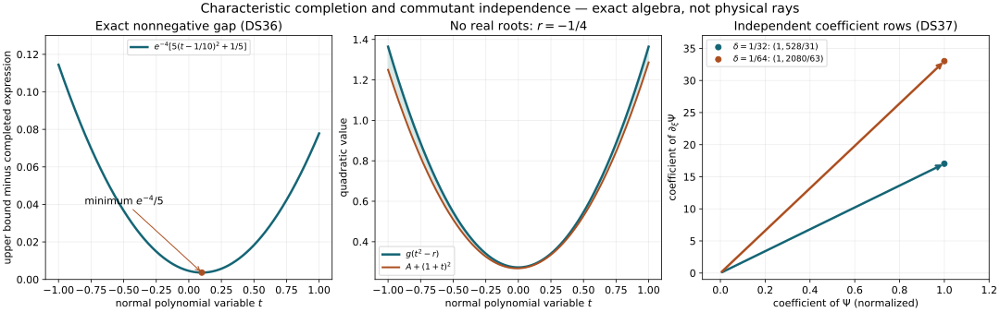

# Characteristic squares and diffractive commutants

*AN-04 proof supplement. Written by GPT-6 Astra (OpenAI), Ultra. Independent exposition and reproducible figures are CC0-1.0; linked components retain their own terms.*

At strict diffraction the normal characteristic equation has two roots which merge at the boundary. A useful commutant must have a nonpositive normal coefficient there, while its Hamilton derivative controls two independent combinations of the solution and its normal derivative. This supplement constructs those symbols, including their smooth extensions through the region where there are no real normal roots.

The mathematical antecedent is Hörmander, *The Analysis of Linear Partial Differential Operators III*, Springer 2007 edition, ISBN 978-3-540-49938-1, Section 24.4, printed 443–454 (PDF 458–469), particularly Lemmas 24.4.3–24.4.5, 24.4.8–24.4.9 and the symbol construction concluding Theorem 24.4.1. The proofs below use the current programme's explicit [even/odd descent and extension](../20261005-restored-smooth-descent/folds-reflections-and-uniform-descent.md), Sections 3–5, rather than an external preparation theorem. The proof map gives exact earlier proofs.

These are complete symbol statements. The analytic strict-diffraction estimate for the full weak form, both boundary domains and natural-dual forcing remains to be proved. None of the symbol inequalities below tests the weak equation or establishes a solution wavefront theorem.

## 1. Smooth powers at a flat zero

**S1. Power-stable cutoffs.** Let \(h\geq0\) be smooth on an open Euclidean set. Suppose, on each compact subset, that for every multi-index \(\alpha\) and every \(0<k<1\),
\[
 |D^\alpha h|\leq C_{\alpha,k}h^k .
 \tag{DS1}
\]
Then \(h^\theta\), defined as zero on \(\{h=0\}\), is smooth for every \(\theta>0\), and satisfies the same kind of estimates. Products of two such functions satisfy (DS1). A compact parameter average of a uniformly controlled family satisfies (DS1), provided that the parameter measure has total mass one and differentiation under the integral is justified.

**Proof.** On \(\{h>0\}\), repeated product and chain rules express any derivative of \(h^\theta\) as a finite sum of terms
\[
 c\,h^{\theta-j}\prod_{\nu=1}^jD^{\beta_\nu}h,
 \qquad |\beta_\nu|\geq1,\quad
 \sum_\nu\beta_\nu=\alpha .
 \tag{DS2}
\]
For a prescribed \(0<q<1\), choose \(k<1\) sufficiently close to one that
\(\theta-j(1-k)\geq\theta q\) for every \(j\leq|\alpha|\). Equation (DS1), and a compact upper bound for \(h\), bound (DS2) by \(C h^{\theta q}\). Thus every candidate derivative tends to zero at the zero set.

Here is the gluing argument. If a continuous function is zero on a closed set, is differentiable off it, and its candidate first derivatives extend continuously by zero, then it is differentiable at a point of that set with derivative zero. Along the segment from that point to a nearby point outside the set, take the last point of the closed set. The fundamental theorem of calculus on the remaining interval bounds the change by the segment length times the supremum of the candidate gradient. That supremum tends to zero. Apply this argument successively to all the candidate derivatives. It proves smoothness and the claimed estimates, including at zeros.

For a product use the finite Leibniz sum and apply (DS1) to both factors with the same \(k\). For an average \(H=\int h_\omega\,d\mu(\omega)\), differentiation and the triangle inequality give
\[
 |D^\alpha H|\leq C_{\alpha,k}\int h_\omega^k\,d\mu
 \leq C_{\alpha,k}H^k .
 \tag{DS3}
\]
The last inequality has an elementary proof: at a positive mean \(a\), concavity gives
\(s^k\leq a^k+ka^{k-1}(s-a)\); integrate and set \(a=H\). If \(H=0\), the nonnegative integrand is zero almost everywhere and the first inequality gives zero. The compact parameter integral and differentiation are the earlier complete FTC/integration results. ∎

The particular cutoff
\[
 E(v)=
 \begin{cases}e^{-1/v},&v>0,\\0,&v\leq0\end{cases}
 \tag{DS4}
\]
and its nonnegative derivative \(E'\) satisfy (DS1) locally. On \(v>0\), each derivative is \(e^{-1/v}\) times a polynomial in \(1/v\). For each \(k<1\), the extra factor \(e^{-(1-k)/v}\) dominates every such polynomial as \(v\downarrow0\). For example, the exponential series gives \(e^w\geq w^m/m!\) for arbitrarily large \(m\); increasing \(m\) proves every required limit and bound. The same argument applies to \(E'=v^{-2}e^{-1/v}\), after dividing by \((E')^k\). Away from zero all bounds follow on compact sets. Smooth compositions with bounded derivatives and positive smooth factors preserve the estimates locally where the positive factor is bounded away from zero.

## 2. The divided difference has a smooth square

**S2. A square through the merging roots.** Suppose \(g(a,z)\) is smooth and \(\partial_a g\geq0\) satisfies (DS1), with all parameter derivatives included. Locally there is a smooth real \(B(r,a,z)\), defined for positive and negative \(r\), such that
\[
 \frac{g(a+s,z)-g(a-s,z)}{2s}
       =B(s^2,a,z)^2 ,
 \qquad
 B(0,a,z)^2=\partial_a g(a,z).
 \tag{DS5}
\]
The quotient at \(s=0\) means its continuous value.

**Proof.** The exact integral
\[
 F(s,a,z)=\frac12\int_{-1}^{1}\partial_a g(a+\vartheta s,z)\,d\vartheta
 \tag{DS6}
\]
equals the quotient by the fundamental theorem of calculus. It is nonnegative and even in \(s\). Every \(s\) derivative contributes a factor \(\vartheta\), bounded by one; all mixed derivative bounds are uniform on a slightly larger compact set. Therefore S1 applies to this average and makes \(\sqrt F\) smooth. Its nonnegative choice is even. The complete even-square descent and full-neighborhood extension in U014, Lemma 3.2 and Theorem 4.2, give
\(\sqrt F(s,a,z)=B(s^2,a,z)\). Evaluation at zero proves the last assertion. There is no requirement that the extension \(B\) itself be nonnegative for \(r<0\). Its square remains smooth. ∎

A factor \(c(z)^2\), independent of \(s\), may be inserted in (DS5) by replacing \(B\) with \(cB\). No derivative condition like (DS1) is needed for this separate factor. This observation permits ordinary parameter cutoffs in the commutant construction.

## 3. A flat error can be dominated without losing smoothness

Work in a relatively open subset \(Y\) of a closed half-space \(y_1\geq0\); smooth functions are smooth up to that boundary. Let \(r\) be real and assume
\[
 dr\ne0\quad\hbox{on }\{r=0\},\qquad
 \partial_{y_1}r>0
 \quad\hbox{if }r=y_1=0,\ d_{y'}r=0 .
 \tag{DS7}
\]
The second condition says that, at a zero with no tangential escape direction, the positive side is accessible by moving inward.

**S3. Accessible zeros and flatness.** On a sufficiently small patch about each zero, every nearby point with \(r<0\) has a zero \(y_*\) in the same half-space with
\[
 |y-y_*|\leq C|r(y)|.
 \tag{DS8}
\]
Consequently, if a smooth \(b\) vanishes for \(r\geq0\), then every derivative of \(b\) is \(O(|r|^N)\) for every \(N\), uniformly on smaller compact patches.

**Proof.** If a tangential derivative of \(r\) is nonzero, keep the other coordinates fixed and vary that tangential coordinate. Shrink the patch so this derivative has fixed sign and magnitude at least \(c>0\). The intermediate value theorem and the fundamental theorem of calculus give a zero within distance \(2|r(y)|/c\), in the half-space. At an interior zero the same argument uses any nonzero partial derivative. In the remaining boundary case, \(\partial_{y_1}r\geq c>0\) on a patch. Increase \(y_1\) by \(2|r(y)|/c\); the value crosses zero before that distance, while staying in the half-space.

All derivatives of \(b\) vanish at a zero: an open positive-\(r\) region approaches it within the half-space by the same directions, and the derivatives are continuous. Taylor's formula along the short segment from \(y_*\) to \(y\), inside a smaller convex coordinate patch, now gives
\(|D^\alpha b(y)|\leq C_{\alpha,N}|y-y_*|^N\).
Use (DS8). Finitely many patches give the assertion on any retained compact part of the zero set. ∎

**S4. Smooth upper envelope of a flat error.** Suppose \(F\geq0\), \(F=0\) for \(r\geq0\), \(F\) is locally bounded, and
\(F=O(|r|^N)\) for every \(N\) on compact sets. Locally there is a smooth \(f\geq F\) with \(f=0\) for \(r\geq0\). No continuity of \(F\) is required.

**Proof.** On a fixed larger compact patch \(K\), define the nondecreasing function
\[
 S(t)=\sup\{F(y):y\in K,\ -t\leq r(y)<0\}
 \quad(t>0),\qquad S(t)=0\quad(t\leq0),
 \tag{DS9}
\]
with empty supremum zero. It is finite and \(S(t)=O(t^N)\) at zero for every \(N\). Its monotonicity makes it measurable. Choose a nonnegative smooth \(\chi\) supported strictly between 1 and 2, normalized by \(\int\chi(v)\,dv/v=1\). Such a function follows from the already proved smooth cutoff and positive integral constructions. Set
\[
 H(t)=\int_0^\infty S(s)\chi(s/t)\,\frac{ds}{s}
     =\int_1^2 S(tv)\chi(v)\,\frac{dv}{v}
       \quad(t>0).
 \tag{DS10}
\]
Then \(H(t)\geq S(t)\). Differentiating the first integral is legitimate for \(t\) in a compact positive interval: its kernels and all derivatives have common compact support, and \(S\) is bounded there. Recursively define
\(\chi_0=\chi,\ \chi_{j+1}(v)=-j\chi_j(v)-v\chi_j'(v)\).
Direct differentiation proves
\[
 t^jH^{(j)}(t)=\int_0^\infty S(s)\chi_j(s/t)\,\frac{ds}{s},
 \qquad |H^{(j)}(t)|\leq C_{j,N}t^{N-j}.
 \tag{DS11}
\]
Extend \(H\) by zero for \(t\leq0\). These bounds and the gluing argument in S1 prove that the extension is smooth and flat. Now \(f(y)=H(-r(y))\) has the required properties in the smaller patch. If several patches are needed, use a finite smooth partition on the retained compact set: take nonnegative cutoffs subordinate to the patches, divide by their positive sum, and average the local majorants. Each term still vanishes for \(r\geq0\), and their sum dominates \(F\). ∎

## 4. A characteristic equality becomes an everywhere inequality

**S5. Quadratic characteristic completion.** Under (DS7), let
\[
 A(t,y)=a_2(y)t^2+a_1(y)t+a_0(y),\qquad
 A(t,y)=-\psi(t,y)^2\quad\hbox{when }t^2=r(y),
 \tag{DS12}
\]
with real smooth coefficients and real smooth \(\psi\). Locally near \(t=r=0\), there are real smooth \(b_0,b_1,g\) such that
\[
 A(t,y)+(b_0(y)+t b_1(y))^2
       \leq g(y)(t^2-r(y))\quad\hbox{for every real }t,
 \tag{DS13}
\]
and, on \(r=0\),
\(b_0=\psi(0,y)\), \(b_1=\partial_t\psi(0,y)\).
Only the values of \(\psi\) near the two small roots are used.

**Proof.** The full even/odd decomposition in U014, Corollary 5.2, gives smooth functions \(B_0,B_1\) in a full square-variable neighborhood with
\[
 \psi(t,y)=B_0(t^2,y)+tB_1(t^2,y).
 \tag{DS14}
\]
Put \(b_j(y)=B_j(r(y),y)\). Their values on \(r=0\) follow from the same decomposition. Subtract
\((a_2+b_1^2)(t^2-r)\) from the left side of (DS13). The result is a polynomial \(c_1(y)t+c_0(y)\) of degree at most one. For \(r>0\) it vanishes at both distinct roots, by (DS12) and (DS14); hence both coefficients vanish there. Continuity and the accessible positive side give the same assertion at \(r=0\). S3 applies to each coefficient and all its derivatives.

For \(r<0\), write \(a=-r>0\). The elementary square
\((|t|-\sqrt a)^2\geq0\) gives
\[
 c_1t+c_0
 \leq
 \left(\frac{|c_1|}{2\sqrt{-r}}+
             \frac{|c_0|}{-r}\right)(t^2-r).
 \tag{DS15}
\]
The parenthesis, extended by zero on \(r\geq0\), is a locally bounded nonnegative function flat to every order in the value of \(r\), by S3. Apply S4 to dominate it by a smooth \(f\) zero for \(r\geq0\), and set \(g=a_2+b_1^2+f\). For \(r<0\), (DS15) proves (DS13). For \(r\geq0\), the subtracted polynomial and \(f\) are both zero, so (DS13) is equality for every \(t\). This proves the result even where the characteristic condition (DS12) has no real roots. ∎

**S6. The homogeneous orders.** Let \(\zeta\ne0\) be a tangential covector and \(\lambda=|\zeta|\), or any fixed positive homogeneous norm on the retained cone. Suppose
\[
 A(\xi)=\sum_{j,k=0}^1 a_{jk}(x,z,\zeta)\xi^{j+k},
 \quad \deg a_{jk}=1-j-k,\quad a_{01}=a_{10},
 \quad p=\xi^2-r,\quad\deg r=2,
 \tag{DS16}
\]
and \(A=-\psi^2\) on \(p=0\), where \(\deg\psi=1/2\). Assume (DS7) on the normalized parameter patch. S5 gives
\[
 A+(\psi_0+\xi\psi_1)^2\leq g(\xi^2-r),
 \qquad
 \deg\psi_0=\tfrac12,\quad
 \deg\psi_1=-\tfrac12,\quad\deg g=-1 .
 \tag{DS17}
\]

**Proof.** Set \(n=\xi/\lambda\), \(R=r/\lambda^2\), normalize \(A\) by \(\lambda^{-1}\) and \(\psi\) by \(\lambda^{-1/2}\), and apply S5 on the compact angular patch. Multiply back by \(\lambda\). The coefficients become
\(\psi_0=\lambda^{1/2}b_0\), \(\psi_1=\lambda^{-1/2}b_1\), \(g=\lambda^{-1}g_{\rm norm}\), giving exactly (DS17). Smooth angular coefficients and the homogeneous chain rule prove the ordinary symbol estimates after a low-frequency cutoff. If compact base support is needed, multiply the normalized inequality by a squared smooth cutoff equal to one on the support of \(A\). It leaves \(A\) unchanged and multiplies both \(b_j\) by that cutoff and \(g\) by its square. This preserves the inequality for either sign of \(p\). ∎

The real symmetric two-by-two coefficient matrix of
\(A+(\psi_0+\xi\psi_1)^2-gp\) is nonpositive. Indeed, a quadratic polynomial nonpositive on every real \(\xi\) gives a nonpositive quadratic form on every real pair \((v_0,v_1)\), by setting \(\xi=v_1/v_0\) when \(v_0\ne0\) and then taking limits when \(v_0=0\). On complex pairs the form is the sum of its forms on the real and imaginary parts. Tensoring with the identity of any fixed finite rank preserves this conclusion. This is the precise symbol-level matrix statement; it makes no assertion about the remaining operator remainders.

## 5. A negative boundary coefficient without a singular root

**S7. Linear remainder with a signed square coefficient.** Let \(F(\xi,y)\) be smooth and suppose
\[
 -\partial_\xi F(\xi,y)=c(y)^2h(\xi,y),
 \quad h\geq0,\quad h\ \hbox{satisfies (DS1)}.
 \tag{DS18}
\]
Near \(\xi=r=0\), there are smooth \(q_0,q_1\) such that
\[
 F=q_0+q_1\xi\quad\hbox{on }\xi^2=r,\qquad
 q_1=-T^2\quad\hbox{everywhere},
 \tag{DS19}
\]
where \(T\) is smooth. The difference \(F-q_0-q_1\xi\) is smoothly divisible by \(\xi^2-r\) under (DS7).

**Proof.** Even/odd descent first gives
\(F=F_0(\xi^2,y)+\xi F_1(\xi^2,y)\).
Take \(q_0=F_0(r,y)\). By S2 applied to a primitive of \(h\),
\[
 F_1(r,y)=-c(y)^2B(r,0,y)^2\quad(r\geq0).
 \tag{DS20}
\]
Set \(T=cB(r,0,y)\) and \(q_1=-T^2\) for both signs of \(r\). This preserves both characteristic values and all jets at \(r=0\).

For completeness, the unmodified remainder is divisible by \(\xi^2-r\) by the exact integral
\[
 F_j(\xi^2,y)-F_j(r,y)
 =(\xi^2-r)\int_0^1
   \partial_sF_j(r+\vartheta(\xi^2-r),y)\,d\vartheta .
 \tag{DS21}
\]
The change in the linear coefficient is a smooth \(k(y)\) zero for \(r\geq0\). On \(r<0\), its added quotient is \(\xi k(y)/(\xi^2+|r|)\). Every prescribed derivative of this expression, for bounded \(\xi\), is bounded by finitely many derivatives of \(k\) times a fixed negative power of \(|r|\). S3 bounds those derivatives by arbitrarily high positive powers. Thus the quotient and all its derivatives tend to zero at \(r=0\), uniformly in \(\xi\). Extend it by zero; the gluing argument in S1 proves smoothness. Combining it with (DS21) proves the division claim. ∎

## 6. Two independent strict-diffractive commutants

Let \(x\geq0\) be the normal coordinate, \(z\) the tangential coordinates, and \((\xi,\zeta)\) their covectors. Write
\[
 p=\xi^2-r(x,z,\zeta),\qquad
 r(0,z_*,\zeta_*)=0,\qquad
 \partial_xr(0,z_*,\zeta_*)>0 .
 \tag{DS22}
\]
The tangential symbol \(r\) is real, smooth and homogeneous of degree two. It may depend on every tangential coordinate, including time. Fix a positive homogeneous norm \(\lambda(\zeta)\), and normalize the anchor by \(\lambda(\zeta_*)=1\).

**S8. Commutant construction.** Given \(M\geq0\), arbitrarily small neighborhoods of the projected anchor \((x,z,\zeta)\) support homogeneous coefficients \(q_j\), of degrees \(-j\), with \(q=q_0+q_1\xi\), and smooth homogeneous functions \(\Psi,V,\varrho\), of degrees \(1/2,0,0\), respectively, such that on \(p=0\),
\[
 H_pq+M\lambda q=-\Psi^2+
            \varrho(x,z,\zeta)(\xi-\sqrt r),
 \qquad q=V^2,\qquad q_1=-T^2 .
 \tag{DS23}
\]
The support of \(\varrho\) has \(r\geq c_\delta\lambda^2>0\); the square root in its term is used only there. At the anchor \(T\ne0\). Two choices give an invertible pair of rows
\((\Psi|_{\xi=0},\partial_\xi\Psi|_{\xi=0})\).

**Proof: the decreasing cutoff.** In fixed local angular coordinates put
\[
 w=x^2+|z-z_*|^2+
       |\zeta/\lambda-\zeta_*|^2,\qquad
 \phi=w+\xi/\lambda .
 \tag{DS24}
\]
At the anchor \(w=dw=0\). With the convention
\(H_p=\partial_{\xi,\zeta}p\,\partial_{x,z}
       -\partial_{x,z}p\,\partial_{\xi,\zeta}\),
direct differentiation gives
\[
 H_p\phi
 =\xi(2\partial_xw-\{r,\lambda^{-1}\}_{z,\zeta})
       +\lambda^{-1}\partial_xr-\{r,w\}_{z,\zeta}.
 \tag{DS25}
\]
In particular it is positive at the anchor. On a sufficiently small normalized neighborhood and for \(|\xi|/\lambda\leq c\), it lies between \(a_*\lambda\) and \(A_*\lambda\), with \(a_*>0\). This follows from continuity on a compact normalized set and homogeneity.

Choose a nonnegative cutoff \(C\) equal to one on \([-2,2]\) and zero outside \((-3,3)\), and another cutoff \(J\) equal to one on \([-1,1]\) and zero outside \((-2,2)\). For small \(\delta>0\) define
\[
 F_\delta=C(w/\delta)^2 E(1-\phi/\delta),\qquad
 N_\delta=C(w/\delta)^2
   \left(E'(1-\phi/\delta)\frac{H_p\phi}{\delta}
                          -M\lambda E(1-\phi/\delta)\right).
 \tag{DS26}
\]
Let \(u=1-\phi/\delta\) only in this proof; it is a scalar cutoff argument, not a solution. Where \(J(\xi/(\delta\lambda))\ne0\) and \(C(w/\delta)\ne0\), \(u\leq3\). For \(u>0\), \(E(u)/E'(u)=u^2\). Choose \(\delta\) small enough that \(9M\delta/a_*\leq1/2\), in addition to the support restrictions. The expression
\[
 \Psi_\delta=
 J(\xi/(\delta\lambda))\,C(w/\delta)\,
 \sqrt{E'(u)}\sqrt{H_p\phi/\delta}\,
 \sqrt{1-M\lambda\delta u^2/(H_p\phi)}
 \tag{DS27}
\]
is therefore smooth on a neighborhood of that support, extended by zero where \(u\leq0\) and outside the normal cutoff. S1 supplies the smooth square root of \(E'\). The other square roots have strictly positive smooth arguments there. If necessary use a slightly larger normal cutoff to define these factors before multiplying by \(J\); this avoids assigning them values outside their positive neighborhood.

**Proof: the incoming error.** The exact differentiated identity is
\[
 H_pF_\delta+M\lambda F_\delta
  =-\Psi_\delta^2+K_\delta,\qquad
 K_\delta=-(1-J(\xi/(\delta\lambda))^2)N_\delta
                  +E(u)H_p(C(w/\delta)^2).
 \tag{DS28}
\]
On the characteristic set every nonzero term of \(K_\delta\) has
\(\xi/\lambda\leq-\delta\). For the first term, \(u>0\) and \(w\geq0\) imply \(\xi/\lambda<\delta\), while \(1-J^2\ne0\) requires \(|\xi|/\lambda\geq\delta\). For the second term, a derivative of \(C(w/\delta)\) requires \(w\geq2\delta\), and \(u>0\) then gives \(\xi/\lambda<-\delta\). Consequently \(r=\xi^2\geq\delta^2\lambda^2\).

Define
\[
 \varrho_\delta(x,z,\zeta)
   =-\frac{K_\delta(-\sqrt r,x,z,\zeta)}{2\sqrt r}
       \quad(r>0),\qquad
 \varrho_\delta=0\quad(r\leq0).
 \tag{DS29}
\]
Its support is separated from \(r=0\), so it is smooth and homogeneous of degree zero. At the positive root \(K_\delta=0\), and at the negative root (DS29) gives
\(K_\delta=\varrho_\delta(\xi-\sqrt r)\). This proves the first characteristic identity for \(F_\delta\).

**Proof: the linear symbol and its boundary square.** The derivative
\[
 -\partial_\xi F_\delta
 =C(w/\delta)^2\frac{E'(1-\phi/\delta)}{\delta\lambda}
 \tag{DS30}
\]
has the form in S7. The factor after the squared cutoff satisfies (DS1) on compact normalized patches, by S1 and the positive factor \(1/(\delta\lambda)\). Obtain \(q_0,q_1=-T_\delta^2\) from S7. Its smooth division gives \(F_\delta-q=pG\), so \(H_pF_\delta=H_pq\) on \(p=0\). Also \(q=F_\delta=V_\delta^2\) there, taking
\(V_\delta=C(w/\delta)\sqrt{E(1-\phi/\delta)}\).
One may multiply \(V_\delta\) by a fixed smooth normal cutoff equal to one on all characteristic roots over the retained tangential support. Such a cutoff exists since \(r/\lambda^2\) is uniformly small on that support. The same harmless cutoff can be used while defining the germ of \(F_\delta\); its derivatives vanish at the roots and near their interval. The coefficients can be chosen supported in the tangential patch by the parameter-support property of even/odd extension. Apply all extension operations on a slightly larger patch before inserting the final fixed support cutoff.

Homogeneity follows by performing the descent in \(n=\xi/\lambda\) at \(\lambda=1\), then multiplying its linear coefficient by \(\lambda^{-1}\). Thus \(q_j\) have degrees \(-j\), \(T_\delta\) degree \(-1/2\), and the other stated degrees follow directly from (DS26)–(DS29). At the anchor,
\[
 T_\delta^2=E'(1)/\delta>0 .
 \tag{DS31}
\]

**Proof: two independent rows.** Set
\(a=\partial_xr(0,z_*,\zeta_*)>0\) and
\(b=\{r,\lambda^{-1}\}_{z,\zeta}(0,z_*,\zeta_*)\).
At the normalized anchor \(C=J=1\), \(H_p\phi=a\), and
\(\partial_\xi H_p\phi=-b\). Since
\(E(1)=E'(1)=e^{-1}\) and \(E''(1)=-e^{-1}\), differentiating (DS26) gives
\[
 \Psi_\delta^2=e^{-1}(a/\delta-M),\qquad
 2\Psi_\delta\partial_\xi\Psi_\delta
       =e^{-1}\left(a/\delta^2+(M-b)/\delta\right).
 \tag{DS32}
\]
In particular
\[
 R_\delta:=\frac{\partial_\xi\Psi_\delta}{\Psi_\delta}
  =\frac1{2\delta}+\frac{2M-b}{2(a-M\delta)}.
 \tag{DS33}
\]
For \(M\delta\leq a/2\), the second term has magnitude at most
\(B=(2M+|b|)/a\). Hence
\(R_{\delta/2}-R_\delta\geq1/(2\delta)-2B>0\)
when \(\delta<1/(4B)\); if \(B=0\), no extra restriction is necessary. The two values of \(\Psi\) are positive, so the determinant of the two rows is nonzero. It remains nonzero on a smaller fixed neighborhood by continuity. Thus the weighted homogeneous symbol matrix is elliptic there. ∎

This proof constructs the incoming error on a region separated from glancing. It does not discard that error, or the lower-order terms generated when the symbols are quantized. Those are separate parts of the analytic estimate.

## 7. Exact examples and complete solutions

### Exercise 1. Why the region with no real roots still matters

Take \(\psi(t)=1+t\), let \(\beta(r)=e^{1/r}\) for \(r<0\) and zero for \(r\geq0\), and set
\[
 A(t,r)=-1-2t-r+\beta(r)(1+t).
 \tag{DS34}
\]
Find a smooth \(g\) for (DS13), taking \(b_0=b_1=1\).

**Solution.** The flat function \(\beta\) has every derivative zero at zero, by the same exponential bounds used for (DS4). For \(r\geq0\), \(A=-(1+t)^2\) at both roots, and the completed expression equals \(t^2-r\) everywhere. For \(r=-a<0\), take
\[
 g(r)=1+\beta(r)\left(\frac1a+\frac1{2\sqrt a}\right),
 \quad g(r)=1\quad(r\geq0).
 \tag{DS35}
\]
It is smooth at zero because an exponential flat factor dominates all derivatives of these negative powers. Inequality (DS15) proves the claim. At \(r=-1/4\), the difference between the upper bound and the completed expression is exactly
\[
 e^{-4}\left(5t^2-t+\frac14\right)
 =e^{-4}\left(5(t-\tfrac1{10})^2+\tfrac15\right)>0 .
 \tag{DS36}
\]
Thus an equation imposed only at real roots does not itself control the negative-\(r\) region; the flat majorant supplies that control.

### Exercise 2. The two rows in a wave-symbol model

Use \(p=\xi^2-[\tau^2-(1-x)\zeta^2]\), with \(\lambda=\tau>0\), at
\((x,t,y;\xi,\tau,\zeta)=(0,0,0;0,1,1)\). Take \(M=1\).
Compute the normalized rows \((1,R_\delta)\) for \(\delta=1/32,1/64\).

**Solution.** Here \(a=1\) and \(b=0\), because \(r\) is independent of tangential base variables. Formula (DS33) gives
\[
 R_{1/32}=\frac{528}{31},\qquad
 R_{1/64}=\frac{2080}{63},\qquad
 \det\begin{pmatrix}1&528/31\\1&2080/63\end{pmatrix}
        =\frac{31216}{1953}>0 .
 \tag{DS37}
\]
These are ratios of principal-symbol coefficients, not Hamilton velocities. Both widths satisfy the local \(9M\delta\leq1/2\) condition when the comparison \(H_p\phi/\lambda\) is sufficiently close to its anchor value one; choose the neighborhood accordingly. The actual rows are obtained by multiplying by the positive values \(\Psi_\delta\), so they are independent as well.

### Exercise 3. Why arbitrary nonnegative cutoffs are insufficient

Explain why the nonnegative smooth function \(h(s)=s^2\) cannot replace (DS1) when taking a smooth square root. Explain why the average in (DS6) avoids this defect under S2's hypotheses.

**Solution.** The nonnegative square root of \(s^2\) is \(|s|\), whose one-sided derivatives at zero differ. Also \(h''=2\), so (DS1) with \(\alpha=2\) and any \(k>0\) would require \(2\leq C|s|^{2k}\), impossible near zero. In (DS6), every derivative is controlled by the corresponding uniform derivative of \(\partial_a g\); (DS3) transfers the full power estimates to the average. S1 then glues every derivative of its square root, not merely the function value. Even descent is applied only after that smoothness has been proved.

*The first panel shows the exact gap (DS36), with its strictly positive minimum. The second compares the two quadratic expressions at \(r=-1/4\); neither curve represents a PDE solution. The third displays the two exact coefficient rows in (DS37), normalized in their first entry. These are vectors in a symbol-coefficient plane, not rays in physical or cotangent space. The full general arguments are S5 and S8.*

## 8. What this supplies to the boundary estimate

S5–S6 convert a negative square known on the characteristic roots into a nonpositive real symmetric quadratic symbol on every normal covariable, including the elliptic side. S7 makes the normal commutant coefficient a smooth negative square. S8 constructs two independent controlled combinations while isolating its remaining error on the incoming real-root region.

The next receiving proof must quantize these symbols, control the complete lower matrix terms and regularizer errors, and derive a legitimate estimate in each original weak domain. A normal differential commutant does not automatically preserve the Dirichlet test space. In the \(H^1\) realization, derivative-on-test lower terms retain their boundary functional. Natural-dual forcing must retain its actual action. These issues are not resolved by the principal-symbol matrix inequality or by the scalar Dirichlet source theorem.

The prerequisite proof index gives the earlier results used here.
