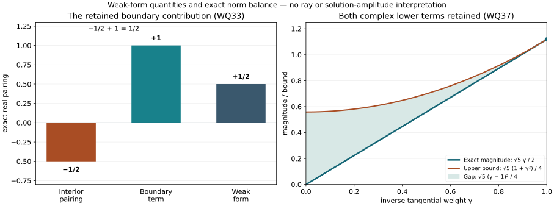

# Characteristic quadratic estimates in the weak boundary form

*AN-04 proof supplement. Written by GPT-6 Astra (OpenAI). Independent exposition and reproducible figures are CC0-1.0; linked components retain their own terms.*

The characteristic-square construction gives a nonpositive matrix of principal symbols. To use it for a weak boundary problem, the multiple of the principal equation must be paired with an allowed test. Here that test is a tangential operator of order minus one. Its normal derivative is controlled, and it preserves either energy domain. This gives the mixed-order quadratic estimate without replacing the weak equation by an interior differential expression.

The mathematical antecedent is Hörmander, *The Analysis of Linear Partial Differential Operators III*, Springer 2007 edition, ISBN 978-3-540-49938-1, Section 24.4, especially Lemma 24.4.5, printed 446–447 (PDF 461–462). That lemma is written with an interior source and explicit boundary traces. We prove the natural-antidual version directly below. The preceding [characteristic-square supplement](../20261007-strict-diffraction-symbols/characteristic-squares-and-diffractive-commutants.md), S5–S8, supplies the complete symbol construction.

The exact earlier operator proofs are [Hilbert calculus and positivity](../20261007-restored-first-order-systems/hilbert-coefficient-calculus-and-positivity.md), H1–H5, especially the ordered expansion (HS4), Sobolev bound (HS6) and sharp lower bound (HS10). They include finite matrices and uniform parameter families. The [boundary-form domain proof](../20261007-restored-boundary-form/boundary-form-localization.md), Section 1.1, identifies the actual energy space and proves the required density. The [normal-coordinate proof](../20261007-restored-normal-window/boundary-normal-coordinates-and-window-transfer.md), Section 4, (NC15)–(NC17), transports the full weak equation and its lower coefficients. The proof map records their exact versions.

This supplement proves an operator estimate needed by strict diffraction. It does not yet prove the normal-commutant identity for rough weak solutions, its regularized propagation estimate, or the full strict-diffractive singular segment.

## 1. Spaces and the actual normalized form

Write \(X=[0,\infty)_x\times\mathbb R^d_z\), with \(d\ge1\), \(D=-i\partial\), Lebesgue measure and inner product linear first. Fix a finite component space \(\mathbb C^N\). All coefficients and all symbol derivatives used below are bounded on fixed larger coordinate patches. Put
\[
 \Lambda=(1+|D_z|^2)^{1/2},\qquad
 \|u\|_{\mathcal X_s}^2
   =\|\Lambda^s u\|_{L^2(X)}^2+
        \|\Lambda^{s-1}D_xu\|_{L^2(X)}^2.
 \tag{WQ1}
\]
The normal derivative is the intrinsic distributional derivative on \(x>0\). The norm is used whenever its two entries exist. In particular \(\mathcal X_1=H^1(X;\mathbb C^N)\), with the same norm. Negative tangential weights do not mean zero extension across the boundary.

Choose
\[
 V=H^1_0(X;\mathbb C^N)\quad\hbox{or}\quad
 V=H^1(X;\mathbb C^N),
 \qquad \|w\|_V=\|w\|_{\mathcal X_1}.
 \tag{WQ2}
\]
The first space is the closure of interior compact smooth functions; the second has no prescribed boundary trace. Its continuous antidual \(V^*\) acts antilinearly on tests. On the normalized patch the full form is
\[
\begin{split}
 q_0(u,w)&=(D_xu,D_xw)
       +\sum_{a,b=1}^d(h^{ab}D_bu,D_aw),\\
 q_1(u,w)&=\sum_{j\in\{x,1,\ldots,d\}}(\ell_jD_ju,w)
       +\sum_j(m_ju,D_jw)+(cu,w),\\
 q(u,w)&=q_0(u,w)+q_1(u,w).
\end{split}\tag{WQ3}
\]
Here \(h^{ab}=h^{ba}\) are real scalars. They may be indefinite and depend on every \(z\) coordinate, including time. All \(\ell_j,m_j,c\) are arbitrary smooth complex matrices. The principal symbol is
\[
 p=\xi^2-r(x,z,\eta),\qquad
 r=-\sum_{a,b}h^{ab}\eta_a\eta_b.
 \tag{WQ4}
\]
The normal coefficient is one and the principal cross block is zero. This is the exact normalized form obtained in (NC15)–(NC17): pullback changes the density and every lower coefficient, and multiplication on the test side creates an additional first-order coefficient. All those terms are included in (WQ3). No time-independence, selfadjointness of the full form, or strong Neumann condition is added.

We first use globally bounded extensions and compactly supported inputs, with the equation
\[
 q(u,w)=f(w)\quad(w\in V),\qquad u\in V,\ f\in V^*.
 \tag{WQ5}
\]
Section 6 proves the exact local formulation; it uses only the original compact tests and does not assert a global equation for a cut-off solution.

**W1. Tangential order bookkeeping.** Let \(B(x)\) be a smooth uniformly bounded family in \(\Psi^m_{1,0}(\mathbb R^d)\), including every needed \(x\) derivative. For real \(t\),
\[
 \|\Lambda^{t-m}Bv\|_{L^2(X)}
       \le C\|\Lambda^t v\|_{L^2(X)},\qquad
 [D_x,B]=-i\,\partial_xB\in\Psi^m.
 \tag{WQ6}
\]
For two tangential orders \(a,b\), a family \(C\in\Psi^{a+b}\) satisfies
\[
 |(Cv,w)_X|
     \le C_0\|\Lambda^a v\|_{L^2(X)}
                  \|\Lambda^b w\|_{L^2(X)}.
 \tag{WQ7}
\]

**Proof.** Apply (HS6) at each fixed \(x\), with the same finite-seminorm constant, square and integrate. The Fourier Cauchy–Schwarz inequality gives (WQ7), or equivalently insert \(\Lambda^{-b}C\Lambda^{-a}\), which has order zero by (HS4). Differentiate the parameter-dependent kernel on smooth tests to obtain the commutator in (WQ6). Its identity for distributions follows by pairing with compact smooth tests and the already proved distributional operator action. All these statements pass from smooth tests to their Sobolev domains by the simultaneous density in Section H1 of the Hilbert-calculus companion. There is no integration by parts in \(x\). ∎

## 2. Mixed-order matrix positivity at the exact lower norm

**W2. A nonpositive principal matrix.** Suppose \(B_{jk}\in\Psi^{1-j-k}\), \(j,k=0,1\), are smooth uniform tangential families acting on \(\mathbb C^N\), with classical homogeneous principal terms \(b_{jk}\). Assume the normalized \(2N\)-by-\(2N\) principal matrix
\[
 \left(|\eta|^{j-1/2}b_{jk}(x,z,\eta)
                    |\eta|^{k-1/2}\right)_{j,k=0}^1
 \quad\hbox{is Hermitian and nonpositive}.
 \tag{WQ8}
\]
Then
\[
 \operatorname{Re}\sum_{j,k=0}^1
       (B_{jk}D_x^ku,D_x^ju)_X
       \le C\|u\|_{\mathcal X_0}^2
       \quad (u\in V).
 \tag{WQ9}
\]
The estimate is uniform for families with bounded symbol seminorms. Lower-order matrix coefficients need not be Hermitian.

**Proof.** Set \(v_j=\Lambda^{1/2-j}D_x^ju\). The sum on the left is the form of the order-zero matrix
\[
 \mathbb B_{jk}=\Lambda^{j-1/2}B_{jk}\Lambda^{k-1/2}
 \quad\hbox{on }v=(v_0,v_1).
 \tag{WQ10}
\]
Its leading matrix is (WQ8). Multiply that homogeneous matrix by a smooth nonnegative low-frequency cutoff equal to one at large frequency; call the resulting symbol \(b\). Its values are still Hermitian nonpositive. The full matrix \(\mathbb B-\operatorname{Op}(b)\) has order minus one, including all composition, adjoint and low-frequency errors. Apply (HS10) to \(-b\), with \(m=-1/2\) and coefficient space \(\mathbb C^{2N}\). It gives an upper bound \(C\|\Lambda^{-1/2}v\|^2\). The order-minus-one quadratic estimate (HS6), at the same half-order, bounds the full remainder by the same quantity.

For each fixed \(x\) these are ordinary tangential estimates. Integrating in \(x\) gives
\[
 \|\Lambda^{-1/2}v\|_{L^2(X;\mathbb C^{2N})}^2
      =\|u\|^2+\|\Lambda^{-1}D_xu\|^2
      =\|u\|_{\mathcal X_0}^2 .
 \tag{WQ11}
\]
For \(u\in V\), \(v\) belongs to \(L^2\), so every expression above is defined. Density gives the asserted estimate on all of \(V\). The constant is uniform because the preceding sharp lower bound and the full remainders use finitely many uniform seminorms. In particular the remainder is controlled at the displayed quadratic mean order; we have not replaced it by a stronger operator-norm remainder. ∎

## 3. The order-minus-one test retains the boundary realization

Choose a scalar tangential family \(G=G^*\in\Psi^{-1}\), with actual \(L^2_z\) selfadjointness for each \(x\), and smooth bounded parameter derivatives. A prescribed real principal symbol \(g\) is realized by the symmetric part of its properly localized quantization. Symmetrization changes only order minus two. Normal-variable support cutoffs commute with tangential operators; tangential input and output cutoffs can also be inserted symmetrically.

**W3. Legal test and exact principal-form identity.** The operator \(G\) satisfies
\[
 \|Gu\|_{H^1(X)}\le C_G\|u\|_{\mathcal X_0},
 \qquad G:V\longrightarrow V.
 \tag{WQ12}
\]
Define the tangential differential family
\[
 R=-\sum_{a,b}D_a h^{ab}D_b,\qquad
 C_G=[D_x,G]\in\Psi^{-1}.
 \tag{WQ13}
\]
It has principal symbol \(r\). For \(u\in V\), the precise quadratic-form identity is
\[
 q_0(u,Gu)
   =(GD_xu,D_xu)-(GRu,u)+(D_xu,C_Gu).
 \tag{WQ14}
\]
The last pairing obeys
\[
 |(D_xu,C_Gu)|\le C\|u\|_{\mathcal X_0}^2.
 \tag{WQ15}
\]

**Proof.** The \(L^2\) and tangential first derivatives of \(Gu\) are bounded by \(C\|u\|\), by (WQ6). Its normal derivative is exactly \(GD_xu+C_Gu\). Its \(L^2\) norm is at most \(C(\|\Lambda^{-1}D_xu\|+\|u\|)\). This proves (WQ12); the same calculation works distributionally whenever the right side is finite.

For the Dirichlet domain, approximate by its defining interior compact smooth sequence. A tangential operator does not enlarge the support in \(x\), so each image is smooth with normal support separated from the physical boundary. Proper tangential localization makes that image compactly supported as well. Without that localization, the Schwartz action followed by expanding tangential cutoffs gives the same \(H^1_0\) conclusion. Continuity and the closedness of \(H^1_0\) complete the argument. For the \(H^1\) domain the bound itself suffices. No assertion about preservation of a strong conormal derivative is needed.

On smooth inputs, expand \(D_xGu=GD_xu+C_Gu\) but leave \(D_xu\) in its original factor. Selfadjointness of \(G\) gives the first term of (WQ14). In the tangential variables only, integration by parts gives
\(\sum(h^{ab}D_bu,D_aGu)=-(Ru,Gu)=-(GRu,u)\).
There is no tangential boundary. Thus (WQ14) follows without any normal integration by parts. Each term is continuous on \(H^1\): \(GR\) has tangential order one, \(G\) order minus one, and the remaining mixed pairing is controlled by (WQ7). The density just cited proves the identity for all \(u\in V\). More precisely (WQ7) with \(a=-1,b=1\), and \(\Lambda C_G\) of order zero, gives (WQ15). ∎

**W4. Every complex lower coefficient is controlled.** For \(q_1\) in (WQ3),
\[
 |q_1(u,Gu)|\le C_1\|u\|_{\mathcal X_0}^2.
 \tag{WQ16}
\]
Consequently an actual weak solution satisfies
\[
 \operatorname{Re}q_0(u,Gu)
    \le |f(Gu)|+C_1\|u\|_{\mathcal X_0}^2
    \le C_G\|f\|_{V^*}\|u\|_{\mathcal X_0}
              +C_1\|u\|_{\mathcal X_0}^2.
 \tag{WQ17}
\]

**Proof.** For every index \(j\), including \(x\),
\(\|\Lambda^{-1}D_ju\|\le\|u\|_{\mathcal X_0}\);
for tangential \(j\) this is the scalar Fourier bound
\(|\eta_j|/\langle\eta\rangle\le1\). Smooth matrix multiplication is bounded on each tangential \(H^t\) needed here, by (HS6), uniformly in \(x\). Hence
\[
 |(\ell_jD_ju,Gu)|
     \le C\|\Lambda^{-1}D_ju\|\,
                    \|\Lambda(\ell_j^*Gu)\|
     \le C\|u\|_{\mathcal X_0}\|u\|.
 \tag{WQ18}
\]
For a tangential \(j\), \(D_jG\) has order zero, so
\(|(m_ju,D_jGu)|\le C\|u\|^2\).
For \(j=x\), (WQ12)'s exact normal derivative instead gives
\[
 |(m_xu,D_xGu)|
    \le C\|u\|(\|\Lambda^{-1}D_xu\|+\|u\|).
 \tag{WQ19}
\]
The \(c\) term is bounded by \(C\|u\|^2\). Summing proves (WQ16). No coefficient matrices were commuted with each other, no lower form was declared Hermitian, and the test-side normal derivative in (WQ19) was never transferred to the first factor. Finally \(Gu\in V\), so (WQ5) gives \(q_0(u,Gu)=f(Gu)-q_1(u,Gu)\). The definition of \(V^*\) and (WQ12) give (WQ17). ∎

## 4. The characteristic quadratic estimate

**W5. Complete weak-form estimate.** Let \(A_{jk}\in\Psi^{1-j-k}\), \(j,k=0,1\), have real scalar homogeneous principal symbols \(a_{jk}I_N\), with \(a_{01}=a_{10}\). The full lower-order parts may be complex matrices. Assume the principal coefficients are supported in a sufficiently small compact conic parameter patch about a strict anchor
\[
 x=0,\quad r=0,\quad \partial_xr>0,
 \tag{WQ20}
\]
and that a real homogeneous function \(\psi(x,z,\xi,\eta)\) of degree \(1/2\) satisfies
\[
 \sum_{j,k=0}^1 a_{jk}(x,z,\eta)\xi^{j+k}
          =-\psi(x,z,\xi,\eta)^2\quad\hbox{on }p=0.
 \tag{WQ21}
\]
Only its values near the small normal characteristic roots are needed. Then there are scalar tangential operators
\[
 \Psi_0\in\Psi^{1/2},\qquad \Psi_1\in\Psi^{-1/2},
 \qquad G=G^*\in\Psi^{-1},
 \tag{WQ22}
\]
supported in a fixed slightly larger patch, such that every solution of (WQ5) satisfies
\[
\begin{split}
 \operatorname{Re}\sum_{j,k=0}^1
      (A_{jk}D_x^ku,D_x^ju)
      +\|\Psi_0u+\Psi_1D_xu\|^2
  &\le \operatorname{Re}f(Gu)+C\|u\|_{\mathcal X_0}^2\\
  &\le C_G\|f\|_{V^*}\|u\|_{\mathcal X_0}
                         +C\|u\|_{\mathcal X_0}^2 .
\end{split}\tag{WQ23}
\]
The principal symbols of \(\Psi_0,\Psi_1\), at \(\xi=r=0\), are respectively \(\psi\) and \(\partial_\xi\psi\). The theorem holds in either domain in (WQ2) and retains the actual \(f\in V^*\).

**Proof: choose and quantize the symbols.** S5–S6 of the characteristic-square supplement apply on the normalized parameter patch, since \(\partial_xr>0\) near (WQ20). They supply real smooth homogeneous \(\psi_0,\psi_1,g\), of degrees \(1/2,-1/2,-1\), with
\[
 \sum a_{jk}\xi^{j+k}
        +(\psi_0+\xi\psi_1)^2
        -g(\xi^2-r)\le0
       \quad\hbox{for every real }\xi .
 \tag{WQ24}
\]
They also give the asserted values on \(\xi=r=0\). The squared support cutoff in S6 makes these coefficients compactly supported inside the fixed larger parameter patch, while preserving (WQ24) for either sign of \(p\). Extend by zero outside it. Low-frequency cutoffs and proper quantization give \(\Psi_j\); choose the actual symmetric quantization of \(g\) as in W3. Every such modification preserves the indicated principal symbol and has the stated lower order.

**Proof: keep the complete operator array.** Put \(u_j=D_x^ju\), and form
\[
\begin{array}{ll}
 B_{00}=A_{00}+\Psi_0^*\Psi_0+GR,&
 B_{01}=A_{01}+\Psi_0^*\Psi_1,\\
 B_{10}=A_{10}+\Psi_1^*\Psi_0,&
 B_{11}=A_{11}+\Psi_1^*\Psi_1-G .
\end{array}\tag{WQ25}
\]
These are the actual ordered operators; neither \(GR\) nor the lower parts of \(A_{jk}\) are replaced by selfadjoint operators. Their orders are \(1-j-k\). The principal polynomial of this array is the left side of (WQ24). Its real symmetric coefficient matrix is nonpositive on real pairs: substitute \(\xi=v_1/v_0\) if \(v_0\ne0\), and use continuity if \(v_0=0\). On complex pairs take the sum of the forms on real and imaginary parts. Tensoring with \(I_N\) preserves the conclusion. Positive diagonal weight conjugation gives (WQ8). Thus W2 bounds its full quadratic form by \(C\|u\|_{\mathcal X_0}^2\).

Expanding (WQ25) and using the exact identity (WQ14) gives
\[
\begin{split}
 &\operatorname{Re}\sum(A_{jk}u_k,u_j)
       +\|\Psi_0u+\Psi_1u_1\|^2
       -\operatorname{Re}q_0(u,Gu)\\
 &\hspace{12mm}
     =\operatorname{Re}\sum(B_{jk}u_k,u_j)
          -\operatorname{Re}(D_xu,C_Gu).
\end{split}\tag{WQ26}
\]
W2 and (WQ15) bound the right side by the required lower norm. W4 then substitutes the full weak source and all lower terms. This proves both lines of (WQ23).

All identities first hold on smooth functions in the selected domain. For \(u\in V\), each left-hand form is continuous in \(H^1\) by W1; for example \(A_{11}\) has order minus one and \(A_{00}\) has order one. The positive output is continuous from \(H^1\) to \(L^2\). The form \(q_0(u,Gu)\) and the mixed error are also continuous there. Approximation therefore proves (WQ26) for the actual solution, and only then is its weak equation applied to \(Gu\). This does not require the approximants to solve that equation, or require a normal derivative trace of \(u\). ∎

The uniformity is precise: for fixed chosen square-completion symbols, the estimate is uniform over bounded families of the full quantizations, their remainders, and the coefficients in (WQ3). No uniform seminorm bound for arbitrary characteristic-square extensions is asserted merely from a bound on their characteristic values.

## 5. Two independent rows control the localized mixed norm

**W6. Elliptic pair estimate.** Suppose two instances of W5 give
\(T_\alpha=\Psi_{\alpha0}+\Psi_{\alpha1}D_x\), \(\alpha=1,2\), and their weighted principal matrix is invertible on a fixed conic neighborhood:
\[
 \mathbb T_0(x,z,\eta)=
 \begin{pmatrix}
 \psi_{10}|\eta|^{-1/2}&\psi_{11}|\eta|^{1/2}\\
 \psi_{20}|\eta|^{-1/2}&\psi_{21}|\eta|^{1/2}
 \end{pmatrix}.
 \tag{WQ27}
\]
There is a scalar tangential cutoff \(K\in\Psi^0\), elliptic at the anchor and with support in that neighborhood, such that
\[
 \|Ku\|_{\mathcal X_{1/2}}^2
       \le C\sum_{\alpha=1}^2\|T_\alpha u\|^2
                       +C'\|u\|_{\mathcal X_0}^2.
 \tag{WQ28}
\]
In particular, writing \(\mathcal A_\alpha[u]\) for the quadratic sum with coefficients \(A_{\alpha jk}\),
\[
 \|Ku\|_{\mathcal X_{1/2}}^2
    \le C\sum_{\alpha=1}^2
        \bigl(|f(G_\alpha u)|
                      -\operatorname{Re}\mathcal A_\alpha[u]\bigr)
               +C''\|u\|_{\mathcal X_0}^2 .
 \tag{WQ29}
\]
This is a mixed tangential-normal estimate. It is not an identification of \(\mathcal X_{1/2}\) with a higher full energy space.

**Proof.** Use \(v=(\Lambda^{1/2}u,\Lambda^{-1/2}D_xu)\), as in W2. The actual order-zero matrix
\(\mathbb T_{\alpha j}=\Psi_{\alpha j}\Lambda^{j-1/2}\)
satisfies \(\mathbb T v=(T_1u,T_2u)\).
Choose a smooth scalar degree-zero cutoff \(k\) supported strictly inside the invertibility region, equal to one near the anchor. On the compact normalized support, the matrix inverse \(\mathbb T_0^{-1}\) is smooth with bounded derivatives: for a two-by-two matrix its entries are the cofactor entries divided by a determinant bounded away from zero. Homogeneity gives the ordinary order-zero estimates. After a fixed low-frequency cutoff, quantize
\(e=k\mathbb T_0^{-1}\). The ordered composition (HS4) gives
\[
 E\mathbb T=K I_2+\mathcal R,\qquad
 \mathcal R\in\Psi^{-1},\qquad
 \|Kv\|\le C\|\mathbb T v\|+C\|\Lambda^{-1}v\|.
 \tag{WQ30}
\]
All operators here act componentwise on the fixed finite coefficient space; proper cutoffs retain only lower-order errors. This is a one-step inverse with the exact remainder needed, so an unproved full asymptotic inverse is unnecessary. The last norm is bounded by \(\|u\|_{\mathcal X_0}\), since its two entries are \(\Lambda^{-1/2}u\) and \(\Lambda^{-3/2}D_xu\).

To identify the left side, commute \(K\) through the weights. The first difference
\([\Lambda^{1/2},K]u\) has order minus one-half and is bounded by \(C\|u\|\). In the normal entry,
\[
 \Lambda^{-1/2}D_xKu
    =K\Lambda^{-1/2}D_xu
      +[\Lambda^{-1/2},K]D_xu
      +\Lambda^{-1/2}[D_x,K]u .
 \tag{WQ31}
\]
The middle operator has order minus three-halves on \(D_xu\), and the last has order minus one-half on \(u\); both are bounded by \(C\|u\|_{\mathcal X_0}\). Squaring the resulting norm bound with
\((a+b)^2\le2a^2+2b^2\) proves (WQ28). Substitute the two estimates (WQ23), using a separate enlarged constant \(C''\) for their lower terms, to obtain (WQ29). ∎

For the two strict commutants constructed in S8 of the preceding supplement, the square-completion coefficients in W5 have, at the anchor, exactly the rows \((\Psi_\delta,\partial_\xi\Psi_\delta)\). Equations (DS31)–(DS33) prove their independence for two sufficiently small widths. The positive homogeneous weights in (WQ27) preserve invertibility. Continuity supplies the fixed neighborhood required in W6. This supplies the operator consequence of that construction once the remaining commutator calculation controls the two \(\mathcal A_\alpha[u]\).

## 6. Local equations, original coordinates and supported tests

**W7. Exact localization and transport.** The preceding estimates also hold for a local weak solution on a relatively compact smooth-face patch. All source pairings are then pairings of the original local natural-antidual source with compact tests in its original domain.

**Proof.** Make the \(G_\alpha,\Psi_{\alpha j},A_{\alpha jk},K,E\) proper in the tangential variables, with input and output kernel supports in one fixed larger compact patch. Their parameter support in \(x\) is compact. Choose a real smooth compact \(\omega\), equal to one on an open neighborhood of all these supports and their required enlargements. Apply the operator inequalities to \(v=\omega u\). The actual tangential operators, their normal derivatives and their products have the same actions there as on \(u\); each derivative of \(\omega\) vanishes on the relevant normal and tangential support.

In particular \(G_\alpha v=G_\alpha u\) is a compact allowed test and \(v=u\) near its support. Therefore
\[
 q(v,G_\alpha v)=q(u,G_\alpha u)
             =f(G_\alpha u).
 \tag{WQ32}
\]
There is no forcing commutator to suppress: no equation for \(v\) on arbitrary tests is used. The norms on the right are the fixed localized \(\mathcal X_0\) norms of \(v\). To bound the source by a norm, use another fixed cutoff equal to one on the test supports; by the definition of the local antidual it gives an element of \(V^*\). For the Dirichlet choice multiplication preserves the defining interior closure; for the Neumann choice it is bounded on \(H^1\).

The coordinate map and real nonzero multiplier of (NC15)–(NC17) are bounded isomorphisms on the chosen local energy domains and their natural antiduals, with their complete coefficient formulas. Their inverse transports each compact test just constructed back to an allowed original test. The source value is its original dual action by those formulas. The transformed normal derivative need not be the original one; we use the transformed mixed norm (WQ1) and do not identify it with an unproved invariant norm. All coefficient derivatives generated by the multiplier are among \(\ell_j,m_j,c\) in W4. Thus this estimate applies after normalizing the full original weak class, including its time-dependent principal coefficients and arbitrary complex lower matrices. ∎

## 7. Exact examples with complete solutions

### Exercise 1. The boundary term that an interior substitution loses

On the half-line, suppress the tangential variables, take \(\Lambda=1\), \(G=1\), \(u=e^{-x}\), and the principal form \(q_0(u,w)=(D_xu,D_xw)\). Compute \(q_0(u,Gu)\), \((D_x^2u,Gu)\), and their difference. Explain why this is relevant to W3 even though this elementary model is not a strict-diffraction symbol.

**Solution.** Since \(D_xu=i e^{-x}\), \(D_x^2u=-e^{-x}\), and \(\int_0^\infty e^{-2x}dx=1/2\),
\[
 q_0(u,u)=\tfrac12,\qquad
 (D_x^2u,u)=-\tfrac12,\qquad
 -i(D_xu(0),u(0))=1 .
 \tag{WQ33}
\]
Direct integration by parts gives, for smooth decaying functions,
\[
 (D_xu,D_xw)=(D_x^2u,w)
                     -i(D_xu(0),w(0)).
 \tag{WQ34}
\]
The three numbers in (WQ33) satisfy that identity exactly. In the \(H^1\) domain the last term is part of the weak operator. The trace functional is continuous: for compact smooth \(w\),
\(|w(0)|^2=-\int_0^\infty (|w|^2)'dx
 \le2\|w\|\|w'\|\le\|w\|_{H^1}^2\).
Density extends the trace and the corresponding boundary functional to \(H^1\). It vanishes on \(H^1_0\), by its defining interior approximants. Thus the two weak domains really have different tests, and restriction to the interior equation loses information in the first one. W3 avoids this substitution altogether. The half-line calculation illustrates that boundary action; it makes no glancing or propagation claim.

### Exercise 2. A non-Hermitian lower form and its exact weight balance

Consider the exact two-component normal-profile calculation \(u(x)=e^{-x}v\), \(v=(1,1)^T\), with a scalar multiplier \(G=\gamma I\), \(\gamma>0\), and matrices
\[
 L=\begin{pmatrix}0&1\\0&0\end{pmatrix},\qquad
 M=\begin{pmatrix}i&1\\0&-2\end{pmatrix}.
 \tag{WQ35}
\]
Compute \((LD_xu,Gu)+(Mu,D_xGu)\). For the model weight whose inverse is \(\gamma\), compare its magnitude with
\(\|u\|^2+\gamma^2\|D_xu\|^2\).

**Solution.** The inner product is linear first. Since
\((Lv,v)=1\) and \((Mv,v)=i-1\), the two pairings add to
\[
 \frac{\gamma}{2}\,i((L-M)v,v)
      =\frac{\gamma}{2}(1+2i).
 \tag{WQ36}
\]
Neither its real nor its imaginary part can be deleted. Here
\(\|u\|^2=\|D_xu\|^2=1\), so the model lower norm is \(1+\gamma^2\). Completing the square gives
\[
 \left|\frac{\gamma}{2}(1+2i)\right|
       =\frac{\sqrt5}{2}\gamma
       \le\frac{\sqrt5}{4}(1+\gamma^2),\qquad
 \text{gap}=\frac{\sqrt5}{4}(\gamma-1)^2 .
 \tag{WQ37}
\]
For an actual tangential Fourier weight, \(0<\gamma=\langle\eta\rangle^{-1}\le1\); the algebraic inequality is true for every \(\gamma>0\). This is an exact normal-profile and weight calculation, not a square-integrable plane wave in unbounded tangential space. It illustrates precisely why the opposite normal-factor positions in (WQ18)–(WQ19) still yield one lower mixed norm.

### Exercise 3. Recover the two entries without changing their orders

At a normalized anchor use the two rows \((1,528/31)\), \((1,2080/63)\) from (DS37). Find the inverse matrix and explain which pair of quantities W6 recovers.

**Solution.** Set \(a=528/31\), \(b=2080/63\), and \(d=b-a=31216/1953>0\). The exact inverse is
\[
 \begin{pmatrix}1&a\\1&b\end{pmatrix}^{-1}
       =\frac1d\begin{pmatrix}b&-a\\-1&1\end{pmatrix}.
 \tag{WQ38}
\]
Multiplication in either order gives the identity: the diagonal numerators are \(b-a=d\) and the off-diagonal numerators cancel. The actual commutant rows include the positive row factors \(\Psi_\delta\); multiply this inverse on the right by their inverse diagonal matrix. In W6 the columns refer to \(\Lambda^{1/2}u\) and \(\Lambda^{-1/2}D_xu\). Inverting their order-zero coefficient matrix recovers these weighted entries, with the order-minus-one remainder in (WQ30). It does not recover two unweighted first derivatives, nor remove that remainder. Formula (WQ31) then identifies the exact localized \(\mathcal X_{1/2}\) norm.

*The first panel displays the three exact quantities in (WQ33): the interior pairing plus the retained boundary term equals the weak form. The second panel compares (WQ37)'s exact magnitude and upper bound for \(0\le\gamma\le1\), with their nonnegative difference shaded. The endpoint \(\gamma=0\) is the continuous limit. These are pairings and weight balances, not solution amplitudes or characteristic rays. Full proofs: W3–W5 and Exercises 1–2.*

## 8. Scope of the quadratic estimate

The symbol inequality now has an actual weak-form realization, with the exact lower mixed norm, natural-antidual forcing and all complex lower coefficients. The two independent symbol rows also give the operator estimate (WQ28). The relevant source book's boundary-trace term has not been thrown away: the principal multiple is represented by \(q_0(u,Gu)\), tested in the original domain.

The remaining propagation proof must control the two quadratic forms \(\mathcal A_\alpha[u]\) by the full normal-commutant identity and its regularizer errors. The first-order normal commutant itself need not preserve \(H^1_0\), and an \(H^1\) solution does not automatically have a normal derivative trace. These issues still require an argument. It must retain the natural-dual source, both weak domains, time-dependent coefficients and arbitrary complex lower matrices, and it must produce one common smooth neighborhood. The mixed norm established here must also be connected to the required energy-b front at that scope.

The prerequisite proof index gives the earlier results used here.
