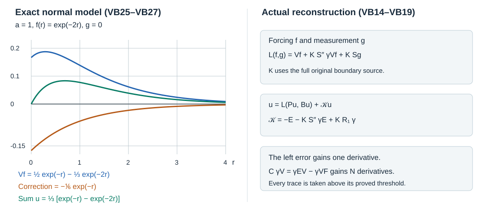

# Recovering a collar solution from its forcing and boundary data

The inverse on a doubled collar, its boundary layer and the inverse of the boundary measurements now fit into one exact construction. The errors matter: one comes from the volume equation, another from the Cauchy projection, and a cancellation gives an additional derivative in the measured trace of volume data. We prove every identity on its actual domain, then return to the original collar with the normal cutoff terms present.

This independent exposition is CC0. The mathematical antecedent is the approved edition of Lars Hörmander, *The Analysis of Linear Partial Differential Operators III*, Springer 2007, ISBN 978-3-540-49938-1, Section 20.1. The existing AN-03 *Fredholm boundary problems with first-order Calderón defects*, Sections 1–7, supplied the comparison of the volume and boundary identities. Its actual proofs have been checked against the earlier AN-04 constructions cited below. Linked components retain their own terms. 

## 1. The actual operators and their domains

Fix the complete cylinder polynomial of GC:C1 on the compact boundary manifold \(Y\):
\[
 P=P_c=\sum_{a=0}^{m}A_a(r)D_r^a:E_Y\longrightarrow F_Y,
 \qquad A_a(r)\in\Psi^{m-a},\quad A_m=M(r),\quad D_r=-i\partial_r.
 \tag{VB1}
\]
Here \(m\ge1\), \(M\) is a smooth invertible bundle map, and the full homogeneous polynomial is elliptic at every nonzero real covector. The fixed collar, uniform coefficient extension, preferred tangential charts, bundle identifications, density and normal properness are those constructed in GC:C1–H1. This includes all smoothing parts of the tangential coefficients. On a sufficiently small collar this polynomial is the original operator. A later interior summand, supported away from that collar, is not inserted into these cylinder identities.

The bar spaces \(\overline H_{(s,t)}\) on \(Y\times\mathbb R_+\) are restriction spaces, with local full Fourier weight \(q^s\lambda^t\), where \(q=(1+|\eta|^2+\kappa^2)^{1/2}\) and \(\lambda=(1+|\eta|^2)^{1/2}\). GC:H1 proves the equivalent global norms; MH:Q1, I1 and TR1–TR3 prove restriction, normal L2 and traces. Set
\[
 \gamma u=(\gamma_ku)_{k=0}^{m-1},\qquad \gamma_ku=(D_r^ku)|_{r=0+},
 \qquad \mathcal U_\sigma=\bigoplus_{k<m}H^{\sigma-k-1/2}(Y,E_Y),
 \quad \mathcal D_\sigma=\bigoplus_jH^{\sigma-m_j-1/2}(Y,G_j).
 \tag{VB2}
\]
The actual measurement matrix is \(\mathcal B=(B_{jk})\), with \(B_{jk}\in\Psi^{m_j-k}\), and the measurement of a volume section is \(Bu=\mathcal B\gamma u\). No upper bound on the original orders \(m_j\) is imposed. Its leading map is bijective from the stable Cauchy bundle to the target bundle, as in NP:M1 and WB:P1.

For a fixed integer \(N\ge1\), choose the actual finite inverse \(Q_N\) of GC:F1 and define its errors with their signs:
\[
 \mathsf E=Q_NP-I_E=-(-\mathcal R_E)^N,
 \qquad \mathsf F=PQ_N-I_F=-(-\mathcal R_F)^N.
 \tag{VB3}
\]
Thus \(Q_N\in\mathcal L^{-m}\) and \(\mathsf E,\mathsf F\in\mathcal L^{-N}\), on their respective bundles. HM:E1 uses the opposite, subtracted error convention; VB3 translates it explicitly. All compositions below have the displayed bundle domains.

Use the complete source of HM:S1–S2, with the coefficient acting after the delta derivative:
\[
 JU=\frac1i\sum_{a=1}^{m}A_a(r)\sum_{b=0}^{a-1}
           U_{a-1-b}\otimes D_r^b\delta_0,
 \qquad J:\mathcal U_\sigma\longrightarrow H_{(-m,\sigma)}(F_Y).
 \tag{VB4}
\]
This includes every derivative generated by multiplying \(A_a(r)\) into a delta derivative. The full finite-jet Gram norm and cross terms proving the last bound are HM:J1–J2 and S2. Define
\[
 \begin{gathered}
 V=r^+Q_Ne^+:F_Y\to E_Y,\qquad K=r^+Q_NJ,\qquad C=\gamma K,\\
 E=r^+\mathsf E e^+,\qquad F=r^+\mathsf F e^+,
 \qquad H=r^+\mathsf FJ:E_Y^{\oplus m}\to F_Y.
 \end{gathered}
 \tag{VB5}
\]
The symbols \(E,F\) in VB5 denote operators, rather than the bundles bearing subscripts in VB1. Zero extension is the normal-L2 extension proved in HM:V1. For \(a\ge0\), its definition is continuous from \(\overline H_{(a,t)}\) to \(H_{(0,a+t)}\); we never extend a positive normal Sobolev order by a false bounded-zero-extension assertion.

The earlier half-space bounds give, for every real tangential index and every indicated real output split,
\[
 \begin{aligned}
 V &: \overline H_{(a,t)}\to\overline H_{(a+m,t)},&&a\ge0,\\
 E,F &: \overline H_{(a,t)}\to\overline H_{(a+N,t)},&&a\ge0,\\
 K &: \mathcal U_\sigma\to\overline H_{(\nu,\sigma-\nu)},&&\nu,\sigma\in\mathbb R,\\
 H &: \mathcal U_\sigma\to\overline H_{(\nu,\sigma-m+N-\nu)},&&\nu,\sigma\in\mathbb R.
 \end{aligned}
 \tag{VB6}
\]
Indeed the first two are HM:V1 applied to their actual paired orders. The last two follow from VB4 and HM:L1 with orders \(-m\) and \(-N\). Their constants depend on the requested indices and finite symbol seminorms. In particular, taking \(\nu>k+1/2\) defines every layer trace continuously, and HM:T1 identifies the same one-sided trace for different auxiliary choices of \(\nu\). TS and VP prove the actual classical trace matrix \(C\); its stable principal symbol and original entry degrees are unchanged.

## 2. The three exact volume identities

For smooth sections up to the boundary, the full source formula is
\[
 P e^+u=e^+Pu+J\gamma u.
 \tag{VB7}
\]
This is HM:S1 with the original coefficients. Apply \(r^+Q_N\), use VB3, and obtain
\[
 u+Eu=V(Pu)+K\gamma u.
 \tag{VB8}
\]
The polynomial \(P\) is local in its normal variable: its tangential coefficients act at the same \(r\). Therefore restriction to \(r>0\) commutes with this differential polynomial on distributions. Since \(r^+JU=0\), the other ordered identity in VB3 gives
\[
 PV=I+F,\qquad PK=H.
 \tag{VB9}
\]
There is no boundary term on the right of the second equation: the boundary source is first acted upon by \(PQ_N=I+\mathsf F\), and only then restricted.

Here are the domains of these equalities. VB8 holds for \(u\in\overline H_{(s,t)}\), \(s\ge m\). Its equation \(Pu\) lies in \(\overline H_{(s-m,t)}\): choose a full extension, apply GC:H1, then restrict, using the normal locality just explained and infimizing the extension norm. Traces lie in \(\mathcal U_{s+t}\). Smooth approximation follows by choosing a full extension, using GC:H1 density and restricting. Multiplication by expanding smooth normal cutoffs and the finite tangential partition gives approximants smooth up to the boundary. Every term in VB7 converges as a distribution: use HM:V1 for both zero extensions, MH:TR1–TR3 for the traces, VB4 for the source, and the continuous proper operators GC and PN. VB8 therefore extends to that entire Hilbert domain, not merely to smooth data.

For \(f\in\overline H_{(a,t)}\), \(a\ge0\), the same approximation proves the first equation of VB9 in \(\overline H_{(a,t)}\); both the equation and the norm bounds are continuous there. For \(U\in\mathcal U_\sigma\), choose \(\nu\ge m\) in VB6 to define \(PKU\) by normal differentiation, and approximate the boundary vector by smooth vectors in its finite Sobolev sum. The second identity follows in distributions. Since compact-boundary distributions belong to some finite negative Sobolev space by WM:W1, it holds for every distributional vector \(U\), with the layer understood through that space. Changing to a larger allowable space does not change the operator.

## 3. Cancellation at the Cauchy trace

Apply VB8 to \(u=KU\). For any \(\sigma\), choose \(\nu\ge m\) in VB6 and use the domain just proved. Equation VB9 gives
\[
 C^2-C=\gamma EK-\gamma VH.
 \tag{VB10}
\]
Both terms are well-defined even when \(U\) is rough. In the first term, start with \(K:\mathcal U_\sigma\to\overline H_{(\nu,\sigma-\nu)}\), then apply \(E\), then trace. The result belongs to \(\mathcal U_{\sigma+N}\). In the second term, choose the output normal index zero for \(H\), giving \(\overline H_{(0,\sigma-m+N)}\). Apply \(V\) and trace at normal order \(m\), which is strictly above every threshold \(k+1/2\), \(k<m\). The result again lies in \(\mathcal U_{\sigma+N}\). Thus VB10 proves the all-real norm gain
\[
 C^2-C:\mathcal U_\sigma\longrightarrow\mathcal U_{\sigma+N}.
 \tag{VB11}
\]
We use the classical weighted order-minus-one conclusion of VP:T2 and WB:P1 where a symbol statement is needed. VB11 is the additional norm estimate for this particular finite inverse; no assertion that a finite error is smoothing follows from it.

Apply VB8 instead to \(u=Vf\). For \(a\ge0\), VB6 puts this in the required domain. Substitute \(PVf=f+Ff\), cancel the identical \(Vf\) terms, and take the trace:
\[
 C\gamma V=\gamma EV-\gamma VF:
 \overline H_{(a,t)}\longrightarrow\mathcal U_{a+t+m+N}.
 \tag{VB12}
\]
For the first term, \(EVf\) has normal order \(a+m+N\); for the second, \(VFf\) has the same order. Their tangential index stays \(t\). Tracing gives exactly the index in VB12. By comparison, tracing \(V\) alone gives only \(\mathcal U_{a+t+m}\). The gain in VB12 comes from the ordered cancellation, not from an improved trace theorem.

## 4. The inverse of the full data

Use the actual boundary operators of WB:R1–I2 for this \(C\) and \(\mathcal B\). They satisfy
\[
 \begin{gathered}
 \mathcal BCS-I=R_G\in\Psi^{-\infty},\qquad
 R_0=I-S\mathcal B-S'',\qquad R_1=R_0+S''C,\\
 U=S\mathcal BU+S''(I-C)U+R_1U.
 \end{gathered}
 \tag{VB13}
\]
Here \(S:\mathcal D_\sigma\to\mathcal U_\sigma\), \(S'':\mathcal U_\sigma\to\mathcal U_\sigma\), and \(R_0,R_1,S''C:\mathcal U_\sigma\to\mathcal U_{\sigma+1}\), for every real \(\sigma\). Their precise entry orders are \(k-m_j\), \(k-l\) and \(k-l-1\), respectively. WB constructs these actual operators by both rectangular symbol inverses and complete asymptotic sums; we do not assume an exact projection or replace \(\mathcal BCS\) by \(\mathcal BS\).

Define the volume reconstruction
\[
 \mathscr L(f,g)=\Phi f+\Lambda g,
 \qquad \Phi=(I+KS''\gamma)V,\qquad \Lambda=KS.
 \tag{VB14}
\]
For \(a\ge0\), the trace of \(Vf\) belongs to \(\mathcal U_{a+t+m}\). Apply \(S''\), then choose \(\nu=a+m\) in the third line of VB6. This proves
\[
 \Phi:\overline H_{(a,t)}\to\overline H_{(a+m,t)},
 \qquad \Lambda:\mathcal D_\sigma\to\overline H_{(\nu,\sigma-\nu)}
 \quad(\sigma,\nu\in\mathbb R).
 \tag{VB15}
\]
In particular the data pair \(f\in\overline H_{(a,t)}\), \(g\in\mathcal D_{a+t+m}\) produces an actual section of \(\overline H_{(a+m,t)}\), with a continuous norm estimate. No trace of a volume section below its legitimate threshold occurs.

Let \(u\in\overline H_{(s,t)}\), \(s\ge m\), and write \(U=\gamma u\), \(f=Pu\), \(g=Bu\). Taking the trace of VB8 gives \((I-C)U=\gamma Vf-\gamma Eu\). Substitute this in VB13 and then in VB8. The result is the exact left identity
\[
 u=\mathscr L(Pu,Bu)+\mathscr Ku,
 \qquad \mathscr K=-E-KS''\gamma E+KR_1\gamma.
 \tag{VB16}
\]
In particular the first two signs are negative. Every equality is on the domain established in Section 2, so this reconstruction is available before an extra derivative has been proved.

## 5. All four right errors and their cancellation

Apply \(P\) to VB14 and use both equations in VB9. Apply \(B=\mathcal B\gamma\) and use \(\gamma K=C\) and VB13. This gives
\[
 \begin{aligned}
 P\mathscr L(f,g)&=f+\mathscr K_1f+\mathscr K_2g,
 &\mathscr K_1&=F+HS''\gamma V,&\mathscr K_2&=HS,\\
 B\mathscr L(f,g)&=g+\mathscr K_3f+\mathscr K_4g,
 &\mathscr K_3&=\mathcal B(I+CS'')\gamma V,&\mathscr K_4&=R_G.
 \end{aligned}
 \tag{VB17}
\]
For the boundary part from \(f\), expand the exact \(S''=I-S\mathcal B-R_0\), preserving the factor order:
\[
 \mathcal B(I+CS'')=\mathcal BC+D_{-1},
 \qquad D_{-1}=-R_G\mathcal B-\mathcal BCR_0.
 \tag{VB18}
\]
Indeed the uncancelled terms before using \(\mathcal BCS=I+R_G\) are \(\mathcal B+\mathcal BC-\mathcal BCS\mathcal B-\mathcal BCR_0\). Each \((j,k)\) entry of \(D_{-1}\) has order at most \(m_j-k-1\); the first summand is smooth by the full smooth-kernel ideal P2:OP6. Consequently VB12 controls \(\mathcal BC\gamma V\), while the order of \(D_{-1}\) controls \(D_{-1}\gamma V\). This is the required measured-volume cancellation.

Here are all five error maps, including the left error:
\[
 \begin{aligned}
 \mathscr K &: \overline H_{(s,t)}\to\overline H_{(s+1,t)},&&s\ge m,\\
 \mathscr K_1 &: \overline H_{(a,t)}\to\overline H_{(a+N,t)},&&a\ge0,\\
 \mathscr K_2 &: \mathcal D_{t+m}\to\overline H_{(a+N,t-a)},&&a,t\in\mathbb R,\\
 \mathscr K_3 &: \overline H_{(a,t)}\to\mathcal D_{a+t+m+1},&&a\ge0,\\
 \mathscr K_4 &: \mathcal D'(Y,\textstyle\bigoplus_jG_j)\to C^\infty(Y,\textstyle\bigoplus_jG_j).
 \end{aligned}
 \tag{VB19}
\]
We verify the remaining index arithmetic. In \(\mathscr K\), \(Eu\) belongs to \(\overline H_{(s+N,t)}\), hence to \(\overline H_{(s+1,t)}\) because \(N\ge1\). Its trace belongs to \(\mathcal U_{s+t+N}\). After \(S''\), use \(K\) with output normal order \(s+1\); the resulting tangential index is \(t+N-1\), which embeds into \(t\). The third term starts with \(\gamma u\in\mathcal U_{s+t}\); \(R_1\) raises this index by one, and \(K\) with the same normal order gives exactly \(\overline H_{(s+1,t)}\).

For \(\mathscr K_1\), the term \(F\) has the stated gain. The other term starts with \(S''\gamma Vf\in\mathcal U_{a+t+m}\). Set \(\nu=a+N\) in the last line of VB6; its tangential index is \(a+t+m-m+N-(a+N)=t\). For \(\mathscr K_2\), \(Sg\in\mathcal U_{t+m}\). The same choice \(\nu=a+N\) gives tangential index \(t-a\). In particular the input index contains no \(a\), and this line allows negative \(a\). For \(\mathscr K_3\), the first part of VB18 gives \(\mathcal D_{a+t+m+N}\), which embeds into the stated space, and the second gives exactly \(\mathcal D_{a+t+m+1}\). The last line is WB:R1. The finite \(N\)-gain is retained where it is proved; the left and measured-volume errors are asserted only with their justified one-derivative gain.

The right identities extend from smooth data to every domain displayed in VB19. For the boundary-data term choose an auxiliary normal output order at least \(m\) in VB15 before differentiating or tracing; the resulting distributions agree with the same layer at every other requested split. Smooth density and the bounds just proved then identify all right-hand sides. For the forcing term \(a\ge0\) already gives output normal order at least \(m\). This also explains why the arbitrary real split in the third line creates no illicit trace.

## 6. One step of regularity and finite iteration

Suppose \(u\in\overline H_{(s,t)}\), \(s\ge m\), and that its actual data satisfy \(Pu\in\overline H_{(s+1-m,t)}\), \(Bu\in\mathcal D_{s+t+1}\). Then VB15–VB16 and the first line of VB19 prove
\[
 \begin{split}
 u&\in\overline H_{(s+1,t)},\\
 \|u\|_{s+1,t}&\le C\left(
      \|Pu\|_{s+1-m,t}+\|Bu\|_{\mathcal D_{s+t+1}}+\|u\|_{s,t}\right).
 \end{split}
 \tag{VB20}
\]
All norms on the right retain the whole cylinder input. The identity, not an a priori assumption about the left norm, establishes membership. The same argument proves every fractional step \(s\mapsto s+\theta\), \(0<\theta\le1\): embed the error output into the target space, put \(a=s+\theta-m\ge0\) in VB15, and use the corresponding data indices. Starting at \(s=m\) and repeating with \(\theta=\min(1,b-s)\) reaches any fixed real \(b\ge m\) in finitely many steps. Thus
\[
 \|u\|_{b,t}\le C_{b,t}\left(
       \|Pu\|_{b-m,t}+\|Bu\|_{\mathcal D_{b+t}}+\|u\|_{m,t}\right)
 \tag{VB21}
\]
whenever the right-hand memberships hold. At earlier steps the target data spaces embed into the required lower spaces by their Fourier weights. Substituting the preceding estimate into the next proves VB21 by finite induction, including a fractional final step. This is a cylinder assertion with global Sobolev data; a smooth function without decay on the infinite cylinder need not satisfy those data hypotheses.

## 7. Return to the original collar

Let the original operator agree with VB1 on \(0\le r<\delta\); the allowed interior summand has both kernel variables away from a smaller such collar. Take \(z\in C_c^\infty([0,\delta))\), equal to one near zero, and form \(v=zu\), extended by zero beyond the positive support of \(z\). The unchanged coefficient extension of GC:C1 implies the exact equality
\[
 P_c v=zPu+[P_c,z]u,
 \qquad [P_c,z]=\sum_{a=1}^m\sum_{h=1}^a
       \binom ah A_a(r)(D_r^hz)D_r^{a-h},
 \qquad Bv=Bu.
 \tag{VB22}
\]
Every normal derivative of \(z\) remains. The coefficient of the power \(D_r^{a-h}\) has tangential order at most \(m-a\), so its total degree is at most \(m-h\le m-1\). GC:B1 proves the complete paired commutator estimate, including its separated tangential kernels. There is no derivative of \(A_a\) in this ordered formula. The boundary equality follows from \(z(0)=1\) and all its positive derivatives vanishing near zero.

Use nested normal cutoffs \(\chi\prec z\prec\zeta\), where \(z=1\) near \(\operatorname{supp}\chi\) and \(\zeta=1\) near \(\operatorname{supp}z\); all are constant one near the boundary. The commutator in VB22 can be evaluated on \(\zeta u\) because it is normal-local and supported where derivatives of \(z\) occur. Applying the normal-polynomial estimate to any full extension of \(\zeta u\) and then restricting proves
\[
 \|[P_c,z]u\|_{s+\theta-m,t}\le C\|\zeta u\|_{s,t},
 \qquad s\ge m,\quad 0<\theta\le1.
 \tag{VB23}
\]
Initially the stronger target is \(s-m+1\); the displayed estimate follows by the embedding \(s-m+1\ge s+\theta-m\). Finite smooth multipliers are bounded by MH:M1. Apply the fractional form of VB20 to \(v\), with VB22, then multiply the output by \(\chi\). This yields the local estimate
\[
 \|\chi u\|_{s+\theta,t}\le C\left(
       \|zPu\|_{s+\theta-m,t}+\|Bu\|_{\mathcal D_{s+t+\theta}}
                         +\|\zeta u\|_{s,t}\right).
 \tag{VB24}
\]
Here the lower norm retains every tangential input on \(Y\). Tangential separation alone is not a reason to remove it: a tangentially smoothing coefficient times a normal derivative can remain singular on the normal diagonal. Section 8 gives an exact instance.

To iterate locally, fix an outer normal collar where the initial \(\overline H_{(m,t)}\) membership and the data hypotheses hold, and a strictly smaller closed collar for the final cutoff \(\chi\). For a prescribed target \(b\), choose finitely many nested normal cutoffs between those two collars, with two intervening plateaux per application of VB24. Such functions are supplied by the smooth cutoff construction K:K4 applied to the nested compact intervals. Begin with the largest cutoff and apply VB24 inward, increasing the index by at most one each time. The argument for VB21 then proves local \(\overline H_{(b,t)}\) membership on the prescribed smaller collar. The final cutoff is fixed as \(b\) increases; only the intervening finite family and constants change.

If the data have all these local orders, the solution is smooth on that fixed smaller collar. To see this last implication with the tangential index still fixed, note
\(q^b\lambda^t\ge q^{b+\min(t,0)}\). The same inequality holds after taking extension infima. Thus the local mixed memberships imply ordinary Sobolev memberships of arbitrarily high order. For a full extension with order \(h>j+(d+1)/2\), Fourier Cauchy–Schwarz makes every derivative of order at most \(j\) absolutely integrable in frequency, hence continuous. Translations are continuous by dominated convergence. This gives a \(C^j\) representative up to the boundary. Representatives for different \(j\) agree on the open collar as distributions and hence as continuous functions, so all one-sided derivatives agree there and at the boundary by continuity. This proves the claimed smoothness. The full low-initial-regularity and microlocal boundary-wavefront argument is a subsequent step; it is not supplied by a trace applied below its threshold.

## 8. Four calculations with complete solutions

**1. The exact scalar Dirichlet inverse.** Take \(P=D_r^2+a^2\), \(a>0\), on the line. The kernel \(k(r)=e^{-a|r|}/(2a)\) satisfies \((-\partial_r^2+a^2)k=\delta_0\): it solves the equation off zero, its first derivative has jump \(-1\), and differentiation of that jump gives exactly the delta. Fourier transformation gives \(\widehat k=(\kappa^2+a^2)^{-1}\). Thus the exact full-line inverse, and its positive restriction, have zero volume errors. This explicit normal model can be treated directly without asserting that its noncompact normal kernel is the normally proper GC choice.

For smooth compact positive forcing, put \(I_f=\int_0^\infty e^{-as}f(s)\,ds\). Direct differentiation of the integral kernel gives
\[
 Vf(r)=\int_0^\infty\frac{e^{-a|r-s|}}{2a}f(s)\,ds,
 \quad \gamma Vf=\binom{I_f/(2a)}{-iI_f/2},\quad
 KU(r)=\frac12\left(U_0-\frac{i}{a}U_1\right)e^{-ar},\quad
 C=\frac12\begin{pmatrix}1&-i/a\\ia&1\end{pmatrix}.
 \tag{VB25}
\]
The source is \(-i(U_1\delta_0+U_0D_r\delta_0)\); since \(D_rk=i e^{-ar}/2\) on the positive side, it gives the stated \(K\) with both phases. Multiplication verifies \(C^2=C\) and \(C\gamma V=0\). For Dirichlet measurement choose \(\mathcal B=(1,0)\), \(S=(1,ia)^t\), and
\(S''=\left(\begin{smallmatrix}0&0\\-ia&1\end{smallmatrix}\right)\).
Then \(R_0=R_1=R_G=0\) and VB14 becomes
\[
 \mathscr L(f,g)(r)=g e^{-ar}+
   \int_0^\infty\frac{e^{-a|r-s|}-e^{-a(r+s)}}{2a}f(s)\,ds.
 \tag{VB26}
\]
Indeed \(KS''\gamma Vf=-I_f e^{-ar}/(2a)\), while \(KSg=g e^{-ar}\). For \(f=e^{-br}\), \(b>0\), \(g=0\), direct substitution and the boundary value give
\[
 u(r)=\frac{e^{-br}-e^{-ar}}{a^2-b^2}\quad(b\ne a),
 \qquad u(r)=\frac{r e^{-ar}}{2a}\quad(b=a).
 \tag{VB27}
\]
Both functions decay and solve the equation; their difference from the integral solution solves the homogeneous equation, is zero at zero and decays. To verify uniqueness directly, if \(w''=a^2w\), put \(z=w'+aw\). Then \((e^{-ar}z)'=0\), so integration gives \(z=c e^{ar}\). Integrating \((e^{ar}w)'=c e^{2ar}\) gives \(w=c_1e^{ar}+c_2e^{-ar}\). Decay forces \(c_1=0\), and the zero boundary value forces \(c_2=0\). The resonant expression also follows by differentiating numerator and denominator in \(b\) at \(b=a\). This calculates the cancellation, rather than relying on a dimension or principal-symbol count.

**2. The sign of the finite inverse error.** Let \(P=\left(\begin{smallmatrix}2&1\\0&3\end{smallmatrix}\right)\), \(A=\left(\begin{smallmatrix}1&2\\-1&0\end{smallmatrix}\right)\), and \(Q=P^{-1}(I+\epsilon A)\). These are finite-dimensional algebra tests, not a replacement for the paired-class estimates. The right error is \(\mathcal R_F=\epsilon A\), and the left error is \(\mathcal R_E=P^{-1}\epsilon A P\). They generally differ. Multiplying the finite geometric sum gives
\[
 Q_N=Q\sum_{j=0}^{N-1}(-\mathcal R_F)^j,
 \quad PQ_N-I=-(-\mathcal R_F)^N,
 \quad Q_NP-I=-(-\mathcal R_E)^N.
 \tag{VB28}
\]
The sum telescopes because \((I+R)\sum_{j<N}(-R)^j=I-(-R)^N\); conjugation by \(P\) proves the left formula. Thus the plus-error convention has signs \(+,-,+\) for \(N=1,2,3\). Commuting \(P\) past its error would destroy the left identity. This is precisely the convention in VB3 and hence in VB16.

**3. A separated tangential input still contributes.** On a circle choose real smooth functions \(h,k\) with disjoint supports and \(\int k^2=1\). Let \(Av(y)=h(y)\int k(z)v(z)\,dz\). Its smooth kernel is \(h(y)k(z)\), so it is tangentially smoothing. Put \(P=D_r^2+1+D_y^2+AD_r\), and choose a scalar cutoff \(\eta\) equal to one near \(\operatorname{supp}h\) and zero near \(\operatorname{supp}k\). For \(u(y,r)=k(y)v(r)\), direct multiplication gives
\[
 \eta u=0,\qquad \eta Pu=hD_rv,\qquad [P,\eta]u=-hD_rv,
 \qquad P(\eta u)=\eta Pu+[P,\eta]u=0.
 \tag{VB29}
\]
The differential tangential commutator vanishes here because every derivative of \(\eta\) is away from \(\operatorname{supp}k\). The rank-one term gives \([A,\eta]k=-h\). For \(v=\omega(r)|r-r_0|\), where \(r_0>0\) and \(\omega=1\) near \(r_0\), \(D_rv\) has a nonzero jump. Thus these tangentially separated terms are not smooth in the full collar. The principal polynomial is still \(\kappa^2+\eta_y^2\); the example is an admissible lower tangential coefficient. Keeping both cancelling terms is necessary for the exact localization identity.

**4. The real indices and the independent layer split.** Let \(m=3\), \(N=2\), and measurement orders \(m_j=0,5,7/2\). With \(t=-1/4\), the input of \(\mathscr K_2\) is \(\mathcal D_{11/4}\), whose three components have orders \(9/4,-11/4,-5/4\). Choosing \(a=-2\) gives output \(\overline H_{(0,7/4)}\); choosing \(a=4\) gives \(\overline H_{(6,-17/4)}\). In both cases the sum of the two output indices is \(7/4\), and the input is unchanged. Neither of these choices changes \(N\) or the operator.

For the one-step left estimate take instead \(s=7/2\), \(t=-5/4\). The initial jet space is \(\mathcal U_{9/4}\). The required forcing is in \(\overline H_{(3/2,-5/4)}\), and the required measurement space is \(\mathcal D_{13/4}\), with component orders \(11/4,-9/4,-3/4\). The recovered section belongs to \(\overline H_{(9/2,-5/4)}\). The first and third terms of VB16 have this order by the separate calculations following VB19; no positive-order measurement has been truncated or silently replaced.

## 9. What the construction proves

The left panel plots the exact model \(a=1\), \(f=e^{-2r}\), \(g=0\): the volume inverse is \(Vf=\tfrac12e^{-r}-\tfrac13e^{-2r}\), its boundary correction is \(-\tfrac16e^{-r}\), and their sum is \((e^{-r}-e^{-2r})/3\). The right panel records the actual reconstruction VB14–VB16. The negative correction cancels the nonzero boundary value of \(Vf\); the full proof retains the errors when the inverse is only a finite parametrix.

We have proved the actual volume and Cauchy identities, their extra cancellation, reconstruction from both data, all five error maps, finite real-order regularity and normal localization on the original collar. The full microlocal boundary-wavefront proof still needs low-regularity normal recovery, bundle-correct localizers and all their commutators. These are concrete subsequent obligations for U051, whose restoration is not asserted here. The proof map identifies every exact earlier proof used above; source credit is not used as a substitute for any of them.
