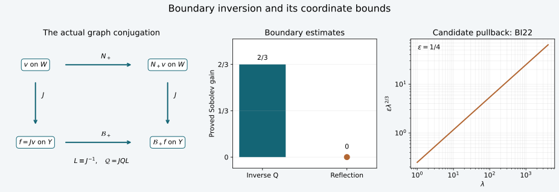

# Inverting the actual Airy conormal row

The [coupled amplitude construction](../20261008-coupled-airy-amplitudes/coupled-matrix-airy-amplitudes.html) gives two exact boundary rows for an actual variable-coefficient operator. We now reduce these rows to the [proved matrix Airy calculus](../20261008-airy-operator-inverse/variable-matrix-airy-boundary-parametrices.html), construct their two-sided inverses modulo smooth kernels, and return the estimates to the physical boundary. All matrix factors retain their order. The argument includes the full complex Robin term.

This constructs the boundary inverse attached to those modes. Identifying their superposition with every weak energy solution still requires an interior mapping and representation theorem. We keep that remaining problem explicit.

## 1. Fix the actual traces and the direction of the graph

**B0. The receiving data.** Use the hypotheses, phase, amplitudes and convention \(D=-i\partial\) of CAA:A0–A12. Write \(x=(q,y)\), with physical side \(q\ge0\), boundary \(Y\), and auxiliary input space \(W\) with coordinates \(w\). On the chosen cone put \(\eta=(\mu,\eta',\lambda)\), \(\lambda>0\). The boundary phase and Airy argument are
\[
 \theta(0,y,\eta)=S(y,\eta),\qquad
 \zeta_b(\eta)=-\mu\lambda^{-1/3},\qquad
 \det S_{y\eta}\ne0 .                                      \tag{BI1}
\]
Here \(S\) has degree one. The amplitudes \(g\in S^0_{\mathrm{cl}}\) and \(h\in S^{-1/3}_{\mathrm{cl}}\) satisfy \(h_b=0\); the leading matrix \(g_{0,b}\) is invertible near the marked point. Let
\[
 \mathscr C=\sum_j a^{qj}(0,y)D_j+R(y),\qquad
 d=\left[-i\sum_j a^{qj}\partial_jg+Rg\right]_b,
 \quad c=a^{qq}\left[h_q-i\zeta_qg\right]_b .                \tag{BI2}
\]
The scalar principal coefficients are real, \(a^{qq}>0\), \(\zeta_q<0\); \(R\) and all lower coefficients may be arbitrary finite complex matrices. This is the specified intrinsic conormal convention, including its sign. Changing to an outward or rescaled convention requires changing BI2 accordingly.

For a classical matrix amplitude \(a\), let \(T_a:W\to Y\) have phase \(S(y,\eta)-w\cdot\eta\), normalization \((2\pi)^{-d}\), and amplitude \(a(y,\eta)\), with fixed interior conic and base localizations. Those cutoffs equal one on the working patch. CAA:A12 proves
\[
 J=T_{g_b},\quad C=T_c,\quad D_0=T_d,\qquad
 K_\pm|_b=J,\qquad \mathscr C K_\pm|_b=C\Phi_\pm+D_0,
 \quad \Phi_+=\varphi(\zeta_b(D_w)),\quad
 \Phi_-=\overline\varphi(\zeta_b(D_w)).                     \tag{BI3}
\]
The bar in \(\overline\varphi\) conjugates the scalar function on the real line. It does not conjugate \(g,h,R,C,D_0\). The same amplitudes solve the operator identity with either Airy solution, even when the lower matrices are complex. The orders of \(J,C,D_0\) are \(0,2/3,0\). Denote the conormal rows on the right of BI3 by \(M_\pm\).

**B1. The ordinary graph inverse and its symbol.** The phase in BI3 parametrizes
\[
 \kappa:(w=S_\eta(y,\eta),\eta)
                \longmapsto (y,S_y(y,\eta)).                \tag{BI4}
\]
The mixed Hessian condition makes both projections local diffeomorphisms. The generating-function identity proves that \(\kappa\) is canonical. Shrink to paired conic patches where it is bijective. The [complete graph theorem](../20261005-restored-graph-egorov/graph-operators-continuity-and-egorov.html), GE:D2 and GE:D9, applies to the elliptic order-zero operator \(J\). It supplies a properly localized order-zero inverse-graph operator \(L:Y\to W\) such that
\[
 LJ\equiv I_W,\qquad JL\equiv I_Y.                         \tag{BI5}
\]
Throughout this lesson \(\equiv\) means equality modulo a smooth kernel on smaller paired conic patches, with nested compact localizations as specified in B3. It does not mean a global inverse.

Set \(\delta=|\det S_{y\eta}|^{1/2}\). The reduced graph symbols are \(g_{0,b}/\delta\) for \(J\) and \(c_{2/3}/\delta\) for \(C\), with the common phase frame. The inverse symbol of \(L\) is \(\delta g_{0,b}^{-1}\) on the inverse graph. Therefore the ordered composition theorem GE:D0, RC:C9 gives an ordinary classical pseudodifferential operator \(LC\) of order \(2/3\), with leading symbol
\[
 \sigma_{2/3}(LC)(w,\eta)
   =g_{0,b}^{-1}c_{2/3}\big|_{y=y(w,\eta)}
   =-i\,a^{qq}\zeta_q I_N\big|_{y=y(w,\eta)} .             \tag{BI6}
\]
The determinant and phase factors cancel in this order. The last equality uses \(c_{2/3}=-i a^{qq}\zeta_qg_{0,b}\), proved in CAA:A12. Likewise \(LD_0\) is ordinary classical order zero, with all its lower terms retained by the full composition theorem. These are full operators modulo smooth kernels, not just principal-symbol identities.

## 2. Extract precisely the normalized Airy multiplier

**B2. An order-zero elliptic matrix factor.** Choose a positive ordinary elliptic frequency function \(\ell(\eta)\) of order one, equal to \(\lambda\) near the smaller cone at high frequency. One construction is \(\ell=\chi\lambda+(1-\chi)\langle\eta\rangle\), with an ordinary conic cutoff \(\chi\) supported where \(\lambda\ge c\langle\eta\rangle\). Its positivity and derivative estimates follow term by term. Put \(Z=i\ell(D)^{2/3}\), with its exact Fourier inverse, and define
\[
 A=(LC)Z^{-1},\qquad B=LD_0,
 \qquad a_0(w,\eta)=
       -a^{qq}\zeta_q\lambda^{-2/3}I_N\big|_{y=y(w,\eta)} . \tag{BI7}
\]
Both \(A,B\) are ordinary order-zero matrix operators, and \(a_0\) is the principal symbol of \(A\). It is a positive scalar multiple of identity bounded away from zero on a compact normalized patch. Homogeneity and compactness give all inverse-symbol estimates. In particular, ellipticity here is established from the actual conormal row.

Set, on this cone,
\[
 n_+=i\lambda^{2/3}\varphi(-\mu\lambda^{-1/3}),\qquad
 n_-=i\lambda^{2/3}\overline\varphi(-\mu\lambda^{-1/3})
       =-\overline {n_+},\qquad r=n_-/n_+.                 \tag{BI8}
\]
Use the positive-real-part extension of AOI:O5 for \(n_+\), and define the extended \(n_-=-\overline{n_+}\). The sign change \(\nu=-\mu\), accompanied by the base reflection \(z_1=-w_1\), is a linear unitary Fourier change. It transfers every derivative and Sobolev estimate of AOI:O5 to BI8. In particular \(H=n_+(D)^{-1}\) has order \(-2/3\) in the concrete \(\mathcal S_{1/3}\) calculus, while \(r(D)\) has order zero and \(|r|=1\).

Extend the local ordinary symbols of \(A,B\) by AOI:O8. For clarity, after shrinking the angular and base patch, the principal matrix differs by less than one quarter, in relative norm, from its invertible value at the marked point. At high frequency the lower-order part changes this bound to less than one half. A compact base and conic cutoff on that difference, followed by addition of the constant matrix, gives a globally invertible ordinary extension. The lower coefficient extends with compact base support. The resulting operators satisfy the hypotheses of AOI:O6. With \(N_\pm=A n_\pm(D)+B\), we obtain
\[
 LM_\pm\equiv N_\pm,
 \qquad M_\pm\equiv JN_\pm,
 \qquad \mathcal B_\pm:=M_\pm L\equiv JN_\pm L .            \tag{BI9}
\]
Indeed \(Z^{-1}n_\pm(D)=\Phi_\pm\) exactly on the original cone, since both are scalar frequency multipliers. Thus the first identity is \(LC\Phi_\pm+LD_0\); BI5 gives the second and third. The lower term is \(B=LD_0\), including \(R\), rather than a discarded principal approximation. The operators \(\mathcal B_\pm\) are the actual boundary rows normalized to Dirichlet values by \(L\).

## 3. Control the localizations before using the inverse

**B3. All errors are local and composable.** Choose four relatively nested conic neighborhoods of the marked input covector, with compact normalized closures, and their images under \(\kappa\). Every identity is asserted in the smallest neighborhoods. Use proper kernel representatives, compact base cutoffs on a larger chart, and ordinary microlocal cutoffs equal to one near the next smaller neighborhood. Finitely many products below require only finitely many such margins; shrink their common interior once.

The ordinary graph compositions and parametrices have complete differentiated remainder estimates by RC:C5–C9 and GE:D9. Their smooth errors stay smooth after an ordinary graph factor, by GE:D7 and RC:C1, using smooth-input continuity of the factor and its adjoint. Errors followed or preceded by a \(\mathcal S_{1/3}\) operator also stay smooth after the compact localizations: AOI:O1–O3 gives continuity on Schwartz functions and their duals, and all Sobolev estimates. Applied to a compact smooth kernel as a smooth family of tests, these statements bound every output derivative; the adjoint argument bounds every derivative in the other kernel variable. Equivalently, apply the all-order Sobolev estimates in both variables and the Fourier proof of smoothness in AOI:O3.

For extension errors the symbols agree on a larger input cone. After sandwiching with smaller ordinary cutoffs, every coefficient of the full expansion AOI:O2 vanishes. Its remainder after \(k\) terms has order reduced by \(k/3\); since \(k\) is arbitrary, the localized error is smoothing. This also proves microlocal separation for these operators. Cutoffs on \(Y\) can be moved through \(J,L\) by the ordinary Egorov theorem GE:D10; their transported principal supports lie in the corresponding input cones, and the complete ordinary expansion supplies the same support statement modulo smoothing. Thus no invariance theorem for \(S_{1/3,0}\) under a nonlinear canonical map is assumed.

These arguments justify all products in BI9 and below on compact distributions, as well as on smooth inputs. They concern the boundary operators. If an interior output cutoff \(\chi(q,y)\) is placed on the original Airy kernel, its equation still contains \([P,\chi]K_\pm\), as in CAA:A11. Boundary inversion does not make that commutator smooth.

## 4. Construct the inverse in the correct order

**B4. Two-sided conormal inverse.** Let \(G\) be an ordinary two-sided parametrix of \(A\), and set
\[
 C_0=A+BH,\qquad T=C_0G-I,\qquad
 U\sim\sum_{j\ge0}(-T)^j,\qquad Q=HGU .                    \tag{BI10}
\]
AOI:O1–O4 and O6 prove all products, the sum and its remainders: \(T\) has order \(-2/3\), \(U\) order zero, and \(Q\) order \(-2/3\) in \(\mathcal S_{1/3}\). The exact identity \(N_+=C_0n_+(D)\) and the two-sided inverse of \(C_0\) give
\[
 N_+Q=I+S_R,\qquad QN_+=I+S_L,
 \qquad S_R,S_L\in\operatorname{Op}(\mathcal S_{1/3}^{-\infty}).
                                                                    \tag{BI11}
\]
This application uses the concrete coefficients BI7, whose ellipticity and full orders were proved in B1–B2. It therefore discharges the representation hypothesis left open in AOI:O8 for these conormal rows.

Define the physical boundary inverse
\[
 \mathcal Q=JQL:Y\longrightarrow Y .                       \tag{BI12}
\]
Then \(\mathcal B_+\mathcal Q\equiv I_Y\) and \(\mathcal Q\mathcal B_+\equiv I_Y\). For the first product, insert BI9 and group it as \(JN_+(LJ)QL\), replace \(LJ\) by identity using B3, apply BI11, and then use \(JL\equiv I_Y\). For the second, group as \(JQ(LJ)N_+L\) and use the other identity in BI11. This proves both sides, retaining every order of multiplication. Low-frequency kernels are allowed; an exact global inverse has not been asserted.

The other row also has a two-sided inverse: use \(H_-=n_-(D)^{-1}=-\overline{n_+^{-1}}(D)\), whose full symbol bounds are the same, and repeat BI10 with \(C_{0,-}=A+BH_-\). The proof of AOI:O6 uses only these inverse bounds and the same ordinary ellipticity after its multiplier has been extended. It gives \(Q_-\) of order \(-2/3\) and \(\mathcal Q_-=JQ_-L\). The lower matrices stay unchanged; this is not complex conjugation of the full operator.

**B5. Every real Sobolev order and wavefront direction.** GE:D7 gives \(J,L:H^t_{\mathrm{comp}}\to H^t_{\mathrm{loc}}\) for all real \(t\); AOI:O3 gives \(Q:H^t\to H^{t+2/3}\). With the nested localizations of B3,
\[
 \mathcal Q:H^t_{\mathrm{comp}}(Y)\longrightarrow
                  H^{t+2/3}_{\mathrm{loc}}(Y),
 \qquad \mathcal B_\pm:H^t_{\mathrm{comp}}(Y)
                      \longrightarrow H^{t-1}_{\mathrm{loc}}(Y).
                                                                    \tag{BI13}
\]
Each bound follows by three consecutive bounded maps, with an outer compact cutoff providing the support required by the next factor. Compatible compact smooth approximation in GE:D7 and AOI:O3 identifies these extensions with the distributional products. For \(\mathcal B_\pm\), use \(n_\pm\in\mathcal S_{1/3}^{1}\), \(A,B\) order zero, and BI9.

AOI:O2 and the separated-cutoff argument in B3 show that \(N_\pm,Q\) do not create wavefront outside the input direction. The graph mapping theorem RC:C1 carries wavefront by \(\kappa\) for \(J\) and by \(\kappa^{-1}\) for \(L\). Consequently the localized \(\mathcal B_\pm,\mathcal Q\) preserve wavefront directions on \(Y\). This is an operator statement obtained by composition, without assigning their physical-coordinate symbols to \(S_{1/3,0}\).

## 5. Reflection and boundary regularity

**B6. The cancellation survives the graph change.** The exact identity
\[
 N_-=N_+r(D)+B(I-r(D))                                    \tag{BI14}
\]
uses the same \(A,B\) for both modes. Define \(\mathcal R_0=-QN_-\). BI11 gives
\[
 \mathcal R_0=-r(D)-QB(I-r(D))-S_Lr(D),
 \qquad \mathcal R=J\mathcal R_0L .                        \tag{BI15}
\]
The second term has order \(-2/3\), the last is smoothing, and the first is order zero. Thus \(\mathcal R\) is bounded on every localized \(H^s\). The apparent order \(1/3\) from multiplying the separate orders of \(Q\) and \(N_-\) cancels exactly. This works with arbitrary noncommuting variable matrix coefficients. It does not assert unitarity.

For actual boundary source \(\beta\) and incoming boundary value \(f_-\), put
\[
 f_+=\mathcal Q\beta+\mathcal R f_- .                      \tag{BI16}
\]
The two inverse identities imply
\(\mathcal B_+f_++\mathcal B_-f_-\equiv\beta\).
Indeed in the input chart the exact error is
\(S_RL\beta-S_RN_-Lf_-\); the remaining errors come from BI5 and BI9 and are smooth by B3. If a distributional pair instead already satisfies the matching equation modulo a smooth function, applying \(\mathcal Q\) proves BI16 modulo a smooth function. Therefore, locally for every real \(s\),
\[
 \beta\in H^{s-2/3},\quad f_-\in H^s
                   \quad\Longrightarrow\quad f_+\in H^s .\tag{BI17}
\]
Here the pair belongs to the constructed boundary representation. No decomposition theorem for arbitrary weak interior solutions is used or concluded.

**B7. A genuine regularity estimate.** Let \(\chi_0,\chi_1\) be properly supported ordinary order-zero cutoffs on \(Y\), with \(\chi_1=I\) microlocally near the operator wavefront of \(\chi_0\); both lie in the paired patch. For distributions supported in one fixed compact coordinate set and every \(M\) with \(-M\le s\),
\[
 \|\chi_0f\|_{H^s}
 \le C\left(\|\chi_1\mathcal B_+f\|_{H^{s-2/3}}
                  +\|f\|_{H^{-M}}\right).                \tag{BI18}
\]
To prove it, localize \(\mathcal Q\mathcal B_+\equiv I\) with \(\chi_0\). B3 and B5 make \(\chi_0\mathcal Q(I-\chi_1)\mathcal B_+\) smoothing after inserting a fixed outer localization. Thus
\(\chi_0f=\chi_0\mathcal Q\chi_1\mathcal B_+f+Ef\),
where \(E\) is a compactly localized smooth-kernel operator. BI13 treats the first term. Its every-order Sobolev bound treats \(E\). These identities hold on distributions, so the proof first establishes the asserted regularity and then its norm bound; it does not assume that the left norm is finite. Compact distributions have some finite negative Sobolev order by AOI:O3. Iterating BI18 at arbitrary \(s\) proves microlocal smoothness of \(f\) when \(\mathcal B_+f\) is microlocally smooth.

## 6. The closed boundary domains are determined, too

**B8. Domain and reflection bounds in the normalized chart.** For the globally extended input operators used in B2–B4, define
\[
 \mathcal D_{\pm,s}=
 \{v\in H^s(W):N_\pm v\in H^{s-2/3}(W)\},\qquad
 \|v\|_{\mathcal D_{\pm,s}}=
       \|v\|_{H^s}+\|N_\pm v\|_{H^{s-2/3}} .              \tag{BI19}
\]
These are complete normed spaces. A Cauchy sequence has limits \(v\) in \(H^s\) and \(b\) in \(H^{s-2/3}\). Continuity \(N_\pm:H^s\to H^{s-1}\), and the continuous inclusion \(H^{s-2/3}\subset H^{s-1}\), identify \(b=N_\pm v\). Convergence follows in the displayed norm. The embeddings and completeness are the Fourier weighted Hilbert-space facts in the earlier Sobolev providers of AOI:O3.

BI11 and AOI:O3 give bounded maps
\[
 Q:H^{s-2/3}\longrightarrow\mathcal D_{+,s},\qquad
 \mathcal R_0:\mathcal D_{-,s}\longrightarrow\mathcal D_{+,s}.
                                                                    \tag{BI20}
\]
For the first, \(Q\beta\in H^s\) and \(N_+Q\beta=\beta+S_R\beta\). For the second, B6 gives the \(H^s\) bound and
\(N_+\mathcal R_0v=-N_-v-S_RN_-v\) gives the remaining graph norm. These formulas provide the bounds by addition. For \(-M\le s\), the \(\mathcal D_{+,s}\) norm is equivalent to
\(\|N_+v\|_{H^{s-2/3}}+\|v\|_{H^{-M}}\): one direction is Sobolev inclusion and the other is AOI:O6's estimate. These are boundary graph domains. They have not been identified with traces of the original interior weak \(H^1\) domain; Exercise 3 shows why a domain assertion cannot be dropped.

## 7. Three solved exercises

### Exercise 1. An exact matrix boundary inverse

For the affine scalar model of CAA:X1, let \(E=\left(\begin{smallmatrix}0&1\\0&0\end{smallmatrix}\right)\), conjugate the interior operator by \(I+qE\), and retain \(\mathscr C=D_q\). Compute both boundary rows and their outgoing inverse.

**Solution.** CAA:X2's product rule with \(E^2=0\) gives \(g=I+qE\), \(h=0\), \(J=I\), \(d=-iE\), \(c=i\lambda^{2/3}I\). Hence \(N_\pm=n_\pm I-iE\). With \(h_0=n_+^{-1}\), exact multiplication gives
\[
 Q=h_0I+i h_0^2E,\qquad
 \mathcal R_0=-rI+i h_0(1-r)E .                            \tag{BI21}
\]
Both products of \(Q\) with \(N_+\) are identity because the linear terms cancel and \(E^2=0\). Multiplying \(-QN_-\) gives the second formula, including its lower term. Replacing the inverse by \(h_0I\) leaves the nonzero residual \(-i h_0E\). This elementary model therefore detects loss of the lower conormal matrix.

### Exercise 2. A nonlinear coordinate change and an invalid symbol shortcut

Let \(w_1=y_1\), \(w_2=y_2+\varepsilon y_1^2/2\), with \(\varepsilon>0\). Test whether the ordinary cotangent pullback of the reciprocal in BI8 satisfies the same \(S_{1/3,0}^{-2/3}\) estimates in physical coordinates.

**Solution.** The Jacobian determinant is one, and the covector identity gives \(\mu=\xi_1-\varepsilon y_1\xi_2\), \(\lambda=\xi_2\). The candidate pulled-back function is
\[
 b(y,\xi)=\frac{1}{i\lambda^{2/3}
   \varphi(-\lambda^{-1/3}(\xi_1-\varepsilon y_1\lambda))},
 \qquad
 \left.\partial_{y_1}b\right|_{\xi_1=\varepsilon y_1\lambda}
                  =-i\varepsilon .                        \tag{BI22}
\]
The derivative follows from \(\varphi'(0)=-\varphi(0)^2\), with \(\varphi(0)\ne0\), proved in ABQ:B3. An \(S_{1/3,0}^{-2/3}\) function would have this base derivative bounded by \(C\lambda^{-2/3}\), which is impossible. We are testing the proposed cotangent pullback, not claiming it is the exact left symbol of the conjugated operator. B4–B7 instead establish the actual conjugated operator and its estimates through \(J,L\).

### Exercise 3. The boundary graph domain can be smaller than the value space

For the scalar affine model \(A=I,B=0\), exhibit an element of \(H^s\) outside \(\mathcal D_{+,s}\).

**Solution.** Fix a small \(a>0\) so that the ray \(\mu=-a\lambda\) stays in the original cone. The positive-argument Airy asymptotic ABQ:B4 implies \(|n_+(\eta)|\asymp\lambda\) on fixed-radius balls about \(\eta_j=(-a\lambda_j,0,\lambda_j)\), \(\lambda_j=4^j\), for all sufficiently large \(j\). The constants are uniform there because \(-\mu\lambda^{-1/3}\sim a\lambda^{2/3}\). Choose a smooth Fourier bump \(\psi\) supported in the unit ball with \(\|\psi\|_2=1\), and start at an index making these balls disjoint. Set
\[
 \widehat v(\eta)=\sum_j
       \frac{\lambda_j^{-s-1/3}}{\sqrt j}\psi(\eta-\eta_j).
 \quad
 \|v\|_{H^s}^2\asymp\sum_j\frac{\lambda_j^{-2/3}}j<\infty,
 \quad
 \|N_+v\|_{H^{s-2/3}}^2\asymp\sum_j\frac1j=\infty .      \tag{BI23}
\]
Disjoint support makes both norm computations sums without cross terms. On each ball \(\langle\eta\rangle\asymp\lambda_j\); inserting its weight and \(|n_+|\asymp\lambda_j\) gives the displayed powers. The convergent first norm defines a tempered distribution by the earlier Fourier Sobolev construction. Thus \(v\in H^s\setminus\mathcal D_{+,s}\), for every real \(s\). The inverse's guaranteed two-thirds gain does not make the conormal row an everywhere-defined map \(H^s\to H^{s-2/3}\).

**F0. Figure coordinates.** The left panel records BI9 and BI12: \(J\) carries input-chart values to physical boundary values, \(L\) returns them, and the physical conormal row is \(JN_+L\). The middle panel gives the proved gains of \(Q\) and \(\mathcal R_0\), namely \(2/3\) and zero, from B4–B6. The right panel plots the exact ratio \(\varepsilon\lambda^{2/3}\) between the derivative magnitude in BI22 and \(\lambda^{-2/3}\), with \(\varepsilon=1/4\). The diagram concerns boundary operators; it does not depict an interior weak-solution theorem.

## 8. Credit and the next mathematical obligation

Richard Melrose and Michael Taylor, [*Boundary Problems for Wave Equations With Grazing and Gliding Rays*](https://mtaylor.web.unc.edu/wp-content/uploads/sites/16915/2018/04/glide.pdf), §8.1, Propositions 8.1.4 and 8.1.12, gives the boundary-factorization and inverse route. Our construction uses the independently proved CAA trace formula, the full earlier graph calculus, and AOI's ordered matrix inverse. The explicit signs, matrix lower terms, localizations, boundary domains and exercises here are independently written.

The proof map records exact preceding providers. Required Lebl proofs remain external human dependencies.  Independent new expression and the original figure are CC0-1.0; linked components retain their terms. 

The boundary inversion step is now established for the actual constructed modes. The remaining continuation must prove their distributional interior mapping, membership and traces in the same weak energy domain, natural-dual source transfer, incoming bounds and the full propagation statement. Smooth-input kernel identities and the boundary graph domains BI19 do not supply those missing identifications.
