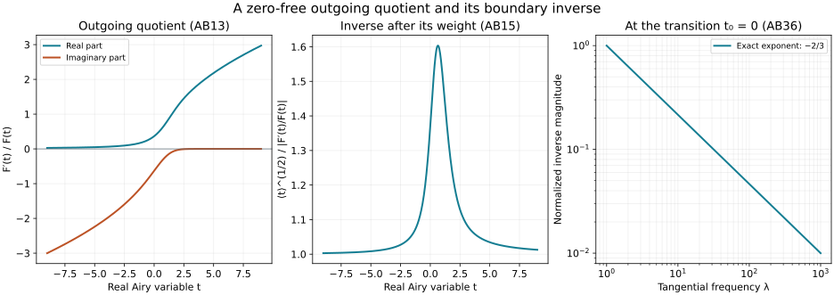

# Zero-free Airy quotients and matrix Robin matching

The [uniform normal estimate](../20261008-uniform-matrix-damping/uniform-matrix-damping-and-robin-defects.html) retains a homogeneous Robin boundary form whose sign is not controlled. A complementary boundary construction uses the complex Airy modes. Their logarithmic derivatives have no real zeros, whereas the corresponding real Airy quotient has poles. This lesson proves the zero-free statement, all differentiated real-axis estimates, the transition-frequency inverse bounds and the exact matrix Robin matching law for the affine Airy model.

The proof builds on the [existing Airy lesson](../20261005-restored-airy-models/airy-functions-and-fold-model-operators.md). Its entire Airy function, differential equation, positive Gaussian contour and real stationary-phase formula are retained. The new argument constructs the single outgoing mode by a convergent integral equation. It needs no unproved complex-sector asymptotic theorem.

## 1. Conventions and the boundary model

**B0. The precise receiving problem.** Write \(D=-i\partial\), take \(x\ge0\), and use tangential Fourier coordinates \(\eta=(\mu,\lambda,\eta'')\) in a closed cone
\[
 \lambda\ge1,\qquad |\mu|+|\eta''|\le C\lambda .
 \tag{AB1}
\]
Thus \(\langle\eta\rangle\) and \(\lambda\) are comparable. The affine model and its scaled Airy variable are
\[
 P_\eta=D_x^2-(x\lambda^2-\mu\lambda),\qquad
 t_x=\lambda^{-1/3}\mu-\lambda^{2/3}x,\qquad t_0=\lambda^{-1/3}\mu .
 \tag{AB2}
\]
If \(F''(t)=tF(t)\), then \(F(t_x)\) solves \(P_\eta u=0\), since
\(\partial_x^2F(t_x)=(\mu\lambda-x\lambda^2)F(t_x)\).
The normal derivative in the boundary operator is the intrinsic \(D_x\), with this sign.

We allow a finite matrix Fourier multiplier \(K(\eta)\) whose symbol and all frequency derivatives have ordinary order zero:
\[
 \|\partial_\eta^\alpha K(\eta)\|\le C_\alpha\lambda^{-|\alpha|}.
 \tag{AB3}
\]
It need not be Hermitian, normal, diagonalizable or constant in \(\eta\). The exact model condition is \((D_x+K(D_z))u|_{x=0}=\beta\). A variable-base Robin coefficient and a general variable-coefficient operator require a further parametrix; they are not identified with this Fourier model.

For a real variable \(s\ge1\), the notation \(a\in S^m_s\) means \(|a^{(j)}(s)|\le C_j s^{m-j}\) for all \(j\). An asymptotic expansion below includes these derivative bounds on every remainder.

## 2. Construct a single oscillating Airy mode

**B1. An actual solution at negative infinity.** Put
\[
 \zeta=\tfrac23s^{3/2},\qquad
 F(-s)=s^{-1/4}v(\zeta),\qquad c=\tfrac5{36}.
 \tag{AB4}
\]
Direct differentiation gives
\[
 v''+(1+c\zeta^{-2})v=0 .
 \tag{AB5}
\]
Indeed the two mixed first-derivative terms cancel and
\((s^{-1/4}v)''=s^{3/4}v''+\tfrac5{16}s^{-9/4}v\);
also \(s^{-3}=4/(9\zeta^2)\).

On \(\zeta\ge1\) solve the integral equation
\[
 v(\zeta)=e^{i\zeta}
       -c\int_\zeta^\infty\sin(\theta-\zeta)\theta^{-2}v(\theta)\,d\theta .
 \tag{AB6}
\]
The integral operator has norm at most \(c<1\) on bounded continuous functions. Explicitly the series \(\sum_{j\ge0}T^j e^{i\zeta}\), where \(T\) is the negative integral term, converges uniformly and absolutely in that norm. The uniform limit is continuous; substitution in the integral is justified by the integrable bound \(c\theta^{-2}\). It solves AB6. Subtracting two solutions gives a difference of norm at most \(c\) times itself, proving uniqueness in this class.

The first derivative of the integral is an integral with a bounded cosine kernel. Its second derivative is the integrand at the lower endpoint minus the original sine integral. Dominated convergence on each compact \(\zeta\) interval therefore proves AB5 and \(C^2\) regularity. The differential equation then gives all higher derivatives. Moreover
\[
 v-e^{i\zeta}=O(\zeta^{-1}),\qquad
 v'-ie^{i\zeta}=O(\zeta^{-1}).
 \tag{AB7}
\]
These estimates follow directly by bounding each tail integral by \(C/\zeta\).

**B2. Every differentiated oscillatory remainder.** There is a symbol \(m\in S^0_\zeta\), with \(m=1+S^{-1}_\zeta\), such that \(v=e^{i\zeta}m\). More precisely,
\[
 m(\zeta)\sim\sum_{j\ge0}a_j\zeta^{-j},\qquad
 a_0=1,\qquad
 a_{j+1}=\frac{j(j+1)+c}{2i(j+1)}a_j .
 \tag{AB8}
\]
Here is a proof of the full remainder assertion. The equation for \(m\) is
\(m''+2im'+c\zeta^{-2}m=0\).
For \(m_N=\sum_{j=0}^{N-1}a_j\zeta^{-j}\), the recurrence cancels every power through \(\zeta^{-N}\), leaving a constant times \(\zeta^{-N-1}\). Let \(v_N=e^{i\zeta}m_N\). The Green identity underlying AB6, integrated from \(\zeta\) to a finite upper endpoint and then to infinity, gives
\[
 v-v_N=T(v-v_N)
 -\int_\zeta^\infty\sin(\theta-\zeta)
         e^{i\theta}\bigl(m_N''+2im_N'+c\theta^{-2}m_N\bigr)\,d\theta .
 \tag{AB9}
\]
The upper-endpoint error tends to zero because \(v_N-e^{i\zeta}\) and its derivative tend to zero. The same endpoint property for \(v\) is AB7.

In the norm \(\sup_{\zeta\ge1}\zeta^N|w(\zeta)|\), the operator \(T\) has norm at most \(c/(N+1)\): integrate \(\theta^{-N-2}\). The last integral in AB9 is \(O(\zeta^{-N})\). Thus its convergent series produces a solution \(w_N=O(\zeta^{-N})\); uniqueness among bounded solutions identifies it with \(v-v_N\). Differentiating AB9 once gives \(w_N'=O(\zeta^{-N})\). The inhomogeneous equation for \(w_N\), and induction after differentiating that equation, give \(w_N^{(k)}=O_k(\zeta^{-N})\) for every fixed \(k\).

This apparently weaker derivative estimate supplies the full symbol estimate by using more terms. For fixed \(N,k\), subtract \(m_{N+k}\), whose \(k\)-th remainder derivative is \(O(\zeta^{-N-k})\). The finite difference \(m_{N+k}-m_N\) starts at \(\zeta^{-N}\), so its \(k\)-th derivative has the same bound. Consequently
\[
 \partial_\zeta^k(m-m_N)=O_{N,k}(\zeta^{-N-k}).
 \tag{AB10}
\]
No undifferentiated oscillatory error has been silently differentiated as though it were a symbol.

## 3. Conserved flux excludes both kinds of real zero

**B3. Extension and exact flux.** Continue the data furnished by B1 across every finite real interval using the first-order system
\[
 \frac d{dt}\binom{F}{F'}=
       \begin{pmatrix}0&1\\t&0\end{pmatrix}\binom{F}{F'} .
 \tag{AB11}
\]
The ordered integral-series proof NCQ:N1 applies on each such compact interval; its uniqueness makes the extensions agree. Successively larger intervals cover the real line. Thus \(F\) is a globally defined smooth complex solution. The exact conserved quantity is
\[
 J(t)=\operatorname{Im}(F'(t)\overline{F(t)})=-1,\qquad
 W(F,\overline F)=F\overline F'-F'\overline F=2i .
 \tag{AB12}
\]
Its derivative is zero because \(F''=tF\) and \(t\) is real. AB4, AB7 and \(d/dt=-d/ds\) give \(F'(-s)=-i s^{1/4}e^{i\zeta}(1+o(1))\), so the constant is exactly \(-1\). If either \(F(t)\) or \(F'(t)\) vanished at a real point, AB12 would vanish there. Neither can vanish.

Set
\[
 \varphi(t)=F'(t)/F(t).
 \quad
 \operatorname{Im}\varphi(t)=-|F(t)|^{-2},\qquad
 \varphi'(t)=t-\varphi(t)^2 .
 \tag{AB13}
\]
These are identities on the whole real line. In particular \(\varphi\) and its reciprocal are smooth there.

For comparison with the earlier real Airy function, its exact decomposition is
\[
 \operatorname{Ai}(t)=\frac1{2\sqrt\pi}
       \bigl(e^{-i\pi/4}F(t)+e^{i\pi/4}\overline{F(t)}\bigr).
 \tag{AB14}
\]
The two solutions in AB12 are linearly independent. Expand \(\operatorname{Ai}\) in this basis, with constant coefficients by uniqueness of AB11. The negative-ray value and derivative asymptotics proved in the earlier Airy lesson, together with AB4 and AB7, determine those coefficients: the cosine \(\cos(\zeta-\pi/4)\) gives precisely the two constants in AB14. More explicitly the Wronskian formulas for the coefficients have limits obtained from those two asymptotic formulas, and the nonzero denominator \(2i\) is constant. This proves the identity, not merely its leading term.

One may equivalently use the real solution
\(\operatorname{Bi}=i(e^{-i\pi/4}F-e^{i\pi/4}\overline F)/(2\sqrt\pi)\).
Then \(\operatorname{Ai}-i\operatorname{Bi}=e^{-i\pi/4}F/\sqrt\pi\), and expanding AB12 gives \(W(\operatorname{Ai},\operatorname{Bi})=1/\pi\). These formulas fix the normalization used for the numerical illustration.

## 4. Positive infinity and global symbol estimates

**B4. The quotient and inverse on both rays.** The following estimates hold for every \(j\ge0\):
\[
 |\varphi^{(j)}(t)|\le C_j\langle t\rangle^{1/2-j},\qquad
 |(\varphi^{-1})^{(j)}(t)|\le C_j\langle t\rangle^{-1/2-j},
 \qquad |\varphi(t)|\ge c_0\langle t\rangle^{1/2}.
 \tag{AB15}
\]
On the negative ray, AB8–AB10 and the chain rule give
\[
 \varphi(-s)=-i\sqrt s+\frac1{4s}+S^{-5/2}_s .
 \tag{AB16}
\]
In fact logarithmic differentiation of AB4 gives
\(1/(4s)-i\sqrt s-\sqrt s\,m'(\zeta)/m(\zeta)\);
the last term is \(S^{-5/2}_s\). The symbol inverse of \(m\), for large \(\zeta\), follows by a convergent scalar geometric series or repeated differentiation of \(m^{-1}m=1\).

We give the positive-ray argument in detail. The already proved Gaussian contour for \(g(t)=\operatorname{Ai}(t)\), rescaled by \(v=t^{1/4}\tau\), is
\[
 g(t)=c_*t^{-1/4}e^{-\zeta(t)}a(t),\qquad
 c_*=\frac1{2\sqrt\pi},\quad \zeta(t)=\tfrac23t^{3/2},
 \quad
 a(t)=\pi^{-1/2}\int_{\mathbb R}e^{-v^2}
             e^{iv^3/(3t^{3/4})}\,dv .
 \tag{AB17}
\]
The imaginary part of the integral vanishes by oddness. Expanding the cosine to any even order, with its integral Taylor remainder, gives
\(a(t)\sim\sum_{j\ge0}\alpha_jt^{-3j/2}\), \(\alpha_0=1\), and every remainder has the corresponding symbol bounds. Indeed each \(t\) derivative of a Taylor remainder is a finite sum of a power of \(t^{-3/4}\), a power of \(t^{-1}\), and a Gaussian moment times a bounded sine or cosine. The Taylor remainder for each of these differentiated trigonometric functions gives
\(\partial_t^k(a-\sum_{j<N}\alpha_jt^{-3j/2})=O(t^{-3N/2-k})\).
All Gaussian moments are finite; their integrations and the constant \(\int e^{-v^2}dv=\sqrt\pi\) have the exact earlier Gaussian provider. In particular \(a=1+S^{-3/2}_t\) and \(g>0\) for \(t\ge T\), for some fixed \(T\).

On this ray define a second real solution
\[
 h(t)=2g(t)\int_T^t g(v)^{-2}\,dv,\qquad
 W(g,h)=gh'-g'h=2 .
 \tag{AB18}
\]
Differentiation proves both the differential equation and the Wronskian. We require its differentiated growing asymptotic, so we prove it. Put
\[
 f(t)=c_*^{-2}t^{1/2}a(t)^{-2},\qquad
 d_0(t)=\frac{f(t)}{2\sqrt t},\qquad
 d_{j+1}(t)=-\frac{d_j'(t)}{2\sqrt t}.
 \tag{AB19}
\]
Here \(d_j\in S^{-3j/2}_t\). Integration by parts with
\(\partial_v e^{2\zeta(v)}=2\sqrt v\,e^{2\zeta(v)}\) gives
\[
 e^{-2\zeta(t)}\int_T^t g(v)^{-2}\,dv
       \sim\sum_{j\ge0}d_j(t).
 \tag{AB20}
\]
To verify the full remainder, after \(N\) terms the remaining integrand is
\(-e^{2\zeta(v)}d_{N-1}'(v)\), plus a fixed lower-endpoint constant. For any symbol \(b\in S^\gamma_t\),
\[
 e^{-2\zeta(t)}
       \left|\int_T^t e^{2\zeta(v)}b(v)\,dv\right|
       \le C_\gamma t^{\gamma-1/2}\quad(t\ge2T).
 \tag{AB21}
\]
Split at \(t/2\). The first part has an exponentially small factor in \(t^{3/2}\), which dominates every prescribed power; the second uses
\(\zeta(t)-\zeta(v)\ge\sqrt{t/2}(t-v)\) and integrates the resulting exponential in \(t-v\). This proves the stated bound, including negative \(\gamma\). The lower endpoint is exponentially small as well.

For derivatives, the remaining normalized integral satisfies a first-order equation
\(R'+2\sqrt t\,R=b(t)\). Its differentiated equation gives the preliminary bound
\(R^{(k)}=O(t^{\gamma-1/2+k/2})\). Use \(N+k\) terms of AB20 for a \(k\)-th derivative of the \(N\)-term remainder; the \(3/2\) decrease per extra term compensates both this preliminary loss and the desired \(k\) derivative powers. The finite intervening symbols already have their differentiated bounds. Thus AB20 is a full symbol expansion. Substitution in AB18 yields
\[
 h(t)=c_*^{-1}t^{-1/4}e^{\zeta(t)}
                 \bigl(1+S^{-3/2}_t\bigr).
 \tag{AB22}
\]

Since \(g,h\) form a real basis, write \(F=A g+B h\) for constants \(A,B\). The nonzero flux AB12 implies \(B\ne0\): a constant multiple of the real function \(g\) would have zero flux. The ratio \(g/h\) and all its derivatives decrease faster than every power, by AB17 and AB22. Hence logarithmic differentiation gives
\[
 \varphi(t)=\sqrt t-\frac1{4t}+S^{-5/2}_t
       \quad(t\longrightarrow+\infty).
 \tag{AB23}
\]
This also proves two-sided amplitude bounds
\[
 c\langle t\rangle^{-1/4}e^{\frac23(t_+)^{3/2}}
 \le |F(t)|\le
 C\langle t\rangle^{-1/4}e^{\frac23(t_+)^{3/2}},\qquad
 |F^{(k)}(t)|\le C_k\langle t\rangle^{k/2-1/4}
                       e^{\frac23(t_+)^{3/2}} .
 \tag{AB24}
\]
Use the two ray constructions and their differentiated expansions at infinity, and the nonzero continuous function \(F\) on the remaining compact interval. The same argument applied to AB16 and AB23, using the nonvanishing of \(F'\), proves the lower bound in AB15. Repeated differentiation of \(\varphi\varphi^{-1}=1\) proves the reciprocal bounds in AB15. This completes the global quotient proof.

## 5. The transition-frequency boundary symbols

**B5. Frequency orders and the normal sign.** Normalize the two modes to have boundary value one:
\[
 V_+(x,\eta)=\frac{F(t_x)}{F(t_0)},\qquad
 V_-(x,\eta)=\frac{\overline{F(t_x)}}{\overline{F(t_0)}} .
 \tag{AB25}
\]
Their intrinsic boundary derivatives are
\[
 n_+(\eta)=i\lambda^{2/3}\varphi(t_0),\qquad
 n_-(\eta)=i\lambda^{2/3}\overline{\varphi(t_0)}
                      =-\overline{n_+(\eta)} .
 \tag{AB26}
\]
In particular
\[
 c\lambda^{2/3}\langle t_0\rangle^{1/2}
      \le |n_\pm|\le C\lambda^{2/3}\langle t_0\rangle^{1/2}
      \le C'\lambda,\qquad |n_-|=|n_+|.
 \tag{AB27}
\]
The phase of \(V_+\) for large \(x\) has positive normal covector
\(\lambda\sqrt{x-\mu/\lambda}\), by AB4. This fixes which mode is called outgoing here.

For every multi-index \(\alpha\), on the cone AB1,
\[
 |\partial_\eta^\alpha n_\pm|
       \le C_\alpha |n_\pm|\lambda^{-|\alpha|/3},\qquad
 |\partial_\eta^\alpha n_+^{-1}|
       \le C_\alpha\lambda^{-2/3-|\alpha|/3}.
 \tag{AB28}
\]
To prove this, a \(\mu\) derivative of \(f(t_0)\) is
\(\lambda^{-1/3}f'(t_0)\), while a \(\lambda\) derivative is
\(-t_0 f'(t_0)/(3\lambda)\). Formula AB15 bounds every \(j\)-th derivative of \(\varphi\) relative to \(|\varphi|\) by \(C_j\langle t_0\rangle^{-j}\). Repeated chain and product rules therefore give a factor at most \(\lambda^{-1/3}\) for each frequency derivative; derivatives of \(\lambda^{2/3}\) have the stronger factor \(\lambda^{-1}\). The identical reasoning for \(\varphi^{-1}\) proves the second assertion. Spectator derivatives vanish. Smooth degree-zero cone cutoffs have the stronger ordinary derivative bounds and preserve these estimates.

Thus \(n_\pm\) have order at most one in \(S_{1/3,0}\), while \(n_+^{-1}\) has order \(-2/3\). This notation records the displayed estimates. No variable-base quantization theorem for that class is being assumed.

## 6. Exact matrix Robin matching

**B6. The boundary inverse and reflection matrix.** Increase the fixed lower frequency threshold to \(L\), so that \(|n_+|\ge2\sup_\eta\|K(\eta)\|\). There is an actual pointwise matrix inverse
\[
 B_+(\eta)=(n_+I+K)^{-1}
       =n_+^{-1}\sum_{j=0}^\infty(-n_+^{-1}K)^j .
 \tag{AB29}
\]
The series converges in matrix norm, gives a left and right inverse by multiplying its finite partial sums, and satisfies
\[
 \|\partial_\eta^\alpha B_+\|
       \le C_\alpha\lambda^{-2/3-|\alpha|/3}.
 \tag{AB30}
\]
Indeed \(E=n_+^{-1}K\) has norm at most \(1/2\) and
\(\|\partial^\alpha E\|\le C_\alpha\lambda^{-2/3-|\alpha|/3}\). A fixed derivative of \(E^j\) has at most \(C_\alpha j^{|\alpha|}\) ordered terms, with at most \(|\alpha|\) differentiated factors and all others bounded by \(1/2\). The geometric majorant remains summable. Multiply by \(n_+^{-1}\) and use AB28. No distinct matrix derivatives have been commuted.

For prescribed incoming boundary amplitude \(h_-\) and Robin datum \(\beta\), define
\[
 \widehat h_+=B_+\widehat\beta+\mathcal R_K\widehat h_-,
 \qquad
 \mathcal R_K=-B_+(n_-I+K).
 \tag{AB31}
\]
Then, pointwise in frequency,
\[
 (n_+I+K)\widehat h_++(n_-I+K)\widehat h_-=\widehat\beta .
 \tag{AB32}
\]
The bound \(\|\mathcal R_K\|\le3\) follows from
\(\|B_+\|\le2/|n_+|\) and AB27. Its differentiated symbol estimates have order zero with loss \(1/3\) per frequency derivative. For precision write
\(\mathcal R_K=-(I+E)^{-1}((n_-/n_+)I+E)\);
AB28 and the same ordered series prove that assertion.

All data can be restricted to a fixed closed subcone of AB1 with \(\lambda\ge L\); use cutoffs in a slightly larger cone when defining global multipliers. Plancherel, applied to the matrix norm pointwise, gives for every real \(s\)
\[
 \|h_+\|_{H^s}\le C_s\bigl(
       \|\beta\|_{H^{s-2/3}}+\|h_-\|_{H^s}\bigr).
 \tag{AB33}
\]
The Fourier-weight definition proves this first for Schwartz data, then for all indicated Sobolev inputs by density. It is a genuine \(2/3\)-order boundary-source gain, with no symmetry condition on \(K\).

**B7. Actual model solutions and distributional traces.** The formula
\[
 \widehat u(x,\eta)=V_+(x,\eta)\widehat h_+(\eta)
                         +V_-(x,\eta)\widehat h_-(\eta)
 \tag{AB34}
\]
defines a distribution solution of the exact model, not just its principal symbol. Here data are tempered distributions supported in the stated cone, and multiplication uses any smooth extension agreeing near that support.

To check existence, take \(x\) in any fixed compact interval \([0,a]\). The inequality \(t_x\le t_0\) makes the exponential quotient in AB24 at most one. Since \(|t_x|+|t_0|\le C_a\lambda^{2/3}\), AB24 gives polynomial bounds for every \(x\) derivative of \(V_\pm\). Frequency derivatives have polynomial bounds as well: differentiate the numerator and denominator, use AB24 and the lower bound there, and retain the exponential quotient. Every resulting factor has a fixed power bound in \(\lambda\); no positive exponential survives. Thus these multipliers and all their \(x\) derivatives act continuously on Schwartz tests and, by transposition, on tempered distributions. This proves smooth \(x\)-dependence in that distribution space, including at zero.

Differentiate AB34 there. AB2 gives \(P_\eta\widehat u=0\), and AB25–AB26 give its value and intrinsic derivative traces. Equation AB32 is exactly the asserted Robin condition. This solution is unique among combinations of the two modes with the prescribed \(h_-\), since the boundary matrix has the inverse AB29. This is a uniqueness statement in the specified incoming/outgoing class, not a Cauchy uniqueness theorem for every solution of a general boundary problem.

## 7. Three solved exercises

### Exercise 1. A nonnormal Robin matrix

Take \(K=\begin{pmatrix}0&b\\0&0\end{pmatrix}\), so \(K^2=0\). Compute the reflection matrix for homogeneous Robin data.

**Solution.** The inverse terminates:
\[
 (n_+I+K)^{-1}=n_+^{-1}I-n_+^{-2}K,\qquad
 \mathcal R_K=-\frac{n_-}{n_+}I
                  -\frac{n_+-n_-}{n_+^2}K .
 \tag{AB35}
\]
Multiplication by \(n_+I+K\) leaves exactly \(-(n_-I+K)\); the term with \(K^2\) vanishes. Thus AB32 holds for every incoming vector, even though \(K\) is nonnormal when \(b\ne0\). The reflected norm need not be one. Its high-frequency correction has size at most \(2|b|/|n_+|\), which is \(O(\lambda^{-2/3})\).

### Exercise 2. The transition gain cannot be increased

For \(K=0\), show that the outgoing inverse cannot map \(H^{s-2/3}\) to \(H^{s+\delta}\) uniformly for any \(\delta>0\) on a cone containing \(\mu=0\).

**Solution.** At \(\mu=0\),
\[
 n_+^{-1}=(i\varphi(0))^{-1}\lambda^{-2/3}.
 \tag{AB36}
\]
Choose a nonzero smooth Fourier bump of fixed small support centered at \((\mu,\lambda,\eta'')=(0,R,0)\), with \(R\to\infty\). On that support \(t_0\to0\), so the nonzero continuous \(\varphi\) bounds the inverse above and below by constant multiples of \(R^{-2/3}\). The ratio of the proposed output norm to the input norm is therefore bounded below by \(cR^\delta\). It diverges. This proves optimality for the stated uniform boundary multiplier estimate, without claiming optimality for every microlocal propagation norm.

### Exercise 3. Why the real derivative is a bad denominator

Prove that \(\operatorname{Ai}'\) has infinitely many real negative zeros and that \(\operatorname{Ai}/\operatorname{Ai}'\) has a pole at each of them.

**Solution.** The earlier differentiated stationary-phase formula is
\(\operatorname{Ai}'(-s)=\pi^{-1/2}s^{1/4}\sin(2s^{3/2}/3-\pi/4)+O(s^{-5/4})\).
Choose increasing \(s\) for which the sine is alternately \(+1\) and \(-1\). The remainder is smaller than half the leading magnitude for all sufficiently large choices. Continuity gives a zero between each consecutive pair. A simultaneous zero of \(\operatorname{Ai}\) and its derivative would force the solution of AB11 to be identically zero, contrary to AB17. At a negative derivative zero \(t_j\), therefore,
\(\operatorname{Ai}''(t_j)=t_j\operatorname{Ai}(t_j)\ne0\).
The denominator has a simple zero and the numerator is nonzero, which proves the pole. The complex denominator \(F'\) is zero-free by the conserved flux AB12.

*The first panels are numerical samples of the real and imaginary parts of \(\varphi\), and of its inverse magnitude after division by the proved weight. The last panel shows the exact \(\lambda^{-2/3}\) dependence at \(t_0=0\), normalized to remove its constant factor. Plotted samples are illustrations; zero-freeness and every global estimate are proved in B1–B7 and Exercises 1–3.*

## 8. Source credit and the next receiving step

Richard Melrose and Michael Taylor, [*Boundary Problems for Wave Equations With Grazing and Gliding Rays*](https://mtaylor.web.unc.edu/wp-content/uploads/sites/16915/2018/04/glide.pdf), §8.1, Proposition 8.1.12 and (8.1.13)–(8.1.16), identifies inversion of the complex Airy quotient as the diffractive Neumann mechanism. Appendix A.3 records the quotient identities. This freely readable author-hosted treatment supplies that source route. The convergent-integral construction, differentiated remainder proofs and finite-matrix Fourier-model argument here are written independently, using the exact earlier programme proofs in the proof map.

The earlier Airy lesson retains its Hörmander I and IV attribution and editions. 

The real-axis inverse and model matching are now available for a general boundary construction. Completing that construction still requires the actual boundary phase and amplitude equations, variable-base operator composition and parametrices, full coefficient and cutoff remainders, and transfer to the same weak energy domain and natural-dual forcing. No general Robin propagation theorem follows merely from the affine Fourier model. The earlier normal estimate and alternative proofs remain intact. Independent new expression is CC0-1.0; linked components retain their licences.
