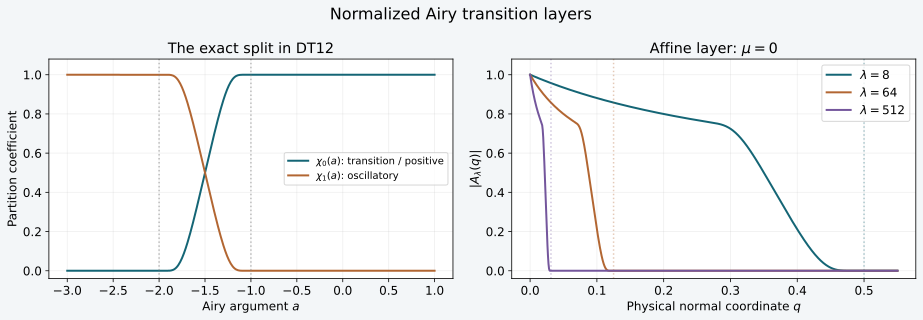

# Distributional Airy kernels and their boundary traces

The [coupled amplitude construction](../20261008-coupled-airy-amplitudes/coupled-matrix-airy-amplitudes.html) defined a normalized Airy kernel on smooth inputs. The [actual boundary inverse](../20261008-actual-boundary-inverse/actual-conormal-inverse-and-reflection.html) then inverted its conormal row. To apply either construction to singular data, we must first prove that the interior kernel acts on distributions and that its boundary values are genuine limits in a specified topology.

We prove these assertions directly. The positive and transition part has a controlled normal layer. The negative part has an oscillation that must be included in the phase before integration by parts. Together they give continuous action on all compactly supported distributions, every distributional normal trace, and actual Dirichlet and Robin parametrices modulo smooth errors. The finite Sobolev loss proved here establishes that action; it is not the sharp estimate needed to identify the original weak energy solution.

## 1. The data and a uniform tangential direction

**D0. The fixed receiving neighborhood.** Retain CAA:A0–A12, with \(q\ge0\), \(y\in\mathbb R^d\), input \(w\in\mathbb R^d\), \(d\ge2\), and \(\eta=(\mu,\eta',\lambda)\) in a small closed cone where \(\lambda\ge1\) and \(\langle\eta\rangle\asymp\lambda\). The real phases have degrees one and two thirds and satisfy
\[
 \theta_b=S(y,\eta),\quad \det S_{y\eta}\ne0,\qquad
 \zeta_b=-\mu\lambda^{-1/3},\qquad
 -C\lambda^{2/3}\le\zeta_q\le-c\lambda^{2/3}<0 .             \tag{DT1}
\]
The matrix amplitudes have orders \(g\in S^0\), \(h\in S^{-1/3}\), with \(h_b=0\). All symbol estimates include every base derivative on the compact collar. Write \(F_+=F\), \(F_-=\overline F\), with the zero-free solution of ABQ:B1–B4, and let \(\omega(\eta)\) be the original conic cutoff, zero for \(\lambda<1\). A removed bounded-frequency part has a smooth kernel by direct differentiation under a compact integral.

Set \(a=\zeta(q,y,\eta)\), \(b=\zeta_b(\eta)\), and \(\Delta=b-a\). Integrating \(\zeta_q\), and differentiating the same identity in \(y\), gives
\[
 cq\lambda^{2/3}\le\Delta\le Cq\lambda^{2/3},\qquad
 |\partial_y^\alpha\zeta|\le C_\alpha q\lambda^{2/3}
       \ (|\alpha|\ge1),\qquad
 |\partial_q^k\partial_y^\alpha\zeta|
       \le C_{k\alpha}\lambda^{2/3}\quad(k\ge1).             \tag{DT2}
\]
The vanishing tangential derivative at \(q=0\) is essential: \(b\) is independent of \(y\). All these bounds hold uniformly on one smaller collar and cone.

Euler's identity gives \(S_y=S_{y\eta}\eta\). Since the mixed matrix is invertible, \(S_y\ne0\) at the marked normalized covector. Choose a fixed real tangential vector field \(T=e\cdot\partial_y\), with constant vector \(e\), so that \(TS/\lambda>0\) there. By continuity and homogeneity, shrink the cone, base patch and collar until
\[
 T\theta\ge3c_1\lambda,\qquad
 |T\zeta|\sqrt{(-\zeta)_+}\le c_1\lambda .                  \tag{DT3}
\]
For the second inequality use DT2, \(|\zeta|\le C\lambda^{2/3}\), and a sufficiently short collar. This choice works for both signs of the Airy mode.

## 2. Bounds that keep the exponential cancellation

**D1. Ratios on the whole ordered real line.** Let
\(\Psi(t)=\frac23(t_+)^{3/2}\) and \(\langle t\rangle=(1+t^2)^{1/2}\).
ABQ:B4 proves the global differentiated bounds
\[
 c\langle t\rangle^{-1/4}e^{\Psi(t)}
 \le |F_\pm(t)|\le C\langle t\rangle^{-1/4}e^{\Psi(t)},
 \qquad
 |F_\pm^{(j)}(t)|\le C_j\langle t\rangle^{j/2-1/4}e^{\Psi(t)}.
                                                                  \tag{DT4}
\]
For \(a\le b\) define
\(\Gamma(a,b)=(\langle b\rangle/\langle a\rangle)^{1/4}
e^{\Psi(a)-\Psi(b)}\). It is uniformly bounded. If \(a\le b\le0\), the bracket ratio is at most one. If \(a\le0\le b\), it is bounded by
\(\langle b\rangle^{1/4}e^{-2b^{3/2}/3}\).
If \(0\le a\le b\), put \(\Delta=b-a\). Then
\(\langle b\rangle/\langle a\rangle\le C(1+\Delta)\), while
\(b^{3/2}-a^{3/2}\ge\Delta^{3/2}\); the last inequality follows by integrating the increasing function \(\frac32\sqrt t\) over \([a,a+\Delta]\) and comparing with \([0,\Delta]\). Exponential decay controls the resulting polynomial.

Consequently
\[
 \left|\frac{F_\pm^{(j)}(a)}{F_\pm(b)}\right|
 \le C_j\langle a\rangle^{j/2},\qquad
 \left|\frac{gF_\pm(a)+ihF_\pm'(a)}{F_\pm(b)}\right|\le C .
                                                                  \tag{DT5}
\]
For the last bound use \(|a|\le C\lambda^{2/3}\) and the order \(-1/3\) of \(h\). The same chain rule gives a bound \(C_\gamma\lambda^{|\gamma|}\) for arbitrary base derivatives of the unsplit amplitude. That bound alone does not give a gain when integrating by parts tangentially; we now improve it where needed.

Choose a real smooth function \(\chi_0\), zero on \((-\infty,-2]\) and one on \([-1,\infty)\), with \(0\le\chi_0\le1\). Set \(\chi_1=1-\chi_0\). Such smooth cutoffs are supplied by the earlier elementary localization proofs.

**D2. The positive and transition part, with every normal weight.** Define
\[
 b_{0,\pm}=\omega\chi_0(a)
             \frac{gF_\pm(a)+ihF_\pm'(a)}{F_\pm(b)} .
 \quad
 q^L|\partial_q^k\partial_y^\alpha b_{0,\pm}|
       \le C_{Lk\alpha}\lambda^{k-2L/3}
       \qquad(L,k\ge0).                                    \tag{DT6}
\]
Here and below all derivative counts are integers. We prove the full estimate, including mixed derivatives. On the support of \(\chi_0(a)\), \(a\ge-2\). Put \(E=\Psi(b)-\Psi(a)\ge0\). The elementary bounds
\[
 \Delta\sqrt{\langle a\rangle}\le C(1+E),\qquad
 \left(\frac{\langle b\rangle}{\langle a\rangle}\right)^{1/4}
       \le C(1+E)^{1/4}                                    \tag{DT7}
\]
hold there. For \(a\ge1\), integrate \(\Psi'(t)=\sqrt t\) to get \(E\ge\Delta\sqrt a\). For \(-2\le a\le1\), bounded \(b\) gives a bounded \(\Delta\); for unbounded \(b\), \(E\) grows like \(b^{3/2}\), which dominates \(\Delta\). This proves the first inequality. The inequality
\(\langle b\rangle/\langle a\rangle\le C(1+\Delta)\), followed by the first one, proves the second.

In the chain rule for \(\partial_q^k\partial_y^\alpha F_\pm(a)\), consider a term with \(j\) derivatives of \(F_\pm\). It contains \(j\) derivatives of \(a\). At most \(k\) of those factors contain a normal derivative; call their number \(r\). Each costs at most \(C\lambda^{2/3}\) by DT2. Each remaining, purely tangential, factor costs at most \(C\Delta\). DT4 then bounds the term by a constant times
\[
 \lambda^{2r/3}\langle a\rangle^{r/2}
 \bigl(\Delta\sqrt{\langle a\rangle}\bigr)^{j-r}
 \left(\frac{\langle b\rangle}{\langle a\rangle}\right)^{1/4}e^{-E}.
                                                                  \tag{DT8}
\]
The first factor is at most \(C\lambda^r\le C\lambda^k\); DT7 absorbs the remaining polynomial in \(E\) into its exponential. Derivatives of \(\chi_0F_\pm\) satisfy the same bounds: derivatives of the cutoff are supported in \([-2,-1]\), where the Airy weights are bounded. For the \(hF_\pm'\) term one extra \(\sqrt{\langle a\rangle}\) is canceled by \(\lambda^{-1/3}\); base derivatives of \(h\) preserve that order. Derivatives of \(g,h\) cause no other loss. Finally \(q^L\le C\lambda^{-2L/3}\Delta^L\) by DT2, and DT7 again absorbs the extra \(\Delta^L\). This proves DT6 for every derivative. The function \(\Psi\) was used only in inequalities, never differentiated at zero.

In particular, the kernel of this part is smooth wherever \(q>0\). On \(q\ge q_0>0\), choose \(L\) arbitrarily large in DT6. Every derivative in the input variable inserts a frequency power, and derivatives of \(e^{i\theta}\) have polynomial bounds. The resulting integrals converge absolutely after any prescribed derivatives.

## 3. Remove the negative-ray oscillation before estimating derivatives

**D3. The exact second phase.** On \(a<-1\) put
\[
 \psi_\pm(a)=\pm\tfrac23(-a)^{3/2},\qquad
 f_\pm(a)=e^{-i\psi_\pm(a)}F_\pm(a),\qquad
 \widetilde f_\pm(a)=e^{-i\psi_\pm(a)}F_\pm'(a).
                                                                  \tag{DT9}
\]
ABQ:B2 proves every differentiated remainder in the single-mode expansion. Substitution of \(\frac23(-a)^{3/2}\) into that expansion gives
\[
 |f_\pm^{(j)}(a)|\le C_j(-a)^{-1/4-j},\qquad
 |\widetilde f_\pm^{(j)}(a)|\le C_j(-a)^{1/4-j}.             \tag{DT10}
\]
For the second estimate differentiate
\(F_\pm=e^{i\psi_\pm}f_\pm\): one obtains
\(\widetilde f_\pm=f_\pm'\mp i\sqrt{-a}\,f_\pm\).
The ordinary product rule gives every displayed bound. A fixed compact interval between \(-2\) and \(-1\) is covered by smoothness and the nonzero denominator.

Define
\[
 \phi_\pm=\theta+\psi_\pm(\zeta),\qquad
 b_{1,\pm}=\omega\chi_1(a)
       \frac{gf_\pm(a)+ih\widetilde f_\pm(a)}{F_\pm(b)} .
 \quad
 |\partial_q^k\partial_y^\alpha b_{1,\pm}|
       \le C_{k\alpha}\lambda^{2(k+|\alpha|)/3}.             \tag{DT11}
\]
To verify it, each derivative of a one-variable coefficient in DT10 gains a factor \((-a)^{-1}\), while a base derivative of \(a\) costs \(\lambda^{2/3}\). Since \(-a\ge1\) on this support, this costs at most \(\lambda^{2/3}\) per derivative. At order zero, the weight \((-a)^{-1/4}/|F_\pm(b)|\) is bounded by D1. The extra \((-a)^{1/2}\) in the second coefficient is canceled by the order of \(h\). The denominator depends only on \(\eta\), so no base derivative hits it. Derivatives of \(\chi_1\) lie in a fixed bounded interval and obey the same estimate.

The original integrand has the exact decomposition
\[
 e^{i\theta}\omega
       \frac{gF_\pm(\zeta)+ihF_\pm'(\zeta)}{F_\pm(\zeta_b)}
       =e^{i\theta}b_{0,\pm}+e^{i\phi_\pm}b_{1,\pm}.         \tag{DT12}
\]
No asymptotic error was introduced. The second phase is used only where \(\chi_1(\zeta)\) is supported.

**D4. A nonstationary tangential derivative for both pieces.** DT3 implies
\[
 T\phi_\pm=T\theta\mp\sqrt{-\zeta}\,T\zeta
                \ge2c_1\lambda,\qquad
 |\partial_y^\alpha (T\phi_\pm)|
                \le C_\alpha\lambda^{1+2|\alpha|/3}.        \tag{DT13}
\]
For the derivative estimate, a base derivative of order \(r\ge1\) of
\((-a)^{3/2}\) is a sum with \(j\le r\) derivatives of \(a\), multiplied by \((-a)^{3/2-j}\). If \(j=1\), its bound is \(C\lambda\). If \(j\ge2\), \(-a\ge1\) makes the latter power bounded and the product costs at most \(\lambda^{2j/3}\le\lambda^{1+2(r-1)/3}\). This argument also covers mixed normal and tangential derivatives. The ordinary derivatives of \(\theta\) have the stronger bound \(C\lambda\). Taking \(r=1+|\alpha|\) proves DT13.

Repeated differentiation of the reciprocal, with the positive lower bound in DT13, gives
\[
 \left|\partial_y^\alpha (T\phi_\pm)^{-1}\right|
       \le C_\alpha\lambda^{-1+2|\alpha|/3}.                \tag{DT14}
\]
Indeed each reciprocal derivative is a product of \(j\) derivatives of \(T\phi_\pm\), divided by its \((j+1)\)-st power; the total derivative count is \(|\alpha|\). The same estimates hold for \(T\theta\).

After \(k\) normal derivatives of either term in DT12, it has the form \(e^{i\varphi}b_{k,\varphi}\), where \(\varphi=\theta\) or \(\phi_\pm\), and
\[
 |\partial_y^\alpha b_{k,\varphi}|
          \le C_{k\alpha}\lambda^{k+2|\alpha|/3}.           \tag{DT15}
\]
For the \(\theta\) term use DT6 and the ordinary derivatives of \(\theta\). For the other term, a product containing \(\ell\) differentiated phase factors, whose total normal order is \(j\), has order at most \(2j/3+\ell/3\le j\), by the mixed estimate just proved. The remaining \(k-j\) derivatives on the amplitude cost at most \(2(k-j)/3\). Tangential differentiation adds at most \(2|\alpha|/3\). The finite product rule proves DT15, including all mixed terms.

## 4. The estimate that defines action on distributions

**D5. Arbitrarily rapid decay after testing the output.** Fix a compact output set and a smooth scalar test \(\chi(y)\) supported there. Work entry by entry in the finite matrix. For either phase \(\varphi\), use
\[
 \mathcal L_\varphi=\frac{1}{iT\varphi}T,\qquad
 \mathcal L_\varphi e^{i\varphi}=e^{i\varphi},\qquad
 \mathcal L_\varphi^{\,t}v=-T\!\left(\frac{v}{iT\varphi}\right).
                                                                  \tag{DT16}
\]
The superscript \(t\) is the bilinear transpose for integration by parts. There are no boundary terms because the test is compactly supported in \(y\). By DT14–DT15, one application of this transpose lowers the frequency bound by \(1/3\). Inductively, after \(N\) applications, derivatives on the test have order at most \(N\), and all coefficient bounds have order \(k-N/3\). Thus the output-tested original integrand \(I_\pm\) satisfies
\[
 I_\pm(q,\eta;\chi)=
  \int e^{i\theta}\omega
       \frac{gF_\pm(\zeta)+ihF_\pm'(\zeta)}{F_\pm(\zeta_b)}
       \chi(y)\,dy,\qquad
 |\partial_q^k I_\pm|\le C_{kN}
       \lambda^{k-N/3}\|\chi\|_{C^N}.                      \tag{DT17}
\]
To check the induction explicitly, differentiating a coefficient adds at most \(2/3\) to its order, whereas multiplication by \((T\varphi)^{-1}\) subtracts one. The term where the derivative hits that inverse has the same net change by DT14. Leibniz's rule distributes the remaining derivatives between coefficients and the test. This proves every required bound with finitely many source seminorms. No frequency derivative of \(I_\pm\) is needed to obtain smoothness in the input variable.

**D6. Continuous distributional realization.** Let \(v\in\mathcal E'(W;\mathbb C^N)\). Its Fourier transform is smooth with polynomial growth: if \(v\) has order \(M\) on its fixed compact support, testing it against a cutoff times \(e^{-iw\eta}\) gives
\(|\widehat v(\eta)|\le C_v\langle\eta\rangle^M\).
Define
\[
 \langle K_\pm v(q),\chi\rangle
    =(2\pi)^{-d}\int I_\pm(q,\eta;\chi)\widehat v(\eta)\,d\eta,
 \qquad
 K_\pm:\mathcal E'(W)\longrightarrow
                       C^\infty([0,\varepsilon];\mathcal D'(Y)).
                                                                  \tag{DT18}
\]
The matrix contraction is the one inherited from the original kernel; the formula can equivalently be read component by component. Choose \(N>3(M+k+d)\) in DT17. The integral for the \(k\)-th normal derivative is absolutely convergent, uniformly in \(q\) and on bounded sets of output tests. Choosing one more normal derivative proves differentiability by the integral fundamental theorem of calculus and domination. Iteration gives the asserted smooth family up to \(q=0\).

For precision, the topology on the range controls every normal derivative uniformly on compact \(q\)-intervals, paired with bounded sets of compactly supported smooth tests. The map is continuous for the strong topology of compact distributions. To prove this, Fourier inversion of \(I_\pm\) produces a smooth function of \(w\); arbitrary \(w\)-derivatives insert frequency powers, still integrable by DT17. As \(q\), its derivative order, and a bounded set of tests vary, these functions form a bounded set of \(C^\infty(W)\). The defining strong seminorm of \(v\) on that bounded set controls DT18. This proves continuity without choosing one universal distribution order for all inputs.

Insert any compact frequency cutoff \(\rho(\eta/R)\), with \(\rho=1\) near zero, into the original integral. Its tested form converges to DT18 in this topology. The tail after \(k\) normal derivatives is bounded by a constant times
\(R^{M+k+d-N/3}\|\chi\|_{C^N}\), by radial integration; increase \(N\) to obtain any prescribed negative power. This also proves independence of the cutoff. For smooth compact inputs the definition agrees with CAA:A11 by absolute convergence and Fubini. Common-support smooth approximation in RC:K7 is dense in the strong compact-distribution topology; continuity therefore makes this extension unique.

## 5. A quantitative bound and actual boundary limits

**D7. A finite-loss Sobolev realization.** Fix compact input support, a compact output multiplier \(\chi_Y\), and integers \(M,k\ge0\). Put
\[
 N=3(M+k+d+1)+1,\qquad L=N+d/2+1 .
 \quad
 \sup_{0\le q\le\varepsilon}
  \|\partial_q^j(\chi_YK_\pm v)(q)\|_{H^{-L}}
       \le C\|v\|_{H^{-M}}\quad(0\le j\le k+1).            \tag{DT19}
\]
For a fixed compact input cutoff, Sobolev duality applied to its product with \(e^{-iw\eta}\) gives
\(|\widehat v(\eta)|\le C\langle\eta\rangle^M\|v\|_{H^{-M}}\).
This follows directly by differentiating that smooth product up to the integer order \(M\) in the Fourier Sobolev norm. DT17 with the chosen \(N\) has integrable frequency power for every \(j\le k+1\). Finally the Fourier proof of Sobolev embedding in AOI:O3 gives
\(\|\chi_Y\chi\|_{C^N}\le C\|\chi\|_{H^{N+d/2+1}}\).
Duality proves DT19. A finite-frequency part is continuous in \(q\) in this operator norm, and the same estimate makes the complementary tail uniformly small. Thus \(K_\pm\) takes this fixed-support \(H^{-M}\) space continuously into \(C^k([0,\varepsilon];H^{-L}_{\rm loc})\), with the extra derivative controlling difference quotients.

DT19 is a concrete finite-loss construction. It makes no assertion of the much stronger energy norm needed in the final propagation argument.

**D8. Exact distributional traces and a smooth PDE residual.** Normal differentiation and tangential differential operators are continuous on the family in DT18. Hence its value and conormal boundary limits exist as actual distributions. Passing to the limit from the regularized kernels, or from common-support smooth inputs, gives the CAA trace identities for every compact distribution:
\[
 (K_\pm v)|_b=Jv,\qquad
 (\mathscr C K_\pm v)|_b=M_\pm v,\qquad
 \mathscr C=\sum_j a^{qj}(0,y)D_j+R(y).                    \tag{DT20}
\]
Here \(J=T_{g_b}\) and \(M_\pm=T_d+T_c\Phi_\pm\) are exactly the operators of ABI:B0, with the complete complex lower matrix. They are continuous on compact distributions by the graph and Airy multiplier proofs. Thus the limits agree with their established distributional actions; no formal trace is substituted for a limit.

Let \(\mathcal P K_\pm=\mathcal S_\pm\) be the smooth kernel identity proved in CAA:A11. Then
\[
 \mathcal P(K_\pm v)=\mathcal S_\pm v\in
                     C^\infty([0,\varepsilon]\times Y).
                                                                  \tag{DT21}
\]
For a direct verification, frequency regularization commutes with the output differential operator. The regularized residual kernels converge with every derivative in all variables, including \(q=0\), because the residual amplitudes have arbitrary frequency decay. Pairing their input variable with the fixed compact distribution preserves this convergence. On the other side DT18 permits passage through every derivative of \(\mathcal P\) in distributions. This proves DT21 and every one-sided smooth boundary limit. Multiplication by an input cutoff preserves the assertion. An output cutoff gives the exact identity
\[
 \mathcal P(\chi K_\pm v)=
       \chi\mathcal S_\pm v+[\mathcal P,\chi]K_\pm v .      \tag{DT22}
\]
The commutator is supported where derivatives of \(\chi\) occur and remains an explicit term.

## 6. The boundary inverses now act through genuine interior operators

**D9. Distributional Dirichlet and Robin parametrices.** Use the proper local graph inverse \(L\), input conormal inverse \(Q\), and physical inverse \(\mathcal Q=JQL\) of ABI:B1–B5. Insert nested compact cutoffs on the input patches, as in ABI:B3. On compact boundary distributions define
\[
 E_\pm^D=K_\pm L,\qquad E_+^N=K_+QL .
                                                                  \tag{DT23}
\]
The intervening boundary operators take compact distributions to distributions with controlled local support; the fixed outer cutoff makes their input to \(K_\pm\) compact. DT18 therefore defines both compositions as smooth \(q\)-families of tangential distributions. On the smaller boundary cone they satisfy
\[
 (E_\pm^D f)|_b\equiv f,\quad
 (\mathscr C E_\pm^D f)|_b=\mathcal B_\pm f,\qquad
 (E_+^N\beta)|_b=\mathcal Q\beta,\quad
 (\mathscr C E_+^N\beta)|_b\equiv\beta .                    \tag{DT24}
\]
Here equality means the chosen representatives and cutoffs of these products; \(\equiv\) allows the smooth microlocal errors already specified in ABI:B3. The first two statements are \(JL\equiv I\) and \(M_\pm L=\mathcal B_\pm\). The last two are \(JQL=\mathcal Q\) and \(M_+QL\equiv JN_+QL\equiv JL\equiv I\). DT20 justifies taking these actual traces. The opposite Robin mode follows with its own inverse \(Q_-\) from ABI:B4.

Both \(\mathcal P E_\pm^D\) and \(\mathcal P E_+^N\) have smooth kernels up to the boundary on the output patch. Indeed DT21 gives \(\mathcal S_\pm L\) and \(\mathcal S_+QL\); the boundary smoothing ideal in ABI:B3 proves their smoothness with all parameters. A change of a graph or boundary parametrix by a smoothing error changes the interior operator by a smooth kernel: CAA:A11 maps compact smooth input families to smooth output families with every derivative. All localization commutators in DT22 are retained.

For a prescribed incoming input amplitude \(v_-\), ABI:B6 gives
\(v_+=QL\beta+\mathcal R_0v_-\), where \(\mathcal R_0=-QN_-\).
Thus \(u=K_+v_++K_-v_-\) is now an actual distributional family, with smooth equation residual and the specified conormal source modulo the boundary smoothing errors. This constructs represented solutions for arbitrary compact distributional data. It does not yet prove that every weak energy solution has this representation.

## 7. Three solved exercises

### Exercise 1. Singular input and the first two normal traces

For the affine model
\(\mathcal P_0=D_q^2-qD_{y_2}^2-D_{y_1}D_{y_2}\),
take \(g=I,h=0\), \(\theta=y_1\mu+y_2\lambda\), and
\(\zeta=-q\lambda^{2/3}-\mu\lambda^{-1/3}\).
Compute the value and first two \(D_q\) traces for input \(\delta_0\), retaining the cone cutoff.

**Solution.** The input Fourier transform is one. At the boundary the kernel's value multiplier is \(\omega\), its first normal derivative multiplier is \(i\omega\lambda^{2/3}\varphi(-\mu\lambda^{-1/3})\), and its second is \(\omega\mu\lambda\):
\[
 u_b=\omega(D)\delta_0,\quad
 (D_qu)_b=\bigl[i\omega\lambda^{2/3}\varphi(\zeta_b)\bigr](D)\delta_0,
 \quad (D_q^2u)_b=(\omega\mu\lambda)(D)\delta_0 .            \tag{DT25}
\]
The last formula uses \(F''(\zeta_b)=\zeta_bF(\zeta_b)\) and \(D_q^2=-\partial_q^2\). It verifies the boundary equation \(D_q^2u=D_{y_1}D_{y_2}u\). None of these integrals must converge absolutely before testing in \(y\); even the value integral has constant modulus on an unbounded cone. DT17–DT20 supply their distributional meaning and the normal limits.

### Exercise 2. Why a tangential direction is required

Consider the kernel with phase \((q-w)\eta\), independent of the tangential output coordinate \(y\). Explain why the conclusion of DT18 fails.

**Solution.** Fourier inversion gives \(Kv(q,y)=v(q)\), constant in \(y\). For \(v=\delta_{q_*}\), with \(0<q_*<\varepsilon\), the output is \(\delta(q-q_*)\otimes1_y\). Pairing with a tangential test of integral one gives the delta distribution in \(q\), which is not a smooth scalar function. Hence this output is not in \(C^\infty_q\mathcal D'_y\). Here \(T\theta=0\) for every tangential \(T\), and the mixed boundary graph hypothesis also fails. Polynomial bounds for a kernel's amplitude alone cannot replace DT3 and DT17.

### Exercise 3. The exact normal scale of the transition piece

In the affine model at \(\mu=0\), compute the normal \(L^2\) norm of the transition factor
\(A_\lambda(q)=\chi_0(-q\lambda^{2/3})F(-q\lambda^{2/3})/F(0)\).

**Solution.** The substitution \(t=q\lambda^{2/3}\) gives
\[
 \int_0^\infty |A_\lambda(q)|^2\,dq
 =\lambda^{-2/3}\int_0^2
       \left|\frac{\chi_0(-t)F(-t)}{F(0)}\right|^2dt
 =c_\chi\lambda^{-2/3},\qquad 0<c_\chi<\infty .             \tag{DT26}
\]
The coefficient is finite by continuity on the compact interval and positive because the integrand equals one at zero. Thus this fixed-frequency normal norm is exactly \(c_\chi^{1/2}\lambda^{-1/3}\). It describes the normal layer of DT6. A tangential operator norm would additionally need an estimate for the superposition of frequencies and its variable coefficients.

**F0. Figure coordinates.** The left panel shows \(\chi_0(a)\) and \(1-\chi_0(a)\), with transitions at \(a=-2,-1\), using the explicit smooth step recorded in the generator. The right panel plots the exact magnitudes in Exercise 3 for \(\lambda=8,64,512\), over \(0\le q\le0.55\). Each curve vanishes for \(q\ge2\lambda^{-2/3}\). The quotient is evaluated from the proven identity \(F(t)=\sqrt\pi e^{i\pi/4}(\operatorname{Ai}(t)-i\operatorname{Bi}(t))\). The graph illustrates the fixed-frequency identity DT26; the full distributional theorem is proved in D0–D9.

## 8. Source credit and the remaining energy step

Richard Melrose and Michael Taylor, [*Boundary Problems for Wave Equations With Grazing and Gliding Rays*](https://mtaylor.web.unc.edu/wp-content/uploads/sites/16915/2018/04/glide.pdf), §§6.1–6.4, discusses the transition/negative-ray decomposition for normalized Fourier–Airy operators. The all-derivative estimates, direct output-test construction, topology, finite-loss bound and trace passage here are independently written using the exact prior ABQ, CAA and ABI proofs. The earlier [fold continuity theorem](../20261005-restored-invariant-folds/invariant-fold-continuity-and-sobolev-transfer.html) has its own geometric and order hypotheses; it was not substituted for the normalization estimates in this proof.

The proof map records all exact providers. Required Lebl proofs remain external; internal P514 closure of this CC0-only export is not claimed. [Source credit](source-provenance.json), [proof review](proof-review.json), [finite checks](model-check.json) and [reader checks](reader-check.json) accompany the source. Independent expression, code and illustration are CC0-1.0, and linked components retain their terms. 

The construction now provides distributional parametrices with genuine boundary traces. Sharp interior estimates, completeness of the incoming/outgoing representation, identification with the same weak \(H^1\) form domain and its natural-dual source, incoming regularity and strict propagation remain to be proved. The same-domain energy contract is unchanged.
