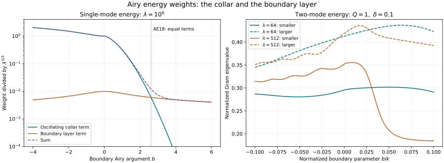

# Airy energy spaces and the actual weak boundary data

The [distributional construction](../20261008-airy-distributional-traces/distributional-airy-kernels-and-boundary-traces.html) makes the normalized boundary kernels meaningful on singular input. That does not determine which inputs produce finite interior energy, or whether every energy solution can be split into two such inputs. We answer both questions completely for the affine glancing equation. The answer supplies a necessary target for the general variable-coefficient problem.

Two features matter. The energy weight changes across the glancing region. Moreover, in the elliptic boundary region the two boundary-normalized modes become almost dependent. An energy solution can have smooth boundary data while its unique coefficients in that normalized basis grow faster than every power of frequency. The stable description uses the unnormalized real Airy basis and a weighted pair of coefficients.

The proof retains every component of a finite complex vector. It identifies the actual Dirichlet and Robin weak realizations, including the sign of the boundary functional, and transfers them through genuine boundary-preserving coordinate changes and invertible matrix gauges. This is an exact model theorem and its stated conjugate class; it is not a normal-form theorem for all variable-coefficient weak problems.

## 1. The collar, frequency cone and real Airy basis

**E0. The model and its norm.** Fix \(Q>0\), \(0<\delta<Q/4\), and a finite constant \(C_0\). On \(X=(0,Q)\times\mathbb R^d\), \(d\ge2\), write \(y=(y_1,y',y_d)\), \(\eta=(\mu,\eta',\lambda)\), and \(D=-i\partial\). Restrict tangential Fourier support to
\[
 \Gamma=\{\lambda\ge1,\ |\mu|\le\delta\lambda,\
                         |\eta'|\le C_0\lambda\},\qquad
 k=\lambda^{2/3},\quad b=-\mu\lambda^{-1/3},\quad t=b-kq .
 \tag{AE1}
\]
Thus \(|b|\le\delta k\), \(\langle\eta\rangle\asymp\lambda\), and \(t\) crosses a negative interval of length comparable to \(k\) before \(q=Q\). There is no condition at \(q=Q\). All weak tests below vanish near that artificial end.

The equation, component by component, is
\[
 P_0u=0,\qquad P_0=D_q^2-qD_{y_d}^2-D_{y_1}D_{y_d},\qquad
 \widehat u_{qq}=k^2(b-kq)\widehat u .
 \tag{AE2}
\]
Use the Fourier convention \(\widehat v(\eta)=\int e^{-iy\eta}v(y)\,dy\), with factor \((2\pi)^{-d}\) in inversion and Plancherel. The standard strip norm is exactly
\[
 \|u\|_{H^1(X)}^2=(2\pi)^{-d}\int
 \int_0^Q\bigl(\langle\eta\rangle^2|\widehat u|^2+
                                      |\widehat u_q|^2\bigr)\,dq\,d\eta .
 \tag{AE3}
\]
Its equivalent version with \(\lambda^2\) in place of \(\langle\eta\rangle^2\) will be denoted \(\mathcal E(u)\). Constants depend on \(Q,\delta,C_0,d\), not on frequency.

Let \(A=\operatorname{Ai}\), \(B=\operatorname{Bi}\), with the normalization fixed in [ABQ:B3](../20261008-airy-boundary-inverse/zero-free-airy-quotients-and-robin-matching.html). In particular
\[
 F=c(A-iB),\qquad c=\sqrt\pi e^{i\pi/4},\qquad
 W(A,B)=AB'-A'B=1/\pi .
 \tag{AE4}
\]
Primes throughout this lesson mean derivatives of the Airy argument. A general Fourier-mode solution is \(A(t)a(\eta)+B(t)d(\eta)\), with vector coefficients \(a,d\in\mathbb C^N\). The letter \(d\) for this coefficient is distinguished from the fixed dimension by its argument.

**E1. The estimates used in the energy integral.** Put \(\Psi(t)=2(t_+)^{3/2}/3\). The differentiated constructions ABQ:B1–B4 give, for \(s\ge1\), with \(\chi(s)=2s^{3/2}/3-\pi/4\),
\[
 \begin{aligned}
 A(-s)&=\pi^{-1/2}s^{-1/4}
                  \{\cos\chi(s)+O(s^{-3/2})\},\\
 B(-s)&=-\pi^{-1/2}s^{-1/4}
                  \{\sin\chi(s)+O(s^{-3/2})\},\\
 |A'(-s)|+|B'(-s)|&\le C s^{1/4}.
 \end{aligned}\tag{AE5}
\]
The errors have all symbol derivatives after removal of the oscillation. These formulas follow by taking real and imaginary parts of \(F/c\), with the minus sign in its imaginary part retained.

On the positive ray \(A(t)\) and \(A'(t)\) decay exponentially. More precisely, for \(t\) sufficiently large,
\[
 A(t)=\frac{t^{-1/4}e^{-\Psi(t)}}{2\sqrt\pi}(1+O(t^{-3/2})),
 \quad
 B(t)=\frac{t^{-1/4}e^{\Psi(t)}}{\sqrt\pi}(1+O(t^{-3/2})),
 \quad
 B'(t)=\frac{t^{1/4}e^{\Psi(t)}}{\sqrt\pi}(1+O(t^{-3/2})).
 \tag{AE6}
\]
Here the full differentiated \(A\) estimate is the Gaussian-contour proof in ABQ:B4. To check the coefficient for \(B\), that proof constructs \(h=2A\int A^{-2}\), with \(W(A,h)=2\) and leading coefficient \(2\sqrt\pi\). Equation AE4 implies \(B=h/(2\pi)+c_1A\) for a real constant \(c_1\). This proves AE6 and its differentiated remainders without an extra complex-sector result.

Consequently
\[
 \int_0^\infty(A^2+A'^2)\,dt<\infty,\quad
 \int_0^b B^2\,dt\asymp\frac{e^{2\Psi(b)}}{\langle b\rangle}
       \ (b\ge1),\quad
 \int_0^b B'^2\,dt\le C\langle b\rangle
                         \int_0^b B^2\,dt\quad(b\ge1).
 \tag{AE7}
\]
For completeness, the middle estimate is an elementary end-point estimate. For large \(b\), the interval \([b-b^{-1/2},b]\) gives the lower bound: the exponential changes by a bounded factor and \(B(t)^2\asymp b^{-1/2}e^{2\Psi(b)}\). For the upper bound split at \(b/2\). The first part is exponentially smaller than \(e^{2\Psi(b)}/b\); on the second, \(\Psi(b)-\Psi(t)\ge\sqrt{b/2}(b-t)\). Integrating this exponential and its \(b^{-1/2}\) prefactor gives the upper bound. The same argument for \(B'^2\asymp t^{1/2}e^{2\Psi(t)}\) gives \(Ce^{2\Psi(b)}\). Continuity and positivity of the integrals give uniform constants on the remaining compact interval \(1\le b\le b_0\). For \(0\le b\le1\), both integrals are bounded; we do not assert the middle equivalence at \(b=0\).

## 2. The oscillating part controls both coefficients

**E2. A uniformly positive two-mode Gram matrix.** The negative portion of \([b-kQ,b]\), written as \(t=-s\), is an interval
\[
 I_{k,b}=
 \begin{cases}
 [-b,kQ-b],&b\le0,\\
 [0,kQ-b],&b\ge0 .
 \end{cases}
 \qquad
 \int_{I_{k,b}}\langle s\rangle^{-1/2}\,ds\asymp k^{1/2}.
 \tag{AE8}
\]
Both end points are at most \((Q+\delta)k\), and the length is at least \((Q-\delta)k\). Integrating the elementary decreasing weight proves the displayed comparison for \(k\ge1\).

For all vectors \(a,d\),
\[
 \int_{I_{k,b}}|A(-s)a+B(-s)d|^2\,ds
       \asymp k^{1/2}(|a|^2+|d|^2).
 \tag{AE9}
\]
Here is the lower-bound argument, including the interference term. On \(s\ge1\), square AE5. The nonoscillating part of the \(2\)-by-\(2\) Gram matrix is
\((2\pi)^{-1}s^{-1/2}I_2\). The error entries are \(O(s^{-2})\), hence have uniformly bounded integrals over any subinterval. The remaining entries are linear combinations of \(s^{-1/2}e^{2i\chi(s)}\). Their integrals are uniformly bounded: integrate once with phase derivative \(2\sqrt s\); the end coefficient is \(1/(2is)\), and its derivative is integrable on \([1,\infty)\). The interval below one contributes a bounded matrix as well. Thus the Gram matrix equals
\[
 \frac1{2\pi}\left(\int_{I_{k,b}\cap[1,\infty)}s^{-1/2}\,ds\right)I_2
                       +O(1).
 \tag{AE10}
\]
For large \(k\), AE8 absorbs the bounded error and proves AE9. For \(1\le k\le k_0\), the parameters \(k,b\) range over a compact set, and the intervals have a positive minimum length. Each Gram matrix is positive definite: a combination of \(A,B\) vanishing on an interval has both value and derivative zero at an interior point, and AE4 makes its coefficients zero. Continuity and compactness of the parameter set and the unit sphere give a positive uniform minimum. This also proves the finite-frequency part of AE9. The argument is scalar in the mode indices and tensors with \(I_N\); arbitrary complex vectors are allowed.

The derivative bound in AE5, including the compact interval, gives
\[
 \int_{I_{k,b}}|A'(-s)a+B'(-s)d|^2\,ds
                   \le Ck^{3/2}(|a|^2+|d|^2).
 \tag{AE11}
\]
Since \(dq=ds/k\), \(\partial_q=-k\partial_t\), and \(\lambda^2=k^3\), equations AE9–AE11 imply that the negative part of the mode energy is comparable to
\(k^{5/2}(|a|^2+|d|^2)=\lambda^{5/3}(|a|^2+|d|^2)\).
The lower bound already comes from the tangential part; no cancellation with the normal derivative is needed.

## 3. The elliptic boundary layer has a separate weight

**E3. Add the positive interval without losing coercivity.** Define
\[
 H(b)=\frac{e^{2\Psi(b)}}{\langle b_+\rangle},\qquad
 W_A(\eta)=\lambda^{5/3},\qquad
 W_B(\eta)=\lambda^{5/3}+\lambda^{4/3}H(b).
 \tag{AE12}
\]
Then the complete mode energy satisfies
\[
 \int_0^Q\left\{\lambda^2|A(t)a+B(t)d|^2+
           k^2|A'(t)a+B'(t)d|^2\right\}\,dq
       \asymp W_A|a|^2+W_B|d|^2 .
 \tag{AE13}
\]
If \(b\le0\), there is no positive interval, and the extra \(\lambda^{4/3}\) term in \(W_B\) is bounded by \(\lambda^{5/3}\). This is E2.

Suppose \(b>0\). The positive-interval energy of \(A a\) is at most
\[
 C(\lambda^2/k+k)|a|^2\le C k^2|a|^2
 \tag{AE14}
\]
by AE7. The positive-interval energy of \(Bd\), for \(b\ge1\), is comparable to \(k^2 H(b)|d|^2\). Indeed its value integral gives the lower bound. For its derivative integral use AE7 and \(b\le\delta k\):
\(k\langle b\rangle\le Ck^2\). For \(0\le b\le1\), it is at most \(Ck^2|d|^2\).

The upper bound in AE13 follows from the squared triangle inequality. For the lower bound use \(|x+y|^2\ge|y|^2/2-|x|^2\) in both positive integrals. It leaves at least half the positive \(B\) energy minus \(Ck^2|a|^2\). For large \(k\), half of the negative-interval lower bound in E2 absorbs that subtraction because \(k^{5/2}\) dominates \(k^2\); its other half retains control of both coefficients. If \(b<1\), the desired extra term is already controlled by E2. For bounded \(k\), \(H(b)\) is bounded because \(b\le\delta k\), so E2 again controls the whole right side. This proves both inequalities with one uniform constant. In particular the positive \(A/B\) cross term was not discarded.

**E4. The exact weighted energy space.** Let \(\mathscr A\) be the space of measurable coefficient pairs supported in \(\Gamma\), modulo equality almost everywhere, with
\[
 \|(a,d)\|_{\mathscr A}^2
 =(2\pi)^{-d}\int_\Gamma
                   (W_A|a|^2+W_B|d|^2)\,d\eta<\infty .
 \tag{AE15}
\]
The map
\[
 \mathcal U(a,d)=\mathcal F_y^{-1}
        [A(b-kq)a+B(b-kq)d]
 \tag{AE16}
\]
is a bounded injection into \(H^1(X;\mathbb C^N)\), and its inverse on its range is bounded. Equations AE3 and AE13 prove both norm inequalities first for bounded frequency support, and then by monotone convergence and Plancherel. Truncation to bounded frequencies converges in \(\mathscr A\) and \(H^1\). Each truncated expression solves AE2; the differential operator is continuous from \(H^1\) into distributions, so every limit solves it as well.

Completeness of \(\mathscr A\) follows directly by multiplying each coefficient by the positive square root of its weight: this identifies it isometrically with two copies of \(L^2(\Gamma;\mathbb C^N)\). Therefore the range of \(\mathcal U\) is closed in \(H^1\). E6 below proves that it is exactly the full space of \(H^1\) solutions with this Fourier support.

## 4. What a single normalized mode actually costs

**E5. A sharp input weight, not a trace-space guess.** For the single mode
\(\widehat u=F(b-kq)F(b)^{-1}v\), AE4 gives
\(a=cv/F(b)\), \(d=-icv/F(b)\). The conjugate mode has the same energy weight. Using ABQ:B4 in AE13 gives
\[
 \mathcal E(u)\asymp(2\pi)^{-d}\int_\Gamma W_{\rm one}(\eta)|v|^2\,d\eta,
 \qquad
 W_{\rm one}=
 \lambda^{5/3}\langle b\rangle^{1/2}e^{-2\Psi(b)}
       +\lambda^{4/3}\langle b\rangle^{-1/2}.
 \tag{AE17}
\]
For \(b\ge0\) the two terms follow immediately from AE12 and
\(|F(b)|^{-2}\asymp\langle b\rangle^{1/2}e^{-2\Psi(b)}\).
For \(b\le0\), the direct second term would be
\(\lambda^{4/3}\langle b\rangle^{1/2}\); it is dominated by the first term and may be replaced by the smaller second term written in AE17 without changing comparability.

In the transition band \(|b|\le C\), \(W_{\rm one}\asymp\lambda^{5/3}\). For \(b=-a_0k\) with fixed \(0<a_0<\delta\), it is comparable to \(\lambda^2\). For \(b=a_0k\), it is comparable to \(\lambda\). Thus the respective boundary Sobolev orders are \(5/6,1,1/2\) on those bands. These are statements about the full collar norm, not pointwise normal values.

For \(b>0\) neither summand may be suppressed uniformly. The equality of their sizes is
\[
 e^{2\Psi(b)}=\lambda^{1/3}\langle b\rangle .
 \tag{AE18}
\]
It occurs on a logarithmic Airy scale \(b\) of size \((\log\lambda)^{2/3}\), up to the lower logarithmic correction. The first term measures the oscillating part of the collar, attenuated from the boundary; the second measures the positive boundary layer. Equation AE18, rather than that descriptive asymptotic, is the exact comparison used here.

For a pair of normalized inputs the conversion is
\[
 a=\frac{c\,v_+}{F(b)}+\frac{\bar c\,v_-}{\overline{F(b)}},
 \qquad
 d=-\frac{ic\,v_+}{F(b)}+\frac{i\bar c\,v_-}{\overline{F(b)}} .
 \tag{AE19}
\]
Its energy is exactly characterized by AE15. On \(b\le0\), the two weights \(W_A,W_B\) are comparable, and the fixed matrix in AE19 is a scalar multiple of a unitary matrix after division by the two denominators of equal magnitude. Hence the energy is comparable to the sum of the two single-mode weights. On \(b>0\), replacing AE15 by that diagonal sum is in general false; E9 gives the concrete obstruction.

## 5. Every finite-energy model solution has the stable representation

**E6. Completeness on the actual \(H^1\) space.** Let \(u\in H^1(X;\mathbb C^N)\), with tangential Fourier support in \(\Gamma\), satisfy \(P_0u=0\) in the open strip. Then there is one and only one \((a,d)\in\mathscr A\) for which \(u=\mathcal U(a,d)\).

We justify passage from the weak equation to each mode. Partial Plancherel and Fubini give \(\widehat u(\cdot,\eta)\in H^1(0,Q)\) for almost every \(\eta\). On any bounded frequency set, test the Fourier-transformed equation against a product of a normal test and an arbitrary compact frequency test. Fubini shows that the normal distributional equation in AE2 holds for almost every frequency for that normal test. Choose a countable dense collection of smooth normal tests on compact subintervals. The \(H^1\) and coefficient bounds make the identity continuous in each test, so outside one null set it holds for every test. Exhaust bounded frequency sets to obtain the assertion almost everywhere in \(\Gamma\).

For a fixed such frequency, the coefficient \(k^2(b-kq)\) is bounded on the strip. Thus \(u''\in L^2(0,Q)\). The elementary weak fundamental theorem can be seen directly here: subtract from \(u'\) the integral of this \(L^2\) second derivative; the remainder has distributional derivative zero and is constant. To prove the last assertion, every compact smooth test of integral zero is a derivative of a compact smooth function; testing against it gives zero. Subtracting an appropriate constant therefore gives the zero distribution. Repeating this argument for \(u\) gives a \(C^1\) representative up to both ends. The equation then makes it \(C^2\), and successive differentiation makes it smooth.

The initial value and derivative determine its coefficients through
\[
 \binom{\widehat u(0,\eta)}{\widehat u_q(0,\eta)}
 =\begin{pmatrix}A(b)&B(b)\\-kA'(b)&-kB'(b)\end{pmatrix}
       \binom{a(\eta)}{d(\eta)},\qquad
 \det=-k/\pi\ne0 .
 \tag{AE20}
\]
The scalar ordered integral-series uniqueness proof NCQ:N1 applies to the corresponding first-order system on \([0,Q]\); equivalently its factorial difference estimate applies directly. It proves that this Airy combination equals the original mode.

The coefficients are measurable. For example, the one-dimensional trace of an \(H^1\) function is the limit of averages of its continuous representative near zero, and the preceding integral formula gives the derivative trace measurably as well. Equation AE20 then gives measurability by an explicit matrix inverse. Integrate the lower bound AE13 to obtain \((a,d)\in\mathscr A\). The upper bound gives the converse already proved in E4. Nonzero determinant, or the lower bound itself, gives uniqueness. This proves completeness for all finite-energy solutions in the stated cone, not just smooth or separated-variable inputs.

## 6. Boundary traces and the signed weak form

**E7. The traces are the original energy and graph traces.** Every solution in E6 has
\[
 f=u|_0\in H^{1/2},\qquad n=(D_qu)|_0\in H^{-1/2},\qquad
 \|f\|_{H^{1/2}}+\|n\|_{H^{-1/2}}\le C\|u\|_{H^1(X)}.
 \tag{AE21}
\]
These are actual one-sided traces. Here are direct estimates with the needed orders. For a mode, average the inequality
\(|u(0)|^2\le2|u(q)|^2+2q\int_0^q|u'|^2\)
over \(0\le q\le\min(Q/2,\lambda^{-1})\). After multiplication by \(\lambda\), it gives a bound by \(C\int_0^Q(\lambda^2|u|^2+|u'|^2)\). Integration in frequency proves the first inequality.

For the derivative trace choose a real smooth \(\vartheta\), equal to one near zero and zero near \(Q\), and put \(w_\lambda(q)=\vartheta(q)e^{-\lambda q}\). Integration by parts and AE2 give
\[
 -u'(0)=\int_0^Q\{u'w_\lambda'+k^2(b-kq)u w_\lambda\}\,dq .
 \tag{AE22}
\]
The bounds \(\|w_\lambda'\|_{L^2}\le C\lambda^{1/2}\),
\(\|w_\lambda\|_{L^2}\le C\lambda^{-1/2}\), and
\(|k^2(b-kq)|\le C\lambda^2\) show that
\(\lambda^{-1/2}|u'(0)|\) is bounded by the square root of its mode energy. This proves the second inequality. Multiplication by \(-i\) gives the stated \(n\).

For bounded-frequency approximants these traces are ordinary restrictions. Their \(H^1\) convergence and the two inequalities identify the limits with the continuous positive and graph traces proved in NCQ:N3 and WSL:L6. Thus the Fourier formulas in AE20 agree with the original weak traces; no additional trace convention is being introduced.

With inner products linear in the first variable, define
\[
 \begin{aligned}
 \mathfrak q_0(u,w)= {}&(D_qu,D_qw)-(qD_{y_d}u,D_{y_d}w)\\
 &-\tfrac12(D_{y_1}u,D_{y_d}w)
       -\tfrac12(D_{y_d}u,D_{y_1}w).
 \end{aligned}\tag{AE23}
\]
For \(w\in H^1(X;\mathbb C^N)\) vanishing near \(q=Q\), the signed Green identity is
\[
 \mathfrak q_0(u,w)=-i\langle n,w|_0\rangle_{H^{-1/2},H^{1/2}} .
 \tag{AE24}
\]
For bounded frequencies and smooth tests this follows from integration by parts:
the outward end term at zero is \(-u_q(0)\overline{w(0)}=-i n\overline{w(0)}\).
Tangential Plancherel gives the two cross terms in AE23. Pass to the limit using \(H^1\) convergence, AE21 and smooth density. The density on a finite strip with tests zero near \(Q\) is the inward-translation and convolution proof BF:A0 with a normal cutoff. This proves AE24 for all the stated tests, including tests that do not vanish at the physical boundary.

## 7. Dirichlet and matrix Robin energy solutions

**E8. Exact weak boundary constraints and matching.** Let \(K(\eta)\) be any bounded smooth \(N\)-by-\(N\) Fourier multiplier of ordinary order zero. It need not be Hermitian or commute with any other matrix. It is bounded on every Fourier Sobolev space by its pointwise norm. The energy Robin realization with data \(\beta\in H^{-1/2}\) is precisely
\[
 \mathfrak q_0(u,w)-i\langle K(D)f,w|_0\rangle
           =-i\langle\beta,w|_0\rangle ,
 \qquad\text{equivalently } n+K(D)f=\beta .
 \tag{AE25}
\]
One implication is AE24. For the converse, boundary tests range over \(H^{1/2}\): the right inverse \(\widehat w(q,\eta)=\vartheta(q)e^{-q\langle\eta\rangle}\widehat h(\eta)\) has \(H^1\) norm bounded by \(C\|h\|_{H^{1/2}}\), by direct integration. Hence the vanishing dual pairing for every \(w\) forces the boundary equality.

The Dirichlet realization consists exactly of the solutions in E6 satisfying \(f=0\), tested on the subspace with zero trace at \(q=0\). For clarity, zero trace equals the closure of smooth tests supported away from that boundary: extend a zero-trace \(H^1\) function by zero across \(q=0\); integration by parts has no boundary jump, so the extension and its weak first derivatives are in \(L^2\). Translate it a small positive distance into the half-strip and convolve at a smaller radius. With the fixed cutoff near \(Q\), these approximants converge in \(H^1\) and vanish near \(q=0\). The converse follows from AE21. This verifies the actual domain identification.

In the stable coefficients the two boundary constraints are
\[
 \begin{aligned}
 \widehat f&=A(b)a+B(b)d,\\
 \widehat\beta
   &=[ikA'(b)I+K(\eta)A(b)]a
                     +[ikB'(b)I+K(\eta)B(b)]d .
 \end{aligned}\tag{AE26}
\]
Together with the finite norm AE15 these conditions are necessary and sufficient. They describe the range of admissible energy boundary data; they do not claim that arbitrary \(\beta\in H^{-1/2}\) can be assigned to one outgoing mode.

Where normalized coefficients are legitimate, the exact same condition reads
\[
 N_+v_++N_-v_-=\widehat\beta,\quad
 N_\pm=ik\varphi_\pm(b)I+K,\quad
 v_+=N_+^{-1}\widehat\beta-N_+^{-1}N_-v_- .
 \tag{AE27}
\]
Here \(\varphi_+=F'/F\), \(\varphi_-=\overline{\varphi_+}\). ABQ:B4 gives \(|k\varphi_+|\ge ck\langle b\rangle^{1/2}\). At sufficiently high frequency the inverse in AE27 is the convergent ordered matrix series
\((ik\varphi_+)^{-1}\sum_{j\ge0}[-K/(ik\varphi_+)]^j\).
The relation retains the full complex \(K\); the energy condition is still AE15 after conversion by AE19.

For constant \(K\), AE25 is also an ordinary differential weak form of the type used in the original energy problem. Choose \(\vartheta=1\) at zero, zero near \(Q\), and put \(m=K\vartheta\). Add to AE23 the interior terms
\[
 (-mD_qu,w)+(mu,D_qw)-((D_qm)u,w).
 \tag{AE28}
\]
Integration by parts shows that these sum to \(-i\langle Kf,w|_0\rangle\): their interior differential terms cancel exactly. Thus the Robin matrix is realized by derivative-on-solution, derivative-on-test and zero-order terms, rather than by silently replacing the natural form with a bare normal derivative.

## 8. Why two distributional normalized inputs are not a completeness theorem

**E9. Finite energy with non-tempered normalized coefficients.** Choose
\(\lambda_j=4^j\), \(\mu_j=-\lambda_j^{2/3}\), \(\eta'_j=0\), beginning at a sufficiently large \(j\). Let \(\rho\) be a nonzero nonnegative smooth function supported in a fixed small frequency ball, and use its disjoint translates \(\rho_j\) centered at these points. On their supports
\[
 b\asymp\lambda_j^{1/3},\quad
 \Psi(b)\asymp\lambda_j^{1/2},\quad
 \frac{\mu}{\lambda}\longrightarrow0,\qquad
 a(\eta)=\sum_j\frac{\lambda_j^{-5/6}}{j}\rho_j(\eta).
 \tag{AE29}
\]
All sufficiently late balls lie in every prescribed cone around the marked glancing direction. In the vector case multiply this scalar coefficient by one fixed unit vector.

First take \(d=0\). Equation AE15 gives finite energy, since the sum of the squared weighted coefficients is comparable to \(\sum j^{-2}\). But inversion of AE19 gives the unique normalized coefficients
\[
 v_+=\tfrac12(A(b)-iB(b))a,\qquad
 v_-=\tfrac12(A(b)+iB(b))a .
 \tag{AE30}
\]
Their imaginary parts have a fixed sign on each ball and size at least a polynomial factor times \(e^{c\lambda_j^{1/2}}\). Neither defines a tempered distribution. Indeed a tempered distribution has an estimate by finitely many Schwartz seminorms. Pair it against translates of one fixed nonnegative bump supported inside these balls, multiplied by a fixed scalar phase selecting the imaginary part. Those seminorms grow at most polynomially in \(\lambda_j\), whereas the pairings just found grow exponentially. This contradicts that estimate. This argument rules out a tempered distribution having these locally smooth coefficients; it does not rely merely on a pointwise-growth heuristic.

The example can satisfy either homogeneous weak boundary condition. On these positive-ray balls \(B(b)\) and \(B'(b)\) are nonzero by AE6. Set respectively
\[
 d_D=-\frac{A(b)}{B(b)}a,\qquad
 d_N=-\frac{A'(b)}{B'(b)}a .
 \tag{AE31}
\]
These give \(f=0\) and \(n=0\) exactly. Both ratios are \(O(e^{-2\Psi(b)})\), with polynomially bounded differentiated prefactors. The \(W_B\) term of AE15 is therefore bounded by a constant times the \(W_A\) term; both solutions have finite energy. Inverting AE19 now yields
\[
 v_+=\frac{F(b)}{2c}(a+id),\qquad
 v_-=\frac{\overline{F(b)}}{2\bar c}(a-id).
 \tag{AE32}
\]
The exponentially small real ratios in AE31 cannot cancel the growing imaginary parts in AE30, so these coefficients remain non-tempered. The nonzero boundary trace in each example is Schwartz in frequency: every derivative is a polynomial factor times \(e^{-\Psi(b)}a\) on the disjoint balls. In particular both examples have smooth boundary data.

This disproves the global, frequency-localized assertion that every \(H^1\) solution, even with homogeneous Dirichlet or Neumann condition, is a sum of the two normalized modes with tempered input coefficients. Compactly supported input distributions are a still smaller class. It does not invalidate the distributional boundary parametrices, or forbid a local representation with an additional interior-wave term. A general completeness proof must supply such a stable representation and establish its local support and energy estimates; it cannot assume that the two normalized coefficients individually have polynomial growth.

## 9. Exact transfer through boundary-preserving changes

**E10. A variable-coefficient class with the same weak spaces.** Let \(\kappa:\mathbb R^d\to\mathbb R^d\) be a smooth diffeomorphism with bounded first derivatives and inverse derivatives, and Jacobian \(0<c\le J=|\det D\kappa|\le C\). Assume the derivatives needed below are bounded. The half-density pullback
\((Cv)(q,y)=J(y)^{1/2}v(q,\kappa(y))\)
is unitary on \(L^2\). Let \(S(q,y)\) be a smooth complex matrix with \(S,S^{-1}\) and their first derivatives bounded, and set \(T=SC\).

The chain and product rules, change of variables and the corresponding inverse formulas show that \(T,T^*\) are isomorphisms of \(H^1\), and of the zero-trace subspace. Here \(T^*=C^{-1}S^*\); this is the actual \(L^2\) adjoint, not \(T^{-1}\). The scalar change-of-variables and half-order trace facts are the earlier exact providers; alternatively the trace isomorphism follows by the \(H^1\) trace and its right inverse used in E8.

Transport both slots and the source as
\[
 \widetilde u=Tu,\quad
 \widetilde{\mathfrak q}(\widetilde u,w)
       =\mathfrak q_0(T^{-1}\widetilde u,T^*w),\quad
 \widetilde F(w)=F(T^*w),\quad
 \widetilde P=TP_0T^{-1}.
 \tag{AE33}
\]
These equalities on \(H^1\) define the exact transported weak problem. Expanding each derivative gives a real scalar transformed principal form and the complete complex lower matrices; no derivative of \(J,S,S^{-1}\) may be omitted. The principal matrices cancel because
\((S^{-1}v,S^*w)=(v,w)\). The natural antidual source is transported by the displayed test map, with its norm bounded by that map's \(H^1\) norm. This includes sources acting on traces or on derivatives of tests.

Write \(T_b=S(0,\cdot)C\). Since \(C\) is independent of \(q\), the transformed value and flux are exactly
\[
 \widetilde f=T_b f,\qquad
 \widetilde n=T_b n
     =(D_q\widetilde u)|_0-(D_qS)_bS_b^{-1}\widetilde f .
 \tag{AE34}
\]
Use the product rule first on bounded-frequency approximants and then the positive and graph trace continuity. Equation AE24 gives
\(\widetilde{\mathfrak q}(\widetilde u,w)=-i\langle\widetilde n,w|_0\rangle\);
the boundary dual map is correct because the trace of \(T^*w\) is \(T_b^*(w|_0)\).

For constant \(K\), the full Robin row becomes
\[
 \widetilde n+S_bKS_b^{-1}\widetilde f=T_b\beta .
 \tag{AE35}
\]
The transformed version of AE28 retains all derivative-on-test terms. Thus E4–E8 give a complete energy parametrization for this actual variable-coefficient conjugate class, with equivalent norms and exactly transported weak domains and sources. Its Fourier support condition means that \(T^{-1}\widetilde u\) has support in \(\Gamma\). No claim is made that an arbitrary canonical transformation, or an arbitrary scalar-principal system, has this boundary-preserving form.

## 10. Three solved exercises

### Exercise 1. An exact energy Gram matrix without oscillatory quadrature

If \(f''=tf\) and \(g''=tg\), find primitives for \(fg\) and \(f'g'\), and use them to compute the two-mode energy matrix on the collar.

**Solution.** Direct differentiation gives
\[
 (tfg-f'g')'=fg,\qquad
 \left(\frac{f'g+fg'+tf'g'-t^2fg}{3}\right)'=f'g'.
 \tag{AE36}
\]
Apply these to the three real pairs \((A,A),(A,B),(B,B)\), and evaluate at \(t=b\) minus \(t=b-kQ\). If the resulting matrices are \(G_0,G_1\), the exact energy Gram matrix is \(\lambda^2G_0/k+kG_1\). It is positive definite by the same Wronskian argument as E2. AE13 bounds its quadratic form uniformly by \(\operatorname{diag}(W_A,W_B)\); the off-diagonal entry is retained in the exact matrix.

### Exercise 2. Boundary \(H^{1/2}\) alone does not give a single-mode energy bound

Construct boundary data in \(H^{1/2}\), supported in the transition band, whose normalized plus mode is not in \(H^1(X)\).

**Solution.** Center fixed disjoint frequency balls at \((0,0,\lambda_j)\), \(\lambda_j=4^j\), and set
\(\widehat v=\sum_j \lambda_j^{-1/2}j^{-1}\rho_j\).
On each ball \(b=O(\lambda_j^{-1/3})\). The boundary squared \(H^{1/2}\) norm is comparable to \(\sum j^{-2}<\infty\). By AE17, the squared energy of its normalized mode would contain
\(\sum_j\lambda_j^{2/3}j^{-2}=\infty\).
Frequency truncations demonstrate the divergence directly. The input is a tempered distribution, so its local distributional realization is meaningful; the failed assertion is the proposed \(H^{1/2}\)-to-\(H^1\) bound.

### Exercise 3. A nonunitary matrix gauge changes the conormal row

Take \(E=\begin{pmatrix}0&1\\0&0\end{pmatrix}\), \(S(q)=I+qE\), \(\kappa=I\), and \(K=0\). Compute the conjugated operator and the natural boundary condition.

**Solution.** Since \(E^2=0\), \(S^{-1}=I-qE\) and
\(S D_q S^{-1}=D_q+iE\). The tangential derivatives commute with \(S\), so
\[
 SP_0S^{-1}=P_0+2iE D_q,\qquad
 \widetilde n=(D_q+iE)\widetilde u|_0 .
 \tag{AE37}
\]
The \(E^2\) term is zero. Thus a solution obtained from a Neumann solution has
\((D_q+iE)\widetilde u|_0=0\), not \(D_q\widetilde u|_0=0\).
The transformed test is \(S^*w\) as in AE33. Its derivative supplies the lower terms needed for the exact weak Green identity. This example belongs to E10 with bounded \(S,S^{-1}\) on the fixed collar.

**F0. Figure coordinates.** The left panel plots the two summands of AE17 and their sum for \(\lambda=10^6\), as functions of \(b\); it displays their exact equality condition AE18. The right panel plots the eigenvalues of the exact Gram matrix in Exercise 1 after normalization by \(\operatorname{diag}(W_A,W_B)^{-1/2}\), for \(Q=1\), \(\delta=0.1\), and \(\lambda=64,512\). Only \(|b|\le\delta\lambda^{2/3}\) is sampled. These are finite numerical illustrations of the weights and interference; the all-frequency bounds are proved in E1–E3.

## 11. Source credit and the corrected general target

The normalized Fourier–Airy ansatz and its role in boundary parametrices are discussed in Richard Melrose and Michael Taylor, [*Boundary Problems for Wave Equations With Grazing and Gliding Rays*](https://mtaylor.web.unc.edu/wp-content/uploads/sites/16915/2018/04/glide.pdf), §§6.1–6.4 and 7.1–7.3. Their discussion distinguishes the parametrix construction from its energy justification. Our exact prior ABQ, ADT, NCQ and WSL proofs supply the analytic inputs here. The weighted Gram estimates, complete model energy description and counterexamples above are independently derived, and are not assertions that the cited source proves this same formulation.

The proof map binds every prerequisite. Required Lebl proofs remain external; internal P514 closure of this CC0-only export is not claimed. Independent expression, code and illustration are CC0-1.0. Linked components retain their terms. [Source credit](source-provenance.json), [proof review](proof-review.json), [finite checks](model-check.json) and [reader checks](reader-check.json) accompany the source.

For the full variable-coefficient weak problem, the remaining representation must include interior incoming data in a stable space, with actual support control, the same form domain and natural-dual source. It must not require that every energy solution have two individually distributional boundary-normalized coefficients. The already proved normalized Dirichlet and Robin parametrices remain valid for their admitted inputs. General energy estimates, completeness with the appropriate additional interior term, incoming regularity, strict propagation and the full singular boundary trajectories remain active. 
