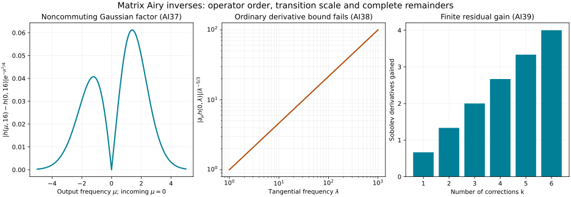

# Variable matrix coefficients in the Airy boundary inverse

The [zero-free Airy quotient](../20261008-airy-boundary-inverse/zero-free-airy-quotients-and-robin-matching.html) gives an exact inverse for a boundary Fourier multiplier. A coefficient depending on the boundary point does not commute with that multiplier. This lesson proves the operator composition, Sobolev bounds and two-sided parametrices needed to handle that dependence. The reflection operator still has order zero, even though estimating its two factors separately would lose a third of a derivative.

We keep arbitrary finite complex matrices and their order of multiplication. The result applies to a boundary operator once its Fourier–Airy representation has actually been established. Constructing that representation from a general variable-coefficient differential equation, and identifying the same weak energy solution, remain further steps.

## 1. A concrete symbol class with all required estimates

**O0. Symbols, quantization and remainders.** Fix \(0<\rho\le1\), a finite matrix size, and boundary coordinates \(z\in\mathbb R^d\). Write \(D_z=-i\partial_z\). We use symbols
\[
 a(z,\eta)=a_\infty(\eta)+a_c(z,\eta),
 \qquad
 |\partial_\eta^\alpha a_\infty|\le C_\alpha
       \langle\eta\rangle^{m-\rho|\alpha|},
 \tag{AI1}
\]
where, for every \(L,\alpha,\beta\),
\[
 \sup_{z,\eta}\langle z\rangle^L
  \langle\eta\rangle^{-m+\rho|\alpha|}
  \|\partial_\eta^\alpha\partial_z^\beta a_c(z,\eta)\|<\infty .
 \tag{AI2}
\]
Denote this class by \(\mathcal S_\rho^m\). The decomposition is fixed by its limit at spatial infinity. Compact dependence on \(z\) is included. The term independent of \(z\) permits identity operators and global extensions of local elliptic coefficients. The intersection over all real \(m\) is denoted by \(\mathcal S_\rho^{-\infty}\).

Left quantization is
\[
 \operatorname{Op}(a)u(z)=(2\pi)^{-d}
       \int e^{iz\cdot\eta}a(z,\eta)\widehat u(\eta)\,d\eta .
 \tag{AI3}
\]
On Schwartz functions this is an ordinary absolutely convergent integral. Every output derivative is controlled by a sufficiently strong input seminorm. Position weights are obtained by integration by parts in \(\eta\); for the \(z\)-independent part this is the usual Fourier multiplier argument. Consequently \(\operatorname{Op}(a):\mathcal S\to\mathcal S\) continuously. All assertions below include uniform estimates in a bounded set of the displayed seminorms. They therefore include smooth parameters on compact sets, by applying the same bounds to their derivatives.

The elementary weight inequality used repeatedly is
\[
 \langle\eta+\theta\rangle^v
       \le C_v\langle\eta\rangle^v\langle\theta\rangle^{|v|}
       \quad(v\in\mathbb R).
 \tag{AI4}
\]
For \(v\ge0\) it follows from
\(\langle\eta+\theta\rangle\le\sqrt2\langle\eta\rangle\langle\theta\rangle\).
For \(v<0\), apply that inequality with \(\eta=(\eta+\theta)-\theta\) and invert. This also gives comparability with \(\langle\eta\rangle\) when
\(|\theta|\le\langle\eta\rangle/2\), with fixed constants.

## 2. Exact ordered composition and its complete expansion

**O1. The actual product symbol.** Put
\(\widehat b_c(\theta,\eta)=\int e^{-iy\cdot\theta}b_c(y,\eta)\,dy\).
Integration by parts in \(y\), and multiplication by \(y\) for \(\theta\) derivatives, give
\[
 \|\partial_\theta^\gamma\partial_\eta^\alpha
               \widehat b_c(\theta,\eta)\|
 \le C_{M,\gamma,\alpha}\langle\theta\rangle^{-M}
                      \langle\eta\rangle^{m'-\rho|\alpha|}
 \quad\hbox{for every }M .
 \tag{AI5}
\]
The \(L^1_y\) bounds here follow from AI2 with a position weight larger than \(d\). Conversely these Fourier estimates, with arbitrarily many \(\theta\) derivatives and powers, give the required position decay by Fourier inversion and integration by parts.

There is an exact product in \(\mathcal S_\rho^{m+m'}\):
\[
 \begin{split}
 a\# b(z,\eta)
 &=a(z,\eta)b_\infty(\eta)\\
 &\quad +(2\pi)^{-d}\int e^{iz\cdot\theta}
                  a(z,\eta+\theta)\widehat b_c(\theta,\eta)\,d\theta .
 \end{split}
 \tag{AI6}
\]
The integral and every fixed derivative are absolutely convergent by AI4–AI5. To identify it with the operator product, first apply both operators to a Schwartz input. The Fourier transform of \(b_c(z,\eta)e^{iz\cdot\eta}\) shifts its first argument by \(\eta\). Substitution and Fubini give AI6; all absolute bounds are supplied by AI5 and the rapid input Fourier decay. The \(b_\infty\) term is exact right multiplication. Thus
\[
 \operatorname{Op}(a)\operatorname{Op}(b)=\operatorname{Op}(a\# b)
       \quad\hbox{on }\mathcal S .
 \tag{AI7}
\]

Here are the complete symbol estimates, including the point where ordinary and Airy orders differ. In the integral split with a smooth cutoff at
\(|\theta|=\langle\eta\rangle/2\). In the inner part, \(\eta+t\theta\) is comparable with \(\eta\), \(0\le t\le1\). Derivatives of the moving cutoff cost \(\langle\eta\rangle^{-1}\), which is at least the required gain \(\langle\eta\rangle^{-\rho}\). In the outer part, AI5 can be used with arbitrarily large \(M\). Each polynomial growth factor from \(a\), any fixed \(\theta\) power, and any fixed target power of \(\eta\) is absorbed by increasing \(M\); \(|\theta|\ge c\langle\eta\rangle\) supplies every desired remaining negative power of \(\eta\). This proves the order bound for every mixed derivative.

The part \(a_c\# b_c\) has rapid position decay directly from the \(a_c\) factor. For \(a_\infty\# b_c\), multiply by \(z^\gamma\) and integrate by parts in \(\theta\). Derivatives fall on \(a_\infty(\eta+\theta)\) and \(\widehat b_c\); the same inner/outer estimates apply. Every such position weight is therefore allowed. The terms involving \(b_\infty\) are immediate. This proves closure in the concrete class AI1–AI2, not merely a bound without position control.

**O2. Every composition remainder and the adjoint.** For \(N\ge1\), Taylor's integral formula in the inner region gives
\[
 a\# b-\sum_{|\alpha|<N}
       \frac{1}{\alpha!}(\partial_\eta^\alpha a)(D_z^\alpha b)
       \ \in\ \mathcal S_\rho^{m+m'-\rho N}.
 \tag{AI8}
\]
Indeed the remainder is a finite sum of integrals with factor
\[
 \frac{N}{\alpha!}\theta^\alpha
       \int_0^1(1-t)^{N-1}
                   \partial_\eta^\alpha a(z,\eta+t\theta)\,dt,
 \qquad |\alpha|=N .
 \tag{AI9}
\]
Its derivatives satisfy the asserted order by comparability and AI5. The whole-space Taylor terms are the inverse Fourier formulas for \(D_z^\alpha b_c\). Their removed outer parts have arbitrarily low order by the outer estimate in O1; so does the outer part of the unexpanded integral. Position weights are handled exactly as in O1, now with the same Taylor subtraction. This proves every seminorm of AI8. Matrix factors keep their displayed order throughout.

The actual Hilbert adjoint has symbol
\[
 a^\dagger(z,\eta)=a_\infty(\eta)^*
 +(2\pi)^{-d}\int e^{iz\cdot\theta}
                       \widehat a_c(-\theta,\eta+\theta)^*\,d\theta .
 \tag{AI10}
\]
This follows by exchanging the two kernel variables, taking conjugate transpose, and then setting the output frequency to \(\eta\). The same absolute Fourier bounds justify the pairing calculation on Schwartz functions. Taylor expansion in the second argument of \(\widehat a_c\), using the inner/outer split, proves
\[
 a^\dagger-\sum_{|\alpha|<N}
      \frac{1}{\alpha!}\partial_\eta^\alpha D_z^\alpha(a^*)
          \in\mathcal S_\rho^{m-\rho N}.
 \tag{AI11}
\]
Integration by parts in \(\theta\) proves rapid position decay for the nonconstant part. These arguments also prove that composition with a symbol in \(\mathcal S_\rho^{-\infty}\), in either order, stays in that class: apply AI8 to arbitrarily negative input orders. No matrix commutativity is used.

## 3. Sobolev bounds without an unproved exotic-symbol theorem

**O3. Every real Sobolev order.** The preceding operators satisfy
\[
 \|\operatorname{Op}(a)u\|_{H^{s-m}}
       \le C_s\|u\|_{H^s},\qquad s\in\mathbb R .
 \tag{AI12}
\]
For \(a_\infty\) this is the pointwise matrix bound and Plancherel. For \(a_c\), the Fourier kernel is
\((2\pi)^{-d}\widehat a_c(\xi-\eta,\eta)\). After inserting the two Sobolev weights, AI4–AI5 bound its norm by
\[
 C_M\langle\xi-\eta\rangle^{-M+|s-m|}.
 \tag{AI13}
\]
Choose \(M>|s-m|+d\). Both marginal integrals of this bound are finite and uniformly bounded. For completeness, if a nonnegative kernel \(k\) has both marginals at most \(C\), then
\[
 \left|\int k(\xi,\eta)v(\eta)\,d\eta\right|^2
 \le \left(\int k(\xi,\eta)\,d\eta\right)
       \int k(\xi,\eta)|v(\eta)|^2\,d\eta .
 \tag{AI14}
\]
Integrating in \(\xi\) gives the \(L^2\) bound \(C\). Apply this to the norm of the vector input and use the triangle inequality for the finite matrix integral. The complete earlier Fourier and Sobolev proofs justify the weights and Plancherel. Density gives the extension in AI12; simultaneous density identifies the extensions distributionally.

Thus an \(\mathcal S_\rho^{-\infty}\) remainder maps every \(H^s\) to every \(H^t\). A compactly supported distribution has finite order \(M\): continuity on tests supported in a fixed compact neighborhood bounds it by finitely many derivative suprema. Test against a fixed cutoff times \(e^{-iz\cdot\eta}\) to obtain \(|\widehat u(\eta)|\le C\langle\eta\rangle^M\). Consequently \(u\in H^{-L}\) for \(L>M+d/2\). An output belonging to every \(H^t\) is smooth: for \(t>k+d/2\), Cauchy–Schwarz makes \(\eta^\alpha\widehat v\) integrable for \(|\alpha|\le k\), and its inverse Fourier integral is continuous by dominated convergence. This proves the smoothing assertion on compact distributions. The adjoint construction O2 also extends each operator to tempered distributions by transposition.

## 4. Asymptotic sums and two-sided matrix parametrices

**O4. Sums and ordinary elliptic factors.** Suppose
\(a_j\in\mathcal S_\rho^{m-\varepsilon j}\), \(\varepsilon>0\).
There exists \(a\in\mathcal S_\rho^m\) such that
\[
 a-\sum_{j<J}a_j\in\mathcal S_\rho^{m-\varepsilon J}
       \quad(J\ge0).
 \tag{AI15}
\]
Choose \(\chi(\eta)=0\) for \(|\eta|\le1\) and \(1\) for \(|\eta|\ge2\), and take an increasing sequence \(R_j\) tending to infinity. For \(j\ge1\), increase \(R_j\) until the first \(j\) seminorms of
\(\chi(\eta/R_j)a_j\), including the rapid-position seminorms, in order \(m-\varepsilon j/2\) are at most \(2^{-j}\). This is possible since there is a positive gap \(\varepsilon j/2\) between the two orders; cutoff derivatives cost \(R_j^{-1}\le C\langle\eta\rangle^{-\rho}\) on their support. Then
\(a=a_0+\sum_{j\ge1}\chi(\eta/R_j)a_j\) converges in every required seminorm.
For a fixed \(J\), the tail with \(j\ge2J\) converges in order \(m-\varepsilon J\); the finitely many intervening terms have that order individually. The differences \((1-\chi(\eta/R_j))a_j\) for \(j<J\) have compact frequency support and satisfy every negative-order estimate, with rapid position bounds on their nonconstant parts. This proves AI15.

Let \(a\in\mathcal S_\rho^0\) be pointwise invertible for large \(|\eta|\), with
\(\|a^{-1}\|\le C\), and suppose its frequency-only part is also uniformly invertible there. Matrix differentiation of \(a^{-1}a=I\), in the actual order of factors, proves \(a^{-1}\in S_{\rho,0}^0\). Its nonconstant part is rapid in \(z\), since
\[
 a^{-1}-a_\infty^{-1}=-a_\infty^{-1}a_c a^{-1}.
 \tag{AI16}
\]
Insert a high-frequency cutoff in this inverse to define \(e\in\mathcal S_\rho^0\). Its low-frequency error is in \(\mathcal S_\rho^{-\infty}\). By AI8,
\[
 a\# e=I+r,\qquad e\# a=I+\ell,\qquad
 r,\ell\in\mathcal S_\rho^{-\rho}.
 \tag{AI17}
\]
Use O1 and AI15 to sum the ordered powers
\(I-r+r\# r-\cdots\). Finite geometric identities show that multiplying its asymptotic sum by \(I+r\), on either side, differs from \(I\) by a symbol of every negative order. Indeed after \(J\) powers the finite residual has order \(-\rho J\), and AI15 controls the discarded tail to that same order. Thus \(e\#(I+r)^{-1}\) is a right parametrix. The construction with \(\ell\) gives a left parametrix. If they are \(q_R,q_L\), then
\[
 q_L-q_R
 =q_L\#(I-a\#q_R)+(q_L\#a-I)\#q_R
       \in\mathcal S_\rho^{-\infty}.
 \tag{AI18}
\]
So either is two-sided. This argument proves parametrices modulo smoothing; it does not assert a global inverse in the presence of a low-frequency kernel. In particular, with \(\rho=1\), an ordinary elliptic matrix factor \(A\) of order zero has an ordinary two-sided parametrix \(G\) of order zero.

## 5. Extend the Airy multiplier without changing its cone

**O5. A global nonzero multiplier and its reciprocal.** On the cone of the preceding Airy lesson write
\[
 n(\eta)=i\lambda^{2/3}\varphi(\lambda^{-1/3}\mu),
 \qquad n_-(\eta)=-\overline{n(\eta)} .
 \tag{AI19}
\]
ABQ:B3–B5 proves
\[
 \begin{split}
 &\operatorname{Re}n>0,\qquad
 c\lambda^{2/3}\le |n|\le C\lambda,\\
 &|\partial_\eta^\alpha n|
       \le C_\alpha|n|\lambda^{-|\alpha|/3},\qquad
 |\partial_\eta^\alpha n^{-1}|
       \le C_\alpha\lambda^{-2/3-|\alpha|/3}.
 \end{split}
 \tag{AI20}
\]
Choose a slightly smaller closed cone and a smooth frequency cutoff \(0\le\chi\le1\) equal to one near it at sufficiently high frequency, supported in the larger Airy cone. It has ordinary order-zero derivative bounds. With \(w(\eta)=\langle\eta\rangle^{2/3}\), set
\[
 \widetilde n=\chi n+(1-\chi)w .
 \tag{AI21}
\]
The product \(\chi n\) is extended by zero outside its defining cone. Since \(w>0\) and \(\operatorname{Re}n>0\), the cross term in the squared modulus is nonnegative. Hence
\[
 |\widetilde n|\ge
       \max\{\chi|n|,(1-\chi)w\}\ge c'\langle\eta\rangle^{2/3}.
 \tag{AI22}
\]
After changing constants on the bounded transition region this holds everywhere.

The relative differentiated bound in AI20 also holds for \(\widetilde n\), with \(\langle\eta\rangle\) in place of \(\lambda\). Terms with no derivative on \(\chi\) use AI22. If \(k\ge1\) derivatives fall on \(\chi\), its bound contributes \(\langle\eta\rangle^{-k}\), while the possible ratio of \(|n|\) to \(|\widetilde n|\) costs at most \(\langle\eta\rangle^{1/3}\). The remaining \(|\alpha|-k\) derivatives cost their Airy factors; the total extra exponent is at most
\(1/3-k-(|\alpha|-k)/3\le-|\alpha|/3\).
The \(w\) terms have stronger ordinary bounds. Differentiating the reciprocal identity therefore proves, globally,
\[
 \widetilde n\in\mathcal S_{1/3}^1,\qquad
 h=\widetilde n^{-1}\in\mathcal S_{1/3}^{-2/3},\qquad
 r=\frac{-\overline{\widetilde n}}{\widetilde n}
                  \in\mathcal S_{1/3}^0,\quad |r|=1.
 \tag{AI23}
\]
These symbols are independent of \(z\). Let \(N_0=\widetilde n(D)\) and \(H=h(D)\). They are exact mutual inverses on Schwartz functions and on their compatible Sobolev domains. Below \(N_{0,-}=(-\overline{\widetilde n})(D)=N_0r(D)\). On the smaller cone these are the original two Airy boundary derivatives.

## 6. The full variable matrix boundary inverse

**O6. Two-sided inverse modulo smoothing.** Let \(A=\operatorname{Op}(a)\) and \(B=\operatorname{Op}(b)\), where \(a,b\in\mathcal S_1^0\) are finite complex matrix symbols. Assume \(a\) and \(a_\infty\) satisfy the ellipticity hypotheses of O4. Define
\[
 \mathcal N_+=A N_0+B,\qquad
 \mathcal N_-=A N_{0,-}+B .
 \tag{AI24}
\]
The same operator \(A\) occurs in both normal leading terms; no commutation of \(A,B\), or \(N_0\) is assumed. The boundary operator \(\mathcal N_+\) has a two-sided parametrix
\[
 Q\in\operatorname{Op}(\mathcal S_{1/3}^{-2/3}),
 \qquad
 \mathcal N_+Q=I+S_R,\quad Q\mathcal N_+=I+S_L,
 \quad S_R,S_L\in\operatorname{Op}(\mathcal S_{1/3}^{-\infty}).
 \tag{AI25}
\]

To construct it, let \(G\) be the ordinary two-sided parametrix of \(A\) from O4, and put
\[
 C=A+BH,\qquad T=CG-I .
 \tag{AI26}
\]
Exact O1 composition gives \(BH\) order \(-2/3\), and
\(T=BH G+(AG-I)\) has order \(-2/3\) in the \(1/3\) calculus. Choose an asymptotic sum
\[
 U\sim\sum_{j\ge0}(-T)^j,\qquad Q=H G U .
 \tag{AI27}
\]
All products here are actual operators with the exact symbols O1 supplies. O4's summation with decrement \(2/3\) gives
\((I+T)U=U(I+T)=I\) modulo smoothing.
Moreover the symbol of \(C\) is \(a\) plus order \(-2/3\), so \(C\) is elliptic of order zero for sufficiently high frequency, including its frequency-only part. Apply O4 to obtain a two-sided parametrix of \(C\). The same identity as AI18 shows that the right parametrix \(GU\) differs from it by smoothing. Thus \(GU\) is two-sided.

Finally,
\[
 \mathcal N_+=C N_0
 \tag{AI28}
\]
is an exact identity, because \(HN_0=I\). AI25 follows by multiplying the two parametrix identities for \(C\), using \(H N_0=N_0H=I\). Composing a smoothing remainder with \(N_0\), of order at most one, still gives a smoothing remainder by O2. This establishes both sides in AI25 with the actual variable matrix coefficients.

In particular, for every \(s,M\in\mathbb R\) for which the last norm is finite,
\[
 \|u\|_{H^s}\le C_{s,M}
       \bigl(\|\mathcal N_+u\|_{H^{s-2/3}}+\|u\|_{H^{-M}}\bigr).
 \tag{AI29}
\]
Apply \(Q\) to \(\mathcal N_+u\), use AI25, and apply O3 to \(Q\) and \(S_L\). The same identity proves regularity when initially \(u\in H^{-M}\): if \(\mathcal N_+u\in H^{s-2/3}\), then \(u\in H^s\). Thus the estimate does not assume the regularity it concludes.

## 7. Reflection has no loss at the transition

**O7. Ordered cancellation and the matching law.** Define
\[
 \mathcal R=-Q\mathcal N_- .
 \tag{AI30}
\]
The estimate from the separate displayed orders of \(Q\) and \(\mathcal N_-\) would only give order \(1/3\). The correct identity is
\[
 \mathcal N_-=\mathcal N_+r(D)+B(I-r(D)).
 \tag{AI31}
\]
It follows from \(N_{0,-}=N_0r(D)\), with \(B\) kept on the left. Therefore
\[
 \mathcal R=-r(D)-QB(I-r(D))\quad\bmod
                 \operatorname{Op}(\mathcal S_{1/3}^{-\infty}).
 \tag{AI32}
\]
The second term has order \(-2/3\); hence \(\mathcal R\) has order zero and is bounded on every \(H^s\). This argument includes all noncommuting derivatives hidden in the products through the exact calculus. A unit-modulus leading multiplier does not assert exact unitarity of the full matrix reflection.

For incoming amplitude \(v_-\) and boundary source \(\beta\), set
\[
 v_+=Q\beta+\mathcal Rv_- .
 \tag{AI33}
\]
Then
\[
 \begin{split}
 \mathcal N_+v_++\mathcal N_-v_-
    &=\beta+S_R\beta-S_R\mathcal N_-v_-,\\
 \|v_+\|_{H^s}
    &\le C_s\bigl(\|\beta\|_{H^{s-2/3}}+\|v_-\|_{H^s}\bigr).
 \end{split}
 \tag{AI34}
\]
The first line is an exact operator identity for this choice of \(Q\); its two displayed errors are smoothing. The second follows from O3 and AI32. Conversely any distributional matching pair satisfies
\[
 v_+=Q\beta+\mathcal Rv_- -S_Lv_+ .
 \tag{AI35}
\]
This proves the corresponding microlocal regularity statement, retaining the smoothing error. It does not replace a parametrix by a nonexistent exact global inverse.

## 8. What local boundary representations this receives

**O8. Localization and canonical transport.** The class above supplies local parametrices near a classical elliptic order-zero matrix symbol at a fixed conic point. To see the global extension explicitly, let its principal matrix there be \(a_*\), invertible. Shrink the position and angular neighborhoods so
\(\|a_*^{-1}(a_0(z,\omega)-a_*)\|<1/4\). At sufficiently high frequency its order-minus-one error makes the bound \(<1/2\). Multiply that difference by compact position, angular and high-frequency cutoffs, and extend it by zero. Adding \(a_*\) gives a globally uniformly invertible extension in \(\mathcal S_1^0\); a geometric matrix series proves the bound. Its frequency-only part is the invertible constant \(a_*\). Extend lower coefficients with the same position cutoffs. The extension equals the original on a smaller conic neighborhood.

Changes of extension outside that neighborhood affect the local symbolic conclusions only by smoothing there. For any nested smaller cutoff, all Taylor coefficients in AI8 for a product containing the separated difference vanish on its support. AI8 with arbitrarily large \(N\) then makes the full product remainder of arbitrarily negative order there. For separation in position, the same statement applies after inserting the local cutoff on both sides; for separation in frequency use its conic support. This is a microlocal assertion on the smaller patch, not a claim that every global extension has identical remote action.

Suppose, in addition, an actual boundary construction has provided an elliptic order-zero graph Fourier integral operator \(J\), its two-sided parametrix \(J^{-1}\), and the representation
\[
 \mathcal B_\pm=J^{-1}\mathcal N_\pm J
                   \quad\bmod\hbox{smooth kernels}
 \tag{AI36}
\]
on fixed smaller patches. The complete earlier graph and Sobolev transfer proofs then give
\(J,J^{-1}:H^s_{\mathrm{comp}}\to H^s_{\mathrm{loc}}\), every real \(s\), with nested compact cutoffs. Conjugating AI25 and AI31–AI35 proves the same two-thirds boundary-source gain and a reflection operator bounded on every \(H^s\) for \(\mathcal B_\pm\). This conclusion uses the actual Sobolev maps and does not require invariance of the \(1/3\)-symbol class under a general canonical transformation. The smooth errors stay smooth: the graph operators are continuous on compact distributions and smooth functions at these localized patches, as proved in the earlier graph calculus.

Formula AI36 is a receiving hypothesis whose proof must include its phase, amplitudes and full remainders. The scalar principal part alone does not establish it for a matrix differential equation. The current result closes the operator inversion step once that representation is supplied; it does not yet prove the weak energy-domain realization or strict diffractive propagation.

## 9. Three solved exercises

### Exercise 1. The pointwise inverse has the wrong order of operators

Let \(A\) be multiplication by \(a(z)=(1+\varepsilon e^{-|z|^2})^{-1}I\) on \(\mathbb R^d\), \(0<\varepsilon<1\), and let \(B=0\). Explain why the inverse of \(A N_0\) is \(H A^{-1}\), while quantizing the pointwise reciprocal symbol gives \(A^{-1}H\).

**Solution.** Both products \((A N_0)(H A^{-1})\) and
\((H A^{-1})(A N_0)\) are identity by exact adjacent cancellations. Left quantization of \(a(z)^{-1}h(\eta)\) is multiplication by \(a^{-1}\) followed by \(H\). Their difference is
\(\varepsilon[H,e^{-|z|^2}]\). For a plane wave of frequency \(\eta_0\), the Fourier transform of this difference is
\[
 \varepsilon\bigl(h(\eta)-h(\eta_0)\bigr)
          \pi^{d/2}e^{-|\eta-\eta_0|^2/4}.
 \tag{AI37}
\]
The Gaussian transform is the earlier exact Gaussian Fourier formula. The multiplier \(h\) is not constant, so this expression is not identically zero. This computation on a tempered plane wave also proves the operators are different on Schwartz tests. Indeed if their difference vanished there, its pairing with every Schwartz test would make its adjoint zero on Schwartz functions; its extension to tempered distributions would then vanish by transposition. The one-dimensional slice in the figure fixes the spectator frequencies and divides out the constant \(\varepsilon\pi^{d/2}\).

### Exercise 2. Ordinary frequency gain fails by an exact factor

On the unchanged Airy cone, compute \(\partial_\mu h\) at \(\mu=0\). Show that \(h\) is not an ordinary symbol of order \(-2/3\) there.

**Solution.** The Riccati identity AB13 gives
\(\varphi'(0)=-\varphi(0)^2\), and \(\varphi(0)\ne0\). Hence
\[
 \left.\partial_\mu
   \frac{1}{i\lambda^{2/3}\varphi(\lambda^{-1/3}\mu)}
       \right|_{\mu=0}
          =-i\lambda^{-1}.
 \tag{AI38}
\]
An ordinary order-\(-2/3\) symbol would bound this by \(C\lambda^{-5/3}\). Their ratio is exactly \(\lambda^{2/3}\), which is unbounded. The \(1/3\)-calculus bound is \(\lambda^{-1}\), precisely the observed scale. A theorem for ordinary symbols cannot simply be cited for this inverse.

### Exercise 3. Finite corrections and the exact residual

With \(T=CG-I\) as in O6, define
\(Q_k=HG\sum_{j=0}^{k-1}(-T)^j\), \(k\ge1\).
Find the exact right residual and its regularity gain.

**Solution.** The exact factorization AI28 gives
\[
 \mathcal N_+Q_k-I=(-1)^{k-1}T^k,\qquad
 Q-Q_k\in\operatorname{Op}
      (\mathcal S_{1/3}^{-2(k+1)/3}).
 \tag{AI39}
\]
The first equality is the finite geometric identity for the single operator \(T\); it requires no commutation of its internal matrix factors. O1 gives \(T^k\) order \(-2k/3\), so O3 gives a gain of \(2k/3\) in every Sobolev scale. The second assertion follows from the defining asymptotic sum of \(U\), followed by \(HG\) of order \(-2/3\). Three corrections give a right residual gaining two derivatives; six give a gain of four. Only the full asymptotic sum has a smoothing residual of every order.

*The first panel samples the magnitude of the Fourier-kernel factor in AI37 for the Airy reciprocal, with \(\lambda=16\), incoming \(\mu=0\), fixed spectator frequencies, and the constant \(\varepsilon\pi^{d/2}\) divided out. It illustrates failure of commutation. The second panel shows the exact ratio \(\lambda^{2/3}\) in AI38. The third shows the proved finite-residual gain \(2k/3\) from AI39. The plot is not a simulation of a variable-coefficient wave equation.*

## 10. Source credit and remaining work

Richard Melrose and Michael Taylor, [*Boundary Problems for Wave Equations With Grazing and Gliding Rays*](https://mtaylor.web.unc.edu/wp-content/uploads/sites/16915/2018/04/glide.pdf), §8.1, Proposition 8.1.12 and (8.1.13)–(8.1.16), uses a \(1/3\)-symbol inverse for the diffractive Neumann operator. That author-hosted source identifies the analytic step addressed here. Sections 4.1–4.4 and 7.1 separately construct phases and amplitudes; they are not replaced by the present inverse.

The exact Fourier-integral composition proof, explicit position-decay class, matrix parametrices and reflection cancellation here are independently written. The proof map identifies the earlier Airy, Fourier, Sobolev, Gaussian and graph inputs. Their editions, attribution and component licences remain intact.

The boundary phase and coupled matrix amplitudes, full differential-equation remainders and transfer to the same weak energy solution still have to establish the hypotheses in O8.  Independent new expression is CC0-1.0; linked components retain their terms. 
