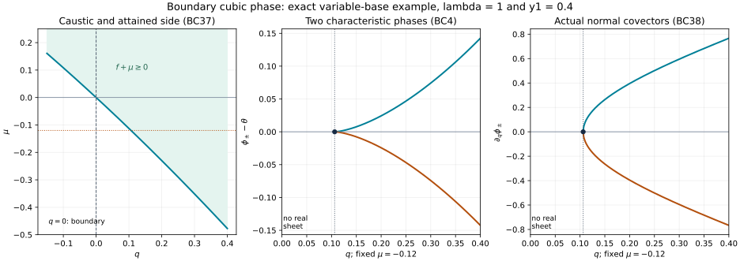

# Boundary-normalized cubic phases at a strict glancing point

The homogeneous glancing-pair theorem supplies a canonical map of two hypersurfaces. To use it in an Airy boundary construction, we also need suitable frequency parameters, an actual phase on the characteristic surface, its precise boundary value, and controlled errors on the side without real characteristics. We construct those objects here. Every statement is local in a fixed smaller conic neighborhood.

**H0. The phase contract.** We use \(\omega=d\xi\wedge dx\), \(\alpha=\xi\cdot dx\), and \(\iota_{H_p}\omega=-dp\). Let \(x=(q,y)\), with physical side \(q\geq0\), and let \(p(x,\xi)\) be a smooth real homogeneous quadratic polynomial in \(\xi\). At a marked nonzero covector, suppose
\[
 p=q=\{p,q\}=0,\qquad
 dp,dq,\alpha\ \text{independent},\qquad
 H_q^2p>0,\quad H_p^2q>0,\qquad
 d\pi(H_p)\ne0.
 \tag{BC1}
\]
The last condition holds for a nondegenerate quadratic principal form at a nonzero covector. Indeed \(d_\xi p=2g\xi\ne0\) when its coefficient matrix \(g\) is invertible.

The earlier [full pair theorem](../20261008-glancing-hypersurface-pair/homogeneous-glancing-pairs-and-boundary-signs.html) gives an equivariant symplectic map \(\kappa\) from
\[
 p_F=\sigma^2-r\lambda^2-\mu\lambda=0,\qquad r=0,
 \quad \eta=(\mu,\eta',\lambda),\quad\lambda>0,
 \tag{BC2}
\]
to \(P=\{p=0\}\), \(Q=\{q=0\}\). It preserves the Euler one-form exactly and has \(p\kappa=a p_F,\ q\kappa=b r\), with \(a,b>0\). The tangential dimension is \(d\geq2\). The marked model positions and the momenta other than \(\lambda=1\) are zero.

We will construct real smooth homogeneous functions \(\theta(x,\eta)\), \(\zeta(x,\eta)\), of degrees one and two-thirds, such that
\[
 \zeta(0,y,\eta)=-\mu\lambda^{-1/3},\qquad
 \theta(0,y,\eta)=S(y,\eta),\qquad
 \det S_{y\eta}\ne0.
 \tag{BC3}
\]
Here \(S\) generates the actual boundary canonical map. On the attained side \(\zeta\leq0\), the two branches
\[
 \phi_\pm=\theta\pm\tfrac23(-\zeta)^{3/2}
 \tag{BC4}
\]
parametrize the chosen characteristic leaves. If \(\mathcal B_x\) is the symmetric bilinear form with \(p(x,\xi)=\mathcal B_x(\xi,\xi)\), the smooth eikonal errors
\[
 E_1=p(x,d_x\theta)-\zeta p(x,d_x\zeta),\qquad
 E_2=\mathcal B_x(d_x\theta,d_x\zeta)
 \tag{BC5}
\]
vanish there, vanish to infinite order at its caustic, and can be made to vanish to infinite order at the actual boundary \(q=0\) on both sides. The minus sign in \(E_1\) follows from BC4 and will be checked directly. These phase results do not yet construct amplitudes, an operator inverse in the actual weak domain, or strict propagation.

## 1. Make the model frequencies transverse to the actual boundary fibers

**C0. A homogeneous shear with a prescribed purpose.** Let \(\kappa_\partial\) be the boundary canonical map supplied by the pair theorem. At the marked point let \(H\) be the inverse image under its differential of the vertical tangent space of the actual boundary cotangent bundle. It is Lagrangian. Homogeneity puts the radial vector \(\partial_\lambda\) in \(H\), so isotropy implies \(dz_d|_H=0\).

The projection of the model \(H_{p_F}\) to the boundary quotient at the anchor is \(-\partial_{z_1}\). Condition BC1 implies \(\partial_{z_1}\notin H\). Since \(H\) is Lagrangian, this is equivalent to \(d\mu|_H\ne0\): if \(d\mu\) annihilated \(H\), the symplectic dual of \(d\mu\) would belong to \(H^\omega=H\). Also \(d\lambda\) and \(d\mu\) are independent on \(H\), because their values on the radial vector are \(1,0\).

Consider \(H_0=H\cap\ker d\lambda\cap\ker d\mu\), of dimension \(d-2\). Projection to the spectator coordinates \((z',\eta')\) is injective on \(H_0\): its kernel could only be the excluded \(z_1\) direction, since \(dz_d|_H=0\). Its image \(L\) is Lagrangian in that spectator symplectic space. Write a basis as the columns of \((X,\Xi)\). Isotropy says \(X^T\Xi=\Xi^TX\), and independence says
\[
 (\Xi+iX)^*(\Xi+iX)=\Xi^T\Xi+X^TX>0.
 \tag{BC6}
\]
Thus the polynomial \(\det(\Xi+cX)\) is not identically zero, since it is nonzero at \(c=i\). Choose a real \(c\) away from its finitely many roots. If there are no spectator coordinates, no choice is needed.

The following actual homogeneous transformation realizes the desired change of tangent frequencies:
\[
 \widetilde\eta'=\eta'+c\lambda z',\qquad
 \widetilde z_d=z_d-\tfrac c2|z'|^2,
 \tag{BC7}
\]
with \(r,\sigma,z_1,\mu,z',\lambda\) unchanged. Its inverse is explicit. Substitution gives
\[
 \widetilde\eta'\cdot d z'+\lambda\,d\widetilde z_d
       =\eta'\cdot dz'+\lambda\,dz_d.
 \tag{BC8}
\]
It fixes the marked point, preserves BC2, and is homogeneous. At the anchor its frequency differential is \(d\eta'+c\,dz'\). These differentials are independent on \(H_0\); together with \(d\mu,d\lambda\), they are independent on \(H\). Precompose \(\kappa\) with the inverse of BC7 and rename its model variables. The required condition now holds:
\[
 d\eta_1,\ldots,d\eta_d
 \text{ are independent on every actual boundary fiber near the anchor.}
 \tag{BC9}
\]
Independence nearby follows from the nonzero determinant, not from an assumed global fiber chart.

Consequently the map on the boundary cotangent bundle replacing its actual fiber variables \(\vartheta\) by the model variables \(\eta\),
\[
 (y,\vartheta)\longmapsto(y,\eta),
 \tag{BC10}
\]
is a local diffeomorphism. All its maps and inverse are homogeneous. Write the model position in these mixed coordinates as \(z=z(y,\eta)\). Exact preservation of the boundary one-form gives
\[
 \vartheta\cdot dy=\eta\cdot dz,\qquad
 S(y,\eta)=\eta\cdot z(y,\eta),\qquad
 S_y=\vartheta,\quad S_\eta=z.
 \tag{BC11}
\]
Indeed the \(d\eta\) coefficients in the first equality give \(\eta\cdot z_\eta=0\). Differentiating the displayed definition proves both last identities. The inverse function theorem in BC10 implies \(\det S_{y\eta}\ne0\). This also proves that \(S\), homogeneous of degree one, generates the actual boundary map on a full neighborhood, including the side with no real normal roots.

## 2. An explicit characteristic fibration and its primitive

**C1. No additional Hamilton–Jacobi existence assumption.** On \(P_F\), fixing \(\eta\) gives the leaves
\[
 r=\sigma^2/\lambda^2-\mu/\lambda,\qquad
 \Lambda^F_\eta=\{(r,z;\sigma,\eta):\eta\text{ fixed}\}.
 \tag{BC12}
\]
They are smooth Lagrangian submanifolds: their coordinates are \((\sigma,z)\), and the restricted form is \(d\sigma\wedge(2\sigma\,d\sigma/\lambda^2)=0\). They foliate \(P_F\). Their images \(\Lambda_\eta=\kappa(\Lambda^F_\eta)\) therefore foliate \(P\) by Lagrangian leaves. They are invariant under the actual characteristic flow, because its pullback is \(aH_{p_F}\) on \(P_F\).

On this whole family choose the explicit function
\[
 \Phi_F=\eta\cdot z+\frac{2\sigma^3}{3\lambda^2},
 \qquad \Phi=\Phi_F\circ\kappa^{-1}\quad\text{on }P.
 \tag{BC13}
\]
It is smooth and homogeneous of degree one. Direct differentiation at fixed \(\eta\) gives \(d\Phi_F=\sigma\,dr+\eta\cdot dz\) on each leaf, so
\[
 d(\Phi|_{\Lambda_\eta})=\alpha|_{\Lambda_\eta}.
 \tag{BC14}
\]
No path-independence or unspecified integration constant is being used. Another leafwise primitive differs by a function of \(\eta\); BC13 fixes that freedom.

## 3. The base-and-frequency projection is an actual fold

**C2. Coordinates retaining the physical boundary.** Set \(t=\sigma/\lambda\) and \(v=\mu/\lambda\). The variables \((t,y,\eta)\) are local coordinates on \(P\). To verify this at the anchor, use the model coordinates \((t,z,\eta)\). On \(r=0\), the derivative of \(y\) in the model \(z\) variables at fixed \(\eta\) is invertible by BC10. The normal characteristic direction of \(Q\) changes no actual boundary position, so the \(t\) derivative there does not invalidate that block. The full Jacobian is triangular with that invertible block. The inverse theorem completes the assertion.

In these coordinates \(q\) is the smooth function
\[
 Q(t,y,\eta)=\widetilde b(t,y,\eta)(t^2-v),
 \qquad \widetilde b>0.
 \tag{BC15}
\]
In particular, for \(v=0\), \(Q_t(0,y,\eta)=0\) and \(Q_{tt}(0,y,\eta)=2\widetilde b(0,y,\eta)>0\). Shrink the neighborhood so \(Q_{tt}>0\). Solve \(Q_t(c(y,\eta),y,\eta)=0\) and put
\[
 Q_c=Q(c,y,\eta),\quad
 A(t,y,\eta)=\int_0^1(1-s)Q_{tt}(c+s(t-c),y,\eta)\,ds,
 \quad u=(t-c)\sqrt A.
 \tag{BC16}
\]
Taylor's formula gives \(q=Q_c+u^2\), and \(u_t>0\) after shrinking. Everything here has degree zero. Since \(Q_c=0\) when \(v=0\) and \(\partial_v Q_c=-\widetilde b\) there, smooth division gives
\[
 Q_c=-vD(y,\eta),\quad D>0,\qquad
 h=q-Q_c=q+vD,\qquad
 Y:P\longrightarrow X\times\mathbb R^d_\eta,\quad
 Y(u,y,\eta)=(Q_c+u^2,y,\eta).
 \tag{BC17}
\]
The smooth positive function \(D\) has degree zero. The map \(Y\) is a fold with attained side \(h\geq0\); its source fold is \(u=0\) and its target caustic is \(h=0\). The source fold meets \(Q\) transversally: on \(u=0\), \(q=-vD\) has nonzero \(v\) derivative at \(v=0\). This proof retains the boundary coordinate; an arbitrary fold chart need not do so.

## 4. The cubic odd part and its exact boundary value

**C3. Smooth descent with the coefficient determined.** Use the smooth square-descent and extension proofs in the earlier [fold lesson](../20261005-restored-smooth-descent/folds-reflections-and-uniform-descent.html). They apply with \((y,\eta)\) as parameters on a compact radial slice. In the coordinates of BC17, the leafwise identity BC14 yields
\[
 \partial_u\Phi=2u\,\xi_q(u,y,\eta).
 \tag{BC18}
\]
The odd part of \(\xi_q\) is \(uJ(u^2,y,\eta)\) for a smooth function \(J\) up to the attained boundary, by odd division followed by square descent. Integrating BC18 shows
\[
 \Phi(u,y,\eta)=\Theta(u^2,y,\eta)+u^3 C(u^2,y,\eta),\qquad
 C(h,y,\eta)=2\int_0^1s^2J(s^2h,y,\eta)\,ds.
 \tag{BC19}
\]
The even part defines \(\Theta\). All parameter derivatives are justified by the earlier finite-derivative descent estimates and differentiation under the displayed compact integral.

At \(q=0,\ v>0\), the two model points have \(t=\pm\sqrt v\) and the same \(z=z(y,\eta)\). Their \(u\) signs agree with their \(t\) signs, since \(Q_{tt}>0\) and its critical point lies between the two roots. Therefore BC13 gives
\[
 \tfrac12(\Phi_++\Phi_-)=S(y,\eta),\qquad
 \tfrac12(\Phi_+-\Phi_-)=\tfrac23\lambda v^{3/2}.
 \tag{BC20}
\]
Here \(h=vD\). Thus \(C(vD,y,\eta)=\frac23\lambda D^{-3/2}\). In particular \(C(0)>0\), and \(C>0\) on a smaller attained neighborhood.

Define there
\[
 \theta(q,y,\eta)=\Theta(h,y,\eta),\qquad
 \zeta(q,y,\eta)=-h\bigl(\tfrac32C(h,y,\eta)\bigr)^{2/3}.
 \tag{BC21}
\]
These functions are smooth up to the caustic, homogeneous of degrees one and two-thirds. Formula BC19 is precisely BC4 on the two sheets. Formula BC20 proves BC3 for \(v\geq0\). Also \(d_x\zeta\ne0\) near the anchor: its \(q\) derivative at \(h=0\) is a negative nonzero multiple of \(\lambda^{2/3}\).

The distinction between the fold and its image matters. The function \(\zeta\) defines the target caustic simply; its pullback under \(Y\) vanishes quadratically at the source fold. We do not call that pullback a simple defining function.

For \(\zeta<0\), BC14 and the local base projection on either sheet give \(d_x\phi_\pm=\xi_\pm\) on \(\Lambda_\eta\), hence \(p(x,d_x\phi_\pm)=0\). Since
\[
 d_x\phi_\pm=d_x\theta\mp\sqrt{-\zeta}\,d_x\zeta,\qquad
 p(x,d_x\phi_\pm)=E_1\mp2\sqrt{-\zeta}\,E_2,
 \tag{BC22}
\]
taking the sum and difference proves BC5 with zero errors. Continuity includes the caustic. This calculation fixes the sign independently of a source's conventions.

## 5. Extend across the caustic without losing the boundary normalization

**C4. A correction supported entirely on the unattained side.** Apply the earlier controlled half-line extension in the variable \(h\), at fixed normalized frequency \(\eta/\lambda\), then restore the required homogeneous factor. This gives smooth real extensions of \(\theta,\zeta\). Their errors \(E_1,E_2\) are smooth and flat at \(h=0\), because they vanish for \(h\geq0\).

Initially these extensions need not satisfy BC3 for \(v<0\). Let \(e_\theta(y,\eta)\) and \(e_\zeta(y,\eta)\) be their boundary values minus \(S(y,\eta)\) and \(-\mu\lambda^{-1/3}\), respectively. Both vanish for \(v\geq0\), and are flat at \(v=0\), including every parameter derivative.

Choose \(D\geq d_0>0\) on the smaller normalized patch, \(0<\delta<d_0/2\), and a smooth cutoff \(\chi\), equal to one near zero and supported in \((-1,1)\). For either discrepancy subtract
\[
 F(q,y,\eta)=
 \begin{cases}
 e(y,\eta)\chi\!\left(q/(\delta|v|)\right),&v<0,\\
 0,&v\geq0.
 \end{cases}
 \tag{BC23}
\]
It is smooth: each derivative of the cutoff costs only a fixed power of \(|v|^{-1}\) on its support, while every derivative of \(e\) is bounded by every positive power of \(|v|\). This proves extension by zero with all derivatives zero at \(v=0\). The construction is homogeneous of the degree of \(e\).

Its support satisfies \(h=q+vD<0\). It therefore leaves the attained phase unchanged and preserves every caustic jet. At \(q=0\) it subtracts exactly the discrepancy. After these two corrections, BC3 holds on the full boundary neighborhood. The functions remain real, and the nonzero caustic differential persists after shrinking.

## 6. Solve every boundary eikonal jet on the elliptic side

**C5. Formal equations with controlled division.** Write the quadratic symbol in actual normal and tangential covectors as
\[
 p(q,y;\rho,\vartheta)
 =A_0(q,y)\bigl[(\rho-a_0(q,y,\vartheta))^2
                    -b_0(q,y,\vartheta)\bigr],\qquad A_0>0.
 \tag{BC24}
\]
Completing the square proves this identity: \(a_0\) is real linear and \(b_0\) real quadratic in \(\vartheta\). Positivity of \(A_0\) follows from \(H_q^2p>0\), and persists locally.

On the boundary substitute \(\vartheta=S_y(y,\eta)\). The discriminant has the form
\[
 b_0(0,y,S_y)=\mu C_0(y,\eta),\qquad C_0>0,
 \tag{BC25}
\]
where \(C_0\) is homogeneous of degree one. To prove the asserted simple zero and sign, use the model boundary at \(\sigma=0,\mu=0\). There \(p\kappa=a p_F\), whose \(\mu\) derivative at fixed actual \(y\) is \(-a\lambda\): the extra derivative of the model \(z\) contributes zero because \(p_F\) is independent of \(z\). At the double normal root, variation of its normal covector contributes zero to \(dp\). The derivative of the completed square is consequently \(\partial_\mu b_0=a\lambda/A_0>0\). Its zero set on that boundary is \(\mu=0\), as follows from the actual fold and BC10. Smooth division proves BC25.

On \(v>0\), the upper model sheet is the larger actual normal root. Indeed on \(Q_F\), the Hamilton relation for \(q\kappa=b r\) gives \(d\kappa(\partial_\sigma)=b^{-1}\partial_\rho\), with positive coefficient. Thus BC22 implies the boundary identities
\[
 \theta_q=a_0(0,y,S_y),\qquad
 \zeta_q=-\lambda^{1/6}\sqrt{C_0}\quad(v>0).
 \tag{BC26}
\]
The discrepancies in these identities for the smooth extensions at \(v<0\) are flat at \(v=0\).

For \(v<0\), shrink \(\delta\) in BC23 if necessary so that \(\zeta>0\) in \(|q|<\delta|v|\). Define the complex preliminary branches by
\[
 W_\pm^{\,0}=\theta\mp\tfrac{2i}{3}\zeta^{3/2}.
 \tag{BC27}
\]
They are conjugate. Their mixed derivatives have at most polynomial growth in \(|v|^{-1}\) after the homogeneous power of \(\lambda\) is removed. Their boundary values are \(S\mp\frac{2i}{3}(-\mu\lambda^{-1/3})^{3/2}\); their tangential derivatives there equal \(S_y\).

We prescribe formal normal jets \(w_{\pm,k}\) with those zeroth values by the recursion
\[
 w_{\pm,k+1}=
 \left.\partial_q^k
 \left[a_0(q,y,d_yW_\pm)
       +R_\pm(q,y,d_yW_\pm)\right]\right|_{q=0},
 \quad
 W_\pm=\sum_{j\geq0}\frac{q^j}{j!}w_{\pm,j}.
 \tag{BC28}
\]
Here \(R_\pm^2=b_0\), with boundary values \(R_\pm=\pm i\sqrt{-\mu C_0}\). The coefficient on the right at order \(k\) depends only on \(w_{\pm,0},\ldots,w_{\pm,k}\) and their tangential derivatives. This follows by differentiating the polynomial functions \(a_0,b_0\) and the identity for the square root. Each square-root differentiation divides by its nonzero boundary value and introduces only finitely many factors. Thus the recursion is well defined for \(v<0\), smooth there, homogeneous of degree one, and preserves \(w_{-,k}=\overline{w_{+,k}}\).

For completeness, the corrections relative to the preliminary jets are flat at \(v=0\). Every normal derivative of their quadratic eikonal residual at \(q=0\) is a sum of a smooth flat function of \(v\) and such a function times a half-integer power: the smooth errors in BC5 vanish near \(q=0\) for \(v>0\). All these residual derivatives are therefore flat on \(v<0\). By BC26 the selected first-order factor has the required leading branch, and the opposite factor has size comparable to \(\lambda\sqrt{|v|}\). Factoring BC24 divides the residual by that opposite factor; this gives a flat first-order residual, with all derivatives still flat. Inductively in BC28, subtracting the preliminary coefficient gives finitely many derivatives of these flat residuals and preceding flat differences, multiplied by factors with polynomial \(|v|^{-1}\) growth. They remain flat. This proves the induction at every finite jet order, including all parameter derivatives.

Convert the resulting formal branches back into real jets by
\[
 T=\tfrac12(W_++W_-),\qquad
 Z=\left[\tfrac{3i}{4}(W_+-W_-)\right]^{2/3}.
 \tag{BC29}
\]
The bracket in the second expression has positive constant term \(\zeta(0,y,\eta)^{3/2}\). Its formal power is defined recursively by differentiating that ordinary real power near this positive constant. Conjugacy makes all coefficients real. These jets have degrees one and two-thirds. They have the same boundary values as \(\theta,\zeta\), and their differences from the preliminary jets are flat at \(v=0\), since the new divisions again cost only powers of \(|v|^{-1}\).

## 7. Realize the boundary jets while retaining the exact attained phase

**C6. A supported smooth summation, with every derivative controlled.** Denote either sequence of correcting normal jets from C5 by \(c_k(y,\eta)\), \(k\geq1\), extending it by zero to \(v\geq0\). Every \(c_k\) is smooth and flat at \(v=0\). On a compact normalized parameter patch form
\[
 G(q,y,\eta)=
 \begin{cases}
 \displaystyle\sum_{k\geq1}\frac{q^k}{k!}c_k(y,\eta)
       \chi\!\left(q/(\varepsilon_k|v|)\right),&v<0,\\
 0,&v\geq0,
 \end{cases}
 \quad 0<\varepsilon_k\leq\delta.
 \tag{BC30}
\]
Here \(\varepsilon_k\) are fixed constants, not functions of the parameters. They can be chosen successively so that the \(k\)-th summand, in every derivative of total order at most \(\lfloor k/2\rfloor\), is bounded by \(2^{-k}|v|^{\lfloor k/2\rfloor}\). To justify the choice, on its support \(|q|\leq\varepsilon_k|v|\). An \(L\)-th derivative costs at most a fixed power of \(|v|^{-1}\), and at most \(L\) powers of \(\varepsilon_k^{-1}\); the remaining \(q^k\) contributes \(\varepsilon_k^k\). For \(L\leq k/2\) the positive power \(\varepsilon_k^{k-L}\) can make the finitely many required seminorms as small as specified. All other factors are uniformly bounded after the chosen flat weight, by flatness of \(c_k\). The finitely many small \(k\) impose no convergence issue.

For each fixed derivative order and flat weight, the tail of BC30 now converges uniformly with that derivative and weight. The finitely many initial terms are also smooth and flat. Therefore \(G\) is jointly smooth and flat at \(v=0\). Differentiation term by term at \(q=0\) is legitimate, and gives exactly \(\partial_q^kG=c_k\): each cutoff is constant near zero for every fixed \(v<0\). The same identity extends to \(v=0\) by flatness. Restoring the homogeneous power of \(\lambda\) gives the stated degree and all frequency derivatives.

Every summand is supported in the unattained wedge from C4. Add the two sums to \(\theta,\zeta\). Their boundary values, actual attained phase, and all caustic jets are unchanged. Their boundary normal jets are now BC29. Recursion BC28 and the sum-and-difference identity BC22 imply that every normal derivative of the smooth errors \(E_1,E_2\) is zero at \(q=0\). Tangential and parameter differentiation preserves that conclusion. Thus, on compact normalized patches, for every pair of multi-indices \(\alpha,\beta\) and every \(N\),
\[
 |\partial_x^\alpha\partial_\eta^\beta E_j|
 \leq C_{\alpha\beta N}\lambda^{m_j-|\beta|}|q|^N,
 \qquad m_1=2,\quad m_2=5/3.
 \tag{BC31}
\]
The corresponding estimate with \(|h|^N\) holds at the caustic. Both assertions follow from Taylor's integral remainder applied to the smooth flat errors. There is one common smooth neighborhood for the summed functions; a different neighborhood is not chosen for each requested order.

The mixed tangential matrix \(\theta_{y\eta}\) equals \(S_{y\eta}\) at \(q=0\). Its determinant stays nonzero in a common smaller collar. Hence the \(d\) one-forms \(d_x\partial_{\eta_j}\theta\) are independent there, including the extended side.

This establishes all phase assertions BC3–BC5. It uses no real-analyticity of the coefficients: the complex operations in C5 concern a quadratic polynomial in the covector and formal normal jets.

## 8. A genuinely homogeneous nondegenerate cubic phase

**C7. The ordinary conic auxiliary variable.** Introduce an input boundary position \(w\), and put \(s=\lambda^{-2/3}\tau\). The function
\[
 \Psi(x,w,\eta,\tau)=
 \theta(x,\eta)-w\cdot\eta
       +\lambda^{-2/3}\tau\zeta(x,\eta)
       +\frac{\tau^3}{3\lambda^2}
 \tag{BC32}
\]
is homogeneous of degree one jointly in the ordinary frequency variables \((\eta,\tau)\). Its critical equations are
\[
 s^2=-\zeta,\qquad w=\theta_\eta+s\zeta_\eta.
 \tag{BC33}
\]
For the second identity, differentiation of \(s\) with respect to \(\eta\) produces a multiple of \(\zeta+s^2\), which vanishes on the critical set.

The critical differentials are independent. The \(d\) derivatives in \(\eta\) have the independent coefficients \(-dw_j\). The derivative in \(\tau\) has no \(dw\) part. At \(s=0\) its differential has the nonzero \(d_x\zeta\) component; away from \(s=0\), its \(\tau\) derivative is nonzero. Consequently it cannot lie in the span of the former \(d\) differentials. The full phase differential is nonzero because the input covector is \(\eta\), with \(\lambda>0\). These are precisely the nondegeneracy conditions of the earlier generating-family theorem.

On a critical point,
\[
 \xi=d_x\theta+s\,d_x\zeta,\qquad
 p(x,\xi)=E_1+2sE_2=0.
 \tag{BC34}
\]
Here every real critical point lies in the attained region, where the errors are exactly zero. After the common input term \(-w\cdot\eta\) is separated, the two output branches recover BC4. For \(s=+\sqrt{-\zeta}\), the full critical value is \(\theta-w\cdot\eta-\frac23(-\zeta)^{3/2}\); the other sign reverses only the cubic contribution. The source fold remains a smooth critical manifold even at \(s=0\). This phase describes the actual characteristic family; no operator amplitude or weak boundary realization is inferred from its existence.

## 9. Three solved exercises

### Exercise 1. A variable-base example with a boundary cross term

Let \(d=2\), \(x=(q,y_1,y_2)\), and
\[
 f(q,y_1)=e^{y_1/4}(q+q^2/5),\qquad r=f(q,y_1),\quad z=y.
 \tag{BC35}
\]
Use a small neighborhood of \(q=0\), where \(f_q>0\). Find the actual symbol and phase.

**Solution.** The cotangent lift gives \(\rho=\sigma f_q\), \(\vartheta_1=\mu+\sigma f_{y_1}\), \(\vartheta_2=\lambda\). Therefore the model symbol expressed in actual covectors is
\[
 p=\left(\frac{\rho}{f_q}\right)^2-f\vartheta_2^2
      -\left(\vartheta_1-\frac{\rho f_{y_1}}{f_q}\right)\vartheta_2.
 \tag{BC36}
\]
It is a real quadratic symbol. Its normal cross term vanishes on the boundary since \(f_{y_1}(0,y_1)=0\), although it is present in the collar. The exact phases are
\[
 \theta=y_1\mu+y_2\lambda,\qquad
 \zeta=-\lambda^{2/3}f-\mu\lambda^{-1/3}.
 \tag{BC37}
\]
At a real cubic critical point \(s^2=-\zeta\), their actual covector has
\[
 \rho=-s\lambda^{2/3}f_q,\quad
 \vartheta_1=\mu-s\lambda^{2/3}f_{y_1},\quad
 \vartheta_2=\lambda.
 \tag{BC38}
\]
Substituting in BC36 gives \(s^2\lambda^{4/3}-f\lambda^2-\mu\lambda=0\). Direct polarization also gives \(E_1=E_2=0\) everywhere. Thus this example needs no flat correction. Its boundary phase is \(S=y\cdot\eta\), and its Airy boundary argument is exactly BC3.

### Exercise 2. Check the eikonal sign in the affine model

Set \(f=q\) in Exercise 1. Compare the minus sign in BC5 with a plus sign.

**Solution.** Now \(p=\rho^2-q\lambda^2-\mu\lambda\), \(p(d\theta)=-q\lambda^2-\mu\lambda\), and \(p(d\zeta)=\lambda^{4/3}\). Hence \(p(d\theta)-\zeta p(d\zeta)=0\). The expression with a plus sign is \(-2q\lambda^2-2\mu\lambda\), which is generally nonzero. Also \(\mathcal B(d\theta,d\zeta)=0\). The result agrees with direct substitution of both branch gradients; the sign cannot be chosen independently of the definition \((-\zeta)^{3/2}\).

### Exercise 3. The cubic critical set at the caustic

For the same affine model, compute the critical normal covector and the two input position shifts at \(q=0\).

**Solution.** BC34 gives \(\sigma=-s\lambda^{2/3}\). Put \(t=\sigma/\lambda\), so \(s=-\lambda^{1/3}t\). At the boundary \(t^2=\mu/\lambda\). Differentiating BC37 at fixed \(s\) gives
\[
 w_1=y_1+t,\qquad
 w_2=y_2-\tfrac13t^3.
 \tag{BC39}
\]
These are the characteristic center variables, not the full boundary-to-boundary displacement. Exchanging \(t\) with \(-t\) while fixing \(w,\eta\) gives precisely the two position changes \(2t,-2t^3/3\) from the earlier pair theorem, with the direction chosen from the corresponding initial sheet. At the caustic \(t=0\), the critical set is still regular because \(d_q\zeta=-\lambda^{2/3}\ne0\), despite the two projected branches meeting.

*The panels are coordinate plots of BC35–BC38, with \(y_1=0.4\) and \(\lambda=1\). The first shows the exact caustic \(\mu=-f(q,0.4)\) and the attained side. The other two use \(\mu=-0.12\): they plot the two phase values relative to \(\theta\), and their actual normal derivatives, only where \(f+\mu\geq0\). They illustrate an explicitly verified variable-coefficient example, not a numerical solution of a general boundary problem.*

## 10. Sources, exact dependencies and remaining work

Richard Melrose and Michael Taylor, [*Boundary Problems for Wave Equations With Grazing and Gliding Rays*](https://mtaylor.web.unc.edu/wp-content/uploads/sites/16915/2018/04/glide.pdf), §§4.1–4.3, supplies the geometric phase route. The receiving proof gives an explicit homogeneous shear, a fixed model primitive, the precise cubic coefficient, boundary normalization on both sides, and a supported realization of all correcting jets. Its signs are derived in BC22 and Exercise 2.

The proof map connects the earlier full pair, fold-descent, inverse, smooth parameter, form and generating-family proofs. Its transitive Lebl prerequisites are explicitly linked external human proofs; internal proof closure of this CC0 export is not claimed. [Source records](source-provenance.json), [proof review](proof-review.json), [finite checks](model-check.json), and [reader checks](reader-check.json) accompany the source. Original exposition and illustration are CC0-1.0; linked components retain their terms.

Coupled matrix amplitudes, full operator and boundary remainders, incoming estimates, natural-dual forcing and transfer to the same weak form domain remain required. The [Airy operator inverse](../20261008-airy-operator-inverse/variable-matrix-airy-boundary-parametrices.html) supplies its proved operator calculus once those actual representation hypotheses are fulfilled. This phase theorem alone does not prove full strict boundary propagation or complete AN-04. 
