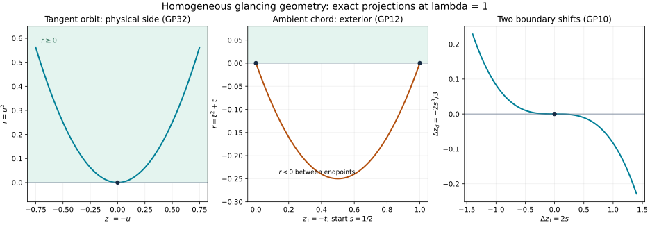

# Homogeneous glancing pairs and the physical boundary side

The characteristic surface and the boundary form a pair of hypersurfaces in phase space. The earlier two-fold relation theorem describes their reduced intersection. Here we extend that description to an actual homogeneous canonical map on a full neighborhood. The extension preserves the two hypersurfaces simultaneously and retains the factors relating their defining functions. Those factors determine the physical side and the change of Hamiltonian time.

This is the geometric reduction needed before constructing a variable-coefficient Fourier–Airy boundary solution. It does not identify a transformed differential operator with the affine model, or establish its boundary amplitudes and weak realization.

## 1. The precise pair and its normal form

**G0. Hypotheses and conclusion.** Let \(X\) have dimension \(d+1\). Work near a nonzero covector \(m\) in \(T^*X\), with
\[
 \omega=d\xi\wedge dx,\qquad
 R=\xi\cdot\partial_\xi,\qquad
 \alpha=\iota_R\omega=\xi\cdot dx,\qquad
 \iota_{H_f}\omega=-df,\quad\{f,g\}=H_fg.
 \tag{GP1}
\]
Let \(p\) be real, smooth and homogeneous of degree two, and \(q\) real, smooth and homogeneous of degree zero. Both vanish at \(m\). Set \(P=\{p=0\}\), \(Q=\{q=0\}\), and assume
\[
 dp,\ dq,\ \alpha\ \text{are linearly independent at }m,\qquad
 \{p,q\}(m)=0,\qquad
 H_p^2q(m)\ne0,\quad H_q^2p(m)\ne0.
 \tag{GP2}
\]
The hypersurfaces are therefore transverse. The theorem also applies to conic symplectic manifolds with degree-one form and their Euler one-form.

There is a homogeneous symplectic diffeomorphism \(\kappa\), from a full conic model neighborhood onto a neighborhood of \(m\), taking the marked model point
\((r,z;\sigma,\eta)=(0,0;0,0,\ldots,0,1)\) to \(m\), and taking
\[
 P_F=\{p_F=\sigma^2-r\lambda^2-\mu\lambda=0\},\qquad
 Q_F=\{r=0\}
 \tag{GP3}
\]
to \(P,Q\), respectively. Here \(z=(z_1,\ldots,z_d)\), \(\eta=(\mu,\eta_2,\ldots,\eta_{d-1},\lambda)\), \(\lambda>0\), and \(d\ge2\). Empty middle lists are allowed. Model positions have degree zero and momenta degree one. Moreover
\[
 \kappa^*\alpha=\sigma\,dr+\eta\cdot dz,\qquad
 p\circ\kappa=a\,p_F,\qquad q\circ\kappa=b\,r,
 \tag{GP4}
\]
where \(a,b\) are smooth nowhere-zero degree-zero functions. If both second brackets in GP2 are positive, then \(a,b>0\) after shrinking. In that case \(\kappa\) preserves the physical side \(q\ge0\) as \(r\ge0\). We prove all these statements below.

## 2. The two actual characteristic quotients

**G1. Construct the reduced relation.** On a smooth hypersurface \(M=\{f=0\}\), the restricted form has kernel \(\mathbb R H_f\). Indeed \(T M=\ker df\), its symplectic orthogonal is that line, and \(df(H_f)=0\). A transverse flow section gives a local quotient by these curves. The form on the section is nondegenerate: a vector orthogonal to that section inside \(TM\) must belong to its radical, which is complementary to the section. The restricted form is constant along the curves, since its contraction with their tangent field is zero and it is closed. Hence it is the pullback of this quotient symplectic form.

These quotients can be chosen homogeneous here. Choose a positive degree-one radius \(L\). On \(P\), the degree-one defining function \(p/L\) has a dilation-invariant Hamilton field \(V\); on \(Q\) use \(Lq\). On the respective hypersurfaces these span the original characteristic lines. At \(m\), the radial field and either such field are independent: dependence would make \(\alpha\) proportional to \(dp\) or \(dq\), contrary to GP2. Their commuting-flow chart supplies a degree-zero function \(t\) with \(Vt=1\) and \(Rt=0\). To see the homogeneity explicitly, prescribe the time coordinate on a section invariant under dilation; equivalently use the joint flow of the commuting independent fields \(V,R\) from a transverse section, and take its \(V\)-time. Dilation translates only the \(R\)-time.

Thus \(t=0\) is a conic transverse section. Its form has degree one, its radial field is nonzero, and the quotient map is equivariant. Denote the two quotient maps and forms by
\[
 \nu_P:P\longrightarrow Y_P,\qquad
 \nu_Q:Q\longrightarrow Y_Q,\qquad
 \nu_P^*\omega_P=\omega|_P,\quad
 \nu_Q^*\omega_Q=\omega|_Q.
 \tag{GP5}
\]
The earlier complete flow and quotient proofs justify all parameter smoothness and local inverses used in this construction.

Put \(K=P\cap Q\). The restrictions \(\nu_P|_K,\nu_Q|_K\) are folds. For example, in a \(V\)-flow chart \((t,y)\) on \(P\), the equation of \(K\) is \(q(t,y)=0\). Its full differential is nonzero by transversality; at the marked point \(q_t=0\), while \(q_{tt}\ne0\) by \(H_p^2q\ne0\) and the nonzero rescaling of \(H_p\). Solving for one \(y\) coordinate gives a projection with one-dimensional kernel and a nonzero kernel-to-cokernel second derivative. This is exactly the earlier intrinsic fold criterion. The other quotient uses \(H_q^2p\ne0\). Their common critical hypersurface is
\[
 \Gamma=\{p=q=\{p,q\}=0\}.
 \tag{GP6}
\]
It is smooth inside \(K\), because differentiating \(\{p,q\}\) along \(H_p\), tangent to \(K\) at \(m\), gives the nonzero number \(H_p^2q\).

The map
\[
 \iota_K=(\nu_P,\nu_Q):K\longrightarrow Y_P\times Y_Q
 \tag{GP7}
\]
is a local embedding. At the fold its two kernels are the independent lines \(\mathbb R H_p,\mathbb R H_q\), so the product differential is injective; it remains injective nearby. The earlier embedded-branch argument supplies the local embedding. The difference \(\omega_P-\omega_Q\) pulls back to zero, and \(\dim K=2d\), half the product dimension. Thus its image is a homogeneous canonical relation with two folding projections.

Its common pulled-back Euler one-form is \(\alpha|_{TK}\), which is nonzero by the independence in GP2: the annihilator of \(TK\) is \(\operatorname{span}\{dp,dq\}\). Consequently the complete homogeneous two-fold theorem applies with all its hypotheses, including its one-form condition. That condition forces \(d\ge2\).

## 3. Compare with the explicit model

**G2. The same reduced normal form on both sides.** In GP3,
\[
 \{p_F,r\}=2\sigma,\qquad H_{p_F}^2r=2\lambda^2,\qquad
 H_r^2p_F=2.
 \tag{GP8}
\]
At the marked point the independent one-forms are
\(dp_F=-dr-d\mu,\ dr,\ \alpha_F=dz_d\).
The model therefore has the same two-fold quotient construction. Apply the earlier homogeneous two-fold relation theorem separately to the actual and model reduced relations, with \(P\) and \(Q\) kept in the same order. Composing their canonical target charts gives homogeneous symplectic maps \(\psi_P,\psi_Q\) of their full quotient neighborhoods. It also gives a homogeneous diffeomorphism
\[
 k:K_F\longrightarrow K,\qquad
 \nu_Pk=\psi_P\nu_{P_F},\quad
 \nu_Qk=\psi_Q\nu_{Q_F}.
 \tag{GP9}
\]
This follows on the entire local relation: each product quotient map is an embedding, and the normal-form parametrization has a smooth inverse. It is not just a match of tangent spaces or one fold sheet.

For a direct view of the model, write \(s=\sigma/\lambda\) on \(K_F\), so \(\mu=s^2\lambda\). The exchange along \(Q_F\) fixes \(z,\eta\) and changes \(\sigma\) to \(-\sigma\). The exchange along \(P_F\) is
\[
 (z_1,z_d,s;\eta')\longmapsto
 (z_1+2s,\ z_d-\tfrac23s^3,\ -s;\eta').
 \tag{GP10}
\]
Here \(\eta'\) denotes the unchanged spectator momenta, including \(\lambda\); the other positions are unchanged. To verify the second exchange, integrate
\[
 \dot r=2\sigma,\quad\dot\sigma=\lambda^2,\quad
 \dot z_1=-\lambda,\quad
 \dot z_d=-2r\lambda-\mu,\quad
 \dot\eta=0.
 \tag{GP11}
\]
Starting at \(r=0,\sigma=s\lambda,\mu=s^2\lambda\), the next boundary intersection has time \(t=-2s/\lambda\), since
\[
 r(t)=2s\lambda t+\lambda^2t^2,\qquad
 \sigma(t)=s\lambda+\lambda^2t.
 \tag{GP12}
\]
Integration of \(\dot z_d\) gives \(-2s^3/3\) at that time. The formula extends smoothly through \(s=0\) and is an involution. For this strictly diffractive sign, the intervening chord has \(r<0\). It is an ambient characteristic construction, not a physical reflected segment in \(r\ge0\).

## 4. Extend a prescribed fold map along the leaves

**G3. A full presymplectic extension.** We need the following elementary extension fact. Suppose \(M_j\) are hypersurfaces with their characteristic foliations, \(K_j\subset M_j\) are simply tangent to those foliations, and a prescribed diffeomorphism \(k:K_0\to K_1\) intertwines their fold quotient maps with a quotient diffeomorphism \(\psi\). Then \(k\) extends to a local diffeomorphism \(E:M_0\to M_1\) intertwining the full quotient maps. If \(\psi\) is symplectic, \(E\) preserves the restricted two-forms. If all data are homogeneous as above, \(E\) can be homogeneous.

Here is a construction across the tangency. Use a flow coordinate \(t\) and quotient variables \(y\), with \(K=\{f(t,y)=0\}\), \(f_t(m)=0\), \(f_{tt}(m)\ne0\). The implicit theorem solves \(f_t(c(y),y)=0\). Taylor's integral formula gives
\[
 f(t,y)=f(c(y),y)+(t-c(y))^2 A(t,y),\quad
 A(t,y)=\int_0^1(1-v)f_{tt}(c(y)+v(t-c(y)),y)\,dv.
 \tag{GP13}
\]
The function \(A\) is smooth and nonzero after shrinking. Set
\[
 u=(t-c(y))\sqrt{|A(t,y)|},\qquad
 h(y)=-\operatorname{sgn}(A)f(c(y),y).
 \quad\text{Then } K=\{u^2=h(y)\}.
 \tag{GP14}
\]
The differential \(u_t\) is nonzero at the tangency. Also \(dh\ne0\) there, because \(df\ne0\) and \(f_t=0\). Thus these are genuine full flow-along-leaf coordinates. For homogeneous data take \(f,t\) of degree zero as in G1; uniqueness makes \(c\) degree zero, and every expression in GP13–GP14 has degree zero.

The map \(\psi\) takes the critical image to the critical image and the attained side to the attained side. Smooth division in the coordinate \(h_0\) therefore gives
\[
 h_1(\psi(y))=b_0(y)h_0(y),\qquad b_0>0.
 \tag{GP15}
\]
The factor is nonzero because both defining differentials and \(\psi\)'s differential are nonzero. Its sign is positive from the attained side and then by continuity. On \(K_0\), the prescribed \(k\) has
\(u_1\circ k=\epsilon\sqrt{b_0(y)}u_0\), with one fixed \(\epsilon\in\{1,-1\}\).
Away from the fold this follows by squaring; at the fold the nonzero derivative of \(k\) on its kernel line fixes the same sign on both sheets. Shrink so that sign is constant.

Define on the full neighborhoods
\[
 E(u,y)=\bigl(\epsilon\sqrt{b_0(y)}u,\ \psi(y)\bigr).
 \tag{GP16}
\]
It is a diffeomorphism, restricts to \(k\), and intertwines the quotient maps. The restricted forms are pullbacks of the quotient forms, so preservation follows without assuming preservation of a particular time parametrization. All factors in the homogeneous construction have their prescribed degrees, so \(E\) is equivariant as well.

Apply this result twice to GP9. We obtain maps
\[
 E_P:P_F\longrightarrow P,\qquad E_Q:Q_F\longrightarrow Q,
 \qquad E_P|_{K_F}=E_Q|_{K_F}=k,
 \tag{GP17}
\]
preserving the respective restricted forms. These are maps on full hypersurface neighborhoods, including both sides of their fold sets.

## 5. Glue the two hypersurface maps in the ambient space

**G4. An equivariant ambient extension.** Two transverse conic hypersurfaces admit adapted equivariant coordinates
\((a_0,b_0,w,\rho)\), with \(P_F=\{a_0=0\}\), \(Q_F=\{b_0=0\}\), \(\rho>0\) degree one, and all other coordinates degree zero. Choose them on a transverse radial slice using the independent defining differentials, then extend along positive rays. Do the same on the target, writing its coordinates \((A,B,W,L)\). The two prescribed maps agree on the intersection.

For each target coordinate \(F\), write its values on the source hypersurfaces as \(F_P(b_0,w,\rho)\), \(F_Q(a_0,w,\rho)\), with common value \(F_K(w,\rho)\). Set
\[
 F(a_0,b_0,w,\rho)
   =F_P(b_0,w,\rho)+F_Q(a_0,w,\rho)-F_K(w,\rho).
 \tag{GP18}
\]
For \(A\), the first and third terms vanish; for \(B\), the second and third vanish. The resulting map \(E_0\) has the two prescribed restrictions. At the marked point its differential is invertible: the \(A\) row has a nonzero \(a_0\) derivative, the \(B\) row a nonzero \(b_0\) derivative, and the remaining tangential block is the differential of \(k\). This is a block triangular invertible matrix. Thus the inverse theorem gives a full local diffeomorphism. Its first two components are nonzero multiples of \(a_0,b_0\), so it takes the hypersurfaces exactly to \(P,Q\). The last coordinate remains positive locally. GP18 preserves every degree; positive saturation of a sufficiently small radial slice supplies the full conic germ.

Let
\[
 \omega_1=E_0^*\omega,\qquad
 \delta=\omega_1-\omega_F.
 \quad
 \delta|_{TP_F}=0,\qquad \delta|_{TQ_F}=0.
 \tag{GP19}
\]
These are equalities of restricted forms at every nearby point on each hypersurface. At the marked point, a two-form vanishing on each of two transverse hyperplanes is a multiple of their two conormals:
\[
 \delta(m_F)=c\, da_0\wedge db_0.
 \tag{GP20}
\]
To check this elementary assertion, complete \(da_0,db_0\) to a cotangent basis. Vanishing on \(a_0=0\) excludes every wedge without \(da_0\); vanishing on \(b_0=0\) then excludes all but \(da_0\wedge db_0\).

## 6. Correct the form while fixing both hypersurfaces

**G5. Homogeneous relative Moser correction.** The straight family
\[
 \omega_t=\omega_F+t\delta,\qquad 0\le t\le1,
 \tag{GP21}
\]
is nondegenerate on one neighborhood of the marked point for every \(t\). Here is the necessary linear argument, since arbitrary convex combinations of symplectic forms need not be symplectic.

Let \(J:V\to V^*\) be \(v\mapsto\omega_F(v,\cdot)\) at the marked point, and let \(D(v)=\delta(v,\cdot)\). By GP20, \(J^{-1}D\) has image in the span of \(J^{-1}da_0,J^{-1}db_0\). Both \(da_0\) and \(db_0\) vanish on that span: their self-pairings vanish by skew symmetry, and their cross pairing is zero because the model hypersurfaces are glancing. Thus
\[
 (J^{-1}D)^2=0,\qquad
 (J+tD)^{-1}=(I-tJ^{-1}D)J^{-1}.
 \tag{GP22}
\]
This proves nondegeneracy for all real \(t\) at the marked point. Continuity and compactness of \([0,1]\) give a common neighborhood for GP21.

All forms have degree one and \(\delta\) is closed. The Euler contraction gives an explicit primitive
\[
 \beta=\iota_R\delta,\qquad d\beta=\delta.
 \tag{GP23}
\]
Indeed Cartan's formula gives \(d\iota_R\delta=\mathcal L_R\delta=\delta\). Since \(R\) is tangent to both conic hypersurfaces, GP19 implies that \(\beta\) restricts to zero on each. At every point of \(K_F\), GP20's same linear argument applies and \(R a_0=R b_0=0\); hence \(\beta\) is zero as a full covector there.

Solve the pointwise nonsingular equation
\[
 \iota_{V_t}\omega_t=-\beta.
 \tag{GP24}
\]
This gives a smooth time-dependent field, zero on \(K_F\). It is tangent to \(P_F\) and \(Q_F\). For example, the \(\omega_t\)-Hamilton vector of a defining function for \(P_F\) is tangent to \(P_F\), so its pairing with \(\beta\) is zero there; GP24 then says that defining function has zero derivative along \(V_t\). The same argument applies to \(Q_F\).

Degree one of both sides of GP24 implies \([R,V_t]=0\), by differentiating the equation under dilation and using uniqueness of its vector solution. The earlier common-time flow theorem gives its flow \(\Phi_t\) for \(0\le t\le1\) on one neighborhood of the marked point. The field vanishes there and on the intersection, so the flow fixes \(K_F\) pointwise. Tangency and uniqueness preserve the two hypersurfaces; equivariance follows from uniqueness and commutation with dilation. Extend from a smaller radial slice to its positive saturation.

Finally the differentiated pullback formula gives
\[
 \frac d{dt}\Phi_t^*\omega_t
  =\Phi_t^*(\delta+d\iota_{V_t}\omega_t)=0.
 \qquad \Phi_1^*\omega_1=\omega_F.
 \tag{GP25}
\]
Thus
\[
 \kappa=E_0\circ\Phi_1
 \tag{GP26}
\]
is the required homogeneous symplectic map of the full hypersurface pair. It retains the prescribed map \(k\) on the intersection. Equivariance gives
\(\kappa^*\iota_R\omega=\iota_R\kappa^*\omega=\alpha_F\),
proving the exact primitive identity in GP4.

## 7. Defining factors, physical side and Hamiltonian clock

**G6. The factors are part of the theorem.** Because \(p\circ\kappa\) and \(p_F\) vanish on the same smooth hypersurface, smooth coordinate division gives the first factor in GP4. Explicitly, in coordinates \((v,y)\) with \(v=p_F\),
\[
 p\circ\kappa(v,y)
   =v\int_0^1\partial_v(p\circ\kappa)(tv,y)\,dt.
 \tag{GP27}
\]
Its factor is nonzero at \(v=0\) since the defining differential is nonzero, and stays nonzero after shrinking. The same proof gives \(q\circ\kappa=b r\). Homogeneity in GP4 makes both factors degree zero.

At the marked glancing point, all terms involving a first bracket or one of the defining functions vanish. Leibniz' rule for the bracket therefore gives
\[
 (H_q^2p)\circ\kappa=2ab^2,\qquad
 (H_p^2q)\circ\kappa=2a^2b\lambda^2
 \quad\text{at }m_F.
 \tag{GP28}
\]
It follows that \(H_q^2p>0\) forces \(a>0\), and \(H_p^2q>0\) forces \(b>0\). This proves the physical-side assertion. The full Hamiltonian relation on the characteristic surface is
\[
 \kappa^{-1}_*H_p=H_{p\circ\kappa}
      =aH_{p_F}\quad\text{on }P_F.
 \tag{GP29}
\]
The term \(p_FH_a\) vanishes there. If a model orbit is parametrized by \(\tau\), its image is an actual orbit after solving \(d\tau/dt=a\) along it. The nonvanishing factor gives a smooth invertible local change of time; positivity preserves orientation.

For the strict normalized receiving symbol below, the vanishing and positivity conditions on the tangential symbol are imposed at the marked glancing covector:
\[
 p_0=\sigma^2-R_0(r,z,\eta),\qquad q=r,\qquad
 R_0(0,z,\eta)=0,\quad \partial_rR_0>0,
 \tag{GP30}
\]
one has \(H_q^2p_0=2\) and \(H_{p_0}^2q=2\partial_rR_0>0\) at a glancing point. The remaining independence in GP2 must also hold. It holds, for example, in a nonzero Lorentzian characteristic patch: if \(\alpha=A\,dp_0+B\,dr\), the fibre components at \(\sigma=0\) give \(A\,d_\eta R_0=0\). For a nondegenerate tangential Lorentzian quadratic form, \(d_\eta R_0\ne0\) at a nonzero covector, hence \(A=0\); then \(\eta\cdot dz=B\,dr\) forces \(\eta=0\), a contradiction. This argument states the needed tangential nondegeneracy rather than inferring it from a double normal root alone.

## 8. What the boundary canonical map supplies

**G7. Boundary reduction and the remaining phase obligation.** When \(q\) is a base defining function, take actual boundary coordinates \((q,z)\) with momenta \((\sigma,\eta)\). On \(Q\),
\[
 \omega|_Q=d\eta\wedge dz,\qquad
 H_q=-\partial_\sigma,\qquad
 Q/\mathbb R H_q=T^*\partial X
 \quad\text{locally}.
 \tag{GP31}
\]
The quotient is the restriction of a covector to tangent vectors of the boundary. Thus \(\kappa|_{Q_F}\) induces a homogeneous canonical boundary map \(\kappa_\partial\). The full map may mix base and fibre variables; the theorem does not say it is the cotangent lift of a change of base coordinates.

For comparison with the earlier Airy quotient, use its first tangential frequency \(\nu=-\mu\) and conjugate base coordinate \(y_1=-z_1\). Then \(p_F=\sigma^2-(r\lambda^2-\nu\lambda)\). The simultaneous sign change is canonical; changing the frequency alone would reverse that symplectic pair.

In particular, this result establishes the actual glancing-pair hypotheses needed before choosing a Lagrangian fibration and its cubic phase. It preserves the elliptic principal factor and the physical side. It does not by itself give a phase with the boundary normalization needed by the Airy quotient, a full matrix amplitude expansion, or a weak-domain identification. The [operator inverse](../20261008-airy-operator-inverse/variable-matrix-airy-boundary-parametrices.html) remains applicable when its explicit Fourier–Airy representation is supplied. Those analytic constructions are the next obligations.

## 9. Three solved exercises

### Exercise 1. The exact tangent orbit and both ambient exchanges

At the model anchor, use the normalized parameter \(u=\lambda t\). Find the tangent orbit and distinguish it from the chord joining two nearby boundary intersections.

**Solution.** GP11 with initial \(\sigma=\mu=r=0\) gives
\[
 r=u^2,\quad \sigma=\lambda u,\quad
 z_1=-u,\quad z_d=-\tfrac23u^3,\quad
 \mu=0,\quad\lambda=\text{constant}.
 \tag{GP32}
\]
The other coordinates are constant. Substitution verifies \(p_F=0\), every Hamilton equation with \(dt=du/\lambda\), and strict interior membership for \(u\ne0\). In contrast, the chord in GP12 has
\(r=(\lambda t+s)^2-s^2<0\) between its two roots when \(s\ne0\). Its endpoint exchange is GP10. The normal-fibre exchange on \(Q_F\) simply changes \(s\) to \(-s\). Both involutions fix \(s=0\), but their reflection lines are different because GP10 also changes \(z_1\) to first order. The cubic \(z_d\) shift is required by the restricted form
\[
 \omega|_{K_F}=d(s^2\lambda)\wedge dz_1
               +d\lambda\wedge dz_d
               +\sum_{j=2}^{d-1}d\eta_j\wedge dz_j.
 \tag{GP33}
\]
Pullback by GP10 adds \(2s^2\,d\lambda\wedge ds\) from the first term and its negative from the second.

### Exercise 2. Why the straight form homotopy is safe here

In dimension six, with coordinates \((r,z_1,z_2;\sigma,\mu,\lambda)\), consider at the anchor
\(\delta=c\,dr\wedge d\mu\). Verify the nilpotence used in GP22 and explain why it does not prove the analogous statement for arbitrary two symplectic forms.

**Solution.** Write the matrix of \(\omega_F\) in position-then-momentum order as
\[
 J_{\mathrm{mat}}=
 \begin{pmatrix}0&-I_3\\ I_3&0\end{pmatrix}.
 \tag{GP34}
\]
As matrices representing the bilinear forms, the inverse-product \(J_{\mathrm{mat}}^{-1}\delta_{\mathrm{mat}}\) has image in the span of \(\partial_\sigma,\partial_{z_1}\). Both \(dr,d\mu\) kill that span, so its square is zero. Multiplication gives
\((J_{\mathrm{mat}}+t\delta_{\mathrm{mat}})^{-1}
=(I-tJ_{\mathrm{mat}}^{-1}\delta_{\mathrm{mat}})J_{\mathrm{mat}}^{-1}\).
Thus its determinant is never zero. The argument uses the isotropic conormal span at a glancing intersection. Without it, take \(\omega_1=-\omega_F\); both endpoints are symplectic but the straight path vanishes at \(t=1/2\).

### Exercise 3. Track two positive rescalings

Replace the model defining functions by \(p=c\,p_F\), \(q=b\,r\), with positive constants \(b,c\). Compute the two second brackets, the physical side and the Hamiltonian clock.

**Solution.** The bracket is bilinear and the constants differentiate to zero, so at the anchor
\[
 H_q^2p=2cb^2,\qquad H_p^2q=2c^2b\lambda^2,\qquad
 H_p=cH_{p_F}\ \text{on }P_F.
 \tag{GP35}
\]
The physical side is still \(r\ge0\), and model time is \(\tau=ct\) for actual time \(t\). If \(b<0\), the second bracket changes sign and the physical side becomes \(r\le0\). If \(c<0\), the first bracket changes sign and time orientation reverses. This explains why deleting the factors from a hypersurface normal form would lose information needed for propagation.

*These are coordinate projections of the exact model at \(\lambda=1\). The first panel shows GP32 and its physical side. The second shows GP12 for \(s=1/2\), including the exterior chord and the two boundary endpoints. The third plots the exact changes \((2s,-2s^3/3)\) in the two boundary positions from GP10. None of the panels identifies a projection with the entire phase space or asserts a PDE propagation theorem.*

## 10. Sources and scope

Richard Melrose and Michael Taylor, [*Boundary Problems for Wave Equations With Grazing and Gliding Rays*](https://mtaylor.web.unc.edu/wp-content/uploads/sites/16915/2018/04/glide.pdf), §§3.6–3.7, gives the glancing-pair normal-form route through the two characteristic quotients. Sections 4.1–4.3 describe its subsequent use for phases. The complete receiving proof above uses the programme's earlier homogeneous two-fold theorem, proves the leafwise and ambient extensions explicitly, and uses the Euler contraction for the homogeneous relative form correction.

The proof map locates the earlier flow, inverse, fold, canonical-relation and form identities. Source records, [proof review](proof-review.json), [finite checks](model-check.json), and [reader checks](reader-check.json) accompany the editable source. Original exposition and illustration are CC0-1.0; linked components retain their own terms. 
