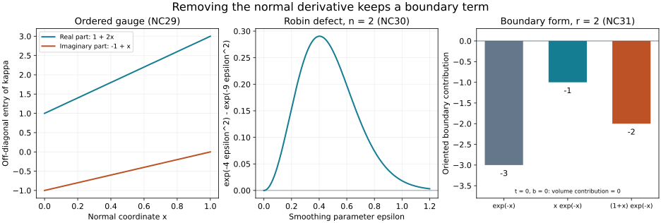

# A normal gauge that keeps the boundary condition

The [weak-source lift](../20261008-weak-source-lift/weak-source-lifting-and-normal-flux.html) removes the natural-dual forcing without discarding its boundary action. The next operation removes the first normal derivative from the interior equation. With matrix coefficients these two operations leave a complex Robin condition. We construct the matrix gauge, regularize that condition exactly, and prove the full normal-commutator identity, including its boundary form and its matrix lower-order terms.

The identity first holds on actual twice weakly differentiable approximants. We then prove its weak graph extension using complementary Sobolev dual pairings, including the normal trace. Uniform estimates at the higher microlocal orders, incoming errors and the full strict-diffraction theorem remain to be proved.

## 1. The problem and the exact earlier proofs

**N0. Conventions and inputs.** Work in a flat collar \(X=[0,\infty)_x\times\mathbb R^d_z\), with values in \(\mathbb C^N\), finite \(N\), and Lebesgue density. We use \(D_j=-i\partial_j\); all inner products are linear in their first entry. Tangential adjoints are actual adjoints in \(L^2_z\), with \(x\) as a parameter. Coefficients are smooth up to the boundary with all derivatives bounded on the localized collar. After extension they may be taken bounded with all derivatives on the half-space. Every function to which the identity is applied has bounded normal support. Tangential pseudodifferential symbols are classical \(S^m_{1,0}\) with uniform bounds for the required normal derivatives.

The normalized form retained from WSL:L0 is
\[
 q(v,\phi)=(D_xv,D_x\phi)+\sum_{a,b}(h^{ab}D_bv,D_a\phi)
 +\sum_j(\ell_jD_jv,\phi)+\sum_j(m_jv,D_j\phi)+(cv,\phi).
 \tag{NC1}
\]
Here \(h^{ab}=h^{ba}\) are real scalars; \(\ell_j,m_j,c\) are arbitrary complex matrices. Normal indices are denoted by \(x\), tangential indices by \(a,b\), and \(j\) ranges over both. The energy domain is either \(H^1_0(X;\mathbb C^N)\) or \(H^1(X;\mathbb C^N)\). After WSL:L4–L8, the right-hand side is an interior distribution \(g\in L^2_xH^{-1}_z\) locally. Its microlocal improvement, when assumed, is exactly the one proved there.

For zero-trace tests the interior equation is
\[
 Pv=g,\qquad P=D_x^2+KD_x+T,\qquad K=\ell_x+m_x,
 \quad T=\sum_{a,b}D_a h^{ab}D_b+\sum_a\ell_aD_a
       +\sum_aD_a\circ M_{m_a}+c+M_{D_xm_x}.
 \tag{NC2}
\]
Multiplication is written \(M\) when confusion with composition is possible. WSL:L6–L7 proves the graph trace of the actual flux \(D_xv+m_xv\). Thus the natural domain has zero flux in \(H^{-1/2}_z\), whereas the Dirichlet domain has \(v|_0=0\).

Exact dependencies are collected in the proof map. WSL:L6 supplies graph density and the signed Green formula. SY:H1–H2 supplies Fourier inversion, Plancherel and all real Sobolev spaces. SY:H7–H8 supplies ordered composition and actual adjoints, with finite-seminorm remainders; SY:H10 supplies their Sobolev bounds. BF:A0 supplies the two energy domains and their smooth density. These are complete earlier programme proofs, not external theorem citations.

## 2. An ordered matrix gauge

**N1. Construction and inverse.** On the chosen collar solve
\[
 2D_xS+KS=0,\qquad S(0,z)=I,
 \quad\text{equivalently}\quad S_x=-\frac{i}{2}KS.
 \tag{NC3}
\]
Put \(F=-iK/2\). A direct construction is
\[
 S(x,z)=I+\sum_{n\ge1}\int_{0<t_n<\cdots<t_1<x}
                  F(t_1,z)\cdots F(t_n,z)\,dt_n\cdots dt_1.
 \tag{NC4}
\]
The order of the matrices is part of the formula. If \(\|F\|\le M\) on \(0\le x\le a\), the \(n\)-th term has norm at most \((Ma)^n/n!\). A fixed number \(k\) of tangential derivatives gives at most \(C_k n^k\) ordered terms, each bounded by \(C_k^na^n/n!\). These summable bounds justify termwise differentiation and integration. Normal differentiation removes the outermost integral and gives NC3; repeated normal derivatives then follow from that equation. The same bounds are uniform in every fixed finite collection of parameters.

The right equation \(H_x=-HF\), \(H(0)=I\), has the same construction, with right multiplication and its corresponding order. Differentiation gives \((HS)_x=0\), hence \(HS=I\). A square finite-dimensional matrix with a left inverse is injective and therefore surjective, by elementary elimination; thus \(H=S^{-1}\). This proves invertibility and \(\|S\|,\|S^{-1}\|\le e^{Ma}\). Uniqueness also follows directly: the difference of two solutions is bounded by \(M\int_0^x\|W(t)\|dt\); iterating this inequality \(n\) times gives \(\sup\|W\|(Ma)^n/n!\), which tends to zero. Extend \(K\) to vanish past the collar if a half-space operator is wanted; \(S\) is then constant in \(x\) there. No self-adjointness or simultaneous diagonalization is used.

**N2. Transform both slots of the weak form.** Set \(v=Su\), \(\phi=S^{-*}\psi\), and \(q'(u,\psi)=q(Su,S^{-*}\psi)\). Multiplication by either smooth bounded invertible matrix is an isomorphism on \(H^1\) and on \(H^1_0\), by the product rule, the inverse bounds and smooth density. For the transformed antidual use exactly \(g'(\psi)=g(S^{-*}\psi)\). For an interior distribution this is multiplication \(g'=S^{-1}g\).

Write \(g_{xx}=1\), \(g_{xa}=g_{ax}=0\), \(g_{ab}=h^{ab}\). Expanding both slots, without commuting matrices, gives the same scalar principal form and
\[
 \begin{aligned}
 \ell'_j&=S^{-1}\ell_jS-\sum_i(D_iS^{-1})g_{ij}S,\\
 m'_i&=S^{-1}m_iS+\sum_jS^{-1}g_{ij}(D_jS),\\
 c'&=S^{-1}cS+\sum_jS^{-1}\ell_j(D_jS)
       -\sum_i(D_iS^{-1})m_iS
       -\sum_{i,j}(D_iS^{-1})g_{ij}(D_jS).
 \end{aligned}\tag{NC5}
\]
The minus signs follow from \((D_iS^{-*})^*=-D_iS^{-1}\). Conversely, inserting these three coefficients in the form reproduces every term in the expanded NC1, proving equality on smooth inputs and then on both energy domains by continuity. In particular,
\[
 m'_x=\kappa=\tfrac12S^{-1}(m_x-\ell_x)S,
 \qquad \ell'_x=-\kappa,
 \qquad P'=S^{-1}PS=D_x^2-R,
 \tag{NC6}
\]
where, as an ordered tangential operator,
\[
 R=-S^{-1}\bigl(M_{D_x^2S+K D_xS}+T\circ M_S\bigr).
 \tag{NC7}
\]
Indeed \(D_x^2(Su)=S D_x^2u+2(D_xS)D_xu+(D_x^2S)u\); NC3 cancels the coefficient of \(D_xu\). The principal symbol of \(R\) remains \(r=-\sum h^{ab}\eta_a\eta_b\), times \(I\). These formulas include all normal derivatives of the original lower coefficients.

## 3. Boundary traces through the gauge

**N3. The retained Robin condition.** We first record the positive trace as well as the earlier negative trace. Put \(\Lambda=(1+|D_z|^2)^{1/2}\). For smooth compactly supported \(u\), integrate the derivative of \(\|\Lambda^{1/2}u(x)\|^2\), using tangential Plancherel:
\[
 \|u(0)\|_{H^{1/2}}^2
 \le 2\|\Lambda u\|_{L^2(X)}\|\partial_xu\|_{L^2(X)}.
 \tag{NC8}
\]
Inward translation, convolution and compact cutoffs give smooth density in \(H^1\), as in BF:A0. The inequality defines a continuous trace by completion, agrees with ordinary restriction for smooth functions, and shows that the \(H^1_0\) trace is zero. The graph trace in WSL:L6 is continuous for \(N\in L^2_xL^2_z\), \(\partial_xN\in L^2_xH^{-1}_z\), and lies in \(H^{-1/2}\).

Smooth multiplication commutes with both traces. For the graph trace, the product rule bounds \(\partial_x(MN)=(\partial_xM)N+M\partial_xN\) in \(L^2_xH^{-1}_z\); SY:H10 bounds multiplication on \(H^{-1}\) and \(H^{-1/2}\). Apply the smooth identity to graph-dense approximants. For the positive trace use \(H^1\) density. Therefore the exact flux factorization
\[
 D_xv+m_xv=S(D_xu+\kappa u)
 \tag{NC9}
\]
implies, since \(S(0)=I\),
\[
 \begin{cases}
 u|_0=0,&\text{Dirichlet domain},\\
 (D_xu+\kappa u)|_0=0\quad\text{in }H^{-1/2}_z,
     &\text{natural domain}.
 \end{cases}\tag{NC10}
\]
Here \(D_xu\) itself has the graph trace: the transformed equation gives \(D_x^2u=Ru+g'\in L^2_xH^{-1}_z\). The second line is a complex Robin condition. An interior normal gauge has not made it the condition \(D_xu|_0=0\).

For later use, the same density argument in \(H^2\) applies to each first derivative. Its traces lie in \(H^{1/2}\) by NC8. Tangential differentiation commutes with trace on smooth approximants; Fourier weights then show \(u|_0\in H^{3/2}\), because the sum of its \(H^{1/2}\) norm and those of its tangential first derivatives is equivalent to its \(H^{3/2}\) norm. Also \(D_xu|_0\in H^{1/2}\). Density in \(H^2\) follows by inward translation first, then ordinary convolution at a smaller radius and cutoffs, with convergence of every derivative of order at most two. No boundary condition is required for this density statement.

## 4. Smoothing with an exact boundary correction

**N4. Localization and the Gaussian commutators.** Choose \(\omega(x,z)=\chi_x(x)\chi_z(z)\) of compact support, equal to one on a smaller collar, with \(\partial_x\omega(0,z)=0\). Let \(w=\omega u\) and \(H=P'u\). Its equation is exactly
\[
 H_0=P'w=\omega H+2(D_x\omega)D_xu+(D_x^2\omega)u-[R,\omega]u.
 \tag{NC11}
\]
All terms belong to \(L^2_xH^{-1}_z\). The last commutator has tangential order one and bounded coefficients. The boundary condition NC10 holds for \(w\) with the same \(\kappa_0=\kappa(0,z)\). Extend the localized coefficients with bounded derivatives. No term in NC11 is dropped.

For \(0<\epsilon\le1\) let \(J_\epsilon=e^{-\epsilon^2|D_z|^2}\), a scalar multiplier independent of \(x\), and \(j_\epsilon(\eta)=e^{-\epsilon^2|\eta|^2}\). Plancherel and dominated convergence give strong convergence to identity in every fixed \(H^t_z\), and also in the corresponding \(L^2_xH^t_z\) spaces. Every derivative of the Gaussian has the form \(\epsilon^{|\alpha|}p_\alpha(\epsilon\eta)e^{-\epsilon^2|\eta|^2}\). Splitting at \(\epsilon\langle\eta\rangle=1\) proves
\[
 j_\epsilon\text{ is bounded in }S^0,\qquad
 j_\epsilon-1=O(\epsilon^{1/2})\text{ in }S^{1/2}.
 \tag{NC12}
\]
For derivative order zero, use \(|e^{-t^2}-1|\le\min(t^2,1)\). For a positive derivative order, the displayed polynomial-Gaussian formula gives the same bound after multiplication by \(\langle\eta\rangle^{|\alpha|-1/2}\): in the first region its positive powers are bounded by a power of \(\epsilon\langle\eta\rangle\), and in the second region Gaussian decay bounds every remaining power. These estimates cover every symbol seminorm.

In the ordered composition formula SY:H7, the zero-order product cancels in a commutator with a scalar multiplier. The remainder with one derivative, including its full finite-seminorm estimate and actual operator interpretation SY:H8, therefore gives
\[
 [\kappa_0,J_\epsilon]=O(\epsilon^{1/2})\text{ in }\Psi^{-1/2},
 \qquad [R,J_\epsilon]=O(\epsilon^{1/2})\text{ in }\Psi^{3/2}.
 \tag{NC13}
\]
Use \(j_\epsilon-1\), whose commutator is unchanged, to obtain the rates. The ordinary global bounded-coefficient calculus applies to the multiplier itself; proper support is not silently imposed on a Gaussian. In particular SY:H10 proves
\[
 \|[\kappa_0,J_\epsilon]b\|_{H^1}\le C\epsilon^{1/2}\|b\|_{H^{1/2}},
 \quad
 \|[R,J_\epsilon]w\|_{L^2_xH^{-1}_z}
     \le C\epsilon^{1/2}\|w\|_{L^2_xH^{1/2}_z}.
 \tag{NC14}
\]

**N5. Actual \(H^2\) approximants and their full equations.** In the Robin case put \(\beta_\epsilon=[\kappa_0,J_\epsilon]\gamma w\), where \(\gamma w=w|_0\). Choose a fixed smooth compactly supported normal function \(\theta\), equal to one near zero, and define
\[
 C_\epsilon(x,z)=-ix\theta(x)\beta_\epsilon(z),
 \qquad w_\epsilon=J_\epsilon w+C_\epsilon.
 \tag{NC15}
\]
For the Dirichlet case set \(C_\epsilon=0\) and use the same \(J_\epsilon w\). For each positive \(\epsilon\), tangential smoothing gives \(J_\epsilon w\in L^2_xH^t_z\) and \(D_xJ_\epsilon w\in L^2_xH^t_z\) for every finite \(t\). Moreover
\(D_x^2J_\epsilon w=J_\epsilon(Rw+H_0)\in L^2\).
Thus all distributional derivatives of total order at most two lie in \(L^2\), which is the definition of \(H^2\). The same is true of \(C_\epsilon\): both \(J_\epsilon\gamma w\) and \(J_\epsilon(\kappa_0\gamma w)\) have every finite tangential Sobolev order, and multiplication by \(\kappa_0\) preserves them.

The graph trace commutes with \(J_\epsilon\) by its bounded action and graph-density approximation. Hence the Robin defect of \(J_\epsilon w\) is precisely \(\beta_\epsilon\). Since \(C_\epsilon|_0=0\) and \(D_xC_\epsilon|_0=-\beta_\epsilon\),
\[
 (D_x+\kappa_0)w_\epsilon|_0=0,
 \qquad w_\epsilon\longrightarrow w\text{ in }H^1(X).
 \tag{NC16}
\]
The first assertion is exact; the second follows from NC14, NC8 and \(\|C_\epsilon\|_{H^1}\le C_\theta\|\beta_\epsilon\|_{H^1}\). In the Dirichlet case the trace stays zero without a correction. The complete equation is
\[
 P'w_\epsilon=J_\epsilon H_0-[R,J_\epsilon]w+P'C_\epsilon
       \longrightarrow H_0\text{ in }L^2_xH^{-1}_z.
 \tag{NC17}
\]
Indeed NC14 treats the commutator. The normal derivatives of \(x\theta\) are fixed bounded compactly supported functions, and an order-two tangential operator maps \(H^1_z\) to \(H^{-1}_z\); these facts bound \(P'C_\epsilon\) by \(C\|\beta_\epsilon\|_{H^1}\) in the stated graph space. Each individual right-hand side in NC17 is in \(L^2\), since \(w_\epsilon\in H^2\). No uniform \(L^2\) bound as \(\epsilon\downarrow0\) has been asserted.

## 5. The full normal commutator

**N6. An exact identity including the matrix lower terms.** In this section write \(P=D_x^2-R\) for the transformed operator. Decompose \(R=R_h+iR_a\), with \(R_h=(R+R^*)/2\) and \(R_a=(R-R^*)/(2i)\). Both are tangentially self-adjoint; \(R_h\) has order two and scalar real principal symbol \(rI\), and \(R_a\) has order at most one.

Choose scalar, componentwise operators \(A=A^*\in\Psi^{-1}\), \(C=C^*\in\Psi^0\), smoothly depending on \(x\). A dot means \(\partial_x\). Set
\[
 B=C-\tfrac i2\dot A,\qquad Q=AD_x+B
       =\tfrac12(AD_x+D_xA)+C,
 \quad S_0=\tfrac12(AR_h+R_hA),\qquad J_0=\tfrac12(AR_h-R_hA).
 \tag{NC18}
\]
Thus \(Q\) is formally self-adjoint in the interior, \(S_0^*=S_0\), and \(J_0^*=-J_0\). We do not assume that \(Q\) preserves a boundary domain. Define the Hermitian operator array
\[
 \begin{aligned}
 E_{11}&=2\dot A,\\
 E_{10}&=\dot B+iJ_0-AR_a,\qquad E_{01}=E_{10}^*,\\
 E_{00}&=\tfrac12(A\dot R_h+\dot R_hA)+i[C,R_h]
                         -(B^*R_a+R_aB).
 \end{aligned}\tag{NC19}
\]
Its entries have orders at most \(1-j-k\). For \(u\in H^2\) with bounded normal support, write \(u_j=D_x^ju\) in the interior and for its trace at the boundary. Then
\[
 \begin{aligned}
 2\operatorname{Im}(Pu,Qu)_X
  &=\mathcal B(u)+\sum_{j,k=0}^1(E_{jk}u_k,u_j)_X,\\
 \mathcal B(u)&=(Au_1,u_1)_\partial
           +2\operatorname{Re}(Bu_0,u_1)_\partial+(S_0u_0,u_0)_\partial.
 \end{aligned}\tag{NC20}
\]
All boundary operators are evaluated at \(x=0\).

Here is the full calculation. Prove it first for smooth inputs compactly supported in the closed half-space. The signed Green identity is
\((f,D_xh)_X=(D_xf,h)_X-i(f(0),h(0))_\partial\).
Consequently \(2\operatorname{Im}(h,Qh)_X=-(Ah(0),h(0))_\partial\). Apply Green once to \((D_x^2u,Qu)\), use \([D_x,Q]=-i(\dot A D_x+\dot B)\), and then apply this last formula to \(h=D_xu\). The resulting boundary terms are \((Au_1,u_1)+2\operatorname{Re}(Bu_0,u_1)\); the volume terms are
\(2(\dot A u_1,u_1)+2\operatorname{Re}(\dot B u,u_1)\).

For the real part of \(R\), move \(A\) tangentially and split \(AR_h=S_0+J_0\). Direct differentiation gives
\[
 -2\operatorname{Im}(S_0u,u_1)
   =-\partial_x(S_0u,u)+(\dot S_0u,u),
 \quad -2\operatorname{Im}(J_0u,u_1)=2\operatorname{Re}(iJ_0u,u_1).
 \tag{NC21}
\]
The first identity uses \(u_1=-iu_x\) and the self-adjointness of \(S_0\). Integration gives \(+(S_0u_0,u_0)_\partial\). Since \(B=C-i\dot A/2\), the remaining term from \(R_h\) is
\((i[C,R_h]u,u)-((\dot A R_h+R_h\dot A)u/2,u)\).
Its second summand cancels precisely the two derivatives of \(A\) in \(\dot S_0\), leaving the first term of \(E_{00}\).

Finally the part \(iR_a\) of \(R\) contributes
\[
 -2\operatorname{Re}(R_au,Au_1+Bu)
 =-2\operatorname{Re}(AR_au,u_1)-((B^*R_a+R_aB)u,u).
 \tag{NC22}
\]
This proves NC19–NC20 with every ordering shown. For general \(H^2\) inputs, the \(H^2\) density and traces proved in N3 and the Sobolev bounds SY:H10 make all boundary and volume expressions continuous. In particular \(u_0\in H^{3/2}\), \(u_1|_0\in H^{1/2}\), and \(Q:H^2\to H^1\). Cutoffs at tangential infinity followed by the same density prove the identity without tangential compact support. No normal trace of an arbitrary \(H^1\) derivative has been paired in this extension.

**N7. Principal polynomial and the surviving boundary form.** Let \(a=\sigma_{-1}(A)\), \(c_0=\sigma_0(C)\), \(k=\sigma_1(R_a)\), so \(k=k^*\) is a matrix. For the tangential Poisson bracket use \(\{f,g\}_z=f_\eta g_z-f_zg_\eta\), with contraction of indices. SY:H7 applied to NC19 gives
\[
 \begin{aligned}
 e_{11}&=2a_x I,\\
 e_{10}=e_{01}&=(\partial_xc_0+\tfrac12\{a,r\}_z)I-ak,\\
 e_{00}&=(a\partial_xr+\{c_0,r\}_z)I-2c_0k.
 \end{aligned}\tag{NC23}
\]
Indeed \(i[A,R_h]\) has principal symbol \(\{a,r\}_zI\); the scalar leading symbols commute with every matrix lower coefficient. The term \(-i\ddot A/2\) in \(\dot B\) is one order below the cross coefficient. All other terms follow by their ordered leading products. With \(p=\xi^2-r\) and \(q=a\xi+c_0\), summing the three coefficients yields
\[
 \sum_{j,k'=0}^1 e_{jk'}\xi^{j+k'}=H_pq\,I-2qk.
 \tag{NC24}
\]
To check the sign directly, \(H_pq=2a_x\xi^2+(2\partial_xc_0+\{a,r\}_z)\xi+a\partial_xr+\{c_0,r\}_z\). The Hermitian matrix \(k\) cannot in general be replaced by a scalar or omitted.

In the Dirichlet case the boundary form is exactly \((Au_1,u_1)_\partial\). Choosing \(A=-T^*T\) with \(T\in\Psi^{-1/2}\) gives \(-\|Tu_1\|^2\), including all lower terms. In the Robin case \(u_1=-\kappa_0u_0\), so instead
\[
 \mathcal B(u)=((\kappa_0^*A\kappa_0-\kappa_0^*B-B^*\kappa_0+S_0)u_0,u_0)_\partial.
 \tag{NC25}
\]
This operator is self-adjoint of order at most one. There is no unconditional sign assertion for NC25. Each \(w_\epsilon\) from N5 satisfies the appropriate version exactly. N8 below supplies the weak graph extension of this identity. Uniform estimates at higher microlocal orders are still needed for strict propagation.

**N8. The identity on the actual weak graph.** Suppose \(u\in H^1(X)\) has bounded normal support and \(Pu\in L^2_xH^{-1}_z\). Coefficients retain all the bounds above. Put \(b_0=\gamma u\in H^{1/2}_z\) and \(b_1=\gamma D_xu\in H^{-1/2}_z\); the latter is defined because \(D_x^2u=Ru+Pu\in L^2_xH^{-1}_z\). For an operator of order \(m\), SY:H10 gives every required tangential mapping. In particular,
\[
 \begin{gathered}
 Q:H^1(X)\longrightarrow L^2_xH^1_z,\qquad
 \|Qu\|_{L^2_xH^1_z}\le C\|u\|_{H^1(X)},\\
 A:H^{-1/2}_z\to H^{1/2}_z,\quad
 B:H^{1/2}_z\to H^{1/2}_z,\quad
 S_0:H^{1/2}_z\to H^{-1/2}_z.
 \end{gathered}\tag{NC26}
\]
The first bound follows separately from \(AD_xu\) and \(Bu\): the normal derivative is in \(L^2\), and \(A\) gains one tangential order. Thus the source pairing and every term of the boundary form have a continuous definition:
\[
 \begin{aligned}
 2\operatorname{Im}\langle Pu,Qu\rangle_{L^2_x(H^{-1},H^1)}
   &=\mathcal B_{\rm weak}(u)+\sum_{j,k=0}^1(E_{jk}D_x^ku,D_x^ju)_X,\\
 \mathcal B_{\rm weak}(u)
   &=\langle Ab_1,b_1\rangle
        +2\operatorname{Re}\langle Bb_0,b_1\rangle
        +\langle S_0b_0,b_0\rangle .
 \end{aligned}\tag{NC27}
\]
Every bracket is the linear-first extension of the \(L^2\) pairing between the indicated complementary Sobolev spaces. For example its frequency integral is bounded by the product of the \(H^{1/2}\) and \(H^{-1/2}\) norms. SY:H1–H2 proves that this agrees with the distribution pairing. No product of two arbitrary negative-order distributions is being defined.

To prove NC27, take the approximants of N5 with \(w=u\). Its construction and estimates use precisely these global graph norms; the localization NC11 is needed only when starting from a local solution. If no boundary condition is specified, use \(J_\epsilon u\) alone. If one is specified, retain the exact Dirichlet or Robin correction. In all cases,
\[
 \|u_\epsilon-u\|_{H^1}
  +\|P(u_\epsilon-u)\|_{L^2_xH^{-1}_z}\longrightarrow0,
 \quad
 \|\gamma D_x(u_\epsilon-u)\|_{H^{-1/2}_z}\longrightarrow0 .
 \tag{NC28}
\]
For the second conclusion, the two graph norms of \(D_x(u_\epsilon-u)\) tend to zero: its normal derivative is \(i(R(u_\epsilon-u)+P(u_\epsilon-u))\), and \(R:H^1_z\to H^{-1}_z\). WSL:L6 gives the trace convergence. NC8 gives convergence of the solution traces in \(H^{1/2}\). All three boundary pairings now converge by NC26. For the volume terms, \(E_{00}\) of order one maps \(H^1_z\) to \(L^2_z\); \(E_{10},E_{01}\) of order zero and \(E_{11}\) of order minus one give continuity on \(H^1(X)\) by Cauchy–Schwarz. The source pairing converges by the first bound in NC26 and the first limit in NC28. Passing to the limit in the already proved NC20 establishes NC27.

For a Dirichlet solution and \(A=-T^*T\), the remaining boundary term is exactly \(-\|Tb_1\|_{L^2_z}^2\): \(T:H^{-1/2}\to L^2\), and adjoint duality follows by Sobolev density from SY:H2 and SY:H8. For a Robin solution, \(b_1=-\kappa_0b_0\) in \(H^{-1/2}\), and NC25 is valid as the \(H^{-1/2},H^{1/2}\) pairing of its order-one operator. This proves the identity in both weak domains with the actual complex boundary coefficient. It does not bound that Robin form by a favorable sign, nor supply the higher microlocal estimate.

## 6. Three solved checks of the mechanism

### Exercise 1. A nonunitary matrix gauge

Take \(E=\begin{pmatrix}0&1\\0&0\end{pmatrix}\), \(K=2iE\), \(m_x=M=\begin{pmatrix}i&1\\0&-2\end{pmatrix}\) and \(\ell_x=K-M\). Compute the gauge and the Robin matrix.

**Solution.** Since \(E^2=0\), the series NC4 stops at its linear term: \(S=I+xE\), \(S^{-1}=I-xE\). Substitution gives \(2D_xS+KS=-2iE+2iE=0\). Direct ordered multiplication gives
\[
 \kappa=S^{-1}(M-iE)S
    =\begin{pmatrix}i&1-i+x(i+2)\\0&-2\end{pmatrix},
 \quad \ell'_x=-\kappa,\qquad m'_x=\kappa.
 \tag{NC29}
\]
The off-diagonal coefficient changes with \(x\). Replacing these products by commuting scalars would lose that change. At the boundary \(\kappa_0=M-iE\), and the second line of NC10 keeps its full off-diagonal entry.

### Exercise 2. Smoothing a Robin mode

On the circle with normalized measure take \(\kappa_0(z)=e^{iz}\) and a boundary value \(b(z)=e^{inz}\), \(n\in\mathbb Z\). Find the defect of Gaussian smoothing and cancel it. The periodic Fourier proof is the same finite-mode calculation as SY:H1; no periodic pseudodifferential theorem is needed in this example.

**Solution.** Multiplication raises the frequency by one. Thus
\[
 [\kappa_0,J_\epsilon]b
  =(e^{-\epsilon^2n^2}-e^{-\epsilon^2(n+1)^2})e^{i(n+1)z}.
 \tag{NC30}
\]
It is generally nonzero. Multiplying the right-hand side by \(-ix\theta(x)\) produces zero value and normal derivative equal to the negative of this defect at \(x=0\), exactly as in NC15. For example \(w=\theta_1(x)(1-ix\kappa_0(z))e^{inz}\), with \(\theta_1=1\) near zero, has trace \(b\), derivative \(D_xw|_0=-\kappa_0b\), and hence the required original Robin condition. This also verifies that the computed defect occurs for an actual smooth input, not just a formal boundary value.

### Exercise 3. Check the normal orientation and the imaginary coefficient

Suppress \(z\), take \(P=D_x^2-(r+ib)\), \(A=-1\), \(C=c_0\), with real constants, and let \(u(x)=e^{itx}f(x)\), where \(t\in\mathbb R\) and \(f\) is any real smooth rapidly decreasing profile. Find both sides of NC20 explicitly.

**Solution.** Here \(B=c_0\), \(S_0=-r\), \(J_0=0\), \(E_{10}=E_{01}=b\), \(E_{00}=-2c_0b\), and \(E_{11}=0\). Since \(D_xu=e^{itx}(tf-if')\),
\[
 \mathcal B(u)=(-t^2+2c_0t-r)f(0)^2-f'(0)^2,
 \quad \sum(E_{jk}u_k,u_j)=2b(t-c_0)\int_0^\infty f^2\,dx.
 \tag{NC31}
\]
For an independent direct evaluation, remove the common factor \(e^{itx}\). Then \(Pu=(t^2-r)f-f''-i(2tf'+bf)\), and \(Qu=(c_0-t)f+if'\). The imaginary part of their scalar inner product is
\((t^2-2c_0t+r)ff'+f''f'+b(t-c_0)f^2\).
Integrating \(2ff'=(f^2)'\) and \(2f''f'=(f'^2)'\) gives NC31 and NC20. In particular the sign at \(x=0\) is fixed, not a choice of energy orientation. At \(t=0\), the profiles \(e^{-x}\), \(xe^{-x}\), \((1+x)e^{-x}\) give boundary forms \(-1-r\), \(-1\), \(-r\), respectively. Their squared \(L^2\) norms are \(1/2,1/4,5/4\), by integrating by parts: the zeroth moment is \(1/2\), and each successive moment is \(j/2\) times the preceding one. The middle profile is Dirichlet; the last has zero normal derivative.

*Left: the exact real and imaginary parts of the off-diagonal coefficient in NC29. Middle: the exact defect coefficient in NC30 for \(n=2\), with its sign fixed by the order of the commutator. Right: the three boundary forms from Exercise 3 at \(r=2,t=0\); the volume contribution is zero when \(b=0\). These are exact coefficient and profile calculations, not numerical solutions of a diffraction problem. The reproducible figure is tied to N1–N8 and the three solutions.*

## 7. Credit, validation and the remaining estimate

Lars Hörmander, *The Analysis of Linear Partial Differential Operators III: Pseudo-Differential Operators*, corrected 2007 printing, ISBN 978-3-540-49938-1, Section 24.4, pp. 443–444 and 449, is the source for the scalar normal-gauge reduction, normal energy identity and the use of regularization. The present proof writes out the ordered matrix gauge, the transformed weak form, its complex Robin condition, the boundary-preserving Gaussian correction, the exact Hermitian operator array and its weak graph extension. It does not attribute the full matrix Robin argument to a scalar Dirichlet statement in the book. The [earlier source-lift proof](../20261008-weak-source-lift/weak-source-lifting-and-normal-flux.md) and [Hilbert coefficient calculus](../20261007-restored-first-order-systems/hilbert-coefficient-calculus-and-positivity.md) retain their own source and component notices.

The prerequisite proof index gives the earlier results used here. Independent new exposition, code and illustration are CC0-1.0. Linked components retain their own licences. 

The next task is the uniform commutant estimate for the full weak problem: bound the source and every regularization defect, retain or estimate the Robin boundary contribution, connect the characteristic squares to energy regularity, control incoming terms, and pass to the limit in the higher-order estimate on a common microlocal neighborhood. The [characteristic-symbol](../20261007-strict-diffraction-symbols/characteristic-squares-and-diffractive-commutants.html), [weak-quadratic](../20261007-strict-diffraction-weak-quadratics/weak-characteristic-quadratic-estimates.html) and source-lift supplements provide the earlier pieces.
