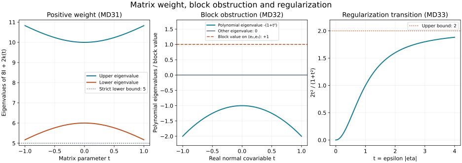

# Matrix damping in the boundary commutator estimate

The [normal-gauge supplement](../20261008-normal-commutant/matrix-normal-gauge-and-boundary-commutator.html) proves the exact commutator identity on the actual weak graph. This supplement absorbs its complex matrix lower coefficients and a uniform class of regularization errors. It proves a mixed half-order estimate with the incoming term and the full boundary form retained. For Dirichlet data the boundary square has a favorable sign. For Robin data the order-one boundary form remains an explicit term; its control is a further part of strict propagation.

The proof uses the scalar characteristic completion with a positive matrix weight. It does not infer positivity of a block matrix merely from positivity of its matrix-valued polynomial on real normal covariables. Exercise 2 gives a counterexample to that inference.

## 1. The equation, the error family and the earlier proofs

**D0. Exact setting.** Use \(X=[0,\infty)_x\times\mathbb R^d_z\), finite coefficients \(\mathbb C^N\), \(D=-i\partial\), and inner products linear first. All operators have fixed localization and uniform coefficient and symbol bounds, including the required \(x\) derivatives. Define
\[
 \|u\|_{\mathcal X_s}^2=\|\Lambda^s u\|^2+
             \|\Lambda^{s-1}D_xu\|^2,\qquad
 \Lambda=(1+|D_z|^2)^{1/2}.
 \tag{MD1}
\]
The gauged form is NC1/NC5 of the earlier supplement, with normal lower coefficients \(\ell_x=-\kappa\), \(m_x=\kappa\). Its interior expression is \(P=D_x^2-R\), where \(R\) is tangential of order two with real scalar principal symbol \(rI\). Put \(R_h=(R+R^*)/2\), \(R_a=(R-R^*)/(2i)\), and write \(k=\sigma_1(R_a)\). In particular \(R_a\) has order at most one.

Let \(Z_\epsilon\in\Psi^1\), \(0<\epsilon\le1\), be a bounded family, and suppose
\[
 Z_{\epsilon h}=(Z_\epsilon+Z_\epsilon^*)/2
       \text{ is bounded in }\Psi^0,\qquad
 Z_{\epsilon a}=(Z_\epsilon-Z_\epsilon^*)/(2i).
 \tag{MD2}
\]
Thus its leading order is skew-Hermitian; its lower matrices are unrestricted. D6 proves this property for the scalar tangential regularizer used below. Take \(u\in H^1\) with bounded normal support and
\[
 Pu=g+Z_\epsilon u,\qquad g\in L^2(X).
 \tag{MD3}
\]
Either \(u\in H^1_0\), or \(u\in H^1\) has the Robin defect
\[
 b_0=\gamma u,\quad b_1=\gamma D_xu,\quad
 b_1+\kappa_0b_0=\beta,\qquad \kappa_0=\kappa|_{x=0}.
 \tag{MD4}
\]
The graph trace exists by NCQ:N3 and N8, since the right side of MD3 is in \(L^2\). Initially \(\beta\in H^{-1/2}\); the sharper defect estimate below assumes \(H^{1/2}\). For Dirichlet data put \(\beta=0\) in norm bounds. The full weak equation, on the original energy domain \(V\), is
\[
 q(u,v)=(g+Z_\epsilon u,v)-i\langle\beta,\gamma v\rangle .
 \tag{MD5}
\]
For \(H^1_0\) the boundary term vanishes. For \(H^1\), MD5 is exactly the flux Green identity WSL:L6–L7, after the ordered normal gauge; it is not an extra Neumann assumption.

The proof uses SDC:S5–S8, the complete scalar characteristic completion and two commutant construction; SDQ:W1–W6, the weighted block estimate, legal order-minus-one test and elliptic pair; NCQ:N6–N8, the full matrix normal identity and its weak graph extension; and SY:H7–H10/H14, the ordered symbol calculus, Sobolev bounds and matrix sharp Gårding estimate. Exact sources and proof locators are in the proof map.

## 2. A positive matrix weight with uniform derivatives

**D1. Uniform square root.** Choose a Hermitian symbol \(k_\epsilon\in S^1\) representing \(R_a+Z_{\epsilon a}\) modulo a bounded \(\Psi^0\) family. Such a representative is obtained by taking the Hermitian part of a full left symbol: the actual self-adjointness and SY:H7 show that the difference has order zero. On \(|\eta|\ge1\), put \(\lambda=|\eta|\) and choose a fixed \(L\) with \(\|k_\epsilon\|\le L\lambda\). Take \(M\ge4L+1\), and set
\[
 H_\epsilon=M\Lambda+2(R_a+Z_{\epsilon a}),\qquad
 h_\epsilon=M I+2k_\epsilon/\lambda .
 \tag{MD6}
\]
Then \(h_\epsilon\ge(M-2L)I>0\). There is a Hermitian positive square root \(s_\epsilon\in S^0\), bounded with all required parameter derivatives, satisfying \(s_\epsilon^2=h_\epsilon\). The leading weight need not be homogeneous in \(\epsilon\lambda\).

Here is a direct proof of smoothness and the uniform symbol bounds. Put \(E_\epsilon=2k_\epsilon/(M\lambda)\), so \(\|E_\epsilon\|\le1/2\), and use
\[
 s_\epsilon=\sqrt M\sum_{n=0}^\infty c_nE_\epsilon^n,\qquad
 c_0=1,\quad c_1=\tfrac12,\quad
 c_n=(-1)^{n-1}\frac{(2n-3)!!}{2^n n!}\quad(n\ge2).
 \tag{MD7}
\]
These real coefficients have \(|c_n|\le1/2\) for \(n\ge1\). The scalar series \(f(t)\) converges absolutely for \(|t|<1\). Its coefficient recurrence gives \(2(1+t)f'=f\); consequently \((f^2/(1+t))'=0\) and \(f(0)=1\), so \(f(t)^2=1+t\). Absolute convergence of the matrix products proves the same square identity. The sum after the identity matrix has norm at most \(\frac12\sum_{n\ge1}2^{-n}=1/2\), proving positivity as well.

A derivative of fixed total order \(j\) of \(E_\epsilon^n\) is a sum of at most \(C_jn^j\) ordered products. At most \(j\) factors are differentiated; the others have norm at most \(1/2\). The differentiated factors obey their uniform \(S^0\) bounds, with one inverse power of \(\langle\eta\rangle\) per frequency derivative. The resulting majorant \(C_jn^j2^{-(n-j)}\) is summable. Termwise differentiation proves every claimed bound, without commuting different derivatives of \(E_\epsilon\). A fixed smooth low-frequency extension preserves these bounds; low-frequency changes contribute uniformly smoothing terms in subsequent calculations.

## 3. The scalar completion carries the matrix weight

Fix one of SDC:S8's scalar symbols \(q=a\xi+c\), with \(a\) of degree \(-1\), \(c\) of degree zero, and \(q=V^2\) on \(p=\xi^2-r=0\). Choose actual scalar operators
\[
 A=A^*=-T^*T\in\Psi^{-1},\quad C=C^*\in\Psi^0,\quad
 B=C-\tfrac i2\dot A,\quad Q=AD_x+B .
 \tag{MD8}
\]
Here \(T\in\Psi^{-1/2}\) has the prescribed square-root symbol, so \(\sigma(A)=a\); the actual negative square is exact. A dot denotes \(\partial_x\).

**D2. Weighted damping inequality.** There are bounded families of matrix operators \(\Phi_{\epsilon j}\in\Psi^{1/2-j}\) and \(G_\epsilon=G_\epsilon^*\in\Psi^{-1}\) such that
\[
 \operatorname{Re}(H_\epsilon u,Qu)
 \ge \|\Phi_{\epsilon0}u+\Phi_{\epsilon1}D_xu\|^2
       -C(\|g\|+\|\beta\|_{H^{-1/2}})\|u\|_{\mathcal X_0}
       -C\|u\|_{\mathcal X_0}^2 .
 \tag{MD9}
\]
Constants are uniform in \(\epsilon\), for the fixed completion and localization.

Apply SDC:S5–S6 to the scalar polynomial \(-\lambda q\), whose value on the characteristic roots is \(-(\lambda^{1/2}V)^2\). It supplies real scalar \(\phi_j\) and \(g_0\), of degrees \(1/2-j\) and \(-1\), such that
\[
 -\lambda q+(\phi_0+\xi\phi_1)^2-g_0(\xi^2-r)\le0
       \quad(\xi\in\mathbb R).
 \tag{MD10}
\]
Its real symmetric two-by-two coefficient matrix is nonpositive. Tensoring this specific matrix with the positive matrix \(h_\epsilon\) preserves nonpositivity: write the weighted form on \((v_0,v_1)\) as the sum over components of the scalar form on \(((s_\epsilon v_0)_\nu,(s_\epsilon v_1)_\nu)\), using D1. Each summand is nonpositive by the scalar complex-pair inequality in SDC:S6. Thus the weighted block inequality is valid on arbitrary pairs in \(\mathbb C^N\oplus\mathbb C^N\), not only on pairs \((v,\xi v)\).

Quantize \(s_\epsilon\phi_j\) to obtain \(\Phi_{\epsilon j}\), and symmetrize the quantization of \(g_0h_\epsilon\) to obtain \(G_\epsilon\). The full damping form \(\mathcal D_\epsilon[u]=\operatorname{Re}(H_\epsilon u,Qu)\) has the exact Hermitian array
\[
 D_{00}=\tfrac12(B^*H_\epsilon+H_\epsilon B),\quad
 D_{10}=\tfrac12AH_\epsilon,\quad D_{01}=D_{10}^*,\quad
 D_{11}=0 .
 \tag{MD11}
\]
Its leading polynomial is \(\lambda qh_\epsilon\). Form the full ordered array for
\[
 -\mathcal D_\epsilon[u]+\|\Phi_{\epsilon0}u+\Phi_{\epsilon1}D_xu\|^2
          -\operatorname{Re}q_0(u,G_\epsilon u).
 \tag{MD12}
\]
As in WQ25, its entries are \(-D_{00}+\Phi_0^*\Phi_0+G_\epsilon R_0\), \(-D_{01}+\Phi_0^*\Phi_1\), their corresponding cross entry, and \(\Phi_1^*\Phi_1-G_\epsilon\); here \(R_0=-\sum D_a h^{ab}D_b\) is the scalar principal tangential operator in the form. There is also the exact normal error \(-\operatorname{Re}(D_xu,[D_x,G_\epsilon]u)\). Weight conjugation by \(\operatorname{diag}(\Lambda^{1/2},\Lambda^{-1/2})\) gives the nonpositive matrix symbol just proved, modulo order-minus-one terms. SY:H14 and the full composition remainders bound MD12 by \(C\|u\|_{\mathcal X_0}^2\), exactly as in SDQ:W2. This works for the nonhomogeneous uniform symbols \(h_\epsilon\): the exhibited pointwise nonpositive representative, rather than only a homogeneous limit, is used in sharp Gårding.

The order-minus-one test argument W3–W4 also works for a matrix \(G_\epsilon\). Its proof uses actual self-adjointness, scalar principal coefficients and ordered matrix Sobolev bounds; it never interchanges \(G_\epsilon\) with a lower matrix. It gives \(G_\epsilon:V\to V\), \(\|G_\epsilon u\|_{H^1}\le C\|u\|_{\mathcal X_0}\), the exact principal-form identity WQ14, and \(|q_1(u,G_\epsilon u)|\le C\|u\|_{\mathcal X_0}^2\). The graph trace inequality WSL:L6 applied to \(G_\epsilon u\), or NC8, bounds its \(H^{1/2}\) trace by the same norm.

Apply MD5 to this legal test. The \(g\) and \(\beta\) terms have the displayed bound in MD9. Also
\[
 |(Z_\epsilon u,G_\epsilon u)|
 \le \|\Lambda^{-1}Z_\epsilon u\|\,\|\Lambda G_\epsilon u\|
 \le C\|u\|^2.
 \tag{MD13}
\]
This uses only tangential orders and retains all complex lower terms. Substitution in MD12 proves MD9. The chosen scalar completion is fixed; no uniformity for arbitrary completion choices is claimed.

## 4. Combine damping with the weak normal identity

**D3. The complete estimate with the incoming term.** SDC:S8 constructs \(q\) for the fixed \(M\) above, with
\[
 H_pq+M\lambda q=-\psi^2+\rho(\xi-\sqrt r)
       \quad\text{on }p=0.
 \tag{MD14}
\]
The support of \(\rho\) is separated from \(r=0\) on the incoming root region. Choose an actual tangential operator \(A_+\in\Psi^1\) with scalar principal symbol \(\sqrt r\) on that region, and a scalar \(\rho_0\in\Psi^0\) quantizing \(\rho\). Fixed support cutoffs are included in these operators. Retain the actual incoming form
\[
 \mathcal I[u]=\operatorname{Re}(\rho_0(D_x-A_+)u,u).
 \tag{MD15}
\]
No regularity estimate for this form is inferred merely from its symbol support.

Let \(\mathcal E[u]\) be the full volume array NC19. The exact weak identity gives
\(\mathcal E[u]=2\operatorname{Im}(g+Z_\epsilon u,Qu)-\mathcal B(u)\).
The correction \(\mathcal Z_\epsilon[u]=2\operatorname{Im}(Z_\epsilon u,Qu)\) has the exact Hermitian array
\[
 Z_{10}=-iAZ_\epsilon,\quad Z_{01}=Z_{10}^*,\quad
 Z_{00}=(B^*Z_\epsilon-Z_\epsilon^*B)/i,\quad Z_{11}=0.
 \tag{MD16}
\]
By MD2 its leading cross entries are both \(a\,\sigma_1(Z_{\epsilon a})\); the Hermitian part of \(Z_\epsilon\) contributes only the lower mixed order. Consequently the array of \(\mathcal E-\mathcal Z_\epsilon+\mathcal D_\epsilon-\mathcal I\) has real scalar leading coefficients and characteristic polynomial \(-\psi^2 I\). The \(k\) and \(\sigma_1(Z_{\epsilon a})\) terms cancel entry by entry, including both cross entries, not just in the polynomial.

Apply SDQ:W5 to this complete array and the actual form equation MD5. It gives scalar \(\Psi_j\in\Psi^{1/2-j}\), with symbols \(\psi,\partial_\xi\psi\) at the strict anchor, and a legal scalar test \(G_1\in\Psi^{-1}\). Its source term is bounded exactly as in MD13 and the preceding trace estimate. Moreover \(\|Qu\|\le C\|u\|_{\mathcal X_0}\), from \(A\) of order minus one and \(B\) of order zero. Substituting the exact normal identity and then D2 yields
\[
 \begin{aligned}
 \|\Psi_0u+\Psi_1D_xu\|^2
 +\|\Phi_{\epsilon0}u+\Phi_{\epsilon1}D_xu\|^2
 \le \mathcal B(u)+\mathcal I[u]
       +C(\|g\|+\|\beta\|_{H^{-1/2}})\|u\|_{\mathcal X_0}
       +C\|u\|_{\mathcal X_0}^2 .
 \end{aligned}\tag{MD17}
\]
All pairings are defined for the stated weak graph by NCQ:N8. Thus no smoothing limit has been used to discard a normal trace or a matrix term.

For Dirichlet data \(\mathcal B(u)=-\|T b_1\|^2\), exactly. Move this term to the left in MD17. For the two independent commutants in SDC:S8, SDQ:W6 also bounds \(\|Ku\|_{\mathcal X_{1/2}}^2\) by the sum of the two \(\Psi\) squares and the lower \(\mathcal X_0\) norm. This is a uniform half-order mixed estimate with the incoming terms retained. Identification with the required higher energy-b norm and propagation from incoming data require their separate proofs.

## 5. The Robin defect is separate from its homogeneous boundary form

**D4. Exact defect expansion and its bound.** In the natural domain write \(b_1=\beta-\kappa_0b_0\). The full boundary form is
\[
 \begin{aligned}
 \mathcal B(u)&=\mathcal B_\kappa[b_0]
       +\langle A\beta,\beta\rangle
       +2\operatorname{Re}\langle(B-A\kappa_0)b_0,\beta\rangle,\\
 \mathcal B_\kappa[b_0]
   &=\langle(\kappa_0^*A\kappa_0-\kappa_0^*B-B^*\kappa_0
                    +\tfrac12(AR_h+R_hA))b_0,b_0\rangle .
 \end{aligned}\tag{MD18}
\]
Expand the three terms of NC20 and collect the two cross pairings; this proves the identity with the displayed matrix order. These are complementary Sobolev pairings, as in NCQ:N8.

There is a lower trace bound that is useful for regularization:
\[
 \|\gamma u\|_{H^{-1/2}}^2
       \le2\|u\|\,\|\Lambda^{-1}\partial_xu\|
       \le\|u\|_{\mathcal X_0}^2.
 \tag{MD19}
\]
This is WSL:L6 applied to \(u\) itself, not to its normal derivative. If \(\beta\in H^{1/2}\), then \(B-A\kappa_0\) is bounded on \(H^{-1/2}\), while \(\langle A\beta,\beta\rangle=-\|T\beta\|^2\le0\). Hence
\[
 \mathcal B(u)\le\mathcal B_\kappa[b_0]
                  +C\|\beta\|_{H^{1/2}}\|u\|_{\mathcal X_0}.
 \tag{MD20}
\]
Thus MD17 keeps only the homogeneous order-one Robin form, plus a controlled defect. We do not assert that \(\mathcal B_\kappa\) has a favorable sign or that it is bounded by the lower norm. This remaining term is a concrete analytic obligation in the full strict-propagation proof.

**D5. The scalar weight's Robin defect is uniformly lower order.** For fixed real \(s\), put
\[
 a_\epsilon(\eta)=\frac{\langle\eta\rangle^s}{1+\epsilon^2|\eta|^2},
 \qquad A_\epsilon=a_\epsilon(D_z).
 \tag{MD21}
\]
The family is uniformly bounded in \(S^s\), with every frequency derivative satisfying the ordinary symbol bound; differentiating the rational factor and splitting at \(\epsilon|\eta|=1\) proves this for all orders. Since its leading coefficient is scalar, SY:H7–H8 gives \([\kappa_0,A_\epsilon]\) uniformly of order \(s-1\). If the original \(u\) lies in \(\mathcal X_s\), apply MD19 to \(\Lambda^s u\). Fourier commutation yields
\[
 \|\gamma u\|_{H^{s-1/2}}\le\|u\|_{\mathcal X_s},\qquad
 \|[\kappa_0,A_\epsilon]\gamma u\|_{H^{1/2}}
       \le C_s\|u\|_{\mathcal X_s}.
 \tag{MD22}
\]
This application uses the graph trace, so it does not assume a stronger ordinary normal trace. If \(u\) has homogeneous Robin condition, the trace of \(A_\epsilon u\) has defect precisely \([\kappa_0,A_\epsilon]\gamma u\), because the multiplier is independent of \(x\). This equality first holds on graph-dense smooth inputs and passes to the same complementary trace spaces. Whenever the weighted input has the regularity needed in MD17, MD20 and MD22 bound that defect uniformly. They do not by themselves prove that weighted input's full equation or higher normal regularity.

## 6. The actual conjugation error of the weight

**D6. Uniform symbol, leading sign and complete remainder.** For a tangential differential \(R\) of order two with smooth bounded coefficients and real scalar homogeneous principal symbol \(r\), define on Schwartz functions
\[
 Z_\epsilon=[P,A_\epsilon]A_\epsilon^{-1}
       =A_\epsilon R A_\epsilon^{-1}-R .
 \tag{MD23}
\]
This is uniformly in \(\Psi^1\), including all required \(x\) derivatives, and its Hermitian part is uniformly in \(\Psi^0\). A representative of its leading symbol is
\[
 z_\epsilon=-i\,\partial_zr\cdot
      \left(\frac{s\eta}{\langle\eta\rangle^2}
                  -\frac{2\epsilon^2\eta}{1+\epsilon^2|\eta|^2}\right)I,
 \qquad Z_\epsilon-\operatorname{Op}(z_\epsilon)
             \text{ is uniformly in }\Psi^0.
 \tag{MD24}
\]
In particular the leading sign is fixed by \(D=-i\partial\).

Here are the uniform remainder details. Every ratio
\((\partial_\eta^\alpha a_\epsilon)/a_\epsilon\) has uniform order \(-|\alpha|\). For the rational factor this follows by repeated differentiation of its logarithm and products of derivatives; the displayed first logarithmic derivative has order minus one, and its successive derivatives have the corresponding negative orders. The factor \(\langle\eta\rangle^s\) obeys the same rule. Also
\[
 \frac{a_\epsilon(\eta+\theta)}{a_\epsilon(\eta)}
       \le C_s\langle\theta\rangle^{|s|+2},
 \tag{MD25}
\]
and analogous differentiated estimates follow with a fixed larger power. Indeed
\(C^{-1}\langle\theta\rangle^{-1}\le
\langle\eta+\theta\rangle/\langle\eta\rangle\le C\langle\theta\rangle\), and
\(1+\epsilon^2|\eta|^2\le
2(1+\epsilon^2|\eta+\theta|^2)(1+\epsilon^2|\theta|^2)\).
These facts justify the same oscillatory integration by parts as SY:H7 for the amplitude with the normalized ratio inserted, uniformly in \(\epsilon\).

More explicitly, if \(r_{\rm full}(x,z,\eta)\) is the full differential symbol, the exact product-minus-\(R\) amplitude is
\[
 (2\pi)^{-d}\operatorname{Os}\iint e^{-iy\cdot\theta}
   \left(\frac{a_\epsilon(\eta+\theta)}{a_\epsilon(\eta)}-1\right)
               r_{\rm full}(x,z+y,\eta)\,dy\,d\theta .
 \tag{MD26}
\]
Taylor expansion in \(\theta\) through degree one gives
\((\partial_\eta a_\epsilon/a_\epsilon)\cdot D_zr_{\rm full}\).
For the second-order integral remainder, transfer its two factors of \(\theta\) to two \(z\) derivatives of the coefficient. On \(|\theta|\le\langle\eta\rangle/2\) the differentiated ratio has order minus two, so the resulting symbol has order zero. On the complementary region, the polynomial ratio bounds MD25, followed by sufficiently many integrations with \(1-\Delta_y\) and \(1-\Delta_\theta\), give the same order-zero bound: arbitrary inverse powers of \(\langle\theta\rangle\) absorb the fixed polynomial and two powers of \(\langle\eta\rangle\). Apply the identical split after any fixed \(z,\eta,x\) derivatives. This is the full differentiated \(S^0\) remainder, with finitely many uniform coefficient seminorms at each stage, not a pointwise Taylor assertion.

The degree-one part uses only the real scalar principal \(r\); differentiating the order-one part of \(r_{\rm full}\) contributes order zero. Since \(D_z=-i\partial_z\), this proves MD24. Its leading symbol is purely imaginary scalar. The adjoint expansion SY:H7 changes it to its complex conjugate modulo order zero, proving MD2. The exact identity
\(PA_\epsilon u=A_\epsilon Pu+Z_\epsilon A_\epsilon u\)
holds on Schwartz functions by construction and on every compatible Sobolev space by SY:H8–H10 and density. Any additional localization commutator remains a separate term.

**D7. The actual weighted input and every cutoff term.** Suppose \(u\in\mathcal X_s\), \(Pu\in L^2_xH^{s-1}_z\), and the original local solution is in the energy domain. Choose a fixed scalar product cutoff \(\chi(x,z)\), with \(\partial_x\chi(0,z)=0\), supported inside the normalized patch. Extend the coefficients smoothly with bounded derivatives there, and put \(u_\epsilon=A_\epsilon(\chi u)\). Its exact equation is
\[
 Pu_\epsilon=g_\epsilon+Z_\epsilon u_\epsilon,\qquad
 g_\epsilon=A_\epsilon(\chi Pu)+A_\epsilon[P,\chi]u .
 \tag{MD27}
\]
All cutoff terms are retained:
\[
 [P,\chi]u=2(D_x\chi)D_xu+(D_x^2\chi)u-[R,\chi]u .
 \tag{MD28}
\]
The last commutator is tangential of order one. Thus \(P(\chi u)\in L^2_xH^{s-1}_z\). For each fixed \(\epsilon>0\), \(a_\epsilon\) has order \(s-2\). Hence \(u_\epsilon\in L^2_xH^2_z\), \(D_xu_\epsilon\in L^2_xH^1_z\), and \(g_\epsilon\in L^2_xH^1_z\). Since \(Z_\epsilon\) is tangential of order one, the exact equation implies \(D_x^2u_\epsilon=Ru_\epsilon+g_\epsilon+Z_\epsilon u_\epsilon\in L^2\). All second distributional derivatives exist in \(L^2\), so \(u_\epsilon\in H^2\). This proves the regularity of the input to MD17 rather than assuming it.

For a zero original trace, \(\gamma u_\epsilon=0\) by weighted graph trace commutation. Such an \(H^2\) function belongs to \(H^1_0\): \(u_\epsilon(x)=\int_0^x\partial_xu_\epsilon(t)\,dt\) in \(L^2_z\), so its \(L^2\) norm on \(0<x<\delta\) is bounded by \(\delta\|\partial_xu_\epsilon\|_{L^2(0,\delta)}\). A cutoff vanishing for \(x<\delta/2\) and equal to one for \(x>\delta\) therefore converges in \(H^1\), including its derivative term; ordinary compact approximation away from the boundary proves the defining closure. For the Robin condition, multiplication by the scalar \(\chi\), whose normal derivative is zero at the face, leaves the original homogeneous condition intact. Its weighted defect is exactly \(\beta_\epsilon=[\kappa_0,A_\epsilon]\gamma(\chi u)\).

The two bounds needed for D4 are uniform:
\[
 \|u_\epsilon\|_{\mathcal X_0}\le\|\chi u\|_{\mathcal X_s}
     \le C\|u\|_{\mathcal X_s},\qquad
 \|\beta_\epsilon\|_{H^{1/2}}\le C_s\|u\|_{\mathcal X_s}.
 \tag{MD29}
\]
The first follows from the Fourier multiplier bound \(0<(1+\epsilon^2|\eta|^2)^{-1}\le1\), its commutation with \(D_x\), and the smooth cutoff bounds from SY:H10. The second is MD22. Moreover,
\[
 u_\epsilon\longrightarrow\Lambda^s(\chi u)\text{ in }\mathcal X_0,
 \quad
 \beta_\epsilon\longrightarrow[\kappa_0,\Lambda^s]\gamma(\chi u)
                  \text{ in }H^{1/2}.
 \tag{MD30}
\]
Weighted dominated convergence proves the first assertion. For the second, prove convergence first for a Schwartz boundary input by Fourier dominated convergence with all required weights, then use the uniform order-\((s-1)\) commutator bound and density in \(H^{s-1/2}\). In particular the weight-induced Robin defect generally survives the limit. The source \(g_\epsilon\) is individually in \(L^2\); a uniform bound for its localized pairings still requires the retained cutoff term in MD27 to be estimated. This proposition makes no uniform global \(L^2\) claim for \(g_\epsilon\).

## 7. Three solved checks

### Exercise 1. A positive matrix weight without commuting derivatives

For \(-1\le t\le1\), take \(k(t)=\begin{pmatrix}t&i\\-i&-t\end{pmatrix}\), \(\lambda=1\), and \(M=8\). Verify a uniform positive bound for \(8I+2k(t)\), and explain why matrix order still matters in derivatives of MD7.

**Solution.** Direct multiplication gives \(k(t)^2=(1+t^2)I\). Its characteristic polynomial is \(\mu^2-(1+t^2)\); the two eigenvalues of the Hermitian matrix are therefore \(\pm\sqrt{1+t^2}\). Thus
\[
 8I+2k(t)\ge(8-2\sqrt2)I>5I.
 \tag{MD31}
\]
But \(k'(t)=\operatorname{diag}(1,-1)\) does not commute with its nonzero imaginary off-diagonal part. Differentiating \(E^n\) requires the sum \(\sum_{j=0}^{n-1}E^jE'E^{n-1-j}\). The ordered derivative bound in D1 controls precisely that sum.

### Exercise 2. A matrix polynomial is not its block form

Let \(A_0=-\operatorname{diag}(1,0)\), \(A_2=-\operatorname{diag}(0,1)\), and \(A_1=\begin{pmatrix}0&1\\1&0\end{pmatrix}\). Compare \(A_0+tA_1+t^2A_2\) with the block matrix whose diagonal blocks are \(A_0,A_2\) and whose two cross blocks are \(A_1/2\).

**Solution.** For every real \(t\),
\[
 A_0+tA_1+t^2A_2
   =-\begin{pmatrix}1\\-t\end{pmatrix}
       \begin{pmatrix}1&-t\end{pmatrix}\le0.
 \tag{MD32}
\]
Nevertheless take \(v_0=(0,1)^T\), \(v_1=(1,0)^T\). Both diagonal terms of the block form vanish, and its two cross terms add to \(1>0\). Hence polynomial nonpositivity alone is insufficient for matrix coefficients. D2 instead starts with a scalar two-by-two nonpositive matrix and tensors it with one positive matrix; that construction proves the needed block inequality directly.

### Exercise 3. The regularizer's leading sign and size

In one tangential dimension use \(r(z,\eta)=z\eta^2\) on a fixed coordinate patch. Compute the imaginary leading coefficient in MD24 and a bound independent of \(\epsilon\).

**Solution.** On this patch it is \(z_\epsilon=i e_\epsilon\), where
\[
 e_\epsilon=-\eta^2\left(
       \frac{s\eta}{1+\eta^2}
             -\frac{2\epsilon^2\eta}{1+\epsilon^2\eta^2}\right),
 \qquad \frac{|e_\epsilon|}{\langle\eta\rangle}\le |s|+2.
 \tag{MD33}
\]
For the first summand use \(|\eta|^3/\langle\eta\rangle^3\le1\); for the second use \(\epsilon^2\eta^2/(1+\epsilon^2\eta^2)\le1\) and \(|\eta|/\langle\eta\rangle\le1\). At high frequency the factor \(2\epsilon^2\eta^2/(1+\epsilon^2\eta^2)\) varies between zero and two. This variation is why a uniform full-symbol representative, rather than a fixed-\(\epsilon\) homogeneous limit, is used in D1 and D6. A smooth coefficient cutoff extends the local model; its derivatives must be retained outside the displayed patch.

*The panels show the exact eigenvalues in MD31, the nonpositive polynomial eigenvalues in MD32 alongside its positive block witness, and the rational transition \(2t^2/(1+t^2)\) with \(t=\epsilon|\eta|\). These are symbol and finite-matrix calculations, not numerical propagation results. Full proofs: D1–D7 and Exercises 1–3.*

## 8. Sources and remaining propagation work

The admitted primary source is Lars Hörmander, *The Analysis of Linear Partial Differential Operators III: Pseudo-Differential Operators*, Springer 2007, ISBN 978-3-540-49938-1, Section 24.4, especially Lemma 24.4.7, pp. 449–451. Its scalar Dirichlet argument supplies the normal-energy and regularization strategy. The matrix weight, legal matrix test, explicit Robin defect and uniform full-symbol formulation above are independent receiving proofs, with the exact earlier programme arguments linked in the proof map. Source credit, [proof review](proof-review.json), [finite checks](model-check.json) and [reader checks](reader-check.json) accompany the editable source.

MD17 proves the uniform estimate with its actual incoming and boundary contributions. To conclude the full weak strict-propagation theorem, the remaining work must control the homogeneous Robin form, prove the incoming estimate from the earlier interior/reflection results, bound the retained cutoff-source pairings, identify the mixed gain with the energy-b front, and pass to higher-order supported limits on one common smooth neighborhood. No such conclusion is inferred from a finite check or from the scalar source theorem. The full AN-04 goal remains active. Independent new text, code and illustration are CC0-1.0; linked components retain their licences.  
